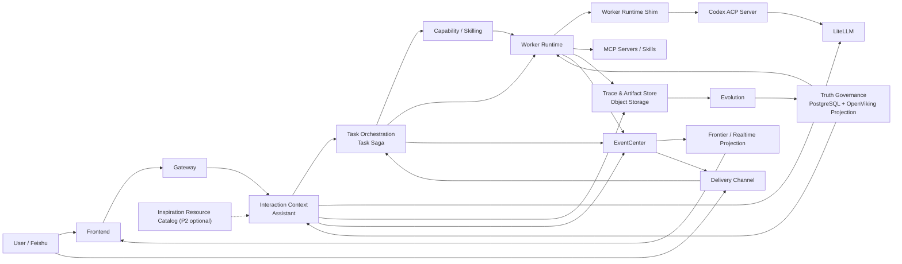
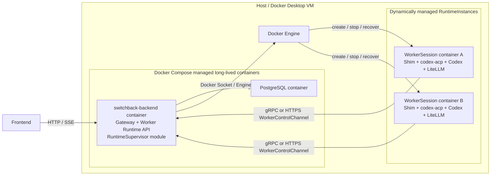
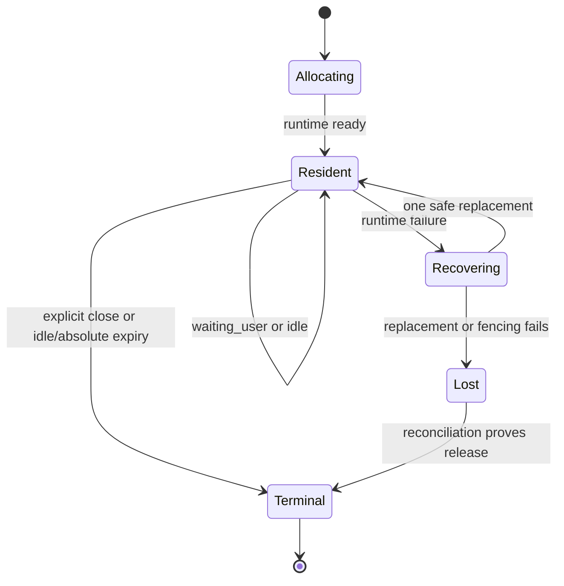
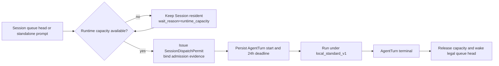
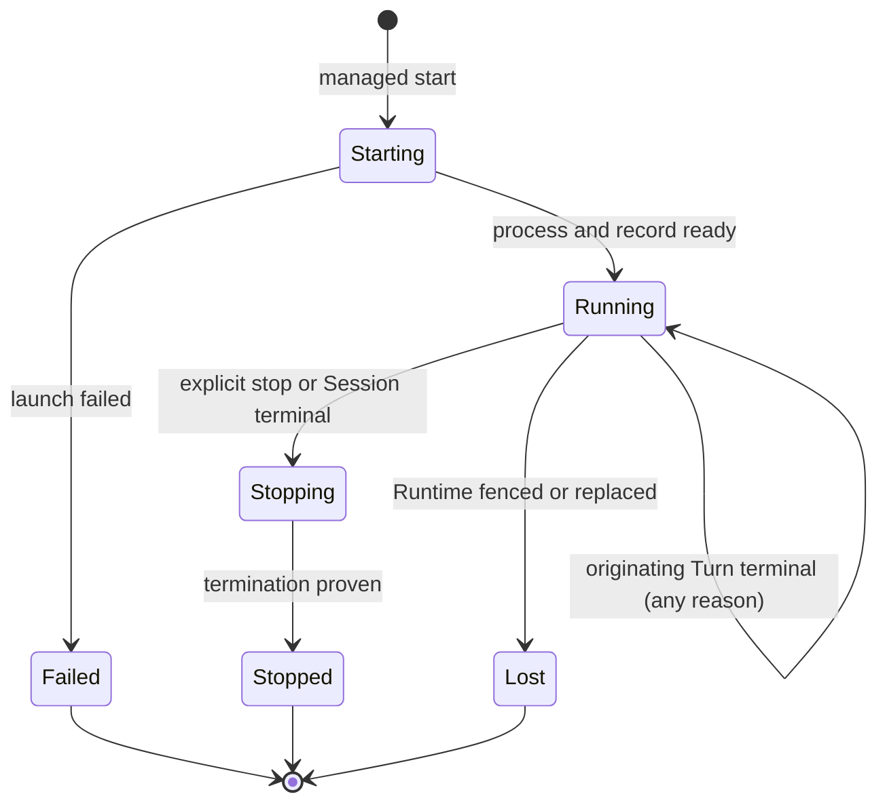
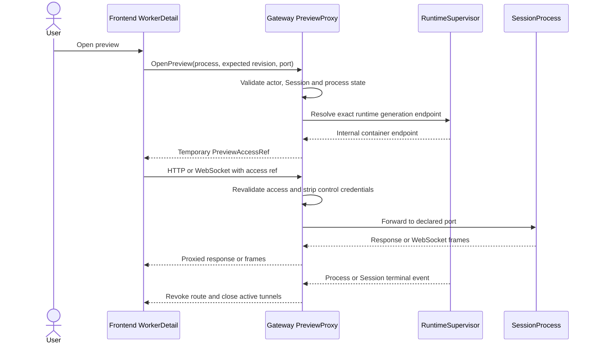
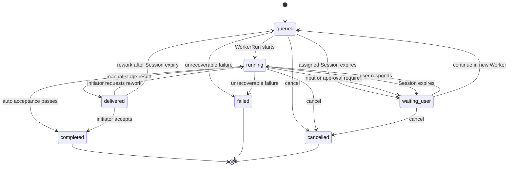

# Switchback / Switchback Technical Design Draft

> 状态：v0.3 需求细化技术基线。
>
> 日期：2026-07-07。
>
> 本文基于当前需求口述、已有 `REQUIREMTENTS.md`、四路子任务调研，以及公开官方资料整理。它不是最终实现承诺，而是后续需求交互、模块设计、DDD 建模和代码落地的基线。

## 0. 结论

Switchback 不应该被设计成“另一个 Devin”或“一个能聊天的代码执行器”。更合理的第一性拆法是：

- Assistant：降低需求不确定性，生成可执行 Task Spec，做派发与结果解释。
- Worker：在容器隔离环境中接收 Task Spec，装载真实 Coding Agent / Skill / MCP，完成代码、测试、产物和报告，并通过网络请求与后端通信。
- Platform：提供 Gateway、EventCenter、Frontier、Delivery、LLMProxy、Skilling、权限、审计、对象存储和可观测能力。
- Evolution：从可审计轨迹中提炼可治理 Truth。Inspiration 仅作为 P2 experimental 的可选外部知识发现能力。

架构主轴建议定为：

```text
Interaction -> Task Orchestration -> Worker Runtime -> Artifact/Trace -> Evolution/Knowledge
```

首个可运行验证闭环不是“全自动端到端上线”，而是：

```text
Web 结构化 TaskSpec 入口
-> 轻量 Task Orchestration 创建 Workspace/WorkerSession 并派发 Worker
-> Worker 在容器隔离环境执行真实 Coding Agent
-> EventCenter 回传进度
-> 产出 report/patch artifact
-> 用户审查结果或直接进入 Worker 后续交互
```

Assistant clarify、Delivery、Evolution、Skilling 等在该 tracer bullet 验证稳定后接入同一协议链，形成完整产品闭环。

## 1. 设计目标

### 1.1 P0 目标

- 支持 Web/飞书入口快速接收任务并异步返回 request id / task id。
- Assistant 能读取短期对话、候选 Truth、Rules、Skills，产出结构化 Task Spec。
- Task Orchestration 使用 PostgreSQL 轻量 Task 状态机；Task/TaskTransition/Outbox 同事务，重试与 deadline 由通用 lease/fencing ScheduledCommand poller 驱动，P0 不引入 Temporal 或第二套 TaskSaga 权威状态。
- Worker 能启动用户级交互 WorkerSession，在 Docker 构建的本地 Docker-compatible 容器隔离环境中通过 ACP 控制 Codex 作为 P0 真实 Coding Agent，通过网络请求与后端通信，并持续输出结构化事件、Trace JSONL 和 Langfuse 观测数据。
- WorkerSession 采用 48 小时 idle timeout、14 天 absolute timeout 和 Tenant/User 级 10 个连续性槽位；waiting/idle/lost 仍计数，queued/unassigned Task 与 pending Continuation 不计数，超时前默认恢复旧会话，终态只允许派生新 identity。
- WorkerSession 绑定一个持久 Workspace；一个 Workspace 可包含多个 WorkerSession 和零到多个 RepositoryCheckout，RuntimeInstance 重建不改变 Workspace identity。
- 每个 WorkerSession 基于 WorkspaceRevision 使用宿主持久化的隔离 WorkingCopy；并行 Worker 只产生 ChangeSet。WorkspaceApply 在租约外准备完整 StagingRevision，再用短时 fenced lease 串行提交 active revision。
- Worker Runtime Shim 主动建立传输无关 WorkerControlChannel：gRPC 双向流优先，HTTP/2/代理/网络不兼容时回退 HTTPS long-poll + batched event POST；大文件始终走可恢复 HTTP 上传。
- Supervisor 对每个连续 RuntimeRecoveryIncident 最多自动重建一次 RuntimeInstance；恢复保留 WorkerSession/WorkingCopy/持久 Agent state/Trace cursor，递增 generation 并 fencing 旧 runtime，重复失败进入 `waiting_user`。
- Runtime Shim 默认每 15 秒发送独立心跳；服务端 45 秒无有效心跳进入 suspect 并暂停新命令/主动探测，90 秒仍未恢复进入 unhealthy；Agent 无响应不按模型输出静默时间判断。
- P0 用户交付固定为 report/patch，允许从 Worker 详情页继续 AgentTurn；patch 支持审查、下载、应用和显式发布分支，但不默认自动创建 branch/PR 或触发 CI。
- EventCenter 驱动 Frontier projection；Frontier 通过 SSE 把任务状态、中间过程和产物引用回传 Frontend，Delivery 渲染飞书卡片。
- Assistant Turns、Worker Trace、原始 Agent transcript、产物引用能写入对象存储。

### 1.2 P1 目标

- Evolution 能在 PostgreSQL 中消费轨迹、生成 ContextCandidate、维护不可变修订和审核；低风险 MemoryTruth 可自动发布，Instruction/Skill 变更必须人工审核，active revision 投影到 OpenViking。
- 可选 P2 Inspiration 能以 Git manifests + Markdown context 维护外部知识声明，并通过可重建 ResourceRecord/OpenViking 投影返回索引、链接和简要内容；缺失时核心流程不得降级失败。
- LLMProxy 能统一模型路由、审计、成本、限流、降级、脱敏，并把模型观测关联到 Langfuse。
- Skilling 能管理 Skill/MCP/AgentProfile 的版本、权限和装载声明。

### 1.3 非目标

- P0 不追求全量事件溯源。关系库保存当前状态，Outbox/EventCenter 负责可靠异步，Trace JSONL 负责审计和复盘。
- P0 不直接实现复杂可视化工作流编排器。Delivery 可以借鉴 n8n/Dify，但输出必须统一成 Task Spec。
- P0 不承诺兼容所有 Coding Agent，但必须接入一个真实 Coding Agent；先稳定协议、容器通信、轨迹和交互续期，再扩展 Agent adapter。
- Evolution 不直接把模型总结写成长期记忆。长期 Truth 必须有来源、范围、置信度、生命周期和权限。

## 2. 外部能力调研结论

本节只保留会影响架构决策的结论，完整调研见 [market-and-open-source-landscape.md](docs/research/market-and-open-source-landscape.md)。

| 来源 | 对 Switchback 的关键启发 |
| --- | --- |
| [OpenAI Codex Cloud](https://developers.openai.com/codex/cloud) | 云端 Coding Agent 的核心形态是后台/并行任务、独立云环境、repo/PR 集成。Switchback 应把 Agent harness 和入口分离。 |
| [GitHub Copilot cloud agent](https://docs.github.com/en/copilot/concepts/agents/cloud-agent/about-cloud-agent) | 任务应像高质量 issue：目标、上下文、约束、分支、测试、PR。执行透明性来自 commit、log、review。 |
| [Google Jules](https://jules.google/) | Worker runtime 应隔离执行，产物优先是 diff/branch/PR/report，不是聊天答案；Switchback 在此基础上需要用户级交互续期能力。 |
| [GitHub Actions job container](https://docs.github.com/actions/using-jobs/running-jobs-in-a-container) | job 可以指定容器镜像运行；Switchback P0 本地 Worker 可借鉴 runner 调度容器执行模型。 |
| [GitLab Runner Docker executor](https://docs.gitlab.com/runner/executors/docker/) | Docker executor 用镜像维持一致隔离环境，并可用同一镜像本地测试命令。Switchback RuntimeProvisioner 可按此抽象。 |
| [Jenkins Docker Pipeline](https://www.jenkins.io/doc/book/pipeline/docker/) | Pipeline stage 或全流程可在 Docker image 中执行，说明“runner 编排容器”是成熟 CI/CD 模式。 |
| [OpenHands Software Agent SDK](https://github.com/OpenHands/software-agent-sdk) | Worker 可借鉴本地/ephemeral workspace、Agent Server、REST API、多 Agent 任务、事件式 runtime。 |
| [ACP](https://github.com/agentclientprotocol/agent-client-protocol) | ACP 适合作为 Worker 接入 Coding Agent 的协议层，但 Switchback 仍需自己的 Task、Trace、Artifact、权限模型。 |
| [ACP Codex adapter](https://github.com/agentclientprotocol/codex-acp) | Codex 可通过 ACP adapter 暴露为 ACP agent server；Switchback P0 Worker 应优先控制 ACP 事件流，而不是解析 Codex TUI/stdout。 |
| [Coder ACP Go SDK](https://github.com/coder/acp-go-sdk) | ACP 官方当前没有 Go 官方 SDK；该项目列在 ACP Community libraries 中，提供 typed client/agent、stdio connection 和 session/update helpers，适合作为 P0 Go shim 的 client。 |
| [MCP](https://modelcontextprotocol.io/specification/2025-06-18) | MCP 解决工具/资源/Prompt 接入，不解决任务编排和执行审计。Skill/MCP 权限必须由 Switchback 统一裁决。 |
| [Cline](https://github.com/cline/cline) | CLI/SDK、Plan/Act、MCP、检查点、NDJSON/headless 对 P0 Worker adapter 很有价值。 |
| [SWE-agent](https://swe-agent.com/latest/) | trajectory 中保留 response/thought/action/observation/state 的思路适合 Switchback Trace JSONL。 |
| [Aider](https://aider.chat/docs/) | 适合轻量 CLIAdapter，尤其是 git diff、repo map、lint/test 自动修复，但沙箱和结构化事件需 Switchback 外层补齐。 |
| [OpenViking](https://github.com/volcengine/OpenViking) | 提供 memory/resource/skill 的 CRUD、L0/L1/L2 检索和 snapshot；适合作为 active context 检索投影，但审批、修订、审计和用户看板由 Switchback 自建。 |
| [Letta memory](https://docs.letta.com/letta-agent/memory) | git-backed memory/context repository 说明长期记忆需要可读、可审、可版本化，而不是裸向量。 |
| [LangGraph long-term memory](https://docs.langchain.com/oss/python/langchain/long-term-memory) | 长期记忆应按 namespace/key 组织，区分短期 thread memory 和跨会话 memory。 |
| [Dify](https://github.com/langgenius/dify) | RAG pipeline、workflow、模型管理、观测集成可借鉴，但不应替代软件工程 Worker 内核。 |
| [LiteLLM](https://github.com/BerriAI/litellm) | P0 模型网关实现，提供 OpenAI-compatible API、多 provider、成本/预算/日志；同容器运行并通过 localhost 服务 Codex。 |
| [RocketMQ ordered messages](https://rocketmq.apache.org/docs/featureBehavior/03fifomessage/) | message group 可提供局部 FIFO，但要求单 producer/串行发送等条件；Switchback 仍需 stream sequence 和消费幂等。 |
| [RocketMQ Go client](https://github.com/apache/rocketmq-clients/tree/master/golang) | 官方 5.x Go client 覆盖普通/FIFO/延迟/事务消息和 consumer，适合作为 P1 EventCenter broker profile。 |
| [GitLab requirements](https://docs.gitlab.com/install/requirements/) | Self-managed GitLab 单节点基线较重，适合集中集成环境，不应成为每位 P0 开发者必跑依赖。 |
| [SeaweedFS](https://github.com/seaweedfs/seaweedfs) | 提供单进程 `weed mini` 与 S3 API，可作为 P1 S3 contract 集成目标；P0 先用本地文件 adapter。 |
| [MinIO source-only notice](https://github.com/minio/minio) | 社区版已改为 source-only 且停止预编译发行，不能再无条件作为新项目默认对象存储。 |
| [Langfuse tracing](https://langfuse.com/docs/observability/overview) | LLM 应用 tracing 可记录 LLM 调用、检索、工具执行、成本、延迟和 session；Switchback Trace 可同步导出为可观测投影。 |
| [Temporal durable execution](https://docs.temporal.io/evaluate/understanding-temporal) | 长任务可靠性可以借鉴 Durable Execution 思路；即使不用 Temporal，也要有 Saga、状态机、幂等、恢复。 |

## 3. 总体架构



核心分层：

- Entry/Presentation Layer：Gateway 负责同步命令与关键查询；Frontier 负责 projection/SSE；Frontend 负责渲染；Delivery 负责飞书通道适配。
- Domain/Application Layer：Interaction、Task Orchestration、Worker Runtime、Knowledge Evolution、Capability、Model Governance。
- Infrastructure Layer：P0 PostgreSQL/local ObjectStore/OpenViking/LiteLLM/Docker；P1 RocketMQ/S3-compatible endpoint/K8s profile；另含 Feishu SDK、MCP/Skill Market。

### 3.1 M1 本地部署与动态 Worker 拓扑

`Switchback Backend` 是逻辑后端服务，在 M1 中打包为一个由 Docker Compose 管理的常驻 `switchback-backend` 容器。`RuntimeSupervisor` 是该服务内部的 Go 模块，不是另一项宿主进程或独立微服务。每个 WorkerSession 的 RuntimeInstance 则是 RuntimeSupervisor 通过 Docker Engine API 动态创建的 sibling 容器，两者不是同一个服务，也不存在容器内嵌套容器。



这是 Docker-outside-of-Docker，而不是 Docker-in-Docker：Backend 借助挂载的 Docker Socket 调用同一个 Engine，Engine 创建与 Backend 并列的 Worker 容器。Docker Socket 具有近似宿主 Docker 管理员权限，因此只挂载给 loopback-only 的受信任 Backend；Worker 容器不挂载 Socket、不以 privileged 运行。Backend 只允许把服务端配置的 Switchback data root 下的 Session WorkingCopy、agent state 和生成配置挂入 Worker，任何客户端或 Agent 输入都不能成为任意 host path。

### 3.2 M1 Worker 网络边界

SingleUserLocalProfile 固定由服务端解析为 `RuntimeNetworkPolicy=trusted_full_network_v1` revision 1 和 exact digest。目标是让真实 Coding Agent 在受信任本机开发环境里拥有与传统本地开发机相同的出站能力：公网、RFC1918/CGNAT/IPv6 私网、企业 VPN、LAN、其他可路由容器服务及任意协议/端口均可访问。TaskSpec 只保存已解析证据，不允许用户、Agent、Skill 或 MCP 选择另一套 authority。

| 流量 | 默认裁决 | 说明 |
| --- | --- | --- |
| 容器内 `localhost` LiteLLM | allow | Codex 模型流量只发往同 RuntimeInstance 的 LiteLLM。 |
| 公网、私网、VPN、LAN、可路由容器网络 | allow outbound | 不限制 destination、协议或端口；可达性由宿主 Docker、路由、DNS 和 VPN 决定。 |
| Linux 宿主服务 | allow outbound | Docker 以 `host.docker.internal=host-gateway` 注入稳定宿主入口。 |
| Worker 入站端口 | deny by default | Runtime Shim 主动连接 Backend，不发布 host/public port；仅 Backend PreviewProxy 可在内部网络访问当前 generation 中已登记的 SessionProcess HTTP/WebSocket 端口。 |
| Docker Engine API | deny by capability | Worker 不挂载 Docker Socket、不使用 privileged 或 host network。 |
| 宿主文件与环境凭证 | deny by capability | 仅允许服务端 Switchback data root 下的隔离挂载，不注入 ambient infrastructure/provider credentials。 |

该 profile 不做 destination allowlist、CIDR deny、redirect 重验、payload inspection 或 per-target ApprovalGrant，也不记录目的地或 payload telemetry。RuntimeInstance、WorkerRunStartSnapshot、Trace identity 和 WorkerDetail 只记录 exact profile id/revision/digest/enforcement status。旧 `m1_public_web_restricted_v1` 仅用于不可变历史读取和已准入执行，并显式标记 `legacy_unenforced`；新准入拒绝旧 profile。该模式不是 DLP，只适用于 loopback-only 的受信任单用户本地部署；多用户或远程部署必须采用重新评审的网络 profile。

本地配置、诊断与回滚见 [M1 Worker 完整网络运维](docs/architecture/m1-worker-network-operations.md)，真实路由矩阵验证见 [M1 Worker 完整网络人工验收](docs/architecture/m1-worker-network-manual-acceptance.md)。

### 3.3 M1 Runtime 驻留策略

M1 固定使用 `RuntimeResidencyPolicy=m1_resident_until_session_terminal_v1`。RuntimeSupervisor 为 WorkerSession 完成首次分配后，除 `allocating/recovering/lost/terminal` 等边界状态外，Session 在 `interactive`、`running`、`waiting_user` 和 `idle` 状态都必须对应一个运行中的 RuntimeInstance。AgentTurn 或 WorkerRun 结束只改变交互/执行状态，不停止容器、不重启 Shim/Codex/LiteLLM，也不改变 runtime generation。



`Resident` 仅表示容器和 Agent harness 仍在，不表示 Agent 获得执行权。无 active AgentTurn 和有效 SessionDispatchPermit 时，Shim 不得启动 ACP prompt 或新 Tool；只允许 RuntimeHeartbeat、WorkerControlChannel、Trace/Artifact drain 和 3.5 节定义的显式 SessionProcess。M1 不引入 `suspending/suspended/resuming`，也不以 `docker pause` 释放资源，因为 pause 仍保留内存且会增加时钟、心跳和租约歧义。

停止条件固定为 explicit close、48 小时 idle expiry、14 天 absolute expiry、授权/安全终止，或 RuntimeRecoveryIncident 中对旧 generation 的 fencing/replacement。`waiting_user` 暂停 idle clock 但不暂停 absolute lifetime，因此驻留 Runtime 最长可能维持到 14 天；它持续占用 continuity quota 和实际 CPU/memory/storage 上限。M1 先用该策略验证 TUI 式连续体验，未来可在不改变 WorkerSession identity、WorkingCopy 和 Agent state ownership 的前提下新增可选 hibernation profile。

### 3.4 M1 Runtime 资源与总容量准入

M1 只提供服务端拥有的 `RuntimeResourceProfile=local_standard_v1`，不在 TaskSpec 或 Frontend 暴露任意数字。一次 RuntimeLease 快照 exact profile id/revision，运行中修改部署配置不改变既有容器；新 generation 重新按当前允许 profile 解析并记录差异。

| 资源 | `local_standard_v1` | Enforcement |
| --- | --- | --- |
| CPU | 2 vCPU hard share | Docker/cgroup quota；超额 throttle，不终止 Turn。 |
| Memory | 4 GiB | hard limit；OOM evidence 标记 `resource_exhausted`。 |
| PID | 512 | cgroup pids limit；达到上限拒绝新进程并记录 Tool/Runtime evidence。 |
| Container writable layer | 10 GiB | runtime/storage adapter hard limit；不支持时 fail closed 或使用已验证替代实现。 |
| WorkingCopy/cache/Agent state | host-managed persistent storage | 不进入 writable-layer 额度；独立 quota、告警和 cache cleanup 待下一项存储策略确认。 |

RuntimeCapacityAdmission 与 WorkerSessionContinuityQuota 是两个边界：后者默认 10，表示最多保留多少个可续聊 Session；前者默认把 Docker Engine 可用 CPU、memory 和 storage 的 80% 作为本机执行预算，决定队头 AgentTurn 当前能否开始。Backend 在签发 SessionDispatchPermit 前完成 capacity check；不足时记录 `runtime_capacity`，保持原 Session resident 和 FIFO 位置，不启动 AgentTurn，也不写 `started_at/deadline_at`。



Capacity admission 必须服从现有 SessionTaskQueue FIFO，不能让后到的小任务越过合法队头；它也不关闭、降级或抢占既有 Runtime。明确 OOMKilled、PID exhaustion 或 writable-layer hard limit 不是普通未知 container loss：Runtime owner 记录 `resource_exhausted`，停止当前 AgentTurn/Tool 并使 Task/Session 进入可解释的 `waiting_user`，避免唯一一次自动恢复在相同资源限制下重复撞限。具体 Docker Desktop/Linux storage enforcement 与 80% 采样/保留算法通过实现 spike 校准。

### 3.5 M1 受管 SessionProcess

Runtime 常驻不意味着 AgentTurn 创建的任意进程都可以常驻。普通 shell/Tool 子进程始终属于当前 AgentTurn process group/cgroup；Turn terminal 时由 Shim drain/terminate，`&`、`nohup`、daemonize、stdio detachment 或父进程退出都不改变归属。需要跨 Turn 的 preview server、dev server 或 file watcher 必须通过 Worker managed-process API 启动，成功后形成独立 `SessionProcess` 记录；M1 不允许在 Turn 结束后把未知 orphan 追认为受管进程。



`SessionProcess` 至少绑定 WorkerSession、origin AgentTurn/Tool、Runtime generation/process handle、`preview_server|dev_server|file_watcher` kind、command summary、cwd、declared ports、`starting|running|stopping|stopped|failed|lost` state、bounded log ref 和 revision。WorkerDetail 展示 active/history、来源、端口、日志与显式 stop/restart；restart 创建新的 process identity，不能复用已终态 identity。

SessionProcess 不持有 AgentTurn execution slot，不允许调用 ACP prompt、创建顶层 WorkerRun 或作为任意 batch Agent 工作的替身。它继续受同一 RuntimeResourceProfile、RuntimeNetworkPolicy、WorkingCopy mount、ResolvedToolPolicy、ApprovalGrant 与 SecretLease 边界约束；资源使用持续进入 aggregate capacity accounting，Turn admission release 不能让已存在的后台负载从容量观测中消失。日志通过有界分段/轮转进入 Trace，避免 stdout 无界占用 writable layer 或 SSE。

Managed start 与 AgentTurn terminal 使用 exact Turn revision、Runtime generation 和 owner commit order 做 fencing。若 SessionProcess acceptance 先提交，后续 `completed/cancelled/timed_out/failed` 只终止 ACP prompt、普通 Tool/process 和 Turn 状态，不停止该 SessionProcess；`interrupt` 收敛为 `cancelled` + `terminal_reason=user_interrupt`。若 Turn terminal 先提交，后到 start 被拒绝，不能借并发绕过 deadline。这允许已经形成价值的 preview/watcher 继续供后续交互使用，但不允许 ordinary batch command 伪装成后台服务。

WorkerSession close、48 小时 idle expiry、14 天 absolute expiry、授权/安全终止停止全部 SessionProcess；这些 Session/安全边界高于 Turn survival。Process stdout/log、端口流量、health check 和 status update 不算有效用户交互，也不续期 idle clock。Runtime taint/fencing/replacement 或 resource hard limit 使容器不可继续时不重放启动命令：旧 generation 中的进程按终止证据成为 `stopped` 或 `lost`，用户或后续 AgentTurn 可显式重新启动。

### 3.6 M1 SessionProcess PreviewProxy

M1 不为 Worker 容器创建 host-port mapping。用户选择 `OpenSessionProcessPreview` 后，Gateway 根据服务端固定 actor、exact WorkerSession、SessionProcess revision、Runtime generation 和声明端口签发短期 `SessionProcessPreviewAccess`；RuntimeSupervisor 只向 PreviewProxy 解析当前容器的内部 endpoint。访问引用不是任意代理配置，客户端不能提交目标 URL、IP、host、未登记端口或 `CONNECT` 请求。



PreviewProxy 是与 EventCenter/SSE 分离的数据面：页面 bytes、WebSocket frames 和上传 body 直接转发，不写入事件总线、Trace JSONL 或对象存储；只记录 access issuance/revocation、目标 identity、裁决、状态码/字节数等有界元数据。P0 只支持 HTTP/1.1 与 WebSocket，并移除 Switchback `Cookie`、`Authorization`、内部身份、`Forwarded` 和 hop-by-hop headers，防止 Worker 生成的应用获得控制面凭证。响应内容仍视为不可信，不由 Backend 改写 HTML/JavaScript。

每个请求和 WebSocket upgrade 都必须确认 access 未过期、SessionProcess 仍为当前 generation 的 `running` 记录且端口仍在 declaration 中。Process `stopped/failed/lost`、WorkerSession terminal、Runtime fencing/replacement、权限撤销或 access expiry 立即拒绝新请求；Backend 维护按 access/process 索引的活跃 tunnel registry，在收到 owner lifecycle 事件时主动关闭长连接，并用状态重验覆盖事件丢失。显式 OpenPreview 是一次用户动作，可刷新 idle；后续资源加载、轮询、HMR、WebSocket 和 health check 不刷新 idle。

M1 不为 Browser origin/URL topology 建立领域协议。SingleUserLocalProfile 在 loopback 上采用实现时能工作的最简单路由，并把兼容性/安全限制记录为 spike 结果；这一细节不阻塞 report/patch 主链路。Worker 生成内容的 origin 隔离在非本机暴露或多用户认证 profile 上线前重新评审。

## 4. DDD Bounded Context

| Bounded Context | 对应模块 | 聚合根 | 核心职责 |
| --- | --- | --- | --- |
| Identity & Access | Gateway / Delivery / Skilling | `Tenant`, `TenantMembership`, `WorkspaceMembership`, `AuthorizationDecision`, `ExecutionAuthorizationLease`, `WorkspaceChannelShareGrant`, `ChannelDisclosureDecision`, `Policy`, `CapabilityGrant` | Tenant 硬隔离、显式 Workspace 角色、委托执行、群聊 audience 披露授权/裁决、撤权、密钥和能力授权边界。 |
| Interaction | Assistant | `Conversation`, `ConversationParticipant`, `ConversationRollover`, `ConversationHandoff`, `AssistantSession`, `TurnWindow`, `TaskDraft`, `TaskReadinessAssessment`, `ClarificationCheckpoint`, `WorkspaceContextResolution` | user/channel scoped 对话、participant/controller 控制、需求澄清、Workspace context 选择/边界 rollover、readiness 判断、检查点、上下文装配和 Task Spec 草稿。 |
| Task Orchestration | Assistant / Delivery -> Worker | `Task`, `TaskTransition`, `ScheduledCommand` | 轻量交付跟踪、验收、Task revision、同事务 Outbox、持久调度和固定 P0 动作规则。 |
| Worker Runtime | Worker | `Workspace`, `RepositoryImport`, `WorkspaceRevision`, `ActiveRevisionPointer`, `WorkingCopy`, `StagingRevision`, `RepositoryCheckout`, `ChangeSet`, `WorkspaceApply`, `WorkerSession`, `AgentTurn`, `SessionProcess`, `WorkerRun`, `ToolInvocationControl`, `RuntimeInstance`, `RuntimeRecoveryIncident` | Workspace bootstrap/import attempts、多资源上下文、持久隔离执行、租约外 staging、fenced 原子版本提交、直接 Agent 交互、SessionProcess 生命周期、Tool 取消收敛、runtime generation、单次自动恢复和清理。 |
| Code Platform Access | Worker / Gateway / Skilling | `RepositoryAccessGrant`, `RepositoryCredentialLease`, `CodePlatformOperation` | 仓库级委托、CredentialBroker、受管原生 CLI、短期 Token 生命周期、provider 结果核查和 A/C fallback profile。 |
| Capability / Skilling | Skilling | `SkillPackage`, `MCPServerConfig`, `AgentProfile`, `ToolCapabilityDeclaration`, `ToolGovernancePolicy` | Skill/MCP/AgentProfile 版本、权限、Tool 风险声明、证据校验和最终策略裁决。 |
| Artifact & Trace | Worker / Assistant | `TraceStream`, `TraceManifest`, `Artifact`, `DataLifecyclePolicy`, `DataLifecycleAction`, `TraceAnalyticsProjection`, `LangfuseExport` | JSONL 事实轨迹、分段目录、冷热生命周期、排障/Evolution 读取、效果统计和 Langfuse 观测投影。 |
| Knowledge Evolution | Evolution | `ContextCandidate`, `MemoryTruth`, `MemoryPublicationPolicy`, `InstructionPolicy`, `ContentRevision`, `ReviewTask`, `ReviewBatch` | 轨迹消费、确定性 Memory 发布、风险治理、不可变修订、审核、MemoryLibrary/ReviewInbox 和 OpenViking 投影。 |
| Inspiration Index | Inspiration | `InspirationRepository`, `InspirationEntry`, `ResourceRecord` | P2 experimental：Git 声明、版本化 URL/摘要/意图、运行态 freshness/ACL、渐进检索和链接返回。 |
| Model Governance | LLMProxy | `ModelInvocation`, `RoutePolicy`, `UsageAccount` | 模型路由、限流、成本、审计、脱敏、降级。 |
| Delivery Channel | Delivery | `ChannelBinding`, `ChannelThreadBinding`, `InboundInteractionEnvelope`, `UserInteraction`, `ProviderChannelSecuritySnapshot`, `DeliveryCardProjection`, `CardInstance` | 飞书触发、Assistant-default 路由、Workspace resolution 引用、显式执行目标、provider audience/security 观测、中间选择/对话、通道投影和结果卡片；只持有 binding/provider 投递/render 状态。 |
| Eventing & Projection | EventCenter / Frontier | `IntegrationEvent`, `EventStream`, `ProjectionCursor`, `TimelineProjection`, `TimelineEntry`, `DeadLetter` | 事件校验/路由、流内 gap/DLQ、稳定 timeline 读模型和实时推送。 |

上下文映射：

| 上游 | 下游 | 关系 |
| --- | --- | --- |
| Gateway | Interaction / Task | Gateway 是入口 adapter，不拥有领域状态。 |
| Gateway PreviewProxy | Worker Runtime | 受管数据面：签发 exact SessionProcess access，RuntimeSupervisor 解析当前内部 endpoint，只代理声明端口 HTTP/WebSocket。 |
| Assistant | Task Orchestration | Published Language：`TaskSpec`。 |
| Delivery | Task Orchestration | Anti-Corruption Layer：飞书消息可在明确时直接转内部命令/TaskSpec。 |
| Task Orchestration | Worker Runtime | Saga command/event。 |
| Capability / Skilling | Worker Runtime | Supplier：提供 CapabilityBundle 和带版本来源的 ResolvedToolPolicy；Worker 负责校验并执行，不拥有降级风险的裁决权。 |
| Assistant / Worker | LLMProxy | Supplier：统一模型请求元数据，不暴露 provider 差异。 |
| Trace / Artifact | Evolution | Evolution 只消费事实轨迹，不反向修改执行历史。 |
| Evolution | Assistant / Worker | Supplier：提供 Truth 读取能力，由调用方按预算加载。 |
| Inspiration | Assistant / Worker | P2 optional Supplier：提供外部知识索引、链接和简要内容；消费者必须允许 provider absent/disabled/empty。完整飞书文档由 Agent/Assistant 通过 lark-cli 和 Skill 自主读取。 |
| EventCenter | Frontier / Delivery | 事件分发与投影，不作为业务事实源。 |
| Identity & Access | Delivery | Supplier：提供 WorkspaceChannelShareGrant 与字段级 ChannelDisclosureDecision；Delivery 只能降级，不能扩大披露。 |
| Interaction | Delivery | Supplier：提供当前 Conversation identity、ConversationRollover/ConversationHandoff 和 resulting binding revision；Delivery 不复制或重建跨 Workspace history。 |

Frontend 信息架构以 WorkerDetailView 为主交互面：`worker_session_id` 表达持续 Agent 交互，TaskList 只做交付跟踪，TaskSummary 是摘要/抽屉并深链到 Worker。Home P0 聚合最近 Worker、waiting_user/approval 和近期交付，不要求完整 ActionInbox。WorkspaceOverviewView 聚合持久上下文，ArtifactDetailView 统一产物 identity/actions，MemoryLibrary/ReviewInbox 保持独立治理。P0 runtime 是 React + TypeScript + Vite SPA，Switchback shell 同源接入 Go Gateway/Frontier；SessionProcess preview 只持有 opaque PreviewAccessRef，M1 route/origin 由 loopback 实现选择，不成为领域 schema。React Router 管 route identity，TanStack Query 管 HTTP lifecycle，ViewProjectionStore 管 live epoch/cursor/version、typed reducer、transient overlay 和 PendingCommand，assistant-ui 只作为 Worker Chat ExternalStore adapter。Agent display 使用双 lane 和 Switchback-owned `DisplayPart v1`；外部协议不能成为领域 schema。完整设计见 [Frontend Information Architecture And Read Models](docs/architecture/frontend-information-architecture.md)、[Frontend Runtime And State Ownership](docs/architecture/frontend-runtime-and-state-ownership.md)、[Agent Display Stream Durability](docs/architecture/agent-display-stream-durability.md) 和 [DisplayPart Schema And Protocol Adapters](docs/architecture/display-part-schema-and-adapters.md)。

Delivery 不复用 Web renderer payload。它从相同 owner events、authorized public facts 和 durable Display summary 构建 DeliveryCardProjection，以 CardInstance 管理 provider message/render/delivery 状态。P0 只支持 task progress、waiting user、approval、result 四类卡片和有限 inline action；创建前 ready TaskDraft 复用 `waiting_user` 并以 exact draft/render revision fencing，不新增第五种卡片。callback 快速确认后经 Gateway/owner 收敛，复杂操作 deep-link Web。完整设计见 [Delivery Card Projection And Callbacks](docs/architecture/delivery-card-projection-and-callbacks.md)。

每个 active ChannelThreadBinding 固定关联一个 primary Assistant Conversation。普通消息没有经验证的 InteractionTargetRef 时只进入该 Conversation；TaskDraft、Task、WorkerSession、Approval 和 Artifact 操作必须来自当前卡片动作、结构化命令或具有不可变路由元数据的明确交互上下文。Delivery 不维护 current focus，related refs 不参与路由，provider 无 thread 能力时只替换 binding identity 形态而不改变语义。完整设计见 [Channel Thread Binding And Explicit Target Routing](docs/architecture/channel-thread-binding-and-routing.md)。

P0 飞书群 topic 的 primary Assistant Conversation 固定为 channel-scoped shared Conversation。每个消息/命令记录真实 actor；provider-mapped participant 可普通对话，只有 Interaction-owned controller 可管理 Workspace context、rollover、channel Conversation lifecycle 和 controller delegation。Binding creator 经 provider/Tenant/channel policy 后成为首个 controller，不能显式移除最后 controller；撤权造成无有效 controller 时进入 `control_orphaned`，由策略授权的 channel administrator 显式恢复。Rollover 只把仍合格的 source roles 投影到 successor，不新增 controller；无合格 controller 时 successor orphaned。Controller 不产生 Workspace、Task、Worker、Approval、Artifact、外部 provider 或群披露权限，所有动作继续逐 actor 重验。Delivery 总体流程和多用户示例见 [Delivery Interaction Design](docs/architecture/delivery-interaction-design.md)。

Task readiness 与 creation intent 分离。Channel ordinary message 即使可形成 ready TaskDraft，也必须先进入 shared Assistant Conversation；只有结构化 `/task`/create-task form 或绑定 exact ready TaskDraft 的注册确认动作可生成 `ExplicitTaskCreationIntent`。P2P/private/API 可按 `TaskCreationTriggerPolicy` 接受明确 create request。Intent 绑定 actor、TaskDraft/TaskSpec digest、readiness、Workspace resolution、Conversation generation、policy 和幂等键；任一 revision 改变都使其 stale。Task Orchestration 同时重验 readiness、intent、权限和 policy 后才原子创建 Task/Saga/Outbox。详见 [ADR 0045](docs/adr/0045-require-explicit-task-creation-surface-in-shared-channels.md)。

Shared TaskDraft 采用 initiator-bound ownership。只有 immutable `initiator_user_id` 可确认原 draft；其他 participant/controller 只能显式 `AdoptTaskDraft`，创建带 `derived_from_task_draft_ref` 的新 lineage，并以 adopter 身份重新过滤 context、校验 Workspace/权限、生成 readiness/digest 和确认。Source intent/grant/secret/private evidence 不继承，原 draft 不变；跨 actor 相同 digest 不作为幂等合并。详见 [ADR 0046](docs/adr/0046-bind-taskdraft-confirmation-to-initiator-and-fork-on-adoption.md)。

Task 创建后的 visibility 与 action authority 分离。Task Orchestration 从 creation intent 固化 immutable TaskInitiator；P0 由 initiator 执行 continue/accept/rework/cancel 和 queued Session 改派，Workspace owner 只有 emergency cancel，其他角色无隐式权限。复杂委托降到 P1，ApprovalGrant 只表示受保护操作授权，不用于延长 AgentTurn。详见 [ADR 0048](docs/adr/0048-make-workersession-primary-and-task-lightweight-in-p0.md)。

Conversation 可以在 `default_workspace_id` 为空时进行 tenant/user-scope 澄清；Workspace-scoped context、TaskSpec、WorkerSession 前必须有用户显式确认的 WorkspaceContextResolution。用户默认、唯一候选、URL 和模型推断只可推荐；TaskSpec `workspace_id` 在派发时必填，Task Orchestration 只重验并快照。首次 resolution 在原 Conversation 内完成；离开 resolved Workspace 时 rebind 通过 successor identity 和新 binding revision 只影响未来 context/TaskDraft，不迁移已有资源；显式 target 使用资源自身 Workspace。完整设计见 [Channel Workspace Resolution Before Execution](docs/architecture/channel-workspace-resolution.md)。

首次 `unresolved -> W1` 只更新原 Conversation 的 WorkspaceContextResolution；已有 resolved Workspace 历史后，`W1 -> W2`、clear 或 access revoke 使用 `ConversationRollover` 在同一事务创建 successor、结构化 ConversationHandoff、target resolution、source `superseded` 状态、binding revision 和 Outbox。默认 handoff 只含 Workspace-neutral typed facts；受保护 carry-over 独立授权。message acceptance 与 rollover 按 binding/source revision 串行化；Turn archive、ContextCompiler、search/export 和 Evolution 保留 generation/scope，不能按 topic 合并。完整设计见 [Conversation Rollover On Workspace Rebind](docs/architecture/conversation-rollover-on-workspace-rebind.md)。

WorkspaceContextResolution 不授权群聊 audience。P0 由 Workspace owner 显式创建 `WorkspaceChannelShareGrant`，绑定精确 provider group audience、允许的 channel binding 和 `workspace_summary` profile。每次卡片发送/更新由 Identity & Access 基于 grant/policy revision、provider audience snapshot 和 owner source classification 生成 `ChannelDisclosureDecision`；Delivery renderer 只接收 allowed fields。无有效 Grant、audience 扩张/外部化、snapshot stale/unknown 或 revoke/expire 时降级为 `minimal_notice` 和逐用户鉴权 Web link。受限 Trace/prompt/reasoning/Secret/Tool/error/report/patch 内容不因 Grant 变为可共享。完整设计见 [Workspace Channel Share And Disclosure](docs/architecture/workspace-channel-share-and-disclosure.md)。

## 5. 领域主流程

### 5.1 Web Assistant 到 Worker

1. Gateway 接收用户 message，校验身份和会话权限。
2. Gateway 写入 `MessageAccepted` 和 outbox，快速返回 `request_id`。
3. Assistant 消费命令，加载 short-term turns、Truth、Rules、Skill manifest，以及 capability 启用时的可选 Inspiration candidates。
4. Assistant 按 TaskReadinessPolicy 生成七维 TaskReadinessAssessment，记录 known/assumed/blocking_unknown/not_applicable、evidence refs 和 assumptions。
5. 存在 blocker 时每条消息只发出一个最高优先级 `ClarificationRequested`；连续三问后发出 ClarificationCheckpoint。用户继续时重置下一组三问预算，缩小范围或取消时记录决策。
6. Assessment 无 blocker 且 validator 通过时，Assistant 生成带 readiness ref/assumptions 的 `TaskSpecDrafted`。若已有绑定 exact draft/spec 的 active creation intent，则携带 intent ref 调用 Task Orchestration；否则展示 ready TaskDraft 确认。真正硬阻塞存在时不能“按假设执行”。
7. Task Orchestration 校验 assessment hash/policy revision、`TaskSpec` 一致性、权限和策略，同事务创建轻量 `Task`、初始 `TaskTransition` 和 Outbox。
8. Saga resolve capability、分配或复用用户级 `WorkerSession`。
9. Worker 基于 active WorkspaceRevision 创建或恢复该 WorkerSession 的隔离 WorkingCopy，再由 RuntimeProvisioner 准备 container、WorkingCopy mount、agent state dir、MCP config、co-located LiteLLM config 和 secret lease。
10. 后端通过网络请求驱动容器侧 Go Worker runtime shim；shim 使用 `coder/acp-go-sdk` 通过本地 stdio ACP Control Channel 控制 `codex-acp`。
11. Worker 控制逻辑将 ACP events、agent state、session JSONL 和原始 transcript 归一化为 `Trace JSONL`、`IntegrationEvent` 和 `ArtifactRef`，并通过后端 API 上传对象存储。
12. EventCenter 更新 Frontier projection，并向用户通道推送进度。
13. WorkerRun 完成后产出阶段性 report/patch Artifact 并进入终态，但 WorkerSession 保持可交互；用户可在 Worker 详情页继续 prompt、queue、interrupt 或 steer。
14. Assistant 可基于结果生成用户可读总结和下一步建议。
15. Evolution 异步消费 trace，生成 TruthCandidate。

TaskReadinessPolicy 是平台/组织版本化策略，定义固定维度、硬阻塞规则、低风险 default catalog 和连续三问 checkpoint budget。Assistant 负责语义归类；Task Orchestration 负责硬校验。Delivery/API 的明确结构化请求可以零轮追问直接产生 ready assessment，但不能跳过相同 gate。

### 5.2 飞书 Delivery Task 快路径

1. Delivery 收到飞书消息、命令或按钮回调。
2. Delivery 映射 `ChannelBinding` 到内部 `tenant_id/user_id/project_id`。
3. Group ordinary message 无论 readiness 都形成 shared Assistant Turn；Assistant 可生成 ready TaskDraft 和注册确认 action。
4. 结构化 `/task`/form 或 exact ready-draft confirmation 按 TaskCreationTriggerPolicy 生成 ExplicitTaskCreationIntent；P2P/private/API 可接受策略允许的明确创建请求。
5. Shared ready draft 只允许 initiator confirmation；non-initiator 通过 AdoptTaskDraft fork 新 draft，重新生成 actor-specific readiness/intent 后确认。
6. Task Orchestration 重验 readiness、intent、TaskSpec digest、`actor == draft initiator == TaskSpec.user_id`、Workspace/policy，并同事务创建 Task/TaskTransition/Outbox；不完整输入转 Assistant 澄清。
7. Task Saga 与 Worker 流程复用主链路。
8. Delivery 订阅用户可见事件并回传飞书，包括进度、等待输入、失败原因、最终产物。

### 5.3 Evolution 长期记忆闭环

1. TraceReady 事件触发 Evolution。
2. Evolution 读取 Assistant/Worker JSONL 和 artifact refs。
3. 抽取 `ContextCandidate`，分类为简单 MemoryTruth、行为型知识、InstructionCandidate 或 SkillCandidate，并只保存带证据内容。
4. 在 PostgreSQL 中写入不可变 ContentRevision，运行冲突检测、权限检查、TTL 推断和风险分级。
5. MemoryPublicationPolicy 只对白名单 `explicit_preference`、`verified_descriptive_fact`、`entity_alias`、`ephemeral_project_state` 做确定性门控；同时要求低风险、非敏感、无冲突、scope 不扩张和明确/权威/确定性验证证据。动态状态必须有 TTL。其余候选进入人工 ReviewTask 或拒绝。
6. RDBMS 事务写入 approved revision 与 Outbox，异步幂等投影到 OpenViking active URI，并创建 snapshot；失败时保持 `publish_pending`。
7. Assistant/Worker 只通过 Evolution 读取 active revision；MemoryLibrary 管 active/disabled/expired Memory，ReviewInbox 分 lane 管待审 Memory/Procedure/Instruction/Skill。编辑、停用、tombstone 和恢复先更新 RDBMS，再重建 OpenViking projection。
8. 批量 approve 只允许同 scope、同 policy revision、同低风险 Memory 类型且无敏感/冲突/scope 扩张的 ReviewTask；其他高风险内容逐条批准。批量命令逐项鉴权和校验 expected revision，并返回逐项结果。
9. P2 Inspiration 激活时由 Git main 保存声明，PostgreSQL 保存同步运行态，OpenViking 保存可重建 L0/L1 投影；完整文档仍由 Agent 调用 lark-cli/Skill 实时读取。main merge webhook 提交 exact-SHA sync request，周期 reconciliation 按 head/last projected SHA 修复漏事件。

## 6. 核心协议

P0 必须先稳定这些协议，否则模块会互相泄漏实现细节。

### 6.1 TaskSpec

TaskSpec 不携带用户可选的执行时长；Worker 对每个 AgentTurn 统一应用平台固定的 24 小时 wall-clock hard deadline。

```json
{
  "schema_version": "task.spec.v1",
  "source": "assistant|delivery|api",
  "tenant_id": "tenant_xxx",
  "user_id": "user_xxx",
  "workspace_id": "workspace_xxx",
  "workspace_resolution_ref": {
    "resolution_id": "wctx_xxx",
    "resolution_revision": 3,
    "membership_revision": 12
  },
  "title": "Fix flaky payment callback test",
  "goal": "Make the callback retry test deterministic and add regression coverage.",
  "readiness_assessment_ref": {
    "assessment_id": "ready_xxx",
    "policy_revision": 4,
    "content_hash": "sha256:ready"
  },
  "creation_intent_ref": {
    "intent_id": "intent_xxx",
    "trigger_policy_revision": 2,
    "task_spec_digest": "sha256:spec"
  },
  "assumptions": [],
  "context_refs": [
    {
      "type": "conversation|document|repo|truth|artifact",
      "uri": "oss://bucket/path/to/ref",
      "scope": "tenant|project|user"
    }
  ],
  "target": {
    "repo": "git@example.com:org/service.git",
    "base_ref": "main",
    "worktree_policy": "branch|patch_only|report_only"
  },
  "constraints": [
    "Do not change public API",
    "Run existing payment tests"
  ],
  "acceptance_criteria": [
    "Unit tests pass",
    "Root cause is explained in final report"
  ],
  "runtime_config": {
    "network_policy": "trusted_full_network_v1",
    "network_policy_revision": 1,
    "network_policy_digest": "sha256:25abd6d521b199eafb612bb42295faf3a56e90a928ae7d631cb7cce8923ed28f"
  },
  "agent_config": {
    "agent_profile_id": "codex-default",
    "adapter": "acp",
    "model_policy_id": "engineering-balanced"
  },
  "capability_refs": {
    "skills": [],
    "mcp_servers": []
  },
  "approval_policy": {
    "requires_human_for": ["external_network", "production_write", "secret_access"]
  },
  "output_policy": {
    "user_visible_types": ["report", "patch"]
  }
}
```

### 6.2 Workspace / WorkingCopy / ChangeSet

```json
{
  "schema_version": "workspace.change_set.v1",
  "change_set_id": "cs_xxx",
  "workspace_id": "workspace_xxx",
  "working_copy_id": "wc_xxx",
  "base_workspace_revision_id": "wrev_10",
  "repository_changes": [
    {
      "checkout_id": "checkout_api",
      "base_commit": "abc123",
      "patch_ref": "artifact://patch/api"
    }
  ],
  "file_changes": [],
  "validation_results": [],
  "preconditions": ["active_workspace_revision == wrev_10"],
  "idempotency_key": "apply:cs_xxx"
}
```

`WorkspaceApply` 先在不持有写租约时，于隔离 staging 区校验并物化全部组件为不可变 `StagingRevision`。随后 Finalize 获取带单调 fencing token 的短时 PostgreSQL lease，在同一事务中重验 expected revision 和 staging digest、创建 `WorkspaceRevision`、推进 active revision pointer、记录 Apply result 并写 Outbox。revision mismatch 返回 `needs_rebase`，内容冲突返回 `conflicted`，过期 token 返回 `fenced`；这些结果都不能产生部分权威更新。

### 6.3 WorkerControlChannel

```json
{
  "schema_version": "runtime.control.v1",
  "message_id": "ctl_xxx",
  "kind": "command|event|ack|heartbeat",
  "worker_session_id": "ws_xxx",
  "runtime_instance_id": "runtime_xxx",
  "runtime_generation": 2,
  "channel_epoch": 7,
  "sequence": 42,
  "ack_sequence": 41,
  "idempotency_key": "runtime-command:cmd_xxx",
  "message_type": "StartRun|CancelRun|AgentTurn|StartSessionProcess|StopSessionProcess|RestartSessionProcess|SessionProcessStatus|Progress|RunCompleted",
  "payload": {}
}
```

Shim 先调用 bootstrap/negotiation API，上报支持的 transports、runtime generation、最后 ACK 的 command sequence 和最后已确认的 event sequence。后端返回 selected transport、endpoint、heartbeat/long-poll 参数、channel token 和新 `channel_epoch`。

传输策略：

- 首选 `grpc_bidi`：Shim 主动建立出站双向流，承载命令、事件、ACK 和 heartbeat。
- fallback `https_long_poll`：Shim 用携带 cursor 的 long-poll 拉命令，用批量 HTTPS POST 回传事件/ACK；不要求容器开放入站端口。
- Trace JSONL segment、raw transcript、patch/report 和其他 Artifact 使用独立可恢复 HTTP upload，不占用控制通道。
- 同一 `(runtime_instance_id, generation)` 同时只允许一个 active channel epoch；重连或切换 transport 时递增 epoch，旧通道提交被 fencing。
- fallback 只由 transport/HTTP2/proxy/connectivity failure 触发；authentication、authorization、policy、schema/protocol version failure 必须 fail closed。
- 两种 transport 都按至少一次交付处理，区分 received/accepted/completed ACK，并依赖 command/event id、sequence 和 idempotency key 去重。

心跳与活性策略：

- P0 默认 heartbeat interval 15 秒、suspect 45 秒、unhealthy 90 秒，配置由 bootstrap 下发。服务端使用 receive time 与 heartbeat sequence，容器时间只用于审计。
- suspect 暂停新命令并探测 control transport/fallback、Docker container、Shim 和 Agent process，不自动终止 active WorkerRun；有效 heartbeat 恢复后返回 healthy。
- 90 秒仍无有效心跳进入 unhealthy；明确 process exit/container missing 可直接 unhealthy。
- Shim 心跳独立于模型和 tool stream。固定 ACP/Codex 栈没有安全 ping/no-op；Agent unresponsive 只由 process exit、stdio EOF、ACP connection close 等硬证据，或 cancel 后 grace 内无法取得 prompt 终态判断。模型没有 token 或文本输出本身不构成失败证据。

Supervisor 恢复策略：

- 进程退出、容器丢失、心跳超时或 Agent 无响应创建 RuntimeRecoveryIncident；P0 每个连续 incident 最多自动恢复一次。
- 自动恢复先 fencing 旧 runtime generation/ChannelEpoch，再创建下一 generation，挂载原 WorkingCopy 和持久 Agent state，并从已确认 command/event/trace cursor 继续。
- replacement 挂载 WorkingCopy 前必须终止或隔离旧 container、撤销旧 control/secret lease 并取得独占 mount lease；无法证明旧 generation 已失去写权限时进入 waiting_user。
- 新 generation 重新签发 SecretLease；仍有效且 scope 匹配的 WorkerSession ApprovalGrant 可以继续使用。
- Supervisor 优先通过 ACP load/resume 恢复原 AgentSession。若唯一一次重建失败、session 无法安全恢复或状态一致性无法证明，则 WorkerRun/WorkerSession 进入 `waiting_user`，禁止 crash loop 和静默新建 AgentSession。
- control channel、LiteLLM、workspace mount 和 ACP Agent/session 均健康，并满足配置的稳定窗口或完成一个持久进度 checkpoint 后才关闭 incident；未来独立故障新建 incident。取消、idle/absolute timeout、鉴权/授权、策略、schema/protocol 错误不触发自动恢复。

### 6.4 IntegrationEvent

```json
{
  "schema_version": "event.v1",
  "event_id": "evt_xxx",
  "event_type": "WorkerRunStarted",
  "producer_context": "worker-runtime",
  "stream_id": "worker/worker-session/ws_xxx",
  "sequence": 7,
  "tenant_id": "tenant_xxx",
  "user_id": "user_xxx",
  "aggregate_type": "WorkerRun",
  "aggregate_id": "run_xxx",
  "trace_id": "trace_xxx",
  "correlation_id": "corr_xxx",
  "causation_id": "evt_prev",
  "idempotency_key": "worker-run-started:run_xxx",
  "visibility": "internal|user",
  "occurred_at": "2026-07-07T00:00:00Z",
  "payload": {}
}
```

TimelineProjection 不复用领域 sequence，而是提交读模型时分配独立 cursor：

```json
{
  "timeline_id": "task/task_xxx",
  "timeline_epoch": 1,
  "timeline_cursor": 42,
  "event_id": "evt_xxx",
  "source_stream_id": "worker/worker-session/ws_xxx",
  "source_sequence": 7,
  "event_type": "WorkerRunStarted",
  "correlation_id": "corr_xxx",
  "causation_id": "evt_prev",
  "occurred_at": "2026-07-07T00:00:00Z",
  "projected_at": "2026-07-07T00:00:01Z",
  "late": false,
  "causation_state": "resolved",
  "display_payload": {}
}
```

完整异常示例和实现算法见 [Event Ordering And Timeline Guide](docs/architecture/event-ordering-explainer.md)。

### 6.5 Trace JSONL

Trace 是事实轨迹，不是用户展示文案。P0 要达到接近普通 Coding Agent 本地 session JSONL 的保真度；每条记录应可独立校验 schema，并能关联原始 transcript。P0 暂不把脱敏作为阻塞项，并同步导出 Langfuse 作为可观测投影。

通用内容 DLP 不阻塞 P0，但平台签发或已知的 Token 是明确例外：Trace ingest 必须在 JSONL、Langfuse、Artifact 和用户投影持久化前做确定性剔除，且不保留普通未脱敏副本。

TraceStream 由不可变 JSONL segments 组成，PostgreSQL TraceManifest 保存 sequence range、checksum、bytes、schema、tier、availability、Langfuse export 和 analytics cursor。排障与 Evolution 按 manifest 定位局部证据；Dashboard 使用 normalized facts 增量投影，不能在请求路径扫描原始 JSONL。

```json
{
  "schema_version": "trace.v1",
  "record_id": "tr_xxx",
  "timestamp": "2026-07-07T00:00:00Z",
  "tenant_id": "tenant_xxx",
  "task_id": "task_xxx",
  "worker_session_id": "ws_xxx",
  "worker_run_id": "run_xxx",
  "source": "assistant|worker|agent|tool|llm_proxy",
  "type": "model_call|tool_call|tool_result|command_output|process_lifecycle|process_log|file_patch|mcp_call|checkpoint|artifact|error|cost",
  "payload": {},
  "raw_ref": {
    "uri": "oss://bucket/raw/agent.ndjson",
    "offset": 128
  },
  "correlation_id": "corr_xxx"
}
```

### 6.6 ArtifactRef

```json
{
  "schema_version": "artifact.v1",
  "artifact_id": "art_xxx",
  "task_id": "task_xxx",
  "worker_run_id": "run_xxx",
  "type": "patch|change_set|branch|pull_request|report|test_log|screenshot|checkpoint|raw_transcript",
  "uri": "oss://bucket/artifacts/art_xxx",
  "checksum": "sha256:...",
  "permission": {
    "tenant_id": "tenant_xxx",
    "visibility": "private|project|org"
  },
  "retention_policy": "trace-default-v1",
  "storage_tier": "hot",
  "availability": "online",
  "available_actions": ["preview", "download", "apply_to_workspace", "publish_branch"],
  "created_at": "2026-07-07T00:00:00Z"
}
```

### 6.6.1 Trace/Artifact 生命周期与看板

- P0 `trace-default-v1` 候选：hot 30 天、warm 至 180 天、cold 长期，不自动物理删除；Tenant 通过新 DataLifecyclePolicy revision 调整。
- P0 LocalFileObjectStore 可以只实现逻辑 tier；P1/S3 adapter 可映射真实 storage class，不能把供应商字段泄漏进领域契约。
- Langfuse 是可重建投影，可独立设置更短 retention；export 失败不回滚 Trace ingest。
- Trace ingest 与领域事件生成幂等 normalized facts，TraceAnalyticsProjection 维护 Task/Worker/Tool/model/cost/Artifact/Evolution 效果指标。
- quarantine 停止普通下载、新 Evolution 消费和用户投影；checksum 不一致或疑似敏感内容可手工进入该状态。
- P0 生命周期操作只记录 actor、action、target、reason、before/after、time、result 和 correlation id，不要求工单、四眼审批或独立审计服务。
- 显式删除使用正常授权和一次确认；后台幂等删除 payload/Langfuse projection，保留最小 tombstone 与非敏感聚合，并把相关 Evolution evidence 标记为 `source_deleted`。

### 6.7 Truth

```json
{
  "schema_version": "truth.v1",
  "truth_id": "truth_xxx",
  "tenant_id": "tenant_xxx",
  "scope_type": "user|workspace|project|repo|org",
  "scope_id": "user_xxx",
  "truth_type": "explicit_preference|verified_descriptive_fact|entity_alias|ephemeral_project_state|inferred_preference|procedure|constraint|skill_hint",
  "evidence_class": "user_explicit_statement|authoritative_source|deterministic_runtime_verification|model_inference",
  "subject": "User code review preference",
  "content": "The user prefers concise bug-first review findings with file/line evidence.",
  "status": "candidate|active|needs_review|rejected|deprecated|expired",
  "confidence": 0.86,
  "risk_level": "low|medium|high",
  "source_refs": [
    {
      "trace_id": "trace_xxx",
      "record_id": "tr_xxx",
      "artifact_uri": "oss://bucket/trace.jsonl"
    }
  ],
  "permissions": {
    "visibility": "private",
    "policy_tags": []
  },
  "lifecycle": {
    "created_at": "2026-07-07T00:00:00Z",
    "refresh_after": "2026-08-07T00:00:00Z",
    "expires_at": null
  },
  "publication_decision": {
    "policy_revision": "memory-publication-p0-v1",
    "allowlist_rule": "explicit-preference-v1",
    "required": false,
    "decision": "auto_approved"
  }
}
```

### 6.8 ContextPack

Assistant 和 Worker 都不直接“搜全库”。它们向 Context Compiler 请求预算内上下文包。

```json
{
  "schema_version": "context.pack.v1",
  "context_pack_id": "ctx_xxx",
  "request": {
    "tenant_id": "tenant_xxx",
    "user_id": "user_xxx",
    "task_id": "task_xxx",
    "budget_tokens": 12000
  },
  "items": [
    {
      "kind": "truth|resource|rule|skill_manifest|conversation_summary",
      "content": "...",
      "source_ref": {},
      "priority": 0.92,
      "token_estimate": 680
    }
  ],
  "dropped": [
    {
      "reason": "budget|permission|stale|low_relevance",
      "source_ref": {}
    }
  ]
}
```

### 6.9 RepositoryAccessGrant 与 CodePlatformOperation

P0 采用受管 B2。RepositoryAccessGrant 表达“某个 WorkerSession 在某段时间内可对哪个 Repository 使用哪些外部能力”，而不是单条 `git`/`gh` 命令审批。Grant 可为 `once` 或 `worker_session`，必须绑定 repository、capabilities、constraints、policy/grant revision 和 expiry。

CredentialBroker 保管 GitHub App 私钥、OAuth refresh token 或长期根凭证，只向当前 runtime generation 签发短期 RepositoryCredentialLease。短期 access token 对 Agent 可用是本方案的信任前提；平台不把 prompt、Skill 或 wrapper 当作 Token 保密边界。

```text
Agent -> managed git/gh entrypoint
      -> validate RepositoryAccessGrant + Membership + Session + policy
      -> CredentialBroker mint/reuse short RepositoryCredentialLease
      -> native GitHub operation
      -> CodePlatformOperation + remote/provider reconciliation
```

P0 capability profile 只包括 `repository.read`、`repository.write`、`pull_request.write` 和 `ci.read`。administration、secrets、variables、workflow/Actions write、ruleset management、repository delete 和组织管理不进入 P0。Git 使用 path-aware `git-credential-switchback`；`gh` 使用不持久化登录状态的 managed wrapper。branch/ref 约束由 GitHub Ruleset/Branch Protection 执行。

外部写入不能按普通幂等 command 盲重试：push 通过 remote ref/head 核对，PR create 通过 head/base/provider object 核对，Provider 成功但 Switchback 投影失败只补偿投影。方案 A（控制面执行全部远端操作）和方案 C（直连只读、控制面写入）保留为 fallback，并复用相同 Grant、Operation 和 provider result 契约。

## 7. Worker Runtime 设计

Worker 不应直接等同于某个 Agent。P0 必须接入一个真实 Coding Agent，并要求 Agent 动作发生在容器中，不影响宿主机。推荐三层：

```text
Worker Runtime
  -> Host Control Plane / RuntimeProvisioner / RuntimeLease / Workspace / SecretLease / NetworkPolicy / ResourceLimit
Worker Runtime Shim
  -> WorkerControlChannel (gRPC bidi -> HTTPS long-poll fallback) / coder-acp-go-sdk client / resumable Trace and Artifact uploader
Agent Runtime
  -> codex-acp stdio server / Codex / co-located LiteLLM / future Agent adapters
Capability Injector
  -> Skills / MCP / Rules / AgentProfile / ModelPolicy / LiteLLM config
```

P0 adapter 优先级：

1. CodexAdapter：P0 首选，容器内 Go shim 使用社区 SDK `github.com/coder/acp-go-sdk@v0.13.5`，通过 stdio 控制 `@agentclientprotocol/codex-acp@1.1.2`；镜像用 lockfile 固定兼容的 `@openai/codex@0.144.1`，Worker 不解析 Codex TUI/stdout。
2. Cline CLI/SDK：适合 headless、NDJSON、ACP、MCP、checkpoint。
3. OpenHands SDK / Agent Server：适合远程 workspace、事件模型、云端 runtime。
4. Aider CLI：适合快速 diff/commit 产出。
5. SWE-agent / mini-SWE-agent：适合作为 eval/trajectory 参考，不作为 P0 主基座。

Worker 状态机：

```text
pending
-> queued
-> allocating
-> preparing_workspace
-> starting_runtime
-> running
   -> waiting_user -> running
   -> waiting_user -> timed_out
   -> recovering_runtime -> running | waiting_user
   -> retry_scheduled -> queued
   -> draining_trace -> succeeded
   -> failed | timed_out | cancelled
-> cleaning
-> released
```

关键不变量：

- 一个 `WorkerRun` 是有开始和阶段性结果的执行窗口，可包含多个 `AgentTurn`；queue/interrupt/steer 可作用于 active WorkerRun，而不是机械地为每条消息新建 Task。
- 一个 `WorkerSession` 是可单独打开的用户级 Agent 交互会话，可以在 idle timeout 前承载多次 `WorkerRun` 和连续 AgentTurn。
- `Task` 只保存交付状态和引用。Task 非终态或 `delivered` 时，用户对当前结果的反馈继续属于同一 Task并创建新 WorkerRun；P0 不再增加 TaskAttempt。
- RuntimeInstance 恢复保持原 WorkerRun，只递增 runtime generation。Task `completed/failed/cancelled` 后的直接 AgentTurn 默认创建不带 `task_id` 的 standalone WorkerRun，可记录 `origin_task_id`。
- Agent 可以建议用户创建新的可跟踪 Task，但不能根据模型推断直接创建，也不需要维护独立 FollowUpTaskProposal 聚合。Gateway/Delivery 从认证显式动作生成 creation intent 后，Task Orchestration 重验 readiness、Workspace 权限和策略并幂等创建 Task/TaskTransition/Outbox。
- 新 Task 只有在认证用户提供 exact WorkerSessionTargetIntent 时才复用有效 Session；复用即继承当前 WorkingCopy、Agent state/context、AgentSession 和未提交变更，不做静默 reset。没有 exact target 时默认分配新 Session；busy Session 只排队不打断，expired Session 不复活。
- `closed/expired` 是不可重开的终态 identity，只保留权限过滤后的只读 Timeline/Trace/Artifact/durable checkpoint。用户通过 `CreateWorkerSessionContinuation` 绑定 exact source revision/checkpoint，派生新的 WorkerSession、隔离 WorkingCopy 和 AgentSession，并记录 source lineage；不能用新 runtime generation 伪装成恢复。
- derived Session 从自身创建时间重新开始 48 小时 idle 与 14 天 absolute clocks，重新占用 continuity slot 并重验 Membership/policy/checkpoint。旧 Runtime/Channel generation、queue/dispatch state、ApprovalGrant、RepositoryAccessGrant、SecretLease 和其他 Session-scoped authority 均不继承；ContextPack/Artifact refs 只按显式选择重新鉴权。
- 要求 clean/exact base 的 Task 使用新 Session 从指定 WorkspaceRevision/checkpoint 物化；容量或权限不允许时保持 queued/blocked，不能原地清理被指向的 Session。
- 每个 WorkerRun 在首次 Agent prompt、Tool 调用或 WorkingCopy 写入前持久化 WorkerRunStartSnapshot，记录 resolved context policy、AgentSession refs、WorkingCopy checkpoint/manifest digest、base WorkspaceRevision、dirty state 和前序 Task/Run refs。
- 每个 WorkerSession 是一个顶层 execution slot：同一时刻最多一个 `bound_task_id` 和一个 `active_worker_run_id`。Task `queued` 时可以引用目标 Session，但直到 Worker Runtime 幂等接受 StartWorkerRun 才取得 slot。
- Task 在 `running/waiting_user/delivered` 时通常保持 binding；`completed/failed/cancelled` 释放。唯一非终态例外是 WorkerSession absolute expiry：旧 Run terminal、current binding 清空并进入 TaskSessionLineage，同一 Task 只有经 initiator 显式 continuation 才能取得新 Session/Run。standalone WorkerRun 只能在无 bound Task/active Run 时启动。
- SessionTaskQueue 与 AgentTurn `queue` 是两个协议：前者等待 execution slot，后者只向当前唯一 active WorkerRun 排队消息。Worker Runtime 冲突返回 `session_busy`，Task Orchestration 负责继续排队或分配其他 Session。
- 只有已分配 Session 的 Task 才进入 SessionTaskQueue。无 exact target 的 Task 在新 Session 分配完成前保持 queued/unassigned，不进入任意已有 Session 队列。
- SessionTaskQueue 按 Session 独立使用提交时分配的单调 `session_queue_sequence` 做稳定 FIFO；重复 enqueue 复用原 sequence。P0 不让 Task display priority 影响调度，不支持 reorder/preemption；queued Task 只可取消或由 initiator 显式改派到另一 Session 的队尾。
- Task Orchestration 的 per-session dispatch gate 为 queue head 或“队列为空时的 standalone prompt”签发短期单次 SessionDispatchPermit。Worker Runtime 只有同时验证 permit、expected session revision 和 runtime generation 后才能占用 slot，避免刚释放的 slot 被后到 standalone prompt 抢走。
- Task 创建时固化 TaskInitiator。每个 accept/rework/cancel/reassign-queued-session command 都携带真实 actor、exact target、expected Task revision 和 idempotency key。P0 initiator 可执行这些动作，current Workspace owner 只有 emergency cancel；其他角色不因可见性、编辑权或 Conversation control 获权。
- 一个 WorkerSession 固定绑定一个 Workspace；一个 Workspace 可以承载一个或多个 WorkerSession，并包含零到多个 RepositoryCheckout。Workspace 与 RuntimeInstance identity 分离。
- 每个 WorkerSession 持有一个基于 `base_workspace_revision_id`、位于宿主持久 WorkspaceStorage 的隔离 WorkingCopy；RuntimeInstance 只 bind mount 该副本，重建时复用它，不重新挂载共享权威目录。
- WorkerRun 只能修改 WorkingCopy，并从中产生 ChangeSet；代码仓库变更记录 base commit、patch/commit 和 target checkout，非仓内容记录 file/artifact manifest 与 checksum。
- WorkspaceApply 的昂贵校验、Git commit/ref 保护和多组件物化在租约外完成，产出完整不可变 StagingRevision；短时写租约只覆盖最终重验与数据库提交。
- Finalize 在一个事务中校验 expected active revision、最新 fencing token 和 staging digest，并整体写入 WorkspaceRevision、ActiveRevisionPointer、Apply result 与 Outbox；事务内不运行测试、复制目录或调用外部系统。
- base revision 已变化时，ChangeSet 进入 `needs_rebase` 或 `conflicted`，由 Worker 在新 WorkingCopy 上重放或由用户审查，禁止 last-write-wins。
- Prepare/Finalize 崩溃前后按 idempotency key 恢复；未提交 staging 始终非权威并由 janitor 清理，已提交 revision 不能因清理失败回滚。
- idle timeout 固定为 48 小时；有效用户交互续期，`waiting_user` 暂停 idle 计时，但任何状态都不能突破 14 天 absolute timeout。
- `worker_session_id` 在首次容器创建时固化；同一时刻只绑定一个 active RuntimeInstance/container，崩溃恢复时复用 session id、递增 runtime generation 并记录新 container id。
- 同一连续 RuntimeRecoveryIncident 只允许一次自动重建；达到稳定健康或完成持久进度 checkpoint 后关闭 incident，重建或 ACP resume 再次失败时进入 `waiting_user`。
- 一个 `WorkerSession` 可包含多个显式 ACP/Codex session id。P0 `codex-acp` 把 Codex subagent 映射成带 child thread metadata 的 ACP tool call；默认记录为 AgentExecutionSpan/Trace，而不是无证据地创建独立 AgentSession。
- ACP initialize 必须持久化协议版本和 capability snapshot；resume/load/list/close 等可选方法不得脱离协商结果调用。
- ACP stdio JSONL 必须在 Go SDK typed decode 前记录有界 raw frame；未知可选 update 转换为内部兼容性 Trace，协议版本、权限和安全语义不明时 fail closed。
- runtime 必须有 lease、heartbeat、48 小时 idle timeout、14 天 absolute timeout、cleanup。
- runtime heartbeat 默认 15s；45s suspect 只暂停新命令并探测，90s unhealthy 才触发恢复；明确进程退出可快速失败。
- `active_quiet` 不是 Runtime 故障证据；平台只发出非终止告警，不因无输出提前取消。当前 AgentTurn 的固定 24 小时 wall-clock hard deadline 仍持续计时。
- 后端 Worker Runtime owner 事务接受 `StartAgentTurn` dispatch 时记录服务端 `started_at` 与 `deadline_at=started_at+86400s`；Shim/ACP 实际调用时间仅进入 Trace。审批等待、`active_quiet`、断线、确认的平台故障和 `recovering_runtime` 均不暂停，也不存在延期或用户选择时长。
- `steer` 作用于当前 Turn 且不重置 deadline；`interrupt` 终结当前 Turn；显式 queued user message 只能在当前 Turn 终态后启动新 Turn。Agent 输出、自动重试和 Runtime recovery 不得自行创建顶层 Turn。
- deadline 由通用 ScheduledCommand 触发并按 AgentTurn/Runtime generation fencing。到期后 Worker 请求 ACP cancel、取消当前 Tool/process，并把 AgentTurn 不可逆收敛为 `timed_out`；迟到结果只写 Trace。
- 普通 shell/Tool descendants 与当前 AgentTurn process group/cgroup 绑定，Turn terminal 时 drain/terminate。只有通过 Worker managed-process API 启动并登记的 preview/dev server/watcher 才成为可跨 Turn 的 SessionProcess；`&`、`nohup`、daemonize 或 stdio detachment 不构成提升。
- SessionProcess 必须绑定 origin Turn/Tool、Runtime generation/process handle、kind、command summary、cwd、declared ports、status、bounded log ref 和 revision；WorkerDetail 支持查看日志与显式 stop/restart。它不能调用 ACP prompt 或创建顶层 Run，继续继承 Runtime 资源、网络、WorkingCopy、Tool policy 与 Grant，并持续进入 aggregate capacity accounting。
- Accepted SessionProcess 跨 `completed/cancelled/timed_out/failed` AgentTurn terminal 存活，interrupt 以 cancelled reason 表达；start/terminal race 按 exact Turn revision、Runtime generation 和 owner commit order 收敛。Session terminal、安全终止、Runtime taint/replacement 或 resource hard limit 仍停止进程；process output/health/status 不刷新 idle clock，replacement 只收敛为 stopped/lost，不自动 restart。
- SessionProcess live preview 只通过 Gateway `OpenSessionProcessPreview` 和 Backend PreviewProxy：校验 actor/exact process revision/generation/declared port，由 RuntimeSupervisor 解析内部 endpoint，不做 host-port mapping、不接受任意 target/CONNECT。P0 只代理 HTTP/WebSocket并剥离 Switchback credential；bytes 不进入 EventCenter/SSE/Trace/ObjectStore，每个 request/upgrade 重验状态，终态/撤权/expiry 关闭 tunnel。显式 open 可刷新一次 idle，页面/HMR 流量不续期；M1 route/origin 是非阻塞实现 spike。
- deadline 使用双重 enforcement：后端 ScheduledCommand 是唯一状态、审计和 fencing owner；Shim 为同一 Turn revision/runtime generation 启动不可重置的本地 monotonic watchdog。断线时 watchdog 仍提交同一幂等取消，重连后以后端终态证据收敛；Shim 只能保守提前停止，不能延长或独立改写 deadline。ACP prompt 在两侧 enforcement 都 armed 前不得启动。
- 启动采用后端预提交后单向 dispatch。后端事务同时持久化 AgentTurn `started_at/deadline_at`、ScheduledCommand 和 `StartAgentTurn` Outbox；命令绑定 Turn revision、Runtime generation、ChannelEpoch、deadline 与 cancellation identity。Shim 校验 freshness，使用控制通道 server-time estimate/uncertainty 计算保守剩余时长，先 arm monotonic watchdog 再调用 ACP；stale/expired/无法证明时间新鲜度时 fail closed，重复 command 不重置 watchdog 或重复 prompt。运输延迟和 uncertainty margin 计入 24 小时窗口。
- 取消已确认时，Task-bound WorkerRun/Task 进入 `waiting_user:agent_turn_timed_out`，用户可在同一 live Session/Run 发起新的独立 AgentTurn。取消无法确认时沿用 TaintedRuntime、一次恢复或外部副作用 reconciliation，未收敛前禁止新 Turn。
- WorkerRun、Task、Tool 和 continuation 不维护时间预算、累计时长、可选 profile 或时间 Grant。TaskSpec 无时长字段；Tool 继承当前 AgentTurn 剩余 deadline。网络、模型请求、进程退出等基础设施超时不进入领域授权。
- LLMProxy 的 rate/token/cost guard 与时间限制正交，按 tenant/user/model 独立治理，不得表示为 AgentTurn 延期。
- AgentTurn deadline 或用户取消触发 Tool 停止后按证据与副作用分级：本地 process-group/cgroup 无法证明停止时 runtime tainted，停止新命令并用 `tool_cancel_unconfirmed_local` 进入 RuntimeRecoveryIncident；远端 read-only/idempotent 且具有 idempotency/reconciliation 证据时 fencing invocation 后可继续收敛；non-idempotent/unknown 副作用不确定时进入 `waiting_user`，不自动重试。任何终态后迟到结果只写 Trace。
- Tool 风险解析采用声明、证据、裁决、执行四层链路：Manifest 产生版本化 ToolCapabilityDeclaration；Adapter 验证并标准化技术证据且只能提高风险；Capability/Skilling 的 ToolGovernancePolicy 生成不可变 ResolvedToolPolicy；Worker 校验 policy revision、来源和完整性后执行。TaskSpec/Approval/tenant policy 只能收紧，Agent 文本不得改变结果。
- 缺失、不可信、冲突或不可验证的元数据 fail closed：effect class 解析为 `unknown`，无法证明的 cancellation 解析为 `unsupported`，idempotency/reconciliation 不能仅凭声明启用自动重试。运行时证据可升级单次 invocation 风险，不得降低 resolved risk。
- WorkerSessionContinuityQuota 按 `(tenant_id, user_id)` 默认上限 10；`allocating/interactive/running/recovering/waiting_user/idle` 计数，`lost` 在 reconciliation 前计数，`closed/expired` 终态释放，queued/unassigned Task 与 pending Continuation 不计数。
- 满额新 Session 请求按 Tenant/User 单调 `session_allocation_sequence` 等待。Task 保持 `queued`、`worker_session_id=null`、`allocation_wait_reason=session_capacity`；Continuation 保持 pending allocation。容量不能触发自动复用、reset、close 或 eviction；exact live Session reuse 不新增槽位。
- Worker Runtime 在 quota row expected revision 下原子预留槽位并创建 `allocating` Session；终态释放槽位与 Session revision 同事务，事件丢失由 reconciliation 恢复。SessionAllocationQueue 与已分配 Session 内的 SessionTaskQueue 使用不同 sequence/dispatcher。
- absolute expiry 由服务端 ScheduledCommand 驱动并按 Session/Run revision fencing。Worker Runtime 先停止新 command/lease、请求 cancel、撤销 control/secret lease，并取得旧 Runtime 已失去 WorkingCopy 写权限的证据；失败时保持 `lost`/quota，不发布可续作终态。成功后 active Run 以 `timed_out:worker_session_absolute_expired` 终止，Session `expired`、quota release，并发布 WorkerSessionExpiryOutcome。
- Task Orchestration 幂等消费 exact expiry outcome：terminal Task no-op；queued/running/waiting_user 进入或保持 `waiting_user:worker_session_expired`；delivered 保持 delivered。Task 的 current `worker_session_id/current_worker_run_id` 清空，旧 Session/Run/checkpoint/release reason 追加到 `worker_session_lineage`。partial Artifact 保留但不触发 auto acceptance，完整 delivered result 不降级。
- `ContinueTaskInNewWorker` 只接受 TaskInitiator，绑定 expected Task revision、expiry outcome/checkpoint 和 idempotency key。Task transaction 将 waiting_user/delivered 转为 queued、写 continuation intent 与 Outbox；WorkerSessionAllocator 正常排队分配，owner binding 成功后设置 current Session 并进入 SessionTaskQueue，dispatch 后创建新 WorkerRun。旧 Run、ApprovalGrant、Secret、AgentSession 和 queue 不迁移；unknown external effect 未 reconciliation 时禁止续作。
- Coding Agent 的执行动作必须发生在容器中；后端通过网络请求与容器侧 runtime 通信。
- ACP 通道位于容器内部，后端网络通道连接 Worker Runtime Shim；两者不共享协议职责。
- 产物必须以 `ArtifactRef` 进入领域模型，不能只存在日志里。
- P0 用户可见产物只承诺 report/patch；preview/download/apply 是 ArtifactAction，publish branch 是需要 RepositoryAccessGrant 的显式后续动作。受管 B2 可允许 Agent 使用 branch/PR/CI-read 能力，但这些不因此成为 P0 产品交付承诺。
- 原始 transcript、用户可见事件、内部调试日志必须分层。

更多细节见 [task-worker-runtime.md](docs/domains/task-worker-runtime.md)。

## 8. 数据与存储

| 数据 | 推荐存储 | 原因 |
| --- | --- | --- |
| Task / Conversation / WorkerSession / Truth 状态 | PostgreSQL | 需要事务、状态机、查询、约束和 JSONB 扩展。 |
| Outbox / Idempotency / Saga 状态 | PostgreSQL | 与业务状态同事务提交；P0 polling dispatcher 可靠投递。 |
| SagaWakeup / lease | PostgreSQL | retry/deadline/reminder/reconciliation 持久化；poller 使用 `SKIP LOCKED`、短 lease、fencing token 和 expected revision。 |
| IntegrationEvent 流 | P0 PostgreSQL dispatcher；P1 RocketMQ 5.x profile | P0 先验证契约/幂等/SSE；需要跨服务订阅、吞吐和回放后再引入 broker。 |
| TimelineProjection / TimelineEntry | PostgreSQL read model | 每个 timeline 独立 append-only cursor；支持 SSE resume、分页、late marker 和重建。 |
| Trace JSONL / raw transcript / artifacts | P0 LocalFileObjectStore；P1 S3-compatible adapter | TraceManifest 在 PostgreSQL；默认 hot 30d/warm 180d/cold 长期且不自动删除，按 tenant/workspace namespace + Membership/ACL 隔离。 |
| Workspace revisions / WorkingCopy / staging / ChangeSets | PostgreSQL metadata + host-managed WorkspaceStorage | active pointer、lease/fencing、Apply 与 Outbox 事务化；WorkingCopy、Agent state 和非权威 staging 位于宿主持久目录，RuntimeInstance 只挂载自己的副本。 |
| Langfuse traces | Langfuse | Trace/LLM/tool 观测投影，用于调试、成本、延迟和 session 分析，不作为权威事实源，可独立短保留并重建。 |
| Truth governance / revision / review | PostgreSQL | Evolution 权威状态，保存 candidate、不可变修订、审核、tombstone、审计和 projection 状态。 |
| Active Truth / Resource context projection | OpenViking | 当前强依赖 serving projection，提供 CRUD、分层检索和 snapshot；可由 RDBMS/Git 声明重建。 |
| Inspiration declaration | 独立 Git repository | YAML manifest、Markdown context 和 generated index 的审核/回滚权威来源。 |
| Read Model / Timeline / Dashboard | PostgreSQL first；Redis/Elastic later | TraceAnalyticsProjection 消费结构化事实增量更新，面向高频查询，不反查原始 JSONL 或依赖 Langfuse。 |
| Model usage / cost log | LLMProxy DB + metrics | 成本、审计、预算、报表。 |
| RepositoryAccessGrant / CodePlatformOperation | PostgreSQL | Grant revision、委托范围、操作事实、provider id/result 和 reconciliation 状态需要事务、查询与审计。 |

## 9. 可靠性策略

### 9.1 Outbox

所有聚合状态变更和领域事件写入同一个数据库事务：

```text
begin transaction
  update task state
  insert outbox_event
commit
outbox relay -> EventCenter
```

消费者按 `event_id` 和 `idempotency_key` 幂等处理，同一事件流按 `stream_id + sequence` 应用。EventCenter 不承担业务事实源，只承担分发、订阅、重试、DLQ 和投影。

### 9.2 Lightweight Task Orchestration

P0 的 Task 是 Worker 执行之上的轻量交付记录。PostgreSQL 中的 Task row 是状态、验收与 revision 的唯一业务权威，不再建立一个拥有独立 revision/terminality 的 TaskSaga。



每次创建或推进在一个事务中锁定 Task、校验 expected revision/idempotency key、更新 Task、追加 TaskTransition 并写 owner-stream Outbox。事务内禁止网络、容器、模型、对象存储和外部 provider 调用。提交后响应丢失按 idempotency key 返回原 transition result；Outbox relay 重放不能生成第二个 WorkerRun 或外部写入。

需要 deadline、retry、reminder 或 reconciliation 时，使用通用 ScheduledCommand row。Poller 通过 `FOR UPDATE SKIP LOCKED`、短 lease 和单调 fencing token 领取，到事务外提交幂等应用命令；处理器重验 command status、token 和 expected Task/WorkerRun revision。ScheduledCommand 不拥有业务状态，不直接执行副作用，也不能改变 terminal Task。

TaskInitiator 可 continue、accept、rework、cancel 和 reassign queued session；current Workspace owner 只有 emergency cancel。所有命令携带真实 actor、exact target、expected Task revision 和 idempotency key。Delivery/Frontend 只显示动作候选，不能把按钮可见性解释为授权。

Task `delivered` 后的返工创建新 WorkerRun 并回到 `running`。RuntimeInstance 自动恢复仍留在原 WorkerRun。Task `completed/failed/cancelled` 后，继续和有效 WorkerSession 对话形成 standalone WorkerRun；创建新的可跟踪交付必须有新的显式 creation intent。

WorkerSession 同时只允许一个 bound Task 和一个 active 顶层 WorkerRun。只有带有效 WorkerSessionTargetIntent 的 Task 可以在创建时引用既有 `worker_session_id`；无 exact target 的 Task 保持 `queued`，由 Worker Control Plane 分配新 Session 后再入队。复用解析为 `inherit_current` 并继承当前 WorkingCopy、Agent state/context、AgentSession 和未提交变更；`fresh_session/exact_base` 在新 Session 中物化，禁止静默 reset 既有 Session。

WorkerSessionContinuityQuota 与 WorkerSessionAllocator 由 Worker Runtime 按 Tenant/User 维护。Task Orchestration 提交 Task-owned allocation request，Continuation application 提交 source/checkpoint-bound request；WorkerSessionAllocator 分配单调 `session_allocation_sequence`，形成统一 SessionAllocationQueue。满额 Task 不设置 Worker deep link、Runtime lease 或 `session_queue_sequence`，Continuation 同样不预造 Session identity。容量释放后只处理最早合法请求。Worker Runtime 在一个事务中锁定 quota revision、创建 `allocating` Session、递增 reserved count 并写 Outbox；owner 随事件幂等完成 Task assignment 或 Continuation binding。request 在 claim 前失效时，由 unclaimed-allocation reconciliation fencing 并释放 Session。

`CreateWorkerSessionContinuation` 在进入 allocation 前重验真实 actor、terminal source/revision、WorkspaceMembership、policy 和 exact durable checkpoint。graceful close 优先产出 final checkpoint；forced expiry/failure 只能提供 latest proven checkpoint，并在 UI 暴露 capture time、digest 和 coverage warning。materialization 创建新 WorkingCopy，不修改 source；重复 command/响应丢失返回同一 derived Session，失败或取消不能留下 interactive orphan。

P0 将 LiveWorkerState 与 WorkerSessionContinuationCheckpoint 分开：非终态 WorkingCopy、Agent state、Trace/control cursor 持续落入 WorkspaceStorage，Runtime generation 恢复直接复用；不可变 continuation checkpoint 只在 AgentTurn terminal、进入 `waiting_user`、阶段结果和 graceful close 等语义边界 best-effort 生成。P0 不设置周期/字节 threshold 或数值 RPO；强制 host/storage failure 只暴露 latest proven checkpoint 的时间、digest 和 coverage，不声明未 checkpoint 状态已保留。

对 Task-owned absolute-expiry continuation，Task Orchestration 不在 Worker 事务中改状态。Worker Runtime 先以 Session/Run owner transaction 提交 terminal facts、quota release 与 Outbox；Task handler 再按 exact binding/revision 写 TaskTransition、清空 current binding 并追加 TaskSessionLineage。事件重复、延迟或丢失由 idempotent handler 与 binding reconciliation 收敛，不引入分布式事务或 TaskSaga。若旧 Runtime fencing 未证明，Session 保持 lost 且不得释放 quota/创建可写 continuation。

Task 只有在 Worker Runtime 接受幂等 `StartWorkerRun` 后才占用 slot；冲突返回稳定的 `session_busy`，不隐式 interrupt。Worker Runtime 在首次 Agent prompt、Tool invocation 或 WorkingCopy mutation 前持久化 WorkerRunStartSnapshot，并把 snapshot ref 关联到 Run/Trace/Artifact/ChangeSet。`running/waiting_user/delivered` 通常保持 binding；Task terminal 或 ADR 0053 absolute-expiry outcome 释放。Agent 内部 subagent 只形成同一 Run 下的 child execution span，共享父 Turn deadline、权限、WorkingCopy 和 Artifact lineage。

Task Orchestration 只为已分配 WorkerSession 的 Task 串行分配 `session_queue_sequence`。调度器只 claim 最小合法 sequence，在短事务中写 dispatch lease/permit 与 Outbox，不使用 `SKIP LOCKED` 跳过仍合法的队头；取消、权限失效或显式改派后才选择下一项。Session slot release 驱动即时调度，周期 reconciliation 覆盖事件或响应丢失。standalone top-level Run 同样需要 dispatch permit，且只在该 Session 没有 queued Task 时签发。

释放 runtime lease、撤销临时 secret、归档 Trace、更新 Artifact retention 和发送通知由各 owner 的幂等命令处理。外部操作效果未知时先 reconciliation 或进入 `waiting_user`，禁止 scheduled retry 盲重放。

ADR 0031 中的 PostgreSQL/Outbox/poller fencing 技术仍可复用；TaskSaga 只在未来出现复杂分支、补偿和长期 timer 需求时重新评估。P0 基线见 [ADR 0048](docs/adr/0048-make-workersession-primary-and-task-lightweight-in-p0.md)、[ADR 0049](docs/adr/0049-serialize-top-level-work-per-workersession.md)、[ADR 0050](docs/adr/0050-require-explicit-workersession-reuse-and-snapshot-start-context.md)、[ADR 0051](docs/adr/0051-count-continuity-holding-workersessions-against-user-quota.md)、[ADR 0052](docs/adr/0052-make-terminal-workersessions-immutable-and-continue-by-derivation.md)、[ADR 0053](docs/adr/0053-preserve-task-identity-across-workersession-absolute-expiry.md) 与 [ADR 0055](docs/adr/0055-use-a-fixed-agentturn-hard-deadline.md)。

### 9.3 幂等和乱序

- Command 必须带 request id / idempotency key。
- Event handler 不能依赖全局顺序；同一 stream 通过单调 `sequence` 检测重复、乱序和缺口。
- 每个 stream 只有一个 StreamOwner；Owner 在业务状态和 Outbox 同事务中分配 sequence。EventCenter 不重编号，跨 context 通过 owner command 产生事件。
- 同 event id 重投幂等忽略；未来 sequence 暂存并等待补齐；同一 stream/sequence 出现不同 event id 进入 integrity incident/DLQ。
- `occurred_at` 只做审计和展示。跨 stream 使用 correlation/causation 表达因果，TimelineProjection 分配独立 TimelineCursor 供 SSE resume 和分页，不宣称全局业务顺序。
- 迟到事件追加新 cursor 并标记 `late=true`，不重写已输出 cursor。P1 RocketMQ 使用 stream_id message group，但 payload sequence 仍是消费权威。
- Worker heartbeat 和 trace append 可以重复，按 sequence 或 offset 去重。
- RuntimeRecoveryIncident、replacement generation 和 resume command 必须带幂等键；恢复命令重投不能创建第二个 replacement runtime。
- 用户可见消息与内部事件分开投影，避免把内部重试噪声推给用户。

## 10. 安全与权限

P0 安全默认值：

- 每个 Workspace 固定属于一个 Tenant；所有 command/read 先校验 resource tenant，再校验 active TenantMembership、显式 WorkspaceMembership、角色、资源分类和 tenant/platform policy。Project/Team 不隐式授予权限。
- WorkspaceRole 是可组合 viewer/editor/reviewer/owner：reviewer 不隐式拥有 editor，owner 也不能绕过 Tenant、外部 provider 或平台硬策略；Workspace 至少保留一个 active owner。
- Worker 不是平台超级用户。启动/续期时由 Identity & Access 签发绑定 actor、tenant、workspace、session、actions 和 policy revisions 的短期 ExecutionAuthorizationLease。
- Membership/Policy 撤销会 fencing 新 command、Apply、Artifact action、受保护读取和 secret issuance；Control Plane 撤销 execution/secret lease 并将 session 保留为 `waiting_user:access_revoked`。无法证明本地动作停止时沿用 TaintedRuntime/recovery 规则。
- WorkspaceRole 不授予 GitHub/GitLab、飞书或生产系统权限。代码平台动作仍需 ResolvedToolPolicy/Capability、RepositoryAccessGrant、RepositoryCredentialLease 和 provider 最终授权；其他外部动作使用对应 ApprovalGrant/SecretLease。
- Worker 在沙箱内默认允许文件、命令、测试、report 和 patch 操作，不逐次审批。
- 新增外部平台鉴权、跨沙箱或生产写权限、安装未授权 Skill 时必须审批。
- 审批可以生成 `once` 或 `worker_session` 作用域的 ApprovalGrant；会话级授权仍必须绑定能力、目标、约束和有效期，不能成为通用放权。
- RepositoryAccessGrant 同样可为 `once` 或 `worker_session`；Grant 生效后受管 B2 的非管理类原生 `git`/`gh` 操作不逐命令审批。它只委托明确 repository/capabilities/constraints，不能被解释为通用 GitHub 权限。
- `waiting_user` 暂停 WorkerSession idle timeout，用户答复后恢复原剩余时长或按有效交互续期；14 天绝对上限继续计时。
- 网络默认 restricted，需要按 TaskSpec/Skill/MCP 明确放开。
- Secret 使用短期 lease；Repository access token 对 Agent 可用，但 App 私钥、refresh token 和长期 PAT/根凭证只能留在 CredentialBroker。P0 Trace 暂不阻塞通用脱敏能力，但已知平台 Token 必须确定性剔除。
- CodePlatform 写操作必须记录 CodePlatformOperation，并在响应丢失、401 或网络错误后先核对 remote/provider 状态再重试；不得通过重放 command 猜测外部副作用。
- Runtime generation 变化时必须重新签发 SecretLease；WorkerSession ApprovalGrant 只有在 capability、target、constraint 和 expiry 仍匹配时才跨 generation 生效。
- MCP tool allowlist 由 Switchback 生成，不由 Agent 自行扩权。
- Truth 和 Resource 检索必须强制注入 tenant/project/user scope，不能依赖 Agent 自觉传参。
- 高风险 Truth 进入 `needs_review`，不能自动影响后续 Worker 行为。
- 对象存储 Trace/Artifact 带 checksum、DataLifecyclePolicy、storage tier、availability 和 ACL snapshot，并由 TraceManifest/ArtifactRef 索引。
- P0 数据按 tenant/workspace namespace 和显式 Membership/ACL 隔离，默认不自动物理删除；运营平台服务 metadata 查询、排障、restore/archive/quarantine/delete job 和效果看板。
- P0 生命周期审计是轻量动作记录，不建设复杂审批核心；raw payload 读取仍需明确能力和 access record。

## 11. Go Monorepo 目录建议

初期建议保持模块边界清晰，不急着拆成微服务。

```text
cmd/
  gateway/
  frontier/
  assistant/
  worker/
  worker-runtime-shim/
  evolution/
  eventcenter/
internal/
  identity/
  interaction/
    domain/
    application/
    adapter/
    infrastructure/
  task/
  worker/
  capability/
  knowledge/
  modelgov/
  delivery/
  eventing/
  artifact/
pkg/
  contracts/
    taskspec/
    event/
    trace/
    artifact/
    truth/
  observability/
  idgen/
deployments/
  docker/
  kubernetes/
docs/
```

规则：

- `internal/*/domain` 不依赖基础设施。
- `pkg/contracts` 只放稳定协议，不放业务流程。
- adapter 负责 HTTP/MQ/Feishu/ACP/MCP/LiteLLM/OpenViking 适配。
- application 负责用例、事务、端口调用和 outbox。

## 12. 领域细节文档

- [0001-requirements-technical-design.md](docs/grilling/0001-requirements-technical-design.md)：针对 `REQUIREMTENTS.md` 和本文的第一轮 grilling 问题清单。
- [CONTEXT.md](CONTEXT.md)：项目级领域词汇表。
- [requirements-matrix.md](docs/requirements/requirements-matrix.md)：可评审需求矩阵。
- [context-map.md](docs/architecture/context-map.md)：DDD bounded context 与 published language。
- [diagrams.md](docs/architecture/diagrams.md)：Mermaid 系统图、时序图、状态机和概念数据模型。
- [trace-artifact-retention-and-analytics-explainer.md](docs/architecture/trace-artifact-retention-and-analytics-explainer.md)：TraceManifest、冷热分层、轻量运营、删除和效果看板。
- [codeplatform-managed-b2-explainer.md](docs/architecture/codeplatform-managed-b2-explainer.md)：受管 B2 信任边界、Grant、Token 续期、Provider 核查和 A/C fallback。
- [postgresql-tasksaga-explainer.md](docs/architecture/postgresql-tasksaga-explainer.md)：历史 TaskSaga 设计与仍可复用的 PostgreSQL 事务、ScheduledCommand lease/fencing poller 和崩溃恢复机制。
- [frontend-information-architecture.md](docs/architecture/frontend-information-architecture.md)：WorkerSession 主交互面、轻量 Task 索引、Workspace/Artifact/Memory 页面边界和 page-optimized read models。
- [frontier-projection-sync-protocol.md](docs/architecture/frontier-projection-sync-protocol.md)：ProjectionSnapshot、typed SSE delta、ViewCursor、replay/resync 和 command convergence。
- [agent-display-stream-durability.md](docs/architecture/agent-display-stream-durability.md)：DisplayCheckpoint/TransientDisplayDelta 双 lane、checkpoint triggers、客户端 reducer、背压和故障恢复。
- [display-part-schema-and-adapters.md](docs/architecture/display-part-schema-and-adapters.md)：Switchback-owned DisplayPart v1、8 种 payload、ACP/AG-UI/AI SDK adapter、未知事件与 renderer/versioning 规则。
- [frontend-runtime-and-state-ownership.md](docs/architecture/frontend-runtime-and-state-ownership.md)：React/Vite SPA、同源静态部署、Router/Query/ViewProjectionStore 状态 owner、assistant-ui adapter、安全与 protocol rollout。
- [delivery-card-projection-and-callbacks.md](docs/architecture/delivery-card-projection-and-callbacks.md)：DeliveryCardProjection/CardInstance、四类卡片、有限 inline action、callback command boundary、provider expiry 和 reconciliation。
- [delivery-interaction-design.md](docs/architecture/delivery-interaction-design.md)：Delivery 端到端交互、channel shared Conversation participant/controller、路由、Workspace/Task/Worker、卡片、披露、幂等与失败恢复总览。
- [channel-thread-binding-and-routing.md](docs/architecture/channel-thread-binding-and-routing.md)：ChannelThreadBinding、Assistant-default 普通消息、显式 InteractionTargetRef、provider fallback、幂等与授权。
- [channel-workspace-resolution.md](docs/architecture/channel-workspace-resolution.md)：WorkspaceContextResolution、未解析 Conversation、显式选择/CreateWorkspace、TaskSpec snapshot、rebind 与撤权。
- [conversation-rollover-on-workspace-rebind.md](docs/architecture/conversation-rollover-on-workspace-rebind.md)：ConversationRollover/ConversationHandoff、同 topic successor、原子 binding 切换、并发 message 归属和跨 Workspace scope 隔离。
- [workspace-channel-share-and-disclosure.md](docs/architecture/workspace-channel-share-and-disclosure.md)：WorkspaceChannelShareGrant、ChannelDisclosureDecision、P0 disclosure profile、provider audience reconciliation、actor-private ephemeral card 和残余暴露。
- [core-protocols.md](docs/contracts/core-protocols.md)：核心协议契约草案。
- [m2-assistant-task-dispatch.md](docs/architecture/m2-assistant-task-dispatch.md)：M2 Assistant durable async processing、Task handoff、Compose/provider、API、数据和回滚设计。
- [m2-assistant-task-dispatch-manual-acceptance.md](docs/architecture/m2-assistant-task-dispatch-manual-acceptance.md)：M2 real-provider/real-Worker 自动验收与浏览器、重启、降级检查。
- [m2-assistant-task-dispatch-requirement-audit.md](docs/architecture/m2-assistant-task-dispatch-requirement-audit.md)：M2 的 49 个规格场景与可执行证据、closeout gate。
- [interaction-assistant.md](docs/domains/interaction-assistant.md)：Assistant、Conversation、Context Compiler、Task Draft。
- [task-worker-runtime.md](docs/domains/task-worker-runtime.md)：Task Saga、WorkerSession、Runtime、ACP/CLI Adapter、Trace/Artifact。
- [evolution-inspiration.md](docs/domains/evolution-inspiration.md)：Trace/Evidence、Truth、Inspiration、OpenViking、权限/TTL/审核。
- [platform-event-llm-delivery-skilling.md](docs/domains/platform-event-llm-delivery-skilling.md)：Gateway、Delivery、EventCenter、Frontier、LLMProxy、Skilling。
- [openviking-memory-governance.md](docs/research/openviking-memory-governance.md)：OpenViking CRUD、检索、snapshot、权限和 Switchback 治理边界调研。
- [inspiration-context-repository-design.md](docs/research/inspiration-context-repository-design.md)：Inspiration Git 声明、运行时投影、同步、审核和渐进读取方案。
- [codeplatform-worker-git-auth-tradeoffs.md](docs/research/codeplatform-worker-git-auth-tradeoffs.md)：Git credential helper、GitHub/GitLab Token 生命周期和 A/B2/C 对比。
- [graphql-sse-client-server-basics.md](docs/research/graphql-sse-client-server-basics.md)：GraphQL 能力边界、SSE 标准语义和 Switchback Agent C/S 四通道。
- [agent-frontend-technology-landscape.md](docs/research/agent-frontend-technology-landscape.md)：Vercel AI SDK、assistant-ui、AG-UI/CopilotKit 的 typed parts/runtime/event/HITL 模式及 Switchback 适配边界。

## 13. 里程碑

### M0：协议和边界

- 冻结 v0 的 TaskSpec、IntegrationEvent、Trace JSONL、ArtifactRef。
- 明确 bounded contexts 和 monorepo 目录。
- 明确 P0 Agent adapter 和运行时底座。

### M1：Worker Tracer Bullet

- 部署采用 SingleUserLocalProfile：服务端配置唯一 tenant/actor，客户端不能覆盖；Frontend 无登录页，默认仅监听 loopback。Identity/Repository authorizer 仍通过端口访问，但 SSO/OIDC、多用户 session、动态 Membership/RBAC 不进入该切片。
- 首次无 Workspace 时，表单可内联启动独立幂等的 Workspace bootstrap：CreateWorkspace 与 RepositoryImport 不进入 Task 创建事务，UI 原地展示进度；只有首个 WorkspaceRevision ready 且用户明确选择 exact workspace/revision 后才开放 TaskSpec 预览和提交。
- bootstrap 创建 `provisioning` Workspace 和独立 RepositoryImport。失败把 Workspace 收敛为 `setup_failed`，保留脱敏错误与 append-only attempts，不创建 active revision/Task；显式重试沿用 bootstrap identity，归档仅关闭该空 Workspace。成功事务原子写入 RepositoryCheckout、首个 WorkspaceRevision、active pointer、`ready` 状态和 Outbox。
- branch/tag 选择先由 Repository adapter 在数据库事务外解析为服务端签名的 RepositorySelectionSnapshot；CreateWorkspace 事务只接受 snapshot 中的 exact commit SHA。Importer 和 retry 只 fetch 该 SHA，远端 ref 移动、重投或 dispatch 都不能改变基线；Snapshot 只证明选择一致性，M1 重验本地 repository allowlist/read policy，后续 profile 重验 RepositoryAccessGrant。
- 认证用户经 Worker-first Web 表单选择 Workspace/repository/base commit，填写目标、验收标准和可选约束，预览后显式提交；结构化 API 复用同一 command/validator，不暴露 raw JSON 编辑器，也不调用模型生成 TaskSpec。
- Gateway 在创建前确定性校验必填字段、显式 Workspace、本地 repository/base/read policy、revision 和平台策略；失败返回字段级 blocker 且不创建 Task。通过后轻量 Task Orchestration 只为显式选中的 Workspace 创建 Task、分配 WorkerSession 并派发 Codex Worker，不创建 Workspace。
- Worker 执行后新发现的语义冲突或上下文缺口通过 WorkerDetail 追问：当前 AgentTurn 终态、Task 进入 `waiting_user`，用户回复后启动新的固定 24 小时 AgentTurn。
- Docker Compose 启动 `switchback-backend`、PostgreSQL 等常驻容器；RuntimeSupervisor 作为 Backend 内 Go 模块通过 Docker Socket/Engine API 创建同级 WorkerSession 容器。Worker 不获得 Docker Socket 或任意宿主路径挂载能力，后续生产环境可在保持 RuntimeProvisioner port 的前提下替换为独立 Runner/Kubernetes adapter。
- Worker 固定使用服务端拥有的 `trusted_full_network_v1`：命名 Docker bridge 允许公网、私网、VPN、LAN、宿主路由以及任意出站协议/端口，Linux 宿主通过 `host.docker.internal=host-gateway` 访问。该 profile 不做逐目标过滤、审批或 payload telemetry，但继续禁止 Worker Docker Socket、privileged/host network、任意 host path、published port 和 ambient infrastructure credential；PreviewProxy 仍是唯一受管入站。TaskSpec、Runtime、StartSnapshot、Trace 和 WorkerDetail 保存 exact profile evidence，历史旧 profile 只读为 `legacy_unenforced`。
- Worker 固定使用 `m1_resident_until_session_terminal_v1`：live Session 在 interactive/running/waiting_user/idle 期间保持 RuntimeInstance、Shim、Codex ACP 与 LiteLLM 运行，不增加 suspend/resume；Turn/Run 阶段完成不停止容器，close/expiry/security/recovery fencing 才停止或替换。
- Worker 固定使用服务端 `local_standard_v1`（2 vCPU、4 GiB memory、512 PIDs、10 GiB writable layer）与默认 80% aggregate RuntimeCapacityAdmission；资源不足时保持 Session resident、按 FIFO 等待 `runtime_capacity`，不启动 AgentTurn/deadline。持久 WorkingCopy/cache/state quota 另行确认。
- 普通 AgentTurn/Tool 子进程在 Turn terminal 时清理；仅通过 Worker managed-process API 创建的 preview/dev server/watcher 可作为 SessionProcess 跨 Turn 存活，并在 WorkerDetail 展示、停止或重启。Managed start acceptance 先于 Turn terminal 提交后，completed/cancelled/timed_out/failed 均保留，interrupt 以 cancelled reason 表达；Session terminal、安全终止、Runtime taint/replacement 或 resource hard limit 仍停止，replacement 后不自动重启。
- SessionProcess 预览固定走 Backend PreviewProxy：只访问当前 generation 的 exact declared HTTP/WebSocket port，不发布 Worker host/public port，终态或撤权立即失效。Preview bytes 不进入 EventCenter/Trace，Frontend 只持有 opaque access ref；M1 route/origin 不再作为当前阻塞决策。
- 容器内 Go shim 经 ACP 驱动 Codex，LiteLLM 同容器代理模型请求。
- EventCenter 驱动 Frontier projection，Frontier 通过 SSE 回传状态。
- Trace/Artifact 写对象存储并导出 Langfuse，用户收到 report/patch。
- 受管 Git/GitHub CLI 通过 RepositoryAccessGrant 和 CredentialBroker 使用短期 Token；外部 branch/PR 引用可追踪但不是 P0 必交付类型。
- M1 固定导入一个已授权 GitHub repository 的 immutable base commit；`apply` 生成新的 Switchback WorkspaceRevision，首切片不执行 push、创建远端 branch 或 PR。
- GitHub read credential 仅由宿主 Repository resolver/Importer 从 env 或 mounted secret 读取；Worker 容器只挂载物化后的 WorkingCopy，不注入 provider token，也不在 M1 执行远端 Git/`gh` 操作。GitHub App、CredentialBroker、动态 RepositoryAccessGrant 和受管 B2 放在 tracer bullet 之后。
- 该切片不以 Assistant clarify、Delivery、Evolution/Inspiration 或 Skill Market 为前置条件。

### M2：Assistant 闭环与 Worker Runtime 强化

- Interaction 使用 PostgreSQL Conversation/Turn/AssistantRun queue、lease/fencing、expected revision、idempotency 和 owner-sequenced Outbox；message acceptance 不调用模型，dispatcher 在事务外调用一个固定 LiteLLM profile，再以 typed proposal + server policy 提交决策。
- ContextCompiler 只选择当前 Conversation、latest draft/readiness/checkpoint、规则/策略与显式授权 Workspace metadata，并记录 selected/dropped refs 和稳定 digest。七维 readiness、TaskDraft revision、creation intent 与 Workspace resolution 都由服务端重建和精确绑定。
- Assistant confirm 在同一 PostgreSQL 原子边界消费 intent 并创建 Task/Transition/SessionAllocationRequest/Outbox；失败全部回滚，成功后复用 M1 RuntimeSupervisor、Codex Worker、Trace、report 和 patch 链路。
- Gateway 暴露 revisioned Assistant commands，Frontier 提供 `assistant_conversation` snapshot/delta/SSE replay/resync；React route 只渲染 projection-owned visible state，pending command 等 causal projection 收敛。
- Local Compose 增加私有 `assistant-litellm` sidecar 和 one-shot schema migrator。Kimi/DeepSeek 是显式 startup profiles，不做 in-run fallback；provider key 从 ignored 文件只读挂载且 sidecar 不发布 host port。
- Assistant evidence 使用 `${SWITCHBACK_DATA_ROOT}/assistant/...` 下的 checksum-addressed JSONL/manifest；Langfuse 与 ObjectStore 是可独立降级的派生效果，PostgreSQL 始终是 Conversation/Task 权威。
- 先完成 `coder/acp-go-sdk` + `codex-acp` capability/event/session recovery Docker spike，包括 raw-frame forward compatibility、active-turn crash、cancel drain 和 background process cleanup；稳定后再接 Cline、OpenHands 或内部 ACP Agent。
- 支持 runtime lease、workspace、LLMProxy env、MCP config。
- 支持取消、超时、失败、重试、清理。
- 支持每个 RuntimeRecoveryIncident 一次自动重建、generation fencing、ACP session resume 和重复失败进入 waiting_user。
- 验证 `git-credential-switchback`、managed `gh`、Token 续期/撤权、known-secret redaction、protected branch 和 push/PR reconciliation；保留 A/C fallback contract profile。

### M3：知识演进

- Evolution 消费 trace。
- 生成 TruthCandidate。
- 支持简单 Memory 自动发布、Instruction/Skill 人工审核、不可变修订、Memory 看板、OpenViking projection/snapshot、过期和回滚。
- Assistant 通过 Evolution 读取 Truth，并自行编译 ContextPack。

### M4：飞书闭环和 Skilling

- Delivery 从飞书创建任务。
- 支持进度、等待用户输入、最终产物回传。
- Skill/MCP/AgentProfile 配置化。

### M5：治理与规模化

- 多租户权限、成本预算、审计报表、DLQ replay、指标告警、企业集成。

## 14. 当前待澄清问题

固定 24 小时、任何状态不暂停的 AgentTurn hard deadline、双重 enforcement 与后端预提交单向 dispatch 已冻结。

## 15. 设计风险

- 把 Assistant 做成执行器：会导致入口阻塞、权限混乱、轨迹不可控。
- 过早兼容所有 Agent：协议不稳时会把 adapter 复杂度扩散到全系统。
- 把 Truth 当普通 RAG 文档：会产生不可审、不可删、不可解释的长期幻觉。
- EventCenter 变成业务事实源：会让状态恢复、回放和幂等复杂化。
- 飞书入口直连生产能力：Delivery 必须先转 TaskSpec 和权限策略。
- 把 Workspace 执行权限当成群披露权限：发起人有权不代表整个群有权；必须使用独立 WorkspaceChannelShareGrant、字段 allowlist 和 audience reconciliation。
- 在同一 Conversation 原地切换 Workspace：历史 Turns/summary/Evolution evidence 会把跨 Workspace 过滤义务扩散给所有消费者；必须 rollover identity，并把受保护 carry-over 变成显式授权动作。
- 把共享 Conversation controller 当成资源管理员：会让群聊协调角色绕过 Workspace/Task/Worker/Approval/Disclosure 权限；controller 只能管理 Conversation context/lifecycle，其他动作逐 actor 重验。
- 把 readiness 当作 Task 创建意图：会让群聊中的完整描述、引用或假设性讨论被模型解释为成本性执行；必须通过 TaskCreationTriggerPolicy 允许的显式创建面生成 intent，并绑定 exact draft revision。
- 允许其他 participant 直接确认原 TaskDraft：会把 actor、成本和审计责任静默转移；必须 initiator-only confirm，其他用户显式 fork 并重新鉴权/readiness。
- 把 Task 可见性或 Workspace editor 当成 lifecycle/cost authority：会让无关成员中断执行或增加成本；P0 必须重验 TaskInitiator，Workspace owner 只保留 emergency cancel。
- 把 Task 重新做成与 Worker 平行的重型工作台：会复制状态和交互入口；P0 Task 只做轻量跟踪并深链到 WorkerDetailView。
- 过早引入 GraphQL：它能优化查询组合，但不能替代 command 幂等、Agent typed events、SSE cursor/resync 或 Artifact 传输；P0 先保持 Snapshot + typed SSE。
- 把每个 token 当 durable projection：会重复 Trace、放大 PostgreSQL/Frontier 写入并降低恢复效率；使用周期/语义 checkpoint，terminal 保证完整。
- 忽略成本：Worker agent loop 很容易产生高 token 和长运行时间，LLMProxy 必须从 P0 起记录 usage。

## 16. 参考资料

- [OpenAI Codex Cloud](https://developers.openai.com/codex/cloud)
- [OpenAI Agents SDK tracing](https://github.com/openai/openai-agents-python/blob/main/docs/tracing.md)
- [OpenAI Background mode](https://developers.openai.com/api/docs/guides/background)
- [GitHub Copilot cloud agent](https://docs.github.com/en/copilot/concepts/agents/cloud-agent/about-cloud-agent)
- [Google Jules](https://jules.google/)
- [Devin](https://devin.ai/)
- [Replit Agent](https://docs.replit.com/references/agent/overview)
- [OpenHands](https://github.com/OpenHands/openhands)
- [OpenHands Software Agent SDK](https://github.com/OpenHands/software-agent-sdk)
- [SWE-agent](https://swe-agent.com/latest/)
- [Aider](https://aider.chat/docs/)
- [Cline](https://github.com/cline/cline)
- [Agent Client Protocol](https://github.com/agentclientprotocol/agent-client-protocol)
- [ACP Go SDK](https://github.com/coder/acp-go-sdk)
- [ACP Codex adapter](https://github.com/agentclientprotocol/codex-acp)
- [Model Context Protocol](https://modelcontextprotocol.io/specification/2025-06-18)
- [OpenViking](https://github.com/volcengine/OpenViking)
- [Letta Agent memory](https://docs.letta.com/letta-agent/memory)
- [LangGraph long-term memory](https://docs.langchain.com/oss/python/langchain/long-term-memory)
- [Dify](https://github.com/langgenius/dify)
- [LiteLLM](https://github.com/BerriAI/litellm)
- [RocketMQ](https://rocketmq.apache.org/docs/)
- [RocketMQ Go client](https://github.com/apache/rocketmq-clients/tree/master/golang)
- [SeaweedFS](https://github.com/seaweedfs/seaweedfs)
- [GitLab installation requirements](https://docs.gitlab.com/install/requirements/)
- [Temporal durable execution](https://docs.temporal.io/evaluate/understanding-temporal)
