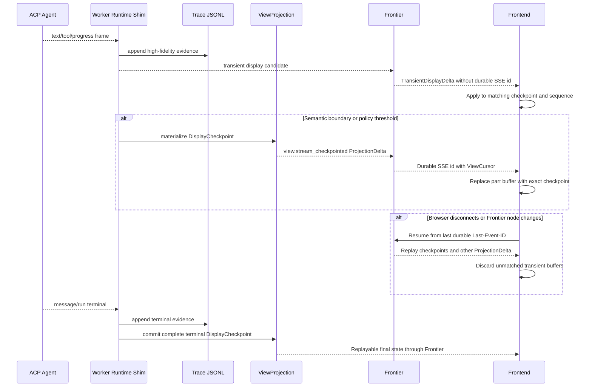

# Agent Display Stream Durability

## Three Different Records

Agent output exists in three forms with different purposes:

| Record | Authority And Purpose | Durability |
| --- | --- | --- |
| Trace JSONL | ACP/Agent/Tool execution evidence for debugging, Evolution and audit | High-fidelity authoritative evidence |
| DisplayCheckpoint | Materialized user-visible message/activity state inside ViewProjection | Durable and replayable |
| TransientDisplayDelta | Low-latency browser rendering between checkpoints | Best effort and short lived |

“Transient” means Frontier does not promise exact browser replay for each chunk. It does not mean Worker omits the source frame from Trace.

## Data Flow



## Durability Matrix

| User-visible data | Transient allowed | Durable requirement |
| --- | --- | --- |
| Text generation | text chunk | periodic/semantic checkpoint and complete terminal text |
| Reasoning | user-visible summary chunk only | summary checkpoint/final; hidden chain-of-thought never projected |
| Tool arguments | partial display args | accepted normalized args before execution and every lifecycle terminal |
| Tool execution | progress pulse/log preview | started/waiting/completed/failed/cancelled state and result summary |
| Approval/HITL | cosmetic countdown/progress | request, allowed actions, decision, expiry/revocation and resulting state |
| Activity | progress pulse | stage/status boundary and terminal outcome |
| Artifact | optional generation progress | ArtifactRef, availability, permission-aware actions and terminal state |
| Error/cancel | no authority in transient lane | structured error/cancel/timeout and terminal checkpoint |

## DisplayCheckpoint v1 Example

```json
{
  "schema_version": "frontier.display_checkpoint.v1",
  "display_stream_id": "display_123",
  "worker_session_id": "ws_123",
  "worker_run_id": "run_456",
  "agent_turn_id": "turn_789",
  "message_id": "msg_100",
  "checkpoint_version": 8,
  "status": "streaming",
  "parts": [],
  "last_observed_transient_sequence": 152,
  "trace_cursor_ref": {},
  "checkpointed_at": "2026-07-13T11:00:00Z"
}
```

The checkpoint contains complete materialized user-visible parts, not a patch from the previous checkpoint. A terminal checkpoint must be sufficient to render the final message/activity after all transient buffers are discarded.

## TransientDisplayDelta v1 Example

```json
{
  "schema_version": "frontier.transient_display_delta.v1",
  "display_stream_id": "display_123",
  "message_id": "msg_100",
  "part_id": "part_text_1",
  "base_checkpoint_version": 8,
  "transient_sequence": 153,
  "delta_type": "text_delta",
  "payload": {"text": " next"},
  "emitted_at": "2026-07-13T11:00:00.120Z"
}
```

SSE framing deliberately omits `id`:

```text
event: transient_display_delta
data: {"schema_version":"frontier.transient_display_delta.v1",...}

```

The existing EventSource last event id therefore continues to identify the last durable ViewCursor.

## Checkpoint Triggers

DisplayDurabilityPolicy must create checkpoints at:

- display/message start with stable identities;
- policy-bounded elapsed time or accumulated bytes;
- Tool accepted/start/waiting/terminal boundaries;
- approval request/decision/expiry/revocation;
- entering or leaving `waiting_user`;
- Artifact attachment or availability change;
- error, cancel, timeout and recovery boundary;
- message, AgentTurn and WorkerRun terminal state.

The exact time/byte thresholds are infrastructure policy, measured with real Codex/ACP stream and PostgreSQL/Frontier load. History records the policy revision used for each checkpoint.

## Client Reducer Rules

1. Load ProjectionSnapshot with the latest DisplayCheckpoint.
2. Apply transient delta only when stream/part exists and base checkpoint version matches.
3. Ignore duplicate transient sequence.
4. On transient gap, stop appending that part and mark it recovering.
5. Replace the part/message with the next durable checkpoint; do not concatenate missing chunks heuristically.
6. A durable checkpoint supersedes every transient buffer at or below `last_observed_transient_sequence`.
7. Durable View gap still follows global `resync_required`; transient gap does not mutate Task/Worker state.

## Backpressure

- Maintain bounded per-connection and per-display-stream transient queues.
- Coalesce adjacent text/reasoning-summary/tool-args deltas for the same part.
- Drop repeated progress pulses before text and never drop a durable control/checkpoint.
- If a client is too slow, close/reconnect it to the last durable cursor instead of buffering without limit.
- Record coalesced/dropped transient counts as observability metrics, not as business failures.

## Failure Examples

| Failure | Result |
| --- | --- |
| Browser loses two text chunks | Part shows recovering until next checkpoint; final content remains exact. |
| Frontier restarts | Transient buffer may disappear; durable snapshot/checkpoint restores the page. |
| Duplicate transient sequence | Client ignores duplicate. |
| Checkpoint commits but SSE response is lost | Durable ViewCursor replay returns the checkpoint. |
| Agent crashes before terminal checkpoint | Trace/runtime recovery determines outcome; UI cannot invent a final message. |
| Terminal checkpoint commits | All prior transient buffers are discarded; final View is replayable. |

## DisplayPart Contract

The stable union is Switchback-owned: `text`, `reasoning_summary`, `tool`, `activity`, `approval`, `artifact`, `source` and `error`. ACP/Codex and future AG-UI or AI SDK inputs are protocol-adapter sources, not canonical browser/domain types. See [DisplayPart Schema And Protocol Adapters](display-part-schema-and-adapters.md) for fields, identity mapping, unknown-event handling and renderer compatibility.
