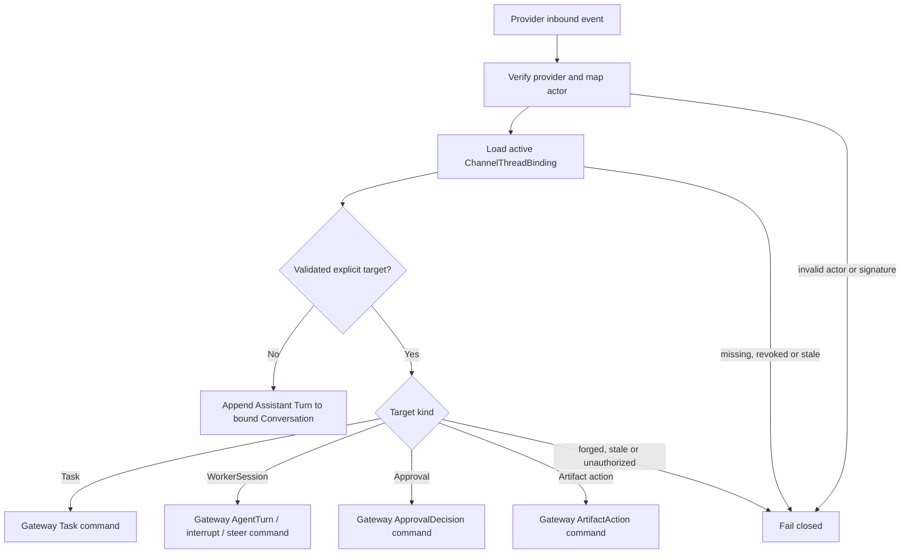
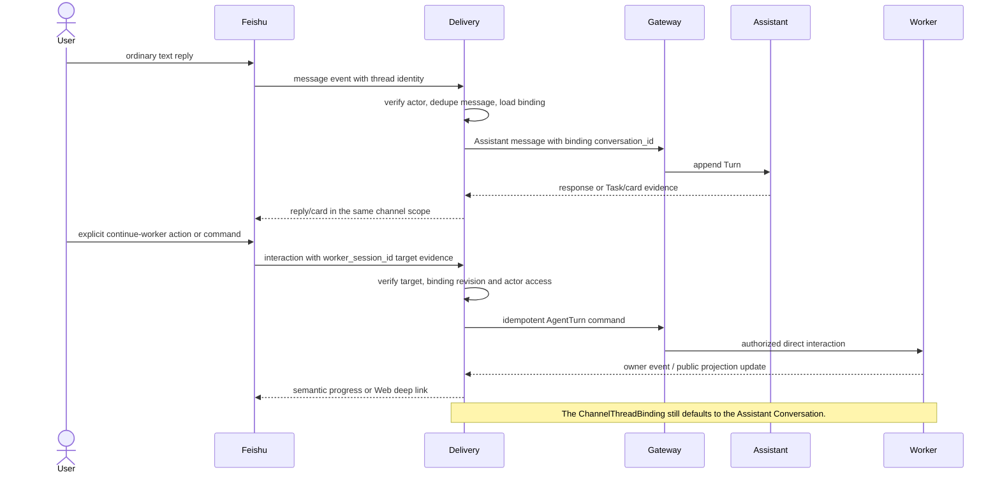
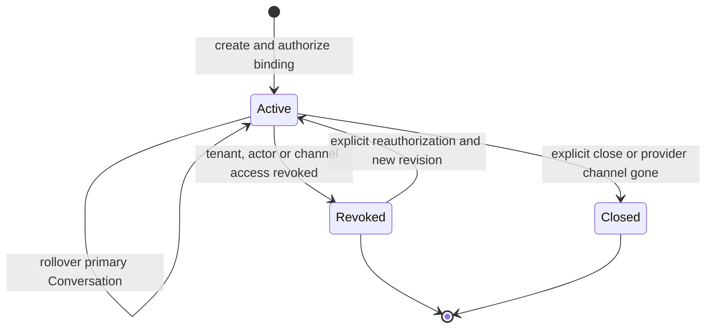

# Channel Thread Binding And Explicit Target Routing

## Scope

`ChannelThreadBinding` connects one provider conversation scope to one current primary Switchback Assistant Conversation per binding revision. P0 group topics use one channel-scoped shared Conversation with Interaction-owned participant/controller roles. The binding preserves the provider topic while allowing Conversation identity to roll over at a Workspace boundary, and allows explicit TaskDraft, Task, WorkerSession, ApprovalRequest and Artifact commands. It is not a mutable execution focus, permission grant or Task/Worker aggregate.

The complete multi-user interaction, ownership and failure flow is documented in [Delivery Interaction Design](delivery-interaction-design.md).

## Routing Rule

The absence of an explicit target is meaningful: it selects the binding's Assistant Conversation. Delivery must not fill the gap using the latest active Worker, latest card, most recent Task, provider reply ancestry or model classification.

## Interaction Sequence

## ChannelThreadBinding v1

| Field | Meaning |
| --- | --- |
| `schema_version` | `delivery.channel_thread_binding.v1`. |
| `binding_id` | Stable Switchback binding identity. |
| `provider` | Provider/profile name, for example `feishu`. |
| `provider_tenant_key` | Provider tenant boundary used with Switchback tenant mapping. |
| `tenant_id` | Switchback Tenant security boundary. |
| `channel_scope` | Provider chat plus `thread_id` or capability-specific root-message fallback. |
| `conversation_id` | Primary Assistant Conversation and default ordinary-message target. |
| `conversation_scope_ref` | Current Conversation scope/type reference; group binding requires `channel`. |
| `conversation_rollover_ref` | Optional latest ConversationRollover id and resulting binding revision. |
| `default_workspace_id` | Optional explicitly resolved Assistant context; unresolved Conversation remains valid. |
| `workspace_resolution_ref` | Interaction-owned WorkspaceContextResolution id/revision/status. |
| `binding_revision` | Monotonic revision for rebind/revoke fencing. |
| `status` | `active`, `revoked` or `closed`. |
| `related_refs` | Permission-filtered Task/WorkerSession/Artifact refs for navigation, never routing priority. |
| `provider_capability_ref` | DeliveryProviderCapability snapshot used for topic/fallback behavior. |
| `created_at`, `updated_at` | Audit timestamps, not ordering authority. |

Provider identity uniqueness is scoped by provider, provider tenant and normalized channel scope. A `thread_id` is preferred when present. If topic reply is unsupported, the adapter may use a chat/root-message binding or a P2P chat binding, but ordinary text still routes to the Assistant Conversation.

Workspace selection, TaskSpec requirements and rebind behavior are defined in [Channel Workspace Resolution Before Execution](channel-workspace-resolution.md). The binding references the current resolution but does not grant Workspace access or migrate related resources.

When an already resolved Workspace boundary changes, Interaction creates a successor Conversation and advances the binding under a new revision. The provider topic remains stable, but predecessor Turns are not part of the successor history. See [Conversation Rollover On Workspace Rebind](conversation-rollover-on-workspace-rebind.md).

Workspace selection also does not grant the provider group access to Workspace-derived content. Shared rich output requires the separate `WorkspaceChannelShareGrant` and `ChannelDisclosureDecision` contract in [Workspace Channel Share And Disclosure](workspace-channel-share-and-disclosure.md); otherwise Delivery uses a minimal notice or actor-specific Web/ephemeral fallback.

## InboundInteractionEnvelope v1

| Field | Meaning |
| --- | --- |
| `schema_version` | `delivery.inbound_interaction.v1`. |
| `provider_event_id` | Provider delivery identity retained for audit. |
| `provider_message_id` | Primary inbound-message idempotency identity. |
| `provider_message_revision` | Optional edit/content revision. |
| `actor_ref` | Provider identity and mapped Switchback actor. |
| `binding_id`, `binding_revision` | Exact binding decision used for routing. |
| `interaction_type` | `ordinary_message`, `structured_command` or `card_callback`. |
| `explicit_target_ref` | Optional validated InteractionTargetRef. |
| `content_ref` | Sanitized inline content or protected payload reference. |
| `idempotency_key` | Stable key derived from provider message/action identity and revision. |
| `received_at` | Service receive time for audit. |

Feishu documents that duplicate receive events can occur and recommends message-id deduplication rather than relying only on event id. Therefore `provider_message_id` is the primary identity for ordinary messages; callback identities continue to use the action/card idempotency contract.

## InteractionTargetRef v1

| Field | Meaning |
| --- | --- |
| `target_type` | `assistant_conversation`, `task_draft`, `task`, `worker_session`, `approval` or `artifact_action`. |
| `target_id` | Canonical target identity. |
| `expected_revision` | Required for owner mutations whose current revision matters. |
| `target_source` | `default_binding`, `card_action`, `structured_command` or `immutable_bot_message_context`. |
| `intent_evidence_ref` | Authenticated provider/card/command evidence; never model text alone. |

Rules:

1. `ordinary_message` without an explicit target uses `conversation_id` with `target_source=default_binding`.
2. A card callback uses its current DeliveryActionDescriptor subject and expected revision.
3. A structured command names and validates its target before dispatch.
4. An immutable bot-message reply may target a resource only when Switchback registered unambiguous routing metadata for that message. Feishu topic `root_id`/`parent_id` alone is insufficient because topic replies point to the root message.
5. A message such as "continue that Worker" remains Assistant input. Assistant may resolve ambiguity and submit an explicit Gateway command; Delivery does not bypass that reasoning boundary.
6. `related_refs` never determine a target and no `current_focus` field exists.
7. `task_draft` is valid only for a current structured task command, registered ready-draft confirmation or authenticated AdoptTaskDraft action. Confirmation requires actor=initiator；adoption binds exact source revision and creates a new actor-owned draft. Plain reply ancestry and unbound confirmation/adoption text remain Assistant input.
8. `task` action targets bind exact action and expected Task revision. Target validity does not authorize the actor；Gateway/Task Orchestration still revalidates TaskInitiator or Workspace-owner emergency-cancel rules. Terminal rework and stale revision fail closed.

## Shared Participants And Controllers

- Every accepted message records the mapped sender as the Turn actor in the shared Conversation.
- Provider-mapped eligible group members can participate in ordinary dialogue according to ConversationParticipationPolicy; group membership alone never grants controller.
- The binding creator becomes initial controller only after provider/Tenant/channel-policy checks.
- Only a controller can select/clear Workspace context, request rollover, close the channel Conversation or manage controller roles.
- Controller operations still reauthorize the actual actor and target Workspace/resource. Controller is not Workspace, Task, Worker, Approval, Artifact or disclosure authority.
- Explicit delegation/revocation uses expected participant revision and cannot remove the last controller. Access revocation that invalidates all controllers enters `control_orphaned`; recovery is explicit and policy-authorized.
- Conversation rollover projects only currently eligible source roles to the successor, preserves source role evidence and never promotes a controller; no eligible controller produces an orphaned successor.
- P0 does not create per-user private sidecar Conversations under the same topic. Protected actor-private interaction uses ephemeral provider UI or Web.

## Binding Lifecycle And Authorization

- Every sender is mapped and authorized independently and must satisfy current participant eligibility. Membership in the Feishu chat is not controller or Switchback Workspace authority.
- A stale binding revision, revoked binding, forged target or cross-Tenant target fails closed without leaking resource existence.
- Rebinding an already resolved Workspace changes future channel routing to a successor Conversation under a new revision. It marks the predecessor superseded but does not migrate or rewrite Task, WorkerSession, Trace or Artifact ownership.
- Ordinary-message acceptance and rollover serialize on binding/source revision. A committed Turn remains in the generation that accepted it; stale envelopes are rejected/reconciled rather than silently rerouted.
- Provider-side topic loss or binding revoke only closes/fences the channel relation. An explicit controller close may close both Conversation and binding under expected revisions. Neither path closes long-lived WorkerSessions, completed Tasks or Artifacts, which remain accessible through authorized Web routes.

## Examples

| Situation | Route |
| --- | --- |
| Two Workers are running and user writes "进度怎么样？" | Bound Assistant Conversation; Assistant can summarize both or clarify. |
| User clicks `continue_worker` and opens WorkerDetail | Web submits an explicit `worker_session_id`; direct AgentTurn. |
| Current approval card receives `approve_once` | Explicit ApprovalRequest target and expected revision through Gateway. |
| User replies under an old Worker result card with plain text in a Feishu topic | Assistant Conversation unless the provider interaction is a registered explicit action. |
| A message says "让 Worker ws_123 继续修测试" | Assistant Turn first; Assistant validates intent/access and may issue an explicit Worker command. |
| Provider group rejects topic reply | Use chat/root fallback binding; do not switch to latest-Worker inference. |
| User switches W1 -> W2 in the same topic | Binding advances from C1 to successor C2; C1 becomes read-only and existing W1 resources remain unchanged. |
| A participant who is not controller selects W2 | Control command is denied; the participant may continue ordinary dialogue. |
| Last controller loses provider/Tenant access | Conversation enters `control_orphaned`; no participant is auto-promoted and control changes wait for explicit recovery. |

## Required Tests

1. Ordinary messages route to the bound Conversation with zero, one or many active Tasks/Workers.
2. Explicit current card actions target exact Task/Approval/Artifact identities and revisions.
3. Explicit Worker commands target one authorized WorkerSession and do not mutate the default route.
4. Late/out-of-order messages and old result-card replies do not select a former current focus.
5. Duplicate provider message delivery produces one Assistant Turn.
6. Stale binding revision, revoked access, actor mismatch, forged/cross-Tenant target and unknown target fail closed.
7. Different users in the same topic receive independent authorization outcomes.
8. Provider topic unsupported fallback preserves Assistant-default semantics.
9. Related refs improve navigation but never participate in route selection.
10. W1->W2 rollover changes only the default Conversation identity; concurrent messages belong exactly once to the serialized old/new binding revision.
11. Multiple users append to one shared Conversation with exact actor identity; no hidden per-user Conversation is created.
12. Participant/controller checks, first-controller creation, delegation, last-controller protection and control-orphan recovery follow policy and expected revisions.
13. Controller role never substitutes for Workspace/resource/action/disclosure authorization.

## References

- [Channel Workspace Resolution Before Execution](channel-workspace-resolution.md)
- [Conversation Rollover On Workspace Rebind](conversation-rollover-on-workspace-rebind.md)
- [Workspace Channel Share And Disclosure](workspace-channel-share-and-disclosure.md)
- [Delivery Interaction Design](delivery-interaction-design.md)
- [Feishu topic overview](https://open.feishu.cn/document/im-v1/message/thread-introduction?lang=zh-CN)
- [Feishu reply message API](https://open.feishu.cn/document/server-docs/im-v1/message/reply?lang=zh-CN)
- [Feishu message field semantics](https://open.feishu.cn/document/uAjLw4CM/ukTMukTMukTM/reference/im-v1/message/intro)
- [Feishu receive message event](https://open.feishu.cn/document/server-docs/im-v1/message/events/receive?lang=zh-CN)
