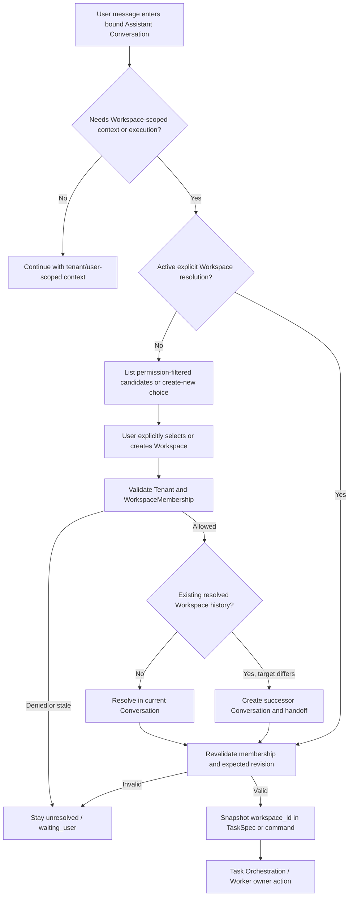
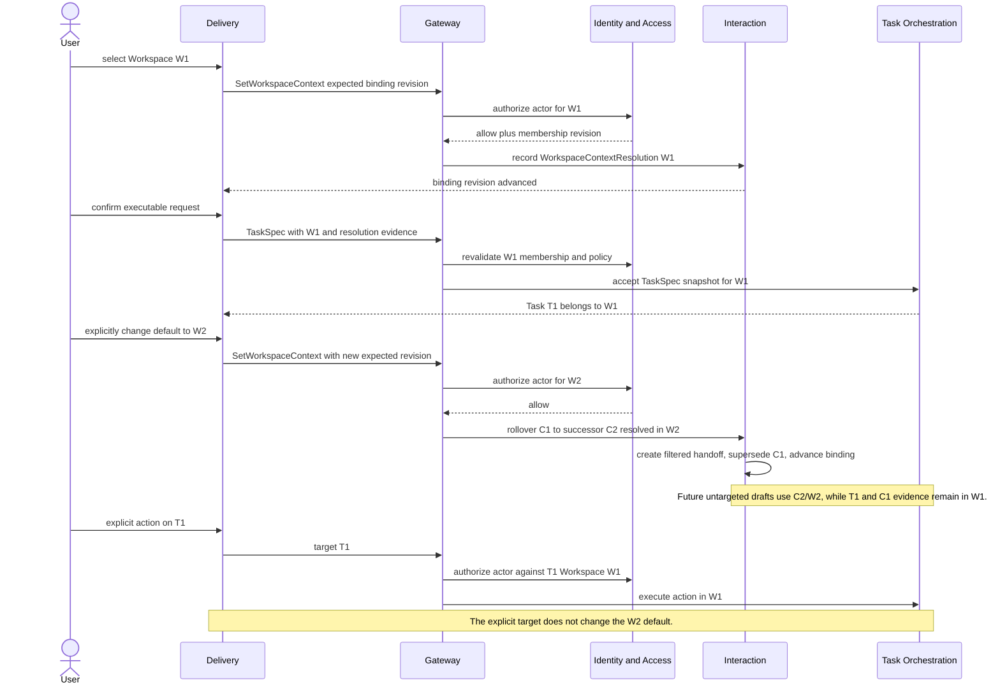

# Channel Workspace Resolution Before Execution

## Scope

`WorkspaceContextResolution` turns an optional channel/Assistant context into one explicit Workspace target before protected context loading or execution. It is a revisioned selection with evidence, not a WorkspaceMembership, authorization grant or migration command. Once a Conversation has resolved Workspace history, leaving that Workspace uses a successor Conversation rather than mutating the same history in place.

## Resolution Flow

Unresolved Conversation behavior is deliberately useful but bounded:

- Assistant may clarify goals, acceptance criteria, constraints and desired deliverables.
- It may use authorized user- or Tenant-scoped Memory, generic Skills and public context.
- It must not load Workspace-scoped Truth, Inspiration records, repositories, Trace or Artifacts merely because a candidate Workspace appears likely.
- It cannot dispatch TaskSpec, create/reuse WorkerSession or issue Workspace execution leases.

## WorkspaceContextResolution v1

| Field | Meaning |
| --- | --- |
| `schema_version` | `interaction.workspace_context_resolution.v1`. |
| `resolution_id` | Stable decision identity. |
| `tenant_id` | Hard Tenant boundary. |
| `conversation_id` | Interaction Conversation whose default context is being resolved. |
| `channel_binding_id` | Optional ChannelThreadBinding source/projection reference. |
| `expected_conversation_revision` | Required Interaction context concurrency fence. |
| `expected_binding_revision` | Required when selection came through a channel binding. |
| `resolution_revision` | Monotonic workspace-context revision. |
| `default_workspace_id` | Selected Workspace; absent only for explicit clear/unresolved result. |
| `actor_user_id` | Authenticated user making the selection. |
| `selection_source` | `web_selector`, `card_action`, `structured_command` or `create_workspace_result`. |
| `intent_evidence_ref` | Immutable user-selection or CreateWorkspace evidence. |
| `membership_revision` | WorkspaceMembership revision observed when resolving. |
| `status` | `resolved`, `cleared`, `stale` or `rejected`. |
| `reason_codes` | Structured stale/reject/clear reasons. |
| `created_at` | Audit time. |

Conversation owns the selected default and resolution revision. A ChannelThreadBinding stores the selected `default_workspace_id` plus current resolution reference as a fenced projection for channel routing. Identity & Access remains the owner of WorkspaceMembership and authorization decisions.

For a channel-scoped shared Conversation, only an active controller may submit selection, clear or rebind commands. Controller role is only the right to coordinate the shared default: the actual actor must still hold current target Workspace access, and any protected source carry-over is authorized separately. A participant without controller role may propose a Workspace in ordinary dialogue but cannot resolve it.

The first `unresolved -> Workspace` transition stays in the current Conversation. `W1 -> W2`, `W1 -> cleared` and access revocation use `ConversationRollover`, create a successor and mark the source `superseded`. The full transaction, handoff and lineage rules are defined in [Conversation Rollover On Workspace Rebind](conversation-rollover-on-workspace-rebind.md).

## Selection Sources

| Source | May propose | May resolve | Notes |
| --- | --- | --- | --- |
| User-global default | yes | no | UI may preselect it, but user confirms before protected use or execution. |
| Assistant/model inference | yes | no | Must explain evidence and present a choice; cannot become authority. |
| Repository/document URL | yes | no | Candidate discovery only; URL possession does not prove Workspace access or intent. |
| Web selector | yes | yes | Authenticated selection with expected binding revision. |
| Current card action | yes | yes | Opaque action targets a permission-filtered Workspace candidate. |
| Structured command | yes | yes | Command includes exact Workspace identity and intent evidence. |
| `CreateWorkspace` result | yes | yes | Separate idempotent command first creates and authorizes the Workspace. |
| Explicit Task/Worker target | n/a | no default change | Uses the resource's own Workspace for that command only. |

Even when the user has exactly one authorized Workspace, Switchback may preselect it but still records a positive confirmation. This keeps execution intent distinct from discovery and makes behavior stable if a second Workspace is added later.

## Dispatch And Rebind Sequence

## Concurrency And Failure Rules

1. `SetWorkspaceContext` requires expected Conversation revision, channel binding revision when applicable, and a stable idempotency key. Duplicate first resolution returns the original resolution; duplicate rollover returns the original successor.
2. If selection races another rebind, stale expected revision fails and the UI/card shows the current default/lineage before retry. It must not create a second successor.
3. TaskSpec submission carries exact `workspace_id`, resolution revision and membership evidence. Any stale/revoked result returns to clarification or `waiting_user`; Task Orchestration creates no Task/Saga/Outbox.
4. WorkspaceMembership revocation marks the resolution stale, fences W1 context and creates/requires a Workspace-unresolved successor with no W1 protected handoff. Switchback never falls through to user-global default, another related Workspace or a model candidate.
5. `CreateWorkspace` is a separate idempotent command. Response loss is reconciled by idempotency identity before another Workspace is created.
6. A direct target uses the target resource's immutable Workspace relation and current authorization, regardless of binding default.
7. A rebind never rewrites existing TaskSpec snapshots, WorkerSession Workspace, Trace scope, Artifact visibility or WorkspaceRevision lineage. It supersedes the old Conversation and advances the binding to a successor.
8. Message acceptance and rollover serialize on binding/source revision: a Turn belongs to exactly one Conversation generation and is never silently moved after acceptance.

## Required Tests

1. Unresolved Conversation can clarify but cannot load Workspace-scoped context or dispatch.
2. Global default, single candidate, model guess and URL discovery never execute without explicit confirmation.
3. Existing selection and CreateWorkspace-result selection record actor/evidence/revisions and reauthorize before TaskSpec acceptance.
4. Missing `workspace_id`, stale binding revision, stale resolution, revoked Membership and cross-Tenant selection fail closed without partial Task creation.
5. Duplicate selection/CreateWorkspace/Task submission converges idempotently.
6. Rebinding creates one successor Conversation for future untargeted drafts but does not change existing Task/WorkerSession/Trace/Artifact ownership.
7. Explicit Task/Worker/Artifact targets use their own Workspace and do not mutate the default.
8. Unresolved or stale selection never falls back to another candidate.
9. W1->W2->W1 creates three Conversation generations; predecessor generations remain read-only.
10. Workspace-neutral handoff and explicitly authorized cross-Workspace carry-over remain distinct.
11. Participant cannot resolve/rebind shared Workspace; controller without target Workspace access also fails closed.

## Channel Visibility Boundary

An actor may be authorized for a Workspace while other members of the provider group are not. `WorkspaceContextResolution` therefore never authorizes posting Workspace-derived content to the whole channel.

The accepted policy uses a separate Identity & Access owned `WorkspaceChannelShareGrant`. A current Workspace owner explicitly binds the Workspace to a verified provider group audience and P0 `workspace_summary` profile. Every shared render/update requires a `ChannelDisclosureDecision` over current grant/policy revision, provider audience snapshot and source classification. Missing or stale authority degrades to a non-resource-identifying notice and per-user-authorized Web route. See [Workspace Channel Share And Disclosure](workspace-channel-share-and-disclosure.md).
