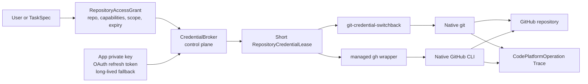
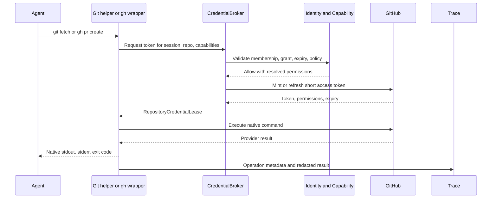
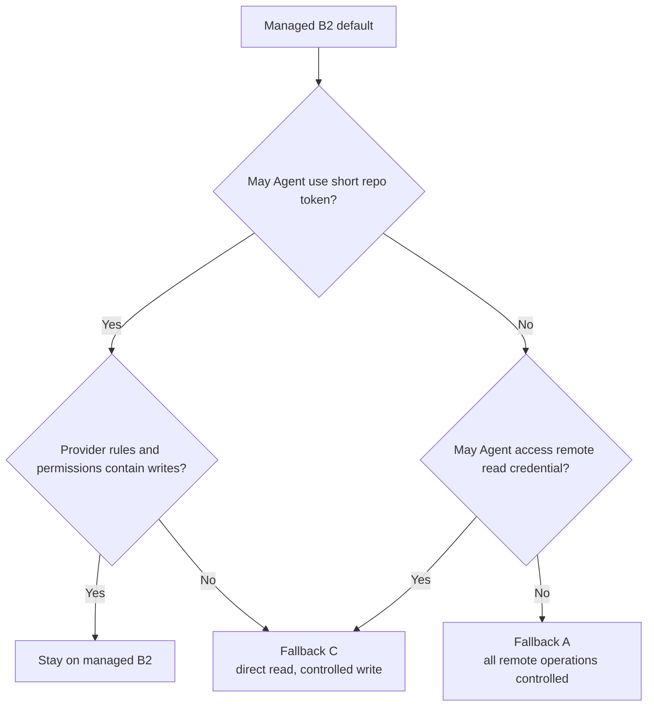

# Managed B2 CodePlatform Access Guide

本文记录 Switchback 接受的 CodePlatform 受管 B2 方案：Worker 镜像预装原生 `git`、GitHub CLI 和相关 Skills；Agent 在 RepositoryAccessGrant 范围内直接操作 GitHub，Switchback 负责身份、短期 Token、续期、撤权、网络和结果追踪，而不代理每一条 GitHub 命令。

详细官方资料与 A/B/C 对比见 [CodePlatform Worker Git Flexibility And Token Renewal Trade-offs](../research/codeplatform-worker-git-auth-tradeoffs.md)。

## 决策摘要

| 问题 | P0 答案 |
| --- | --- |
| Agent 是否直接运行 `git`/`gh` | 是 |
| 是否每次 push/PR 都调用控制面 Adapter | 否；Grant 生效后由 Agent 自主操作 |
| Token 是否对 Agent 保密 | 否；短期 access token 对 Agent 可用是受托执行模型的一部分 |
| 什么绝不能进容器 | GitHub App 私钥、OAuth refresh token、长期 PAT/根凭证 |
| Token 如何续期 | credential helper/CLI wrapper 按需向 CredentialBroker 获取 |
| 授权粒度 | Repository + capability + once/WorkerSession + expiry/constraints |
| 默认允许什么 | repo read；经批准后 contents write、PR write、Actions read |
| 默认禁止什么 | administration、secrets、variables、workflow write、repo delete、ruleset 管理 |
| P0 产品承诺是否变成 PR/CI | 否；仍只保证 report/patch，branch/PR 是授权后的外部操作和引用 |

一句话版本：**Switchback 决定 Agent 在哪个仓库拥有什么能力，GitHub Token落实这份能力，Agent 自己用原生 CLI完成操作。**

## 信任模型

受管 B2 不把 Coding Agent 当作无法接触凭证的低信任 planner。用户批准 `repository.write` 后，Agent 在 Grant 有效期内可以执行 Token 所允许的非管理类 GitHub 操作。这意味着：

- Agent 可以读取当前短期 Token，平台不声称 Token 对它保密。
- Skills 是操作指导，不是安全边界；真正边界是 RepositoryAccessGrant、Token permissions、Repository scope、GitHub ruleset、网络和 WorkerSession 生命周期。
- 平台必须避免发出超出任务所需的管理类权限，因为无法依靠 prompt 阻止 Agent 调用 `gh api`。
- 用户批准的是一段受限委托，而不是每条命令的逐次审批。

## 权限 Profile

P0 推荐把 Provider permissions 编译成少量可解释 profile：

| Profile | Switchback capability | GitHub permission intent | Agent 可做 |
| --- | --- | --- | --- |
| `repo-read` | `repository.read` | metadata/read + contents/read + PR/read + Actions/read | clone/fetch/submodule/LFS read、查看 PR/CI |
| `repo-write` | `repository.write` | `repo-read` + contents/write | push 非受保护 refs、创建 branch/tag（受 policy 限制） |
| `pr-write` | `pull_request.write` | pull requests/write | create/update/comment PR |
| `ci-read` | `ci.read` | Actions/read | 查看 run、job、log/status |

P0 不签发 administration、secrets、variables、workflow/write、actions/write、members、rulesets、repository delete 等管理类权限。若未来需要，必须新增独立 capability 和审批，而不能扩大 `repository.write` 的含义。

Token 可能无法表达 branch 级限制，所以 default/protected branch、force push 和 branch delete 仍由 GitHub Ruleset/Branch Protection 与 Tenant policy 防守。Agent 在其他可写 ref 上的自主性是受管 B2 明确接受的取舍。

## 启动与续期

Worker 镜像预装 CLI，但不烘焙任何用户/组织 Token，也不执行持久化 `gh auth login`。

实现约束：

- `git-credential-switchback` 启用 `credential.useHttpPath=true`，按 host + repository path 请求 Token。
- managed `gh` wrapper 在每次 CLI invocation 前获取/复用 Token，通过当前子进程环境交给真实 `gh`；不写入 gh config。
- CredentialBroker 可在 expiry 前缓存 Token，但缓存 key 必须包含 provider、installation/user、repository、permission set 和 grant revision。
- GitHub installation token 到期时重新 mint；user OAuth 到期时由控制面 refresh。Refresh token 和 App private key永不返回 Worker。
- 单个 Git/LFS 操作遇到认证过期时，Helper/Wrapper 清理旧 lease，在核查远端状态后最多进行有界重试；不能无限重跑 push/PR create。

## 授权与审批

RepositoryCheckout 被创建或恢复时需要有效 `repository.read`。读 Grant 可以来自 Workspace 已绑定的组织策略或用户显式授权。

外部写入仍属于受保护能力，但无需逐命令确认：

1. TaskSpec 可携带已批准的 RepositoryAccessGrant。
2. 未预授权时，第一次需要 write/PR capability 的操作进入 `waiting_user`。
3. 用户选择 `once` 或 `worker_session` scope，并绑定 repository、capabilities、expiry 和约束。
4. Grant 生效后，Agent 可以连续执行 Token 允许的 GitHub 操作，不再为每个 push/comment 询问。
5. Grant 撤销、Membership 失效、Session 过期或 Tenant policy 变化后，Broker 停止续签并撤销当前 Provider token；Worker 网络和新命令按既有 fencing 规则收敛。

## Trace 与 Secret 处理

P0 仍保留高保真 Trace，但平台自己签发的 credential 是明确例外，不能以“暂不脱敏”为理由落盘：

- Token 不进入 remote URL、命令参数、Git config、gh config、shell history、Artifact、Langfuse 或用户可见进度。
- Broker 保存当前活跃 Token 的 fingerprint/secret id，Trace ingest 对精确值和已知 Provider token pattern 做确定性替换。
- CodePlatformOperation 记录 actor、session、repository、capabilities、command kind、target refs、provider request/result ids、exit class、started/completed time 和 correlation id，不记录 secret。
- 若 Agent 主动输出 Token，ingest 标记 `secret_redacted` 和安全事件；原始未脱敏副本也不能进入普通 TraceStore。

这不是通用内容 DLP，而是平台已知 secret 的最低安全处理。

## Provider 结果与恢复

直接 CLI 不代表 Switchback 可以只看退出码：

- push 后记录 remote ref/commit；认证或网络失败时先查询 remote head，再决定是否重试。
- PR create 后记录 provider PR id/URL/head/base；响应丢失时按 head/base 查询，避免重复 PR。
- `gh api` 等无法分类的操作仍记录命令类别、endpoint method/path 和结果摘要，不记录 body 中的 secret。
- Provider 成功是外部事实；Switchback Trace/Artifact 投影失败只能补偿投影，不能重做已成功外部写入。

## 备选方案保留

### 方案 A：控制面代理所有远端操作

控制面执行 fetch/publish/PR/CI，Token 不进入 Worker。它提供最强的 per-operation policy、branch/expected-head 约束和结构化幂等，但会限制多 remote、submodule、LFS 和 Agent 临时 Git workflow。

适用回退条件：

- 安全政策禁止任何 repo-write Token 进入 Agent sandbox。
- direct CLI 多次产生未授权副作用或难以收敛的幂等问题。
- Provider 要求强操作级审计、双人确认或不可抵赖执行主体。

### 方案 C：远端只读直连，写入走控制面

Agent 用动态 read-only credential 自由 fetch/submodule/LFS，push/PR/CI 由 Adapter 执行。它在灵活性和写入治理之间折中，但需要同时维护 native CLI 认证和写 Adapter。

适用回退条件：

- 读操作灵活性是刚需，但 branch/ref 级写限制无法由 Provider ruleset 满足。
- write token 泄漏或误用风险不可接受，但完全方案 A 适配成本过高。
- GitLab/内部代码平台的 Token scope 比 GitHub 更粗，需要把写权限留在控制面。

## P0 验收

- 固定镜像包含版本锁定的 Git、GitHub CLI、`git-credential-switchback`、managed `gh` wrapper 和 GitHub Skills。
- 无 Grant 时私有 repo operation fail closed，不弹交互式 `gh auth login`。
- 同 host 多 repository 在 `useHttpPath=true` 下不串 credential。
- read/write/PR/CI-read profile 权限与 GitHub App installation 配置一致，管理类权限不可申请。
- 1 小时 Token 多次续签可覆盖长 WorkerSession，refresh/root secret 从不进入容器。
- once/session Grant、撤权、Membership revision 和 WorkerSession expiry 均能停止新 Token 签发。
- token 不出现在 Trace、Langfuse、Artifact、remote URL、process args 和 gh config。
- push/PR 在响应丢失、401、网络重置和重复命令下通过 remote reconciliation 收敛。
- protected branch/ruleset 测试证明 default branch、force push 和 delete 被拒绝。
- A/C fallback profile 保留同一 RepositoryAccessGrant、CodePlatformOperation 和 Provider result 契约。
