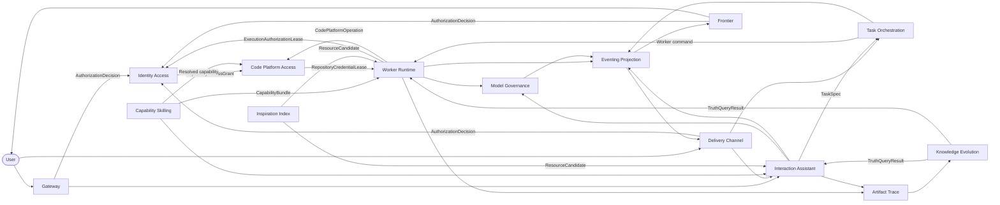

# DDD Context Map

> 状态：v0.2。
>
> 本文用于约束模块边界。实现时可以拆服务或合并部署，但 bounded context 的语言、聚合和依赖方向不应随意混用。

## Context Ownership

| Context | Core Aggregates | Owns | Does Not Own |
| --- | --- | --- | --- |
| Identity & Access | Tenant, TenantMembership, WorkspaceMembership, AuthorizationDecision, ExecutionAuthorizationLease, WorkspaceChannelShareGrant, ChannelDisclosureDecision, Policy, CapabilityGrant | Tenant 硬隔离、显式 Workspace 角色、统一权限裁决、Worker 委托授权、群聊 audience 披露授权/字段裁决、撤权和能力授权 | Worker 执行细节、provider 消息投递、Truth 内容生成 |
| Interaction | Conversation, ConversationParticipant, ConversationRollover, ConversationHandoff, TurnWindow, AssistantSession, TaskDraft, TaskReadinessAssessment, ClarificationCheckpoint, WorkspaceContextResolution | user/channel scoped 对话、participant/controller 控制、澄清、显式 Workspace context 选择/边界 rollover、readiness 判断、检查点、上下文装配、TaskSpec 草稿 | Workspace/资源动作授权、provider 投递、容器运行、代码修改、事件投影 |
| Task Orchestration | Task, TaskTransition, TaskSessionLineageEntry, SessionTaskQueue order, SessionDispatchPermit, ScheduledCommand | 轻量交付跟踪、验收、当前 Session ref 与历史 lineage、固定 P0 actor 规则、单 Session 稳定 FIFO、dispatch gate、同事务 Task/Transition/Outbox 和持久调度 | Workspace Membership、WorkerSession execution slot/expiry fencing、Coding Agent 协议细节、外部副作用执行 |
| Worker Runtime | Workspace, RepositoryImport, WorkspaceRevision, ActiveRevisionPointer, WorkingCopy, StagingRevision, RepositoryCheckout, ChangeSet, WorkspaceApply, WorkerSession, WorkerSessionExecutionSlot, WorkerSessionExpiryOutcome, AgentTurn, AgentTurnHardDeadline, WorkerRun, ToolInvocationControl, RuntimeInstance, RuntimeHeartbeat, RuntimeRecoveryIncident, WorkerControlChannel | Workspace bootstrap/import attempt、持久工作上下文、宿主隔离副本、租约外 staging、fenced 原子版本提交、主交互 WorkerSession、单顶层执行 slot、固定 Turn deadline、absolute-expiry fencing/outcome、Tool 取消收敛、runtime health/generation、单次自动恢复、控制通道和容器执行 | Task 创建/验收/队列顺序、Assistant 对话策略、长期 Truth 发布 |
| Code Platform Access | RepositorySelectionSnapshot, RepositoryAccessGrant, RepositoryCredentialLease, CodePlatformOperation | branch/tag 到 exact SHA 的受管解析证据、仓库级委托、CredentialBroker、短期 Token 生命周期、受管原生 CLI、provider 结果核查和 A/C fallback profile | Workspace 角色、Task 状态、Provider 根/刷新 secret 的 Worker 侧持久化 |
| Artifact & Trace | TraceStream, TraceManifest, Artifact, DataLifecyclePolicy, DataLifecycleAction, TraceAnalyticsProjection | JSONL/Artifact 事实内容、segment/checksum、冷热生命周期、排障/Evolution 读取和效果统计 | 业务状态机、Truth 发布判断和模型路由 |
| Knowledge Evolution | ContextCandidate, MemoryTruth, MemoryPublicationPolicy, InstructionPolicy, ContentRevision, ReviewTask, ReviewBatch, MemoryLibrary, ReviewInbox, OpenVikingProjection | 候选、确定性 Memory 发布、不可变修订、风险治理、审核、双视图看板和读取 | 原始任务执行和 Skill 可执行内容发布 |
| Inspiration Index | InspirationRepository, InspirationEntry, ResourceRecord | P2 experimental 的 Git 资源声明、URL/摘要/意图、运行态 freshness/ACL 和可重建索引 | Truth 审核结论、完整飞书文档读取、P0/P1 ContextPack 可用性 |
| Capability / Skilling | SkillPackage, MCPServerConfig, AgentProfile, ToolCapabilityDeclaration, ToolGovernancePolicy | 能力版本、依赖、权限声明、Tool 技术证据、最终风险策略和启停审计 | Worker runtime lease 和单次 Tool 执行状态 |
| Model Governance | ModelInvocation, RoutePolicy, UsageAccount | 模型路由、审计、限流、成本、降级 | Task 业务状态 |
| Delivery Channel | ChannelBinding, ChannelThreadBinding, InboundInteractionEnvelope, UserInteraction, ProviderChannelSecuritySnapshot, DeliveryCardProjection, CardInstance, DeliveryProviderCapability | 飞书触发、Assistant-default 路由、Workspace resolution 引用、显式 InteractionTargetRef、provider audience/security 观测、中间选择/对话、通道专用卡片投影、投递/更新/过期/对账 | Workspace 授权、group disclosure 决策、Task/Worker/Approval/Artifact 执行状态或可变 current focus |
| Eventing & Projection | IntegrationEvent, EventStream, Subscription, ProjectionCursor, TimelineProjection, TimelineEntry, ViewProjection, ProjectionSnapshot, ProjectionDelta, DisplayPart, DisplayCheckpoint, TransientDisplayDelta, HomeView, TaskSummaryView, WorkerDetailView, WorkspaceOverviewView, ArtifactDetailView, DeadLetter | 事件校验/分发、gap/DLQ、Worker 主交互与轻量 Task 读模型、Snapshot/SSE delta、canonical display、durable/transient lane 和稳定用户 timeline | 领域 stream sequence 分配和聚合事实源 |

## Published Languages

| Producer | Consumer | Published Language |
| --- | --- | --- |
| Interaction | Task Orchestration | TaskReadinessAssessment, TaskSpec |
| Interaction | Delivery Channel / Task Orchestration | WorkspaceContextResolution |
| Interaction | Delivery Channel / Eventing & Projection | ConversationRollover, ConversationHandoff, ConversationSuperseded |
| Interaction | Delivery Channel / Identity & Access | ConversationParticipant, ConversationParticipantChanged, ConversationControlOrphaned, ConversationControlRecovered |
| Delivery Channel | Task Orchestration / Interaction | InboundInteractionEnvelope, InteractionTargetRef, DeliveryCommand, TaskSpec |
| Worker Runtime | Gateway / Task Orchestration | NewTaskSuggestion, source Task/Run lineage refs |
| Worker Runtime | Gateway / Eventing & Projection | SessionProcess status and lifecycle events |
| Worker Runtime | Gateway PreviewProxy | current Runtime endpoint resolution, SessionProcess generation/status and declared-port evidence |
| Gateway / Delivery Channel | Interaction / Task Orchestration | AdoptTaskDraft, TaskCreationTriggerPolicy, ExplicitTaskCreationIntent, TaskSpec |
| Task Orchestration | Gateway / Frontier / Delivery Channel | Task, TaskTransition, permission-filtered TaskActionDescriptor |
| Task Orchestration / Gateway | Worker Runtime | SubmitWorkerSessionAllocationRequest, CancelWorkerSessionAllocationRequest, CreateWorkerSessionContinuation, ContinueTaskInNewWorker allocation intent, StartWorkerRun, WorkerRunStartSnapshot, StartAgentTurn, CancelAgentTurn, RuntimeControlEnvelope |
| Worker Runtime | Task Orchestration / Gateway / Eventing & Projection | WorkerSessionAllocationQueued, WorkerSessionAllocated, WorkerSessionContinuationCreated, WorkerSessionExpiryOutcome, WorkerSessionCapacityReleased, WorkerSessionAllocationRejected |
| Gateway / Frontier | Worker Runtime | AgentTurnCommand, SessionProcessCommand, ApprovalDecision |
| Gateway PreviewProxy | Worker Runtime | exact declared-port HTTP/WebSocket traffic over internal runtime network |
| Worker Runtime | Artifact & Trace | TraceRecord, TraceSegment, ArtifactRef, AnalyticsFact |
| All contexts | Eventing & Projection | IntegrationEvent |
| Eventing & Projection | Frontier / Delivery | TimelineEntry, ProjectionSnapshot, ProjectionDelta, ProjectionControlEvent, DisplayPart, DisplayCheckpoint, TransientDisplayDelta, HomeView, TaskSummaryView, WorkerDetailView, WorkspaceOverviewView, ArtifactDetailView |
| Owner contexts / Eventing & Projection | Delivery Channel | IntegrationEvent, DisplayCheckpoint, permission-filtered available-action refs |
| Artifact & Trace | Knowledge Evolution | TraceReady, TraceManifest, EvidenceAvailabilityChanged |
| Knowledge Evolution | Interaction / Worker | TruthQueryResult |
| Inspiration Index | Interaction / Worker | 可选 P2 ResourceCandidate；provider 缺失/停用/空结果必须等价于无候选 |
| Capability / Skilling | Interaction / Worker | CapabilityBundle, ResolvedToolPolicy |
| Identity & Access / Capability | Code Platform Access | AuthorizationDecision, RepositoryAccessGrant |
| Code Platform Access | Worker Runtime | RepositoryCredentialLease, CodePlatformOperationResult |
| Interaction / Worker | Model Governance | ModelInvocationMetadata |
| Identity & Access | All protected contexts | AuthorizationDecision, ExecutionAuthorizationLease, MembershipChanged |
| Identity & Access | Delivery Channel | WorkspaceChannelShareGrant, ChannelDisclosureDecision, ChannelDisclosureChanged |
| Delivery Channel | Identity & Access | ProviderChannelSecuritySnapshot, ProviderAudienceChanged |

## Dependency Rules

- Gateway 负责同步命令/关键查询，Frontier 负责 projection/SSE，Delivery 负责飞书通道状态；三者不拥有核心业务事实。
- Frontend 采用 WorkerSession 主交互面和轻量 Task 索引；Workspace 是上下文聚合、Artifact 使用 canonical detail、Memory 独立治理、Home 只聚合最近工作和待处理 projection；任何 View 都不成为 owner context。
- P0 Frontier 以完整 ProjectionSnapshot + typed SSE ProjectionDelta 同步 View；ViewCursor 只做浏览器 replay，不能替代 owner StreamSequence/TimelineCursor。GraphQL 可作为未来 read adapter，但不改变 Gateway command、SSE resync 或领域所有权。
- DisplayCheckpoint 进入 ViewProjection 并可重放；TransientDisplayDelta 不推进 ViewCursor，只做实时渲染。两者都不是 Trace 权威证据，Worker Trace JSONL 仍记录高保真 source frames。
- ACP/Codex、AG-UI 和 AI SDK 等外部显示语言经 DisplayProtocolAdapter 进入 Switchback-owned DisplayPart；adapter 保留 source provenance，但 external protocol type 不成为 Eventing/Projection published language。
- DeliveryCardProjection 是独立 channel read model，不是 Web View/DisplayPart 的 provider JSON 映射。Delivery 只拥有 CardInstance/render/delivery state；callback 经 Gateway 和 owner action 重验，复杂/过期/不支持动作 deep-link Web。
- ChannelThreadBinding 固定关联一个 primary Assistant Conversation：无显式 InteractionTargetRef 的普通消息进入 Assistant；TaskDraft/Task/WorkerSession/Approval/Artifact 直达必须有当前 action/command evidence。related refs、最近活动和 provider reply ancestry 不构成 current focus 或权限。
- P0 group topic 绑定 channel-scoped shared Conversation。每个 Turn 保留真实 actor；participant 可普通对话，controller 可管理 context/lifecycle/delegation。Provider membership 与 WorkspaceMembership 都不自动产生 controller，controller 也不替代任何 Workspace/resource/action/disclosure authorization。
- Binding creator 经 policy 校验后成为首个 controller；角色变更带 expected revision 且不能显式移除最后 controller。撤权使 controller 全部失效时进入 `control_orphaned`，由 policy-authorized channel administrator 显式恢复，普通 participant 不自动提升。
- Conversation 可在 WorkspaceContextResolution 缺失时继续非 Workspace 澄清。Workspace-scoped context/Task/Worker 前必须显式选择；TaskSpec workspace 必填。Delivery 只引用 resolution，Identity & Access 仍拥有 Membership，rebind 不迁移资源且显式 target 使用资源自身 Workspace。
- 首次 unresolved->Workspace 保持 Conversation；离开已有 resolved Workspace 时 Interaction 原子创建 successor Conversation/target resolution/handoff，source 进入 superseded，ChannelThreadBinding 指向 successor。默认 handoff 仅 Workspace-neutral；跨 Workspace protected carry-over 逐 source/target 授权。
- Inbound message acceptance 与 ConversationRollover 按 binding/source revision 串行化。ContextCompiler、Turn archive、search/export 和 Evolution 按 Conversation generation + Workspace scope 读取，provider topic/lineage 不能成为跨 scope 合并授权。
- WorkspaceContextResolution 不授权群聊披露。Identity & Access 拥有 WorkspaceChannelShareGrant/ChannelDisclosureDecision；Delivery 提供 provider audience/security evidence 并只渲染 decision 的字段 allowlist。无有效 Grant 或 audience/snapshot 不再可信时降级为 minimal notice/Web，不能按 sender authority 扩大到整个群。
- WorkspaceChannelShareGrant 不授予群成员 WorkspaceMembership、Web 读取或卡片动作。共享 card callback 仍按当前 actor、owner action、expected revision 和 policy 独立鉴权；actor-private detail 优先 ephemeral card，否则转 Web。
- Identity & Access 是 TenantMembership、WorkspaceMembership 和 AuthorizationDecision 的唯一 owner；Gateway、Frontier、Delivery、Worker、Evolution 与 Skilling 调用统一授权服务，不各自解释角色。
- 每个 Workspace 只属于一个 Tenant；授权要求 active TenantMembership + 显式 WorkspaceMembership。Project/Team 不隐式授权，跨 Tenant 资源引用 fail closed。
- WorkspaceRole 只授权 Switchback 动作；代码平台副作用还需 Capability/ResolvedToolPolicy、RepositoryAccessGrant、RepositoryCredentialLease 和 provider 权限，其他外部副作用使用对应 ApprovalGrant/SecretLease。Worker 始终代表 actor user 使用短期 ExecutionAuthorizationLease。
- 受管 B2 中短期 repository access token 对 Agent 可用，App private key、OAuth refresh token 和长期 root credential 只属于 CredentialBroker。Grant 生效后非管理类原生 `git`/`gh` 操作不逐命令审批；平台已知 Token 必须在 Trace/Langfuse/Artifact 前剔除。
- CodePlatform 外部写入必须生成 CodePlatformOperation 并按 remote/provider 状态核查，禁止盲重试。方案 A 与 C 只改变执行/凭证位置，复用 Grant、Operation 和 provider result 语言。
- Membership/Policy 撤销必须 fencing 新 command、受保护 read、Apply、Artifact action 和 secret issuance，并保留 session/evidence 进入 access-revoked waiting state。
- EventCenter 分发事件和维护投影，不直接修改 Task、Worker、Truth 聚合。
- Assistant 只能通过 TaskSpec 请求 Worker，不能直接控制 runtime。
- Assistant/Delivery/API 只有在 TaskReadinessAssessment 无 blocking unknown 且 TaskSpec validator 通过后才能提交 Task；连续三次 Assistant 澄清问题必须产生 ClarificationCheckpoint。
- P0 Task 使用 PostgreSQL 轻量状态机。Task/TaskTransition/Outbox 同事务推进；ScheduledCommand poller 只提交幂等命令，使用短 lease、fencing token 和 expected revision，事务与 poller 都不直接执行外部副作用。
- Task 非终态或 `delivered` 时的反馈创建同 Task 下的新 WorkerRun；Runtime recovery 保持原 WorkerRun。Task 终态后的直接 AgentTurn 属于 standalone WorkerRun，可引用 origin task；显式新目标创建新 Task，只有 exact WorkerSessionTargetIntent 才可复用原 Session。
- Task Orchestration 只在 exact target intent 有效时把 Task 分配到既有 Session；无 target 时分配新 Session。复用解析为 `inherit_current` 并保留 WorkingCopy/Agent context/未提交变更，clean/exact-base 要求使用新 Session或阻塞，禁止静默 reset。
- Worker Runtime 在首次 Agent/Tool/WorkingCopy 动作前持久化 WorkerRunStartSnapshot；Trace、Artifact、ChangeSet 和投影用该 snapshot 解释实际启动基线。
- Worker Runtime owns Tenant/User WorkerSessionAllocator、SessionAllocationQueue sequence、WorkerSessionContinuityQuota revision、原子 reserve/release、终态不可复活校验和 WorkerSessionContinuation materialization；Task Orchestration submits Task-owned allocation requests，Gateway/Worker application submits direct Continuation requests。waiting/idle/lost 仍计数，closed/expired 终态释放，容量等待不自动复用或回收 Session。
- SessionAllocationQueue 与 SessionTaskQueue 是不同 published language：前者按 Tenant/User 对 Task/Continuation 的新 Session allocation request 排序，后者按 WorkerSession 等 execution slot。两者使用独立 sequence、幂等键和 reconciliation。
- `CreateWorkerSessionContinuation` 只从 exact terminal checkpoint 派生新 Session/WorkingCopy/AgentSession。Identity & Access 重新授权，Artifact & Trace 提供只读证据，任何旧 Session-scoped Grant/Secret/Runtime generation 不跨 identity 继承。
- Worker Runtime owns absolute-expiry fencing、WorkerRun/WorkerSession 终态与 `WorkerSessionExpiryOutcome`；Task Orchestration owns outcome 对 Task 状态、current Session ref、TaskSessionLineage 和 `ContinueTaskInNewWorker` intent 的应用。无法证明旧 runtime/WorkingCopy 写权限已被 fencing 时 Session 保持 `lost` 并计入 quota，不允许可写续作。
- Successful expiry keeps terminal Tasks unchanged, moves/keeps queued/running/waiting_user Tasks at `waiting_user:worker_session_expired`, and leaves delivered Tasks delivered. Initiator-only continuation returns the same Task to queued allocation and creates a new Run only after normal dispatch; owner events、revisions、idempotency and reconciliation replace any distributed transaction/TaskSaga.
- Worker Runtime owns each AgentTurn's persisted `started_at/deadline_at` and timeout fencing. The fixed 24-hour wall clock includes approval wait、quiet、disconnect and recovery；Task Orchestration only consumes the resulting `waiting_user:agent_turn_timed_out` transition and does not own a time account or extension action.
- Worker Runtime owns SessionProcess identity and lifecycle. Ordinary Tool descendants remain AgentTurn-scoped; only an explicit managed start can create a cross-Turn process. SessionProcess remains under the same Runtime authority, appears in WorkerDetail and Trace, stops at Session terminal, and is never auto-restarted across Runtime generation replacement.
- A committed SessionProcess start survives `completed/cancelled/timed_out/failed` of its source AgentTurn; interrupt is a control action represented by cancelled plus a terminal reason. Start-versus-terminal races fence on exact Turn revision/runtime generation; Session terminality、security、Runtime taint/replacement and resource hard limits remain higher-priority stop boundaries.
- Gateway owns `OpenSessionProcessPreview` authorization and Backend PreviewProxy. RuntimeSupervisor resolves only the current generation endpoint for an exact declared port; Worker publishes no host/public port, preview bytes bypass EventCenter/Trace, and terminal/revocation events close active tunnels. M1 browser route/origin stays a loopback implementation detail rather than a context contract.
- Worker Runtime 以 WorkerSessionExecutionSlot 保证同一 Session 同时只有一个 bound Task/active 顶层 WorkerRun；Task Orchestration 保持 busy Task queued，或在显式用户选择下改用另一 Session。AgentTurn queue 与 SessionTaskQueue 是不同 published language。
- Task Orchestration 为每个 Session 分配单调 queue sequence，并只为队头或空队列下的 standalone start 签发 SessionDispatchPermit；Worker Runtime 单次消费许可后再获取 slot。Task priority 不改变 P0 FIFO，slot-release 丢失由 reconciliation 恢复。
- Worker Runtime 只能建议创建新 Task。Gateway/Delivery 从认证用户动作生成 ExplicitTaskCreationIntent；Task Orchestration 重验 readiness/授权并幂等创建 Task/TaskTransition/Outbox。模型输出不能充当 intent evidence，来源 WorkerRun 不追溯改挂。
- Shared channel ordinary message 只能进入 Assistant 并形成 TaskDraft；只有 TaskCreationTriggerPolicy 允许的结构化创建面或 exact ready-draft confirmation 才生成 ExplicitTaskCreationIntent。Readiness、controller role、provider reply ancestry 和自由文本确认都不能单独授权创建。
- Shared TaskDraft confirmation 绑定 immutable initiator。Non-initiator 只能显式 AdoptTaskDraft，Interaction fork 新 lineage 并重验 context/readiness/authorization；source intent/grants/private evidence 不继承，Task Orchestration 要求 intent actor = draft initiator = TaskSpec user。
- Task 创建时固化 immutable TaskInitiator。P0 initiator 可 accept/rework/cancel，current Workspace owner 只有 emergency cancel；Editor/reviewer/controller/visibility/disclosure 不授予动作。ApprovalGrant 只授权受保护操作，不能延长 AgentTurn；TaskActionGrant 留到 P1。
- Temporal 和公开 TaskSaga 不进入 P0；未来需要通过独立 OpenSpec/ADR 重新定义执行所有权和在途迁移。
- Worker 详情页可通过 Gateway 向 WorkerSession 提交 AgentTurn；该路径不经过 Assistant，但仍校验 session ownership、lease 和 ApprovalGrant。
- Worker 只能通过 CapabilityBundle、ResolvedToolPolicy 和 TaskSpec 装载能力，不能自行扩权；Manifest/Adapter 是裁决输入，Capability/Skilling 平台策略是最终裁决者，Worker 只校验并执行快照。
- 每个 WorkerSession 绑定一个 Workspace；一个 Workspace 可承载多个 WorkerSession 和零到多个 RepositoryCheckout。Workspace 与 RuntimeInstance identity 分离。
- 多 WorkerSession 只并行写宿主持久的各自 WorkingCopy；ChangeSet 在租约外准备完整 StagingRevision，再通过短时 fenced WorkspaceApply 串行提交新 WorkspaceRevision 和 active pointer，禁止直接并发写共享权威目录。
- M1 RuntimeSupervisor 是 Compose 管理的 `switchback-backend` 内 Go 组件，通过仅 Backend 持有的 Docker Socket 创建 sibling WorkerSession containers；Worker 无 Docker Socket/privileged/任意 host-path 能力。该部署选择不改变 RuntimeProvisioner 端口，未来可替换为独立 Runner 或 Kubernetes adapter。见 [ADR 0059](../adr/0059-embed-m1-runtime-supervisor-in-switchback-backend.md)。
- M1 RuntimeNetworkPolicy 固定为服务端拥有的 `trusted_full_network_v1`：命名 Docker bridge 允许公网、私网、VPN、LAN、其他可路由容器和 Linux 宿主服务的任意出站协议/端口，宿主入口在 Docker Engine API 中使用 `host.docker.internal:host-gateway`。该 profile 不做逐目标过滤/审批或 payload telemetry，只适用于 loopback-only SingleUserLocalProfile；Worker 仍无 Docker Socket、privileged/host network、任意 host path、published port 或 ambient infrastructure credential。见 [ADR 0066](../adr/0066-trust-full-worker-network-in-single-user-local-profile.md)。
- M1 RuntimeResidencyPolicy 固定为 `m1_resident_until_session_terminal_v1`：interactive/running/waiting_user/idle Session 保持一个运行中的 RuntimeInstance；Turn/Run terminal 不 planned stop/pause/hibernate 或变更 generation，无 dispatch permit 不得执行。close、idle/absolute expiry、安全终止或 recovery fencing 才停止/替换，M1 无 suspended/resuming。见 [ADR 0061](../adr/0061-keep-m1-runtime-resident-until-session-terminal.md)。
- M1 RuntimeResourceProfile 固定 server-owned `local_standard_v1`（2 vCPU、4 GiB memory、512 PIDs、10 GiB writable layer）；RuntimeCapacityAdmission 默认使用 Docker Engine 80% aggregate budget。容量不足保持 resident Session/FIFO 并等待 `runtime_capacity`，不创建 Turn/deadline；resource_exhausted 不按普通 loss 自动恢复。见 [ADR 0062](../adr/0062-use-one-fixed-m1-runtime-resource-profile.md)。
- Worker Runtime Shim 只主动建立出站 WorkerControlChannel；控制语义与传输实现解耦，P0 以 gRPC 双向流为主、HTTPS long-poll + event POST 为 fallback，并以 Runtime generation 和 ChannelEpoch 隔离旧连接。
- gRPC 与 HTTPS fallback 必须共享 RuntimeControlEnvelope、sequence、ACK、幂等和 resume cursor；鉴权、授权、策略或协议错误必须 fail closed，不能伪装为 transport fallback。
- Supervisor 每个连续 RuntimeRecoveryIncident 最多自动重建一次 RuntimeInstance；复用 WorkerSession/WorkingCopy/持久 Agent state/cursors，递增并 fencing generation，恢复失败或 ACP resume 不安全时进入 waiting_user。
- RuntimeHeartbeat 默认 15s，45s suspect 暂停新命令并探测，90s unhealthy；Agent progress 独立判断。replacement 前必须证明旧 runtime 已失去 WorkingCopy 写权限并取得独占 mount lease。
- Evolution 只消费 Trace/Artifact 证据，不能重写执行历史。
- Artifact & Trace 通过 TraceManifest 管理权威 segments 和生命周期；Dashboard 使用 TraceAnalyticsProjection，不扫描原始 JSONL，Langfuse 不是唯一统计源。
- P0 生命周期操作只保留轻量 DataLifecycleAction；显式删除后的 evidence 标记 source_deleted，不能继续作为可核验证据。
- Evolution 是 Truth owner 和 read provider。
- Evolution/Skilling 的 RDBMS 与版本化内容源拥有候选、修订、审核和审计；OpenViking 只保存批准后的 active serving projection。
- Inspiration 提供索引、链接和简要内容；完整飞书文档读取由 Assistant/Worker 中的 Agent 使用 lark-cli 和对应 Skill 完成。
- ContextPack 是 Assistant/Worker 编译结果，不是长期事实源。

## Context Map Diagram

