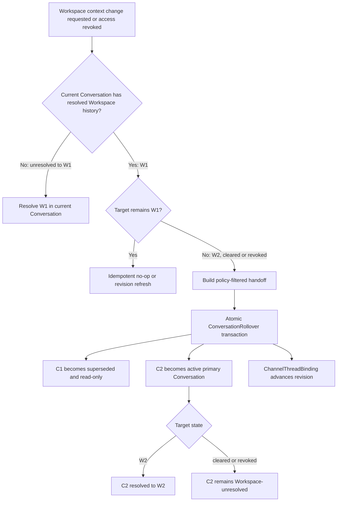
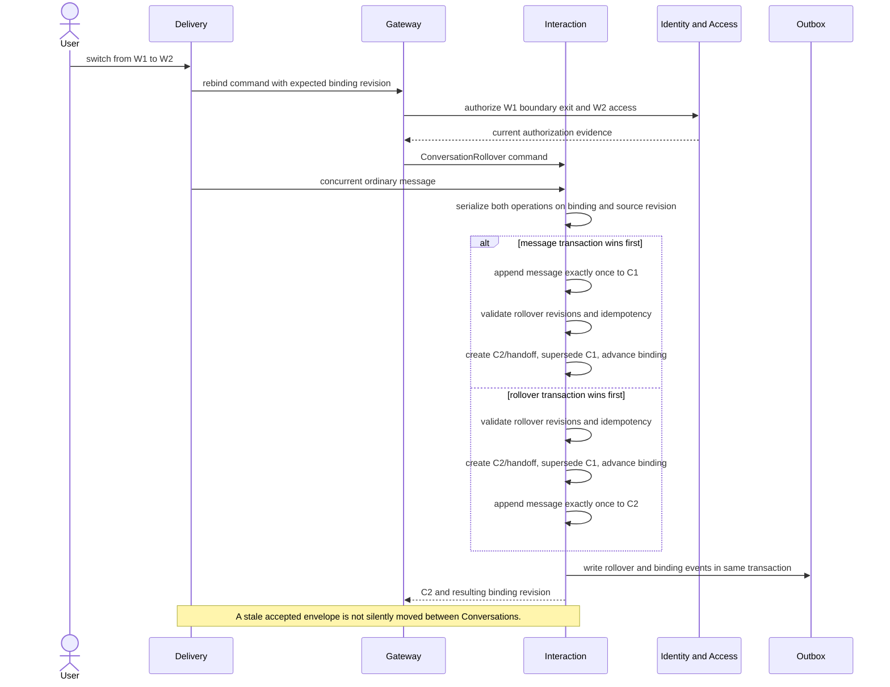
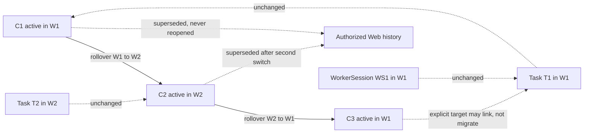

# Conversation Rollover On Workspace Rebind

## Scope

`ConversationRollover` preserves the same provider topic while replacing the primary Assistant Conversation whenever its resolved Workspace boundary changes. It prevents historical W1 context from entering W2 through prompt compilation, summaries, Evolution, search or export.

This is an Interaction-domain transition. It does not migrate Task, WorkerSession, Trace, Artifact or Workspace state.

For an explicit rollover of a channel-scoped shared Conversation, the actor must be a current controller and independently authorized for the target Workspace. `access_revoked` may be system/policy-triggered without controller intent. Controller role never authorizes protected cross-Workspace carry-over by itself.

## Boundary Rule



| Transition | Rollover | Result |
| --- | --- | --- |
| New/unresolved Conversation -> W1 | No | Same Conversation obtains its first WorkspaceContextResolution. |
| W1 -> W1 | No | Idempotent no-op or safe revision refresh; no new identity. |
| W1 -> W2 | Yes | Source superseded; successor resolved to W2. |
| W1 -> cleared | Yes | Source superseded; successor is Workspace-unresolved. |
| W1 access revoked | Yes | Source protected and superseded; successor is Workspace-unresolved with `access_revoked` evidence. |
| W2 -> W1 after an earlier W1 generation | Yes | Create another successor; never reactivate the old W1 Conversation. |

## ConversationRollover v1

```json
{
  "schema_version": "interaction.conversation_rollover.v1",
  "rollover_id": "rollover_123",
  "tenant_id": "tenant_1",
  "channel_binding_ref": {"binding_id": "binding_1", "expected_revision": 8},
  "source_conversation_ref": {"conversation_id": "conversation_c1", "expected_revision": 21},
  "target_conversation_id": "conversation_c2",
  "trigger_type": "explicit_workspace_rebind",
  "source_workspace_resolution_ref": {"workspace_id": "workspace_w1", "revision": 3},
  "target_workspace_resolution_ref": {"workspace_id": "workspace_w2", "revision": 1},
  "handoff_ref": {"handoff_id": "handoff_123", "revision": 1},
  "actor_ref": {"user_id": "user_1"},
  "intent_evidence_ref": {"type": "structured_command", "id": "command_1"},
  "resulting_binding_revision": 9,
  "idempotency_key": "workspace-rebind-command-1",
  "completed_at": "2026-07-13T10:00:00Z"
}
```

`trigger_type` is `explicit_workspace_rebind`, `explicit_workspace_clear` or `access_revoked`. Explicit triggers require authenticated user intent. `access_revoked` requires current Membership/policy revocation evidence instead of user intent.

## ConversationHandoff v1

The handoff is immutable, structured and scope-aware. It is not a free-form summary copied into a system prompt.

| Field | Meaning |
| --- | --- |
| `handoff_id`, `revision` | Stable immutable handoff identity and revision. |
| `source_conversation_id`, `target_conversation_id` | Exact lineage endpoints. |
| `handoff_mode` | `workspace_neutral` or `explicit_cross_workspace`. |
| `items` | Typed goal/constraint/assumption/blocker items with source scope and classification. |
| `source_refs` | Exact structured source fields or explicitly approved protected references. |
| `policy_ref` | Handoff classification policy id/revision. |
| `authorization_refs` | Required for every cross-Workspace source and target operation. |
| `content_digest` | Immutable content checksum. |
| `created_by`, `created_at` | Actor/model-assisted origin and audit time; model origin is not authority. |

Default `workspace_neutral` handoff may include:

- the explicit user goal stated independently of Workspace data;
- tenant/user-level constraints and preferences already authorized for the successor;
- unresolved TaskReadiness dimensions and safe assumptions;
- a generic statement that prior Workspace-scoped context was intentionally not carried.

It excludes by default:

- raw or summarized W1 Turns containing protected details;
- W1 Truth, Inspiration, repository/file/path names or document content;
- Task, WorkerSession, Trace and Artifact references;
- Tool/model output, secrets, hidden reasoning and internal errors.

An `explicit_cross_workspace` handoff names every selected source, reauthorizes W1 read and W2 target-context use, records user intent and applies the same source classification and disclosure constraints as any other protected context operation. A model-generated summary alone cannot authorize carry-over.

## Atomic Rollover And Message Routing



Transaction rules:

1. Lock/revalidate ChannelThreadBinding and source Conversation expected revisions.
2. Validate target Workspace authorization or access-revocation evidence.
3. Resolve command idempotency before creating any successor identity.
4. Create target Conversation, target resolution, handoff and rollover record.
5. Mark source `superseded`, advance binding and write Outbox in one transaction.
6. Project only currently policy-eligible participant/controller relations to the successor, preserving source role revision/evidence and never creating or promoting a controller; no eligible controller yields `control_orphaned`.
7. Perform no model, object storage, provider or remote context read inside the transaction. Protected carry-over content must be prepared and authorized before finalize.
8. Duplicate command returns the original successor and binding revision; stale competing rebind returns the current lineage without creating C3 accidentally.

## Lineage And Resource Ownership



The provider topic is a navigation and delivery surface, not a shared ownership container. Existing explicit Task/Worker/Artifact actions continue against the resource Workspace and do not change the current primary Conversation.

## Prompt, Archive And Evolution Rules

- ContextCompiler loads recent Turns and summaries only from the active Conversation generation unless an authorized handoff item is explicitly included.
- Every TurnWindow archive records Conversation id, Workspace scope snapshot, resolution revision and rollover lineage reference.
- Search and export may show lineage after per-generation authorization but cannot concatenate protected content into one unscoped transcript.
- Evolution preserves each evidence item's original user/tenant/Workspace scope. Shared provider topic, predecessor id or repeated wording is not authority to widen scope.
- User/tenant Memory may be derived under the existing publication policy; Workspace-scoped Truth cannot cross the rollover boundary without explicit eligible evidence and target scope authorization.
- A W1 WorkspaceChannelShareGrant never authorizes W2 card content. Shared rollover notices reveal Workspace names only when the corresponding ChannelDisclosureDecision allows them; otherwise Delivery uses a generic notice.

## Failure And Recovery

| Failure | Result |
| --- | --- |
| Target Workspace authorization fails | No rollover; current binding remains, command fails closed. |
| Source/binding expected revision is stale | No successor is created; caller receives current binding/lineage. |
| Transaction rolls back | C1 remains active and binding unchanged. |
| Commit succeeds but response is lost | Retry by idempotency key returns C2 and the original revision. |
| Model handoff generation fails | Continue with deterministic empty/minimal workspace-neutral handoff. |
| Explicit carry-over preparation fails | Rollover may continue without protected carry-over, or user cancels before finalize; never partially copy unknown content. |
| Access is revoked | Fence W1 context and create/require an unresolved successor with no W1 protected handoff. |
| Provider notification fails | Backend rollover remains authoritative; Delivery reconciles notification separately. |

## Required Tests

1. Unresolved -> W1 stays in one Conversation; W1 -> W1 is idempotent.
2. W1 -> W2, W1 -> cleared and access revocation create one successor and supersede the source.
3. W1 -> W2 -> W1 creates C1 -> C2 -> C3 and never reopens C1.
4. Rollover atomically creates target Conversation/resolution/handoff/lineage, updates binding, supersedes source and writes Outbox.
5. Duplicate, response-loss, stale revision and competing rebind cases create at most one successor per accepted command.
6. Concurrent ordinary messages commit to exactly one generation according to serialized binding revision.
7. Default handoff contains only workspace-neutral typed items and cannot include raw Turns or protected references.
8. Explicit cross-Workspace carry-over verifies source read, target context permission, classification, intent and exact references.
9. Existing Task/Worker/Trace/Artifact identities and Workspace ownership never change.
10. ContextCompiler, archive, search/export and Evolution preserve generation and Workspace scope without topic-based merging.
11. W1 share grant does not authorize W2 output; rollover notice degrades when disclosure decision disallows names.
12. Explicit shared-Conversation rollover rejects non-controller actors and controllers without target authorization; policy-triggered access revocation still isolates the source.
13. Successor participant/controller projection preserves only current eligible roles and creates no new controller; an orphaned successor fences control mutations.
