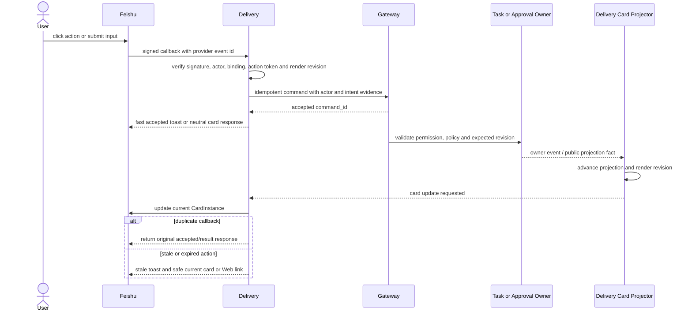

# Delivery Card Projection And Callbacks

## Scope

`DeliveryCardProjection` is the Feishu/channel-specific read model for semantic progress and bounded interaction. It uses canonical Switchback identities and owner-authorized actions but has its own layout, render revision, provider capability and delivery lifecycle.

The end-to-end shared Conversation, routing, role and Workspace/Task/Worker interaction is documented in [Delivery Interaction Design](delivery-interaction-design.md); this document remains the focused card/render/callback contract.

Card callbacks carry explicit targets under the separate [Channel Thread Binding And Explicit Target Routing](channel-thread-binding-and-routing.md) contract. An ordinary text reply under the same topic is not implicitly redirected to the card subject.

Workspace-derived shared content is additionally governed by [Workspace Channel Share And Disclosure](workspace-channel-share-and-disclosure.md). An actor's Workspace authorization is insufficient for group disclosure: the projector needs a current `ChannelDisclosureDecision`, and the renderer receives only its field allowlist.

```mermaid
flowchart LR
    accTitle: Delivery Card Projection And Command Boundary
    accDescr: Owner events and authorized display facts build a channel projection, Delivery renders it to Feishu, and callbacks return through Gateway instead of mutating Task or Worker state.

    Owners["Interaction TaskDraft / Task / Worker / Approval / Artifact owners"]
    Events["Owner events and normalized public facts"]
    Display["Durable DisplayCheckpoint summaries"]
    Disclosure["ChannelDisclosureDecision"]
    Projector["Delivery Card Projector"]
    Projection["DeliveryCardProjection"]
    Renderer["Feishu Card Renderer"]
    Instance["CardInstance and delivery state"]
    Feishu["Feishu card"]
    Callback["Delivery callback adapter"]
    Gateway["Gateway command"]

    Owners --> Events
    Events --> Projector
    Display --> Projector
    Events --> Disclosure
    Disclosure --> Projector
    Projector --> Projection
    Projection --> Renderer
    Renderer --> Instance
    Instance --> Feishu
    Feishu -->|"signed interaction callback"| Callback
    Callback -->|"authenticated idempotent intent"| Gateway
    Gateway --> Owners
    Owners -->|"new evidence"| Events
```

Delivery does not read browser caches, React renderer output or raw Trace to build a card. The projector consumes stable public facts and durable display summaries through explicit contracts.

## Projection Shape

| Field | Meaning |
| --- | --- |
| `schema_version` | `delivery.card_projection.v1`. |
| `delivery_card_projection_id` | Stable logical projection identity. |
| `tenant_id` | Tenant security boundary. |
| `channel_binding_id` | Authorized channel/chat binding. |
| `card_kind` | `task_progress`, `waiting_user`, `approval`, `result`. |
| `subject_ref` | Canonical TaskDraft, Task, WorkerSession, ApprovalRequest or Artifact subject; TaskDraft is limited to pre-Task `waiting_user` confirmation/adoption. |
| `source_projection_refs` | Owner/public projection identities and exact revisions used to render. |
| `workspace_id` | Required when the subject or any visible field is Workspace-derived. |
| `share_grant_ref` | Current WorkspaceChannelShareGrant id/revision/status; absent for minimal fallback. |
| `disclosure_decision_ref` | Exact ChannelDisclosureDecision and policy/provider snapshot revision used for the visible field allowlist. |
| `disclosure_profile` | `minimal_notice` or P0 `workspace_summary`. |
| `projection_revision` | Monotonic logical projection revision. |
| `render_revision` | Monotonic provider-render revision used for callback fencing. |
| `status` | `active`, `waiting_user`, `completed`, `failed`, `cancelled`, `expired`, `degraded`. |
| `title` | Short channel-safe title. |
| `summary_blocks` | Typed, bounded and sanitized text/facts suitable for the provider. |
| `attention` | Waiting reason, severity and deadline summary. |
| `available_actions` | Permission-filtered DeliveryActionDescriptors. |
| `web_deep_link` | Canonical Web route; contains no bearer authority and authorizes each opener independently. |
| `provider_capability_ref` | Versioned provider/card capability snapshot. |
| `interaction_expires_at` | Provider/policy-derived interaction cutoff. |
| `update_expires_at` | Provider/policy-derived update cutoff. |
| `generated_at` | Projection generation time. |

`source_projection_refs` makes channel rendering explainable and prevents an old card update from silently overwriting a newer owner state. `render_revision` changes whenever visible card content/action set changes, even if the provider message id stays the same.

The projector must treat `allowed_fields` from ChannelDisclosureDecision as its maximum input. It cannot fetch a richer owner View to fill an omitted section. Without an active grant, a shared card uses `minimal_notice`, names no protected subject and carries only a canonical Web route. Provider-supported per-user ephemeral cards may show actor-private details after normal actor authorization.

## Card Kinds

| Kind | Purpose | Typical content |
| --- | --- | --- |
| `task_progress` | Coalesced semantic execution status | Task title, current stage, Worker/Run state, latest checkpoint summary, elapsed/waiting state |
| `waiting_user` | Request missing information, exact ready TaskDraft creation/adoption, or a bounded choice | reason, prompt/draft summary, allowed create/adopt/choice/input action, deadline, Web link |
| `approval` | Present a current ApprovalRequest | operation/scope/risk, once/session choices when allowed, expiry, Web review link |
| `result` | Show terminal or stage result | outcome, report summary, patch/artifact refs, failure/recovery action, Worker continuation link |

P0 does not mirror token-by-token output. Text and progress updates are coalesced and rendered at semantic boundaries, policy intervals and terminal state. This keeps provider updates bounded and avoids pretending a collaboration card is a Coding Agent terminal.

## Action Subset

| Action | Inline in P0 | Rule |
| --- | --- | --- |
| `create_task` | conditional | Only a current `waiting_user` TaskDraft projection; binds exact draft/spec/readiness/Workspace/render revisions and creates intent, not success. |
| `adopt_task_draft` | conditional | Non-initiator explicitly forks the current visible TaskDraft; creates a new actor-owned draft and never creates Task or consumes source. |
| `submit_choice` | yes | Only choices present in the current owner projection. |
| `submit_text` | yes | Bounded clarification/waiting-user input; size/content policy applies. |
| `approve_once` | conditional | Current ApprovalRequest explicitly permits once scope. |
| `approve_session` | conditional | Current ApprovalRequest and policy explicitly permit WorkerSession scope. |
| `cancel` | conditional | Canonical candidate identifies exact Task/Run and expected Task revision; callback actor must be TaskInitiator or current Workspace owner using emergency cancel. |
| `accept` | conditional | Manual Task is `delivered`; callback actor must be TaskInitiator. |
| `rework` | conditional | Task is non-terminal or `delivered`; callback actor must be TaskInitiator and the action starts a new WorkerRun. |
| `open_web` | link | Opens canonical Task/Worker/Artifact detail. |
| `review_artifact` | link | Full report/patch review happens on Web. |
| `continue_worker` | link | Opens WorkerDetail chat; card does not emulate unrestricted Agent chat. |

Patch apply, branch publish, PR creation, production writes, Skill installation, arbitrary Tool calls and any interaction the card cannot explain completely are Web-only. P0 has no time-budget or deadline-extension action; the fixed AgentTurn deadline may be displayed but never changed by a card.

Ready TaskDraft confirmation or adoption does not add a fifth card kind. The Interaction-owned draft supplies the current actions; Delivery only projects and fences them. `create_task` succeeds only for the draft initiator. Another participant must invoke `adopt_task_draft`, receive a new actor-owned draft and confirm that new revision. A plain topic reply such as "确认" has no immutable `task_draft` target and therefore remains an Assistant Turn.

A shared card cannot prove that every viewer may operate a Task. Its cancel/accept/rework descriptor therefore means only that the Task state currently permits the command shape. Delivery maps and forwards the actual clicking actor; Gateway and Task Orchestration re-evaluate TaskInitiator, Workspace-owner emergency-cancel rule, Membership, policy, expected Task revision and constraints. An unauthorized click fails closed and does not consume the action.

## Callback Flow

Callback rules:

1. Verify provider signature/encryption and map provider user to an active Switchback actor.
2. Load CardInstance and current DeliveryCardProjection; compare action id, render revision and expiry.
3. Re-evaluate Tenant/Workspace membership and the current canonical available action.
4. Derive a stable idempotency key from provider callback identity plus card/action identity.
5. Submit the Gateway command with actor and channel intent evidence; callback data itself is not authority.
6. Return within the provider deadline with accepted/toast or a safe immediate card response.
7. Never mark business success from callback acceptance. Wait for owner evidence and projector convergence.

## CardInstance And Rendering

CardInstance is Delivery-owned provider state:

- provider/channel and card/message identity;
- projection id and last applied render revision;
- template/card schema version;
- send/update attempt and provider result;
- last successful render checksum;
- interaction/update availability;
- reconciliation and terminal delivery status.

Rendering is deterministic for `(projection_revision, disclosure_decision_ref, provider_capability_ref, locale)`. The provider adapter may use a versioned template or generated card JSON, but template ids and Feishu JSON fields do not enter Task/Worker/Approval contracts.

An update request with an already-applied render revision is a no-op. A lower revision is rejected. If provider response is lost, Delivery uses provider lookup/reconciliation when supported; otherwise it records unknown delivery outcome and avoids creating a second business command.

## Provider Capability And Expiry

Feishu currently requires a quick callback response and applies finite card update/interaction windows. These values change independently of Switchback, so `DeliveryProviderCapability` stores:

- callback response deadline;
- update and interaction windows;
- supported card/schema versions and components;
- immediate/delayed/streaming update support;
- payload, input and action limits;
- rate-limit and reconciliation capabilities.

At the time of this design, official Feishu documentation states a 3-second callback response requirement, a 14-day update window and a 30-day interaction window for sent cards. The adapter must verify these values against its current provider profile rather than hard-code them in domain logic.

When inline interaction is unavailable or expired, the card becomes read-only and shows an authorized Web deep link. Expiry never expires the underlying Task, WorkerSession or ApprovalRequest by itself.

When a WorkspaceChannelShareGrant is suspended, revoked or expired, or the provider audience/security snapshot is stale or unknown, rich rendering stops even if the CardInstance is otherwise updateable. Delivery best-effort updates or recalls its earlier message and records the cleanup outcome. Provider limits, already delivered notifications and user copies mean Switchback cannot promise historical erasure.

## Failure Matrix

| Failure | Result |
| --- | --- |
| Duplicate provider callback | Same idempotent command/result; no second side effect. |
| Stale render revision | Reject action, refresh/degrade card, offer current Web link. |
| User mapping or membership invalid | Fail closed without disclosing protected subject. |
| Share grant missing/stale/revoked or audience changed | Render minimal notice; fence rich updates and best-effort redact/recall prior card. |
| Gateway accepts but response is lost | Query by idempotency/callback identity before retry. |
| Owner rejects expected revision | Project current state and show stale-action result. |
| Actor is neither TaskInitiator nor eligible Workspace-owner emergency canceller | Reject without consuming the action or changing Task; render actor-safe current state or Web link. |
| Provider update response is lost | Reconcile provider state or record unknown delivery outcome; do not replay business command. |
| Card update window elapsed | Mark CardInstance read-only/degraded; owner workflow continues. |
| Unsupported critical interaction | Do not render a misleading button; deep-link to Web. |

## Required Tests

1. Projection fixtures for all four card kinds, source revision and permission filtering.
2. Deterministic rendering, monotonic render revision, duplicate/stale update fencing and locale variants.
3. Signature, actor/binding/membership, opaque token, action freshness and expected-revision checks.
4. Callback deadline, duplicate delivery, response loss, idempotent Gateway command and causal projection convergence.
5. Inline action allowlist and Web-only rejection for patch apply/publish/PR/production/Tool/Skill actions.
6. Provider expiry, unsupported component, rate-limit, update-window and interaction-window degradation.
7. Card callback cannot directly mutate Task, Worker, Approval, Artifact or create an unvalidated TaskSpec.
8. Card contains no secrets, raw Trace, hidden reasoning, private prompt, Tool stdout, full report/patch, unauthorized ids or unbounded Agent output.
9. Grant/profile/source classification intersection, provider audience expansion, stale snapshot, revoke/expiry downgrade and residual-exposure audit.
10. Shared action callbacks reauthorize each actor; actor-private detail uses ephemeral card or Web and the deep link carries no bearer authority.
11. Task cancel/accept/rework callbacks cover initiator, owner emergency cancel, editor/reviewer/controller denial, stale revision and terminal Task rejection; AgentTurn deadline has no callback action.

## References

- [Channel Thread Binding And Explicit Target Routing](channel-thread-binding-and-routing.md)
- [Feishu card overview](https://open.feishu.cn/document/feishu-cards/feishu-card-overview)
- [Feishu card callback communication](https://open.feishu.cn/document/feishu-cards/card-callback-communication?lang=zh-CN)
- [Feishu card callback handling](https://open.feishu.cn/document/uAjLw4CM/ukzMukzMukzM/feishu-cards/handle-card-callbacks?lang=zh-CN)
- [Feishu upgraded card capabilities](https://open.feishu.cn/document/feishu-cards/feishu-card-cardkit/cardkit-upgraded-version-card-release-notes?lang=zh-CN)
