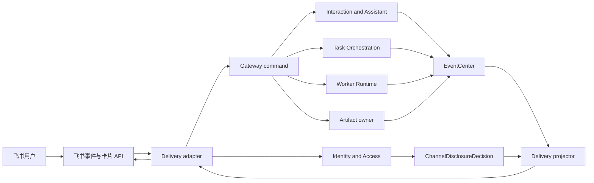
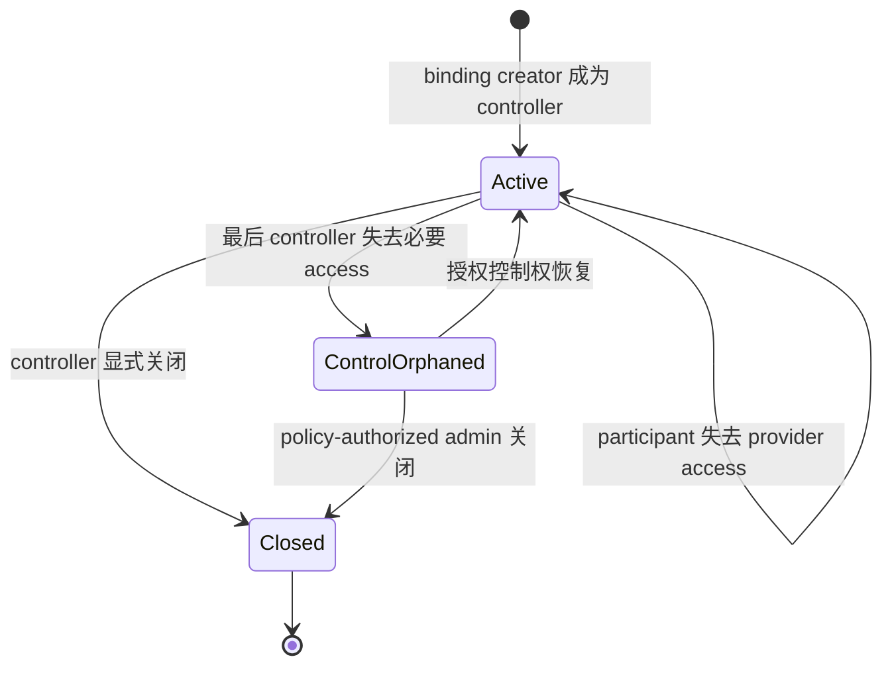
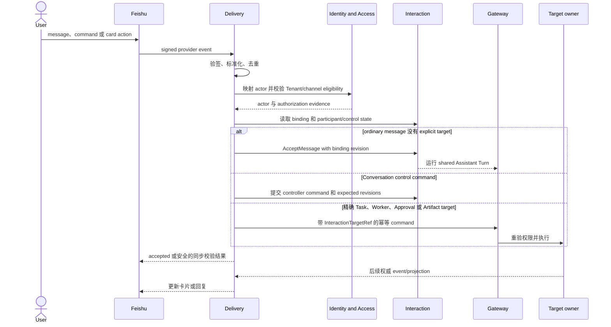
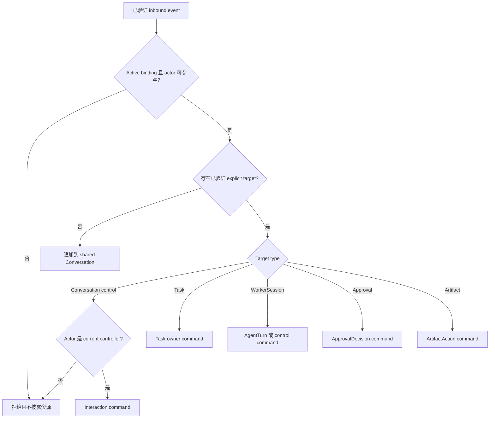
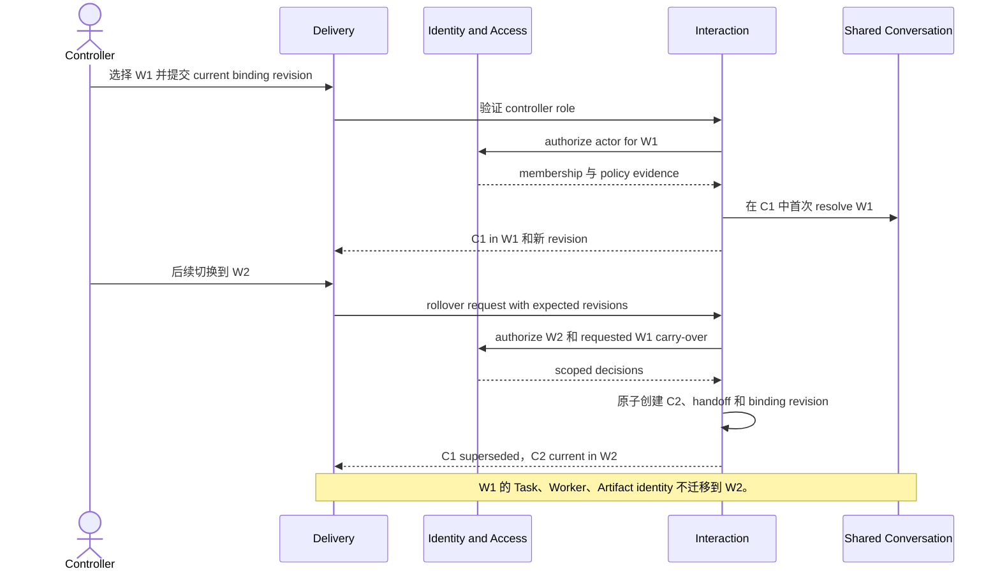
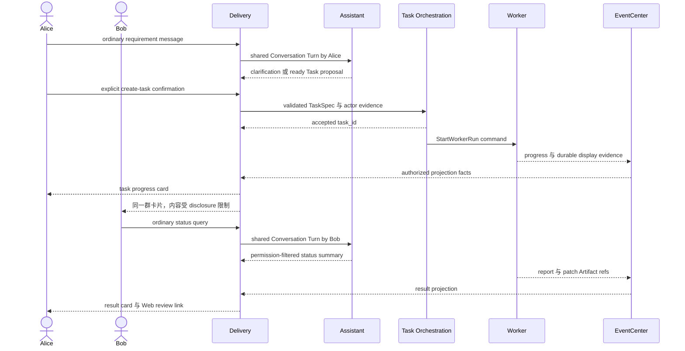
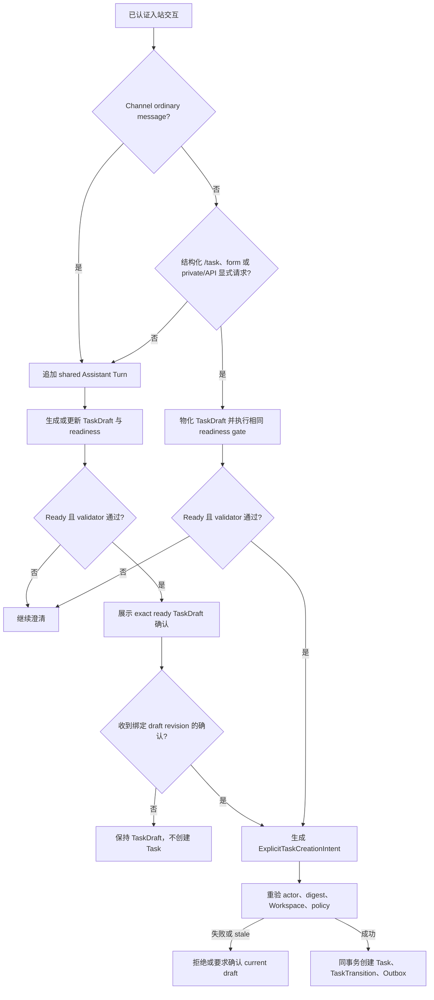
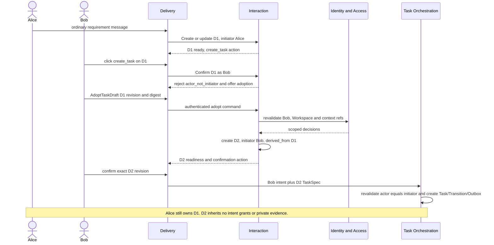
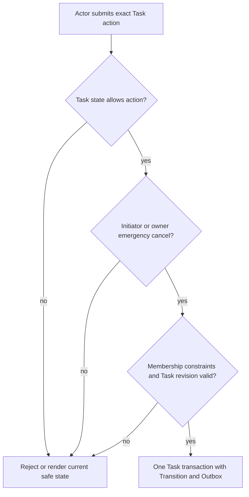

# Delivery 整体交互设计

## 1. 文档目的与范围

本文是 Switchback Delivery 交互的端到端设计入口，以 P0 飞书群话题为参考通道，串联身份映射、共享 Assistant Conversation、Workspace 选择与 rollover、Task/Worker 显式操作、群卡片、披露控制和失败恢复。

各专项文档仍是字段和局部协议的权威来源。本文重点回答三件事：用户在飞书里做了什么、请求经过哪些 owner、最终由谁保存和推进状态。

Delivery 是通道适配器和交互路由器。它不拥有 Assistant 推理、Task 生命周期、Worker 执行、审批含义、Workspace 权限或 Artifact 操作。

## 2. 核心原则

1. 群普通对话共享一个历史，但每个 Turn 和动作都保留真实操作者。
2. Conversation controller 负责协调共享上下文，不因此获得 Workspace 或执行权限。
3. 没有显式目标就进入 Assistant Conversation，绝不猜测“最近的 Worker”。
4. 通道回调 `accepted` 只表示命令已接收，不表示业务动作成功。
5. 群共享可见性与单个 actor 的操作权限是两个独立裁决。
6. Delivery 只保存 provider binding、投影、渲染和投递状态，领域 owner 保持权威。
7. Provider 能力不足可以改变展示方式，但不能改变路由、幂等和鉴权语义。

## 3. 职责边界

| 关注点 | 权威 owner | Delivery 的职责 |
| --- | --- | --- |
| Provider 身份与 channel event | Provider adapter + Identity & Access mapping | 验签、标准化 id、映射 actor、保留证据。 |
| 共享 Conversation 与参与角色 | Interaction | 解析 binding，提交 Turn/control command，渲染结果。 |
| Workspace membership 与权限 | Identity & Access | 请求裁决，不从 provider membership 推断。 |
| Lightweight Task | Task Orchestration | 提交显式 TaskSpec/command，消费 owner event；Task 不复制 Worker 执行状态。 |
| WorkerSession 与 AgentTurn | Worker Runtime | 路由经验证目标，投影安全状态。 |
| Approval 语义 | 请求 owner + Identity & Access | 收集精确 actor 决定，不自行解释授权范围。 |
| 群可见 Workspace 信息 | Identity & Access + source owner | 只渲染 `ChannelDisclosureDecision` 允许的字段。 |
| 卡片与 provider message | Delivery | 管 projection/render revision、provider id、更新和对账。 |

## 4. 规范交互模型

| 概念 | 用途 | 所有权规则 |
| --- | --- | --- |
| `ChannelBinding` | 把 provider channel 安装/安全边界映射到 Switchback Tenant 配置。 | Delivery adapter 状态。 |
| `ChannelThreadBinding` | 把 provider topic/chat-root scope 映射到一个 current primary Conversation generation。 | Delivery 保存关系，Conversation identity 来自 Interaction。 |
| `ConversationScope` | 区分 `user` 与 `channel` 交互容器。 | Interaction value object。 |
| `ConversationParticipant` | 记录 channel Conversation 中 actor 的 `participant`/`controller` 角色。 | Interaction 版本化、可审计事实。 |
| `InboundInteractionEnvelope` | 不可变 provider event、actor、binding revision、target 与幂等证据。 | Delivery 创建的 ingress fact。 |
| `InteractionTargetRef` | 精确 Assistant/Task/Worker/Approval/Artifact target。 | 提交 Gateway 前验证。 |
| `TaskCreationTriggerPolicy` | 按 channel/user/API scope 判断哪些 authenticated surface 能生成 Task 创建意图。 | 平台/组织策略；不判断 readiness。 |
| `ExplicitTaskCreationIntent` | 绑定 actor、exact TaskDraft/TaskSpec/readiness/Workspace revision 的创建授权证据。 | Gateway/Delivery 记录，Task Orchestration 重验和消费。 |
| `WorkspaceContextResolution` | 为未来 Assistant context 显式选择默认 Workspace。 | Interaction 拥有，不是授权。 |
| `ConversationRollover` | 离开已有 resolved Workspace 时创建 successor。 | Interaction 原子状态转换。 |
| `WorkspaceChannelShareGrant` | 允许一个 provider group audience 查看 bounded Workspace projection。 | Identity & Access 拥有，不是动作授权。 |
| `DeliveryCardProjection` | 面向 channel 的进度和有限动作语义读模型。 | Delivery projection。 |
| `CardInstance` | Provider message/render/delivery/reconciliation 状态。 | Delivery provider 状态。 |

### 4.1 共享 Conversation 角色矩阵

| 操作 | Participant | Controller | 始终额外要求的权限 |
| --- | :---: | :---: | --- |
| 发送普通 Assistant 消息 | 是 | 是 | 当前 provider mapping、Tenant access、active binding。 |
| 查看 channel-safe 回复 | 是 | 是 | actor access；涉及 Workspace 时还需 audience disclosure。 |
| 首次选择 Workspace | 否 | 是 | 当前 target Workspace membership 和 policy。 |
| Rebind/clear Workspace 并 rollover | 否 | 是 | target Workspace access；携带 protected context 时还需 source read。 |
| 关闭 channel Conversation | 否 | 是 | Conversation/binding expected revision 和 lifecycle policy。 |
| 委派或撤销 controller | 否 | 是 | participant expected revision；不得移除最后 controller。 |
| 创建 Task | 可基于显式意图 | 可基于显式意图 | actor-specific readiness、Workspace、policy、TaskSpec validation。 |
| Continue/interrupt/steer Worker | 可基于显式 target | 可基于显式 target | actor-specific WorkerSession 与 Workspace 权限。 |
| 批准操作 | 可基于显式 target | 可基于显式 target | actor 必须是该 ApprovalRequest 的合格审批人。 |
| 查看/apply/publish Artifact | 可基于显式 target | 可基于显式 target | actor-specific Artifact、Workspace 和 provider 权限。 |

最后一列没有任何“controller 可替代”规则：controller 只负责 Conversation 协调。

### 4.2 Participant 与 Controller 生命周期

Provider group membership 只是 channel 参与资格证据，不是 controller authority。成员关系变化后，历史 Turn 仍保留原 actor。

## 5. 入站路由

### 5.1 处理时序

### 5.2 路由决策

“继续刚才那个 Worker”这类纯文本不是 explicit target。它先成为 Assistant Turn；Assistant 可以澄清，或在明确目标后产生一条独立认证 command。卡片 callback、结构化命令或注册了不可变路由 metadata 的 bot action 才能提供 explicit target。

## 6. 共享 Conversation 与 Workspace

### 6.1 首次使用

1. 第一个合格用户创建或激活 `ChannelThreadBinding`，成为首个 controller。
2. 系统创建未选择 Workspace 的 `channel` Conversation。
3. 其他 mapped group member 在第一次有效交互被接受时物化为 participant。
4. 未解析 Workspace 时可以做 tenant/user-scope 的脑暴和澄清。
5. Workspace-derived context、TaskSpec 和 WorkerSession 必须等待 controller 显式选择，并通过 target Workspace 授权。

Controller 可以协调群默认上下文；其他 participant 仍可在自己有权限时，对明确的 Task/Worker 发起显式动作。

### 6.2 Workspace 选择与 Rollover

如果当前 `WorkspaceChannelShareGrant` 不允许该 provider audience 查看 W1/W2 信息，共享回复只能包含 `minimal_notice` 和逐用户鉴权 Web link。选择 Workspace 不会静默创建 share grant。

Rollover 同事务把 C1 中当前仍满足 policy 的 participant/controller 投影到 C2，并记录来源 role revision。它不会新增或提升 controller；如果 C2 没有任何仍合格的 controller，C2 以 `control_orphaned` 状态开始。

## 7. Task 与 Worker 交互

### 7.1 端到端 Task 示例

这个例子刻意把共享 Conversation 与 Task authority 分开：

- Alice 的显式意图和 Workspace authorization 创建 Task。
- Bob 只能看到 channel-authorized 字段；点击动作时按 Bob 自己重新鉴权。
- Conversation rollover 或 controller 变化不会终止 Task。
- 完整 report、patch review 和 unrestricted Worker chat 进入 Web，除非未来 provider profile 能安全承载。

### 7.2 直接操作 Worker

直接 Worker command 必须有精确 `worker_session_id` 和 actor-specific permission，不能改变 channel primary Assistant Conversation 或共享 Workspace default。P0 卡片可 deep-link 到 WorkerDetail；unrestricted prompt/queue/interrupt/steer 默认留在 Web，除非 provider interaction 同时具备不可变 Worker target 和足够的输入语义。同一 WorkerSession 只暴露一个 active WorkerRun 作为 queue/interrupt/steer 目标；此处 `queue` 是 Agent message queue，不是等待 Session execution slot 的 SessionTaskQueue。

### 7.3 Task Readiness 与创建意图

P0 采用两个独立门槛：

- `TaskReadinessAssessment`：回答“这份任务是否已具备可执行规格”。
- `ExplicitTaskCreationIntent`：回答“这个已认证 actor 是否明确要求现在创建一项可跟踪 Task”。

Ready 不代表用户要执行，显式创建动作也不能绕过 readiness、validator、Workspace resolution、权限或审批。共享群聊的规则如下：

| Scope / 交互面 | 路由与结果 |
| --- | --- |
| Group `ordinary_message` | 始终先形成 shared Assistant Turn；即使一次即可 ready，也只生成 ready TaskDraft 和确认入口，不直接创建 Task。 |
| Group `/task` 或结构化任务命令 | 字段完整时可零问生成 ready assessment 并直达创建；不完整时进入 Assistant 补全，最终 draft 仍需重新确认。 |
| Group create-task form/button | 表单提交绑定 exact draft/spec digest；校验通过后可直达创建。 |
| Group ready-draft confirmation | 使用 `waiting_user` 卡片或注册 bot action，绑定 exact TaskDraft/render revision；自由文本“确认”若没有该 target 仍是 ordinary message。 |
| P2P/private `user` Conversation | 策略可把语义明确的 create/execute instruction 认定为 `explicit_private_request`；普通咨询仍进入 Assistant。 |
| Authenticated API | 显式 create endpoint/request 可直达相同 readiness、intent、authorization 和 idempotency gate。 |

`ExplicitTaskCreationIntent` 必须绑定 actor、interaction scope/source evidence、channel binding 与 Conversation generation、TaskDraft revision、TaskSpec digest、readiness assessment、Workspace resolution、trigger policy revision、expiry 和 idempotency key。TaskDraft/TaskSpec/readiness/Workspace/generation 任一变化都会使旧确认 stale；系统不得把确认自动迁移到新 draft 或 rollover successor。

重复点击、provider 重投或 Gateway response loss 只返回原 Task identity。创建 Task 不改变 primary Conversation、default Workspace 或任何 current focus。Controller role 也不授予 Task 创建权限。

### 7.4 Shared TaskDraft ownership 与 Adoption

P0 使用 initiator-bound 方案：每条 TaskDraft lineage 有不可变 `initiator_user_id`，只有该 initiator 可以确认并创建 Task。其他 participant、controller 或协作补充需求的人都不能对原 draft 生成创建意图。

其他 participant 若希望继续执行，必须显式调用 `AdoptTaskDraft`。Adoption 是 fork，不是 transfer：系统创建新 TaskDraft id，把 adopter 设为 initiator，并记录 source draft revision/digest lineage；原 draft 不变。新 draft 重新过滤 context refs、重验 Workspace/权限、生成 readiness 和 digest，然后由 adopter 再次确认。

边界规则：

- Shared Turn contribution 只推进 draft revision，不改变 initiator。
- `create_task` callback 必须校验 clicking actor 等于 draft initiator；失败不会自动转成 adoption。
- Adoption 必须来自 `/task adopt`、Web 或 registered bot action，并绑定 exact source revision、Conversation generation、Workspace resolution 和 actor。
- 原 initiator 仅离线时，source draft 可正常被 adopt；原 initiator 权限导致 readiness stale 时，只要 payload 仍可读且 generation/scope 未变，也可以 fork，但必须完全重验 adopter。
- Conversation rollover、Workspace mismatch、source consumed/cancelled 或受保护 context 不可读时 fail closed。
- 同一 actor 重复 adopt 同一 source revision 返回原 D2。不同 actor 的相同 digest 是不同 lineage，允许形成不同 Task；平台只提示可能重复，不自动合并。
- Controller role 不提供 confirm 或 adopt 特权。

### 7.5 Task 验收、返工与动作权限

P0 Task 是轻量交付记录，状态为 `queued/running/waiting_user/delivered/completed/failed/cancelled`。Task 创建后固化 TaskInitiator；可见性、Shared Conversation role 与 WorkspaceRole 不等于 operate 权限。

同一 WorkerSession 在 P0 最多绑定一个 Task 和一个 active 顶层 WorkerRun。只有 registered card action/command 携带 exact `worker_session_id` 并生成 WorkerSessionTargetIntent 时，新 Task 才进入既有 Session；复用会继承当前 WorkingCopy、Agent context 和未提交变更。普通 Task 创建没有 exact target 时先保持 `queued`，由平台分配新 WorkerSession。Delivery 不得根据最近活动、同 Workspace、唯一 idle Session、related ref 或模型文本自动选 Session。

繁忙的显式目标 Session 只排队，不发送 interrupt；需要并行、clean 或 exact-base 时用户在 Web 选择新 WorkerSession。`delivered` Task 通常仍占有 Session binding，直到 accept/cancel/其他终态释放，以保证返工继续指向同一 Agent 和 WorkingCopy；唯一 P0 例外是 absolute expiry 成功 fencing 后释放旧 slot 并保留 TaskSessionLineage。卡片只显示 `queued:allocating_session` 或目标 Session 等待摘要，不暴露不存在的 queue position。

Tenant/User continuity quota 默认 10。`waiting_user`、`idle` 和尚未对账完成的 `lost` Session 仍占槽位；Task 与 WorkerSessionContinuation 的新 Session 请求在满额时进入 SessionAllocationQueue。Task 保持 `queued`、无 `worker_session_id`；Continuation 保持 pending allocation。Delivery 只显示 owner projection 给出的 `used/limit`、容量等待位置和 Web deep link，不自行统计、不暗示已有 Worker，也不触发自动复用/关闭。

SessionAllocationQueue 是 Tenant/User 下 Task/Continuation 尚未分配 Session 的容量 FIFO；SessionTaskQueue 是 exact Session 内等待 execution slot 的 FIFO。两者必须使用不同文案、sequence 和 deep link。飞书卡片可以提供当前 actor 有权执行的 cancel 与 Web 改派入口，但不提供 priority、reorder 或 preempt；Task 展示 priority 不影响任一顺序。队列已有 Task 时，通道消息默认仍回 Assistant，显式 Worker standalone prompt 也不能越过目标 Session 队头。

`closed/expired` Worker 卡片只能展示权限过滤后的只读结果和 Web deep link。若 provider card action 能稳定绑定 exact source revision/checkpoint，可展示“在新 Worker 中继续”；Delivery 只把真实 actor 与 opaque action target 交给 Gateway，Gateway/Worker Runtime 重新鉴权并创建 WorkerSessionContinuation。卡片不得写“恢复/重开”，不得继承旧 Session 的 approval、repository Grant、Secret、queue 或 AgentSession，也不得在分配完成前展示新 Worker identity。

Task-bound absolute expiry 使用更具体的 `ContinueTaskInNewWorker`：`queued/running/waiting_user` Task 卡片显示 `waiting_user:worker_session_expired` 和 initiator-only“在新 Worker 中继续”；`delivered` Task 继续显示 accept，只有 rework 才触发新 Worker。卡片必须展示 partial/complete Artifact 标记和旧 Worker 只读 deep link。fencing 未证明或外部副作用为 unknown 时只显示核查状态，不暴露可执行 continuation/retry。续作不要求时间预算确认；新 Worker 中每个实际 AgentTurn 自动使用固定 24 小时 hard deadline。

| Action | 默认允许 | 明确不允许 | 额外约束 |
| --- | --- | --- | --- |
| `accept` | TaskInitiator | owner/editor/reviewer/controller/普通 participant 仅因角色操作 | 仅 manual Task 的 `delivered` 状态。 |
| `rework` / `continue` | TaskInitiator | 其他角色仅因可见性操作 | Task 非终态或 `delivered` 且 current Session live；创建新 WorkerRun 并回到 `running`。 |
| `continue_task_in_new_worker` | TaskInitiator | owner/editor/reviewer/controller 仅因角色操作 | 绑定 exact expiry outcome/checkpoint；Task 先进入 queued allocation，成功后才创建新 Run/回到 running。 |
| `cancel` | TaskInitiator；current Workspace owner emergency cancel | editor、reviewer、controller、普通 participant 仅因角色操作 | 只作用于可取消 Task；owner 不获得其他动作。 |
| `reassign_queued_session` | TaskInitiator | owner/editor/reviewer/controller 仅因角色操作 | 仅 queued；existing Session 需新的 exact target intent 并继承其当前状态，fresh/exact-base 则分配新 Session。 |

P0 不实现 TaskActionGrant。Delivery shared card 上的 `cancel`/`accept`/`rework` 只是 action candidate，不是对所有观看者的授权；Callback 必须映射真实 clicking actor 并重验 expected Task revision。固定 AgentTurn deadline 只读展示，不存在增加时间的表单或 callback。

Task `delivered` 后，accept 进入 `completed`，rework 创建新 WorkerRun 并回到 `running`。若原 Session 已 absolute-expired，accept 不依赖 live Worker；rework 先显式创建新 Worker，Task 在 allocation 期间为 queued。`completed/failed/cancelled` 后继续 Worker chat 是 standalone Run；只有显式创建意图才创建新 Task。ApprovalGrant 只表示受保护操作授权，不能延长 AgentTurn。

WorkerRun 启动后，Delivery 只投影 `inherit_current/fresh_session/exact_base`、base revision 与 dirty/unknown 摘要；完整 WorkerRunStartSnapshot 和 WorkingCopy manifest 留在权限受控的 Web/Trace 入口。Delivery 不拥有或重建该 snapshot。

## 8. 卡片投影与动作

P0 card kind 为 `task_progress`、`waiting_user`、`approval` 和 `result`。

| 展示面 | 适合承载的内容 | 交互规则 |
| --- | --- | --- |
| Shared group card | Bounded title、coarse stage/status、safe summary、Artifact type/count；`waiting_user` 可承载 ready TaskDraft 确认和 adoption 入口。 | 需要 current disclosure decision；每次 callback 重验 actor；confirm/adopt 绑定 exact draft/render revision；Task accept/rework/cancel 重验 fixed P0 actor rule。 |
| Per-user ephemeral card | Actor-private choice、approval detail 或 protected prompt。 | 绑定精确 actor 和 expiry。 |
| Web deep link | Full report、patch/diff、Trace、unrestricted Worker chat、apply/publish、复杂表单。 | Link 只携带 identity，不携带 bearer authority；Web 对 opener 鉴权。 |

Callback 流程固定为：

1. 校验 provider signature 和 callback identity。
2. 映射点击 actor，不能复用原消息发送者的权限。
3. 校验 binding、CardInstance、action token、render revision 和 expiry。
4. 重验 exact owner action 与 expected revision。
5. 提交一个幂等 Gateway command。
6. 在 provider deadline 内返回 acknowledgement。
7. 等待 owner evidence 后再渲染业务成功或失败。

## 9. 状态所有权与事件流

| 状态 | 保存方 | 更新依据 |
| --- | --- | --- |
| Provider event dedupe 和 delivery attempt | Delivery | Provider event/API result。 |
| Binding/provider capability/security snapshot | Delivery adapter | Provider metadata 与 reconciliation。 |
| Conversation、participant、controller、Turn、rollover | Interaction | Authenticated command 与 accepted message。 |
| Workspace membership/share grant/disclosure decision | Identity & Access | Membership、policy、provider audience evidence。 |
| Task/TaskTransition/ScheduledCommand | Task Orchestration | Owner command 与 transition。 |
| WorkerSession/WorkerRun/AgentTurn | Worker Runtime | Task/direct command 与 runtime evidence。 |
| DeliveryCardProjection/CardInstance | Delivery projection store | Owner event + disclosure decision。 |
| Timeline/Web view | Frontier | EventCenter normalized event。 |

Delivery 经 EventCenter 消费 owner event，并可重建 channel projection。Provider card 永远不是 Task、Worker 或 Approval 的恢复事实源。

## 10. 幂等与顺序

| 操作 | Primary identity/fence | 重复行为 |
| --- | --- | --- |
| Ordinary message | provider message id + content revision + binding revision | 至多创建一个 Turn。 |
| Card callback | provider action/callback id + CardInstance/action revision | 至多提交一个 owner command。 |
| Controller delegation | command idempotency key + expected participant revision | 返回原 role change 或 stale revision。 |
| Workspace selection | command key + expected Conversation/binding revision | 返回原 resolution 或 current conflict。 |
| Conversation rollover | command key + source/binding revision | 至多创建一个 successor。 |
| Task creation | explicit intent key + TaskSpec digest | response loss 后返回原 Task identity。 |
| Session capacity wait | tenant + user + task + allocation sequence | owner projection 显示稳定位置；无 Worker identity，不生成 SessionTaskQueue position。 |
| Existing Session target | actor + exact worker_session_id + source/render revision + idempotency key | 生成一个 WorkerSessionTargetIntent；重复返回原 intent，不按最近 Session retarget。 |
| Task action | actor + task/target + expected Task revision + idempotency key | 重验 initiator/owner emergency-cancel 规则；重复返回原 Transition，不重复 accept/rework/cancel。 |
| Task expiry continuation | actor + task + expiry outcome/checkpoint + expected Task revision + idempotency key | 重复返回原 queued/allocation result；不创建第二 Session request 或 WorkerRun。 |
| Provider card update | projection/render revision + provider message id | 对账 current render，不重复业务 command。 |

Provider timestamp 只用于审计，不是 ordering authority。Conversation message acceptance 与 rollover 按 binding/source revision 串行化。领域 owner event 保留 owner stream sequence；Delivery 遇到 gap 必须 repair/replay，不能自行发明业务顺序。

## 11. 失败与恢复矩阵

| 故障或竞争 | 必须产生的结果 |
| --- | --- |
| 无效 signature 或 unmapped actor | 拒绝，不披露 binding 或 resource existence。 |
| Provider 重复投递 | 返回幂等 acknowledgement，不创建第二 Turn/command。 |
| Binding 或 participant revision stale | 拒绝并展示 current safe state，不自动 retarget。 |
| 非 controller 尝试 Workspace rebind | 拒绝 control action；符合 policy 时仍可普通对话。 |
| 最后 controller 失去 access | 进入 `control_orphaned`；显式恢复前冻结 context/lifecycle mutation。 |
| 两个 controller 并发 rebind | 一个 expected revision 成功；另一个看到 current successor 后再决定。 |
| Actor 缺 target Workspace access | 不创建 resolution、rollover 或 Task。 |
| Ready ordinary group message | 只生成 Assistant Turn/ready TaskDraft/确认入口，不直接创建 Task。 |
| 自由文本“确认”没有 exact draft target | 作为普通 Assistant Turn；可重新展示 current ready-draft action，但不直接创建 Task。 |
| 非 initiator 点击 `create_task` | 拒绝且不生成 intent；可返回显式 AdoptTaskDraft 入口，但不能自动接管。 |
| AdoptTaskDraft 重复或不同 actor 并发 | 同 actor/source revision 返回原 adopted draft；不同 actor 创建不同 lineage，不按 digest 合并。 |
| TaskDraft/readiness/Workspace/generation 在确认前变化 | 旧 action/intent stale；展示 current diff 并要求重新确认，不迁移旧意图。 |
| 重复 task confirmation 或创建响应丢失 | 返回相同 Task identity，不创建第二 Task/Transition/Outbox。 |
| Task 创建没有 exact WorkerSession target | 保持 queued 并分配新 Session；不加入任何已有 Session 队列。 |
| Tenant/User continuity quota 已满 | Task 保持 queued/unassigned 并进入 SessionAllocationQueue；卡片显示 used/limit、位置和 Web 管理入口，不自动选择或关闭 Session。 |
| terminal Worker 请求续作 | source 卡片保持只读；registered action/Web 显式选择 exact checkpoint，进入统一 allocation FIFO，成功后链接新 Worker identity。 |
| active Task 的 Session absolute-expired 且 fencing 成功 | 旧 Run 显示 `timed_out:worker_session_absolute_expired`；Task 进入/保持 waiting_user，旧 Worker 只读，partial Artifact 保留；initiator 显式 continuation 后才 queued allocation。 |
| delivered Task 的 Session absolute-expired | Task 保持 delivered 且完整结果仍可 accept；rework 必须显式创建新 Worker/Run，不能恢复旧 Session。 |
| absolute expiry 无法证明旧 Runtime 失去写权限 | Session 保持 lost 且计入 quota；不渲染 continuation/retry action，等待 owner reconciliation。 |
| absolute expiry 时外部副作用结果 unknown | 保持 waiting_user 并提供核查/确认/补偿 Web action；不得把 continue 当作 blind retry。 |
| checkpoint stale/unreadable 或 source 权限撤销 | Gateway fail closed；Delivery 显示不泄露内容的失效提示和授权 Web 入口，不 fallback 到较旧/其他 checkpoint。 |
| Capacity release event 丢失或重复 | Delivery 不调整业务计数；等待 Worker/Task owner reconciliation 和新 projection，重复更新按 revision 合并。 |
| exact target Session 与 clean/exact-base 冲突 | 不清理原 Session；转 Web 选择新 Session或保持 queued/blocked。 |
| Session target action stale、expired 或 actor 不匹配 | 拒绝复用，不自动降级为最近/唯一 Session；展示 fresh Session 路径。 |
| Unauthorized accept/rework/cancel action | 拒绝且不消费 current action；按 actor 显示安全错误。 |
| Stale expected Task revision | 不推进 Task；重新投影 current actions。 |
| Terminal Task receives rework | 拒绝改写并提供显式新 Task 路径；Worker chat 仍可 standalone 继续。 |
| Share grant 缺失或 audience 不确定 | 渲染 `minimal_notice` 或 actor-private/Web fallback。 |
| Share grant 在卡片发送后撤销 | Fence rich update，best-effort 更新/撤回并记录 residual exposure。 |
| Provider callback response loss | 依 callback/command idempotency 收敛，不重复 owner command。 |
| Provider card update 失败或 rate-limit | Backend owner state 不变，coalesce 后重试/对账。 |
| Event projection gap | 停止推进 affected projection，repair/replay/rebuild；不扫描 raw Trace 取权威。 |
| Provider topic 消失 | Close/revoke binding 并停止 channel delivery；保留 Conversation history 和执行资源。 |
| Controller 显式关闭 Conversation | 按 expected revision 关闭 Conversation/binding；保留 Task、Worker、Artifact。 |

## 12. P0 与后续扩展

### P0

- 每个 active 飞书 group topic binding revision 对应一个共享 `channel` Conversation。
- 角色只有 `participant` 和 `controller`；binding creator 为首个 controller。
- 显式 controller 委派、last-controller protection 和 orphan recovery。
- Ordinary message 默认进入 Assistant；direct resource action 必须有 explicit target。
- 群普通消息即使 ready 也不直达 Task；`/task`/结构化 form/绑定 exact ready draft 的确认才生成创建意图，P2P/private/API 可按策略接受明确 create request。
- Ready TaskDraft 仅 initiator 可确认；其他 participant 通过显式 AdoptTaskDraft fork 新 draft、重新鉴权/readiness 后自行确认。
- Task 使用轻量状态机和 WorkerSession 主交互面；initiator 可 accept/rework/cancel，Workspace owner 仅 emergency cancel，P0 不实现 TaskActionGrant。
- Existing WorkerSession reuse 只接受 exact target action；复用继承当前 WorkingCopy/Agent context，普通 Task 默认新建 Session，clean/exact-base 不原地 reset。
- Tenant/User continuity quota 默认 10；Delivery 区分统一的 Task/Continuation SessionAllocationQueue 与 SessionTaskQueue，只投影权威计数/位置和显式处理动作。
- closed/expired Worker 只读；“在新 Worker 中继续”必须绑定 exact terminal checkpoint，经 Gateway 重新鉴权并派生新 Session，旧 identity 和 Session-scoped authority 不复活。
- Task-bound absolute expiry 保留同一 Task 和历史 lineage：active Run timed_out，active Task waiting_user，delivered 不回退；只有 initiator 的 exact continuation 才让 Task 进入新 Session allocation，fencing/unknown-effect 未解决时 fail closed。
- 每个实际 ACP prompt 独立使用固定 24 小时、不暂停且不可延期的 AgentTurn hard deadline；Delivery 只读显示 deadline/timeout 状态，不提供时长配置或续作预算。
- Workspace resolution/rollover、四类 card、bounded group disclosure 与 Web fallback。
- Delivery 只使用 owner event 和 stable public fact，不直接渲染 raw Trace。

### P1/P2 候选

- 挂在 shared group topic 下的 per-user private sidecar Conversation。
- Provider-specific richer form、private thread 或 dedicated Task topic。
- Workspace-owner-only control、scheduled transfer 等更细 controller policy。
- Provider capability 和 disclosure 足够时支持更多 inline Artifact review。
- 基于实际协作需求增加 bounded TaskActionGrant、reviewer acceptance 或 rich ActionInbox。
- 复用相同 normalized contract 接入其他 channel provider。
- 基于明确用户动作克隆某个 Session checkpoint 到新 Session，而不修改 source Session。

## 13. 必需验收测试

1. 多个 participant 向一个 shared Conversation 追加 Turn，actor identity 和顺序正确。
2. Provider membership 不授予 controller；Workspace membership 也不授予 controller。
3. Binding creator 只有通过 provider/Tenant/channel 检查后才成为首个 controller。
4. Controller delegation/revoke 使用 expected revision、可审计，且不能移除最后 active controller。
5. 最后 controller 撤权后进入 `control_orphaned`，普通 participant 不自动提升。
6. Participant 可发普通文本，但不能 select/clear Workspace、rollover 或关闭 Conversation。
7. Controller 没有 target Workspace access 时也不能 resolve/rollover。
8. Controller role 不允许替其他 actor 执行 Task/Worker/Approval/Artifact action。
9. Ordinary message 不路由到 latest Task/Worker/card；explicit target 精确且至多执行一次。
10. W1 到 W2 rollover 保留一个 provider topic、创建 successor、旧资源不迁移。
11. Rollover 只投影仍合格的 participant/controller，不新增 controller；无合格 controller 时 successor 为 `control_orphaned`。
12. Shared card 需要 fresh disclosure decision；callback 对 clicking actor 独立鉴权。
13. Message/callback/rollover/task confirmation 重复投递和 response loss 均幂等收敛。
14. Provider failure 不能修改或回滚权威 Task/Worker state。
15. Binding close、Conversation close 与 Task/Worker lifecycle 保持独立。
16. Ready ordinary group message 只产生 TaskDraft，不产生 Task；完整 `/task` 可零问创建。
17. Unbound confirmation text、stale draft/readiness/Workspace/generation 均不能创建 Task。
18. 重复 ready-draft callback、command 和 response loss 至多创建一个 Task/TaskTransition/Outbox。
19. Task creation 不改变 primary Conversation/default Workspace，controller role 不扩大创建权限。
20. 非 initiator confirm 被拒绝；adoption 创建新 actor-owned draft，不继承 intent/grant/private evidence，也不改写 source。
21. 同 actor adoption 幂等，不同 actor 相同 digest 不自动合并；rollover/Workspace mismatch/context unreadable fail closed。
22. Task action 覆盖 initiator accept/rework/cancel、Workspace-owner emergency cancel、editor/reviewer/controller denial、stale revision、duplicate command 和 terminal rework rejection。
23. Task-bound absolute expiry 覆盖 fencing success/failure、Run timed_out、waiting/delivered 差异、partial Artifact、unknown external effect、duplicate outcome/continuation 和满额 allocation；飞书卡片不自动迁移或重试。
24. AgentTurn deadline 覆盖固定 24 小时、waiting/quiet/disconnect/recovery 不暂停、steer 不重置、超时取消/fencing、取消不确定阻塞下一 Turn，以及 Delivery 不提供延期 action。

## 14. 相关详细文档

- [Channel Thread Binding And Explicit Target Routing](channel-thread-binding-and-routing.md)
- [Channel Workspace Resolution Before Execution](channel-workspace-resolution.md)
- [Conversation Rollover On Workspace Rebind](conversation-rollover-on-workspace-rebind.md)
- [Workspace Channel Share And Disclosure](workspace-channel-share-and-disclosure.md)
- [Delivery Card Projection And Callbacks](delivery-card-projection-and-callbacks.md)
- [Frontend Information Architecture And Read Models](frontend-information-architecture.md)
- [Core Protocols](../contracts/core-protocols.md)
- [ADR 0044](../adr/0044-channel-scoped-shared-conversation-with-explicit-controllers.md)
- [ADR 0045](../adr/0045-require-explicit-task-creation-surface-in-shared-channels.md)
- [ADR 0046](../adr/0046-bind-taskdraft-confirmation-to-initiator-and-fork-on-adoption.md)
- [ADR 0047](../adr/0047-govern-task-actions-by-policy-and-scoped-grants.md)
- [ADR 0053](../adr/0053-preserve-task-identity-across-workersession-absolute-expiry.md)
- [ADR 0055](../adr/0055-use-a-fixed-agentturn-hard-deadline.md)
