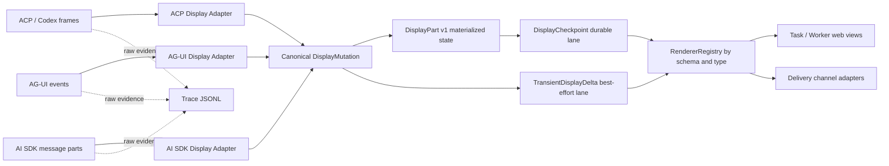

# DisplayPart Schema And Protocol Adapters

## Decision Summary

`DisplayPart v1` is the stable Switchback user-visible read language. It is deliberately smaller than authoritative Task/Worker/Tool/Approval state and more structured than raw Agent events. External protocols are evidence inputs; adapters materialize them into canonical parts.



The adapter does not turn Display into an authority store. Tool, Approval, Artifact and Task owners remain responsible for their state; Display stores permission-filtered summaries and command references.

## Common Envelope

| Field | Type | Rule |
| --- | --- | --- |
| `schema_version` | string | `frontier.display_part.v1`. |
| `part_id` | string | Stable within one DisplayStream and across all checkpoints. |
| `part_type` | enum | `text`, `reasoning_summary`, `tool`, `activity`, `approval`, `artifact`, `source`, `error`. |
| `part_revision` | integer | Starts at 1 and increases only when materialized user-visible state changes. |
| `ordinal` | integer | Stable display order; the checkpoint array plus ordinal is authoritative. |
| `lifecycle_status` | enum | `pending`, `streaming`, `waiting_user`, `completed`, `failed`, `cancelled`, `expired`. |
| `critical` | boolean | Unknown critical parts require a client upgrade; unknown non-critical parts get a safe fallback. |
| `visibility` | object | Permission-filtered audience/scope snapshot; never leaks an unauthorized target. |
| `provenance` | object | Source adapter/schema, canonical Trace refs and non-secret source ids. |
| `available_actions` | array | Canonical Gateway command references only; not local callbacks or authority grants. |
| `payload` | object | Typed by `part_type` and schema version. |
| `created_at` | timestamp | First materialization time. |
| `updated_at` | timestamp | Latest materialization time. |

`part_id` is assigned by Switchback. An adapter keeps a scoped identity map such as `(runtime_generation, agent_session_id, source_tool_call_id) -> part_id`. The map prevents a resumed Agent session or subagent from accidentally overwriting another part with the same provider-local id.

## Part Types

| Type | Minimum payload | Durable boundaries |
| --- | --- | --- |
| `text` | `format: plain|markdown|code`, `content`, optional `language` | start, periodic/byte policy, semantic boundary, terminal |
| `reasoning_summary` | `format`, `content` | summary boundary and terminal; only explicitly user-visible summary |
| `tool` | `tool_invocation_id`, display name, normalized filtered arguments/result summary, effect/risk summary, timing | accepted, started, waiting, every terminal result |
| `activity` | `activity_id`, `kind`, label, status, optional progress/detail summary | stage/status boundary and terminal |
| `approval` | `approval_request_id`, reason, risk/scope summary, allowed options, expiry, decision summary | request, revision, decision, expiry, revocation |
| `artifact` | canonical `artifact_ref`, type, label, availability, permission-aware actions | attachment, availability/action change, terminal |
| `source` | permission-aware evidence/resource ref, label, optional authorized URI | add, revoke, availability change |
| `error` | stable code, user-safe message, recoverability, action refs | creation and any terminal/recovery decision |

Important payload rules:

- `reasoning_summary` never carries hidden chain-of-thought or provider-private reasoning.
- `tool` arguments and results are normalized and filtered. Partial arguments may exist only in TransientDisplayDelta until an accepted normalized form is checkpointed.
- `approval` is a read model. Clicking an option submits a Gateway command containing the approval identity and expected revision; it does not mutate the part locally as truth.
- `artifact` stores an ArtifactRef, not report/patch bytes. Preview/download/apply/publish availability comes from permission-aware ArtifactAction projection.
- `source` includes a URI only after the requesting actor is authorized to know and open it.
- `error` exposes a user-safe message. Internal stack, raw provider payload and secrets stay in separately authorized Trace/operator surfaces.

## Example Checkpoint Parts

```json
[
  {
    "schema_version": "frontier.display_part.v1",
    "part_id": "part_tool_01JXYZ",
    "part_type": "tool",
    "part_revision": 3,
    "ordinal": 20,
    "lifecycle_status": "waiting_user",
    "critical": true,
    "visibility": {"audience": "workspace_members", "workspace_id": "workspace_123"},
    "provenance": {
      "adapter": "acp.codex.v1",
      "source_schema": "acp.session_update.v1",
      "trace_refs": [{"trace_stream_id": "trace_123", "sequence": 418}],
      "source_ids": {"tool_call_id": "call_provider_9"}
    },
    "available_actions": [
      {
        "action_id": "approve_once",
        "command_type": "gateway.decide_approval.v1",
        "target_id": "approval_456",
        "expected_revision": 2
      }
    ],
    "payload": {
      "tool_invocation_id": "tool_invocation_456",
      "tool_name": "github.push_branch",
      "arguments_summary": {"repository": "org/repo", "branch": "switchback/report"},
      "effect_class": "external_write",
      "risk_summary": "Pushes a new remote branch",
      "result_summary": null,
      "started_at": "2026-07-13T11:00:00Z"
    },
    "created_at": "2026-07-13T11:00:00Z",
    "updated_at": "2026-07-13T11:00:05Z"
  },
  {
    "schema_version": "frontier.display_part.v1",
    "part_id": "part_artifact_01JXYZ",
    "part_type": "artifact",
    "part_revision": 1,
    "ordinal": 30,
    "lifecycle_status": "completed",
    "critical": false,
    "visibility": {"audience": "workspace_members", "workspace_id": "workspace_123"},
    "provenance": {"adapter": "switchback.artifact_projection.v1", "trace_refs": []},
    "available_actions": [
      {"action_id": "review_diff", "command_type": "gateway.open_artifact.v1", "target_id": "artifact_789"}
    ],
    "payload": {
      "artifact_ref": {"artifact_id": "artifact_789", "artifact_type": "patch"},
      "label": "Worker patch",
      "availability": "available"
    },
    "created_at": "2026-07-13T11:05:00Z",
    "updated_at": "2026-07-13T11:05:00Z"
  }
]
```

## Adapter Mapping Rules

Adapters receive typed source frames after the Worker raw-frame tee. They emit internal `DisplayMutation` commands such as create/upsert/terminalize part or append transient content. `DisplayMutation` is internal application language; it is not sent to browsers and cannot directly mutate owner state.

| Source observation | Adapter result |
| --- | --- |
| ACP/Codex assistant text | Stable `text` part; chunks are transient, checkpoints contain full content. |
| Provider-visible reasoning summary | `reasoning_summary`; hidden reasoning is rejected from Display. |
| ACP Tool call and updates | Canonical `tool_invocation_id` lookup, then one stable `tool` part through its lifecycle. |
| Generic progress update | Typed `activity` when semantics are known; restricted fallback activity when optional and unknown. |
| Permission/approval request | Resolve owner ApprovalRequest and emit critical `approval`; source payload alone cannot grant permission. |
| Generated file/report/patch | Resolve canonical ArtifactRef and emit `artifact`; never embed ungoverned filesystem paths. |
| Citation/resource evidence | Permission check, then emit `source`; otherwise omit without disclosing existence. |
| Provider error | Normalize stable code/recoverability and emit `error`; raw error remains Trace evidence. |

## Unknown And Failure Matrix

| Condition | Behavior |
| --- | --- |
| Unknown optional source progress/update | Preserve raw Trace, emit telemetry, optionally show non-critical restricted `activity`. |
| Unknown source Tool/approval/permission/security lifecycle | Fail closed; stop the affected transition and enter protocol incompatibility or `waiting_user` as policy requires. |
| Source identity cannot be mapped safely | Do not merge by guess; create an integrity incident or wait for recovery. |
| Browser knows schema but not a non-critical part type | Render a sanitized generic fallback without privileged actions and report telemetry. |
| Browser does not know a critical part or security semantics | Emit/handle `client_upgrade_required`; do not continue with a downgraded renderer. |
| Markdown/HTML includes active content | Sanitize against the versioned rendering policy; scripts, event handlers and arbitrary components are forbidden. |
| Action ref is stale or replayed | Gateway revalidates actor, target, expected revision, policy and idempotency; Display state alone authorizes nothing. |

## Renderer And Versioning Contract

Frontend registers renderers by `(schema_version, part_type)`. A renderer receives only the typed part, transient overlay and permission-filtered action descriptors. It cannot access provider-native frames or mutate Task/Worker state directly.

- Optional additive payload fields are compatible within `frontier.display_part.v1`.
- New required fields, changed field meaning, broader visibility, new executable behavior or changed permission/security semantics require v2.
- Unknown optional fields are ignored after schema validation.
- Unknown non-critical types use the fallback renderer; unknown critical types require upgrade.
- Delivery does not map this union directly into provider components. Its independent DeliveryCardProjection may consume authorized durable summaries while preserving canonical source identity/revision/action refs; unsupported critical interactions become a Web deep link. See [Delivery Card Projection And Callbacks](delivery-card-projection-and-callbacks.md).

## Required Contract Tests

1. Every part type round-trips through checkpoint serialization and renderer validation.
2. Stable part ids survive checkpoints, reconnects, runtime generation recovery and source redelivery; revisions never decrease.
3. ACP/Codex text, Tool, approval, artifact and error mappings preserve canonical owner ids.
4. Unknown optional progress degrades safely; unknown Tool/permission/security semantics fail closed.
5. Unknown non-critical browser types use a no-action fallback; unknown critical types require client upgrade.
6. Markdown/code sanitization prevents executable content and secret-bearing raw payloads from entering user display.
7. Available actions are references only and stale/replayed commands are rejected by Gateway/owner revision checks.
8. Durable checkpoints remain complete after transient loss, while Trace retains the original source frames.
