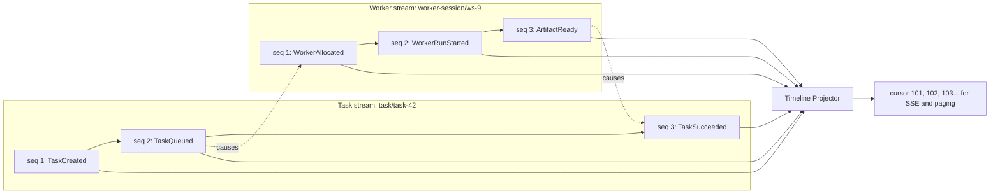
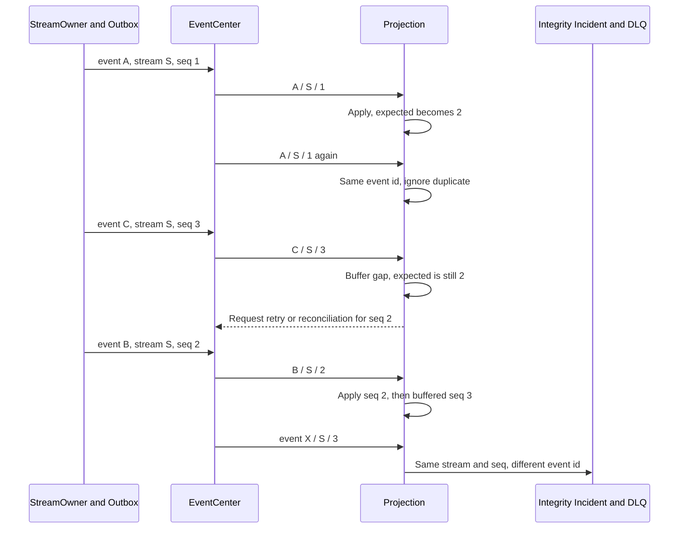
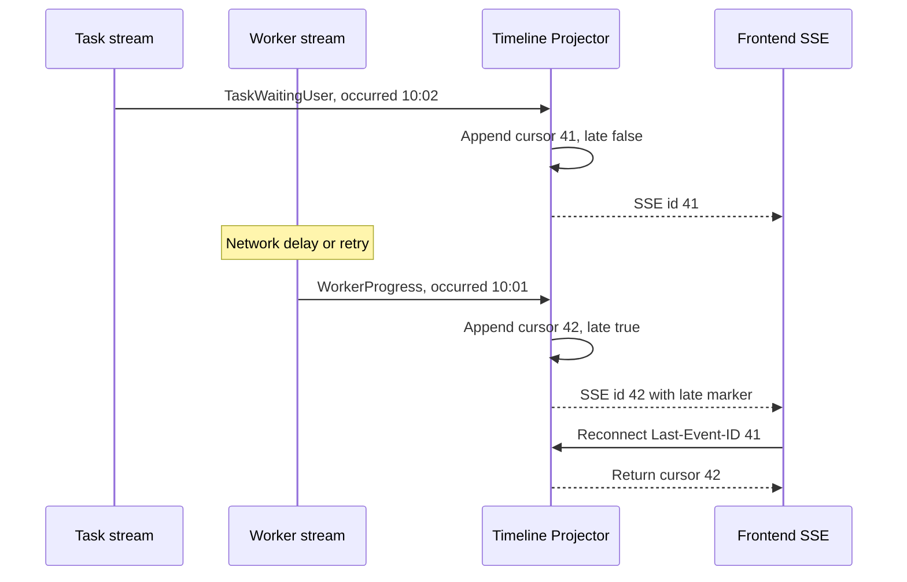

# Event Ordering And Timeline Guide

本文解释 Switchback 方案 A 中最容易混淆的三个顺序：领域流内顺序、跨流因果关系和前端 Timeline 展示顺序。它们解决不同问题，不能互相替代。

## 先看结论

| 问题 | 使用什么 | 谁负责 | 是否权威 |
| --- | --- | --- | --- |
| 同一个 Task/WorkerSession 内谁先谁后 | `stream_id + sequence` | 该 stream 的唯一 StreamOwner | 是，领域流内权威 |
| Task 事件为什么触发 Worker 事件 | `correlation_id + causation_id` | 产生下游事件的领域 owner | 是，因果证据 |
| 前端从哪里继续 SSE、如何稳定分页 | `timeline_id + timeline_epoch + timeline_cursor` | Timeline projector | 只对读模型展示权威 |
| 页面显示几点发生 | `occurred_at` | 原事件 producer | 仅审计/显示，不排序 |

一句话版本：**业务模块给自己的事件编号，EventCenter 检查和转发，Timeline 再给用户看到的条目编号。**

## 三种顺序如何协作



图中 Task 的 `seq=2` 与 Worker 的 `seq=2` 没有大小关系。它们属于不同 stream。跨 stream 只通过 causation 表达“TaskQueued 触发 WorkerAllocated”。

## 谁分配 StreamSequence

每个 stream 只有一个逻辑 owner，例如：

| Stream | StreamOwner | 合法写入方式 |
| --- | --- | --- |
| `interaction/conversation/conv-7` | Interaction | Conversation transaction + Outbox |
| `task/task/task-42` | Task Orchestration | Task aggregate transaction + Outbox |
| `worker/worker-session/ws-9` | Worker Runtime | WorkerSession transaction + Outbox |
| `knowledge/memory/mem-5` | Knowledge Evolution | Memory governance transaction + Outbox |

其他模块不能直接为这些 stream 写事件。例如 Worker 想让 Task 进入完成状态，应发送幂等 command 给 Task Orchestration，由 Task owner 更新 Task 并产生下一个 Task stream sequence。

逻辑事务如下，具体可以使用 aggregate version 或锁定的 stream-head row 分配序号：

```text
BEGIN
  validate command and expected aggregate version
  update aggregate state
  sequence = allocate_next(stream_id)
  insert outbox(event_id, stream_id, sequence, payload)
COMMIT
```

关键点是 aggregate state、sequence 和 Outbox 必须同事务提交。EventCenter 收到事件后不能重新编号，因为它无法与原业务状态事务保持原子性。

## 重复、乱序与缺口



消费者最小算法：

```text
if event_id already applied:
    ignore as duplicate
else if sequence == expected_sequence:
    apply and advance; then drain contiguous buffered events
else if sequence > expected_sequence:
    persist in gap buffer and request retry/reconciliation
else if same stream/sequence belongs to a different event_id:
    raise integrity incident; do not overwrite
else:
    treat as stale duplicate and verify audit record
```

### 示例一：正常流内顺序

| 到达 | stream_id | sequence | event_id | 结果 |
| --- | --- | ---: | --- | --- |
| 1 | `task/task/task-42` | 1 | `evt-task-created` | 应用 |
| 2 | `task/task/task-42` | 2 | `evt-task-queued` | 应用 |
| 3 | `task/task/task-42` | 3 | `evt-task-running` | 应用 |

### 示例二：重复和缺口

| 到达 | stream_id | sequence | event_id | 结果 |
| --- | --- | ---: | --- | --- |
| 1 | `worker/worker-session/ws-9` | 1 | `evt-allocated` | 应用，期待 seq 2 |
| 2 | `worker/worker-session/ws-9` | 3 | `evt-artifact-ready` | 暂存，报告缺少 seq 2 |
| 3 | `worker/worker-session/ws-9` | 1 | `evt-allocated` | 相同 event id，忽略重投 |
| 4 | `worker/worker-session/ws-9` | 2 | `evt-run-started` | 应用 seq 2，再应用已暂存 seq 3 |

如果第四行是 `sequence=1, event_id=evt-other`，这不是普通重复，而是两个事实争用同一序号，必须进入 integrity incident/DLQ。

## 跨 Stream Timeline

Timeline 是读模型，不负责定义业务真相。Projector 每提交一个用户可见条目，就在目标 timeline 中分配下一个 `timeline_cursor`。SSE 的 `Last-Event-ID` 和分页使用 `timeline_epoch:timeline_cursor`。



图中为简洁省略 epoch；实际 SSE id 例如 `1:41`、`1:42`。

### 示例三：为什么不按 occurred_at 插入

| timeline_cursor | occurred_at | event | late | 说明 |
| ---: | --- | --- | --- | --- |
| 40 | 10:00 | WorkerRunStarted | false | 已推送 |
| 41 | 10:02 | TaskWaitingUser | false | 已推送 |
| 42 | 10:01 | WorkerProgress | true | 迟到后追加，不插回 40 与 41 之间 |

如果把 cursor 42 插回中间，已经收到 cursor 41 的浏览器无法可靠知道历史页面被改写，SSE resume 和分页会出现遗漏或重复。UI 可以显示原始 `occurred_at=10:01` 和“延迟到达”标识，但读取顺序保持 40、41、42。

### Timeline 全量重建

- 普通重投或 DLQ replay 通过 `(timeline_id, event_id)` 找回原 TimelineEntry，不改变 cursor。
- 如果灾难恢复无法保留 event-to-cursor mapping，Timeline projector 创建新 `timeline_epoch` 并重新生成 cursor。
- 客户端携带旧 epoch（例如 `1:42`）请求新 epoch 2 时，Frontier 返回 `resync_required` 和 epoch 2 的 snapshot cursor，而不是猜测对应位置。
- `occurred_at` 仍不能用于把旧 cursor 转换成新 cursor。

## P0 PostgreSQL 与 P1 RocketMQ

| 语义 | P0 PostgreSQL outbox | P1 RocketMQ |
| --- | --- | --- |
| StreamSequence 来源 | StreamOwner 业务事务 | 仍来自 StreamOwner payload |
| 流内投递 | dispatcher 按 stream/cursor 拉取 | `message_group = stream_id` 的 FIFO 基础 |
| 重复 | consumer event id 幂等 | broker 重投后仍按 event id 幂等 |
| gap | projection buffer + outbox replay | projection buffer + retry/reconciliation |
| 冲突 | integrity incident / local DLQ | integrity incident / broker DLQ |
| TimelineCursor | TimelineProjection 数据库分配 | 仍由 TimelineProjection 数据库分配 |

RocketMQ 的 FIFO 只能帮助投递，不能替代 payload sequence。原因是 producer 重试、DLQ replay、迁移和投影重建都仍需要 Switchback 自己判断事件在领域 stream 中的位置。

## 实现检查清单

- 一个 stream 只有一个 owner；跨 context 通过 command，不共享 stream writer。
- aggregate state、next sequence、Outbox 同事务提交。
- 数据库唯一约束至少覆盖 `(stream_id, sequence)` 和 `event_id`。
- ProjectionCursor 保存每个 stream 的 last applied sequence，并持久化 gap buffer/repair 状态。
- 同 sequence 不同 event id 进入 integrity incident，不能覆盖。
- TimelineEntry 对 `(timeline_id, event_id)` 唯一，cursor 在 timeline epoch 内单调；SSE id 使用 `epoch:cursor`。
- 普通 replay 复用原 cursor；无法保留映射的全量重建递增 epoch 并触发客户端 resync。
- 迟到事件 append-only，保留 occurred_at 并设置 late。
- correlation/causation 用于跨 stream 因果展示和排障，不用于猜测全局 sequence。
- P1 broker adapter 必须通过与 P0 相同的重复、gap、DLQ 和 timeline contract tests。
