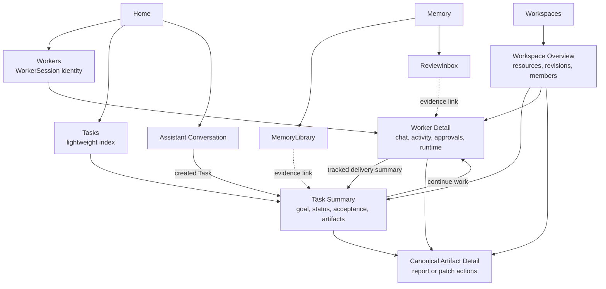

# Frontend Information Architecture And Read Models

## Decision Summary

Switchback P0 uses Worker as the primary work view and Task as a lightweight delivery index. Product-facing “Worker” means a WorkerSession detail surface keyed by `worker_session_id`, not a backend Worker service replica.

Target global navigation:

1. Home
2. Workers
3. Tasks
4. Workspaces
5. Memory

P0 enables Home, Workers, a compact Tasks index, and Workspaces. Home shows recent Workers, waiting_user/approval and recent deliveries; it is not a full workflow inbox. Task Summary may be a drawer or small page and always deep-links to the primary Worker Detail. The independent Memory area is enabled with P1 Evolution governance. Artifact has a canonical detail route. Assistant Conversation remains a separate interaction surface.

## Navigation And Identity Map

## Page-Optimized Read Models

| Read Model | Phase | Primary Identity | Purpose | Contains |
| --- | --- | --- | --- | --- |
| `HomeView` | P0 | user + tenant | 快速回到正在进行的工作 | recent Workers、continuity quota usage、Task/Continuation capacity waits、waiting_user/approval、recent deliveries、canonical deep link |
| `TaskListView` | P0 | tenant/user filters | 扫描可跟踪交付 | title、status、priority/source、workspace、current stage、allocation/session queue reason and position、latest result |
| `TaskSummaryView` | P0 | task_id | 理解交付状态并跳转到执行面 | TaskSpec/acceptance snapshot、current Session assignment/context policy、append-only Session lineage、expiry outcome、allocation wait、current/history Runs、active AgentTurn deadline/terminal state、actions、Artifacts/completeness、conditional WorkerSession link |
| `WorkerListView` | P0 | tenant/user filters | 扫描可交互执行会话 | WorkerSession status、continuity-slot counted flag、workspace、active Run、idle/absolute deadline、waiting/approval、latest activity |
| `WorkerDetailView` | P0 | worker_session_id | live Session 像 Coding Agent 一样交互，terminal Session 只读检查/派生续作 | chat/AgentTurns、bound Task、active and historical Runs、FIFO queued Tasks/position/age、SessionProcess ports/logs/open-preview/stop/restart、projected activity、approvals、runtime health、Artifacts、Task/Continuation lineage、terminal checkpoint |
| `WorkspaceOverviewView` | P0 | workspace_id | 查看持久上下文 | resources、repositories、active revision、members、Tasks、WorkerSessions、Artifacts |
| `ArtifactDetailView` | P0 | artifact_id | 审阅和操作统一产物 | type、provenance、availability、preview/download/apply/publish actions、permission decision |
| `MemoryLibrary` | P1 | user/workspace/project scope | 治理 active Memory | lifecycle、revision、source、usage、projection state、actions |
| `ReviewInbox` | P1 | reviewer + scope | 审核候选内容 | lane、diff、evidence、risk、conflict、scope/ACL、review actions |

## Page Boundaries

### Task Summary

- 展示目标、`queued/running/waiting_user/delivered/completed/failed/cancelled` 状态、验收模式和阶段结果，不复制 chat、runtime control 或 raw Trace。
- Task 非终态或 `delivered` 且 current Session live 时，“继续/返工”跳转 Worker Detail；current Session absolute-expired 时在 TaskSummary 发起 exact new-Worker continuation。Task 终态后仍可跳转到有效 WorkerSession，后续 standalone Run 不改写 Task。
- projection 按当前 viewer 展示 TaskInitiator 和 permission-filtered accept/rework/cancel action；Workspace editor/reviewer 不因可见而获得动作。AgentTurn deadline 只读且不可延期。
- 所有动作经 Gateway command，按真实 actor、expected Task revision 和 idempotency key 重验。
- 未分配 Session 的 queued Task 显示“等待 Worker 容量”、`session_allocation_sequence`/等待时长和当前 `used/limit`，不伪造 Worker deep link 或 SessionTaskQueue position。只有 exact Session target action 才可显示“复用此 Worker”，且必须提示会继承其当前未提交变更和 Agent context。
- 容量满时允许的动作只有取消 Task、打开 Worker 列表关闭可终止 Session，或显式选择 exact Session 复用；Frontend 不提供自动清理、自动改派或“复用最近 Worker”。
- 当前 Session absolute-expired 后，TaskSummary 清空 live Worker 标记但保留历史 Worker deep link、旧 Run 的 `timed_out:worker_session_absolute_expired`、checkpoint 与 Artifact completeness。`queued/running/waiting_user` 显示 initiator-only“在新 Worker 中继续”；`delivered` 仍显示 accept，只有 rework 才进入新 Worker continuation。
- 旧 runtime fencing 未完成或 external effect 为 unknown 时，不显示可执行 continuation；只展示“正在核查执行状态”及权限过滤后的证据，不能让按钮暗示可以安全重试。
- 续作不再要求时间预算表单。TaskSummary 只展示 source expiry outcome/checkpoint、allocation 状态和新 Session lineage；每个实际开始的 AgentTurn 自动获得独立固定 24 小时 hard deadline。

### Worker Detail

- 非终态 Session 的 Chat 是主要交互面，支持 prompt、queue、interrupt 和 steer。`closed/expired` Session 的 composer、AgentTurn、Run、approval 和 runtime actions 全部禁用，只保留只读证据。
- Activity 使用用户可见 Trace summary；raw Trace 需要独立权限和显式入口。
- Task-bound Run 显示 task link；standalone Run 显示 standalone 标记和可选 origin lineage。
- report/patch 使用 Canonical Artifact Detail，不复制一份 Worker 私有产物状态。
- terminal Session 显示 latest proven checkpoint 的 capture time、digest、coverage 和 warning；主动作固定为“在新 Worker 中继续”，不得使用“恢复/重开”文案。
- 续作确认必须显示 source Session/checkpoint、目标 Workspace、将重新计算的 idle/absolute lifetime，以及“不继承旧审批、仓库 Grant、Secret、队列和 AgentSession”。成功后导航到新的 `worker_session_id`，source 页面保持只读并显示 `continued_as` lineage。
- 配额满时 continuation 显示独立 allocation position/等待原因，可取消请求但不能预览成已创建 Worker；它与 Task allocation 共享 FIFO，但不能被标成 SessionTaskQueue。
- Task `delivered` 时，accept 与继续反馈都在此完成；后者启动新的 WorkerRun。
- Task-bound Session absolute-expired 时，旧 Worker Detail 只读展示 expiry outcome、partial/complete Artifact 和 `continued_as` lineage。Task continuation 必须从 Task action 发起，以保持同一 Task；普通“在新 Worker 中继续”只派生 Session 上下文，不能静默改写 Task。
- 每个 Run 可展示只读启动基线摘要：`inherit_current/fresh_session/exact_base`、base WorkspaceRevision、dirty state 和 checkpoint；详细 manifest 仍走受权限保护的 Trace/诊断入口。

### Home

- 只聚合最近 Worker、用户当前需要处理的 waiting_user/approval 和近期交付，不复制 owner context 状态机。
- 展示 Tenant/User continuity quota `used/limit` 与等待容量的 Task 数；计数来自 Worker Runtime projection，不能由浏览器统计 WorkerList。
- 每个 item 必须携带 canonical target identity、reason、available actions 和 deep link。
- 已处理、失效或权限撤销的 item 由 projection 收敛；Frontend 不自行猜测终态。

### Workspace And Memory

- Workspace 是资源与协作上下文，不代替 Worker 的日常执行入口。
- Memory 是独立治理面；Task/Worker 只展示来源引用和相关 Memory 摘要，不内嵌审核状态机。

## Cross-View Invariants

- `task_id`、`worker_session_id`、`workspace_id`、`artifact_id` 和 Memory revision identity 在所有页面保持一致。
- 同一 Artifact 的 metadata、权限和 actions 来自同一 Artifact projection；不同页面只改变展示密度。
- Home、Task、Worker 和 Workspace 页面不得通过前端拼接 raw domain events 推断业务状态。
- SessionAllocationQueue position 与 SessionTaskQueue position 必须使用不同标签和字段；前者没有 Worker identity，后者必须有 exact WorkerSession。
- 所有 projection 都按当前 Tenant/Workspace Membership 和资源策略过滤；不可访问资源不泄露存在性。
- Conversation、Task、WorkerSession、Workspace 和 Artifact 使用显式 related refs/deep links，不建立虚假的单一父子树。

## Concrete Scenarios

1. 飞书直接创建的 Task 没有 Assistant Conversation，仍出现在 Tasks 和 Home recent deliveries。
2. Task 完成后 WorkerSession 继续有效：Task 显示终态，Worker 仍可交互。
3. 用户在 Worker 中发起 standalone Run：Worker Activity 展示该 Run，Tasks 不产生伪 Task。
4. patch 从 Task、Worker 或 Workspace 打开时进入同一 Artifact Detail，并执行同一权限检查。
5. Memory 审核项从 ReviewInbox 打开；证据链接可以跳到 Task/Worker，但审核动作仍属于 Evolution governance。
6. Assistant 创建 Task 但未选择 WorkerSession：Task 先显示 queued/allocating，平台分配新 Session 后才出现 Worker link 与 FIFO position。
7. 用户在 Worker Detail 明确选择“在此 Worker 创建 Task”：新 Run 继承当前 WorkingCopy 和 Agent context；若 Task 要求 clean/exact base，界面要求新建 Worker，不提供静默清理按钮。
8. 用户已占满 10 个 continuity slots：新 Task 显示 queued/session_capacity 和 allocation position，不出现 Worker link；关闭一个 Session 后，最早合法 Task 获得新 Worker，其他位置稳定。
9. WorkerSession 为 waiting_user、idle 或 lost：WorkerList 仍显示其占用 quota；只有 owner projection 确认 closed/expired 后 used count 才减少。
10. expired S17 有 checkpoint C9：详情只读并显示 C9 capture/coverage；用户点击“在新 Worker 中继续”后创建 S42，S42 使用新 AgentSession/授权/clocks，S17 永不恢复为 live。
11. continuation 请求进入满额队列：Frontend 显示它与 Task 请求共用的 authoritative allocation sequence，但不创建 Worker deep link；更早合法 Task 仍先分配。
12. running Task T7 的 Session S17 absolute-expired 且 fencing 成功：Run 显示 timed_out，T7 显示 `waiting_user:worker_session_expired`，partial patch 可审阅但不能 auto accept；initiator 确认后 T7 进入 queued/capacity wait，分配 S42 并启动新的 continuation Run。
13. delivered Task T8 的 Session 到期：T8 保持 delivered，完整 report 仍可 accept；用户选择 rework 时才创建新 Session/Run，旧 Worker 永远只读。
14. S17 到期时无法证明旧容器失去 WorkingCopy 写权限：S17 显示 lost 且继续计入 quota，T7 不出现 continuation action，直到 reconciliation 产生可验证的 expiry outcome。
15. 某自定义 policy 下 T7 已累计消耗 55 分钟、Task ceiling 4 小时，本次续作请求 1 小时：确认页显示剩余 3 小时 05 分钟；Run 只实际执行 20 分钟便完成时，Task 累计值变为 1 小时 15 分钟，未使用的 40 分钟不计入消耗。
16. continuation 等容量期间 policy 把本次有效最大值降到 30 分钟：Frontend 不把已确认的 1 小时静默改成 30 分钟，而是显示 stale reason 并要求 initiator 重新确认。

## Projection Sync Decision

Frontier 已确定使用 HTTP ProjectionSnapshot + typed SSE ProjectionDelta，同一 View 通过 epoch/cursor/version 完成断线 replay，并在 gap、old epoch 或 replay miss 时要求 `resync_required`。GraphQL 不进入 P0。完整契约见 [Frontier Snapshot And Typed SSE Protocol](frontier-projection-sync-protocol.md)。

Agent display 已进一步固定为 durable DisplayCheckpoint + best-effort TransientDisplayDelta，并采用 Switchback-owned DisplayPart v1。外部 Agent/UI 协议只经 adapter 映射，Frontend 通过 schema/type RendererRegistry 渲染。见 [Agent Display Stream Durability](agent-display-stream-durability.md) 与 [DisplayPart Schema And Protocol Adapters](display-part-schema-and-adapters.md)。

P0 Frontend runtime 已确定为 React + TypeScript + Vite SPA，同源接入 Go Gateway/Frontier；浏览器状态按 Router、TanStack Query、ViewProjectionStore、transient overlay 与 optional assistant-ui ExternalStore adapter 分层。见 [Frontend Runtime And State Ownership](frontend-runtime-and-state-ownership.md)。

Delivery 已确定使用独立 DeliveryCardProjection/CardInstance，四类卡片只暴露有限 owner-authorized actions，复杂交互 deep-link Web。见 [Delivery Card Projection And Callbacks](delivery-card-projection-and-callbacks.md)。

ChannelThreadBinding 已确定在每个 revision 绑定一个 current primary Assistant Conversation；群 topic 使用 channel-scoped shared Conversation，并按真实 actor 保存 participant/controller。普通回复进入 Assistant，只有 controller 可管理共享 Workspace context/lifecycle，但 controller 不产生资源权限；TaskDraft/Task/WorkerSession/Approval/Artifact 只有显式 target 才直达，不维护 current focus。Conversation 可在 Workspace 未解析时起聊，首次 resolution 保持 identity；离开已有 resolved Workspace 时，同一 provider topic rollover 到 successor Conversation，predecessor 只读且资源不迁移。群聊 Workspace-derived 内容另需显式 WorkspaceChannelShareGrant，并只显示字段级 `channel_shareable` 投影。群 ordinary message即使 ready 也只生成 TaskDraft；只有 immutable initiator 可确认，其他 participant 通过“Create as my Task”fork 新 actor-owned lineage。Task 创建后使用固定 P0 actor 规则：initiator 可 accept/rework/cancel，Workspace owner 只有 emergency cancel。单 WorkerSession 顶层执行固定串行化：WorkerDetail 只显示一个 bound Task/active Run，并把 SessionTaskQueue 与 Agent message queue 分开。SessionAllocationQueue 统一排序 Task/Continuation 新 Session 请求。P0 Tenant/User continuity quota 默认 10，waiting/idle/lost 仍计数，容量满时不自动复用或回收；Frontend 展示 authoritative used/limit、allocation position 和显式动作。closed/expired Worker 只读，续作从 exact checkpoint 派生新 identity/AgentSession/授权。每个实际 ACP prompt 使用固定 24 小时、不暂停且不可延期的 AgentTurn hard deadline；WorkerDetail 显示开始、截止和取消收敛状态。见 [Delivery 整体交互设计](delivery-interaction-design.md)、[ADR 0048](../adr/0048-make-workersession-primary-and-task-lightweight-in-p0.md)、[ADR 0049](../adr/0049-serialize-top-level-work-per-workersession.md)、[ADR 0050](../adr/0050-require-explicit-workersession-reuse-and-snapshot-start-context.md)、[ADR 0051](../adr/0051-count-continuity-holding-workersessions-against-user-quota.md)、[ADR 0052](../adr/0052-make-terminal-workersessions-immutable-and-continue-by-derivation.md)、[ADR 0053](../adr/0053-preserve-task-identity-across-workersession-absolute-expiry.md) 与 [ADR 0055](../adr/0055-use-a-fixed-agentturn-hard-deadline.md)。
