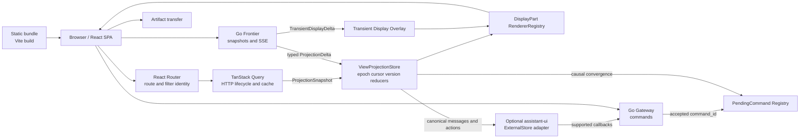
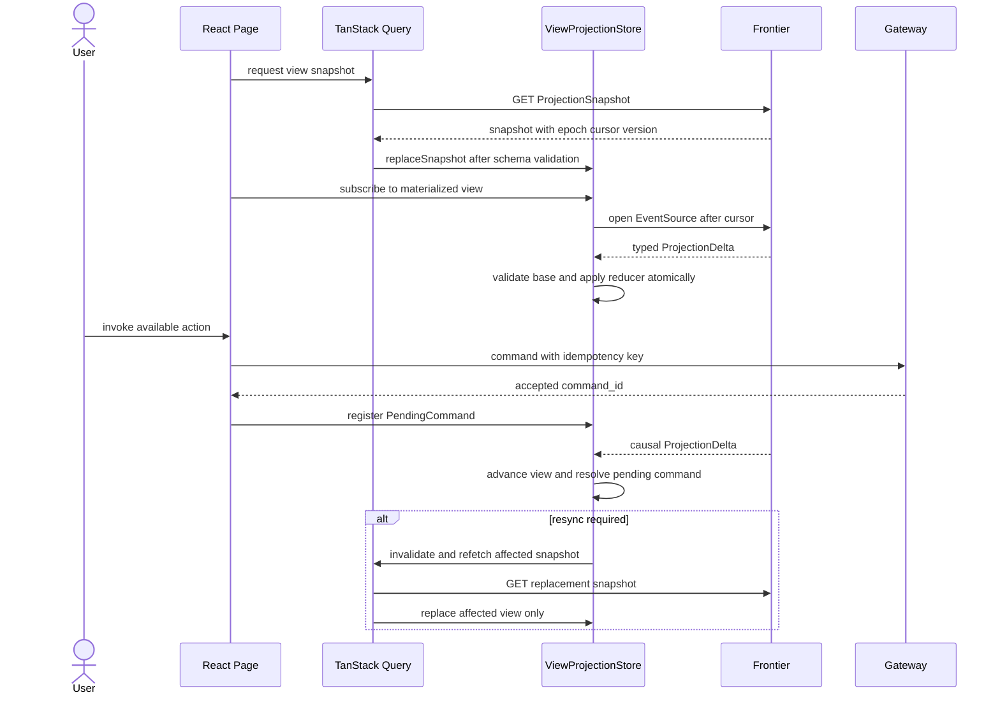

# Frontend Runtime And State Ownership

## Runtime Baseline

P0 uses a React + TypeScript SPA built with Vite. The production artifact is static HTML/CSS/JavaScript; Node.js is required for development and build only. Gateway, Frontier, authentication, projection, commands and Artifact transfer remain Go/backend responsibilities.

## Production Topology

Recommended same-origin routes:

| Route family | Owner | Purpose |
| --- | --- | --- |
| `/` and hashed assets | static handler/reverse proxy | SPA shell and immutable assets |
| `/api/commands/*` | Gateway | authenticated idempotent commands |
| `/api/views/*` | Frontier query | ProjectionSnapshot and list/read queries |
| `/api/streams/*` | Frontier SSE | durable ProjectionDelta/control and transient display events |
| `/api/artifacts/*` | Artifact service/adapter | preview metadata and resumable bytes |

The ingress may route to separate Go services, but the browser observes one trusted origin. SPA fallback applies only to non-API navigation routes. Hashed assets use long immutable caching; `index.html` is revalidated so a protocol-incompatible client can refresh. Secrets never enter Vite client environment variables.

This trusted-origin rule covers the Switchback shell、Gateway、Frontier、SSE and Artifact APIs. WorkerDetail obtains an opaque PreviewAccessRef from Gateway; Backend proxies its HTTP/WebSocket data without exposing a Worker host port. For M1, the preview route/origin is a loopback-only implementation choice and does not add another frontend protocol. Isolation is revisited before non-local or multi-user deployment.

Local development uses Vite's development server with explicit proxies for backend route families. Production does not run `vite preview`, a Vite development server or a Node BFF.

## Browser State Owners

| State | Single owner | Persistence | Rule |
| --- | --- | --- | --- |
| selected page/resource, shareable filters | React Router URL | browser history/link | Component-local copies cannot diverge from URL identity. |
| HTTP request/retry/cache lifecycle | TanStack Query | memory, optional policy cache | It fetches snapshots/lists/status; it does not interpret raw SSE authority. |
| active materialized View | `ViewProjectionStore` | browser memory | Exact epoch/cursor/version and typed reducers; replaced by Snapshot. |
| transient text/progress overlay | transient sub-store | bounded browser memory | Keyed by stream/part/base checkpoint/sequence; discarded on mismatch/checkpoint. |
| accepted command outcome pending | `PendingCommandRegistry` | browser memory | Keyed by command id; resolved only by projection/status/snapshot evidence. |
| draft input, panel expansion, hover/menu | component-local state | none or explicit user preference | Never used to infer backend business state. |
| chat components | assistant-ui ExternalStore adapter | none of its own | Receives converted canonical state and supported callbacks. |

`ViewProjectionStore` is a framework-neutral interface even if its P0 implementation uses React-compatible subscription primitives. Reducers remain pure TypeScript functions and can run in unit tests without rendering React.

## Snapshot And Stream Integration

Rules:

1. Decode and validate Snapshot/Delta schema before mutation.
2. `replaceSnapshot` replaces one affected View atomically and clears incompatible transient buffers.
3. Durable reducers verify epoch, cursor and exact base/result version before commit.
4. Reducer failure stops the affected View and requests resync or client upgrade; components cannot skip a critical delta.
5. Transient overlays never modify durable version/cursor and are superseded by checkpoints.
6. Query invalidation requests a new authoritative snapshot; it does not replay domain events in the browser.
7. A command mutation's HTTP success means accepted, not completed. Pending UI is explicitly non-authoritative.

## assistant-ui Boundary

Worker Chat may use assistant-ui primitives and `ExternalStoreRuntime` when they reduce implementation cost. The adapter maps:

| Switchback | assistant-ui surface |
| --- | --- |
| canonical message/text DisplayParts | thread message/content |
| Tool/Approval DisplayParts | custom Tool/approval renderer |
| WorkerSession busy state | runtime running/disabled flags |
| prompt | `onNew` -> Gateway AgentTurn command |
| interrupt/cancel | supported callback -> Gateway command |
| queue/steer | explicit Switchback command callback |

Unsupported capabilities are omitted rather than emulated locally. Branch/edit/regenerate semantics are enabled only after Switchback defines matching backend commands. assistant-ui ids do not replace `worker_session_id`, `agent_turn_id`, `message_id`, `part_id` or Tool/Approval identities.

## Security And Compatibility

- Secure/HttpOnly/SameSite session cookies authenticate same-origin Snapshot/SSE/command requests; bearer tokens do not enter URLs.
- State-changing commands follow the Gateway CSRF strategy and always carry idempotency keys.
- Runtime validation rejects unknown critical schema; non-critical DisplayPart fallback follows ADR 0037.
- Frontend build metadata advertises supported Snapshot/Delta/DisplayPart versions for diagnostics.
- Backend rollout preserves the previously supported client protocol during a compatibility window; incompatible clients receive `client_upgrade_required` and reload `index.html`.
- Source maps, raw Trace and operator details follow separate authorization and production publication policy.

## Required Tests

1. Pure reducer tests for every ProjectionDelta and DisplayPart schema version.
2. Snapshot seed, snapshot/subscribe race, duplicate delta, base mismatch, old epoch, replay miss and targeted resync.
3. Transient duplicate/gap/checkpoint replacement without durable-state mutation.
4. Accepted command, delayed result, response loss, causal convergence and idempotent retry behavior.
5. Route identity and authorization revocation clear only the affected View and sensitive cache.
6. assistant-ui conversion preserves canonical ids and cannot invent unsupported commands or approvals.
7. Static deployment tests cover SPA fallback, API route exclusion, cache headers, cookie auth, CSRF and client-upgrade refresh.
8. Browser E2E covers Task terminal with live WorkerSession, direct Worker chat, approval, report/patch rendering and reconnect.

## References

- [Vite backend integration](https://vite.dev/guide/backend-integration)
- [Vite production build](https://vite.dev/guide/build)
- [TanStack Query React overview](https://tanstack.com/query/latest/docs/framework/react/overview)
- [assistant-ui ExternalStoreRuntime](https://www.assistant-ui.com/docs/runtimes/custom/external-store)
