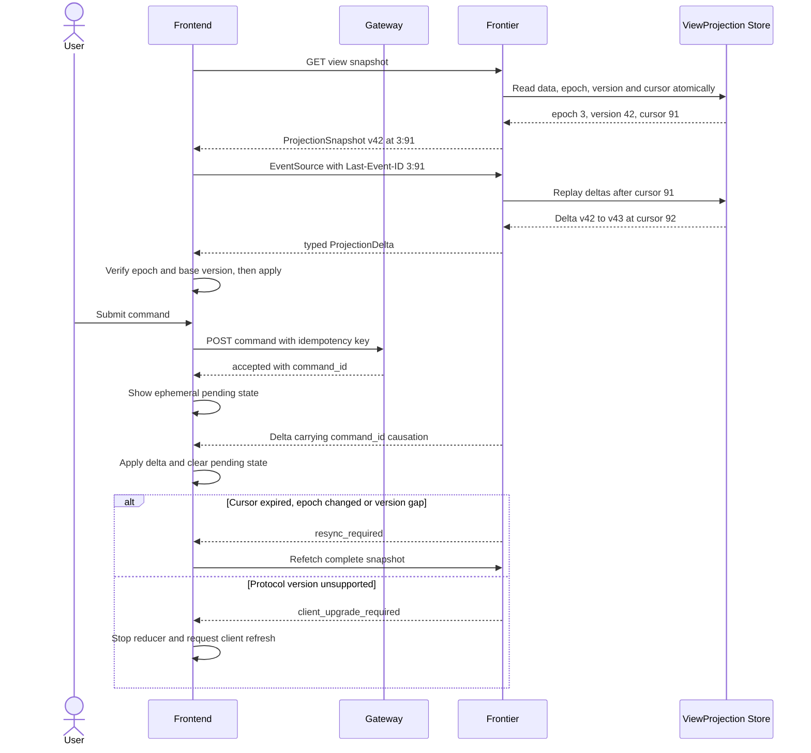

# Frontier Snapshot And Typed SSE Protocol

## Scope

This protocol synchronizes one page-optimized ViewProjection from Frontier to Frontend. It covers durable/replayable projection state; fine-grained Agent token/reasoning chunks use the separately defined transient Display lane.

## Responsibilities

| Component | Responsibility |
| --- | --- |
| Gateway | Accept commands, authenticate actor, enforce idempotency, return `command_id`. |
| EventCenter / Projector | Convert owner events into authorized ViewProjection state and ordered ProjectionDelta. |
| Frontier query | Return one complete ProjectionSnapshot at a committed cursor/version. |
| Frontier SSE | Replay and stream ProjectionDelta/control events after a cursor. |
| Frontend | Render snapshot, apply compatible typed deltas, keep only ephemeral pending command state, refetch on resync. |

P0 browser runtime and state ownership are fixed in [Frontend Runtime And State Ownership](frontend-runtime-and-state-ownership.md): TanStack Query orchestrates HTTP lifecycle, while a dedicated ViewProjectionStore owns the active materialized replica and SSE reducer state.

## Race-Free Initial Load And Reconnect



The snapshot cursor is committed with the snapshot state. Any delta committed before or at that cursor is already represented in `data`; any delta committed after it is replayed by SSE. The client never uses timestamps to bridge the two.

## ProjectionSnapshot v1

```json
{
  "schema_version": "frontier.projection_snapshot.v1",
  "view_type": "worker_detail",
  "view_id": "ws_123",
  "tenant_id": "tenant_1",
  "view_epoch": 3,
  "view_cursor": 91,
  "projection_version": 42,
  "query_fingerprint": "sha256:...",
  "generated_at": "2026-07-13T10:00:00Z",
  "data": {},
  "available_actions": [],
  "related_refs": []
}
```

Snapshot invariants:

- `data`、`available_actions`、`related_refs` MUST come from one committed projection version and authorization decision.
- `view_id + query_fingerprint` identifies the subscribed page shape. Server-supported filters/sorts are canonicalized before hashing.
- HTTP response SHOULD include an ETag derived from view identity, epoch and projection version.
- A related resource that fails authorization MUST be omitted without an existence hint.

## ProjectionDelta v1

```json
{
  "schema_version": "frontier.projection_delta.v1",
  "delta_id": "delta_456",
  "view_type": "worker_detail",
  "view_id": "ws_123",
  "view_epoch": 3,
  "view_cursor": 92,
  "base_projection_version": 42,
  "result_projection_version": 43,
  "event_type": "view.timeline_appended.v1",
  "critical": true,
  "command_id": "cmd_789",
  "source_refs": [],
  "payload": {}
}
```

Initial durable event taxonomy:

| Event Type | Meaning |
| --- | --- |
| `view.entity_upserted.v1` | Add or replace one typed summary entity. |
| `view.entity_removed.v1` | Remove a visible entity or list membership. |
| `view.timeline_appended.v1` | Append a user-visible TimelineEntry summary. |
| `view.available_actions_changed.v1` | Replace permission-filtered commands/actions. |
| `view.attention_changed.v1` | Add/update/remove an ActionInbox condition. |
| `view.artifact_ready.v1` | Attach canonical Artifact summary/ref. |
| `view.stream_checkpointed.v1` | Commit recoverable message/run content checkpoint. |

Typed payload schemas are versioned per event type. Frontend MUST NOT dispatch on arbitrary JSON paths or raw domain event names.

Delta application rules:

1. If `view_epoch` differs, request a new snapshot.
2. If `view_cursor`/`delta_id` was already applied, ignore the duplicate.
3. If `base_projection_version` differs from local version, stop applying and resync.
4. Apply the event through its versioned reducer.
5. Set local version/cursor to the result values only after reducer success.
6. A reducer failure is a client integrity error; do not skip a critical delta and continue.

## SSE Framing

```text
id: 3:92
event: projection_delta
data: {"schema_version":"frontier.projection_delta.v1",...}

```

- The SSE `id` MUST equal `view_epoch:view_cursor` for replayable events.
- Heartbeat comments MAY keep proxies from closing an idle stream but MUST NOT advance cursor/version.
- Commands never travel over SSE.
- Artifact bytes and raw Trace never travel over this stream.
- Frontier SHOULD close and reauthorize periodically according to session policy; reconnect uses the last applied id.

## ProjectionControlEvent v1

| Control Event | Trigger | Frontend Action |
| --- | --- | --- |
| `resync_required` | old epoch, cursor evicted, replay gap, base version unavailable | Drop affected View cache and fetch snapshot. |
| `client_upgrade_required` | no compatible snapshot/delta schema | Stop applying and refresh/upgrade client. |
| `access_revoked` | current actor can no longer read the View | Clear View and navigate to non-disclosing access state. |
| `stream_draining` | deployment/maintenance asks client to reconnect | Reconnect with last applied event id. |

`resync_required` is a data-continuity response, not a general retry button. Authentication/authorization and schema incompatibility MUST retain their own error categories.

## Command Convergence

Gateway command responses contain at least:

```json
{
  "status": "accepted",
  "command_id": "cmd_789",
  "idempotency_key": "client-generated-key",
  "accepted_at": "2026-07-13T10:00:01Z"
}
```

Frontend MAY render a pending indicator keyed by `command_id`, but it MUST NOT mutate authoritative status optimistically. A matching delta/causation clears pending. A timeout or disconnected SSE means “outcome unknown”; Frontend queries command status or refetches snapshot rather than treating it as failure and resubmitting with a new idempotency key.

## Authorization And Browser Transport

- Prefer same-origin Frontier endpoints with Secure, HttpOnly and appropriate SameSite session cookies.
- Native EventSource MAY use credential mode but cannot carry arbitrary application headers like a normal fetch request; do not place bearer tokens in query parameters.
- Snapshot and stream MUST resolve the same actor/Tenant/Workspace permissions.
- Permission revocation stops new deltas, emits only a non-disclosing control event when allowed, and closes the stream.

## Operations And Testing

Monitor:

- active SSE connections and reconnect rate;
- replayed delta count/bytes and replay-window misses;
- `resync_required` and client-upgrade rates;
- snapshot latency/size and delta lag;
- reducer/base-version mismatch incidents;
- pending command convergence latency.

Contract tests cover snapshot/subscribe race, duplicate replay, disconnect/resume, old epoch, evicted cursor, base-version mismatch, unknown schema, access revocation, projector replay, Frontier node failover, command response loss and Artifact exclusion.

## Agent Display Lane Decision

Agent display uses durable DisplayCheckpoint plus best-effort TransientDisplayDelta. Transient events do not advance ViewCursor; semantic and terminal checkpoints restore exact content. See [Agent Display Stream Durability](agent-display-stream-durability.md).

The canonical union is Switchback-owned and external protocols enter through adapters. Renderer identity, unknown-type behavior and versioning are defined in [DisplayPart Schema And Protocol Adapters](display-part-schema-and-adapters.md).
