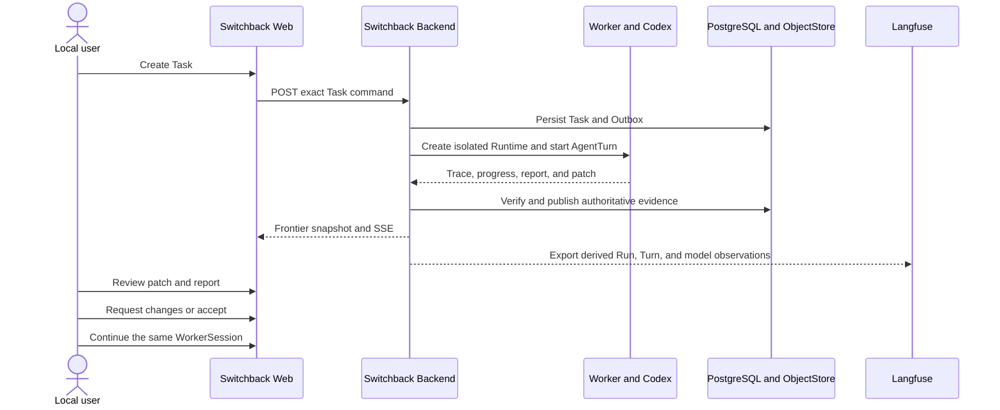

# M1 Worker delivery 人工验收手册

_适用于 2026-07-24 的 `m1-worker-delivery-vertical-slice` 本地单用户实现。_

---

## 验收范围

本手册验证当前已经实现的主链路：



验收通过必须同时满足：

- Switchback Web、Backend、Langfuse 均可从 loopback 访问
- Web 创建的 Task 由真实容器内 Codex 执行
- Task、WorkerSession、WorkerRun、AgentTurn 状态可在页面持续观察
- report 与 patch Artifact 可打开、校验、下载
- patch Task 默认进入人工验收，可返工后再接受
- 同一存活 WorkerSession 可继续对话
- Langfuse 可看到对应 `worker.run`、`agent.turn` 与 model generation
- Worker 不挂载 Docker Socket，不发布宿主端口，源 fixture 不被修改

## 环境准备

### 前置条件

- Docker Desktop 或兼容 Docker Engine 正常运行
- 本机有 Go、Node.js、npm、`openssl`
- `deploy/local/.env` 引用的 DeepSeek 或 Kimi key 文件已填入可用凭据
- 不在主链路验收过程中重启 `switchback-backend`

### 启动

在仓库根目录执行：

```bash
make local-config
make local-up
```

等待服务启动后执行：

```bash
curl --fail http://127.0.0.1:4173/healthz
curl --fail http://127.0.0.1:4173/api/v1/views/task_summary/index
curl --fail http://127.0.0.1:8080/healthz
curl --fail http://127.0.0.1:3000/api/public/health
docker compose --env-file deploy/local/.env -f deploy/local/compose.yaml ps
```

预期：

| 检查 | 预期结果 |
|---|---|
| Switchback Web health | `{"service":"switchback-web","status":"ok"}` |
| Web 同源 API | 返回 `frontier.projection_snapshot.v1` |
| Backend health | `{"service":"switchback-backend","status":"ok"}` |
| Langfuse health | `{"status":"OK","version":"3.217.0"}` |
| Compose | `switchback-web`、`switchback-backend`、PostgreSQL、Langfuse 六服务均为 running；有 healthcheck 的服务为 healthy |

### 访问地址

| 服务 | 地址 |
|---|---|
| Switchback Web | `http://127.0.0.1:4173/` |
| Backend | `http://127.0.0.1:8080/` |
| Langfuse | `http://127.0.0.1:3000/` |
| Langfuse Switchback M1 项目 | `http://127.0.0.1:3000/project/switchback-m1` |

Langfuse 本地账号固定为 `switchback@localhost.invalid`。密码由 `make local-env` 首次生成，不提交到 Git，可执行：

```bash
awk -F= '$1 == "LANGFUSE_INIT_USER_PASSWORD" {print $2}' deploy/local/.env
```

本机当前已验证凭据记录在 ignored 文件 `runtime-data/manual-acceptance/current-local-access.md`。若数据库 volume 来自另一份 `.env`，以能实际登录的旧初始化密码为准；修改环境变量不会更新已有 Langfuse 用户密码。

## 主链路验收

### 创建真实 Coding Agent Task

1. 打开 Switchback Web。
2. 点击任务列表右上角的加号按钮，按钮提示为 `Create task`。
3. 填写：

| 字段 | 建议值 |
|---|---|
| Title | `Manual acceptance: fix counter` |
| Goal | 见下方文本 |
| Agent | `DeepSeek` |

Goal：

```text
Inspect the counter package, fix Add so the existing test passes, and run go test ./....

Acceptance criteria:
- Fix only the counter implementation needed by the test.
- Produce a concise stage report.
- Produce a patch artifact.
- Do not change go.mod.
- Do not publish remote changes.
```

4. 点击 `Create`。

预期：

- 表单提示 Task 已被接受
- Task 列表出现新行，状态按 `queued -> running -> delivered` 推进
- Worker capacity 的 used 数增加，但不超过 `10`
- 点击 Task 行后进入唯一 WorkerSession 详情页
- Docker 中出现带 `com.switchback.managed=worker-runtime` 标签的动态容器

辅助检查：

```bash
docker ps --filter label=com.switchback.managed=worker-runtime
git diff --exit-code -- test/fixtures/m1/workspace-repository
```

源 fixture 必须保持未修改；代码变更只应存在于该 WorkerSession 的隔离 WorkingCopy。

### 观察实时执行

在 Worker detail 页面记录以下 identity：

- `worker_session_id`
- `worker_run_id`
- `agent_turn_id`
- Runtime generation
- Agent profile

执行中预期：

- Task/Run/Turn 状态可见
- Timeline 出现 Prompt、Agent/Tool 活动和阶段状态
- transient live activity 可以出现，但页面刷新后以 durable timeline 为准
- 页面不因 SSE 短暂重连而把 Task 判为失败
- 同一 Session 同时只有一个顶层 active WorkerRun

可选地打开浏览器开发者工具，确认页面保持一条 Frontier events 请求；事件流断开后应自动从 snapshot/cursor 恢复。

### 审查 report 与 patch

Task 到达 `delivered` 后：

1. 查看右侧 `Stage result`。
2. 打开 `Stage report`。
3. 返回 Worker 页面，打开 `Patch review`。
4. 下载两个 Artifact。

预期：

| 检查 | 预期结果 |
|---|---|
| Stage report | 包含完成摘要与 `go test ./...` 验证结果 |
| Patch review | 显示 `current - delta` 改为 `current + delta` 的 diff |
| Integrity | 页面显示 `Checksum verified` |
| Provenance | 显示对应 WorkerRun、AgentTurn 与 checksum |
| Patch semantics | 显示 `Review only · not applied`，不会自动写回源 fixture |
| Download | 下载内容与页面内容一致 |

如果页面显示 `Checksum verification failed` 或 `Artifact content missing`，内容动作必须被禁用，本场景判定失败。

### 返工与人工接受

先走一次返工，以验证同一 Task 的多 WorkerRun 交互：

1. 在 `Request changes message` 输入：

```text
Add one focused table-driven test for a negative delta, run go test ./..., and update the report and patch.
```

2. 点击 `Request changes`。
3. 等待 Task 再次经历 `running -> delivered`。
4. 核对 WorkerSession identity 不变、WorkerRun/AgentTurn identity 更新。
5. 审查新的 report/patch 后点击 `Accept`。

预期：

- 返工不会创建第二个 Task
- 同一 WorkerSession 的顶层执行保持串行
- 新 Artifact 带新的 Run/Turn provenance
- `Accept` 后 Task 进入 `completed`
- 重复点击或网络重试不会产生重复状态推进

### 继续 WorkerSession 对话

Task 完成后，在 Worker chat 输入：

```text
Reply with exactly FOLLOW_UP_OK and do not change files.
```

选择 `Follow up` 并发送。

预期：

- 仍使用同一个 `worker_session_id`
- 存活 Runtime 不因阶段完成而停止
- 创建后续 Run/Turn，并在 Timeline 中显示 `FOLLOW_UP_OK`
- patch Artifact 为无文件变化
- 48 小时 idle timeout 与 14 天 absolute lifetime 仍适用

如果执行中提供了 `Queue`，可发送一条排队消息并检查 FIFO position。`Interrupt` 只在 active Turn 且 action 可用时出现。当前 M1 不把 `Steer` 作为必须通过项。

## Langfuse 验收

1. 打开 Langfuse 并使用本地账号登录。
2. 进入 `Switchback Local -> Switchback M1 -> Tracing`。
3. 按 Worker detail 中记录的最新 `worker_run_id` 查找 Trace。
4. 打开 Trace 并核对 observations。

预期：

- 每个 WorkerRun 对应一个 `worker.run` Trace
- 每个顶层 AgentTurn 对应一个 `agent.turn` span
- 每次真实模型调用对应 `model.generation`
- model/profile、Session/Run/Turn identity 与 Switchback 页面一致
- 新 Task 的 Trace 数量增加
- Langfuse 查询延迟不会改写 Switchback 已完成的 execution outcome

Langfuse 是可重建观测投影，不是 Task、Trace JSONL、report 或 patch 的权威事实源。若 Switchback 已完成但 Langfuse 缺少数据，本场景记为“执行通过、观测验收失败”，不得把 Agent 结果改成失败。

## 存活与隔离验收

### Web 独立重启

```bash
docker compose --env-file deploy/local/.env -f deploy/local/compose.yaml restart switchback-web
curl --fail http://127.0.0.1:4173/healthz
curl --fail http://127.0.0.1:4173/api/v1/views/task_summary/index
```

预期 Web 独立恢复，Task 数据仍来自 Backend/PostgreSQL。此检查证明 Web 不依赖手工 Vite 终端或当前 Codex 会话。

### Runtime 隔离

```bash
docker inspect "$(docker ps -q --filter label=com.switchback.managed=worker-runtime)" \
  --format '{{json .HostConfig.Binds}} {{json .HostConfig.PortBindings}} {{.HostConfig.Privileged}}'
```

预期：

- 仅挂载服务端派生的 Session WorkingCopy/cache/state
- 没有 `/var/run/docker.sock`
- `PortBindings` 为空
- `Privileged` 为 `false`

不要把完整 `docker inspect` 环境输出粘贴到验收报告，它可能包含 Runtime 临时敏感信息。

## 失败判定

以下任一情况使对应场景失败：

- `make local-up` 后 `switchback-web` 不存在或 `4173` 不可访问
- 浏览器使用 demo 数据而不是 Frontier snapshot
- Task 长时间停在 `queued` 且没有明确 capacity/provider 原因
- Worker 直接修改 `test/fixtures/m1/workspace-repository`
- 同一 WorkerSession 同时出现两个顶层 active WorkerRun
- report/patch 缺少 checksum 或 provenance
- Artifact checksum 失败后仍允许下载或接受
- patch Task 未经人工动作直接进入 `completed`
- 返工创建了第二个 Task 或覆盖旧 Artifact provenance
- Langfuse 失败改写了已经完成的执行结果
- Worker 容器获得 Docker Socket、host port 或 privileged

## 当前已知边界

这些不是本次 M1 人工验收失败：

| 边界 | 当前行为 |
|---|---|
| 用户体系 | 固定 `tenant-local` / `user-local`，没有登录页、SSO、RBAC |
| Backend 重启 | Runtime generation 自动恢复尚未交付；live Session 可能进入 `lost` |
| Steer | UI/协议可表达，但当前 Agent capability 不保证支持 |
| Protected effect | Approval 数据与 UI 已有，外部受保护 Tool 的 same-operation resume 尚未接入 |
| Repository remote | Worker 不接收 GitHub token，不执行远端 push/PR |
| SessionProcess/Preview | 跨 Turn 受管进程与 PreviewProxy 尚未进入本切片 |
| Inspiration/Evolution | 不在当前 Worker delivery 端到端验收范围 |

因此主链路期间不要执行 `docker compose restart switchback-backend`。已经处于 `lost` 的旧 Session 只能作为只读证据查看；请创建新 Task 验证当前 Runtime。

## 验收记录

每次验收至少记录：

| 字段 | 内容 |
|---|---|
| Git commit | `git rev-parse HEAD` |
| 验收时间 | 本地时间与时区 |
| Agent profile | DeepSeek 或 Kimi profile id |
| Task | Task id 与终态 |
| Runtime | WorkerSession、Run、Turn、generation、container id |
| Artifact | report/patch id、checksum、completeness |
| Langfuse | Trace id、span/generation 数量 |
| Isolation | fixture digest、Docker Socket/port/privileged 检查 |
| 结论 | pass、fail，或 execution pass / observability fail |

自动化发布门槛仍应执行：

```bash
make verify
make failure-acceptance
```

真实供应商回归使用：

```bash
make real-provider-acceptance
```

人工页面观察不能替代这些确定性 gate；自动化通过也不能替代本手册对可用性、交互和渲染的检查。
