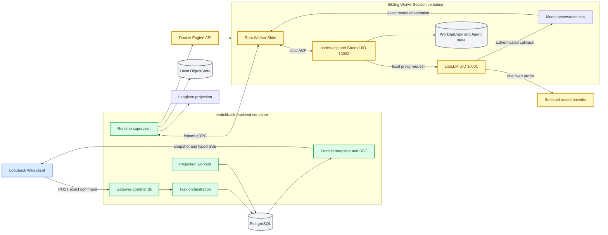

# M1 Worker delivery architecture and operations

_Production-module topology, local operation, persistence, rollback, and diagnosis for `m1-worker-delivery-vertical-slice`._

---

## Scope and status

This document describes the first single-user Worker delivery slice. It covers the production Go packages, local Docker Compose topology, real Codex acceptance path, PostgreSQL state, filesystem evidence, Langfuse projection, and the minimal React Worker UI.

The implementation has three distinct runnable surfaces:

| Surface | Purpose | Current status |
|---|---|---|
| Production packages | Task, Session, Runtime, Artifact, projection, Gateway, and Frontier behavior | Implemented and exercised by unit/integration tests |
| Acceptance drivers | Fake-Agent restart slice, real Kimi/DeepSeek Codex, and failure matrix | Executable end to end |
| Default local product entry | `cmd/switchback-backend` plus `web/` | Gateway, Frontier snapshot/SSE, RuntimeSupervisor, Artifact download and live UI are composed |

`make local-up` starts the production local composition. A Task created by the Web UI is admitted by Gateway, allocated and executed by a dynamically created Worker, materialized through Frontier and rendered from live snapshot/SSE data. The deterministic acceptance commands remain the release evidence because they also assert negative and residue conditions.

## Architecture



### Ownership rules

| Concern | Authoritative owner | Derived or transient copy |
|---|---|---|
| Task, WorkerSession, WorkerRun, AgentTurn, Runtime, queues, revisions | PostgreSQL | Frontier views and UI replicas |
| Raw/normalized Trace, manifest, report, patch | LocalFileObjectStore after checksum verification | Langfuse and rendered Artifact views |
| Live WorkingCopy and Codex rollout/session files | WorkerSession storage below the Switchback data root | Continuation/evidence references |
| Runtime container and secret volume | Backend RuntimeSupervisor using exact labels and identity | Docker process state |
| Browser state | Frontier snapshot plus ordered durable deltas | Transient text/activity overlay |
| Model selection | Immutable server AgentProfile on WorkerRun | LiteLLM route rendered for that Runtime |
| Approval request and grant | PostgreSQL exact capability/target/effect/revision records | WorkerDetail pending request and actions |

Task is a lightweight delivery record. WorkerSession remains the primary interactive surface and can accept a later exact-Session message after a stage result. A WorkerSession has at most one top-level active WorkerRun, while one live Runtime stays resident until Session terminality or an explicit failure boundary.

### Runtime and secret boundary

The Backend is the only Docker owner. Worker containers do not receive the Docker Socket, privileged mode, host networking, host ports, arbitrary host paths, or provider selection from the client.

The root Shim reads root-owned bootstrap and provider files, then starts:

- LiteLLM as UID `10001`, with the selected upstream credential in its private process environment
- `codex-acp` and Codex as UID `10002`, with only a Runtime-local LiteLLM URL and proxy token
- ordinary Tool processes under the Agent UID and the current AgentTurn lifecycle

The Shim starts an authenticated loopback model-observation sink before LiteLLM. The LiteLLM callback binds its generated call id to the currently active Session/Run/Turn, and the Shim emits that observation through the same fenced WorkerControl stream before terminal settlement. Backend combines the observation with the checksum-verified TraceManifest and projects it to Langfuse. Export or exact-query verification failure records `degraded` and never rewrites the execution outcome.

Codex diagnostic SQLite and app-server logs are deliberately stored below `/run/switchback-runtime/`. Codex 0.144.1 can persist request headers in those diagnostic stores independently of `RUST_LOG`; keeping them in the Runtime layer prevents those credentials from entering durable Session state. Durable ACP frames pass through the bounded raw tee and exact-token redactor before they reach `trace-spool`.

### Langfuse input and output

New M1 projections intentionally contain complete debugging content:

| Langfuse object | `input` | `output` |
|---|---|---|
| `worker.run` Trace | first projected Turn content | last projected Turn stage report |
| `agent.turn` span | exact Turn content | checksum-verified stage report |
| `model.generation` | complete LiteLLM request body | complete serializable provider response |

This is the high-fidelity local policy: Tool arguments/results and provider-returned reasoning are retained without semantic redaction. Transport headers, process environment, Provider/API keys, LiteLLM proxy credentials and callback internals are not copied into these fields. Before ingestion, Backend scans the complete batch for every known generated credential and provider key; a match prevents any Langfuse request and degrades observability without changing execution outcome. The loopback sink accepts at most 32 MiB per observation as a runtime safety boundary.

Do not use this content policy unchanged for shared or remotely reachable Langfuse deployments. Existing rows created before content capture remain empty and cannot be reconstructed exactly; create a new Worker Turn to validate the current behavior.

## Data locations

The default local host data root is `.switchback/local`, generated into ignored `deploy/local/.env` as `SWITCHBACK_HOST_DATA_ROOT`. Inside `switchback-backend` the same root is `/var/lib/switchback`.

| Data | Local location | Lifecycle |
|---|---|---|
| WorkerSession root | `.switchback/local/sessions/<worker_session_id>/` | Retained until an explicit administrative retention action |
| WorkingCopy | `sessions/<id>/working-copy/` | Live for the Session; mounted at `/workspace` |
| Codex Agent state | `sessions/<id>/agent-state/` | Live for the Session; contains durable Codex rollout/session files |
| Worker Trace spool | `sessions/<id>/trace-spool/` | Staging for redacted ACP Trace and Runtime logs |
| Runtime secret input | `sessions/<id>/runtimes/<runtime>-g<generation>/secret-input/` | Removed immediately after the Docker secret volume is populated |
| Final ObjectStore content | `objects/tenants/<tenant>/users/<user>/workspaces/<workspace>/sessions/<session>/runs/<run>/turns/<turn>/<kind>/sha256/<digest>` | Immutable, checksum-addressed evidence |
| Temporary ObjectStore upload | Same identity path below `temporary/` | Reconciled after finalize failure or timeout |
| Business state and projections | Compose volume `postgres-data` | Durable across Backend/Compose restart |
| Langfuse events and media | Compose ClickHouse/PostgreSQL/MinIO/Redis volumes | Derived and rebuildable; never the execution source of truth |
| Runtime secret volume | `switchback-runtime-secrets-<runtime>-g<generation>` | Must be absent after confirmed cleanup |
| Codex diagnostics | `/run/switchback-runtime/app-server-logs` and `/run/switchback-runtime/codex-sqlite` inside Worker | Runtime-local; removed with the container |
| Acceptance evidence | ignored `runtime-data/` | Machine-readable local verification output, never committed |

Do not manually edit PostgreSQL rows, finalized ObjectStore objects, Trace manifests, or files inside a live WorkingCopy. Use commands with expected revision and idempotency key so state and Outbox remain aligned.

## Local operation

### Prerequisites

- Go version compatible with `go.mod`
- Docker Desktop or a Docker-compatible Engine with Compose
- Node.js and npm for `web/`
- `openssl` for local secret generation
- Provider keys only when running real-provider acceptance

All generated credentials, `.switchback/`, `runtime-data/`, dependency directories, databases, and logs are ignored by Git.

### Start the local topology

```bash
make local-env
make local-config
make local-up
curl --fail http://127.0.0.1:8080/healthz
```

`make local-up` performs these operations in order:

1. Builds the Backend and Worker images.
2. Resolves the Worker image to an immutable Docker image ID and writes it to ignored `deploy/local/.env`.
3. Builds the React/Vite bundle and packages it in the loopback-only `switchback-web` Nginx image.
4. Starts Switchback Web, PostgreSQL, Backend, Langfuse Web/worker, ClickHouse, MinIO, and Redis.
5. Exposes Switchback Web, Backend, and Langfuse only on loopback.
6. Gives the Docker Socket only to Backend; sibling Workers are created dynamically and are not Compose services.

Open Switchback Web at `http://127.0.0.1:4173` and Langfuse at `http://127.0.0.1:3000`. The generated Langfuse login password remains in ignored `deploy/local/.env`.

Check all three loopback entry points:

```bash
curl --fail http://127.0.0.1:4173/healthz
curl --fail http://127.0.0.1:4173/api/v1/views/task_summary/index
curl --fail http://127.0.0.1:3000/api/public/health
```

`switchback-web` serves the compiled SPA and proxies `/api` to Backend on the private Compose path with response buffering disabled for SSE. Production routes load complete Frontier snapshots, subscribe from the returned cursor and atomically resync the affected view when required; demo data is test-only. Run `npm --prefix web run dev` only when frontend hot reload is specifically required, and stop the Compose `switchback-web` service or select a different Vite port first.

### Operate the Worker Workbench

WorkerDetail is both the durable interaction history and the Artifact review
surface. It reconstructs historical Agent/Tool output from server-owned
DisplayCheckpoints; the browser never parses raw ACP Trace.

For a manual check:

1. Open one delivered Worker and confirm the latest Run/Turn group contains the
   user prompt, expanded Agent Markdown and collapsed Tool Calls.
2. Send ordinary feedback. A delivered bound Task must expose
   `task.continue`, create a new WorkerRun/AgentTurn in the same Task and
   WorkerSession, and return the Task through `running` to `delivered`.
3. Use Request changes for explicit rework. It uses the same continuation
   authority with `interaction_kind=rework`.
4. Accept the delivery. The canonical Task remains `completed`, rendered as
   `Accepted`; acceptance does not close the WorkerSession.
5. Send another message. It must use `worker.follow_up`, create a standalone
   WorkerRun in the same live WorkerSession, and leave the accepted Task
   revision unchanged.
6. Review Report, Diff and Files. Report renders safe Markdown; Patch shows a
   changed-file tree, unified/split diff and hunk navigation. Integrity failure
   disables rendering/download rather than showing unverified bytes.

Every command carries the complete projected Task/Session/Run/Turn revision
tuple. On `stale_target`, refresh the projection and explicitly resend; the
browser preserves the draft but never automatically retargets it.

Display history is stored in PostgreSQL `worker_display_checkpoints` and joined
to canonical Run/Turn identity. Transient SSE text is only a low-latency overlay.
Refresh and reconnect must converge to the checkpoint, and terminal Turns
without reconstructable history must say `non_backfillable` rather than invent
content.

### Run deterministic acceptance

```bash
make verify
make failure-acceptance
make runtime-recovery-acceptance
```

`make verify` runs formatting, migrations, generated protocol, image provenance, unit, race, vet, PostgreSQL integration, secret scan, and OpenSpec gates. `make failure-acceptance` emits a machine-readable summary under ignored `runtime-data/failure-acceptance/` and covers:

- invalid provider credential
- Artifact checksum mismatch
- Langfuse unavailable
- WorkerSession quota full
- AgentTurn deadline
- Runtime loss
- Docker cleanup failure and reconciliation

`make runtime-recovery-acceptance` currently collects recovery evidence; it is
not by itself a promotion pass. It requires a mode-`0600` DeepSeek key, records
the exact deterministic tests that passed, then runs the fixed-image
`idle_between_turns_manual_replacement` case with exact AgentSession retention,
no prompt replay and zero managed residue. That driver-managed case records
`production_recovery_path=false`. Promotion requires the generated report to
reach `enablement_ready=true` with no missing required scenario; until then the
Compose recovery flag remains disabled by default.

### Run real Codex acceptance

Keep provider keys in mode `0600` files outside tracked paths, then run:

```bash
SWITCHBACK_KIMI_KEY_FILE=/absolute/path/to/kimi.key \
SWITCHBACK_DEEPSEEK_KEY_FILE=/absolute/path/to/deepseek.key \
make real-provider-acceptance
```

The success run proves two Turns in one AgentSession for each selected profile, fixture immutability, exact identity cardinality, known-token absence from persisted boundaries, and zero managed Docker residue. No Kimi/DeepSeek fallback occurs inside an AgentTurn.

To exercise the real invalid-credential path without valid provider credentials:

```bash
SWITCHBACK_REAL_PROVIDER_MODE=invalid-credential \
./scripts/run-real-provider-acceptance
```

### Stop or reset

```bash
make local-down
```

This removes Compose containers and networks but preserves named volumes and `.switchback/local`. To perform a destructive reset, first stop all Switchback containers, take any required backup, then remove the Switchback Compose volumes and `.switchback/local` explicitly. There is intentionally no default `make` target that deletes durable data.

## Migration and rollback

### Schema migration

Migration files use six-digit monotonic names and exact `-- migrate:up` / `-- migrate:down` sections. `make migration-check` validates ordering and shape.

On a fresh PostgreSQL volume, `deploy/local/init-postgres.sh` creates `switchback` and applies every `up` section in order. PostgreSQL only runs `/docker-entrypoint-initdb.d` scripts for an empty data directory; changing a migration does not upgrade an existing local volume.

Before an upgrade of an existing environment:

1. Stop new Task admission and WorkerSession allocation.
2. Record active Runtime identities and fence/clean them through RuntimeSupervisor.
3. Back up PostgreSQL and `.switchback/local` together.
4. Apply new migrations in ascending order with `ON_ERROR_STOP=1`.
5. Start the new Backend and verify health, schema gates, pending Outbox, projections, and ObjectStore references.

Never treat ObjectStore and PostgreSQL as one filesystem transaction. Finalize content first, commit only checksum-verified refs, then let orphan reconciliation handle interrupted cross-store work.

### Application rollback

The preferred rollback is code/config rollback without schema downgrade:

1. Stop new allocation and command admission.
2. Fence live Runtime commands and run exact container/secret cleanup.
3. Stop the new Backend.
4. Start the previous compatible Backend against the retained PostgreSQL and ObjectStore data in read-only/diagnostic mode first.
5. Re-enable writes only after version compatibility is proven.

Do not hand an existing Session back to the Spike in-memory owner. The Spike is historical evidence, not a fallback runtime.

Runtime recovery and new Display materialization remain independently configurable:

| Flag | Default | Rollback effect |
|---|---:|---|
| `SWITCHBACK_SINGLE_RUNTIME_RECOVERY_ENABLED` | Compose `0`; bare Backend `0` | Keep disabled until the fixed-image active-turn, Backend-restart, failed-fencing/replacement, stale-event, and lifecycle-preemption gates pass. Set to `1` only for controlled acceptance. Setting it back to `0` stops opening new automatic incidents; already-open incidents still reconcile to recovered or exhausted and stored evidence remains. |
| `SWITCHBACK_WORKER_DISPLAY_PROJECTION_ENABLED` | `1` | Set to `0` on Backend to stop creating new Display streams/checkpoints. Task, Worker, Trace and Artifact execution continue; existing checkpoints remain readable. |

Example:

```bash
SWITCHBACK_SINGLE_RUNTIME_RECOVERY_ENABLED=0 \
SWITCHBACK_WORKER_DISPLAY_PROJECTION_ENABLED=0 \
make local-up
```

Workbench is the only production Artifact presentation owner. A renderer
regression is rolled back by reverting the offending Web commit and rebuilding
the image; there is no second UI path or frontend runtime/build flag. Disable
backend projection only when new Display materialization itself is faulty.
That server flag does not delete migration `000011` data, rewrite Task state,
stop a live Runtime, or permit raw Trace reconstruction in the browser.

Use migration `down` sections only when the prior binary cannot coexist with the new schema, no incompatible writes must be retained, and a restore point has been tested. Apply `down` sections in reverse migration order. A failed downgrade is recovered from the coordinated PostgreSQL and data-root backup, not by editing rows or deleting ObjectStore files.

## Failure diagnosis

Start with the user-visible code and exact Task/Session/Run/Turn/Runtime identity. Do not copy provider payloads or raw credentials into tickets or chat.

| Symptom or code | First checks | Expected action |
|---|---|---|
| `command_service_unavailable` | Backend composition, PostgreSQL connectivity, command adapter installation | Retry only with the same idempotency key after service repair |
| `stale_target` | Current projection revision and exact target identity | Refresh snapshot; never rewrite expected revision locally |
| `unsupported_command` | ACP capability snapshot and current Turn state | Remove/disable the action; do not emulate unsupported steer/interrupt |
| Provider authentication failure | Selected AgentProfile, key file mode, LiteLLM health | Keep the same execution outcome; fix credential and start an explicit later action |
| Runtime never becomes ready | Worker container exit, bootstrap validation, fixed UID directories, gRPC target | Inspect sanitized container diagnostics; do not broaden capabilities as a shortcut |
| `recovering_runtime` | Incident phase/revision, failed/replacement generation, heartbeat, exact container and secret identity | Let the single durable incident reconcile; never manually create another Runtime or replay the prompt |
| `runtime_recovery_failed` | Fence/continuity/health evidence and cleanup ScheduledCommand | Keep the same Session/Run waiting_user, reconcile residue, and require an explicit user action |
| `runtime_lost` while recovery gate is disabled | Heartbeat sequence, container/process state, channel epoch | Preserve legacy fail-closed evidence; re-enable recovery only after the recovery acceptance gate passes |
| Artifact integrity failure | ArtifactRef checksum, ObjectStore object presence, finalize projection status | Disable acceptance/apply-like actions and reconcile the object boundary |
| Langfuse unavailable | Projection status and Langfuse service health | Keep execution result; replay the derived projection later |
| Cleanup unconfirmed | Exact Runtime labels, container identity, secret volume identity | Keep cleanup failure visible and run reconciliation until absence is proven |
| SSE `resync_required` | View epoch, retained cursor, latest complete snapshot | Atomically replace the client replica from a new snapshot |
| Delivered Worker says refresh before retry | Task/Session/Run/Turn revisions and projected `task.continue` action | Preserve the draft, refresh once, then explicitly resend against the new tuple |
| Composer absent after acceptance | Root `available_actions`, Session terminality, latest Run/Turn terminality | Expect `worker.follow_up`; never reopen the completed Task |
| Agent or Tool history missing | `worker_display_checkpoints`, terminal checkpoint completeness, timeline `backfill_status` | Reconcile a current terminal Turn; retain truthful `non_backfillable` for old evidence that cannot be reconstructed |
| Report/Diff cannot render | Artifact review outcome, checksum, media type, size and parser result | Use truthful empty/fallback state; do not render or download checksum-failed bytes |

Useful non-secret inspection commands:

```bash
docker compose --env-file deploy/local/.env -f deploy/local/compose.yaml ps
docker compose --env-file deploy/local/.env -f deploy/local/compose.yaml logs --tail=200 switchback-backend
docker ps -a --filter label=com.switchback.managed=worker-runtime
docker volume ls --filter label=com.switchback.managed=runtime-secret
curl --fail http://127.0.0.1:8080/healthz
```

For acceptance output, inspect only the generated summary first:

```bash
jq '.' runtime-data/failure-acceptance/*/failure-acceptance-summary.json
jq '.' runtime-data/real-provider/*/acceptance/real-provider-success-summary.json
jq '.' runtime-data/runtime-recovery/*/runtime-recovery-acceptance.json
```

Raw ACP frames, ObjectStore content, Codex state, and application logs are separate protected diagnostic surfaces. Known-token scanning is a release gate, not permission to paste raw evidence into user-visible errors.

## Deferred work

The following items are intentionally outside this M1 change and must not be inferred from helper code:

| Deferred item | Required before |
|---|---|
| HTTPS long-poll control fallback | Networks that cannot support the gRPC stream |
| Linux-enforced public egress policy with DNS/redirect/IP revalidation | Any non-local or security-sensitive deployment |
| Managed SessionProcess and PreviewProxy | Cross-Turn dev servers and browser previews |
| LiteLLM sidecar alternative | Moving upstream credentials outside the Worker container |
| Production S3-compatible ObjectStore and RocketMQ profile | Distributed/multi-host deployment |
| Multi-user authentication, Workspace membership, RBAC, and disclosure control | Non-local user access |
| Repository importer and managed GitHub/GitLab credential broker | Remote repository mutation from Worker |
| Assistant, Delivery, Evolution, Skill Market, and Inspiration integration | Product channels beyond direct TaskSpec/Worker interaction |
| Kubernetes deployment and aggregate multi-node admission | Shared production runtime |
| Protected-effect execution/resume bridge from ACP or a managed external Tool | Exposing external credentials, production writes or capability installation to M1 Workers |

M1 exposes only ordinary isolated WorkingCopy operations to Codex and keeps `approval_policy=never`; an unsolicited ACP permission request fails closed. The persisted ApprovalRequest/ApprovalGrant contract, exact Gateway decision endpoint and WorkerDetail controls are present, but no external credential or production-write Tool is exposed. A future protected Tool must publish a request and implement same-operation resume against the exact active grant before that capability can be enabled.

The final per-scenario review is recorded in [M1 Worker delivery requirement audit](m1-worker-delivery-requirement-audit.md).

## Verification evidence

Machine-readable evidence is generated, ignored, and tied to the exact local run:

- `runtime-data/failure-acceptance/<run>/failure-acceptance-summary.json`
- `runtime-data/real-provider/<run>/acceptance/real-provider-success-summary.json`
- `runtime-data/real-provider/<run>/acceptance/real-provider-invalid-credential-summary.json`
- `runtime-data/runtime-recovery/<run>/runtime-recovery-acceptance.json`

The evidence must report separate `execution_outcome` and `acceptance_outcome`, immutable source/Workspace fixtures, exact identity cardinality, known-token absence, and zero managed container/secret residue. A green Langfuse projection alone is never acceptance evidence.
