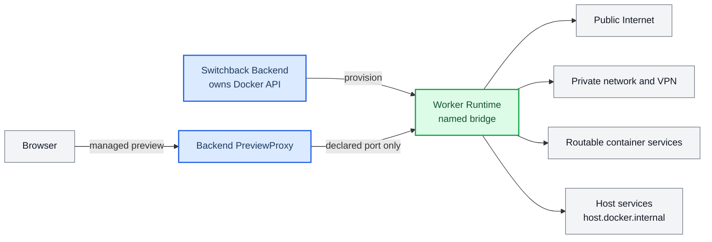

# M1 Worker 完整网络运维

_面向 `SingleUserLocalProfile` 的本地运维说明；现行决策以 [ADR 0066](../adr/0066-trust-full-worker-network-in-single-user-local-profile.md) 为准。_

---

## 🎯 运行边界

服务端固定解析 `trusted_full_network_v1` revision 1。Worker 通过 `switchback-m1-worker-control` 命名 Docker bridge 访问公网、私网、企业 VPN、LAN、其他可路由容器和宿主开发服务；出站不限制目的地、协议或端口。



完整网络不改变以下隔离：

- Docker Socket 只挂载给 Backend，Worker 不可见。
- Worker 不使用 privileged 或 host network。
- mount source 只能由 Backend 从 Switchback data root 派生。
- Worker 不发布 host/public 端口；PreviewProxy 是唯一受管入站。
- Worker 不自动继承 repository、database、Kubernetes、cloud 或 Docker 凭证。

该 profile 不是 DLP，不适用于远程暴露或多用户生产部署。不要在 Worker 可路由地址上暴露未认证的 Docker TCP API、数据库管理员端口或其他高权限服务。

## 🔧 配置与启动

本地 Compose 必须满足：

- Backend 使用 `SWITCHBACK_WORKER_NETWORK=switchback-m1-worker-control`。
- `worker-control` 是具名且非 `internal` 的 bridge。
- Worker 的 Docker Engine API `ExtraHosts` 包含 `host.docker.internal:host-gateway`。
- 服务端 deployment profile 为 `single_user_local_v1`；其他部署 profile 必须拒绝 `trusted_full_network_v1`。

常规启动：

```bash
make local-env
make local-up
```

检查网络：

```bash
docker network inspect switchback-m1-worker-control \
  --format 'name={{.Name}} driver={{.Driver}} internal={{.Internal}}'
```

期望：`driver=bridge internal=false`。

## 🔎 证据与诊断

同一次执行的 TaskSpec、RuntimeInstance、WorkerRunStartSnapshot、Trace identity 和 WorkerDetail 必须显示同一组证据：

```text
id=trusted_full_network_v1
revision=1
digest=sha256:25abd6d521b199eafb612bb42295faf3a56e90a928ae7d631cb7cce8923ed28f
enforcement_status=active
```

旧 `m1_public_web_restricted_v1` 只能作为不可变历史读取或已准入执行，revision/digest 分别为 `0`/空，status 必须是 `legacy_unenforced`。不要回写历史 TaskSpec，也不要声称旧执行实施了私网过滤。

本 profile 不产生 destination、URL、IP、端口、payload 或逐目标 network decision telemetry。排障时只记录 probe 名称和成功/失败类型，避免把私网地址或业务数据写入 Trace。

常见问题：

| 现象 | 优先检查 |
| --- | --- |
| 公网 DNS/HTTPS 不通 | Docker daemon DNS、宿主代理、防火墙、bridge 是否 `internal=false` |
| `host.docker.internal` 不通 | 容器 `ExtraHosts` 是否含 `host-gateway`、宿主服务是否监听可路由地址 |
| VPN endpoint 不通 | VPN 是否向 Docker VM/bridge 传播路由、split tunnel 和本机防火墙 |
| 私网 TCP 通但 UDP 不通 | VPN/防火墙是否只放行 TCP、服务监听协议与地址 |
| Worker 能连服务但认证失败 | 这是 credential/capability 问题，不应通过网络 profile 注入凭证 |

## ↩️ 回滚

回滚必须同时撤销服务端默认 profile 和新 Runtime admission，不能只改 UI 或 Docker 参数：

1. 停止创建新的 `trusted_full_network_v1` Task/Runtime。
2. 对已准入、未终态执行做显式 operator 处置；不要静默改写其 TaskSpec 或运行证据。
3. 恢复服务端配置与 RuntimeProvisioner 的前一版行为，并重新跑对应网络验收。
4. 保留所有历史 profile evidence；数据库迁移是 additive，不需要也不应批量重写旧记录。
5. 重新启用前再次通过 [人工验收](./m1-worker-network-manual-acceptance.md) 和 OpenSpec strict validation。

回滚到旧实现只代表恢复旧代码，不代表 `m1_public_web_restricted_v1` 曾经真实执行私网过滤。
