# M1 Worker Runtime Spike 后续路线

> 目标不是把 Spike 搬进生产目录，而是把已验证机制收敛为 Switchback 第一个可交互、可持久、可演进的单用户纵向闭环。

---

## 1. 推荐结论

Spike 完成后的主线应是 **M1 单用户 Worker Delivery Vertical Slice**：

```text
TaskSpec
  -> lightweight Task
  -> WorkerSession allocation
  -> WorkerRun / AgentTurn
  -> real Codex in Docker
  -> live progress
  -> report / patch review
  -> direct follow-up chat on the same live WorkerSession
```

这是当前最短的价值验证路径。它能验证用户真正关心的交互闭环，同时迫使 Task、Session、Run、Trace、Artifact 和 Runtime 边界进入正式 DDD 与持久化实现。

当前不应优先实现 Inspiration、完整 Evolution、飞书 Delivery、多用户 SSO、Skill Market 或复杂调度策略。它们都依赖一个稳定、可继续交互的 Worker 主链路。

LiteLLM sidecar 作为有边界的并行实验，不阻塞纵切开发。实验只回答隔离收益、token 路由和故障边界是否值得增加部署复杂度；在正式部署拓扑冻结前给出结论即可。

## 2. 从 Spike 到产品的原则

1. 复用已验证的机制，不复用 Spike 的临时 ownership。
2. 先冻结协议和不变量，再迁移 adapter；不要复制后再反向推导领域模型。
3. LocalFileObjectStore JSONL 继续作为 Trace/Artifact 事实源，PostgreSQL 保存业务状态、索引和 Outbox。
4. Langfuse 继续是可重建观测投影，不能影响 Agent 已完成结果。
5. 前端先做 WorkerSession 详情主交互面，Task 只做轻量交付跟踪。
6. 单用户 M1 仍保留 tenant/workspace 字段和服务端默认值，但不实现 SSO/RBAC UI。

## 3. 路线图

```mermaid
flowchart LR
    accTitle: Post-Spike M1 delivery roadmap
    accDescr: The completed runtime Spike feeds a contract extraction phase, then the production runtime, task persistence, and Worker interaction surface form one single-user vertical slice while a bounded LiteLLM sidecar experiment informs the deployment topology.

    spike["Completed Runtime Spike"] -->|"Extract verified contracts"| contracts["P0 Contract Baseline"]
    contracts -->|"Implement production owners"| runtime["P1 Runtime Core"]
    contracts -->|"Time-box topology question"| sidecar["Parallel LiteLLM Sidecar Experiment"]
    runtime -->|"Persist business lifecycle"| task["P2 Task and Session Orchestration"]
    task -->|"Expose progress and artifacts"| interaction["P3 WorkerDetail Interaction"]
    sidecar -->|"Topology decision"| hardening["P4 Runtime Hardening"]
    interaction --> hardening
    hardening -->|"Stable execution foundation"| channels["P5 Assistant and Delivery Integration"]
    channels -->|"Trace-backed learning"| evolution["P6 Evolution and Skilling"]

    classDef done fill:#dcfce7,stroke:#15803d,color:#14532d
    classDef critical fill:#dbeafe,stroke:#1d4ed8,color:#172554
    classDef parallel fill:#fef3c7,stroke:#b45309,color:#78350f
    classDef later fill:#f3f4f6,stroke:#4b5563,color:#111827
    class spike done
    class contracts,runtime,task,interaction critical
    class sidecar,hardening parallel
    class channels,evolution later
```



## 4. 阶段拆解

### P0：Contract Baseline

先从 Spike 建立一份 promotion matrix，对每个组件标记 `promote`、`adapt`、`rewrite` 或 `discard`。

优先冻结：

- `TaskSpec` 最小执行字段和 immutable snapshot
- WorkerSession、WorkerRun、AgentTurn identity 与状态边界
- WorkerControl command/event envelope、sequence、ACK 和 generation
- Trace segment、manifest、Artifact ref 与 checksum
- `execution_outcome` 和 delivery/acceptance 结果的分离语义
- AgentProfile 与 ModelRoute 的服务端选择边界
- RuntimeProvisioner 和 ObjectStore ports

明确不直接提升：

- Spike in-memory run state
- Harness ownership 和 45 分钟 test timeout
- Spike HTTP API 形状
- Compose credential 生成方式
- 只适用于验收的 fault proxy 与 summary 文件

退出标准：完成 ADR/协议评审，字段 ownership 唯一，Spike 到生产组件的迁移决策可追踪。

### P1：Production Runtime Core

在正式 DDD 模块中实现最小 Runtime owner：

- Backend 内 RuntimeSupervisor application service
- Docker RuntimeProvisioner infrastructure adapter
- Worker Shim 与 ACP CodexAdapter
- WorkerControl gRPC 主通道
- HTTP Trace/Artifact 可恢复上传
- Local ObjectStore adapter
- server-owned AgentProfile、mount、network 和 secret derivation

继续使用单用户、本地 Docker、generation 1 happy path。此阶段先不实现 recovery、long-poll fallback 和完整 egress enforcement。

退出标准：正式 Backend 可通过内部 application command 启动真实 Codex Run，完成两个 Turn，并保留与 Spike 等价的证据。

### P2：Task 与 Session 持久化

把执行接入 PostgreSQL 业务状态：

- lightweight Task、TaskTransition 和 immutable TaskSpec snapshot
- WorkerSession、WorkerRun、AgentTurn 和 RuntimeInstance records
- PostgreSQL transaction + Outbox
- idempotency key、expected revision 和 owner stream sequence
- 单 Session 顶层执行串行化
- 单用户 continuity quota 10 与 allocation queue
- 固定 24 小时 AgentTurn deadline
- 48 小时 idle 和 14 天 absolute lifetime 的最小 scheduler

退出标准：Backend 重启后仍能读取真实状态；重复命令不重复创建 Session/Run；Task、Run 和 Runtime terminality 不互相覆盖。

### P3：WorkerDetail 主交互面

先做真实工作界面，不做营销页：

- Gateway 创建/读取 Task 和 WorkerSession
- Frontier 以 SSE 输出 projection snapshot、delta 和 resync
- WorkerDetail 展示 live trace、阶段 report、patch diff 和状态
- chat box 对 exact WorkerSession 发送 follow-up、queue、interrupt 或 steer
- report 下载/查看；patch 审查、下载和后续操作
- `waiting_user` 审批的单次与会话级最小交互

退出标准：用户可以创建一个 Task、观察执行、审查 patch，并在 Worker 完成阶段结果后继续同一 Session 对话。

### P4：Runtime Hardening

在产品链路可用后补可靠性和隔离：

- Runtime heartbeat、suspect/unhealthy 和一次自动 generation recovery
- ChannelEpoch fencing 与 late event handling
- HTTPS long-poll command + batched event POST fallback
- Linux egress enforcement 与 redirect/IP 重验
- managed SessionProcess 与 PreviewProxy
- SecretLease、cleanup reconciliation 和 lost quota handling
- 资源 aggregate admission、OOM/PID/storage exhaustion 语义

退出标准：故障注入覆盖容器退出、Backend 重启、断流、late event、secret rotation 和 cleanup failure，且不产生双写 Runtime 或静默丢失结果。

### P5：Assistant 与 Delivery 集成

Runtime 主链稳定后再接入口：

- Assistant clarify/readiness -> TaskSpec
- creation intent 与 Workspace resolution
- Delivery 飞书触发、选择和结果卡片
- EventCenter owner stream 到 Frontier/Delivery projections

退出标准：Web 与飞书都调用同一 Task/Worker application API，不复制执行状态机。

### P6：Evolution 与 Skilling

最后基于可信 Trace 建立演进能力：

- Evolution candidate/revision/review/active Truth
- OpenViking active projection
- Memory 看板与可修改短期记忆
- Skill 生成/修改审核与安装授权

Inspiration 保持 P2 experimental，直到可以给出可观测的召回、采用和任务收益指标。

## 5. LiteLLM Sidecar 并行实验

实验只比较当前 co-process 与 sidecar，不改变 Agent/Task 协议。

必须回答：

| 问题 | 验证方式 |
|---|---|
| Codex 是否仍只获得本地 proxy base/token | 检查 Agent child env 与 ACP authenticate Trace |
| 上游 key 是否可完全移出 Worker execution container | 分离 mount/env 并做 UID 和容器级读取测试 |
| sidecar 重启是否会错误终止 AgentTurn | 注入 proxy restart，观察 execution 与 evidence 语义 |
| localhost 变成容器网络后增加哪些攻击面 | 检查 network attachment、DNS、端口和跨 Worker 可达性 |
| Token/Trace correlation 是否保持一致 | 复跑双 Turn Langfuse exact verifier |
| 部署和清理复杂度是否值得 | 对比容器数、启动时间、故障模式和 secret ownership |

建议时间盒：1 至 2 个工程日。若 sidecar 不能明显改善 upstream credential isolation，或需要引入跨 Worker 共享代理和复杂租户鉴权，则 M1 保留 co-process，sidecar 延后。

## 6. 下一项 OpenSpec 建议

建议下一项 change 命名为：

```text
m1-worker-delivery-vertical-slice
```

范围只包含 P0 到 P3，并按以下用户验收故事定义完成：

> 单用户在本地 Web 提交一个明确 TaskSpec；系统创建 Task 和 WorkerSession，在 Docker 中运行真实 Codex；页面实时显示执行过程和阶段结果；用户审查 report/patch 后，可以在同一仍存活的 WorkerSession 中继续对话，且 Backend 重启不会丢失已提交的业务状态和权威 Trace。

第一轮实现不要接 Assistant 自动澄清。先允许调用者直接提交 TaskSpec，这与当前需求一致，也能把 Runtime、Task 和交互的真实风险更早暴露出来。

## 7. 优先级与暂停条件

| 优先级 | 工作 | 原因 |
|---|---|---|
| P0 | Contract Baseline + production vertical slice proposal | 防止把 Spike 临时结构固化成产品协议 |
| P0 | P1-P3 主链 | 最快验证真实用户交互与持久化闭环 |
| P1 | sidecar 对比实验 | 影响部署和 secret 边界，但不应阻塞产品链路 |
| P1 | Runtime recovery/egress hardening | 在长驻 Session 前必须完成 |
| P2 | Assistant/Delivery | 依赖稳定 Task/Worker API |
| P2 | Evolution/Skilling | 依赖可信、可解释的 Trace 和反馈闭环 |
| P3 | Inspiration | 当前价值路径和使用方式仍不够清晰 |

出现以下情况时暂停功能扩张，先修基础契约：

- Task、WorkerRun 和 Runtime 对同一 terminal outcome 给出不同权威结论
- Backend 重启后无法从 PostgreSQL/ObjectStore 重建用户可见状态
- 相同 idempotency key 可以创建多个 Session、Run 或 Runtime
- Worker 可以获得 Docker Socket、任意宿主路径或上游 provider key
- Frontier/Delivery 开始维护独立执行状态机
- Langfuse 故障会覆盖已完成的 Agent execution outcome

## 8. 里程碑完成定义

M1 不是“把所有模块搭出来”，而是以下闭环同时成立：

- 一个明确 TaskSpec 可以触发一个真实 Worker
- Worker 在隔离容器内由 ACP 控制 Codex
- 两个 Turn 能在同一 live Session 连续交互
- Task/Session/Run 状态可持久、幂等且可恢复读取
- 用户可以实时看进度并审查 report/patch
- Trace/Artifact 是权威事实，Langfuse 是可重建投影
- 正常和关键故障路径都不会遗留未报告的可写 Runtime

达到这个里程碑后，再把 Assistant、Delivery 和 Evolution 接到同一条稳定主链，收益和风险都会更容易判断。
