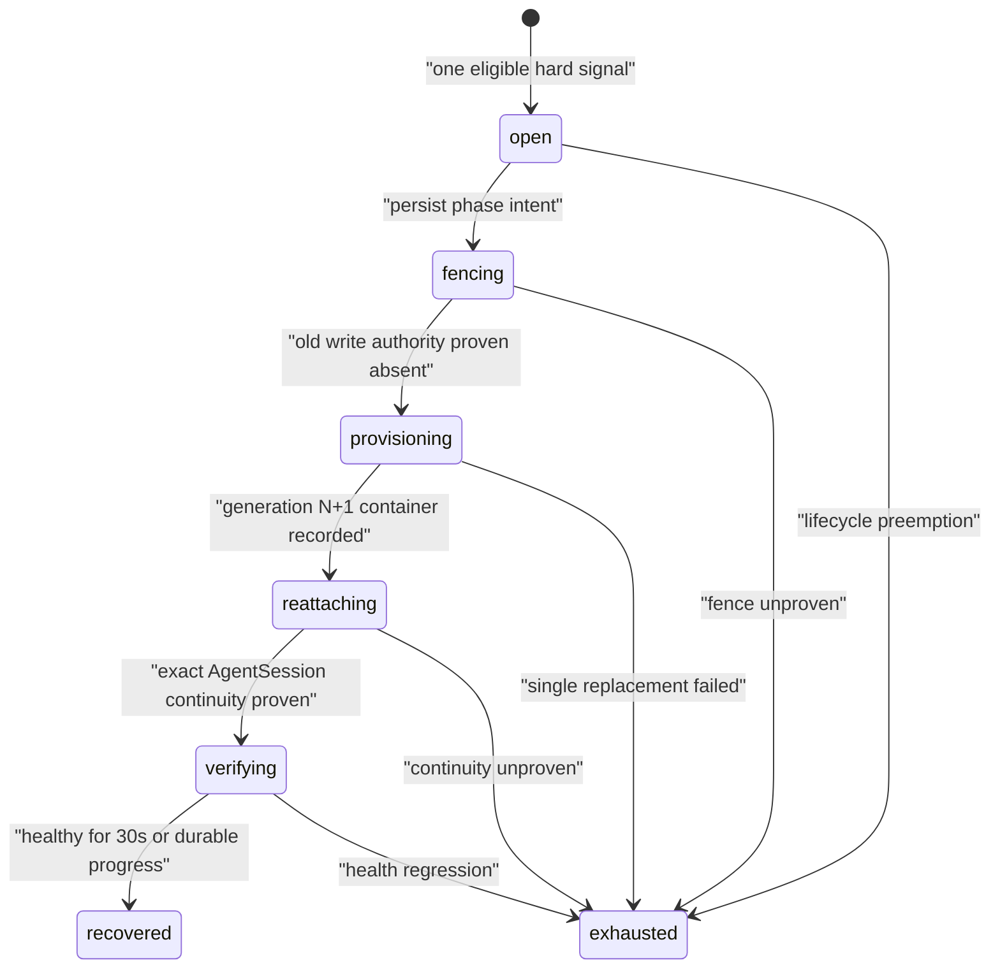

# M1 Worker Runtime 单次恢复运行手册

_适用于 loopback-only `SingleUserLocalProfile`。该能力只替换失效的 Runtime generation，不创建新 Task、WorkerRun 或 AgentSession。_

## 结论与边界

M1 对明确的 Runtime 硬故障最多自动替换一次。恢复必须先证明旧 generation 已失去控制、SecretLease 和 WorkingCopy 写权限，再为同一 WorkerSession 预留 generation `N+1`。ACP 只能恢复或加载 exact AgentSession，禁止自动重放旧 prompt 或 Tool 调用。

自动恢复只接受以下触发：

- 当前容器明确退出或丢失
- WorkerControl 连接关闭
- ACP stdio EOF
- 以服务端接收时间计算，45 秒无有效 heartbeat 进入 `suspect`，90 秒进入 `unhealthy`

用户取消、Session idle/absolute expiry、授权/策略/schema/protocol 错误、已知资源耗尽和未知外部副作用不授予自动重试权限。模型无 token、Tool 长时间运行或 `active_quiet` 本身也不是 Runtime 故障。

## 所有权与状态机



PostgreSQL 是 incident、phase intent、replacement identity、mount fence、heartbeat 和 idempotency result 的唯一权威。Docker、文件系统、Runtime secret 和 ACP 是事务外副作用；Backend 重启后按已持久化 phase 与 exact resource identity 继续 reconciliation，不重新分配 generation。

关键不变量：

- 一个 WorkerSession 同时最多一个非终态 `RuntimeRecoveryIncident`
- 同一连续 incident 的 `attempt_count` 只能从 0 变为 1
- Task、WorkerSession、WorkerRun、AgentSession、WorkingCopy 和原 AgentTurn deadline 不变
- replacement 使用更高 generation、ChannelEpoch 和全新 Runtime secret
- old-generation control/event、Display mutation 和 Artifact publication 不得成为当前权威
- deadline 或 absolute expiry 到达时，既有生命周期规则优先并 fencing 当前恢复资源
- fencing、provision、reattach 或 verify 任一步失败即 `exhausted`，不 crash loop

## 配置与启停

| 配置 | 默认 | 含义 |
|---|---:|---|
| `SWITCHBACK_SINGLE_RUNTIME_RECOVERY_ENABLED` | Compose `0`；裸 Backend `0` | 是否允许创建新的自动恢复 incident；完整 fixed-image fault gate 通过前只在受控验收中显式设为 `1` |
| `SWITCHBACK_M1_WORKER_DELIVERY_ENABLED` | Compose `1` | recovery 依赖完整 Worker delivery，关闭时不能单独开启 |

当前稳定窗口是服务端固定 30 秒，不接受 Task/Agent 输入。AgentTurn 24 小时 hard deadline 与 WorkerSession 14 天 absolute expiry 在恢复期间继续流逝。

回滚只需在 Backend 环境设置：

```bash
SWITCHBACK_SINGLE_RUNTIME_RECOVERY_ENABLED=0 make local-up
```

关闭后不会再从新故障创建 incident；已经持久化的非终态 incident 仍会继续收敛为 `recovered` 或 `exhausted`，避免留下双写 authority。回滚不会删除 migration `000013`、incident、Trace 或 Artifact 数据。

## 运行检查

先从公开视图和精确 identity 检查，不先读取原始 ACP/模型内容：

```bash
docker compose --env-file deploy/local/.env -f deploy/local/compose.yaml ps
docker compose --env-file deploy/local/.env -f deploy/local/compose.yaml logs --tail=200 switchback-backend
docker ps -a --filter label=com.switchback.managed=worker-runtime
docker volume ls --filter label=com.switchback.managed=runtime-secret
```

WorkerDetail 在恢复中应显示 `recovering_runtime`、incident id、phase、failed/replacement generation、attempt 与 evidence time，并隐藏会与恢复冲突的执行动作。投影断线重连必须从 durable snapshot/delta 收敛，不能由浏览器猜测状态。

如需数据库诊断，只查询 identity/status/evidence reference，不复制凭证或原始 provider payload：

```sql
SELECT incident_id, worker_session_id, failed_runtime_instance_id,
       failed_generation, replacement_runtime_instance_id,
       replacement_generation, phase, attempt_count,
       fence_status, continuity_status, outcome_reason,
       evidence_ref, evidence_at, revision, updated_at
FROM runtime_recovery_incidents
WHERE worker_session_id = $1
ORDER BY opened_at DESC;
```

## 故障处置

| 现象 | 判断 | 动作 |
|---|---|---|
| 长时间无模型输出但 heartbeat 新鲜 | `active_quiet`，不是恢复条件 | 保持 Turn，等待原 deadline 或明确 hard signal |
| `suspect` | 45 秒未收到有效 heartbeat | 暂停新 dispatch，检查 control/container/process |
| `recovering_runtime` 停在 fencing | 旧容器或 mount 独占未证明 | 不手工启动 replacement；修复 Docker 后让 reconciliation 收敛 |
| `recovery_continuity_unproven` | ACP 能连接但旧 Turn/Tool effect 不可证明 | 保持同一 Run/Session waiting_user，由用户明确决定后续 |
| `runtime_recovery_failed` | 唯一 replacement 尝试已耗尽 | 检查 incident evidence 和 cleanup scheduled command；禁止第二次自动重建 |
| `agent_turn_deadline` | 原始 deadline 在恢复中到达 | deadline 结果权威，不延长或新建 Turn |
| `worker_session_absolute_expired` | Session 14 天边界到达 | 按 expiry contract 终止 Session；续作只能派生新 Session |
| replacement 有容器/secret 残留 | cleanup 尚未确认 | 保留 waiting state，运行 durable cleanup reconciliation，直至精确资源不存在 |

不要通过删除数据库行、手工递增 generation、复活 closed/expired Session、重放 prompt 或复用旧 SecretLease 修复恢复失败。

## 自动验收

真实固定镜像验收需要 mode `0600` 的 DeepSeek key 文件：

```bash
SWITCHBACK_DEEPSEEK_KEY_FILE=/absolute/path/to/deepseek.key \
SWITCHBACK_SINGLE_RUNTIME_RECOVERY_ENABLED=1 \
make runtime-recovery-acceptance
```

该命令收集两类证据：

- PostgreSQL integration suite 的实际通过 test 名称；
- 固定镜像下由 acceptance driver 手工编排的 `idle_between_turns_manual_replacement`，包括 generation 1 清理、generation 2 启动、exact AgentSession 保留、两次独立 prompt、源 fixture 不变、已知 token 不落盘和零容器/secret 残留。

后者不经过生产 `RuntimeRecoveryService`/Backend ownership coordinator，因此报告会明确记录 `production_recovery_path=false`。`outcome=passed` 只表示本次已执行证据通过；只有 `enablement_ready=true` 且 `missing_enablement_scenarios=[]` 才表示完整启用门禁通过。当前 Backend restart、active-turn、failed fencing/replacement、stale-event fixed-image 与 security termination preemption 尚未闭环，默认 gate 必须保持关闭。

最终报告位于：

```text
runtime-data/runtime-recovery/<run>/runtime-recovery-acceptance.json
```

验收细节见 [M1 Worker Runtime 单次恢复人工验收](m1-worker-runtime-recovery-manual-acceptance.md)，协议字段见 [Core Protocols](../contracts/core-protocols.md#runtimerecoveryincident-v1)。
