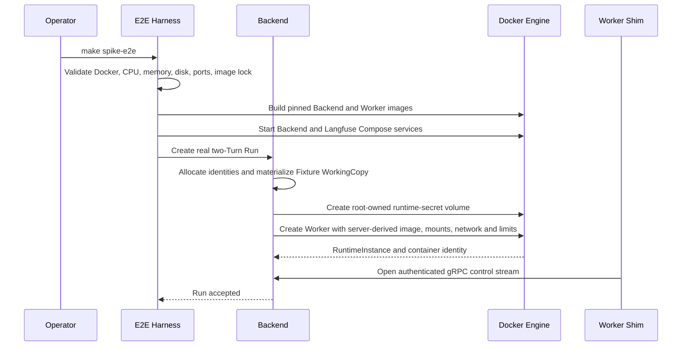
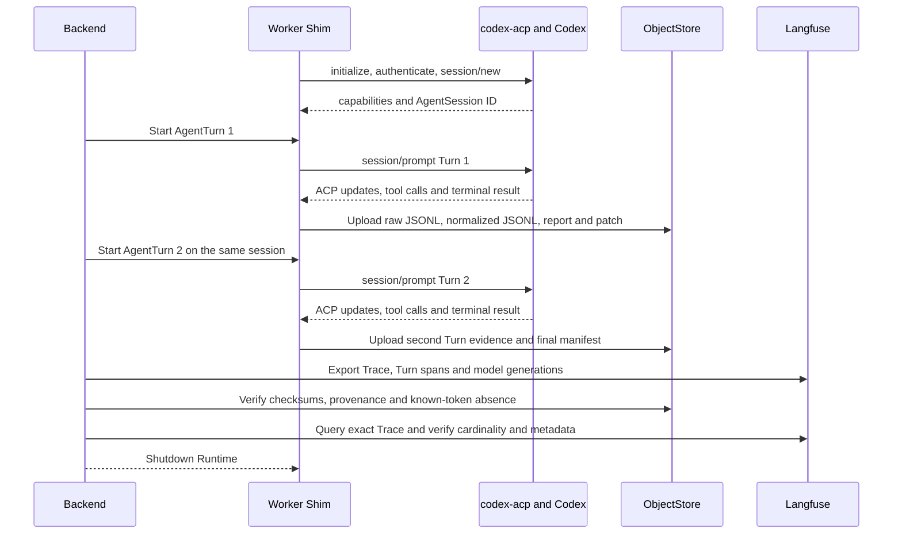

# M1 Worker Runtime Spike 执行架构

> 本文描述已经实现并通过验收的 Spike 如何启动、执行、留存证据和判定结果。稳定设计约束仍以 [M1 Worker Runtime Spike 设计](./m1-worker-runtime-spike.md) 为准；可复制命令见 [Worker Runtime Spike README](../../spikes/worker-runtime/README.md)。

---

## 1. 文档状态与结论

- 状态：M1 Spike 实现完成，真实双 Turn 验收通过
- 验证日期：2026-07-22
- 首个 Agent：Codex，经 `codex-acp` 和 ACP 控制
- 模型代理：Worker 容器内 LiteLLM `1.93.0` co-process
- 已验证上游：DeepSeek、Kimi，各自作为一次 WorkerRun 的唯一确定路由
- 权威证据：本地 ObjectStore 中的 JSONL、manifest、report 和 patch
- 派生观测：Langfuse Trace、AgentTurn span 和 model generation

这个 Spike 证明了一条最小但真实的执行链：Backend 可以通过 Docker Engine 动态创建隔离 Worker；Worker Shim 可以通过 ACP 控制真实 Codex 连续执行两个 AgentTurn；两个 Turn 复用同一 AgentSession 和 WorkingCopy；模型流量经过 LiteLLM；证据可以上传、校验、投影到 Langfuse，并在结束后清理动态容器。

它不证明生产就绪，也不实现正式 Task 编排、数据库持久化、Runtime 恢复、完整网络 egress、48 小时 idle、14 天 absolute lifetime、24 小时 AgentTurn deadline、Frontend 或 Evolution。

## 2. 三个运行平面

| 平面 | 组成 | 责任 | 不承担的责任 |
|---|---|---|---|
| 控制平面 | E2E Harness、Compose、Backend、Docker Engine | 前置检查、构建、创建 Run、派生安全容器参数、启动/停止 Worker、汇总结果 | 不执行 Agent Tool，不解析 Codex TUI 输出 |
| 执行平面 | Worker root Shim、LiteLLM、`codex-acp`、Codex、WorkingCopy | ACP 生命周期、两个 AgentTurn、Tool 执行、模型代理、Trace 与 Artifact 生成 | 不持有 Docker Socket，不决定镜像、挂载和上游路由 |
| 证据平面 | LocalFileObjectStore、Langfuse | 保存权威 JSONL/manifest/report/patch，并提供可查询观测投影 | Langfuse 不成为执行事实源，ObjectStore 不替代业务数据库 |

```mermaid
flowchart LR
    accTitle: M1 Worker Runtime Spike runtime topology
    accDescr: The local harness starts the Backend and Langfuse stack, the Backend creates one sibling Worker through Docker Engine, and the Worker controls Codex through ACP while uploading evidence back to the Backend.

    operator["Operator"] -->|"make spike-e2e"| harness["E2E Harness"]
    harness -->|"Compose lifecycle and Run request"| backend["Spike Backend"]
    backend -->|"Docker Engine API"| engine["Docker Engine"]
    engine -->|"Create isolated sibling"| worker["Worker Container"]

    subgraph runtime["Worker execution plane"]
        shim["Trusted root Shim"] -->|"ACP over stdio"| codex["codex-acp and Codex UID 10002"]
        codex -->|"localhost model HTTP"| proxy["LiteLLM UID 10001"]
        codex -->|"Read and write"| workingCopy["Session WorkingCopy"]
    end

    worker --> shim
    shim -->|"gRPC commands and events"| backend
    shim -->|"HTTP evidence upload"| backend
    proxy -->|"One server-selected route"| upstream["DeepSeek or Kimi"]
    backend -->|"Authoritative objects"| objects["Local ObjectStore"]
    backend -->|"Derived observations"| langfuse["Langfuse"]

    classDef control fill:#dbeafe,stroke:#1d4ed8,color:#172554
    classDef execution fill:#dcfce7,stroke:#15803d,color:#14532d
    classDef evidence fill:#fef3c7,stroke:#b45309,color:#78350f
    class operator,harness,backend,engine control
    class worker,shim,codex,proxy,workingCopy,upstream execution
    class objects,langfuse evidence
```



## 3. 启动与容器创建

Harness 是验收编排器，不是生产 RuntimeSupervisor。它先验证宿主资源和 Docker 环境，再启动静态 Compose 服务；真正的动态 Worker 仍由 Backend 通过 Docker Engine API 创建。



启动过程必须满足以下不变量：

1. `make preflight` 在 build、Compose create 和动态 Worker create 之前执行。
2. Backend 是唯一挂载 Docker Socket 的容器。
3. 动态 Worker 的 image、network、mount、UID、资源和模型路由全部来自服务端配置。
4. 客户端不能提供宿主路径、Docker 参数或上游凭证。
5. Fixture 只被复制到 Session WorkingCopy；源码 Fixture 的前后 digest 必须一致。
6. 每次 Run 创建新的 WorkerSession、WorkerRun、RuntimeInstance、AgentSession 和 AgentTurn identities。

## 4. 双 Turn 执行与证据闭环

两个 AgentTurn 在同一 RuntimeInstance、AgentSession 和 WorkingCopy 中串行执行。Turn 2 必须依赖 Turn 1 的上下文与文件变更，因此它同时验证 ACP session continuity 和工作区 continuity。



### 4.1 Identity 关系

| Identity | 单次成功验收中的关系 | 重复运行时 |
|---|---|---|
| WorkerSession ID | 两个 Turn 共用一个 | 必须新建 |
| WorkerRun ID | 两个 Turn 共用一个 | 必须新建 |
| RuntimeInstance ID | 两个 Turn 共用 generation 1 | 必须新建 |
| Container ID | 对应唯一 RuntimeInstance | 必须新建 |
| AgentSession ID | 两个 Turn 共用一个 ACP session | 必须新建 |
| AgentTurn ID | Turn 1、Turn 2 各一个 | 必须新建 |
| Langfuse Trace ID | 对应一个 WorkerRun | 必须新建 |

`SWITCHBACK_SPIKE_E2E_REPEAT=2` 会连续执行两次成功路径，并比较两份 summary，防止清理不完整、identity 复用或隐藏状态污染造成假阳性。

### 4.2 每个 Turn 的证据

每个 AgentTurn 至少产生：

- ACP 入站和出站原始 JSONL，typed SDK 解码前 tee
- 归一化 Trace JSONL
- 阶段性 `report`
- WorkingCopy 相对基线的 `patch`
- 内容 digest、大小、对象路径和 identity provenance
- 对应 Langfuse span 与 model generation

最终 manifest 绑定 WorkerSession、WorkerRun、Runtime generation、AgentSession 和两个 AgentTurn。Backend 只有在 checksum、结构、identity 和 cardinality 全部匹配后，才把 `evidence_verified` 置为 `true`。

## 5. 信任、凭证与进程边界

| 组件 | 可持有内容 | 明确禁止 |
|---|---|---|
| Backend | Docker Socket、上游 key、Langfuse credential、服务端运行策略 | 把客户端 Docker 参数直接透传给 Engine |
| Root populator | 创建单 Runtime、`root:root 0400` 的 secret volume | 长期运行、访问公网、把 secret 写入 WorkingCopy |
| Worker root Shim | 编排子进程、读取 root-only bootstrap secret、向 Backend 建立控制通道 | 作为 Codex Tool execution identity |
| LiteLLM UID `10001` | 私有进程环境中的上游模型 key | Docker Socket、Langfuse credential、WorkingCopy Tool 权限 |
| Codex/Tool UID `10002` | LiteLLM localhost base、LiteLLM proxy token、WorkingCopy | 上游模型 key、Langfuse credential、Docker Socket、root secret 文件 |
| Langfuse | M1 本机单用户策略下的完整 Turn/模型 input/output 和统计元数据；传输认证信息不进入 payload，已知凭证在发送前扫描 | 充当 Worker 执行权威事实源 |

ACP authenticate 帧会把 LiteLLM proxy token 发送给 `codex-acp`，但持久化 JSONL 在写盘前把精确 token 替换为 `[REDACTED:litellm_proxy_token]`。这个变换只作用于 Trace 副本，不修改 ACP 实际传输字节。

验收会同时检查：

- root secret 文件所有者和权限为 `root:root 0400`
- UID `10001` 和 UID `10002` 直接读取 secret 文件均得到 permission denied
- Codex/Tool 子进程环境中不存在上游和 Langfuse 名称或已知值
- ObjectStore 与 Langfuse 中不存在生成凭证和上游 key 的精确值
- Worker 没有 Docker Socket、privileged、host network、host port 或任意宿主挂载

## 6. 模型路由

Backend 在 WorkerRun 启动前选择一个服务端 profile。一次 Run 内只有一个上游，不在错误后自动切换 provider。

| Profile | LiteLLM model | API base | 协议形态 |
|---|---|---|---|
| `deepseek-codex-openai-v1` | `deepseek/deepseek-v4-pro` | `https://api.deepseek.com` | OpenAI-compatible route |
| `kimi-codex-anthropic-v1` | `anthropic/kimi-for-coding` | `https://api.kimi.com/coding` | Anthropic-compatible route |

LiteLLM callback 对 Codex Responses API 历史执行保守归一化：保留 reasoning item，把 tool call 与 tool result 成对转换；缺失、重复、歧义或非字符串 tool ID 时 fail closed，避免把损坏历史发送给上游。

DeepSeek 和 Kimi 是两个可选部署 profile，不是自动 fallback。正式系统若增加 fallback，必须在新 WorkerRun 或显式重试边界重新选择并记录 profile，不能在同一 AgentTurn 中静默换模型。

## 7. 数据布局与读取顺序

默认数据根目录为 `spikes/worker-runtime/.spike-data/`，可通过 `SWITCHBACK_SPIKE_HOST_DATA_ROOT` 指向另一个 ignored 目录。

```text
.spike-data/
  env/                         # Compose env 与 root-only 上游 key
  sessions/<worker-session>/   # WorkingCopy、agent state、trace spool
  objects/<session>/<run>/     # 权威 Turn 对象与 manifest
  acceptance/
    summary.json               # 机器可读验收结论
```

排障读取顺序：

1. 先读 `acceptance/summary.json`，确定 execution 与 acceptance 是哪一层失败。
2. 再读 Run manifest，确认预期对象、checksum 和 identity。
3. 检查对应 Turn 的 normalized JSONL、report 和 patch。
4. 只有在协议解析或 adapter 行为异常时，才下钻 raw ACP JSONL。
5. 最后按 exact Trace ID 查询 Langfuse，检查投影 cardinality 和 metadata。

不要仅凭 Langfuse UI 判断 Agent 是否完成；Langfuse 是异步、可重建投影。

## 8. 结果语义

三个结论必须分开：

| 字段/信号 | 回答的问题 | 示例 |
|---|---|---|
| `execution_outcome` | Codex 执行是否完成 | Langfuse 不可用时仍可为 `completed` |
| `spike_acceptance` | 证据、观测和清理是否满足 Spike gate | 执行完成但 Langfuse 无法反查时为 `failed` |
| Harness exit code | 验收脚本是否按该 variant 的契约结束 | 注入 cleanup failure 必须非零 |

### 8.1 可执行故障矩阵

| Variant | 预期 `execution_outcome` | 预期 `spike_acceptance` | 必须证明 |
|---|---|---|---|
| `success` | `completed` | `passed` | 双 Turn、证据、Langfuse、凭证扫描、Fixture digest、cleanup 全部通过 |
| `invalid-upstream-credential` | `failed` | `pending` | 模型鉴权失败不能产生假完成，Fixture 不变且 Worker 被清理 |
| `langfuse-unavailable` | `completed` | `failed` | Agent 结果不被观测故障改写，但 Spike gate 不得通过 |
| `checksum-mismatch` | `failed` | 非 `passed` | 合法原 checksum 对应的 body 被一次性修改后，Backend 以 `evidence_checksum_mismatch` 拒绝 |
| `cleanup-failure` | `completed` | `failed` | 精确 Worker DELETE 被拒绝时报告 identity、Harness 非零，并由测试 fallback 清理真实资源 |
| `repeat=2` | 两次 `completed` | 两次 `passed` | 两次运行 identity 独立，无容器或持久状态串扰 |

## 9. 执行命令

不要把真实 key 写入仓库文件。只在当前 shell 中设置：

```bash
export SWITCHBACK_SPIKE_UPSTREAM_MODEL='provider/model'
export SWITCHBACK_SPIKE_UPSTREAM_API_BASE='https://provider.example/v1'
export SWITCHBACK_SPIKE_UPSTREAM_API_KEY='replace-me'

cd spikes/worker-runtime
make spike-e2e
```

故障与重复性验收：

```bash
SWITCHBACK_SPIKE_E2E_VARIANT=invalid-upstream-credential make spike-e2e
SWITCHBACK_SPIKE_E2E_VARIANT=langfuse-unavailable make spike-e2e
SWITCHBACK_SPIKE_E2E_VARIANT=checksum-mismatch make spike-e2e
SWITCHBACK_SPIKE_E2E_VARIANT=cleanup-failure make spike-e2e
SWITCHBACK_SPIKE_E2E_REPEAT=2 make spike-e2e
```

提交前验证：

```bash
make fmt-check
make proto-check
make test
make test-scripts
make spike-integration
go test -race ./...
go vet ./...
```

### 9.1 常见运行问题

- Compose volumes 由 project name 共享，而不同 data root 会生成不同 PostgreSQL credential。切换 credential 集前执行 `make purge`，否则旧 volume 会拒绝新密码。
- `make preflight` 默认要求 Docker 具备 6 CPU、12 GiB memory 和 25 GiB backing storage；这是真实 Langfuse 栈的本地门槛，不是 Worker 的生产资源配置。
- Docker Desktop 不能证明完整 Linux egress enforcement。当前 Spike 只证明 named network、无 host gateway、无 host port、无 Docker Socket 和挂载/credential 边界。
- 当前 `codex-acp` 的 `systemError` notification 不携带 AgentTurn ID。Shim 只能按活跃 prompt 的流顺序归属；真正晚到且跨 Turn 的通知无法安全重分配，因此生产协议需要补 correlation 或在 adapter 层 fail closed。
- Harness 的 45 分钟 Go test timeout 只用于防止本地验收卡死，不是产品的 24 小时 AgentTurn deadline。

## 10. Spike 证明边界

### 已证明

- Docker Engine 动态创建 sibling Worker 的最小路径可行
- Go Shim 使用 ACP 控制真实 Codex 的双 Turn continuity 可行
- Codex 经 co-located LiteLLM 调用 DeepSeek 和 Kimi 可行
- 上游 key 与 Codex/Tool Unix identity 隔离可验证
- raw/normalized JSONL、report、patch、manifest 和 checksum 闭环可行
- Langfuse 精确 identity 投影与反查可行
- 失败注入不会被误报为完整成功
- 正常与故障路径可报告并清理动态 Worker

### 尚未证明

- 正式 DDD 聚合、PostgreSQL 事务、Outbox 和幂等恢复
- 长驻 48h/14d lifecycle、24h deadline、Runtime generation recovery
- gRPC 不可用时的 HTTPS long-poll fallback
- 生产级 Linux egress enforcement 和 PreviewProxy
- 多用户、SSO、WorkspaceMembership、审批与 SecretLease
- Gateway/Frontier SSE、WorkerDetail chat 和 Artifact UI
- Assistant、Delivery、Evolution、Skilling 与 Inspiration 集成

后续工作应从这些未证明项中选择最短产品闭环，而不是继续扩充 Spike。具体顺序见 [Spike 后续路线](./m1-worker-runtime-post-spike-roadmap.md)。
