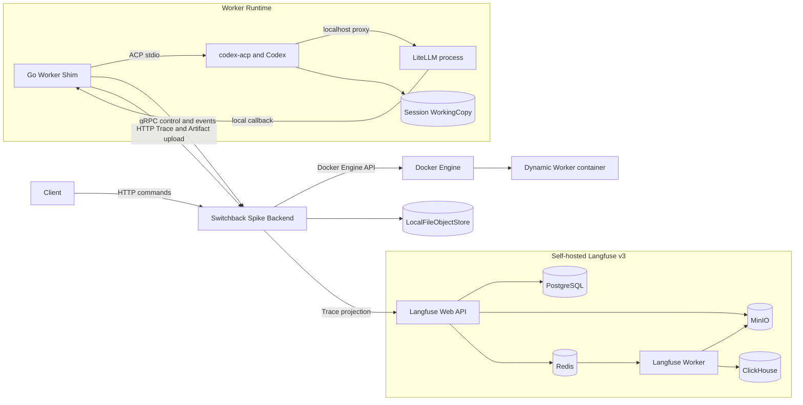
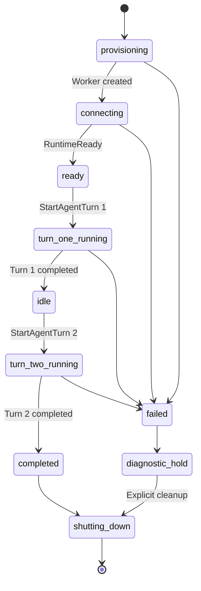
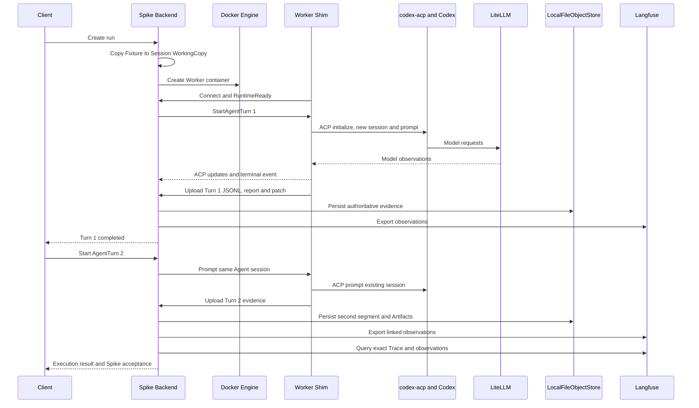

# M1 Worker Runtime Spike

_2026-07-17 approved design for the first executable Switchback runtime proof_

---

## Status and decision

This document defines the implementation boundary for an isolated but reusable Worker Runtime Spike under `spikes/worker-runtime/`. It validates the highest-risk M1 assumptions before production DDD modules are created.

The Spike is successful only when a real Codex Agent runs inside a dynamically created Docker Worker, completes two sequential AgentTurns against the same ACP session and WorkingCopy, emits authoritative JSONL plus report/patch Artifacts, and produces queryable observations in a self-hosted Langfuse v3 deployment.

| Decision | Accepted choice | Reason |
| --- | --- | --- |
| Code placement | Isolated `spikes/worker-runtime/` tree | Preserve a clean production boundary while retaining reusable contracts and images |
| Repository input | Hermetic Go Fixture Git repository | Keep Runtime failures independent from GitHub and credential failures |
| Runtime topology | Backend dynamically creates a sibling Worker | Validate the accepted RuntimeSupervisor and Docker Socket trust boundary |
| Worker control | gRPC bidirectional stream; HTTP for large uploads | Exercise the primary control path without implementing fallback transport |
| Coding Agent | ACP-controlled Codex | Prove a real Agent rather than a scripted shell substitute |
| Agent continuity | Two sequential AgentTurns in one WorkerSession | Prove interactive continuation through the same container, WorkingCopy and ACP session |
| Model proxy | Co-located LiteLLM under a separate Unix identity | Minimize the first topology while hiding the upstream model credential from Codex |
| Future model proxy | Independent LiteLLM sidecar candidate | Match the likely production topology without coupling the control contracts to co-location |
| Trace authority | LocalFileObjectStore JSONL | Keep Switchback-owned evidence independent from an observability vendor |
| Observability | Mandatory self-hosted Langfuse v3 acceptance | Verify the real projection rather than a mock or optional integration |

## Goals and non-goals

### Goals

- Start the complete Spike through one stable command
- Create a Worker through the Docker Engine API from a loopback-only Backend
- Keep Docker Socket, arbitrary host paths and upstream model credentials away from Codex
- Drive `codex-acp` through the Go ACP client and retain raw plus normalized execution evidence
- Reuse one live Agent session and WorkingCopy for a second user turn
- Produce report and patch Artifacts after each turn
- Export Trace, Tool and model observations from Backend to Langfuse
- Verify Langfuse asynchronously by querying exact Trace and Observation identities
- Leave enough explicit contracts to promote proven code without treating the Spike as production code

### Non-goals

- Assistant clarification, Delivery, Evolution, Inspiration, OpenViking or Skill Market
- GitHub RepositoryImport, remote Git operations, branch publication or pull requests
- Frontend, Frontier SSE, EventCenter projections or PostgreSQL Task orchestration
- WorkerSession quota, 48-hour idle expiry, 14-day absolute expiry or fixed 24-hour AgentTurn enforcement
- Runtime replacement, crash recovery, transport fallback or ChannelEpoch failover
- Full `m1_public_web_restricted_v1` egress enforcement across Docker Desktop and Linux
- Multi-user authentication, Membership, RBAC or production SecretLease issuance
- PreviewProxy, SessionProcess or managed background processes

## Repository boundary

The Spike owns one top-level directory and does not add packages to future production `internal/` modules.

```text
spikes/worker-runtime/
  Makefile
  README.md
  compose.yaml
  image-lock.json
  api/
    worker_control.proto
  backend/
    cmd/spike-backend/
    internal/control/
    internal/runtime/
    internal/artifact/
    internal/langfuse/
  worker/
    cmd/worker-shim/
    internal/acp/
    internal/modelobs/
    internal/trace/
  images/
    backend/Dockerfile
    worker/Dockerfile
  fixtures/
    go-repository/
  scripts/
    preflight
    generate-env
    run-e2e
    verify-langfuse
  test/
    integration/
    e2e/
```

Runtime data is written only below ignored `.spike-data/`:

```text
.spike-data/
  env/
  object-store/
  sessions/<worker_session_id>/
    working-copy/
    agent-state/
    trace-spool/
    runtime-logs/
```

## Runtime architecture



### Network and mount layout

| Boundary | Rule |
| --- | --- |
| Host ingress | Backend and Langfuse Web bind to loopback only |
| Docker control | Only Backend mounts Docker Socket; Worker never receives it |
| Worker mounts | Backend derives every source from `.spike-data/sessions/<id>/` |
| Fixture | Source is read-only; Backend creates an isolated WorkingCopy before Worker start |
| Control network | Dynamic Worker can reach only exact Backend control/upload endpoints on the Spike network |
| Observability network | Backend can reach Langfuse; Worker is not attached to the Langfuse storage network |
| Model network | LiteLLM can reach the configured upstream model; Codex only addresses localhost LiteLLM |
| Host paths | Client payloads cannot submit mount source, Docker network, container image or host destination |

The network topology proves that Worker cannot directly address Langfuse storage or Docker control. Complete public-Web/private-network egress enforcement remains a separate adapter Spike because Docker Desktop and Linux require different enforcement mechanisms.

## Components

### Spike Backend

The Backend owns HTTP commands, the in-memory Spike lifecycle, RuntimeSupervisor, WorkerControl stream, LocalFileObjectStore writes, Langfuse export and acceptance verification. It does not persist Switchback Task or WorkerSession domain state across Backend restart.

The RuntimeSupervisor uses server-generated identifiers and labels to create, inspect and remove exactly one active Worker container per Spike session. It never accepts arbitrary Docker options from the client.

### Worker Shim

The Shim starts LiteLLM, starts `codex-acp`, acts as the ACP client, maintains the raw frame tee, compiles normalized Trace records, generates Git patch Artifacts and uploads evidence to Backend. It sends heartbeats only as a diagnostic signal; heartbeat timeout and runtime recovery are not implemented.

The first supported Agent profile remains fixed to:

- `github.com/coder/acp-go-sdk@v0.13.5`
- `@agentclientprotocol/codex-acp@1.1.2`
- `@openai/codex@0.144.1`

All container packages and images use reviewed exact versions or digests. Floating major tags are forbidden in the committed image lock.

The server-owned Codex ACP launch environment fixes `INITIAL_AGENT_MODE=agent-full-access`. This disables Codex's nested bubblewrap sandbox inside the already isolated Worker container; it does not grant host access or weaken Docker Socket, mount, network, capability, secret or UID boundaries. The ACP client still cancels any unexpected permission request rather than auto-approving it.

### LiteLLM and model observation sink

LiteLLM `1.93.0` runs in the Worker image under a dedicated Unix identity. The Codex/Tool execution identity cannot read the mounted upstream model credential and receives only a local base URL plus a short internal proxy token. The trusted Backend reads the credential to construct the known-token redactor and stages the per-Runtime bootstrap plus model credential into a Docker-managed secret volume. A short-lived root populator has no network, Docker Socket, published port or secret-bearing environment/argv; it copies only the two server-derived files, verifies `root:root 0400`, and exits before the Worker starts. The Worker mounts that volume read-only. Host files are never mounted into the Worker because Docker Desktop host-bind ownership projection is not a reliable Unix permission boundary. A minimal container init starts with root authority so it can read the volume-backed bootstrap secret and pass the model key only to the LiteLLM child before dropping child privileges; that trusted init is technically capable of reading the credential and is part of the Spike trust boundary.

M1 has two verified, server-owned upstream model profiles:

| Profile | LiteLLM model | API base | Verified path |
| --- | --- | --- | --- |
| `deepseek-codex-openai-v1` | `deepseek/deepseek-v4-pro` | `https://api.deepseek.com` | Two AgentTurns, native `apply_patch`, Trace, Langfuse and cleanup |
| `kimi-codex-anthropic-v1` | `anthropic/kimi-for-coding` | `https://api.kimi.com/coding` | Two AgentTurns, shell-based edits, Trace, Langfuse and cleanup |

The Backend freezes one profile before a WorkerRun and injects only its model, base URL and credential. Model routing is therefore an explicit configuration choice, not a request-level fallback chain: an upstream failure never switches the active AgentTurn to the other provider. The Spike continues to express the selected profile through the generic `SWITCHBACK_SPIKE_UPSTREAM_*` deployment contract; a durable model-profile registry and user-facing selection API are promotion work.

DeepSeek's Chat Completions contract requires every assistant tool-call message to be followed immediately by all matching tool-result messages. Codex Responses history can place empty or meaningful assistant items between a tool-call batch and its results. The Switchback LiteLLM pre-call callback normalizes only complete, uniquely matched call/result batches: it drops empty interstitial messages and moves meaningful messages before the call batch. Messages with non-empty reasoning or extension fields are preserved; non-string, incomplete or ambiguous ID sets are left untouched and fail at the upstream instead of being guessed.

The separate Unix identities prove isolation from the Agent execution identity, not isolation from container root. If the deployment cannot trust the co-container init, the accepted fallback is the independent LiteLLM sidecar described under Promotion and follow-up. That topology removes upstream model credentials from the Worker container while keeping the same ACP gateway and `ModelObservationSink` contracts.

LiteLLM success and failure callbacks send model, route, latency, usage, cost and error metadata to a localhost `ModelObservationSink` owned by Shim. Shim binds each observation to WorkerSession, WorkerRun, AgentTurn and Trace identities before forwarding it to Backend. This callback contract uses an endpoint configuration rather than process discovery, so a later independent LiteLLM sidecar can implement the same boundary.

### Self-hosted Langfuse

The Spike uses the official Langfuse v3 six-service topology: Web, Worker, PostgreSQL, ClickHouse, Redis and S3-compatible object storage implemented locally by MinIO. The detailed source-backed topology, initialization and resource analysis is recorded in [Langfuse Self-Hosted Topology for the Switchback Worker Runtime Spike](../research/langfuse-self-hosted-runtime-spike.md).

As of 2026-07-17, the reviewed release baseline is Langfuse `v3.217.0`. Web and Worker must use that same exact version, while every supporting image must be resolved to a reviewed digest in `image-lock.json` before the E2E gate is accepted.[^1]

The Compose profile uses `LANGFUSE_INIT_*` variables to create a stable local organization, project, API keys and optional login user without manual UI steps.[^2] Secrets are generated into ignored, owner-readable runtime files and are never committed.

For Langfuse `v3.217.0`, the exact single-Trace verifier requests the complete `GET /api/public/traces/{trace_id}` representation. Supplying `fields=core,observations` omits top-level Trace metadata even though observation metadata remains visible, so that filtered response cannot prove runtime identity. Both the typed Backend verifier and the shell acceptance verifier require exact Trace metadata, two Turn spans, the full expected generation set, and matching Runtime plus AgentTurn metadata on every accepted observation.

## Identities and lifecycle

| Identity | Spike rule |
| --- | --- |
| `worker_session_id` | Stable across both AgentTurns |
| `runtime_instance_id` | One dynamic container for the Session |
| `runtime_generation` | Fixed to `1`; replacement is out of scope |
| `worker_run_id` | One run spanning the accepted two-turn scenario |
| `agent_session_id` | ACP/Codex identity returned by initialization |
| `agent_turn_id` | New identity for each user prompt |
| `trace_id` | Stable Langfuse and Switchback correlation root for the run |



The Worker stays resident between the two turns. No command may start a second top-level turn while another is active.

## Interfaces

### Client HTTP API

| Endpoint | Purpose |
| --- | --- |
| `POST /spike/runs` | Create a Session from the fixed Fixture and start AgentTurn 1 |
| `GET /spike/runs/{worker_run_id}` | Read lifecycle, identities, errors and Artifact references |
| `POST /spike/sessions/{worker_session_id}/turns` | Start AgentTurn 2 after successful Turn 1 |
| `POST /spike/sessions/{worker_session_id}/cleanup` | Stop and remove the dynamic Worker while retaining evidence |
| `GET /spike/artifacts/{artifact_id}` | Read report, patch or acceptance report |

The create command accepts goal, acceptance criteria and optional constraints. Repository, image, mount, network, model route and identity are server-owned Spike configuration.

### WorkerControl gRPC stream

Every envelope carries:

```text
message_id
stream_sequence
ack_sequence
worker_session_id
worker_run_id
runtime_instance_id
runtime_generation
agent_turn_id
sent_at
payload
```

The Spike implements one transport and one active stream. It retains identifiers, sequence and ACK fields so the protocol can later gain ChannelEpoch and resume semantics without changing payload ownership.

| Direction | Payloads |
| --- | --- |
| Backend to Worker | `InitializeSession`, `StartAgentTurn`, `CancelAgentTurn`, `ShutdownRuntime` |
| Worker to Backend | `RuntimeReady`, `AgentSessionReady`, `TurnStarted`, `ACPUpdate`, `ModelObservation`, `TurnCompleted`, `TurnFailed`, `RuntimeDiagnostic` |

Trace segments, reports and patches are not embedded in gRPC messages. They use resumable-shaped HTTP endpoints even though the Spike performs one-shot uploads.

## Two-turn execution flow



Turn 1 fixes a known defect in the Fixture and runs its tests. Turn 2 adds or corrects a boundary test that requires awareness of the first-turn change. The second prompt must not restate the first-turn implementation context.

## Trace, Artifact and Langfuse semantics

### Authoritative evidence

The Shim tees ACP stdin/stdout frames before typed decoding and emits normalized records with stable sequence and identity metadata. Backend stores immutable per-turn segments and a small manifest:

```text
object-store/<worker_session_id>/<worker_run_id>/
  manifest.json
  turns/<agent_turn_id>/raw-acp.jsonl
  turns/<agent_turn_id>/trace.jsonl
  turns/<agent_turn_id>/report.md
  turns/<agent_turn_id>/changes.patch
  acceptance/summary.json
```

Known upstream model credentials, local proxy tokens and Langfuse keys are deterministically removed before JSONL, logs, Artifact payloads or Langfuse observations are persisted. ACP frames are still recorded before typed decoding, but the trusted recorder replaces the exact LiteLLM proxy token before writing the frame; E2E requires the authenticate frame to remain valid JSON-RPC with `Bearer [REDACTED:litellm_proxy_token]`. General content DLP remains out of scope.

### Execution outcome versus Spike acceptance

Langfuse is a derived projection and cannot rewrite the Agent execution result:

```text
execution_outcome = completed | failed
spike_acceptance = passed | failed
```

An execution may be `completed` while `spike_acceptance=failed` because Langfuse export or query verification failed. The acceptance verifier must poll the exact Trace identity until both AgentTurn observations and expected model generations are queryable, or until a bounded verification deadline expires. Ingestion HTTP success alone is insufficient because Langfuse v3 processes observations asynchronously.[^3]

## Failure handling and cleanup

| Failure | Required behavior |
| --- | --- |
| Docker, image, resource, credential or Langfuse preflight failure | Return a structured preflight error and create no Worker |
| Fixture materialization failure | Remove partial Session directory and create no container |
| Worker connect timeout | Capture container diagnostics, stop Worker and mark execution failed |
| LiteLLM readiness failure | Never start ACP; retain diagnostic logs |
| ACP initialize or capability mismatch | Fail closed, upload raw frames and stop the run |
| Turn 1 failure | Do not issue Turn 2; retain Worker for explicit diagnostic cleanup |
| Turn 2 failure | Preserve Turn 1 evidence and partial Turn 2 evidence |
| JSONL or Artifact persistence failure | Execution cannot be accepted as complete |
| Langfuse export/query failure | Preserve completed execution outcome but fail Spike acceptance |
| Cleanup failure | Report leaked Worker, populator and secret-volume identities and return non-zero |

There is no automatic retry, replacement or runtime generation increment. Failure diagnostics remain available until explicit cleanup. Normal successful completion gracefully shuts down ACP, LiteLLM and Shim, removes the Worker container, and retains Session evidence.

The current `codex-acp` `systemError` session update does not carry an
AgentTurn ID. The Shim attributes a notification received while a prompt is
active to that prompt, relying on JSON-RPC stream ordering. A truly late
notification arriving after its prompt response cannot be proven to belong to
the previous or next Turn; this remains an explicit Spike limitation rather
than a basis for heuristic reassignment.

## Security boundary

- Backend uses a fixed local actor and binds only to loopback
- Backend alone mounts Docker Socket and treats it as root-equivalent authority
- Worker has no Docker Socket, privileged mode, host network or arbitrary host mount
- WorkingCopy, Agent state and trace spool are isolated per Session
- Bootstrap and model credentials use one Backend-managed per-Runtime Docker volume; no host credential file is mounted into the Worker
- The secret populator is removed before Worker start and has no network, Docker Socket, published port or secret-bearing environment/argv
- Fixture source remains unchanged and read-only
- Within Worker runtime execution, only LiteLLM and the trusted root init can read the upstream model secret; Codex/Tool processes receive only local proxy configuration
- Worker does not receive Langfuse, PostgreSQL, ClickHouse, Redis or MinIO credentials
- Backend exports Langfuse observations after deterministic known-token filtering
- Worker and Langfuse storage services do not share a Docker network
- Client commands cannot choose actor, host path, image, network, container name or model credential

The Spike must record any network-policy gaps discovered on Docker Desktop or Linux. It must not claim complete `m1_public_web_restricted_v1` conformance from network separation alone.

## Verification strategy

### Unit tests

- Envelope identity, sequence and ACK validation
- Single-active-turn state transitions
- Server-owned path derivation and mount allowlist
- Known-token filtering
- Langfuse identity mapping
- Artifact manifest and checksum generation

### Integration tests

- Fake ACP and fake model path through a real dynamic Worker container
- gRPC connect, command, update and terminal event flow
- HTTP Trace and Artifact upload
- LiteLLM observation callback mapping
- Connect timeout, ACP failure, upload failure and cleanup failure
- Host Fixture immutability and Worker Docker Socket absence

### Real E2E acceptance

`make spike-e2e` performs the complete proof:

1. Validate Docker daemon, required ports, disk and configured CPU/memory
2. Create or reuse ignored secret files
3. Verify pinned image digests and build Backend/Worker images
4. Start Langfuse infrastructure and application containers
5. Wait for infrastructure health, Web database health, Web readiness and Worker health
6. Verify headless project and API-key initialization
7. Start Backend and create a dynamic Worker
8. Run Turn 1 against the real Codex/LiteLLM path and verify Fixture tests
9. Run Turn 2 against the same Agent session and WorkingCopy
10. Verify host Fixture immutability, report, patch, JSONL and checksums
11. Poll Langfuse Public API for the exact Trace, both turns and model observations
12. Write an acceptance report, remove the dynamic Worker and return pass/fail

The E2E harness may impose a shorter process timeout to prevent a local or CI job from hanging. That timeout is test infrastructure and must not appear in TaskSpec or be described as the production AgentTurn deadline.

On 2026-07-22, the success variant passed with LiteLLM `1.93.0` against both `deepseek-codex-openai-v1` and `kimi-codex-anthropic-v1`: both turns completed in one ACP session and Runtime, incremental patches and tests passed, Langfuse Trace/Observation identities matched, the Fixture digest was unchanged, known-token scanning passed, and cleanup reported no residual Worker or Compose container. This is an M1 Spike result, not a production-readiness claim.

The same acceptance run covered the negative matrix. Invalid credentials and
evidence checksum corruption never produced false completion. A real Kimi run
with Langfuse unavailable preserved `execution_outcome=completed` while setting
`spike_acceptance=failed`. Injected Docker cleanup failure reported exact
sanitized resource identities, returned non-zero, and was removed by fallback
cleanup against the real daemon. Two consecutive Kimi success runs passed with
independent Session, Run, Runtime, AgentSession and Turn identities.

## Acceptance criteria

- [x] One command starts the isolated environment without manual Langfuse UI setup
- [x] Backend dynamically creates exactly one sibling Worker using only server-derived options
- [x] Worker has no Docker Socket, privileged mode, host network or arbitrary mount
- [x] Real Codex is controlled through ACP, not terminal-output parsing
- [x] Codex model requests pass through LiteLLM, and the Codex/Tool execution identity cannot read or receive the upstream credential
- [x] Turn 1 fixes the Fixture and passes tests
- [x] Turn 2 reuses the same ACP session and WorkingCopy and depends on Turn 1 context
- [x] Each turn produces raw ACP JSONL, normalized JSONL, report and patch
- [x] Host Fixture remains byte-for-byte unchanged
- [x] Known credentials do not appear in persisted evidence or Langfuse
- [x] Backend exports queryable Langfuse Trace, Turn spans and model generations
- [x] Langfuse verification checks exact identities rather than only HTTP ingestion success
- [x] Successful completion removes the dynamic Worker and retains evidence
- [x] Failures return structured diagnostics and leave no unreported container leak
- [x] Re-running after normal cleanup produces an independent Session and the same functional outcome

## Promotion and follow-up

Only code that passes the real E2E gate is eligible for promotion. Candidate reusable pieces are:

- ACP adapter and raw-frame tee
- WorkerControl envelope and gRPC service
- RuntimeProvisioner interface and Docker adapter
- ModelObservation schema and callback boundary
- Trace segment/Artifact upload contracts
- Langfuse exporter and asynchronous verifier
- Server-owned WorkingCopy mount derivation

The Spike does not become production code by relocation alone. Promotion requires a separate review against the production contracts, tests and DDD ownership boundaries.

The implementation and operator view is documented in [M1 Worker Runtime Spike execution architecture](./m1-worker-runtime-spike-execution.md). The recommended promotion order is documented in [M1 Worker Runtime Spike follow-up roadmap](./m1-worker-runtime-post-spike-roadmap.md).

The next infrastructure experiment should replace co-located LiteLLM with an independent sidecar while preserving Codex proxy configuration and `ModelObservationSink`. It is time-boxed and runs alongside, rather than ahead of, the production Worker delivery vertical slice. This records the user's expectation that the real Switchback topology may use a sidecar without allowing another infrastructure experiment to block the first product loop.

[^1]: Langfuse. (2026). "Release v3.217.0 and Docker Compose snapshot." https://github.com/langfuse/langfuse/releases/tag/v3.217.0 and https://github.com/langfuse/langfuse/blob/v3.217.0/docker-compose.yml

[^2]: Langfuse. "Headless Initialization (Self-Hosted)." https://langfuse.com/self-hosting/administration/headless-initialization

[^3]: Langfuse. "Self-hosted architecture and asynchronous ingestion." https://langfuse.com/self-hosting
