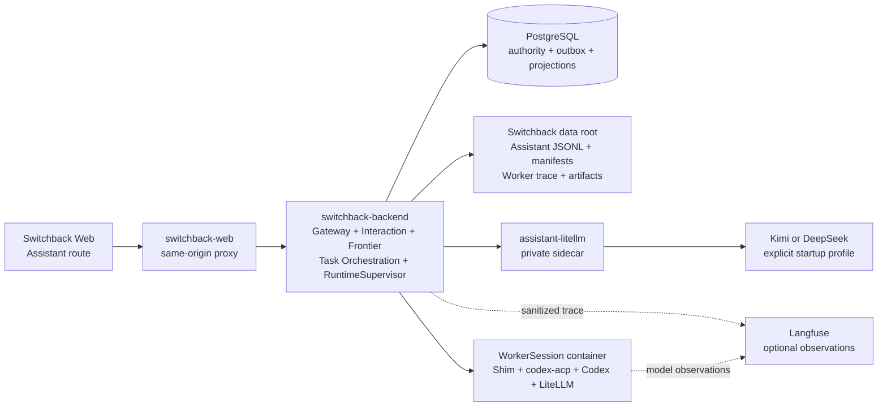
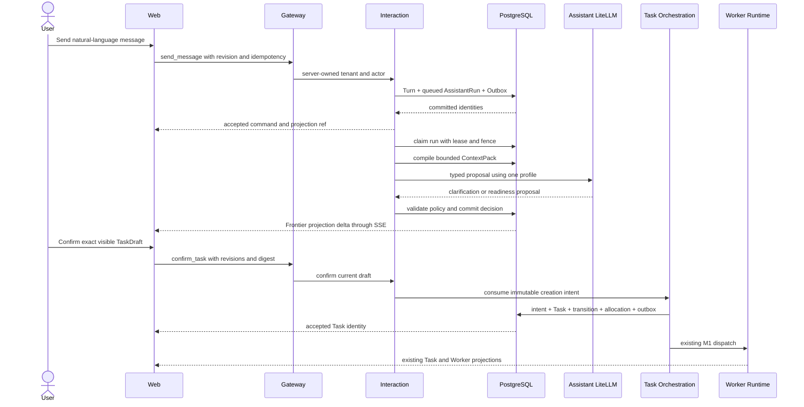

# M2 Assistant Task Dispatch Vertical Slice

## Status And Scope

This is the implementation and operations contract for
`m2-assistant-task-dispatch-vertical-slice`.

M2 adds one focused Assistant path in front of the existing M1 Task and Worker
path:

```text
natural-language message
  -> durable AssistantRun
  -> clarification/readiness
  -> exact TaskDraft confirmation
  -> existing Task admission
  -> existing real Codex Worker
```

The slice is intentionally narrow:

- one server-owned local user and tenant;
- one explicit Workspace resolution before dispatch;
- one Assistant model profile for each AssistantRun;
- asynchronous processing and Frontier projection;
- no Assistant-side heavy execution;
- no provider fallback inside a run;
- direct TaskSpec remains available as a rollout fallback.

## Runtime Topology



`assistant-litellm` has provider egress but no host port. The Backend is the
only Compose service with the Docker Socket. Dynamic WorkerSession containers
remain sibling containers managed by the Backend RuntimeSupervisor.

## Ownership Boundaries

| Owner | Owns | Does not own |
| --- | --- | --- |
| Gateway | Revisioned commands, server identity, sanitized HTTP errors | Model calls, readiness decisions, Task state |
| Interaction | Conversation, Turn, AssistantRun queue, ContextPack, readiness, TaskDraft, checkpoint, creation intent | Worker execution and Task lifecycle |
| Assistant LiteLLM adapter | One fixed profile request, typed response decode, sanitized diagnostics | Provider fallback, Task authority, raw response persistence |
| Task Orchestration | Exact admission transaction, Task/Transition/allocation/outbox | Natural-language clarification |
| Worker Runtime | Real Codex execution, trace, report, patch, runtime lifecycle | Reinterpreting or widening the confirmed TaskSpec |
| Eventing/Frontier | Durable projection and SSE replay/resync | Command authority |
| Web | Human-readable interaction and pending command state | Inventing readiness, confirmation, or Task state |

The model returns an untrusted proposal. Server code rebuilds the readiness
assessment, TaskDraft, TaskSpec digest, and creation intent from selected
evidence and policy. Model-provided authority fields are never persisted as
authority.

## Durable Processing Flow



### Message Acceptance

`SendConversationMessage` performs no model or network call. Its PostgreSQL
transaction validates identity/revision/idempotency, appends the ordered user
Turn, creates a queued AssistantRun with profile and policy snapshots,
invalidates a stale ready draft, writes owner-sequenced Outbox state, and
returns stable accepted identities.

Only one AssistantRun can be claimed for one Conversation at a time. Queue
order is stable. A lost response can be retried with the same idempotency key.

### Model Invocation And Recovery

The dispatcher leases queued work and records an invocation boundary before
the model request. Recovery distinguishes:

- no invocation started: the run may be requeued;
- provider effect may have occurred: the run becomes a visible retryable
  failure with an unknown-effect diagnostic;
- malformed output, timeout, profile mismatch, or policy conflict: fail closed
  before Task authority exists.

An explicit retry creates a new AssistantRun under the same configured profile.
It is not provider fallback.

### Readiness And Confirmation

Readiness has exactly seven dimensions: `goal`, `deliverable_acceptance`,
`scope_target`, `constraints`, `context_access`, `risk_approval`, and
`execution_policy`.

Each is `known`, `assumed`, `blocking_unknown`, or `not_applicable`. Low-risk
reversible details may be visible assumptions. Permission, external or
irreversible effects, conflicting goals, unavailable critical context, and
untestable outcomes remain blockers.

The Assistant asks one highest-priority blocker at a time. After three
clarification questions it creates a checkpoint with `continue`,
`narrow_scope`, and `cancel`. Confirmation is enabled only for the current
ready TaskDraft and binds:

- Conversation and revision;
- TaskDraft identity and revision;
- readiness identity and revision;
- Workspace, WorkspaceRevision, resolution, and membership revision;
- exact TaskSpec digest and trigger policy revision;
- user idempotency key.

Any mismatch is stale and creates no partial Task or Worker state.

## Assistant Decision Contract

The provider response is decoded as `assistant.decision.v1`. A valid readiness
proposal uses an array, not a map:

```json
{
  "schema_version": "assistant.decision.v1",
  "decision_type": "ready",
  "visible_message": "The task is ready for confirmation.",
  "clarification_question": "",
  "clarification_questions": 0,
  "readiness": {
    "dimensions": [
      {
        "dimension": "goal",
        "status": "known",
        "summary": "Repair counter.Add.",
        "evidence_refs": ["turn/user-2"]
      }
    ],
    "blocking_unknowns": [],
    "assumptions": []
  },
  "task_draft": {
    "goal": "Repair counter.Add.",
    "deliverables": ["Code change", "Test result"],
    "acceptance_criteria": ["go test ./... passes"],
    "constraints": ["No remote writes"],
    "acceptance_mode": "manual",
    "task_spec_digest": "__SERVER_COMPUTED__"
  }
}
```

The real response must contain all seven dimensions exactly once. Server code
validates the shape and policy, replaces server-owned placeholders, and rejects
unknown evidence references or model-controlled authority.

## Gateway API Examples

The client never sends tenant or actor fields.

Create a Conversation:

```http
POST /api/v1/assistant/conversations
Content-Type: application/json

{
  "schema_version": "assistant.conversation_command.v1",
  "command_type": "create_conversation",
  "idempotency_key": "web-create-018f"
}
```

Select the exact Workspace:

```http
POST /api/v1/assistant/conversations/{conversation_id}/workspace
Content-Type: application/json

{
  "schema_version": "assistant.conversation_command.v1",
  "command_type": "select_workspace",
  "conversation_id": "{conversation_id}",
  "expected_revision": 1,
  "idempotency_key": "web-workspace-018f",
  "workspace_id": "workspace-local",
  "workspace_revision_id": "workspace-revision-local-v1",
  "workspace_resolution_id": "resolution-local",
  "workspace_resolution_revision": 1,
  "membership_revision": 1
}
```

Send a message:

```http
POST /api/v1/assistant/conversations/{conversation_id}/messages
Content-Type: application/json

{
  "schema_version": "assistant.conversation_command.v1",
  "command_type": "send_message",
  "conversation_id": "{conversation_id}",
  "expected_revision": 2,
  "idempotency_key": "web-message-018f",
  "content": "Repair counter.Add and run go test ./..."
}
```

Confirm a ready draft:

```http
POST /api/v1/assistant/conversations/{conversation_id}/task-drafts/{task_draft_id}/confirm
Content-Type: application/json

{
  "schema_version": "assistant.conversation_command.v1",
  "command_type": "confirm_task",
  "conversation_id": "{conversation_id}",
  "expected_revision": 7,
  "idempotency_key": "web-confirm-018f",
  "task_draft_id": "{task_draft_id}",
  "task_draft_revision": 1,
  "readiness_assessment_id": "{assessment_id}",
  "readiness_assessment_revision": 1,
  "workspace_id": "workspace-local",
  "workspace_revision_id": "workspace-revision-local-v1",
  "workspace_resolution_id": "resolution-local",
  "workspace_resolution_revision": 1,
  "membership_revision": 1,
  "task_spec_digest": "sha256:{digest}",
  "trigger_policy_revision": "assistant-trigger-v1"
}
```

Read and subscribe:

```text
GET /api/v1/views/assistant_conversation/{conversation_id}
GET /api/v1/events?view_type=assistant_conversation&view_id={conversation_id}
```

The browser treats a successful command as pending until the causal projection
arrives. Replay gaps or epoch changes trigger snapshot resync.

## Data Locations

| Data | Authority and local location |
| --- | --- |
| Conversation, Turns, runs, readiness, drafts, checkpoints, intents | PostgreSQL tables from `migrations/000010_assistant_interaction.sql` |
| Idempotency and owner event sequence | PostgreSQL, in the command transaction |
| Task handoff | Existing Task/Transition/SessionAllocationRequest/Outbox tables |
| Assistant projection | Existing Frontier/Eventing PostgreSQL projection tables |
| Assistant evidence | `${SWITCHBACK_DATA_ROOT}/assistant/tenants/{tenant}/users/{user}/workspaces/{workspace-or-unresolved}/conversations/{conversation}/generation-{n}/` |
| Evidence files | Checksum-addressed `{boundary}-{sha256}.jsonl` and immutable `.manifest.json` |
| Worker trace and artifacts | Existing M1 paths below `${SWITCHBACK_DATA_ROOT}` |
| Acceptance summaries | Ignored `runtime-data/m2-real-provider/run-*/m2-real-provider-summary.json` and `runtime-data/failure-acceptance/run-*/failure-acceptance-summary.json` |
| Observations | Langfuse when configured; never business authority |

Evidence rejects credential/environment/hidden-reasoning fields and known
tokens before write. ObjectStore or Langfuse failure is a sanitized degraded
derived effect and does not roll back committed Conversation or Task state.

## Configuration And Provider Selection

| Variable | Default | Meaning |
| --- | --- | --- |
| `SWITCHBACK_M2_ASSISTANT_ENABLED` | `1` in local Compose | Enables the Assistant route and dispatcher |
| `SWITCHBACK_ASSISTANT_MODEL_PROFILE` | `kimi-code-assistant-openai-v1` | Server-owned profile for new AssistantRuns |
| `SWITCHBACK_ASSISTANT_CONTEXT_BUDGET_TOKENS` | `8192` | ContextPack selection budget |
| `SWITCHBACK_ASSISTANT_MAX_RECENT_TURNS` | `24` | Maximum recent Turns |
| `SWITCHBACK_ASSISTANT_REQUEST_TIMEOUT` | `90s` | Provider deadline, maximum `10m` |
| `SWITCHBACK_ASSISTANT_LITELLM_BASE_URL` | Compose private URL | Canonical sidecar base URL |
| `SWITCHBACK_ASSISTANT_LITELLM_API_KEY` | generated proxy key | Backend-to-sidecar credential |
| `SWITCHBACK_WORKER_DISPLAY_PROJECTION_ENABLED` | `1` | Enables safe durable/transient Worker Display materialization for new Turns |

| Profile | LiteLLM alias | Provider base |
| --- | --- | --- |
| `kimi-code-assistant-openai-v1` | `switchback-assistant-kimi-code` | `https://api.kimi.com/coding/v1` |
| `deepseek-assistant-openai-v1` | `switchback-assistant-deepseek` | `https://api.deepseek.com` |

The Kimi profile is local-only and uses a Kimi Code key, never a Kimi Platform
key. Keys are read from ignored local files and mounted read-only into Backend
provisioning and `assistant-litellm`. They must never be committed or printed.
Changing profiles requires an explicit startup configuration change. A run
never silently switches provider: there is no fallback and no User-Agent
spoofing. Historical Runs referencing the retired profile fail closed; an
explicit user Retry creates a new Run under the configured profile.

## Local Operations

```bash
make local-env
SWITCHBACK_ASSISTANT_MODEL_PROFILE=deepseek-assistant-openai-v1 make local-up
```

Open:

- Web: `http://127.0.0.1:4173`
- Backend health: `http://127.0.0.1:8080/healthz`
- Langfuse: `http://127.0.0.1:3000`

Inspect:

```bash
docker compose --env-file deploy/local/.env -f deploy/local/compose.yaml ps
docker compose --env-file deploy/local/.env -f deploy/local/compose.yaml logs switchback-migrate
docker compose --env-file deploy/local/.env -f deploy/local/compose.yaml logs --tail=100 switchback-backend assistant-litellm
```

`switchback-migrate` is a one-shot dependency. It tracks
`switchback_schema_migrations`, recognizes existing M1 legacy volumes through
explicit sentinels, and applies migrations in order before Backend startup.

Stop with `make local-down`.

Before archive, run the real-provider gate in
[`m2-assistant-task-dispatch-manual-acceptance.md`](m2-assistant-task-dispatch-manual-acceptance.md).
Its required product sequence is:

```text
first delivery
  -> direct delivered Task chat
  -> same-Task rework
  -> Accept (Task completed / Accepted)
  -> standalone follow-up in the same WorkerSession
```

The first three Worker actions preserve Task and WorkerSession identity while
creating fresh WorkerRun/AgentTurn identities. The final action preserves only
WorkerSession identity: the accepted Task revision is immutable.

## Failure Handling And Rollback

| Failure | Expected behavior |
| --- | --- |
| Duplicate or response-lost command | Same idempotency key returns the original result |
| Concurrent expected revision | Exactly one mutation wins; the other is stale |
| Backend restart before invocation | Lease recovery safely requeues |
| Backend restart after invocation boundary | Visible retryable unknown-effect failure; no automatic model replay |
| Provider timeout or malformed output | Sanitized failed run; no Task authority |
| ObjectStore or Langfuse unavailable | Committed outcome remains; derived effect is degraded |
| Task admission fails | Intent, Task, transition, allocation, and outbox all roll back |
| Projection replay gap | Frontier emits control state and browser resyncs snapshot |

Operational rollback is additive and preserves evidence:

1. set `SWITCHBACK_M2_ASSISTANT_ENABLED=0` and recreate Backend/Web;
2. keep direct TaskSpec enabled;
3. do not delete migration `000010` tables or evidence;
4. drain or explicitly cancel queued AssistantRuns according to visible state;
5. retain Task and Worker records already created through M2;
6. change provider only by startup profile, never by in-run fallback.

Workbench is the sole production Artifact presentation owner. If its renderer
regresses, revert the offending Web commit, rebuild the Web image, and verify
the compatible authoritative Worker/Artifact contracts. Set
`SWITCHBACK_WORKER_DISPLAY_PROJECTION_ENABLED=0` only if new Display
materialization must also stop. Retain migration `000011`, existing
checkpoints, Trace and Artifact bytes; do not reopen accepted Tasks or redirect
their follow-up to Task continuation.

The database migration is not destructively reversed. Rollback disables new
Assistant commands while preserving authoritative and diagnostic history.

## Known Boundaries

- SingleUserLocalProfile only; no login, SSO, or multi-user authorization UI.
- One explicit Workspace per Conversation generation; no multi-Workspace draft.
- Evolution Truth and Inspiration are not on this slice's critical path.
- No streaming model tokens or hidden reasoning are exposed to Web.
- No automatic provider fallback, model voting, or cross-provider retry.
- Assistant does not execute tools, modify a WorkingCopy, approve Worker
  actions, or bypass Worker policy.
- Worker execution, Task review, report, and patch stay in canonical views.
- Direct TaskSpec stays available while Assistant is disabled or degraded.

## Code Map

| Area | Location |
| --- | --- |
| Versioned contracts | `api/schema/v1/assistant-*.schema.json`, `internal/contracts/v1/assistant.go` |
| Interaction domain/application | `internal/interaction/domain`, `internal/interaction/application` |
| PostgreSQL adapter | `internal/interaction/adapter/postgres` |
| LiteLLM adapter | `internal/interaction/adapter/litellm` |
| Evidence and Langfuse | `internal/interaction/adapter/localfile`, `internal/interaction/adapter/langfuse` |
| Product composition | `internal/localproduct/assistant_runner.go` |
| Gateway and Frontier | `internal/gateway/http`, `internal/frontier`, `internal/eventingprojection` |
| Web | `web/src/views/AssistantConversation.tsx`, `web/src/api/assistant*.ts` |
| Compose/provider image | `deploy/local/compose.yaml`, `images/assistant-litellm` |
| Acceptance | `scripts/run-m2-real-provider-acceptance`, `scripts/run-failure-acceptance` |
