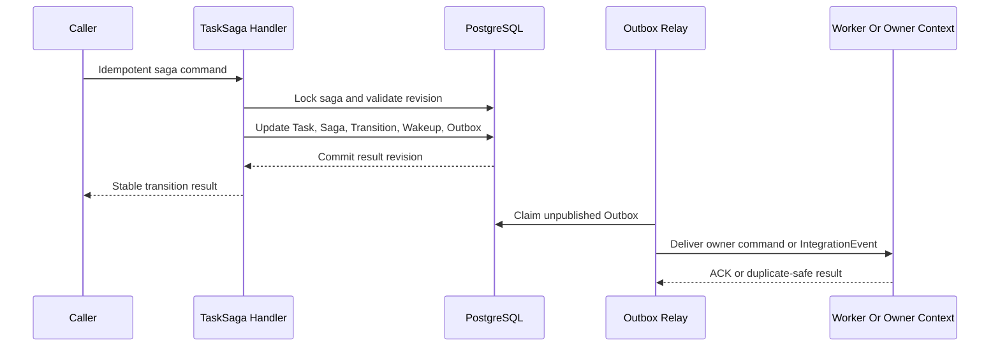
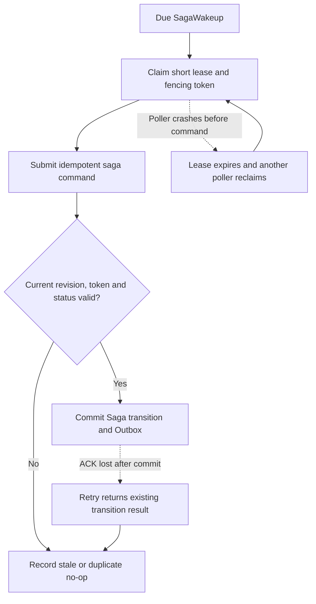
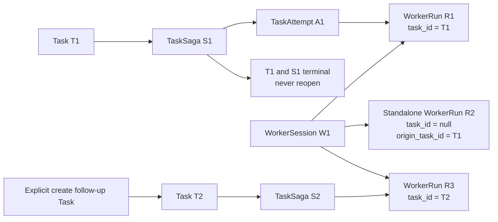

# PostgreSQL TaskSaga And Durable Wakeup Guide

本文记录 Switchback P0 采用方案 A 的 TaskSaga durable execution 设计：PostgreSQL 保存权威 Task/TaskSaga 状态，状态迁移与 Outbox 同事务提交，重试、deadline 和延迟恢复由持久 SagaWakeup 与短租约 poller 驱动，不依赖进程内 timer，也不从 P0 引入 Temporal。

## 决策摘要

| 问题 | P0 答案 |
| --- | --- |
| TaskSaga 权威状态在哪里 | PostgreSQL |
| 状态与事件如何一致 | Task/TaskSaga/Transition/Wakeup/Outbox 同事务 |
| 超时和重试如何触发 | SagaWakeup + lease/fencing poller |
| poller 是否直接调用外部系统 | 否；只提交幂等内部命令 |
| 外部副作用如何执行 | Outbox/command 驱动 owner context，接收方幂等并核查结果 |
| 是否实现通用 DurableWorkflowEngine | P0 不实现；保留稳定 command/event 契约 |
| Temporal 是否永久排除 | 否；达到明确触发条件后重新评估 |

`TaskSaga` 是 Task 的长流程协调状态，不是 Worker、Agent loop、EventCenter 或数据库后台任务。它负责判断下一步和补偿方向，但不在数据库事务里分配容器、调用模型、push GitHub 或发送飞书消息。

## 权威状态与事务

每次有效状态迁移使用同一个 PostgreSQL 事务：

```text
begin
  lock TaskSaga by id
  verify expected revision and idempotency key
  update Task and TaskSaga state/revision
  append SagaTransition
  create/cancel/obsolete SagaWakeup rows
  append owner stream IntegrationEvent to Outbox
commit
```

事务内禁止网络调用、容器操作、文件复制、模型请求和其他不可控阻塞。Outbox relay 在提交后驱动 Worker Runtime、EventCenter 或其他 owner context。若数据库提交成功但 relay 崩溃，未投递 Outbox 仍可重放；若命令重复投递，接收方按 command/idempotency key 返回已有结果。



## SagaWakeup

SagaWakeup 是“到期后重新评估 TaskSaga”的持久指令，不代表副作用本身。P0 至少支持：

| Kind | 用途 |
| --- | --- |
| `retry_due` | 可重试步骤的下一次尝试 |
| `task_deadline` | Task/WorkerRun 业务 deadline 到期决策 |
| `recovery_probe` | 已安排的恢复或核查 |
| `waiting_user_reminder` | 非阻塞提醒，不改变 Task 事实状态 |
| `reconciliation_due` | 外部结果未知后的核查，不直接重做写入 |

最小字段包括 `wakeup_id`、`task_saga_id`、`kind`、`due_at`、`expected_saga_revision`、`status`、`lease_owner`、`lease_until`、`fencing_token`、`attempt`、`idempotency_key` 和 `payload_ref`。

Poller 使用短事务和 `FOR UPDATE SKIP LOCKED` 领取 due wakeup，分配短 lease 与单调 fencing token，然后在事务外提交同一个应用命令。命令处理器重新锁定 TaskSaga 并检查 expected revision、wakeup 状态和 token；过期、取消、已交付或指向旧 revision 的 wakeup 只记录 stale/no-op，不能推进状态。



## 崩溃与重复场景

| 故障点 | 收敛方式 |
| --- | --- |
| TaskSaga 事务提交前崩溃 | 整个事务回滚，没有半状态 |
| 提交成功、响应丢失 | 相同 idempotency key 返回原 Transition result |
| Outbox relay 投递前崩溃 | 未发布 Outbox 继续被领取 |
| Wakeup 领取后、命令前崩溃 | lease 到期后重新领取 |
| 命令提交后、wakeup ACK 前崩溃 | wakeup/transition 幂等检查返回已完成 |
| Worker command 已执行但 ACK 丢失 | Worker owner 按 command id 返回已有 WorkerRun |
| 外部写入效果未知 | 安排 reconciliation wakeup 或进入 waiting_user，禁止盲重试 |

## waiting_user 与时钟

进入 `waiting_user` 时，TaskSaga 在同一事务中记录 reason、当前 revision、允许动作和相关 Wakeup：

- WorkerSession 48 小时 idle clock 按既有策略暂停。
- 当前 AgentTurn 固定 24 小时 hard deadline 和 WorkerSession 14 天 absolute lifetime 不暂停。
- 用户答复产生带 decision/approval id 的幂等 command；过期或重复答复不能推进已变化的 Saga revision。
- 提醒类 Wakeup 只能通知，不得把等待状态自动改成成功或失败。

## 模块接口

P0 不抽象一个试图同时兼容 PostgreSQL 与 Temporal 的通用 workflow engine。Task Orchestration 对其他模块只发布稳定的业务 command/event：

```text
SubmitTask
StartWorkerRun
WorkerRunStageChanged
RequestUserDecision
ApplyUserDecision
RetryTaskStep
CancelTask
CompleteTask
```

内部实现通过 `TaskSagaRepository`、`SagaWakeupRepository`、`TransactionManager`、`OutboxWriter` 和 `SagaClock` 等窄接口获得可测试性。未来迁移 Temporal 时，应重新评估执行所有权和迁移方案，而不是假设替换一个 adapter 即可完成。

## 一 Task 一 Saga 的聚合边界

TaskSaga 只协调一个 Task，终止边界也是 Task 终态。WorkerSession 是更长寿命的交互容器，不属于 TaskSaga 聚合；因此同一个 WorkerSession 可以先承载任务型 WorkerRun，再在 Task 完成后承载 standalone WorkerRun，之后还可以复用来执行一个显式创建的新 Task。



关键例子：

1. T1 的第一次实现失败，需要按策略重试：仍使用 S1，新建 TaskAttempt A2 和 WorkerRun R2。
2. T1 执行中容器崩溃：仍使用 S1、原 TaskAttempt 和原 WorkerRun，只创建新的 RuntimeInstance generation。
3. T1 成功后用户在 Worker 详情页说“再解释一下这个 diff”：创建 standalone WorkerRun，`task_id` 为空，可用 `origin_task_id=T1` 帮助 UI 展示上下文。
4. 用户明确选择“创建后续任务：补集成测试”：创建 T2/S2，可以继续使用同一 WorkerSession 和 Workspace，但不会修改 T1/S1 或追溯重标之前的 standalone Run。

终态 T1 的迟到 Worker/Provider 事件只进入 Trace/audit；若其声称发生了新的业务状态变化，则产生 integrity incident，不允许通过普通事件处理器复活 S1。

## Temporal 重新评估条件

满足以下任一条件时，可以重新提出 Temporal OpenSpec change：

- 公司已经提供受管 Temporal 平台和明确的运维 owner。
- Saga 数量、分支、跨周等待或 timer/retry 运维成本持续超过自建 poller 的可维护范围。
- PostgreSQL wakeup backlog、lease contention 或恢复 SLO 无法在合理复杂度内满足。
- 团队愿意承担 deterministic Workflow、版本兼容、history replay 和双系统迁移成本。

重新评估不意味着自动迁移。必须先证明 Task/TaskSaga 状态所有权、EventCenter/Trace 分工、在途 Saga 迁移和回滚路径。

## P0 验收

- Task、TaskSaga、SagaTransition、SagaWakeup 和 Outbox 能在一个事务中原子推进。
- 每个 Task 只存在一个 TaskSaga；Task/Saga 终态后无法被直接 AgentTurn 或迟到事件重开。
- Task retry 创建新的 TaskAttempt/WorkerRun，runtime recovery 保持原 TaskAttempt/WorkerRun，二者不可混淆。
- WorkerSession 可以在 Task 终态后继续承载 standalone WorkerRun 或新 Task 的 WorkerRun。
- 相同 idempotency key 不产生第二个 Transition、WorkerRun 或补偿动作。
- 多 poller 通过 `SKIP LOCKED` 与 lease/fencing 不并发执行同一有效 Wakeup。
- 过期 token、旧 expected revision、cancelled/obsolete Wakeup 均为 no-op。
- `waiting_user` 正确暂停 active/idle 时钟但不暂停 wall/absolute cap。
- 数据库、relay、poller、Worker ACK 各故障点均能重试收敛。
- 外部副作用未知时不自动重试，沿用 owner reconciliation/waiting_user 语义。
- Dashboard 与 Frontier 只消费 EventCenter/read model，不直接扫描 Saga 表作为用户时间线。
