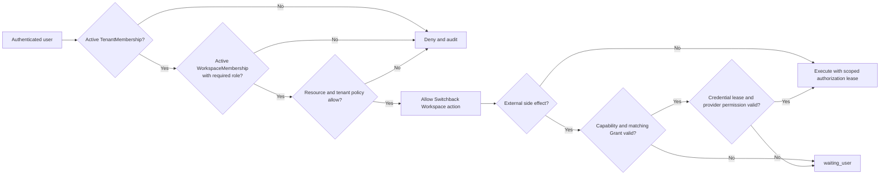
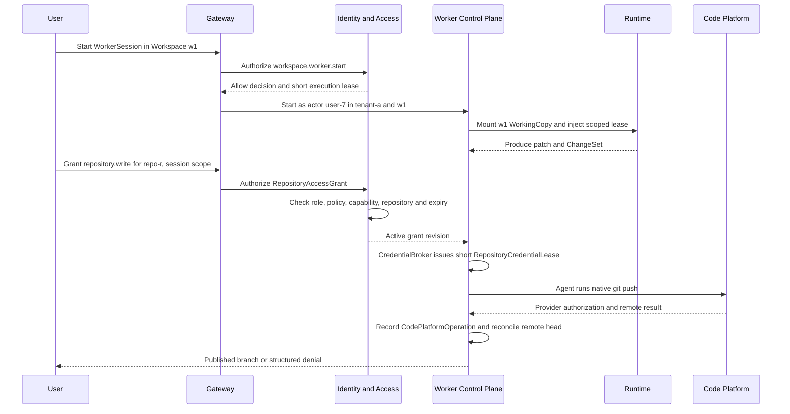

# Tenant And Workspace Authorization Guide

本文解释 Switchback P0 的共享 Workspace 授权方案 A：Tenant 是硬隔离边界，Workspace 访问来自显式 WorkspaceMembership，外部平台能力与凭证独立判断。

## 先看结论

| 问题 | P0 答案 |
| --- | --- |
| Workspace 能否跨 Tenant | 不能；复制或导入必须创建目标 Tenant 内的新 Workspace |
| 用户为什么能访问 Workspace | 同时拥有有效 TenantMembership 和 WorkspaceMembership |
| Project/Team 是否自动授予 Workspace 权限 | 不自动；P0 不使用隐式继承 |
| Workspace editor 能否直接 push GitHub | 仅凭 editor 不能；取得匹配的 RepositoryAccessGrant 后，受管 B2 允许 Agent 在 Grant 范围内直接 push |
| Worker 以谁的身份执行 | 始终代表发起用户，不是平台超级用户 |
| 成员被撤权后旧容器能否继续 | 不能继续领取授权、提交 Apply 或访问受保护资源；控制面暂停并撤销 lease/secret |

一句话版本：**先证明“你属于这个 Tenant 且是这个 Workspace 的成员”，再判断“这个角色能否做平台动作”，最后单独判断“外部系统是否允许”。**

## 三层边界



三层不能互相替代：

1. **Tenant boundary**：防止跨组织数据泄漏，是所有请求最先检查的硬条件。
2. **Workspace authorization**：决定用户能否查看、执行、修改、审核或管理该 Workspace。
3. **External authorization**：决定能否 clone 私有仓库、push branch、创建 PR、操作飞书或生产系统。

知道 `workspace_id`、拥有 GitHub token 或被 Tenant 管理员识别，都不能跳过前两层。

## 成员与角色

一个 User 可以加入多个 Tenant，但每次请求只能选择一个 `tenant_id`。一个 Workspace 只属于一个 Tenant。WorkspaceMembership 使用可组合角色，而不是把 reviewer 强行塞进单继承层级。

| Role | P0 允许的 Workspace 动作 | 明确不自动允许 |
| --- | --- | --- |
| `viewer` | 查看 metadata、用户可见 Timeline、report 和允许读取的 Artifact | 创建 WorkerSession、AgentTurn、Apply、原始敏感 Trace、外部写入 |
| `editor` | viewer 能力；创建/恢复 WorkerSession、发送 AgentTurn、产生 ChangeSet、执行普通 WorkspaceApply | 管理成员、批准要求 reviewer 的内容、外部 push/PR/生产写 |
| `reviewer` | viewer 能力；审核策略指定的 ChangeSet、Memory/Instruction/Skill 或受保护动作 | 默认修改 WorkingCopy 或管理成员；需要 editor/owner 才能编辑 |
| `owner` | viewer + editor + reviewer；管理 WorkspaceMembership、归档 Workspace 和 Workspace 级策略 | 跨 Tenant 访问、绕过外部 provider、绕过平台硬策略 |

不变量：

- 一个 Workspace 至少保留一个 active owner；删除或降级最后一个 owner 必须拒绝。
- Membership 修改使用 expected revision，产生审计记录和领域事件，重复命令按 idempotency key 收敛。
- `owner` 不是 Tenant 全局管理员，也不能绕过生产、外部写入、敏感数据和平台策略。
- P0 使用显式用户 Membership。未来 Team/Group 接入时必须保留授权来源和解析后的有效成员，不能引入无法解释的隐式权限。

## 授权判定顺序

Gateway、Frontier、Delivery 和后台执行使用同一个 Identity & Access authorization service，不各自复制角色判断。

```text
authorize(principal, tenant_id, workspace_id, action, resource):
    require authenticated principal
    require resource.tenant_id == tenant_id
    require active TenantMembership(principal.user_id, tenant_id)
    require active WorkspaceMembership(principal.user_id, workspace_id)
    require role set permits action
    require resource ACL/classification permits read or mutation
    require tenant/platform policy permits action
    require TaskSpec/ResolvedToolPolicy/Grant constraints when applicable
    if action has external effect:
        require approved capability and current RepositoryAccessGrant or ApprovalGrant
        require current RepositoryCredentialLease or other SecretLease
        require provider accepts the delegated/service principal
    return immutable AuthorizationDecision with reason and policy revisions
```

任何一步失败都返回结构化 deny reason 并写审计。调用方不能把 `tenant_id`、`user_id` 或 WorkspaceRole 当作 Agent 可修改参数；这些字段由已认证后端上下文注入。

## Worker 不是超级用户

启动 WorkerSession 时，控制面把当前 AuthorizationDecision 转为短期 ExecutionAuthorizationLease，绑定：

```text
tenant_id
actor_user_id
workspace_id
worker_session_id
allowed_actions
resource_constraints
membership_revision
policy_revisions
issued_at / expires_at
```

Runtime Shim 只能使用该 lease 请求后端动作，不能自行增加 action 或替换 actor。Lease 到期时必须重新授权；它不能成为 14 天 WorkerSession 的永久权限快照。



第一段允许 Worker 修改隔离 WorkingCopy，不代表自动允许 push。RepositoryAccessGrant 生效后，Agent 在该 repository/capability/constraint 内可连续运行原生 CLI 而不逐命令审批；短期 Token、GitHub ruleset 和 provider 最终授权仍独立生效。Provider 拒绝或结果不确定时，Switchback 必须记录并核查真实 remote 状态，不能改写为内部成功或盲重试。

## 撤权与运行中会话

权限不能只在 WorkerSession 创建时检查一次。

```mermaid
stateDiagram-v2
    accTitle: Authorization Lease Revocation
    accDescr: An active worker authorization lease is renewed only while membership and policy remain valid; membership revocation fences new commands and protected operations, revokes secrets, and moves the session to access-revoked waiting state without deleting evidence.

    [*] --> Authorized: live membership check
    Authorized --> Authorized: short lease renewal succeeds
    Authorized --> Revoking: membership or policy revoked
    Revoking --> Fenced: stop new commands and revoke secrets
    Fenced --> WaitingAccess: preserve session, trace, and artifacts
    WaitingAccess --> Authorized: authorized member restores access
    WaitingAccess --> Closed: owner closes or session expires
```



撤权最小处理：

- Identity & Access 发出 membership/policy revision event。
- Gateway/Frontier 立即拒绝新的 command/read。
- Worker Control Plane 停止派发新 AgentTurn、Apply 和外部动作，并撤销 ExecutionAuthorizationLease、SecretLease 和未使用 ApprovalGrant。
- 已在容器中运行的本地动作进入受控 cancel/drain；如果无法证明停止，沿用 TaintedRuntime 和 recovery fencing 规则。
- WorkerSession、Trace 和 Artifact 不删除，状态进入 `waiting_user` 的 `access_revoked` reason；恢复访问必须由当前有权主体重新授权。

## 具体示例

### 同 Tenant 协作

Alice 是 owner，Bob 同时是 editor，Carol 只有 reviewer：

- Bob 可以创建自己的 WorkerSession，在隔离 WorkingCopy 中修改并提交 ChangeSet。
- Carol 可以查看 ChangeSet 并执行策略要求的审核，但不能仅凭 reviewer 角色修改 WorkingCopy。
- Bob 可以执行普通 WorkspaceApply；若某个 Apply 被 Workspace policy 标记为需审核，则必须先有 Carol 或 owner 的有效审核决定。
- Bob 仅凭 editor 不能发布 GitHub branch；取得 repo-scoped `repository.write` RepositoryAccessGrant 后，他的 Worker Agent 可在 Grant 有效期内直接 push 非受保护 ref，不再逐命令确认，但仍受短期 Token 和 GitHub ruleset 约束。

### 跨 Tenant 引用

Dave 属于 `tenant-b`，即使获得 `tenant-a` 的 Workspace id 或 Artifact URL，也会在 resource tenant match 阶段被拒绝。P0 不创建跨 Tenant WorkspaceMembership。需要协作时，通过未来受审计的 export/import 或 copy 流程在 `tenant-b` 创建新 Workspace 和新资源身份。

### Tenant 管理员排障

Tenant 管理员身份不隐式等于所有 Workspace 的 viewer。普通排障只能查看脱敏运营元数据。读取 Workspace 内容或原始 Trace 需要显式 Membership，或未来单独设计的 break-glass 流程；break-glass 不属于 P0 普通授权路径。

## 实现检查清单

- Workspace 只能绑定一个 tenant，所有子资源冗余保存或可验证推导相同 tenant id。
- Workspace owner 由 active WorkspaceMembership 表达；`created_by_user_id` 只做审计，不作为持续授权。
- P0 WorkspaceRole 是可组合角色集，reviewer 不隐式拥有 editor。
- 所有 command、敏感 read、Apply、Artifact action、RepositoryAccessGrant 和 SecretLease issuance 都调用统一授权服务。
- AuthorizationDecision 保存 action、resource、allow/deny reason、membership revision 和 policy revisions。
- Worker 以 actor user 身份获得短期 ExecutionAuthorizationLease，不能使用平台身份绕过 Workspace 权限。
- Membership/policy 撤销会 fencing 新命令和受保护动作，并撤销 lease/secret。
- WorkspaceMembership 不授予外部平台权限；provider 结果仍是最终外部事实。
- 受管 B2 的短期 repository Token 对 Agent 可用；root/refresh secret 只在 CredentialBroker。平台已知 Token 在 Trace/Langfuse/Artifact 前确定性剔除。
- CodePlatform 写操作记录 CodePlatformOperation 并按 remote/provider 状态核查；A/C fallback 保留相同授权契约。
- 禁止跨 Tenant Membership、直接资源引用和 Context/Truth/Artifact 泄漏。
- last-owner、expected revision、重复命令、撤权竞态和运行中会话纳入 contract tests。
