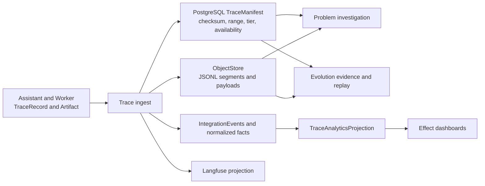
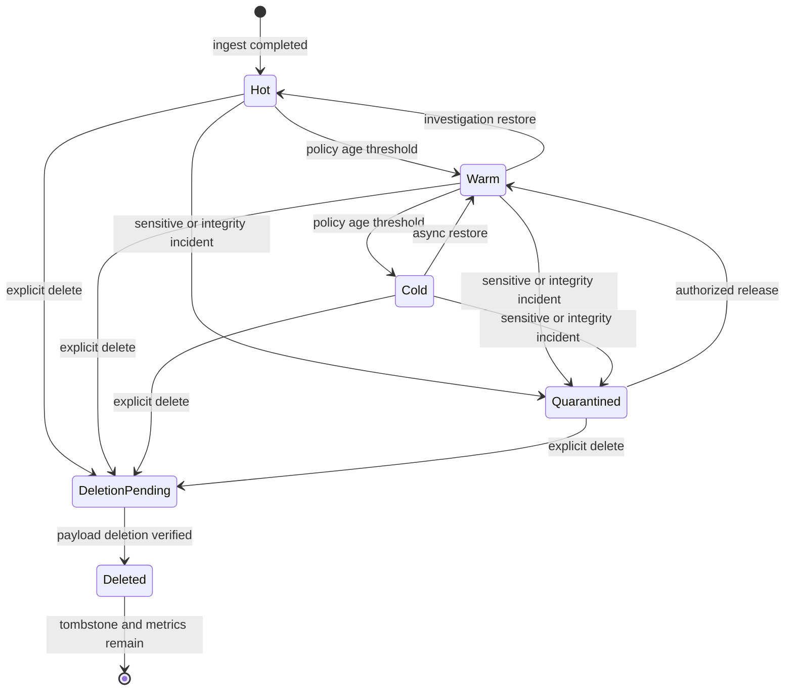
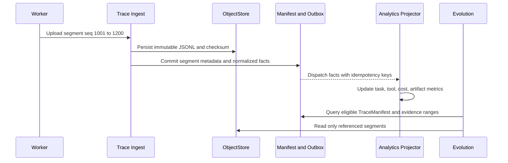

# Trace Artifact Retention And Analytics Guide

本文解释 Switchback P0 的 Trace/Artifact 生命周期方案 A。核心目标不是建设复杂审计平台，而是让数据长期服务于故障排查、Evolution 重放和产品效果看板，同时控制在线存储成本并保留纠错能力。

## 先看结论

| 问题 | P0 答案 |
| --- | --- |
| 权威执行轨迹在哪里 | ObjectStore JSONL/原始 Artifact，由 PostgreSQL TraceManifest 索引 |
| Langfuse 是不是事实源 | 不是；它是可重建观测投影，可采用更短保留期 |
| 看板是否扫描 JSONL | 不扫描；消费事件和 Trace ingest 生成结构化 TraceAnalyticsProjection |
| 时间到期是否自动物理删除 | 默认不删除，只从 hot 迁移到 warm/cold |
| 审计是否需要复杂审批流 | P0 不需要；记录 actor、action、target、reason、time、result 即可 |
| 敏感内容误写怎么办 | 手工 quarantine，停止普通读取和投影，再执行授权删除或恢复 |
| Trace 删除后 Truth 怎么办 | 保留来源 tombstone/id 和删除状态，不假装证据仍可读取 |

默认候选策略：`hot 30 天 -> warm 至 180 天 -> cold 长期`。天数属于 Tenant DataLifecyclePolicy，可通过新 revision 调整；P0 本地文件系统可以先只实现逻辑 tier，P1/S3 adapter 再映射到真实存储层级。

## 数据路径



关键边界：

- JSONL 和原始 Artifact 是事实内容；TraceManifest 是定位、校验和生命周期的权威目录。
- Langfuse 用于模型、Tool、成本、延迟和 session 排障，但丢失或缩短保留期不能导致 Switchback Trace 丢失。
- Dashboard 只查询结构化投影，不在用户请求时扫描大 JSONL，也不依赖 Langfuse 可用性。
- Evolution 通过 TraceManifest 和稳定 evidence refs 读取所需片段；cold 数据允许异步 restore 后重放。

## 生命周期状态



状态语义：

| State | 普通读取 | 排障/Evolution | 内容是否存在 |
| --- | --- | --- | --- |
| `hot` | 直接 | 直接 | 是 |
| `warm` | 直接或短延迟 | 直接或短延迟 | 是 |
| `cold` | 返回 restore job/异步读取 | restore 后读取 | 是 |
| `quarantined` | 拒绝 | 仅授权维护动作 | 通常存在但隔离 |
| `deletion_pending` | 拒绝新读取 | 不再进入新 Evolution/投影 | 删除进行中 |
| `deleted` | 拒绝并返回 tombstone 状态 | 只看来源 id 和删除原因 | payload 不存在 |

Tier 变化不修改 Trace 内容和 checksum。Tier、availability 和 restore job 是可变生命周期元数据，不写回不可变 JSONL。

## TraceManifest

一个 TraceStream 可以分成多个不可变 JSONL segment。TraceManifest 至少记录：

```text
trace_stream_id
tenant_id / workspace_id
conversation_id / worker_session_id / worker_run_id
segment refs, sequence ranges, checksums, byte sizes
first_recorded_at / last_recorded_at
schema versions
lifecycle_policy id/revision
storage_tier / availability
langfuse export status
analytics projection cursor
```

这样可以支持：

- 按 sequence/时间/类型读取局部 Trace，不下载整段 session。
- 校验 segment 是否丢失、重复或损坏。
- cold restore 后从原 cursor 继续 Evolution 或 analytics replay。
- 删除 payload 后保留最小 tombstone，避免 Truth evidence ref、ArtifactRef 和排障记录变成无法解释的悬空 id。

## 看板统计什么

TraceAnalyticsProjection 的目标是回答“平台和演进是否有效”，不是复刻所有 Trace 内容。

| 主题 | 指标示例 |
| --- | --- |
| 任务交付 | Task/WorkerRun 成功率、失败分类、active/wall time、等待用户时间 |
| Runtime | 分配耗时、恢复次数、heartbeat incident、容器回收和资源用量 |
| Agent/Tool | AgentTurn 数、Tool 调用/超时/取消/重试、late result、测试结果 |
| 模型 | token、成本、延迟、route/provider/model、错误和 fallback |
| 产物 | report/patch 数、预览/下载/Apply/发布动作及结果 |
| Evolution | candidate 数、自动发布/审核/拒绝、Memory 使用、纠错、撤销和过期 |
| 用户效果 | 后续追问次数、阶段完成后继续交互、重复任务减少等可解释 proxy |

统计事实在 Trace ingest 或领域事件事务后增量写入，并保留 schema/policy revision。聚合指标不保存 prompt、源码、密钥或完整 Tool 输出；即使原 payload 后续删除，已经合法生成的非敏感聚合可以保留。



## 简化运营与审计

P0 后端运营平台优先提供：

- 按 tenant/workspace/task/session/trace id 查询 metadata、状态、大小、tier、错误和 Langfuse link。
- 发起 restore、archive、quarantine、release 和 delete job。
- 查看 ingestion、projection、Evolution consumption 和 deletion job 结果。
- 查看任务、成本、Tool、Artifact 和 Evolution 效果看板。

P0 不要求工单系统、四眼审批、复杂 legal workflow 或独立审计仓库。`DataLifecycleAction` 只需记录：

```text
action_id
actor_user_id and actor_role
tenant_id and target refs
action: archive | restore | quarantine | release | delete
reason
requested_at / completed_at
before_state / after_state
result / error
correlation_id
```

普通 Workspace 成员按 Membership/ACL 读取自己有权的数据。运营角色默认查询 metadata；读取 raw payload 必须具有明确 `trace.raw.read` 能力并记录 access action，但 P0 不强制额外工单审批。

## 删除流程

删除不是默认时间策略，而是显式纠错动作：

1. 有权用户、Workspace owner 或平台 data operator 发起 delete command，指定目标和理由。
2. 系统解析目标 TraceStream/Artifact/segments，冻结新读取和新投影，写 `deletion_pending`。
3. 后台删除 ObjectStore payload，并请求删除可识别的 Langfuse 派生记录；投影删除失败可重试。
4. 校验 payload 不再可读，写 `deleted`、完成时间和最小 tombstone。
5. Analytics 保留不含原文的聚合；Evolution evidence ref 标记 `source_deleted`，不得把来源当作仍可核验。

P0 可以只要求一次确认和正常授权，不要求双人审批。若未来出现法务保全、监管或高敏 Tenant，再在 DataLifecyclePolicy 增加 `legal_hold` 和更强审批，不把它预埋成所有用户的日常负担。

## 故障与恢复

| 情况 | 处理 |
| --- | --- |
| ObjectStore 成功、Manifest 事务失败 | segment 视为 orphan，由 reconciliation 按 checksum 注册或清理 |
| Manifest 成功、Analytics 投影失败 | Outbox 重试；不影响 Trace 权威内容 |
| cold restore 失败 | 保持 cold/unavailable，记录错误，不伪造空 Trace |
| Langfuse export 失败 | 标记 projection error 并重试；不回滚 Trace ingest |
| 删除部分成功 | 保持 deletion_pending，按对象幂等重试并显示剩余对象 |
| Trace segment checksum 不匹配 | quarantine，停止 Evolution 和普通下载 |

## 实现检查清单

- JSONL/Artifact payload 与 TraceManifest 使用 checksum、segment sequence range 和 idempotency key 对齐。
- P0 DataLifecyclePolicy 默认 hot 30 天、warm 至 180 天、cold 长期，且不自动物理删除。
- P0 local filesystem 可以逻辑模拟 tier；领域契约不依赖具体 S3 storage class。
- Dashboard 使用 normalized fact/IntegrationEvent 增量投影，不扫描原始 JSONL。
- Evolution 按 TraceManifest evidence range 读取，cold 时走 restore，deleted 时显式标记来源不可用。
- Langfuse 是可重建投影，可有独立较短 retention。
- quarantine 立即停止普通读取、Evolution 新消费和用户下载。
- 显式删除有幂等 job、tombstone 和结果记录，但 P0 不要求复杂审批。
- 原 payload 删除后只保留不含原文的 metadata、最小来源 tombstone 和聚合统计。
- contract tests 覆盖 tier 迁移、restore、重复 ingest、投影重试、quarantine、部分删除和 evidence source_deleted。
