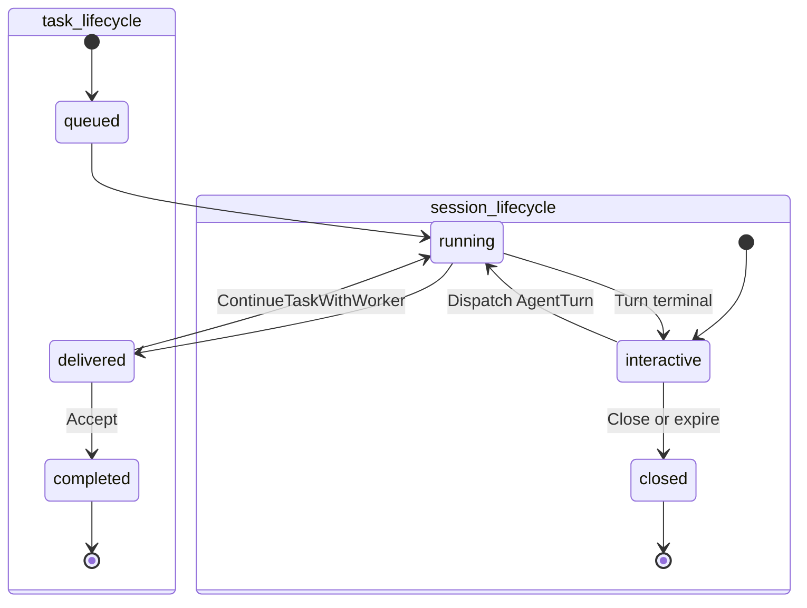
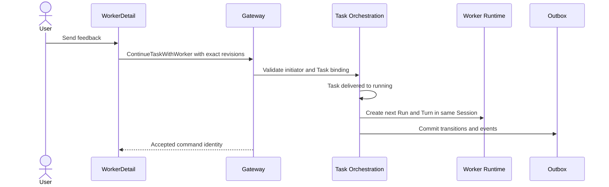
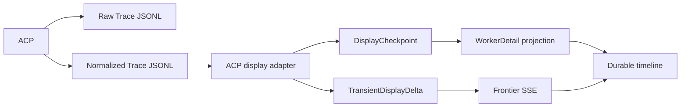
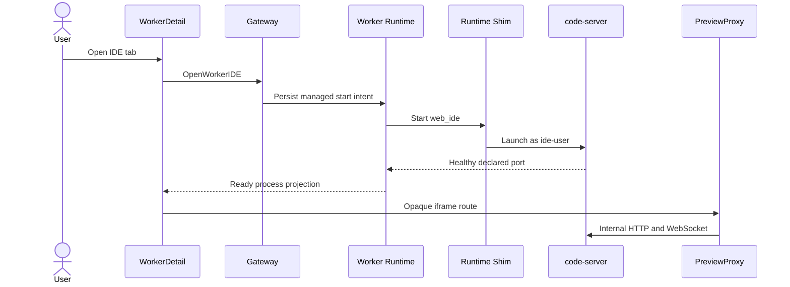

# Worker Workbench And Web IDE

_Confirmed design for the post-M2 Worker interaction surface, 2026-07-25._

---

## Scope

M2 proves that Assistant can clarify, create an exact TaskSpec and dispatch a real Worker. It reuses the M1 Worker execution and review path. Product testing exposed gaps in that reused path, but folding their implementation into the Assistant change would mix Interaction, Task, Worker Runtime, Eventing, Artifact and frontend ownership.

The work is split into two OpenSpec changes:

| Change | Purpose | M2 dependency |
| --- | --- | --- |
| [`worker-workbench-interaction-hardening`](../../openspec/changes/worker-workbench-interaction-hardening/) | Correct delivered chat, durable Agent/Tool history and Artifact review | Correctness fix and real multi-turn acceptance are required before M2 archive |
| [`worker-web-ide-session-process`](../../openspec/changes/worker-web-ide-session-process/) | Optional managed browser IDE inside the Worker Runtime | Does not block M2 |

```mermaid
flowchart LR
    accTitle: Post M2 Worker Delivery Order
    accDescr: Worker correctness and review are delivered before optional Web IDE runtime support, then the complete Assistant to Worker sequence is verified.

    m2_dispatch["M2 Assistant dispatch"] --> chat_fix["Correct delivered chat"]
    chat_fix --> durable_timeline["Materialize durable timeline"]
    durable_timeline --> artifact_workbench["Deliver Artifact Workbench"]
    artifact_workbench --> m2_acceptance["Run real M2 multi-turn acceptance"]
    m2_acceptance --> web_ide["Add optional Web IDE"]
```



## Confirmed product decisions

| Area | Decision |
| --- | --- |
| Delivered chat | Free-form feedback continues the same Task and creates a new WorkerRun/AgentTurn |
| Accepted Task | Stored `completed` remains terminal; UI renders `Accepted` |
| Chat after acceptance | Same WorkerSession, standalone WorkerRun, old Task unchanged |
| Timeline density | Agent text expanded; Tool Calls collapsed with expandable details |
| Artifact layout | Resizable in-page Workbench with Report, Diff and Files |
| Diff renderer | `@pierre/diffs` behind a Switchback adapter |
| File tree | `@pierre/trees` behind a Switchback adapter because its API is beta |
| Web IDE layout | Embedded Workbench iframe with resize and temporary full-screen |
| Web IDE runtime | Pinned code-server primary, OpenVSCode Server fallback |
| Web IDE start | On demand; survives AgentTurn terminality |
| IDE/Agent writes | Concurrent shared WorkingCopy; mark `mixed_origin_possible` |
| IDE extensions | Preinstalled-only first; later allow direct user Open VSX installation |

## Task and Session separation

Task is a tracked delivery envelope. WorkerSession is the persistent Coding Agent interaction identity. Acceptance closes the delivery, not the conversation.



`completed -> running` is deliberately forbidden. Reopening an accepted Task would make acceptance metrics and external automation unstable and would turn Task into a second WorkerSession.

The UI uses product labels:

| Canonical state | Product label |
| --- | --- |
| Task `completed` | Accepted |
| WorkerRun `completed` | Run completed |
| AgentTurn `completed` | Turn completed |
| WorkerSession `interactive` | Interactive |

## Delivered continuation

WorkerDetail must not infer standalone follow-up from terminal Run/Turn state alone. It selects actions from the complete exact state tuple.



The command carries Task, Session, previous Run/Turn revisions, `interaction_kind=chat|rework`, content and idempotency key. The state transition, identities, Session references, TaskTransition and Outbox commit atomically. Runtime dispatch remains asynchronous.

If the target is stale, the browser preserves the draft, refreshes the exact WorkerDetail projection and requires a new send. It never automatically retargets or replays the message.

## Durable Agent and Tool display

Trace JSONL is evidence, not a browser presentation protocol. Worker UI consumes canonical DisplayPart checkpoints.



The timeline supports:

- Full Agent messages in safe Markdown
- Provider-supplied reasoning summaries, never hidden chain-of-thought
- Collapsed Tool Calls with status, duration, safe arguments, locations and bounded output
- Approval, Artifact, stage and safe error parts
- Run/Turn grouping and stable historical pagination
- Reconnect convergence from durable checkpoints

Raw provider payloads, credentials, internal headers and unlimited Tool output remain outside DisplayPart. Evolution continues to derive governed Truth from authorized Trace and Artifact evidence; it does not treat the display projection as a new fact source.

## Artifact Workbench

The Worker page becomes a chat and review workspace rather than a timeline plus a narrow result card.

```text
+----------------------------+--------------------------------------------+
| Worker timeline            | Workbench                                  |
|                            | [Report] [Diff] [Files] [IDE]              |
| Agent and Tool history     |                                            |
|                            | File tree and selected result               |
| Composer                   | Resizable and temporarily full-screen       |
+----------------------------+--------------------------------------------+
```

Report behavior:

- Render checksum-verified canonical Report Artifact
- Support safe Markdown, tables, lists and code blocks
- Block raw HTML, scripts and automatic remote image loading
- Keep LiteLLM, ACP and Runtime diagnostics in Timeline rather than report content

Patch behavior:

- Show changed-file status, additions and deletions
- Select all files or one file
- Toggle unified/split layout and wrapping
- Navigate hunks
- Show "No code changes" for zero-byte patch
- Fall back to metadata and authorized download for binary, oversized or unparseable content

Accept means the Task delivery is accepted. It does not apply the patch a second time because the WorkerSession WorkingCopy already contains the result.

## Web IDE runtime

Web IDE is a typed managed SessionProcess, not a public container service.



Runtime rules:

- Include a pinned code-server binary in the Worker image but start it only on demand
- Run as separate `ide-user` without Docker Socket, root, arbitrary host paths or repository credentials
- Share the exact WorkingCopy and toolchain with Codex
- Admit start only when Runtime resource headroom is sufficient
- Keep the process across AgentTurn terminality and iframe unmount
- Stop on explicit action, Session terminality, security termination, Runtime replacement or hard resource exhaustion
- Preserve Session IDE settings but never auto-restart process identity across Runtime generations

Preview rules:

- Publish no host port
- Resolve only the current generation and exact declared process port
- Use an opaque same-origin PreviewAccessRef
- Proxy HTTP and WebSocket
- Strip Switchback cookies, authorization and internal headers before forwarding
- Close active tunnels on revocation, expiry, process terminality or generation replacement

## Concurrent WorkingCopy edits

Dynamic read-only IDE mode is rejected for the first version. Editor UI restrictions would not constrain extensions or terminals, while filesystem ACL/remount switching creates race and ownership complexity.

Agent and IDE therefore write concurrently. Every AgentTurn retains its WorkerRunStartSnapshot. If the IDE process ran between Turn start and Artifact finalization, the result is marked `mixed_origin_possible`. The system does not claim byte-level authorship.

IDE terminal commands are direct user actions, not Agent Tool Calls. Remote publish remains unavailable because the Worker container receives no GitHub/GitLab credential.

## Extension rollout

Version 1 includes approved image-pinned extensions in an immutable directory and disables runtime installation for both Agent and IDE users.

A later additive version may allow the user to install Open VSX extensions into Session-persistent IDE storage. Switchback records extension id, version, source and installation time. Agent processes remain unable to write that directory. Microsoft Marketplace remains excluded.[^1]

## Acceptance gates

The Workbench change is complete only after:

1. Delivered chat creates a new Run/Turn in the same Task and Session
2. Accept leaves Task `completed`/Accepted and later chat creates a standalone Run
3. Refresh reconstructs Agent and Tool history from durable checkpoints
4. Safe Markdown and non-empty multi-file patch review render correctly
5. Empty and integrity-failed Artifacts produce truthful states
6. Desktop/mobile Playwright coverage has no overlap or inaccessible controls
7. A real M2 provider flow passes delivery, direct feedback, second delivery, acceptance and standalone follow-up

The Web IDE change is complete only after:

1. IDE starts on demand with no published host port
2. Same-origin HTTP/WebSocket proxying passes authorization and header-isolation tests
3. IDE survives AgentTurn terminality and stops with Session terminality
4. Runtime replacement fences the old endpoint without auto-restart
5. Concurrent edits mark possible mixed origin
6. Extension installation is disabled in version 1
7. IDE capacity failure leaves Agent Runtime healthy

## References

[^1]: Coder. "code-server FAQ." https://coder.com/docs/code-server/FAQ

[^2]: Pierre Computer Company. "Diffs." https://diffs.com/

[^3]: Pierre Computer Company. "Trees documentation." https://trees.software/docs

[^4]: Microsoft. "Visual Studio Code Server." https://code.visualstudio.com/docs/remote/vscode-server
