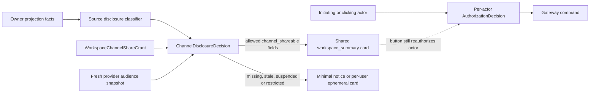
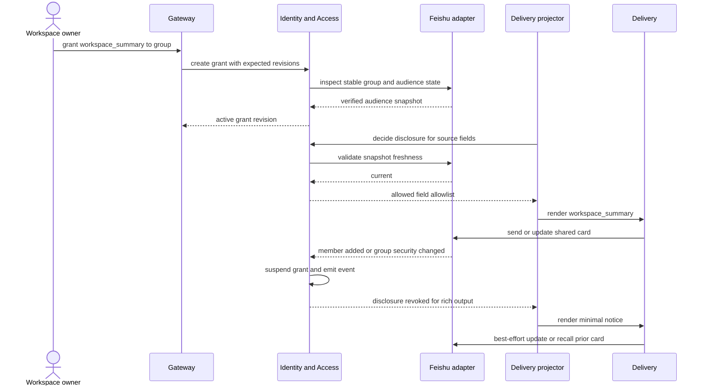

# Workspace Channel Share And Disclosure

## Scope

`WorkspaceChannelShareGrant` is the independent authority for disclosing bounded Workspace-derived projections to a provider group. It is not a WorkspaceMembership, execution grant, card action grant or replacement for per-user Web authorization.

This design separates three questions:

1. May the initiating actor read or execute in the Workspace?
2. Has a Workspace owner approved this provider group as an audience?
3. Is this exact projection field safe and allowed by the current disclosure profile?

All three must be answered independently. Only the second and third questions govern shared card content.



## Ownership And Trust Boundary

| Concern | Owner | Rule |
| --- | --- | --- |
| Workspace membership and owner authority | Identity & Access | P0 grant creation, revision and revocation require a current active Workspace owner and expected revisions. |
| Workspace-derived source facts and classification | Task/Worker/Approval/Artifact owner projection | The source owner emits normalized facts and `channel_shareable` classification; Delivery cannot upgrade restricted data. |
| Share grant and disclosure decision | Identity & Access | Exact Workspace, provider audience, profile, policy and current provider snapshot are re-evaluated. |
| Provider channel state and message lifecycle | Delivery adapter | Fetches/subscribes/reconciles provider facts and manages CardInstance update/recall attempts. |
| Card layout and delivery | Delivery | Renders only the allowed decision output; no independent disclosure inference. |
| Action authorization | Gateway plus resource owner | Every actor, command and expected revision is checked again; the group grant is not authority. |

## WorkspaceChannelShareGrant v1

```json
{
  "schema_version": "identity.workspace_channel_share_grant.v1",
  "grant_id": "wcsg_123",
  "tenant_id": "tenant_1",
  "workspace_id": "workspace_1",
  "audience_scope": {
    "provider": "feishu",
    "provider_tenant_key": "tenant_key_1",
    "chat_id": "oc_group_1"
  },
  "delivery_scope": {
    "allowed_channel_binding_ids": ["binding_1"]
  },
  "disclosure_profile": "workspace_summary",
  "audience_baseline_ref": {
    "snapshot_id": "channel_snapshot_7",
    "digest": "sha256:..."
  },
  "grantor_user_id": "user_owner",
  "workspace_membership_revision": 12,
  "policy_ref": {"policy_id": "channel-disclosure-p0", "revision": 1},
  "grant_revision": 3,
  "status": "active",
  "valid_from": "2026-07-13T09:00:00Z",
  "expires_at": "2026-08-13T09:00:00Z"
}
```

Required invariants:

- `tenant_id`, `workspace_id`, provider tenant and group identity are immutable for one grant identity. Changing them creates a new grant.
- P0 status is `active`, `suspended`, `revoked` or `expired`; only `active` is usable.
- Revision, policy, owner Membership and provider audience snapshot must be current at decision time.
- The profile can reduce disclosure but cannot override source classification or platform hard restrictions.
- The grant is prospective. It does not legalize or reclassify content sent before its creation.

## Disclosure Classes And P0 Profile

| Source class | Example | Shared under `workspace_summary` |
| --- | --- | --- |
| `channel_public` | Provider/channel routing status that is not Workspace-derived | Yes, even without a Workspace share grant. |
| `channel_shareable_status` | Explicitly approved Task/Worker coarse stage and status | Yes. |
| `channel_shareable_summary` | Bounded title/result/waiting summary approved by the source projection | Yes. |
| `channel_shareable_artifact_metadata` | Artifact type, count and canonical subject reference without content/path leakage | Yes. |
| `actor_private` | User-specific approval reason, private prompt, personalized action details | Shared card: no; per-user ephemeral card or Web. |
| `workspace_restricted` | Repository/file names not explicitly classified, full report, patch/diff, Tool output | No; Web only. |
| `platform_restricted` | Secret, raw Trace, hidden reasoning, internal stack/error detail | Never. |

No-grant fallback is intentionally weaker than `workspace_summary`: a shared group message may say only that a Switchback update requires opening Web, without naming the protected subject. The canonical Web route performs per-user authorization. It must not contain a personalized bearer token.

## ChannelDisclosureDecision v1

Each shared send or update snapshots one deterministic decision:

| Field | Meaning |
| --- | --- |
| `decision_id` | Stable audited decision identity. |
| `tenant_id`, `workspace_id` | Exact security and content boundary. |
| `channel_binding_ref` | Binding id and revision being rendered. |
| `share_grant_ref` | Grant id/revision/status, absent for no-grant fallback. |
| `source_projection_refs` | Exact owner projection identities/revisions. |
| `requested_classes` | Source classifications requested by the card projector. |
| `resolved_profile` | `minimal_notice` or `workspace_summary`. |
| `allowed_fields` | Explicit allowlist of normalized fields, never an arbitrary payload. |
| `provider_snapshot_ref` | Security/audience snapshot and freshness evidence. |
| `policy_ref` | Disclosure policy id/revision. |
| `allow`, `reason_codes` | Deterministic result and structured degradation/suspension reasons. |
| `decided_at`, `valid_until` | Audit time and short decision freshness boundary. |

`DeliveryCardProjection` references this decision and optional share grant. A renderer receives only `allowed_fields`; it cannot fetch richer source state to fill an empty card section.

## Grant And Audience Lifecycle

```mermaid
stateDiagram-v2
    accTitle: WorkspaceChannelShareGrant Lifecycle
    accDescr: A share grant is active only while owner authority, policy and provider audience remain current; audience expansion or uncertainty suspends rich disclosure.

    [*] --> Active: owner grants verified audience
    Active --> Suspended: audience expands or security state changes
    Active --> Suspended: provider state becomes stale or unknown
    Active --> Suspended: owner membership or policy becomes stale
    Active --> Revoked: owner revokes
    Active --> Expired: expiry reached
    Suspended --> Active: owner reauthorizes current audience
    Suspended --> Revoked: owner revokes
    Suspended --> Expired: expiry reached
    Revoked --> [*]
    Expired --> [*]
```



Provider signals are safety inputs, not the source of Workspace authorization. In Feishu, user-added and user-removed events can trigger reconciliation, while the group-information API supplies current group/security metadata. A known audience expansion, internal-to-external or private-to-public transition, bot removal, inspection failure or stale snapshot suspends rich rendering. Provider events can be lost, so reconciliation and render-time freshness checks remain required.



## Card Actions And Per-User Detail

A shared card may expose only actions whose existence is safe for the channel. The action descriptor remains a hint, not authority. On callback, Delivery and Gateway remap the clicked provider identity and revalidate Tenant, Workspace, owner action, expected revision and policy.

When an approval, clarification or continuation action is intended for one user and revealing its detail to the group is unnecessary, Delivery should use a provider-supported per-user ephemeral card. If that capability is unavailable or expired, the shared card contains a generic notice and Web link instead of widening disclosure.

## Revocation And Residual Exposure

Revocation or suspension fences every future shared send/update before rendering. Delivery then attempts to update, redact or recall bot-authored messages and records the provider result. This is best effort:

- provider administrators can configure recall/edit time limits;
- the bot may lack current group or message access;
- users may already have read, exported, quoted or captured the content;
- provider caches and notifications are outside Switchback's transactional control.

Therefore `disclosure_retracted` means Switchback stopped future disclosure and attempted provider cleanup. It never means every copy was erased. Unknown or failed cleanup creates an auditable residual-exposure record.

## Required Tests

1. Missing, revoked, expired, suspended, wrong-Tenant, wrong-Workspace and wrong-channel grants produce only `minimal_notice`.
2. Active grant allows only fields both source-classified and profile-allowed; Delivery cannot upgrade a restricted class.
3. Raw Trace, private prompt, hidden reasoning, secrets, Tool stdout, internal errors, full report and patch content never enter shared cards.
4. Audience expansion, external/public transition, bot removal, stale/unknown snapshot and owner Membership revocation suspend rich rendering.
5. Duplicate provider events, reconciliation races and stale grant/policy revisions converge idempotently.
6. Card callback reauthorizes each actor; the grant never makes a group member a Workspace member or action approver.
7. Actor-private actions use ephemeral card when supported and otherwise degrade to Web.
8. Web deep links contain no bearer authority and each opener is independently authorized.
9. Revocation fences future renders and records update/recall success, unsupported, expired and unknown outcomes without claiming complete erasure.
10. Historical messages are not retroactively authorized by a newly created grant.

## Feishu Capability Evidence

The provider adapter must use a versioned capability profile rather than treat these links as immutable domain rules:

- Feishu publishes user-added and user-removed group events for bots in the group: [user added](https://open.feishu.cn/document/server-docs/group/chat-member/event/added?lang=zh-CN), [user removed](https://open.feishu.cn/document/server-docs/group/chat-member/event/deleted-2).
- The group-information API exposes group metadata and permission configuration when the caller has sufficient access: [get chat information](https://open.feishu.cn/document/server-docs/group/chat/get-2).
- Bot-authored cards can be updated, and bot-authored messages can be recalled subject to provider permissions and administrator-configured limits: [message APIs](https://open.feishu.cn/document/server-docs/im-v1/introduction?lang=zh-CN), [recall message](https://open.feishu.cn/document/server-docs/im-v1/message/delete?lang=zh-CN).
- Feishu supports cards visible only to specified users, which is useful for actor-private interaction: [message API overview](https://open.feishu.cn/document/server-docs/im-v1/introduction?lang=zh-CN).
