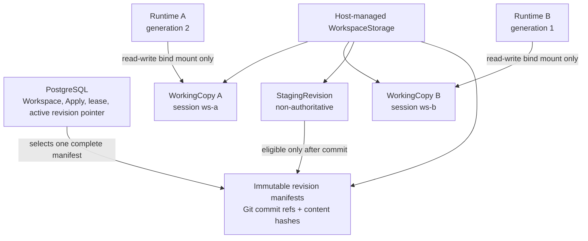
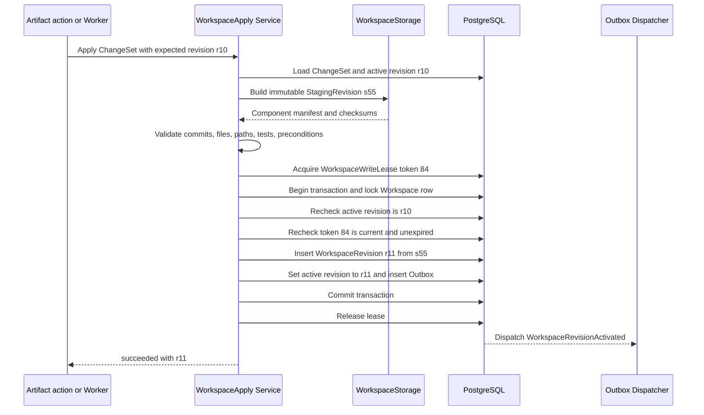

# Workspace Storage And Atomic Apply Guide

本文解释 Switchback P0 的 WorkingCopy 方案 A：宿主管理持久目录，PostgreSQL 管理 revision、租约和权威指针，Worker 容器只挂载自己的隔离 WorkingCopy。

## 先看结论

| 问题 | P0 答案 |
| --- | --- |
| Worker 在哪里改文件 | 宿主持久目录中的 session WorkingCopy；容器仅 bind mount 自己的副本 |
| 容器删除后文件是否还在 | 在；容器层不是 WorkingCopy 的事实源 |
| Workspace 当前版本由什么决定 | PostgreSQL 中的 `active_revision_id` |
| 多仓和非仓内容如何成为一个版本 | WorkspaceRevision 保存一份完整、不可变的 component manifest |
| 大仓物化是否长期持有写租约 | 否；StagingRevision 在租约外准备 |
| 写租约保护什么 | 最终重验、fencing 和 active revision pointer 的事务提交 |
| “原子 Apply”是什么意思 | 数据库一次性切换完整 manifest 的权威指针，不承诺多个目录同时 rename |

一句话版本：**Worker 在自己的持久副本里工作，Apply 先在旁边准备完整候选版本，最后用一个短数据库事务决定它是否成为 Workspace 当前版本。**

## 物理布局和所有权

P0 可以使用以下逻辑布局；路径名称是实现建议，不进入领域协议：

```text
workspace-root/
  workspaces/{workspace_id}/
    repositories/{checkout_id}/       # 受控 Git object/repository storage
    working-copies/{worker_session_id}/
      repos/{checkout_id}/             # per-session Git worktree
      files/                            # 非仓文件和设计产物
      agent-state/                      # 可恢复 Agent state
    staging/{workspace_apply_id}/       # 非权威、可清理的完整候选版本
    revisions/{workspace_revision_id}/
      manifest.json                     # 可重建/核查副本，不是 active pointer
    content/{content_hash}/             # 可选内容寻址对象或快照
```



责任边界：

- RuntimeProvisioner 创建容器并授予单个 WorkingCopy 的 mount lease；它不能挂载共享权威目录。
- WorkspaceStorage adapter 管理目录、Git worktree、非仓树、staging 和清理。
- PostgreSQL 是 WorkspaceRevision metadata、WorkspaceApply、WorkspaceWriteLease、fencing token 和 ActiveRevisionPointer 的权威来源。
- 容器可回收；WorkingCopy、Agent state、ChangeSet 和 revision manifest 必须跨 RuntimeInstance generation 保留。

### Git 与非 Git 内容

| 组件 | WorkingCopy | WorkspaceRevision 中的不可变引用 |
| --- | --- | --- |
| Git repository | 每个 WorkerSession 独立 worktree 和内部临时 branch/ref | 具体 commit SHA、checkout id、workspace path |
| 非仓文件 | session 独立 materialized tree | 内容寻址 manifest、每个文件 checksum 和 ArtifactRef |
| 设计或调研产物 | session files 或 ArtifactStore | manifest 中的 ArtifactRef 和 checksum |

WorkspaceRevision 必须引用不可变 Git commit SHA，不能只保存可移动 branch 名。实现应在 Apply 完成前用受控临时 ref 保护 staged commit，避免 Git GC 提前清除。copy-on-write、reflink 或 hardlink 可以优化性能，但不能成为正确性前提。

## Apply 为什么分成两段

大仓 checkout、patch 应用、文件复制和 checksum 可能持续数分钟。如果整个过程都持有 WorkspaceWriteLease，一个慢 Apply 会阻塞所有其他已准备好的 ChangeSet。因此 P0 把 Apply 分成：

1. **Prepare**：在租约外校验 ChangeSet，并构建完整、不可变的 StagingRevision。它不改变 Workspace 权威状态，可以并发，也可以失败后清理。
2. **Finalize**：获取短时 WorkspaceWriteLease，重验 active revision、staging 完整性和 fencing token，在同一 PostgreSQL 事务中创建 WorkspaceRevision、切换 active pointer 并写 Outbox。



建议实现伪代码：

```text
apply(change_set_id, expected_revision_id, idempotency_key):
    return existing result when idempotency_key already completed

    change_set = load_ready_change_set(change_set_id)
    staging = workspace_storage.prepare_immutable_candidate(change_set)
    validate_complete_manifest(staging)

    lease = acquire_workspace_lease(workspace_id)
    transaction:
        workspace = lock_workspace(workspace_id)
        assert workspace.active_revision_id == expected_revision_id
        assert lease_is_current(lease.id, lease.fencing_token)
        assert staging_is_complete_and_immutable(staging)
        revision = insert_workspace_revision(staging.manifest)
        update_workspace_active_revision(revision.id)
        insert_outbox(WorkspaceRevisionActivated)
        mark_apply_succeeded(revision.id)
    release(lease)
```

`validate_complete_manifest` 在 Prepare 后和 Finalize 内各有不同职责。租约外做昂贵内容验证；事务内只做快速、确定性的引用完整性、expected revision 和 fencing 重验。事务内不得重新复制大目录或运行测试。

## 单仓示例

Workspace `w1` 当前是 `r10`，其中 API 仓库指向 commit `a100`。WorkerSession `ws-a` 在自己的 worktree 修改代码并产生 commit `a101`：

1. ChangeSet 声明 base `r10`、base commit `a100`、candidate commit `a101`。
2. Prepare 检查 `a101` 可达、路径正确、测试证据存在，并创建 staging manifest。
3. Finalize 发现 active 仍为 `r10`，提交 `r11`，其 API 组件指向 `a101`。
4. `active_revision_id` 从 `r10` 一次切换到 `r11`。

内部临时 branch 可以继续移动，但 `r11` 永远引用 `a101`。

## 多仓和非仓示例

一个 ChangeSet 同时包含：

| 组件 | r10 | 候选 |
| --- | --- | --- |
| API repository | commit `a100` | commit `a101` |
| Web repository | commit `b200` | commit `b205` |
| 非仓需求文档 | hash `doc-old` | hash `doc-new` |

Prepare 必须先得到包含三个候选引用的完整 StagingRevision。Finalize 只会产生两种结果：

- 三个组件整体成为 `r11`，active pointer 指向 `r11`。
- 任一组件失败、base 过期或租约失效，active pointer 仍指向 `r10`。

不存在“API 已更新但 Web 仍旧”的权威 WorkspaceRevision。底层 staging 目录可能部分写入，但它没有被 active pointer 选择，因此不是平台事实。

## 两个 WorkerSession 竞争

```mermaid
stateDiagram-v2
    accTitle: Workspace Apply Outcomes And Recovery
    accDescr: A prepared staging revision can commit only while its expected base and fencing token remain current; stale bases, expired leases, and component failures leave the active revision unchanged, while orphan staging is cleaned asynchronously.

    [*] --> Preparing
    Preparing --> Prepared: complete immutable staging
    Preparing --> Failed: component or validation failure
    Prepared --> Finalizing: acquire lease and token
    Finalizing --> Succeeded: base and token current
    Finalizing --> NeedsRebase: active revision changed
    Finalizing --> Fenced: lease expired or token obsolete
    Succeeded --> [*]: active pointer advanced
    Failed --> CleanupPending
    NeedsRebase --> CleanupPending
    Fenced --> CleanupPending
    CleanupPending --> [*]: remove orphan staging after retention
```



Session A 和 B 都从 `r10` 开始：

| 顺序 | 动作 | active revision | 结果 |
| ---: | --- | --- | --- |
| 1 | A 准备 staging A | `r10` | 非权威候选 |
| 2 | B 准备 staging B | `r10` | 非权威候选 |
| 3 | A 取得 token 84 并提交 | `r11` | A succeeded |
| 4 | B 取得 token 85，重验 expected `r10` | `r11` | B `needs_rebase` |

B 即使更晚取得了合法租约，也不能把基于 `r10` 的内容覆盖到 `r11`。它必须基于 `r11` rebase/replay，生成新 ChangeSet。

### 过期 holder fencing

Apply A 取得 token 84 后暂停，租约过期；Apply B 取得 token 85。A 恢复后即使仍持有旧进程和 staging，也必须在事务重验时被拒绝。只检查 `lease_id` 或本地进程状态不够，提交必须验证数据库中的最新单调 fencing token。

## 崩溃恢复

| 崩溃点 | 权威状态 | 恢复动作 |
| --- | --- | --- |
| Prepare 中 | active pointer 未变 | 标记 Apply failed 或继续幂等 Prepare；janitor 清理残留 staging |
| 已 Prepare、未取得租约 | active pointer 未变 | 可重试 Finalize，但必须重新检查 expected revision |
| 已取得租约、事务提交前 | active pointer 未变 | 租约到期；新尝试获取更大 fencing token |
| 数据库事务已提交、响应前 | active pointer 已整体切换 | 按 idempotency key 返回原 result revision，不能重复创建 |
| 提交后清理失败 | active pointer 已整体切换 | 后台重试清理；不能回滚成功 revision |

WorkspaceWriteLease 推荐使用 PostgreSQL lease row，而不是只用 session-scoped advisory lock，因为 lease row 能显式保存 holder、expiry 和单调 fencing token，并能被恢复流程审计。数据库事务仍需锁定 Workspace/lease row并使用条件更新，不能只相信调用方带来的 token。

## 实现检查清单

- WorkingCopy 和 Agent state 位于宿主管理的持久存储，不位于容器 writable layer。
- 每个 RuntimeInstance 只能读写自己 WorkerSession 的 WorkingCopy mount。
- replacement runtime 挂载前先 fencing 旧 generation，并证明旧容器已失去写权限。
- Git revision 使用 commit SHA；非仓 revision 使用内容寻址 manifest 和 checksum。
- StagingRevision 是完整、不可变、非权威候选，可在 WorkspaceWriteLease 外构建。
- WorkspaceWriteLease 使用数据库单调 fencing token，只覆盖最终重验与提交。
- WorkspaceRevision、active pointer、WorkspaceApply result 和 Outbox 同一事务提交。
- Finalize 事务内不复制大目录、不运行测试、不调用外部服务。
- stale base 返回 `needs_rebase` 或 `conflicted`，不使用 last-write-wins。
- 任一组件失败时 active pointer 保持不变；orphan staging 由 janitor 延迟清理。
- idempotency key 能区分“提交成功但响应丢失”和真正未提交。
- contract tests 覆盖单仓、多仓、非仓、竞争 Apply、过期 token、提交前后崩溃和重复请求。
