# Task Orchestration / Worker Runtime Domain

## 1. 领域定位

Task Orchestration 负责把 Assistant/Delivery 产生的 TaskSpec 变成可靠执行流程。宿主侧 Worker Control Plane 负责按 CI/CD runner 模式分配 Docker-compatible 容器；容器内 Go Worker Runtime Shim 通过网络与后端通信，并以 ACP client 身份控制 Codex，把原生执行流转换为 Switchback 标准 Trace、Event、Langfuse observation 和 Artifact。

核心原则：

- Task 只跟踪交付、验收和当前 WorkerRun，不复制 Worker 的执行状态。
- WorkerSession 是用户持续交互的主对象，WorkerRun 表示每个执行或返工阶段。
- Worker Runtime 执行代码，但不拥有任务来源和用户通道语义。
- Coding Agent 是可替换 adapter，不是领域模型本身。

## 2. 聚合与实体

| 类型 | 名称 | 说明 |
| --- | --- | --- |
| Aggregate Root | `Task` | 轻量交付状态、TaskSpec snapshot、initiator、Workspace/WorkerSession/WorkerRun/Artifact refs、验收模式和 revision。 |
| Entity | `TaskTransition` | Task 的不可变 revision/state 推进事实，与 Task/Outbox 同事务提交。 |
| Entity | `TaskSessionLineageEntry` | Task 历史绑定的 Session/Run、绑定/释放原因、absolute-expiry outcome 与 checkpoint 的 append-only 谱系。 |
| Entity | `ScheduledCommand` | retry/deadline/reminder/reconciliation 的持久到期请求，不拥有业务状态。 |
| Aggregate Root | `Workspace` | 持久逻辑工作上下文，可包含文件、Artifact、设计材料、多个 WorkerSession 和零到多个仓库检出。 |
| Entity | `RepositoryImport` | Workspace bootstrap 中异步导入 Repository、记录 append-only attempts，并在成功时创建首个 Checkout/Revision 的操作。 |
| Value Object | `RepositorySelectionSnapshot` | Code Platform Access 把 branch/tag 解析为 exact SHA 后签发的短期选择证据；Worker Runtime 只消费，不把它当授权。 |
| Aggregate Root | `WorkerSession` | 绑定一个 Workspace、可单独打开并持续 Agent 交互的执行会话，也是单顶层 Task/WorkerRun 的串行化边界。 |
| Entity | `WorkspaceRevision` | Workspace 的不可变逻辑版本和组件 manifest；active pointer 只在完整 Apply 成功后推进。 |
| Entity | `WorkingCopy` | WorkerSession 基于某个 WorkspaceRevision 的隔离可写副本，跨 RuntimeInstance generation 保留。 |
| Entity | `StagingRevision` | WorkspaceApply 在提交前准备的完整不可变候选 manifest；未被 active pointer 选中时不具权威性。 |
| Entity | `RepositoryCheckout` | 某个外部 Repository 在 Workspace 中的检出或挂载；Workspace 可以没有仓库。 |
| Entity | `ChangeSet` | WorkingCopy 相对 base revision 生成的多仓/非仓变更、检查结果和应用前置条件。 |
| Entity | `WorkspaceApply` | 租约外准备 StagingRevision，再在短时独占租约内串行提交 active revision 的操作。 |
| Entity | `AgentTurn` | 用户直接与 Worker Agent 的一轮 prompt/queue/interrupt/steer 交互。 |
| Entity | `SessionProcess` | Worker 显式启动并管理、可跨 AgentTurn 存活的 preview/dev server/watcher；它仍属于 WorkerSession 和当前 Runtime 权限边界。 |
| Entity | `WorkerRun` | 一次具体执行尝试。 |
| Value Object | `WorkerSessionTargetIntent` | 认证用户显式指向 exact WorkerSession 的复用证据；不能由最近活动、Workspace 相同或模型推断产生。 |
| Value Object | `WorkerSessionContextPolicy` | Run 启动状态的解析结果：继承当前 Session、新建 Session 或要求精确基线。 |
| Entity | `WorkerRunStartSnapshot` | WorkerRun 首次执行动作前持久化的 WorkingCopy、AgentSession 与继承策略实际基线。 |
| Aggregate Root | `WorkerSessionContinuityQuota` | Tenant/User 的 Session 连续性槽位计数、limit、revision 与原子 reserve/release。 |
| Entity | `WorkerSessionContinuation` | 从终态 Session 的 exact durable checkpoint 派生新 Session 的显式、幂等来源记录。 |
| Value Object | `WorkerSessionExpiryOutcome` | Worker Runtime 对 absolute expiry 的 fencing、Run 终态、checkpoint、Artifact completeness 和外部副作用状态的权威结果。 |
| Value Object | `WorkerSessionContinuationCheckpoint` | 终态 Session 可供派生的不可变 WorkingCopy manifest、digest、capture time 与 coverage。 |
| Value Object | `SessionAllocationQueue` | 新 Session 分配前按 Tenant/User 稳定排序的 Task/Continuation 容量等待视图；不拥有第二套 Task 或 Session 状态机。 |
| Value Object | `WorkerSessionExecutionSlot` | WorkerSession 的可选 bound Task、active WorkerRun、session revision 与 fencing evidence。 |
| Entity | `RuntimeProvisioner` | 创建、续期和回收本地 Docker-compatible 容器的运行时提供者。 |
| Entity | `RuntimeInstance` | WorkerSession 的一代实际容器/Pod，带 generation 和历史 container id。 |
| Entity | `WorkerRuntimeShim` | 容器内接收命令、驱动 ACP、采集轨迹并向后端回传的控制进程。 |
| Entity | `WorkerControlChannel` | RuntimeInstance generation 与后端之间的逻辑命令/事件/ACK/心跳通道。 |
| Entity | `RuntimeRecoveryIncident` | 一次连续 runtime/agent 不健康故障、一次自动恢复限制和处理结果。 |
| Entity | `RuntimeLease` | 容器/VM/K8s pod/worktree 的租约。 |
| Entity | `RepositoryAccessGrant` | WorkerSession 对单 Repository 的 once/session 受限委托。 |
| Entity | `RepositoryCredentialLease` | CredentialBroker 为当前 Grant/runtime generation 签发的短期 provider access。 |
| Entity | `CodePlatformOperation` | 原生 Git/Provider 操作及其权限快照、目标、结果和核查证据。 |
| Entity | `AgentInvocation` | 某个 Coding Agent 的启动和会话信息。 |
| Entity | `AgentSession` | WorkerSession 内部的具体 Agent 会话；一个 WorkerSession 可包含多个 AgentSession。 |
| Value Object | `RuntimePolicy` | 网络、资源、权限、超时、清理策略。 |
| Value Object | `WorkspaceWriteLease` | 只覆盖 WorkspaceApply 最终重验与提交临界区的独占写租约，不锁住 WorkerRun 或 staging 构建。 |
| Value Object | `RuntimeControlEnvelope` | 传输无关的 command/event/ack/heartbeat 信封。 |
| Value Object | `RuntimeHeartbeat` | Shim 独立发送的 runtime、Agent process 和 operation state 存活信号。 |
| Value Object | `CapabilityBundle` | Skill/MCP/Rules/AgentProfile/ModelPolicy materialized result。 |

关系不变量：

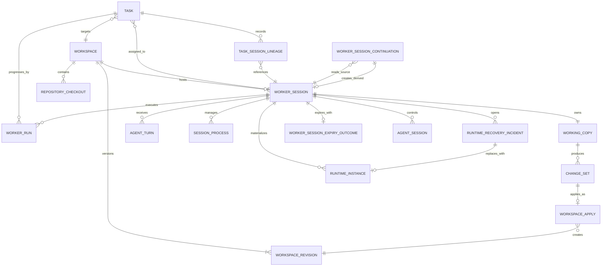

- 每个 WorkerSession 必须绑定一个 Workspace；一个 Workspace 可以有一个或多个 WorkerSession。
- Task 可以在 `queued` 时尚未分配 WorkerSession；只有已分配的 Task 才进入该 Session 的队列。已有 Session 的分配必须来自 exact WorkerSessionTargetIntent，否则默认创建新 Session。
- `allocating/interactive/running/recovering/waiting_user/idle/lost` WorkerSession 各占一个 Tenant/User continuity slot；queued/unassigned Task 与 pending Continuation 不占 slot，`closed/expired` 终态释放且不可重开。
- 每个 WorkerSession 同一时刻最多一个 bound Task 和一个 active 顶层 WorkerRun；Task 处于 queued 且引用目标 Session 时尚未取得 execution slot。
- Task 在 `running`、`waiting_user`、`delivered` 时通常保持 Session binding，直到 `completed`、`failed`、`cancelled` 才释放。唯一 P0 非终态例外是 ADR 0053：Session absolute expiry 成功 fencing 后把旧关联移入 TaskSessionLineage；若 fencing 不成立则保持 `lost`，不释放 slot/quota。需要顶层并行时创建另一个 WorkerSession。
- Agent 内部 subagent/child span 可以在一个 active WorkerRun 内并行，但共享父 AgentTurn 的固定 deadline、权限、WorkingCopy、Trace 和 Artifact lineage。
- 普通 Tool/process descendants 归属 AgentTurn 并随 Turn terminal 清理；只有显式 managed start 能创建 SessionProcess。SessionProcess 不是新的 execution slot、AgentTurn 或权限主体。
- Workspace 可以先用于调研、实验、设计或 Artifact 管理，不要求存在 RepositoryCheckout。
- repository-backed bootstrap 使用 `provisioning -> ready | setup_failed`；失败保留 Workspace/RepositoryImport attempts 但没有 active revision，不得创建 Task/WorkerSession，可显式重试或归档。
- RepositoryImport 只接受服务端 RepositorySelectionSnapshot 固化的 exact SHA；远端 ref 移动、重试或 Task dispatch 不得重新解析基线，当前 read grant 仍需独立重验。
- 多仓任务在同一 Workspace 中使用多个 RepositoryCheckout；后续产物也可以触发创建新 Repository。
- Workspace 是持久上下文，RuntimeInstance 是可替换算力实例，二者不能共用 identity。
- 多 WorkerSession 使用隔离 WorkingCopy 并行执行，禁止直接挂载同一权威可写目录。
- 每次 WorkspaceApply 只在最终重验与数据库提交的短临界区持有独占写租约；WorkerRun、AgentTurn 和 StagingRevision 构建不占用 Workspace writer。

## 3. Task 状态机

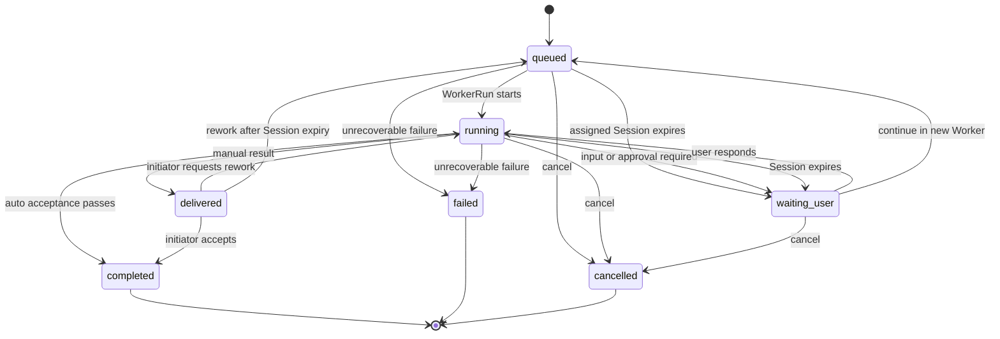

TaskDraft/readiness 在 Task 创建前完成，Worker 的 starting/timed_out 等细节属于 WorkerRun，因此不重复进入 Task 状态。P0 durable execution 固定采用 PostgreSQL：Task/TaskTransition/Outbox 在同一事务推进。ScheduledCommand poller 使用 `FOR UPDATE SKIP LOCKED`、短 lease、单调 fencing token、expected Task/Run revision 和稳定 idempotency key，只提交应用命令，不直接调用 Worker 或外部系统。

事务提交前崩溃整体回滚；提交成功但响应丢失时重复命令返回原 Transition。Outbox relay 和 poller 均按至少一次投递设计；旧 token、stale revision、cancelled/obsolete command 为 no-op。外部副作用 unknown-effect 安排 reconciliation 或进入 waiting_user，不由 scheduled retry 盲重试。

Temporal 和公开 TaskSaga 不进入 P0。未来若复杂分支、补偿或长期 timer 明显超过轻量 Task 表达能力，再按新 ADR 评估。

### 3.1 WorkerSession execution slot

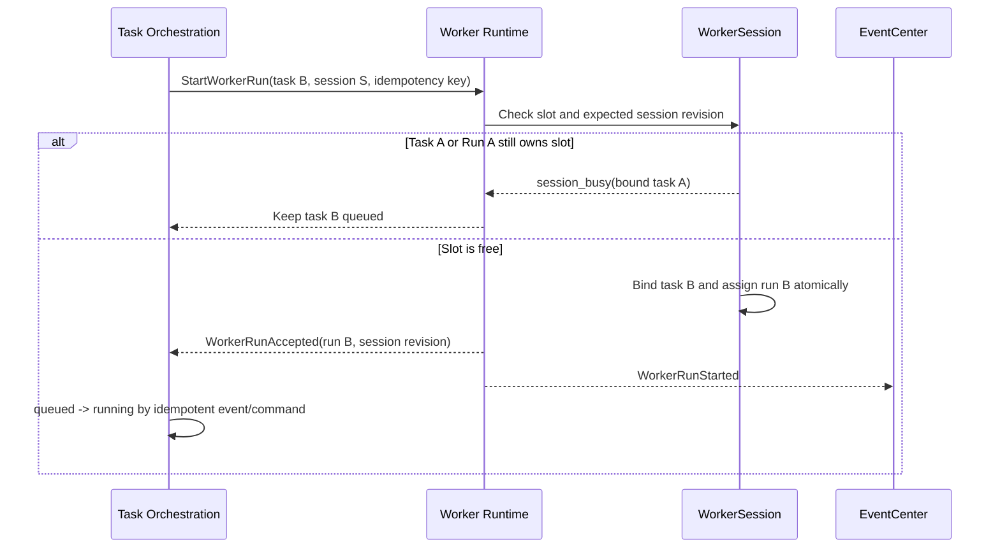

- Worker Runtime owns `bound_task_id`、`active_worker_run_id` 和 Session revision；Task Orchestration 不能直接改写 slot。
- Task Orchestration owns queued Task state。EventCenter 只传递 `WorkerRunAccepted/Started` 与 slot release 事件，不分配 slot。
- 重复 StartWorkerRun 使用同一 idempotency key 返回原 Run；不同 Task/Run 在 slot 已占用时返回 `session_busy`。旧 session revision 或 fencing token 不得覆盖当前 holder。
- active WorkerRun 有 `task_id` 时必须与 bound Task 相同；Task 终态释放 slot 前，当前 Run 必须已终态或完成可证明的安全取消收敛。
- `SessionTaskQueue` 是 Task 调度概念；AgentTurn `queue` 是向当前 active WorkerRun 排队消息，两者不得共享 command/schema。

### 3.2 Stable FIFO dispatch

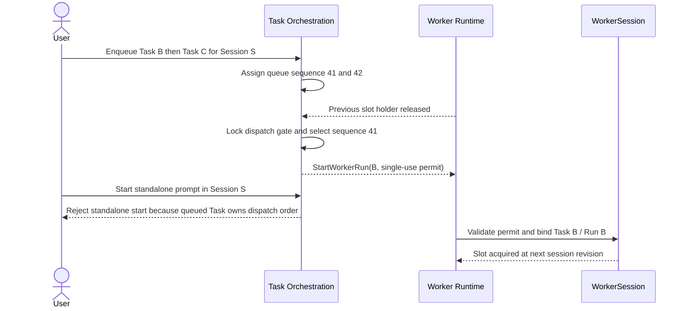

- FIFO scope is one WorkerSession, not one Workspace, Tenant or user. `session_queue_sequence` is assigned by the server when enqueue commits; duplicate enqueue returns the original value and gaps are not reused.
- P0 只允许取消 queued Task，或由 TaskInitiator 显式改派到另一个授权 Session 的队尾；不支持 priority、drag reorder 或 preemption。Task 的展示 priority 不参与调度。
- 所有新顶层 Run 都要持有 SessionDispatchPermit。Task Orchestration 只给 queue head 签发 Task permit，只在队列为空时给 standalone prompt 签发 permit；Worker Runtime 单次消费并重验 permit 与 slot fencing。
- slot-release event 触发即时调度；事件丢失、permit 过期和响应未知由 reconciliation 重评。仍合法的队头不得被 `SKIP LOCKED` 跳过。

### 3.3 Explicit reuse and WorkerRun start baseline

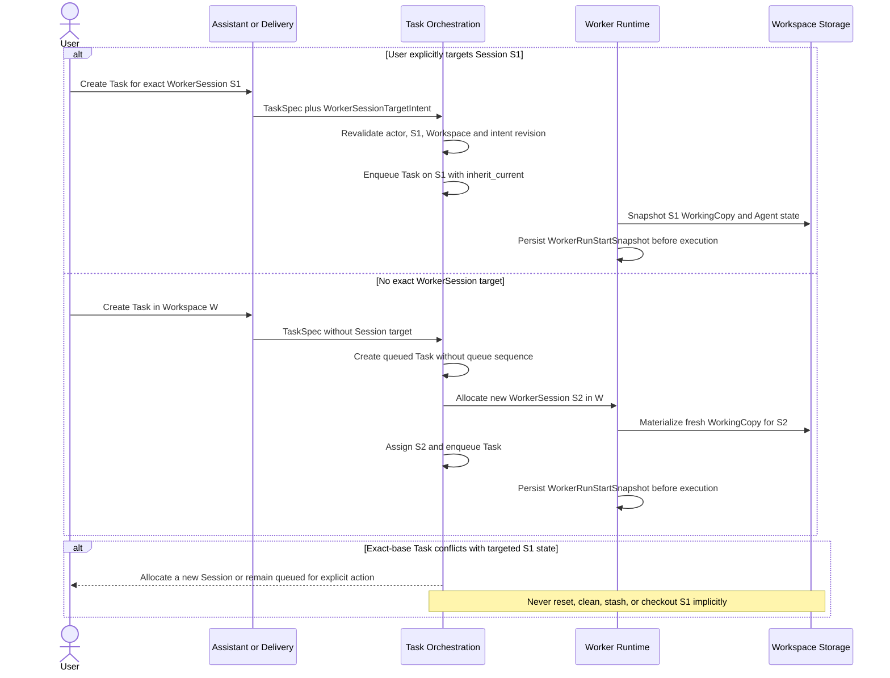

- `WorkerSessionTargetIntent` 必须绑定 actor、exact Session、Workspace、source/revision 和 idempotency key。Worker Detail action、注册卡片/命令和 exact API 字段可生成该证据；最近/唯一 idle Session、related ref 与模型输出不可生成。
- 显式复用解析为 `inherit_current`，继承当前 WorkingCopy、持久 Agent state/context、AgentSession 和未提交变更。平台不得静默 reset、clean、stash、checkout 或替换 Session 状态。
- 未指定 exact Session 的新 Task 保持 `queued`，先分配新 WorkerSession，再进入其 SessionTaskQueue。未分配期间 `worker_session_id`、`session_queue_sequence` 均为空，可用只读 allocation reason 表达等待原因，不增加 Task 状态。
- `exact_base` 必须绑定精确 WorkspaceRevision/checkpoint。若目标 Session 当前状态不匹配，应新建 Session 或保持 queued/blocked；不能为了满足 Task 而清理原 Session。
- 每个 WorkerRun 在首次 Agent prompt、Tool invocation 或 WorkingCopy mutation 前写入 `WorkerRunStartSnapshot`。至少记录 resolved context policy、AgentSession refs、WorkingCopy checkpoint/manifest digest、base WorkspaceRevision、dirty state、前序 Task/Run refs 和服务端时间。
- Reassign 到已有 Session 同样需要新的 exact target intent，并继承目标 Session 当前状态；选择 fresh/exact baseline 则分配新 Session。

### 3.4 Continuity quota and Session allocation FIFO

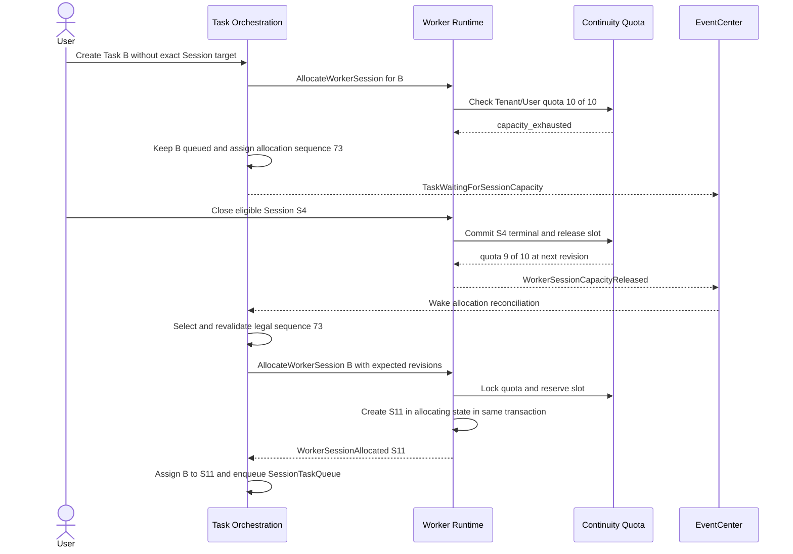

- Continuity quota scope is `(tenant_id, user_id)` and defaults to 10. It measures retained resumable interaction state, not current CPU usage or container count.
- `waiting_user` and `idle` count because they retain WorkingCopy/Agent continuity; `lost` counts until owner reconciliation proves a terminal release. queued/unassigned Task and pending Continuation do not count and start no AgentTurn deadline or WorkerSession idle clock.
- 配额满时新 Session 请求写入 Tenant/User 单调 `session_allocation_sequence`。Task 保持 `queued` 且没有 Worker deep link、SessionTaskQueue position 或 Runtime lease；Continuation 保持 pending allocation。
- Worker Runtime 的 WorkerSessionAllocator owns SessionAllocationQueue order、quota revision 和 WorkerSession creation/release。Task Orchestration 与 Continuation application 只提交 owner-bound allocation request；一个合法队头不能被后到请求越过，无效队头先幂等收敛后再继续。
- Worker Runtime 原子锁定 quota、创建 `allocating` Session、递增 reserved count/revision 并写 Outbox。重复 allocation command 返回原 Session；Task 在 claim 前失效时，unclaimed Session 由 fencing/reconciliation 终态释放。
- exact reuse 使用已计数 Session，不新增槽位；容量不足不能成为隐式 reuse、reset、close 或 eviction 的理由。
- Session 终态与 quota release 同事务，实际容器/挂载/存储清理异步。release event 丢失由 reconciliation 唤醒 allocation dispatcher。

### 3.5 Immutable terminal Session and derived continuation

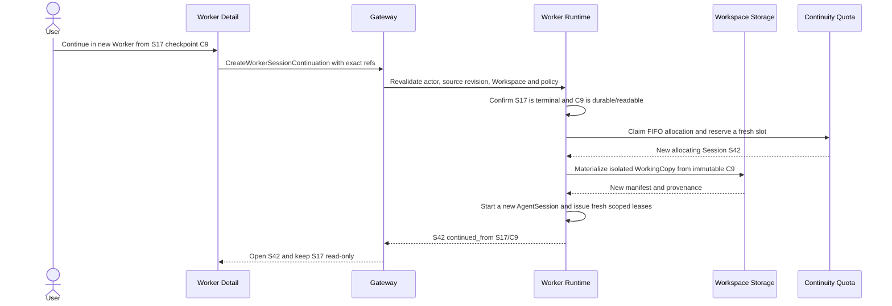

- `closed/expired` 是不可逆终态。终态 Session 不能接受 AgentTurn、WorkerRun、Runtime/Secret lease、dispatch permit 或新 Session-scoped Grant；Runtime generation 只用于 live Session 故障恢复，不能用来绕过终态。
- `CreateWorkerSessionContinuation` 必须绑定 actor、source Session/revision、exact checkpoint/digest、Workspace、policy 和 idempotency key。重复请求/响应丢失返回同一 derived Session identity。
- derived Session 记录 `continued_from_worker_session_id` 与 `continued_from_checkpoint_ref`，创建新 WorkingCopy 和 AgentSession，并从自身创建时间重新开始 idle/absolute clocks。
- 续作不继承旧 queue/dispatch state、Approval/Repository Grant、SecretLease、Runtime/Channel generation。ContextPack/Artifact 只在用户显式选择且当前权限重验后加入。
- graceful close 优先生成 final durable checkpoint；forced expiry/failure 只能使用 latest proven checkpoint，并向用户显示 capture time、digest 和 coverage warning。复制或 materialization 不修改 source。
- LiveWorkerState 是非终态 Session 的可变 WorkingCopy、Agent state 与 Trace/control cursor，持续保存在 WorkspaceStorage 并供同 Session Runtime generation 恢复直接复用；它不是 continuation checkpoint。
- P0 continuation checkpoint 采用 best-effort semantic policy：AgentTurn terminal、进入 `waiting_user`、阶段结果和 graceful close 时尝试生成不可变 snapshot；不承诺周期、字节阈值或数值 RPO。强制 host/storage failure 只能展示 latest proven checkpoint 与 coverage warning。
- Continuation 与 Task 新 Session 请求共享 SessionAllocationQueue FIFO 和 quota reserve 契约；Continuation 不得越过更早合法请求，也不能因来源 Session 刚释放一个 slot 而获得隐式优先级。
- 普通 WorkerSessionContinuation 只延续 Session 上下文；绑定 non-terminal Task 的 absolute expiry 使用下一节 `ContinueTaskInNewWorker`，保持原 Task identity 并新建 Run。

### 3.6 Absolute expiry preserves Task identity

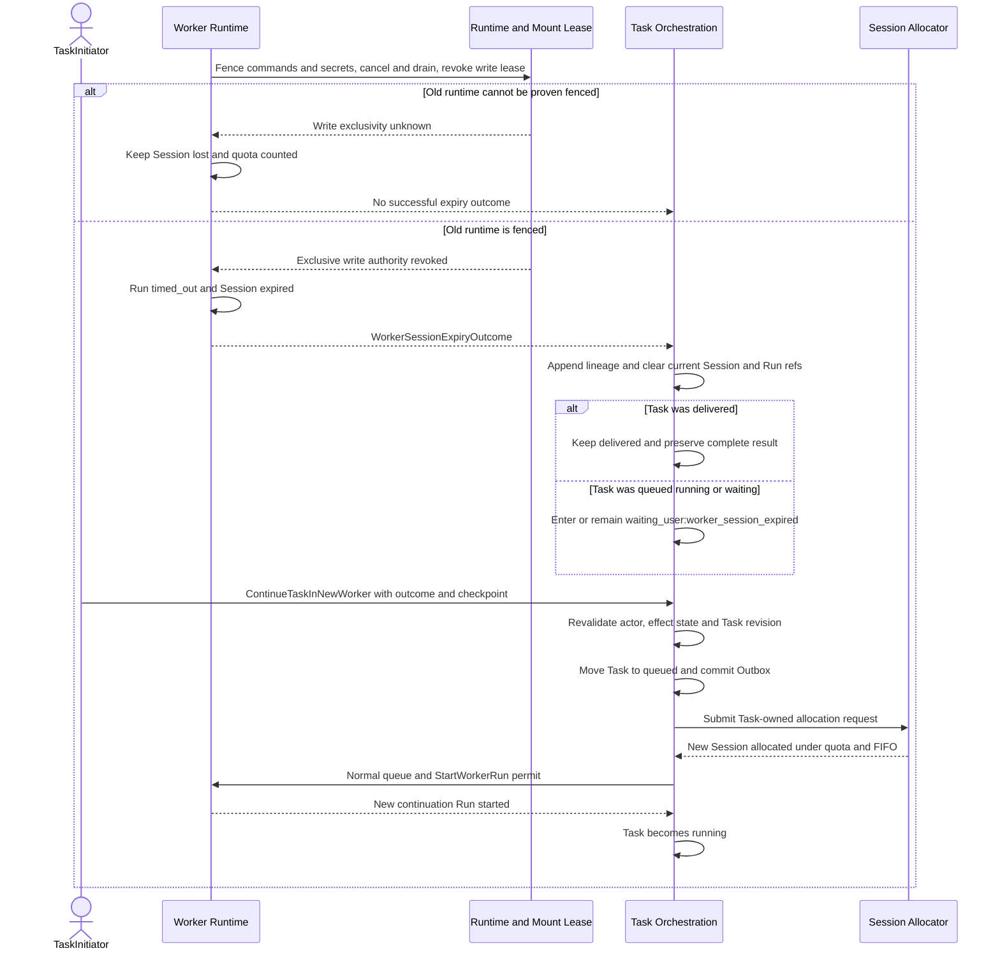

- Worker Runtime 必须先停止新 command/lease，做有界 cancel/drain，撤销旧 generation 的 control/secret lease，并证明旧 container/runtime 已失去 WorkingCopy 写权限。无法证明时 Session 进入或保持 `lost`，继续占 quota，也不能成为可写续作 source。
- 成功收敛后 active WorkerRun 终态固定为 `timed_out:worker_session_absolute_expired`。旧 Run 不迁移、不恢复；晚到结果只进入 Trace。
- `WorkerSessionExpiryOutcome` 记录 exact Session/Run revision、terminal checkpoint、Artifact `partial|complete`、cancel/fencing evidence、external-effect state 和 bound Task。重复 outcome 按 idempotency/revision 收敛。
- terminal Task 忽略该 outcome；`queued/running/waiting_user` Task 进入或保持 `waiting_user:worker_session_expired`；`delivered` 保持 delivered。旧 current Session/Run ref 清空，但 TaskSessionLineageEntry 永久保留。
- complete delivered result 在旧 Session 到期后仍可 accept。partial report/patch 可查看和下载，但不能自动满足验收，也不能掩盖缺失步骤。
- 只有 TaskInitiator 可 `ContinueTaskInNewWorker`，且必须绑定 exact Task revision、expiry outcome 和 checkpoint。外部 non-idempotent/unknown effect 未核查时先保持 waiting_user，不得把“继续”解释为重试未知副作用。
- continuation command 的 Task 事务只更新 Task/Transition/lineage 并写 Outbox，把 Task 置为 `queued`；Session allocation、WorkingCopy materialization 和容器操作都在事务外通过 owner 协议完成。
- 新 Session 继续遵守 continuity quota 与 SessionAllocationQueue FIFO；新 Run 在正常 dispatch 时创建，`trigger_type=task_session_continuation`，并在 WorkerRunStartSnapshot 记录旧 Session/Run/outcome/checkpoint。旧 AgentSession、runtime、queue、Grant 和 Secret 不继承。

Task 动作 authority 与 Task 可见性、Conversation control、Workspace 编辑权分离：

- Task 创建时从 accepted creation intent 固化 immutable TaskInitiator。
- TaskInitiator 可 continue、accept、rework、cancel 和 reassign queued session；current Workspace owner 仅有 emergency cancel。
- Workspace editor/reviewer、Conversation participant/controller、群披露或 Artifact review 都不产生 Task 动作权限。
- 每个 command 重验 actor、Membership、expected Task revision 和 target state。终态 Task 不接受 rework；需要显式创建新 Task。
- P0 不实现通用 TaskActionGrant；ApprovalGrant 只授权受保护 Tool/外部操作，不能延长 AgentTurn。有限委托留到 P1。

`WorkerRun` 状态机：

```text
pending
-> allocating
-> preparing_workspace
-> starting_runtime
-> starting_agent
-> running
-> recovering_runtime -> running | waiting_user
-> waiting_user -> running | timed_out
-> draining_trace
-> succeeded
-> failed | timed_out | cancelled
-> cleaning
-> released
```

固定 AgentTurn 超时语义：

- TaskSpec 不携带 WorkerRun、AgentTurn 或 Tool 时长。Worker Runtime 在实际 ACP prompt 被持久接受时记录服务端 `started_at` 和 `deadline_at=started_at+86400s`。
- deadline 是不暂停的 wall clock。模型推理、Tool、`active_quiet`、审批等待、断线、平台故障和 Runtime recovery 全部包含在同一 24 小时内。
- `steer` 不重置当前 Turn deadline，`interrupt` 终结当前 Turn；显式 queued user message 仅在当前 Turn 终态后启动新的独立 Turn。Agent/自动重试/recovery 无权自行创建顶层 Turn。
- deadline 到期由 ScheduledCommand 按 Turn revision/runtime generation fencing，Worker 请求 ACP cancel 并停止当前 Tool/process，AgentTurn 终态固定为 `timed_out:agent_turn_hard_deadline`。
- 后端 ScheduledCommand 是 deadline 状态、审计和 fencing 的唯一 owner；Runtime Shim 为同一 Turn revision/runtime generation 启动不可重置的 monotonic watchdog。任一路径使用同一幂等取消 identity，断线期间本地 watchdog 继续有效，重连后以后端终态收敛。ACP prompt 在后端 enforcement 与本地 watchdog 都 armed 前不得执行。
- 后端在一个事务中提交 AgentTurn start/deadline、ScheduledCommand 和 `StartAgentTurn` Outbox 后单向 dispatch。Shim 校验 exact Turn revision/runtime generation/ChannelEpoch 与 command freshness，按后端 deadline 和 server-time uncertainty 启动保守 monotonic watchdog，然后才调用 ACP。无需 Ready/Permit 往返；stale/expired/无法证明 freshness 时拒绝，重投不重置 watchdog 或重复 prompt，运输延迟计入固定窗口。
- 取消确认后 WorkerRun 可继续保留，Task-bound 交互进入 `waiting_user:agent_turn_timed_out`；用户可在同一 live Session/Run 发起新 Turn。取消不确定时必须先完成 TaintedRuntime 或外部副作用 reconciliation。
- WorkerRun、Task、Tool 和 continuation 没有时间预算、累计时长、时间 Grant 或可选 timeout profile。Tool 继承当前 Turn 的剩余 deadline；基础设施 transport/shutdown timeout 不进入领域协议。
- LLMProxy 的 rate/token/cost guard 独立治理，不用 AgentTurn 时间表示成本授权。

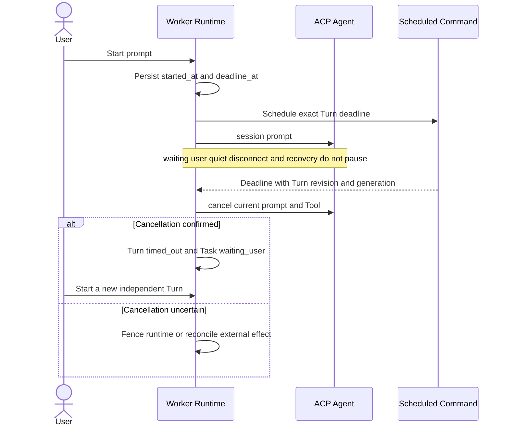
- Tool cancellation outcome 分为 confirmed、unconfirmed local、unconfirmed remote-safe 和 unconfirmed external。本地不确定会 taint RuntimeInstance、停止新命令并以 `tool_cancel_unconfirmed_local` 打开 RuntimeRecoveryIncident。
- 远端 read-only 或有幂等键+核查证据的 idempotent write 可在 `tool_invocation_id` fencing 后继续；non-idempotent/unknown 或证据不足时进入 `waiting_user`，不自动重试。
- Tool terminal 后的任何迟到结果只写 `late_tool_result` Trace。用户界面不得将它渲染为已超时 Tool 的新终态。
- Tool/Skill/MCP manifest 产生版本化 ToolCapabilityDeclaration；Adapter 生成可审计技术证据且只能提高风险；Capability/Skilling 按 ToolGovernancePolicy 编译 ResolvedToolPolicy。Worker 在 invocation 前校验声明、证据、policy revision、scope 和 hash，并应用 TaskSpec/Approval 的进一步限制。
- 声明缺失、冲突、不可信、过期或无法验证时按最高风险 fail closed：`effect_class=unknown`、不可验证 cancellation=`unsupported`、无自动重试。Agent 文本不能降级风险，运行时硬证据只能升级单次 invocation。

`WorkerSession` 状态机：

```text
allocating
-> interactive
   -> running -> interactive
   -> recovering -> running | waiting_user
   -> waiting_user -> running | interactive
   -> idle
-> expired | closed | lost
```

- `WorkerRun.succeeded` 表示一次阶段完成并生成阶段性结果，不表示 WorkerSession 被关闭。
- `waiting_user` 暂停 48 小时 idle 计时；用户答复后恢复并按有效交互续期，但 14 天绝对上限继续计时。
- `recovering` 表示 Supervisor 已 fencing 故障 runtime 并在同一 RuntimeRecoveryIncident 内执行唯一一次自动重建；它不是新 Task 或新 WorkerRun。

## 4. Worker 控制面与运行时模型

```text
Worker Control Plane (host/backend)
  - Task/WorkerSession lifecycle
  - Docker container lease
  - workspace, network, secret and resource policy
  - 48-hour idle / 14-day absolute timeout / cleanup
  - RuntimeRecoveryIncident attempt limit, generation fencing and replacement

Worker Runtime Shim (inside container, Go)
  - WorkerControlChannel supervisor and transport fallback
  - ACP client via coder/acp-go-sdk
  - session/event/permission normalization
  - Trace/Artifact upload and EventCenter reporting

Agent Runtime (inside same P0 container)
  - agentclientprotocol/codex-acp stdio server
  - Codex and AgentSession state
  - co-located LiteLLM on localhost
  - Skill/MCP/rules/capability materialization
```

P0 有三类不同通信链路：

- 后端控制通道：Shim 主动连接后端，优先 gRPC 双向流，transport/HTTP2/proxy 不兼容时回退 HTTPS long-poll + event batch POST。
- 容器本地 ACP 通道：Worker Runtime Shim 通过 stdio 与 `codex-acp` 通信；不要求后端直接暴露 ACP。
- 数据上传通道：Trace segment、raw transcript、report/patch 和其他 Artifact 通过独立可恢复 HTTP 上传。

WorkerControlChannel 规则：

- bootstrap 上报 supported transports、runtime generation、last acknowledged command sequence 和 last confirmed event sequence；后端分配 selected transport、channel token、heartbeat 参数和递增 channel epoch。
- `grpc_bidi` 与 `https_long_poll` 共用 RuntimeControlEnvelope；业务 handler 不依赖 transport 类型。
- 同一 RuntimeInstance generation 同时只允许一个 active epoch；切换 transport 前 fencing 旧 epoch，禁止 gRPC 与 polling 双通道同时消费命令。
- command 至少一次投递，ACK 分为 `received`、`accepted`、`completed`；重投依赖 command id/idempotency key，不能依赖 TCP/gRPC connection identity。
- event 至少一次上传，按 event id/stream sequence 去重；long-poll cursor 和 gRPC resume cursor 表达同一逻辑位置。
- 只有 connect/HTTP2/proxy/transport timeout 等错误可触发 fallback；认证、授权、策略、schema 和 protocol version 错误 fail closed。
- 选定 fallback 后在当前 channel epoch 内保持稳定；恢复首选 transport 只在下一次安全重连/新 epoch 发生，避免 active run 中来回抖动。

Runtime heartbeat 规则：

- P0 默认 `heartbeat_interval = 15s`、`suspect_after = 45s`、`unhealthy_after = 90s`；threshold 由 bootstrap 下发，允许未来按环境配置覆盖。
- timeout 使用后端接收时间和 heartbeat sequence，容器 wall clock 只做审计。Shim 心跳独立于模型 stream/tool process，即使模型无输出或长命令运行也必须持续。
- 45 秒无有效心跳进入 suspect：暂停新命令，探测 gRPC/HTTPS fallback、Docker container、Shim 和 Agent process；不立即中断 active WorkerRun。
- 90 秒仍无心跳进入 unhealthy 并打开 RuntimeRecoveryIncident；明确 process exit/container missing 可立即 unhealthy。
- heartbeat recorder、first-heartbeat/普通 liveness evaluator 在锁 Session/Runtime 图前取得 exact AgentTurn outcome advisory lock，图锁后重验 Run/Turn identity；预读期间 identity 切换通过有界跨事务 retry 进入新锁域，不得关闭 control stream 或让 startup readiness 因瞬态冲突失败。终态 owner 已先进入或已经提交时取消该 watchdog/liveness 决策，不得竞争打开 recovery。
- pending settlement 期间到达的 heartbeat 仍记录审计 observation 和严格 pre-T+90 的 first-heartbeat proof；即使在 T+90 边界 watchdog 尚未取消，也不回滚/关闭 control stream，不恢复 Runtime 状态、不递增 Runtime revision，也不重排普通 liveness command。`backend_deadline` 已观察到 exact graceful terminal 时，即使 Runtime 已是 suspect，也只提交 Session/Run/Turn 的 timeout 结果并保持 Runtime 状态与 revision 不变。
- 固定 ACP/Codex 栈没有安全 ping/no-op。Agent unresponsive 只由 child process exit、stdio EOF、ACP connection close 等硬证据，或 cancel 后 grace 内无法取得 prompt 终态判断；不能把模型无 token 输出当作 Agent 无响应。
- `active_quiet` 只产生非终止告警，不触发提前恢复或静默取消；当前 AgentTurn 固定 24 小时 hard deadline 继续计时。deadline 到期时无论交互式、无人值守或正在等待审批，都幂等发送 ACP cancel 并取消当前 Tool/process。cancel grace 从 30 秒候选值开始 Docker spike 测量。

SessionProcess 规则：

- Shim 为每个 AgentTurn 建立可证明清理的 process group/cgroup。普通命令即使使用 `&`、`nohup`、daemonize、脱离 stdio 或父进程退出，也不能脱离 Turn 归属；Turn terminal drain 后仍存在且无法证明停止时沿用 TaintedRuntime 路径。
- preview server、dev server、file watcher 必须通过 Worker managed-process API 启动。Worker 在进程启动与记录之间收敛 `starting -> running|failed`，禁止在 Turn terminal 后把扫描到的 orphan PID 追认为受管进程。
- SessionProcess 记录 source Turn/Tool、Runtime generation/process handle、kind、command summary、cwd、declared ports、status、bounded log ref、revision 和时间；状态固定为 `starting/running/stopping/stopped/failed/lost`。
- SessionProcess 不持有 WorkerSessionExecutionSlot 或 AgentTurn deadline，不得调用 ACP prompt/创建顶层 Run。它继承同一 Runtime resource/network/mount/Tool/Grant/Secret 边界，资源持续进入 aggregate capacity accounting。
- WorkerDetail 展示 active/history、来源、端口、状态、日志和 revisioned stop/restart。Restart 是显式动作并创建新 identity/lineage；不重用 terminal process identity。
- Session close/idle expiry/absolute expiry/authorization-security termination 停止全部 SessionProcess。Process output/log、端口流量、health/status update 不构成用户交互，不刷新 idle clock。Runtime replacement 只把旧 generation 的 process 收敛为 stopped/lost，不自动重启，避免端口冲突、重复 watcher 或外部效果。
- Managed start acceptance 与 AgentTurn terminal 按 exact Turn revision、Runtime generation 和 Worker owner commit order 串行化。Acceptance 先提交后，`completed/cancelled/timed_out/failed` 均保留 SessionProcess；interrupt 作为控制动作收敛为 `cancelled` + terminal reason。Terminal 先提交则拒绝新 start，不能事后收养 orphan。Turn cancel/deadline 仍停止 ACP prompt、active Tool 和普通 descendants。

SessionProcess PreviewProxy 规则：

- 运行中的 `preview_server|dev_server` 只能通过 Gateway 的 `OpenSessionProcessPreview` 暴露给用户。命令绑定实际 actor、exact WorkerSession/SessionProcess、expected process revision、runtime generation、已声明端口和幂等键；`file_watcher` 或未声明端口不能打开预览。
- Gateway 签发短期 SessionProcessPreviewAccess，RuntimeSupervisor 从当前 generation 的容器记录解析内部 endpoint。客户端、Agent 和预览页面不能提交任意 URL/IP/host/port，Backend 也不创建 Docker host-port mapping。
- PreviewProxy 是独立数据面，只转发 HTTP/1.1/WebSocket，不经过 EventCenter/SSE/ObjectStore，也不记录页面 body/frame 到 Trace。它移除 Switchback Cookie、Authorization、内部身份和 hop-by-hop headers，只保留有界访问元数据。
- Process/Session terminal、Runtime fencing/replacement、权限撤销或 access expiry 使访问引用失效并关闭活跃 tunnel。每个 request/upgrade 仍重验当前状态，避免仅依赖可能丢失的 lifecycle event。
- 用户显式点击 OpenPreview 可刷新一次 idle；页面资源、轮询、HMR/WebSocket、health check 和 process 流量不能续期。M1 browser route/origin 由 loopback 实现决定，不进入领域模型；非本机或多用户 profile 前重新评审。
- WorkerSession close/idle/absolute expiry、authorization/security termination、Runtime taint/fencing/replacement 和 resource hard limit 是更高优先级停止边界；这类停止不因 Turn survival 规则被阻止，replacement 仍不自动重启。

Supervisor 恢复规则：

- 进程退出、容器丢失、心跳超时或 Agent 无响应打开一个 RuntimeRecoveryIncident；P0 `max_auto_recovery_attempts_per_incident = 1`。
- Control Plane 先标记旧 RuntimeInstance unhealthy 并 fencing 旧 generation/ChannelEpoch；旧容器终止或隔离且 WorkingCopy 写租约被撤销后，才启动下一 generation。同一 WorkerSession 任何时刻仍只能有一个 active RuntimeInstance。
- replacement 挂载原 WorkingCopy 前必须终止或隔离旧 container、撤销旧 control/secret lease 并取得新的独占 WorkingCopy mount lease；无法证明写独占则进入 waiting_user。
- 新 generation 挂载原 WorkingCopy 和持久化 Agent state，从已确认 command/event/trace cursor 恢复，并优先通过 ACP `load_session`/resume 恢复原 AgentSession。
- 不允许在 resume 失败时静默创建全新 AgentSession。唯一自动恢复再次失败、AgentSession 无法安全恢复或状态一致性无法证明时，WorkerRun 与 WorkerSession 进入 `waiting_user`，向用户展示失败证据和可选动作。
- 新 runtime 达到 control channel、LiteLLM、ACP Agent 和 workspace mount 全部健康，并满足配置的稳定窗口或完成一个持久进度 checkpoint 后，才关闭当前 incident；未来独立故障创建新 incident 并重新获得一次自动恢复机会。
- 用户取消、idle/absolute timeout、鉴权/授权、策略、schema/protocol 错误不属于可自动恢复故障。WorkerSession ApprovalGrant 只要仍有效且 scope 匹配即可沿用；SecretLease 必须按新 generation 重发。
- incident phase 固定为 `open/fencing/provisioning/reattaching/verifying/recovered/exhausted`；每个外部副作用前先持久化 phase intent 和 Outbox。M1 稳定窗口固定 30 秒，原 Turn deadline 与 Session absolute expiry 不暂停并可抢占恢复。
- SingleUserLocalProfile Compose 默认开启单次恢复；裸 Backend 默认关闭。关闭 gate 只阻止新 incident，已打开 incident 仍按 durable owner state 收敛，避免遗留双写 authority。

## 5. Adapter 策略

| Adapter | P0 价值 | 风险 |
| --- | --- | --- |
| `CodexAdapter` | P0 首选；Go shim 使用 `coder/acp-go-sdk` 驱动 `agentclientprotocol/codex-acp`。 | 两者都需要精确 pin，并验证 capability negotiation、session resume、permission 和事件覆盖。 |
| `ClineAdapter` | headless、NDJSON、MCP、checkpoint、ACP/CLI 形态清晰。 | 需确认 CLI 稳定性和企业部署方式。 |
| `OpenHandsAdapter` | Runtime/Agent Server/事件模型更接近平台化 Worker。 | 集成成本更高，需梳理 SDK/Server 边界。 |
| `AiderAdapter` | 快速产出 diff/commit/report，适合 MVP。 | 结构化事件弱，需外层解析和沙箱。 |
| `SWEAgentAdapter` | trajectory/eval 参考价值高。 | 官方已偏 maintenance/mini 方向，产品化能力不足。 |

P0 推荐：

1. P0 先实现 `CodexAdapter`：容器内 Go shim 通过 `github.com/coder/acp-go-sdk` 启动并控制 `agentclientprotocol/codex-acp` stdio server。
2. CodexAdapter 在 initialize 时持久化 protocol/capability snapshot，并在 typed decode 前 tee 所有 ACP JSONL 帧；未知可选 update 降级为可审计的兼容性 Trace，不因单个未知进度事件中断 runtime。
3. RuntimeProvisioner 采用 CI/CD runner/Docker executor 风格：M1 RuntimeSupervisor 是 Compose 管理的 `switchback-backend` 内部组件，通过只挂载给 Backend 的 Docker Socket/Engine API 创建 sibling WorkerSession 容器；只挂载服务端 Switchback data root 下该 Session 的隔离 WorkingCopy 和 agent state，并注入 env、skills、MCP config 和 LiteLLM config。Worker 不挂载 Docker Socket、不 privileged，也不能指定任意宿主路径。
4. SingleUserLocalProfile 的 RuntimeNetworkPolicy 固定为服务端拥有的 `trusted_full_network_v1`：命名 Docker bridge 允许公网、私网、VPN、LAN、可路由容器和宿主服务的任意出站协议/端口，Docker Engine API 使用 `host.docker.internal:host-gateway`（CLI 等价形式为 `--add-host host.docker.internal:host-gateway`）。TaskSpec、RuntimeInstance、StartSnapshot、Trace 和 WorkerDetail 固化 exact profile id/revision/digest/status。
5. 该 profile 不做 destination/CIDR 过滤、redirect 重验、payload inspection、per-target ApprovalGrant 或目的地 telemetry，只适用于 loopback-only 的受信任单用户本地环境。Worker 仍无 Docker Socket、privileged/host network、任意 host path、published port 或 ambient infrastructure credential；PreviewProxy 是唯一受管入站，旧 profile 只以 `legacy_unenforced` 兼容读取/执行。
6. M1 RuntimeResidencyPolicy 固定为 `m1_resident_until_session_terminal_v1`：首次分配后，interactive/running/waiting_user/idle Session 保持同一 RuntimeInstance、Shim、Codex ACP 和 LiteLLM 运行；Turn/Run terminal 不 stop/pause/hibernate 或增加 generation。无 active Turn/dispatch permit 时仍禁止新 Agent/Tool 动作。
7. Runtime 只在 explicit close、idle/absolute expiry、authorization/security termination 或 recovery fencing 时停止/替换。M1 不定义 suspended/resuming；waiting_user 驻留最长可到 14 天 absolute boundary，并持续占用 quota 与宿主资源。
8. M1 RuntimeResourceProfile 固定为 server-owned `local_standard_v1`：2 vCPU、4 GiB memory、512 PIDs、10 GiB writable layer；TaskSpec/Agent 不接受任意资源数字。WorkingCopy/cache/state 是独立持久存储边界，不依赖 writable layer。
9. RuntimeCapacityAdmission 默认使用 Docker Engine 可用 CPU/memory/storage 的 80% aggregate budget。只有 admission 通过才向合法队头签发 SessionDispatchPermit；不足时保留 resident Session/FIFO 并等待 `runtime_capacity`，不创建 active AgentTurn 或开始 24h deadline。明确 OOM/PID/storage limit 进入 `waiting_user:resource_exhausted`，不按普通 runtime loss 自动重建。
10. 通用认证通过环境变量或挂载配置进入容器并由 SecretLease 管控；CodePlatform 通过 `git-credential-switchback`/managed `gh` 按需取得短期 RepositoryCredentialLease，根/刷新凭证不进入容器。
11. P0 LiteLLM 与 Codex 同容器运行，Codex 的模型调用指向 localhost；后续 K8s 可改为同 Pod sidecar。
12. 后端通过网络请求驱动容器侧 Worker runtime shim，禁止 Agent 动作影响宿主机。
13. 同时保持 `ACPAdapter`/`CLIProcessAdapter` 端口，用于未来 Cline/Claude Code/Aider/OpenHands/internal agent。

Session 映射：

- `worker_session_id` 在首次容器启动时固化；同一时刻最多绑定一个 active RuntimeInstance/container。
- 崩溃恢复时复用原有 `worker_session_id`，创建下一代 RuntimeInstance 和新 container id，并保留历史 mapping。
- 每个连续 RuntimeRecoveryIncident 最多自动重建一次；达到稳定健康或完成持久进度 checkpoint 后 incident 关闭，再次失败后进入 `waiting_user`，禁止 crash loop。
- `worker_session_id` 与显式 ACP/Codex session id 允许一对多。`codex-acp@1.1.2` 的 subagent 默认映射为带 child thread metadata 的 tool call/AgentExecutionSpan，不自动提升为独立 AgentSession。
- 用户在 idle timeout 前的 chat/command 后续交互默认恢复旧 WorkerSession。
- idle timeout 固定为 48 小时；有效用户交互续期，但不能突破 14 天绝对上限。

Workspace 映射：

- `worker_session_id -> workspace_id` 为 N:1：每个 WorkerSession 只有一个 Workspace，一个 Workspace 可承载多个 WorkerSession。
- `workspace_id -> repository_checkout_id` 为 1:0..N：非代码任务可以没有仓库，多仓修改可以有多个检出。
- RepositoryCheckout 必须记录 provider、repository identity、revision、workspace path 和写入策略，不能只保存一个未校验 URL。
- WorkerSession 基于 active WorkspaceRevision 在宿主管理的持久 WorkspaceStorage 中创建 WorkingCopy；Git 仓库使用 per-session worktree/内部临时 ref，非仓文件使用隔离 materialized tree 和内容 manifest。
- RuntimeProvisioner 只把该 WorkerSession 的 WorkingCopy 挂载到 RuntimeInstance；容器销毁不能删除 WorkingCopy、WorkspaceRevision、ArtifactRef 或 Agent session mapping。

## 6. Workspace 隔离写与 ChangeSet Apply

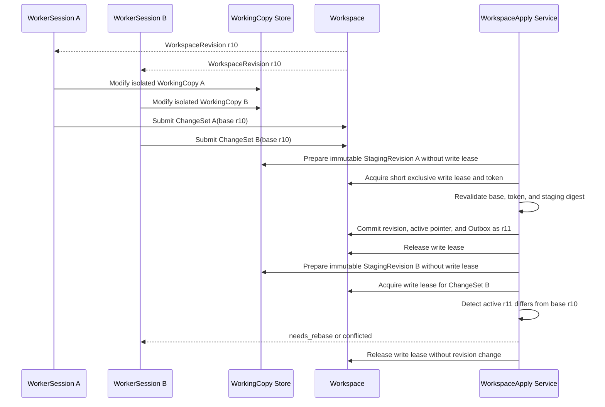

ChangeSet 最小内容：

- `workspace_id`、`working_copy_id`、`base_workspace_revision_id`。
- 每个 RepositoryCheckout 的 base commit、patch/commit、target path 和 dirty-state assertion。
- 非仓文件/设计产物的 create/update/delete manifest、checksum 和 ArtifactRef。
- 测试/验证结果、生成者 WorkerRun/AgentTurn、权限和外部动作声明。
- 应用前置条件、预期 active revision、冲突策略和幂等键。

应用不变量：

- Git commit/ref 保护、文件复制、checksum、测试和多组件物化在租约外完成，产出完整不可变 StagingRevision；任一组件不可应用时不得进入 Finalize。
- WorkspaceWriteLease 使用 PostgreSQL lease row 和单调 fencing token；它只覆盖锁定 Workspace、重验 expected revision/token/digest 和提交事务。
- WorkspaceRevision、active pointer、WorkspaceApply result 与 Outbox 在同一事务提交；事务内不得复制大目录、运行测试或调用外部服务。
- 失败或崩溃遗留 staging 不暴露为权威状态并由 janitor 清理；提交成功但响应丢失时按 idempotency key 返回原 result revision。
- base revision 不匹配时默认 `needs_rebase`；禁止 last-write-wins 和自动覆盖其他 Session 已应用的变更。
- Worker 可基于新 active revision 重建 WorkingCopy 并重放 ChangeSet；语义冲突或外部产物冲突进入用户审查。
- publish-branch 可以从已验证 ChangeSet/WorkingCopy 发起，但仍是外部写入；它不等价于 WorkspaceApply。

### 6.1 受管 CodePlatform B2

P0 Worker 镜像预装版本锁定的 Git、GitHub CLI 和批准的 GitHub Skills。用户或组织先授予 repository-scoped RepositoryAccessGrant；Grant 生效后，Agent 可像本地 Coding Agent 一样直接使用原生 `git`/`gh` 完成 Token 允许的非管理类操作，不再逐命令询问。

- `repository.read`、`repository.write`、`pull_request.write`、`ci.read` 分开授权；管理、secret/variable、workflow/Actions write、ruleset、delete 和组织权限禁止进入 P0 profile。
- 短期 access token 对 Agent 可用是受管 B2 的信任边界；CredentialBroker 保管 App private key、OAuth refresh token 和长期 PAT/root credential。
- Git helper 使用 `credential.useHttpPath=true` 按 host + repository path 取 lease；managed `gh` 每次 invocation 获取当前 lease 并 `exec` 原生 CLI，不写持久化 gh login/config。
- Token 生命周期独立于 WorkerSession；续签必须重验 Membership、Grant revision、Session、runtime generation 和 policy。撤权后停止续签、撤销可撤销 Token，并 fencing 新命令/网络。
- Provider ruleset/branch protection 负责 protected/default branch、force push 和 delete。Prompt 与 Skill 不是授权边界。
- 每次操作记录 CodePlatformOperation。push/PR 响应不确定时先查 remote head 或 provider object；无法核查的写入进入 `unknown_effect`/`waiting_user`，禁止盲重试。
- 已知平台 Token 在 Trace/Langfuse/Artifact/用户进度持久化前确定性剔除。一般 Trace DLP 可后置，但该规则不能后置。
- 方案 A 与 C 作为 provider/profile fallback：A 把全部远端操作移到控制面；C 保留 Agent 直连只读，把写入移到控制面。两者复用 Grant/Operation/provider-result 契约。

## 7. Trace 规范化

Worker 需要把不同 Agent 的原始事件统一映射：

| Switchback Trace type | 来源示例 |
| --- | --- |
| `agent_started` | CLI process start / ACP session start |
| `model_call` | LLMProxy request metadata |
| `tool_call` | Agent tool invocation |
| `tool_result` | Tool observation |
| `command_output` | shell stdout/stderr |
| `file_patch` | diff / apply_patch / git diff |
| `mcp_call` | MCP tool call |
| `checkpoint` | checkpoint id / snapshot / rollback point |
| `artifact` | report, patch, PR, screenshot, log |
| `error` | adapter/runtime/agent/tool/model error |
| `cost` | token / price / duration |
| `langfuse_export` | Langfuse trace/span/generation export result |

原始 transcript 默认作为 `raw_transcript` artifact 保存。P0 Trace 保持接近普通 Coding Agent 本地 session JSONL 的保真度，暂不把通用内容 DLP 作为阻塞项，并同步导出 Langfuse 用于可观测；平台签发或已知 Token 必须在所有持久化出口前确定性剔除。Worker 控制逻辑负责管理 session state、JSONL、raw transcript 和 artifact，并通过后端 API 上传对象存储、通过 EventCenter 回传事件。

Trace ingest 将不可变 JSONL segment 注册到 PostgreSQL TraceManifest，并产生 Dashboard 使用的 normalized facts。P0 DataLifecyclePolicy 默认 hot 30 天、warm 至 180 天、cold 长期且不自动物理删除；Langfuse 可使用独立短保留。排障和 Evolution 通过 TraceManifest 定位/restore 证据，Dashboard 不扫描原始 JSONL。archive/restore/quarantine/delete 只保留轻量 DataLifecycleAction；显式删除后保留 tombstone 和非敏感聚合，并把 Evolution evidence 标记 `source_deleted`。

## 8. Artifact 类型

```text
patch
branch
pull_request
commit
report
test_log
coverage
screenshot
checkpoint
raw_transcript
trace_jsonl
workspace_snapshot
```

Artifact 不变量：

- 必须有 `artifact_id`、`uri`、`checksum`、`type`。
- 必须能关联 `task_id` 和 `worker_run_id`。
- 权限和 retention 不能只依赖对象存储 bucket 默认值。
- ArtifactRef 必须保存 DataLifecyclePolicy revision、storage tier 和 availability；quarantined/deleted payload 不得继续 preview/download 或进入新 Evolution 消费。
- 用户可见产物和内部调试产物要区分。
- P0 用户可见交付类型固定为 `report` 和 `patch`；其他类型保留在协议枚举中但不属于默认闭环。
- Frontend 根据 Artifact 类型选择 renderer；patch 使用 diff review，report 使用结构化文档视图。
- P0 ArtifactAction 至少支持 preview、download 和 apply-to-workspace；publish-branch 是显式外部写入动作，需要 CodePlatform capability、凭证和 RepositoryAccessGrant。匹配的 session Grant 生效后不重复逐命令审批。
- `apply-to-workspace` 消费 ChangeSet 并返回新 WorkspaceRevision 或结构化 conflict；不能把 patch 直接写入共享目录。

## 9. 应用服务

| 服务 | 命令 |
| --- | --- |
| `TaskAppService` | `CreateTask`, `QueueSessionAllocation`, `AssignWorkerSession`, `ReassignQueuedTask`, `StartWorkerRun`, `WaitForUser`, `DeliverTask`, `AcceptTask`, `RequestRework`, `ApplyWorkerSessionExpiry`, `ContinueTaskInNewWorker`, `ApplyAgentTurnTimeout`, `CancelTask`, `FailTask` |
| `WorkerSessionAllocator` | `SubmitAllocationRequest`, `CancelAllocationRequest`, `ClaimAllocationHead`, `ReserveContinuitySlot`, `AllocateWorkerSession`, `BindAllocationOwner`, `ReleaseContinuitySlot`, `ReconcileAllocation` |
| `WorkerSessionContinuationService` | `CreateContinuation`, `ValidateTerminalCheckpoint`, `MaterializeDerivedWorkingCopy`, `BindDerivedSession`, `FailContinuation` |
| `ScheduledCommandService` | `ScheduleCommand`, `CancelCommand`, `ClaimDueCommands`, `DeliverCommand`, `CompleteCommand`, `ExpireLease` |
| `WorkerLifecycleService` | `AllocateSession`, `PrepareWorkspace`, `StartRun`, `StartAgentTurn`, `HandleAgentTurnDeadline`, `HandleHeartbeat`, `OpenRecoveryIncident`, `RecoverRuntime`, `CompleteRecovery`, `EscalateRecovery`, `ExtendIdleLease`, `ExpireSession`, `PublishExpiryOutcome`, `MarkRuntimeTainted`, `CompleteRun`, `CleanupRuntime` |
| `WorkerControlService` | `BootstrapChannel`, `OpenTransport`, `ReceiveCommand`, `AcknowledgeCommand`, `PublishEventBatch`, `ResumeChannel`, `FenceEpoch` |
| `WorkspaceApplicationService` | `CreateWorkingCopy`, `SubmitChangeSet`, `PrepareStagingRevision`, `FinalizeWorkspaceApply`, `RebaseChangeSet`, `ResolveConflict`, `CleanupStaging` |
| `CodePlatformAccessService` | `RequestRepositoryGrant`, `IssueCredentialLease`, `RevokeGrant`, `RecordOperation`, `ReconcileRemoteResult`, `SelectFallbackProfile` |
| `AgentAdapterService` | `Initialize`, `NewSession`, `LoadSession`, `Prompt`, `Cancel`, `HandleUpdate`, `CancelTool`, `FenceToolInvocation`, `ReconcileToolInvocation`, `StopAgent` |
| `TraceAppendService` | `AppendTraceRecord`, `CommitTraceSegment`, `UpdateTraceManifest`, `ArchiveRawTranscript`, `RegisterArtifact`, `EmitAnalyticsFacts` |
| `DataLifecycleService` | `TransitionTier`, `RestoreColdData`, `QuarantineData`, `ReleaseData`, `DeleteData`, `ReconcilePayload` |

## 10. 端口

| Port | Adapter |
| --- | --- |
| `TaskRepository` | RDBMS |
| `TaskTransitionRepository` | PostgreSQL append-only Task transition history |
| `ScheduledCommandRepository` | PostgreSQL due rows with `SKIP LOCKED`, lease and fencing |
| `TransactionManager` | PostgreSQL transaction for Task/Transition/Outbox |
| `WorkerSessionRepository` | RDBMS |
| `RuntimeProvisioner` | Local Docker-compatible runtime first; K8s / internal sandbox later |
| `WorkerControlTransport` | gRPC bidirectional stream primary; HTTPS long-poll/event POST fallback |
| `ResumableUploadPort` | HTTP multipart/range upload for Trace and Artifact payloads |
| `WorkspaceRepository` | PostgreSQL Workspace/Revision/Apply metadata |
| `RepositoryProvider` | Git / internal code platform checkout/worktree operations |
| `CredentialBrokerPort` | GitHub App/OAuth credential broker; GitLab provider later |
| `CodePlatformProvider` | GitHub native Git/gh result lookup; GitLab native Git/glab later |
| `CodePlatformOperationStore` | PostgreSQL operation and reconciliation facts |
| `WorkingCopyStore` | Host-managed persistent WorkspaceStorage; copy/reflink optimization optional |
| `WorkspaceWriteLeaseProvider` | PostgreSQL lease row + monotonic fencing token; distributed lease later only with identical semantics |
| `SecretLeaseProvider` | Vault / KMS / internal IAM |
| `CapabilityResolver` | Skilling service |
| `AgentAdapter` | ACP / CLI |
| `TraceStore` | Object Storage |
| `TraceObservationExporter` | Langfuse |
| `ArtifactStore` | Object Storage |
| `EventPublisher` | Outbox / EventCenter |

## 11. 用户等待与人工介入

Worker 可能需要用户输入，例如：

- 缺少外部平台鉴权或新增能力授权。
- 操作需要跨出沙箱、写生产或访问受保护系统。
- 需要选择实现方案。
- 测试依赖不可访问。

Worker 在现有沙箱权限内执行文件读写、命令、测试、patch 和 report 不触发询问。是否询问由能力/审批策略决定，而不是由“这是写操作”这一事实决定。代码平台首次缺少所需 repository capability 时请求 RepositoryAccessGrant；Grant 生效后同范围原生 CLI 操作不逐次询问。

用户可以选择：

- `once`：仅批准当前结构化操作请求，消费后失效。
- `worker_session`：在当前 WorkerSession 中，对同一 capability、target 和约束范围持续有效，直到撤销、过期或 session 结束。

会话级 ApprovalGrant 不是“本会话所有操作都允许”；grant 必须记录 operation/capability、target scope、constraint、request evidence、grantor 和 expiry。

此时 Worker 不直接私聊用户，而是发出：

```text
WorkerInputRequested
TaskWaitingUser
```

Delivery/Frontier/Assistant 负责把问题翻译成用户通道交互。用户回答后进入：

```text
UserInputReceived
TaskResumeRequested
```

## 12. 直接 Worker 交互

用户从 Worker 详情页发送的消息直接进入 WorkerSession，不经过 Assistant：

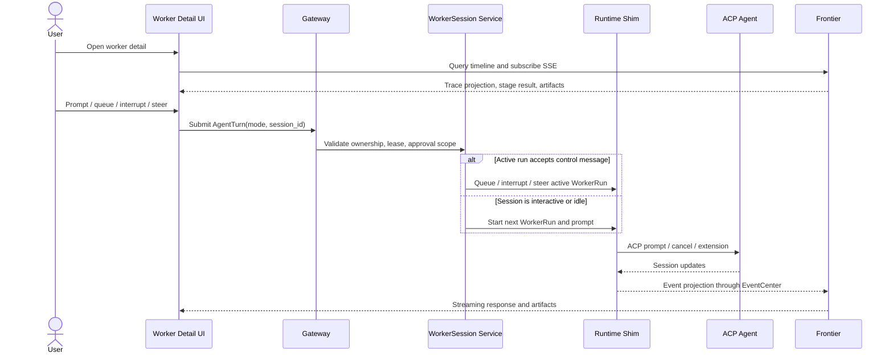

路由规则：

- Worker 详情页消息永远先形成 AgentTurn；它可以加入 active WorkerRun，也可以触发下一次 WorkerRun。
- 同一 WorkerSession 只有一个 active 顶层 WorkerRun，因此 queue/interrupt/steer 不需要模型推断目标；没有 active Run 时这些 control mode 不得误投到历史 Run。
- Task 处于 `queued/running/waiting_user/delivered` 时，对该交付的反馈保持同一 `task_id`；返工创建新 WorkerRun，RuntimeInstance 恢复仍属于原 WorkerRun。若当前 Session 已 absolute-expired，则必须经显式 `ContinueTaskInNewWorker` 分配新 Session/Run，不能跳回旧 Worker。
- manual Task 的 WorkerRun 完成后进入 `delivered`，用户可在 Worker 页面接受或继续反馈；auto Task 满足验收证据时直接 `completed`。
- Task `completed/failed/cancelled` 后的直接 AgentTurn 默认触发 standalone WorkerRun，可保留 `origin_task_id`，但没有 `task_id`。显式创建的新目标只有带 exact WorkerSessionTargetIntent 时才复用原 Session；否则在同一授权 Workspace 分配新 Session。
- Worker 可以建议创建新 Task，但模型推断和范围扩大不能成为创建命令；P0 不维护独立 FollowUpTaskProposal。
- Task Orchestration 对显式创建 intent 重验 readiness、Workspace 权限和幂等键，原子创建新 Task/TaskTransition/Outbox。原 standalone WorkerRun 只作为 lineage，不被追溯重挂。
- WorkerSession 在 lease 有效期间始终继续可交互；Task 页不复制 chat 工作台。
- WorkerSession 已有 bound Task 时，另一个 Task 只能保持 queued 或显式改用新 Session；不允许用 standalone AgentTurn 绕过 slot。Task `delivered` 通常仍保持 binding，以保证接受/返工指向原 Agent/WorkingCopy；absolute expiry 后只保留 lineage，accept 不需要 live Worker，rework 则显式创建新 Worker。
- WorkerSession 无 bound Task/active Run 但存在 queued Task 时，新的 standalone prompt 不直接启动；UI 应引导用户等待队头、取消/改派 queued Task，或显式创建另一 WorkerSession。
- WorkerDetail 还展示该 Session 的 active/history SessionProcess。用户可显式 open-preview/stop/restart；这些动作不经过 Assistant，但必须重验 Session 状态、process revision/runtime generation、declared port 和当前权限。Open-preview 只返回 opaque PreviewAccessRef，不展示容器 endpoint；Runtime replacement 后只展示 stopped/lost 与重新启动动作，不能假装原 PID 仍可恢复。

## 13. P0 验收

- 能从 TaskSpec 创建新 WorkerSession，或只在 exact WorkerSessionTargetIntent 有效时复用既有 Session；没有 exact target 的 queued Task 不进入任意既有 Session 队列。
- 能在显式复用时完整继承 WorkingCopy、Agent state/context、AgentSession 和未提交变更，并拒绝任何隐式 reset/clean/stash/checkout；clean/exact-base Task 使用新 Session 或保持 blocked。
- 能在每个 WorkerRun 首次执行动作前持久化可核对的 WorkerRunStartSnapshot，并把它关联到 Trace、Artifact 和 ChangeSet lineage。
- 能按 Tenant/User 默认 limit 10 对 allocating/interactive/running/recovering/waiting_user/idle/lost 精确计数，证明并发 allocation 不超卖且 closed/expired 终态原子释放。
- 能让满额 Task 保持 queued/unassigned 并按 SessionAllocationQueue FIFO 等待；容量释放、响应丢失、Task 取消、stale authority 和 unclaimed Session 均幂等收敛，不自动复用/回收既有 Session。
- 能证明 closed/expired Session 不可重开且只读；从 exact durable checkpoint 续作时创建新 Session/WorkingCopy/AgentSession、新 clocks 和新授权链路，保留来源 lineage，不继承旧 Session-scoped authority。
- 能让 Task 与 WorkerSessionContinuation 新 Session 请求共享 Tenant/User allocation FIFO；并发、满额、取消、checkpoint 不可读和响应丢失不会越过合法队头或创建 orphan/duplicate Session。
- 能在 14 天 absolute expiry 前 fencing 旧 runtime/lease；无法证明时保持 lost/quota，成功后把 active Run 收敛为 `timed_out:worker_session_absolute_expired`，按 Task 状态保留 delivered 或进入 waiting_user，并发布 exact WorkerSessionExpiryOutcome。
- 能保留 partial/complete Artifact 与 TaskSessionLineage；只有 initiator 的 exact continuation command 才把同一 Task 置回 queued，经过 quota/FIFO 创建新 Session 与新 WorkerRun，外部 unknown effect 不会被隐式重试。
- 能为每个实际 ACP prompt 持久化独立 `started_at/deadline_at`，证明 waiting_user/quiet/disconnect/recovery 不暂停且 steer 不重置；24 小时到期后取消和 fencing 收敛，未确认停止前不能启动下一 Turn。
- 能证明普通 `&`/`nohup`/daemonized descendants 不能逃逸 AgentTurn cleanup；仅 managed API 可创建 SessionProcess，并支持稳定 identity、generation/revision fencing、bounded logs、WorkerDetail stop/restart、Session terminal cleanup 与 Runtime replacement no-auto-restart。
- 能保证每个 WorkerSession 只有一个 bound Task/active 顶层 WorkerRun；并发 StartWorkerRun、响应丢失和重投收敛到同一 Run 或稳定 `session_busy`，busy Task 不会隐式 interrupt。
- 能按 Session 独立稳定 FIFO 调度 Task；重复 enqueue、并发 dispatcher、取消队头、显式改派、slot-release event 丢失、permit 过期和 standalone prompt 竞态均不会越过合法队头或创建第二个 Run。
- 能在 Docker 构建的本地容器中启动 Go Worker Runtime Shim、`codex-acp`、Codex 和 LiteLLM；shim 使用 `coder/acp-go-sdk` 通过 stdio 控制 Agent。
- 能持久化 ACP protocol/capability snapshot，只调用已协商能力，在 typed decode 前保留 raw ACP frame，并对未知可选 update 做可审计、不中断的降级处理。
- 能通过环境变量或挂载配置注入认证材料，并让 Codex 模型请求经同容器 LiteLLM。
- 能维护 WorkerSession 与 active RuntimeInstance 一对一、与历史 RuntimeInstance/AgentSession 一对多的映射，并在崩溃恢复时复用原有 `worker_session_id`、递增 generation。
- 能在 runtime/agent 故障时自动重建一次并恢复原 WorkingCopy、持久 Agent state、Trace cursor 和可恢复 AgentSession；旧 generation/epoch 被 fencing，新 SecretLease 被签发。
- 能按 15s/45s/90s heartbeat 默认值完成 healthy/suspect/unhealthy 转换；suspect 暂停新命令并探测，明确进程退出快速失败，长模型/tool 操作不因无输出误判。
- 能在固定镜像中通过 initialize、new/prompt/update、cancel model/tool、clean restart resume/load、active-turn crash、Agent/Codex process kill、quiet execution、unknown update、permission scope、subagent、graceful drain 和 background-process cleanup 的 Docker contract spike。
- 能在 replacement 前证明旧 runtime 已失去 WorkingCopy 写权限并取得独占 mount lease，否则进入 waiting_user。
- 能在同一 incident 的自动恢复再次失败、ACP resume 失败或一致性无法证明时停止重启并进入 `waiting_user`，且不会静默创建新 AgentSession。
- 能由 Shim 主动建立 gRPC 双向 WorkerControlChannel，并在模拟 HTTP2/代理失败时回退 HTTPS long-poll + event POST。
- 能在 transport 切换后以同一 command/event id、sequence 和 ACK cursor 恢复，不重复执行命令；旧 channel epoch 被 fencing。
- 能证明 auth/policy/protocol 错误不会错误触发 fallback，并能通过独立可恢复 HTTP 上传 Trace/Artifact 大文件。
- 能写 Trace JSONL 和 raw transcript artifact。
- 能把 Trace/LLM/tool observation 导出到 Langfuse。
- 能产出 report/patch artifact，并在 48 小时 idle window 内继续对话处理产物。
- 能展示独立 Worker 详情页，并支持 AgentTurn 的 prompt、queue、interrupt 和 steer。
- 能支持 Workspace 无仓、多仓和后续绑定仓库，并保持 Workspace 与 RuntimeInstance identity 分离。
- 能让多个 WorkerSession 基于同一 WorkspaceRevision 在宿主持久目录中创建隔离 WorkingCopy，并保证 RuntimeInstance 只 bind mount 自己的 WorkingCopy。
- 能从单仓、多仓或无仓 WorkingCopy 生成 ChangeSet，在租约外构建完整不可变 StagingRevision，再用短时 PostgreSQL fenced lease 原子提交新 WorkspaceRevision、active pointer、Apply result 和 Outbox。
- 能在 revision mismatch 时返回 needs_rebase/conflicted，并证明失败 Apply 不会推进 active revision 或暴露部分结果。
- 能在过期 token、重复请求以及 Finalize 提交前后崩溃时收敛到唯一结果，并安全清理 orphan staging。
- 能在 waiting_user 时暂停 idle 计时，并记录 once/session 两类受限 ApprovalGrant。
- 能原子提交 Task/TaskTransition/Outbox，并在 commit response、relay、poller lease 和 Worker ACK 丢失时幂等收敛。
- 能完成 `queued/running/waiting_user/delivered/completed/failed/cancelled` 状态转换；manual patch 可返工为新 WorkerRun，runtime recovery 保持原 WorkerRun。
- 能拒绝旧 fencing token、stale expected revision 和 cancelled/obsolete ScheduledCommand；多个 poller 不会执行两个有效 transition。
- 能证明外部 unknown-effect 不会被 scheduled retry 盲重试，而是进入 reconciliation 或 waiting_user。
- 能通过 EventCenter 推送 running/succeeded/failed。
- 能取消任务并清理 runtime。
- 能处理 48-hour idle timeout、14-day absolute timeout、Tenant/User continuity quota 10 与容量等待，并归档失败上下文。
