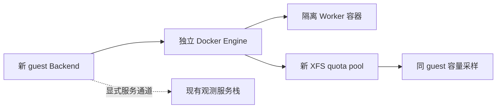

# 独立 Linux Engine、XFS quota 与存储池容量研究

_Switchback · 2026-10-11 · 仅方案研究；状态：待用户确认资源、版本与连接方式，未安装或启动_

---

## 🎯 建议与当前边界

建议采用独立命名的 arm64 Linux VM，优先直接 Lima + VZ；在全新虚拟块盘上建立 XFS project quota，将 rootful Docker classic `overlay2` 的数据目录放入该文件系统。**这是一条待验证路径**：官方支持条件和当前源码存在，但本机尚无 guest、Engine 或 quota enforcement 的实测证据。`overlay2` 的 `size` 需要 XFS + `pquota`，不能由回显 `HostConfig.StorageOpt` 推断内核已强制执行。[^1][^2]

建议 VM 名 `switchback-core`、新盘短名 `sbquota`；均只是待确认名称，创建前仍需查重。最小拓扑只放独立 Backend/Worker 及其必要状态，优先复用现有观测服务。全套第二份观测栈是另一种选择，需要额外容量与独立端口评估。这里没有执行安装、下载镜像、创建/格式化/挂载磁盘、启动 daemon、修改 Desktop/context，也没有运行 Go/PG 测试。

以下是主任务提供的只读快照，本研究没有重新测量；不能据此宣称当前机器已通过新增 VM 的准入：

| 已知项 | 快照及解释 |
| --- | --- |
| 宿主 | arm64 macOS 26.5；48 GiB；15 logical CPU |
| 内存压力 | `memory_pressure` 当时报告 34% free；不是可长期预留内存 |
| 现有 Desktop | Engine 15 CPU、16,483,418,112 bytes memory；13 个旧服务容器未设资源上限 |
| APFS | 可用 280,299,092 KiB，约 267 GiB；不是新 Engine/XFS pool 可用空间 |
| VM 工具 | PATH 未发现 `limactl/colima/podman/orbctl/multipass`；不能证明全局未安装应用 |

## 🔍 三条路线与版本差异

| 路线 | 已核实的官方能力 | 判断与待验证点 |
| --- | --- | --- |
| 直接 Lima + VZ | VZ 使用 Apple Virtualization.framework；原生架构 Linux guest；可附加独立 raw/qcow2 磁盘[^3][^4] | 推荐 stable v2.2.1 两阶段候选：一次明确授权初始化，随后禁止自动格式化；quota 挂载与 Engine 启动顺序仍是 gate |
| 独立 Colima profile | 基于 Lima；支持 Apple Silicon、独立 profile 与自定义 Docker 配置[^5] | 可行备选；便捷封装不能替代 XFS/quota 证明；官方 FAQ 说明启动会选择自身 context，应另核所选版的禁切换设置 |
| 独立 UTM Linux VM | 官方 arm64 Linux 路线、独立 drive；Apple backend 可创建新 raw/sparse 虚拟盘[^6][^7] | 稳定版 Lima 的新盘流程无法安全收敛时可选；guest OS、Engine、quota 和 transport 由我们显式管理，操作步骤较多 |

检索日官方 Docker 29 release notes 最新为 **29.9.0（2026-10-08）**；本研究查看 `docker-v29.9.0` 的 `overlay2/overlay.go`，没有拿早年 Moby quota 代码作为当期 Engine 能力证明。实现时需锁定实际 Engine package version/build、guest image digest、内核及 `xfsprogs` 版本，重新匹配源码与运行证据。[^2][^8]

Lima 最新 stable 是 **v2.2.1（2026-10-03）**；release list 同时把 `v2.3.0-beta.1` 标为 prerelease，其中新增 additional disk 的 `mount`/`mountPoint`。官网滚动文档中的这些字段不能直接套到 stable。[^9]

本研究用只读官方 raw source 核实了 **v2.2.1 的 `05-lima-disks.sh`**：它按 `/dev/disk/by-label/lima-${DISK_NAME}` 判断首次初始化，默认允许格式化；`format:false` 仅跳过格式化，随后仍无条件挂载 `/dev/${DEVICE_NAME}1` 到 `/mnt/lima-${DISK_NAME}`，该 mount 没有 `pquota` 参数。因此“空白盘 + `format:false`”不是可直接启动完成的方案，也不能把默认挂载当作 quota 挂载。[^10]

官方 issue #5407 是风险线索：已于 2026-10-04 经 #5460 关闭；评论明确超长 XFS 标签会被 `mkfs.xfs` 拒绝，不能把 ext4 的反复格式化复现直接描述成 XFS 的必然行为。上述 stable 的 by-label/自动 mount 行为由确切 tag 源码独立核实。[^11][^10]

**推荐的版本决策**：优先保留 stable v2.2.1，采用以下两阶段设计候选；不默认转 beta。`format:false` 是后续稳态默认，不是假定空盘能被直接挂载。[^10]

1. 用户以后单独授权初始化后，先证明短唯一盘名对应本任务新建、独占、为空的确切虚拟盘；仅该首次阶段允许 `format:true` + `fsType:xfs`。确切 tag 的脚本在 label 不存在且 format 为 true 时执行初始化并附加 `lima-` 标签，随后挂载；`sbquota` 加此前缀共 12 个字符，避免超长 XFS 标签问题。初始化成功后核验 disk/partition identity、XFS UUID、label 与 `ftype`，在这个阶段禁止 Docker 自动启动。[^10][^11]
2. 停止 VM 后，将该盘配置改为 `format:false` + `fsType:xfs`，再允许后续启动；脚本在此设置下不会进入格式化分支，即使 label 缺失也不会重新格式化，但仍尝试挂载指定分区。因此 label/UUID/设备不匹配或 mount 异常必须使应用启动门禁失败，不能依靠 Lima 自身检查替代 identity 验证。[^10]
3. Engine 启动前，显式验证并收敛正确 XFS mount 的 project quota accounting/enforcement；stable 的默认 mount 不带 `pquota`，所以普通自动挂载成功仍不合格。应按已登记 UUID 配置后续 quota 挂载，并核实与 Lima 自动挂载之间的顺序、是否需先卸载再挂载及重启持久性；该 guest 级流程尚未实测，不能把上述源码分支证明当作运行成功。[^10][^1]

若 stable 的挂载顺序最终不能安全收敛，再比较 UTM 或用户明确接受的 Lima prerelease；后者需核实 exact tag 的 `mount:false` 实现，而非只照抄滚动文档。以上只定义授权与验收边界，不是安装计划，也不提供或执行实际 `mkfs` 命令。

## ⚙️ Engine、文件系统与通信边界

Docker Engine 29 的全新安装默认使用 containerd image store，升级旧安装则保留 legacy graph driver；containerd 的默认 `overlayfs` snapshotter 和 classic `overlay2` 是不同后端。切换会隐藏另一后端的镜像/容器，所以本方案只在全新 guest 首次运行前选 classic，不触碰现有 Desktop。[^12]

以下是**新 guest 目标配置草图**，不是已应用配置或安装脚本；只有新盘以正确选项挂载后，才允许 daemon 使用它：[^13][^12]

```json
{
  "data-root": "/srv/switchback-engine/docker",
  "storage-driver": "overlay2",
  "features": { "containerd-snapshotter": false }
}
```

XFS backing filesystem 必须 `ftype=1`/支持 `d_type`；`overlay2.size` 可作为默认上限，具体 Worker 仍提交固定 `size=10G` 并验证。[^14][^1] 配额范围是 writable layer；bind mount/volume、镜像层、daemon 日志与构建缓存必须另外预算，不能把 10 GiB 宣称为整个 Session 的持久存储总上限。Docker 文档区分 writable layer 和外部挂载，Moby 当期实现也只在 ReadWrite layer 路径调用 `SetQuota`。[^15][^2]

VZ 默认文件共享是 `virtiofs`，它把 host directory 暴露给 guest；建议仅用于明确选定的输入目录，Engine root、WorkingCopy 和 mutable state 使用 guest 自有块盘。共享 APFS 路径不满足上述“guest XFS + project quota”的证明条件。[^16][^1]

Lima 支持 guest localhost 到 host 的端口转发；v2.2.1 模板默认 host bind 为 `127.0.0.1`，有自动 fallback，建议后续明确列出允许端口并忽略其余转发，预防与现有服务碰撞。模板还说明 VZ `vzNAT` 地址可从 host 访问但不能直接从其他 guest 访问；因此不能宣称新 VM 与 Docker Desktop 天然共享容器网络。[^17][^18]

建议在新 guest 中保持 Backend 与 Worker sibling 模式：只有 Backend 访问该 guest Engine socket，Worker 通过网络回 Backend。旧观测栈连接优先评估**逐服务 SSH tunnel/明确的 loopback relay**，保留现有端点认证，先验证 guest Backend 到具体目标端点的可达性；失败后再比较少量独立依赖与完整第二栈。Lima user-mode 文档中的 `host.lima.internal` 是该网络模式下的 host loopback 入口，不能未经验证套到所有网络模式。[^19]

host 管理新 Engine 可选择独立 endpoint 的 SSH 或 Lima 的受控 Unix socket 转发；每次显式选新 endpoint，不全局切换默认 context。Docker 官方支持 SSH/TLS 访问 daemon；不要为方便开启未认证 TCP daemon。[^20][^18]



图为建议拓扑，未建立连接，也不证明资源准入。

## 📊 如何证明强制执行与真实可用空间

下面是后续验收标准，均尚未执行；不能用配置保存成功、`inspect.StorageOpt` 或 `df` 单独代替：

1. **身份与挂载**：记录 guest identity/boot ID、Engine endpoint 与 `ID`/version、实际 `DockerRootDir`/driver；在 Engine 所在 guest 核对 `overlay2` 实际目录归属的 XFS UUID、设备 major:minor、mount ID/options 与 `ftype=1`。Docker `info` 可提供 Engine ID、root 和 driver 信息，但不直接证明 quota enforcement。[^21][^14]
2. **内核状态**：在确切 XFS mount 读取 `xfs_quota state -p`，同时证明 accounting 和 enforcement enabled；用实际 layer 的 project ID 查硬限额，记录原始单位与 bytes。`xfs_quota` 的 `state` 与 `quota/report` 分别提供状态和额度/使用情况，report 默认 1 KiB 单位。[^22]
3. **写入越界**：以后在新 Engine 创建一个隔离、无 volume/bind/tmpfs 目标的小额度 probe；写真实分配的数据到 root writable layer，额度内成功、超额失败，保留 errno/退出码、实写量、project usage/limit 与 pool 余量。测试上限应小于 pool 余量，失败时 pool 仍明显未满；否则不能区分 quota 与全池耗尽。由当期源码的 `CreateReadWrite → SetQuota` 和官方支持契约建立测试假设，再用运行结果证实。[^2][^1]
4. **控制组与持久性**：另一 probe 使用更大额度完成相同写量；保持已有容器跨 daemon/guest 重启后复核 UUID、project quota 与同一上限。新旧 probe 的精确 identity 和清理范围先记录；这里只定义标准，不创建/删除容器或启动模型。

后续 quota capability 证据应至少绑定 `(engine_id, endpoint_identity, engine_build, guest_boot_id, storage_driver, xfs_uuid, mount_identity, probe_image_digest, captured_at)`。Engine 重建、root/driver/pool 更换或证据过期均使 capability 失效；配置变更后重新验证，不借用旧 Desktop 或不同 release 的成功结果。

**容量权威采样建议**：在同 guest、同 mount namespace，从没有 per-container project 限额的 pool 根目录读取 `statvfs/fstatvfs`，计算 `available_bytes = f_bavail × f_frsize`，并保留 `f_bfree`、total blocks、inode 余量、采样时间及单位；Linux 接口定义 `f_bavail` 为非特权用户可用块数，采样对象是指定 mounted filesystem。不要在 quota 限制的容器 root 中读取值充当整个 pool 余量。[^23]

| 必须绑定的内容 | 为何需要 |
| --- | --- |
| Engine endpoint + Engine ID/build | context 名称不足以识别 daemon |
| 实际 overlay2 root + pool mount/UUID | `DockerRootDir` 下的子目录也可能是另一个 mount[^2] |
| VM identity/boot + device/mount namespace | 防止采样来自宿主 APFS、旧 Desktop 或另一 guest |
| 时间 + 原始字段 + bytes 换算 | 过期、解析失败或单位不清都应返回 unknown |
| 独立 host backing file 所在 APFS 余量 | 防止 sparse VM disk 的 guest 逻辑余量掩盖宿主底层空间风险；UTM 文档明确 APFS raw image 可为 sparse[^7] |

`docker system df` 提供 daemon 所用及可回收空间，不是 filesystem 的可用容量；不能用 total virtual disk size、镜像可回收量或 host `df` 替代上述采样。[^24] overlay2 不应被假设具有独立 thin pool API；这里的 pool 是经证据识别的 backing filesystem。

本研究只建议后续可信 guest-side probe 向 Backend 提供上述 identity-bound snapshot。**完整 aggregate capacity ledger 仍未设计/实现**：还需解决并发预留、实际已用量与 outstanding commitment 的去重、非 Worker 消耗、image/log/build/WorkingCopy 的同池覆盖、CPU/memory/storage headroom、lease/fencing、事件丢失恢复与 stale/unknown fail closed；不能简单以“当前 free 减去所有 10 GiB”冒充完成。

## 📋 未解决事项与后续确认

需要用户确认具体 VM 路线/版本、CPU/内存/磁盘预算、观测服务 transport，以及安装、首次启动与一次性新盘初始化授权；只有稳态方案不能收敛时才额外询问是否接受 prerelease。资源数字需依据当前 host load 与新 guest 的需求重新评估；本研究不承诺这台主机当前能容纳新 VM，也不默认分配十个 4 GiB resident Worker。

仍需实测 exact guest/kernel/xfsprogs/Engine 的强制 quota、新盘安全初始化与重启挂载顺序、host backing-space 采样、跨 VM 的观测与控制通信，以及之后的 capacity ledger。取得这些证据前，新 Engine 的 storage capability 状态应为 `unknown/unproven`。这份文档不是生产 gate 已完成的证明。

## 🔗 官方资料与确切源码

全部于 2026-10-11 检索；滚动文档不等于已选择的安装版本。源码链接用确切 tag；issue 只作为风险线索。

[^1]: Docker. “Set storage driver options per container.” https://docs.docker.com/reference/cli/docker/container/run/#set-storage-driver-options-per-container---storage-opt
[^2]: Moby. `docker-v29.9.0`, `daemon/graphdriver/overlay2/overlay.go`；核查 `Init`、`CreateReadWrite` 与 `create`。https://github.com/moby/moby/blob/docker-v29.9.0/daemon/graphdriver/overlay2/overlay.go
[^3]: Lima. “VZ / VM types”; >= 0.14 支持 VZ，v1.0 起 macOS 新实例默认 VZ。https://lima-vm.io/docs/config/vmtype/vz/
[^4]: Lima. “Disks”; virtual additional disks，不是 host raw block-device passthrough。https://lima-vm.io/docs/config/disk/
[^5]: Colima. 官方 FAQ，main 为滚动内容，具体版本待选。https://github.com/abiosoft/colima/blob/main/docs/FAQ.md
[^6]: UTM. 官方 arm64 Ubuntu guest guide；不是本次建议锁定 Ubuntu 22.04。https://docs.getutm.app/guides/ubuntu/
[^7]: UTM. Apple backend “Drive.” https://docs.getutm.app/settings-apple/drive/
[^8]: Docker. “Engine version 29 release notes”; 29.9.0 发布于 2026-10-08。https://docs.docker.com/engine/release-notes/29/#2990
[^9]: Lima. 官方 releases，v2.2.1 stable 与 v2.3.0-beta.1 的 release status/changes。https://github.com/lima-vm/lima/releases
[^10]: Lima. **已读取确切 v2.2.1 原文**（只读 curl stdout，exit 0），`05-lima-disks.sh`。https://raw.githubusercontent.com/lima-vm/lima/v2.2.1/pkg/cidata/cidata.TEMPLATE.d/boot.Linux/05-lima-disks.sh
[^11]: Lima. 官方 issue #5407 与关联 #5460 的关闭记录；不是单独的 runtime 证明。https://github.com/lima-vm/lima/issues/5407
[^12]: Docker. “containerd image store with Docker Engine.” https://docs.docker.com/engine/storage/containerd/
[^13]: Docker. “dockerd”; data-root、storage-driver、features 与 `overlay2.size`。https://docs.docker.com/reference/cli/dockerd/
[^14]: Docker. “OverlayFS storage driver”; classic overlay2 与 XFS d_type/ftype 条件。https://docs.docker.com/engine/storage/drivers/overlayfs-driver/
[^15]: Docker. “Running containers”; filesystem/volume 与 writable layer 语义。https://docs.docker.com/engine/containers/run/
[^16]: Lima. “Filesystem mounts”; VZ virtiofs 是共享目录设备。https://lima-vm.io/docs/config/mount/
[^17]: Lima. “Port forwarding”; guest localhost 到 host，v1.1 起默认 GRPC forwarder。https://lima-vm.io/docs/config/port/
[^18]: Lima. `v2.2.1`, `templates/default.yaml`; `vzNAT`、portForwards、socket forwarding、containerd 默认配置。https://github.com/lima-vm/lima/blob/v2.2.1/templates/default.yaml
[^19]: Lima. “Default user-mode network”; host loopback / `host.lima.internal` 的特定模式语义。https://lima-vm.io/docs/config/network/user/
[^20]: Docker. “Protect the Docker daemon socket”; Unix socket、SSH 与 TLS。https://docs.docker.com/engine/security/protect-access/
[^21]: Docker. “docker system info”; ID、root、driver 与 JSON 输出。https://docs.docker.com/reference/cli/docker/system/info/
[^22]: xfsprogs. 上游 `xfs_quota(8)` 手册；man7 页面标明来自 xfsprogs upstream Git，2026-08-04 获取。https://man7.org/linux/man-pages/man8/xfs_quota.8.html
[^23]: Linux man-pages project. `statvfs(3)`：mounted filesystem、f_bavail 与 f_frsize。https://man7.org/linux/man-pages/man3/statvfs.3.html
[^24]: Docker. “docker system df”; used/reclaimable 用量契约。https://docs.docker.com/reference/cli/docker/system/df/
