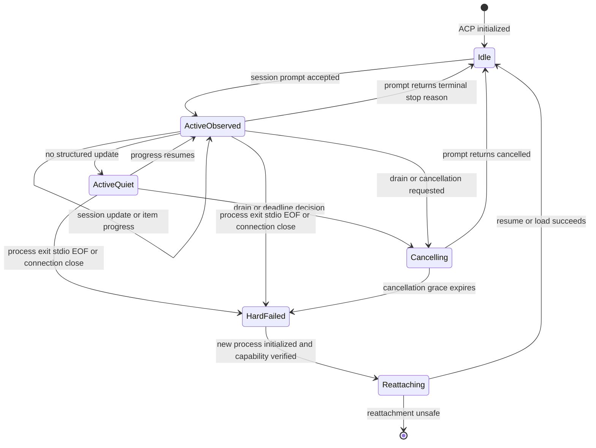

# ACP/Codex runtime 活性与会话恢复调研

_Switchback P0 Worker 研究记录，2026-07-11；以 ACP 官方规范、固定版本源码和官方 Codex App Server 为准_

---

## 🎯 Executive recommendation

Switchback 可以继续采用 `github.com/coder/acp-go-sdk@v0.13.5`、`@agentclientprotocol/codex-acp@1.1.2` 和 lockfile 固定的 `@openai/codex@0.144.1`，但必须把它们理解为三层边界：

1. **ACP 只定义会话控制语义**：initialize、new/prompt/update/cancel，以及 capability-gated 的 load/resume/list/close 等方法。它不定义 runtime heartbeat、process supervisor、durable Trace、容器恢复或 Switchback command 幂等。[^1]
2. **`codex-acp` 是语义适配器**：它把 ACP session 映射到 Codex thread，把 prompt/cancel 映射到 turn start/interrupt，把 Codex item/plan/usage 事件映射到 ACP update。它没有 heartbeat、ping 或无副作用 liveness probe。[^2]
3. **恢复可靠性必须由 Docker spike 证明**：固定版源码具备 load/resume 实现，但跨 ACP 进程重启的 E2E persistence test 被上游标记为 flaky 并跳过，不能直接把“方法存在”当作“故障恢复已经可靠”。[^3]

因此，P0 不应按“多久没有模型输出”判定 Agent 无响应。推荐把 runtime、ACP process、turn progress 和 durable recovery evidence 分开：

- Runtime liveness：继续使用 Switchback 自有 15s/45s/90s heartbeat
- ACP process liveness：子进程退出、stdio EOF、协议连接关闭是硬失败
- Turn progress：`session/update` 和 pending `session/prompt` 只说明 turn 状态；静默本身不是失败
- Recovery proof：capability negotiation + session resume/load 成功 + 稳定窗口 + 固定版本 Docker contract test

## 📌 Evidence matrix

| Layer | Fixed snapshot | Evidence | What Switchback may rely on | What remains unproven |
| --- | --- | --- | --- | --- |
| ACP v1 | 当前官方 v1 文档 | JSON-RPC、initialize、capability negotiation、session lifecycle、cancel/update | 方法和 capability 的协议语义 | Agent 实现质量、heartbeat、process lifecycle |
| Go ACP client | `coder/acp-go-sdk@v0.13.5`, commit `0845a3b` | typed client、raw JSON-RPC connection、cancel propagation、extensions | stdio ACP client 和已知 schema 类型 | unknown union forward compatibility、Codex 行为 |
| Codex adapter | `codex-acp@1.1.2`, commit `8aff492` | ACP server、Codex App Server mapping、unit/E2E tests | advertised capabilities 和 event mapping | restart persistence test 被跳过；无 liveness RPC |
| Codex runtime | `rust-v0.144.1`, commit `44918ea` / npm `0.144.1` | thread/resume、turn/interrupt、turn/item notifications | persisted thread 和 turn lifecycle | 进程崩溃中间态、后台 terminal drain |

上述 commit 均从固定 tag 解析，用于把调研结论和未来 Docker 镜像库存绑定到可复现源码快照。[^20]

`codex-acp@1.1.2` 的 `package.json` 依赖 `@agentclientprotocol/sdk:^1.2.1` 和 `@openai/codex:^0.144.0`，所以只固定顶层 `codex-acp` 版本仍可能解析到不同依赖。P0 镜像必须提交 lockfile，并验证实际安装结果为 ACP SDK `1.2.1`、Codex `0.144.1`。[^4]

截至 2026-07-11，npm registry 的 latest 仍分别是 `codex-acp@1.1.2`、ACP TypeScript SDK `1.2.1` 和 Codex `0.144.1`；这只是时间截面，不能替代 lockfile。[^5]

## 📋 Protocol capability checklist

ACP v1 要求所有连接先 initialize，双方协商一个 major protocol version，并把未声明的 capability 视为 unsupported。[^6]

| Capability | ACP status | `acp-go-sdk@v0.13.5` | `codex-acp@1.1.2` | Switchback P0 decision |
| --- | --- | --- | --- | --- |
| `initialize` / version negotiation | Required | Typed API | Implemented | Block startup on version mismatch |
| `session/new` | Baseline | Typed API | Maps to `thread/start` | Required |
| `session/prompt` | Baseline | Typed request | Maps to `turn/start`, waits completion | Required |
| `session/update` | Baseline notification | Typed union | Maps messages/tools/plans/usage | Required, raw frame also retained |
| `session/cancel` | Baseline notification | Typed notification | Maps to `turn/interrupt` | Required, not a liveness ping |
| `session/request_permission` | Baseline client method | Typed callback | Command/file/permission mapping | Required |
| `session/load` | Optional `loadSession` | Typed API | `thread/resume` + `thread/read`, replays history | Required fallback for P0 Codex profile |
| `session/resume` | Optional `sessionCapabilities.resume` | Typed API | `thread/resume`, no history replay | Preferred recovery path |
| `session/list` | Optional | Typed API | Implemented | Operations/debugging capability |
| `session/close` | Optional | Typed API | Interrupts active turn, then unsubscribes | Graceful drain step, not process shutdown |
| `session/delete` | Version-sensitive | Marked unstable in Go SDK | Advertised/implemented | Not P0 runtime dependency |
| FS reverse methods | Optional client capability | Typed callbacks | Not required for Codex self-execution | Do not advertise unless needed |
| Terminal reverse methods | Optional client capability | Typed callbacks | Codex commands are reported as tool calls | Do not use as generic Codex process control |
| Plan and usage updates | Optional/update variants | Typed; usage marked unstable | Implemented from Codex events | Observe, but tolerate absence |
| Heartbeat / ping / no-op | Not defined | None | None found | Switchback-owned RuntimeHeartbeat |

ACP distinguishes load and resume. `session/load` replays conversation history as `session/update`; `session/resume` restores context without replay and may only be called when `sessionCapabilities.resume` was advertised。[^7]

`codex-acp@1.1.2` advertises `loadSession`, resume, list, close, delete and additional directories. Its load and resume paths both call Codex `thread/resume`; load additionally calls `thread/read(includeTurns=true)` and streams reconstructed history。[^8]

## 🔌 Codex adapter findings

### Session identity and recovery

The ACP session id returned by `codex-acp` is the Codex thread id. New session maps to `thread/start`; load/resume map to `thread/resume` with cwd, MCP servers, provider/config and additional directories reconstructed by the adapter。[^9]

This supports the Switchback identity model `WorkerSession -> AgentSession -> Codex thread`, but does not by itself prove crash recovery. The fixed tag contains an E2E test intended to restart the ACP process, load the same session and verify remembered context; that test is explicitly skipped as flaky。[^3]

Recovery therefore needs two separate outcomes:

- `agent_session_attached`: initialize and capability-gated resume/load returned successfully
- `semantic_continuity_verified`: the fixed image passed restart/turn-state contract tests before release

Runtime recovery may use the first outcome online. Image promotion must require the second outcome offline.

### Prompt, progress and completion

`codex-acp` starts a Codex turn, subscribes to events, maps item/message/tool/plan/usage notifications to ACP updates, and waits for `turn/completed` before answering the original `session/prompt`。[^10]

The authoritative ACP turn boundary is the `session/prompt` response with `stopReason`; individual `session/update` notifications are progress evidence, not a durable completed checkpoint. ACP cancellation requires the original prompt to eventually resolve with `cancelled`, although updates may still arrive before that response。[^11]

At the Codex layer, `item/started` and `item/completed` define item lifecycle, while `turn/completed` carries final completed/interrupted/failed state. Token usage is emitted separately。[^12]

### Cancel and close

`session/cancel` is a one-way notification. In the adapter it calls Codex `turn/interrupt`; the adapter relies on the later `turn/completed(status=interrupted)` to resolve the pending prompt as cancelled。[^13]

`session/close` is stronger than cancel at the ACP level, but fixed `codex-acp` ultimately unsubscribes from the Codex thread and clears local handlers after interrupting the active turn. It does not terminate the `codex-acp` process or container。[^14]

Codex App Server also documents that interrupting a turn does not terminate background terminals. Its background-terminal cleanup API is experimental and is not exposed as a stable ACP method by `codex-acp@1.1.2`。[^15]

### Permissions and subagents

Command, file-change and broader permission requests are translated into ACP `session/request_permission`, including session-scoped choices。[^16]

Codex collaborative/subagent work is mapped by the adapter into ACP `tool_call` / `tool_call_update`. Adapter-specific `rawInput` includes sender and receiver thread ids, but ACP v1 does not promote each subagent to a separate ACP Session。[^17]

Implication: Switchback should treat Codex subagents as child execution spans/tool calls by default. Creating a distinct `AgentSession` for each subagent is only safe when an adapter-specific contract exposes and persists the child thread identity.

## 🩺 Liveness model

Recommended evidence classes:

| State | Evidence | Automatic action |
| --- | --- | --- |
| `idle` | No pending prompt; ACP process and stdio alive | None |
| `active_observed` | Pending prompt plus recent ACP update/item progress | Continue |
| `active_quiet` | Pending prompt, process alive, no recent structured update | Do not restart; apply Task/turn/tool deadlines |
| `cancelling` | Cancel sent; original prompt response pending | Wait bounded grace, continue accepting late updates |
| `hard_failed` | Process exit, stdio EOF, connection close, or cancellation grace expired | RuntimeRecoveryIncident |
| `reattaching` | New ACP connection initialized; resume/load in progress | No new user prompt until attached |

There is no safe generic ACP ping in the fixed stack. Sending a prompt would mutate session history; sending cancel would interrupt valid work; calling resume/load on an active session changes subscriptions and is not a no-op. Therefore “N minutes without model output” may only create an internal progress warning, not `agent_unresponsive`.

For P0, the Agent progress threshold should remain configurable and non-terminal until the Docker spike measures real Codex behavior. Turn deadline and tool-specific timeout are stronger controls than a global silence timeout.

## 🔄 Recovery and graceful drain

Recommended drain sequence:

1. Quiesce AgentTurn dispatch for the target AgentSession.
2. If a prompt is active, send `session/cancel` and mark pending permission requests/tool calls cancelling.
3. Wait for the original `session/prompt` response with `stopReason=cancelled`; continue recording late updates until the response.
4. Flush raw ACP frames, normalized Trace and command/event cursors.
5. If advertised, call `session/close` to release adapter-side session resources.
6. Terminate the `codex-acp`/Codex process group or container under RuntimeProvisioner control; ACP close alone is not enough.
7. Revoke old generation control/secret/mount leases before replacement.

Recommended recovery sequence:

1. Start the fixed image and record exact package/commit inventory.
2. Initialize ACP and verify protocol version plus required capabilities.
3. Prefer `session/resume` when advertised; it avoids history replay.
4. Fall back to `session/load` only when `loadSession` is advertised; tag replayed updates and deduplicate by source message/tool id plus replay generation.
5. Re-send the complete intended cwd, additional directories, MCP servers and runtime config rather than assuming the Agent persisted them.
6. Mark `agent_session_attached` only after resume/load response and adapter process stability checks.
7. Resume user work only after Switchback command/Trace cursors and WorkingCopy fencing also agree.

Candidate cancellation grace should be measured in the spike. A starting proposal is 30 seconds after cancel before process termination, but this report does not freeze that value because long-running tool cancellation behavior is not guaranteed by the protocol.

## 🛡️ Unknown-field compatibility

ACP explicitly reserves `_meta` for custom data and extension methods prefixed with `_`. Implementations must negotiate capabilities rather than infer optional support。[^18]

The Go SDK connection initially parses each JSONL line into raw JSON-RPC fields, but then decodes known params into generated types. `SessionUpdate.UnmarshalJSON` returns `no matching variant for union` for an unknown discriminator, so typed decoding alone is not forward-compatible for new update variants。[^19]

P0 policy:

- Tee every inbound/outbound ACP JSONL frame into a bounded raw-frame recorder before SDK decoding.
- Decode known methods/updates into typed events.
- Preserve unknown update variants as `TraceRecord(type=acp_unknown_update)` with raw payload and emit an internal compatibility warning.
- Do not terminate a healthy runtime for one unknown optional update.
- Fail closed on protocol-version mismatch, malformed required fields, or unknown behavior that affects permission/security decisions.
- Only dispatch underscore-prefixed custom methods through an explicit allowlisted extension handler.

The raw recorder is a Switchback wrapper around the SDK transport; it is not a change to the community SDK.

## 🧪 Required Docker spike

The spike must use the exact Docker image and lockfile intended for P0. Passing unit tests against mocked JSON-RPC is insufficient.

| ID | Scenario | Required evidence |
| --- | --- | --- |
| S-01 | Initialize | Protocol version, full capability snapshot, exact package versions |
| S-02 | New/prompt/update | Message, plan, command, file, MCP, usage and permission mapping |
| S-03 | Cancel during model | Late updates accepted; prompt returns cancelled |
| S-04 | Cancel during command/tool | Tool process outcome, prompt terminal state, no orphan process |
| S-05 | Session resume after clean ACP restart | Same thread id, no replay, next prompt sees prior context |
| S-06 | Session load after clean ACP restart | History replay tagged/deduplicated; next prompt sees context |
| S-07 | Restart during active turn | Final persisted turn state identified; no silent duplicate tool side effect |
| S-08 | Kill `codex-acp` only | Shim detects exit/stdio EOF and opens recovery incident |
| S-09 | Kill Codex child only | Adapter error/process evidence reaches Shim within bounded time |
| S-10 | Quiet long model/tool | Runtime heartbeat continues; no false Agent restart |
| S-11 | Unknown update variant | Raw frame retained; known stream continues or fails in a controlled way |
| S-12 | Permission once/session | Grant mapping, cancellation, expiry and generation behavior |
| S-13 | Subagent | Child thread ids retained as spans without inventing ACP sessions |
| S-14 | Graceful drain | cancel -> terminal prompt -> trace flush -> close -> process-group exit |
| S-15 | Background process | Container cleanup removes processes not covered by turn interrupt |

The image fails promotion if S-05 or S-06 is flaky. The current upstream skipped persistence E2E makes this a release gate, not an optional confidence test.

## ✅ Decisions now safe to freeze

- Keep `coder/acp-go-sdk@v0.13.5` behind Switchback `AgentControlPort`.
- Lock all transitive Node dependencies; do not rely on caret resolution in `codex-acp`.
- RuntimeHeartbeat remains Switchback-owned and independent of ACP/model output.
- Agent silence alone never triggers automatic recovery.
- Process exit, stdio EOF and ACP connection close are hard Agent failures.
- Cancel is a drain action, not a health probe.
- Resume/load are capability-gated; prefer resume and use load as replaying fallback.
- Raw ACP JSONL must be captured before typed Go decoding.
- `session/close` does not replace process-group/container cleanup.
- Codex subagents default to child spans/tool calls, not independent ACP AgentSessions.

## ✅ Accepted product policy after review

- `active_quiet` emits a non-terminal warning while the current fixed AgentTurn deadline continues; there is no separate silence auto-cancel timer.
- Fixed 24-hour AgentTurn hard deadline and explicit user interrupt trigger ACP cancel; TaskSpec does not select timeout behavior.
- Cancellation grace starts as a 30-second Docker-spike candidate and remains unfrozen until fixed-image measurements cover model, tool and background-process cancellation.
- Every actual ACP prompt uses fixed `started_at/deadline_at=+86400s`; waiting, quiet, disconnect and Runtime recovery do not pause or extend it, and steer does not reset it.
- WorkerRun、Task、Tool and continuation do not publish time budgets or grants. Tool cancellation still uses effect/evidence fencing, while LLM rate/token/cost guards remain independent.

## ❓ Open questions for the next grill

1. Resolved: Manifest declares intent, Adapter validates and may only raise risk, Capability/Skilling platform policy emits the authoritative ResolvedToolPolicy, and missing or conflicting metadata fails closed.
2. If `session/resume` fails but `session/load` succeeds, may the same automatic recovery incident continue, or does the replay-risk require `waiting_user`?
3. Should adapter-specific child thread ids become first-class `AgentExecutionSpan`, or remain Trace metadata in P0?
4. Which unknown ACP updates may be ignored after raw capture, and which categories must block image promotion?

## 📚 Sources

[^1]: ACP v1 Overview, baseline and optional methods: https://agentclientprotocol.com/protocol/v1/overview
[^2]: `codex-acp@v1.1.2` server routes and absence of a heartbeat method: https://github.com/agentclientprotocol/codex-acp/blob/v1.1.2/src/index.ts
[^3]: Skipped cross-process persistence E2E test in `codex-acp@v1.1.2`: https://github.com/agentclientprotocol/codex-acp/blob/v1.1.2/src/__tests__/CodexACPAgent/e2e/acp-e2e-session-persistence.test.ts
[^4]: Exact `codex-acp@v1.1.2` dependency ranges: https://github.com/agentclientprotocol/codex-acp/blob/v1.1.2/package.json
[^5]: Official npm registry metadata and dist-tags: https://registry.npmjs.org/@agentclientprotocol%2Fcodex-acp, https://registry.npmjs.org/@agentclientprotocol%2Fsdk, https://registry.npmjs.org/@openai%2Fcodex
[^6]: ACP initialization and capability negotiation: https://agentclientprotocol.com/protocol/v1/initialization
[^7]: ACP load/resume semantics: https://agentclientprotocol.com/protocol/v1/session-setup
[^8]: `codex-acp@v1.1.2` advertised capabilities and load/resume implementation: https://github.com/agentclientprotocol/codex-acp/blob/v1.1.2/src/CodexAcpServer.ts, https://github.com/agentclientprotocol/codex-acp/blob/v1.1.2/src/CodexAcpClient.ts
[^9]: Codex thread start/resume mapping in `CodexAcpClient`: https://github.com/agentclientprotocol/codex-acp/blob/v1.1.2/src/CodexAcpClient.ts
[^10]: Codex notification to ACP update mapping: https://github.com/agentclientprotocol/codex-acp/blob/v1.1.2/src/CodexEventHandler.ts
[^11]: ACP prompt completion and cancellation semantics: https://agentclientprotocol.com/protocol/v1/prompt-turn
[^12]: Codex App Server lifecycle at `rust-v0.144.1`: https://github.com/openai/codex/blob/rust-v0.144.1/codex-rs/app-server/README.md
[^13]: `codex-acp@v1.1.2` cancel implementation: https://github.com/agentclientprotocol/codex-acp/blob/v1.1.2/src/CodexAcpServer.ts
[^14]: `codex-acp@v1.1.2` close and unsubscribe implementation: https://github.com/agentclientprotocol/codex-acp/blob/v1.1.2/src/CodexAcpServer.ts, https://github.com/agentclientprotocol/codex-acp/blob/v1.1.2/src/CodexAcpClient.ts
[^15]: Codex App Server interrupt and background terminal behavior: https://github.com/openai/codex/blob/rust-v0.144.1/codex-rs/app-server/README.md
[^16]: `codex-acp@v1.1.2` permission bridge: https://github.com/agentclientprotocol/codex-acp/blob/v1.1.2/src/CodexApprovalHandler.ts
[^17]: `codex-acp@v1.1.2` collaborative Agent mapping: https://github.com/agentclientprotocol/codex-acp/blob/v1.1.2/src/CodexToolCallMapper.ts
[^18]: ACP extensibility rules: https://agentclientprotocol.com/protocol/v1/extensibility
[^19]: `acp-go-sdk@v0.13.5` generated union decoding and raw JSON-RPC connection: https://github.com/coder/acp-go-sdk/blob/v0.13.5/types_gen.go, https://github.com/coder/acp-go-sdk/blob/v0.13.5/connection.go
[^20]: Fixed source tags: https://github.com/coder/acp-go-sdk/releases/tag/v0.13.5, https://github.com/agentclientprotocol/codex-acp/releases/tag/v1.1.2, https://github.com/openai/codex/releases/tag/rust-v0.144.1
