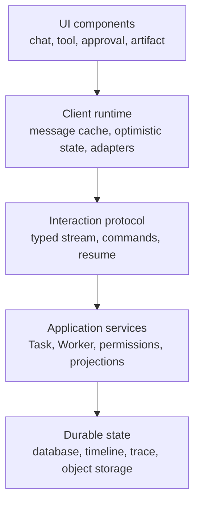
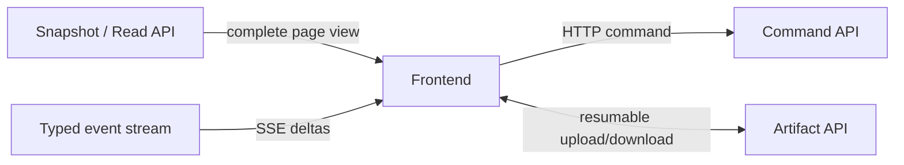
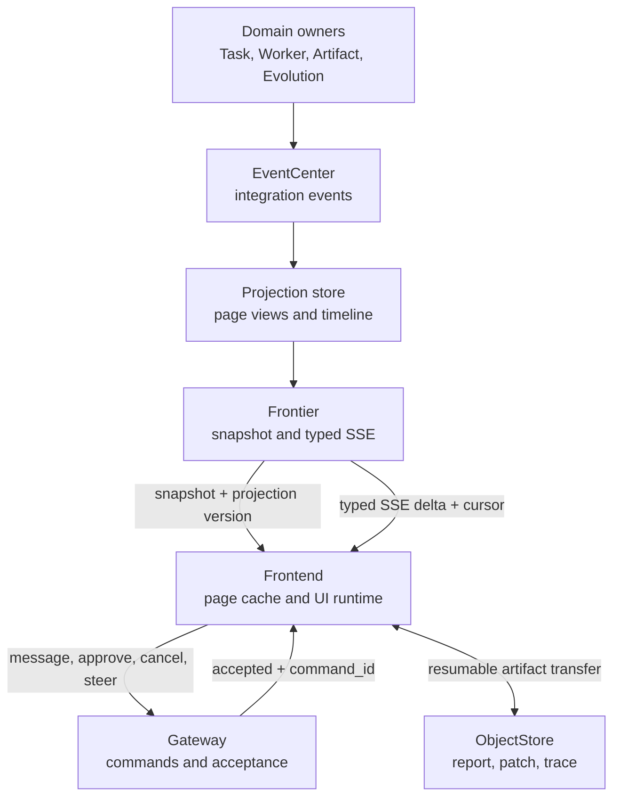

# Agent Frontend Technology Landscape

> 调研日期：2026-07-13。范围是 Agent Web/C-S 前端架构与协议，重点覆盖 Vercel AI SDK、assistant-ui、AG-UI/CopilotKit。外部事实只引用官方文档、官方规范或官方源码；对 Switchback 的判断属于本调研建议，不修改既有项目决策。

## 结论

Switchback P0 继续采用 **HTTP page snapshot + typed SSE delta + HTTP command + 独立 Artifact 传输** 是合理的。这个组合不是落后于主流 Agent 前端，反而与当前生态中逐渐形成的分层共识一致：

- Vercel AI SDK 展示了“结构化消息 part + 流式增量 + 可替换 transport”的 Agent UI 模型；但它的核心抽象仍是 chat/message，不负责 Switchback 的 Task、WorkerSession、Approval、Artifact 和跨页面 projection。[^ai-use-chat][^ai-stream-protocol][^ai-transport]
- assistant-ui 证明了 UI primitives、conversation runtime、wire protocol、persistence 应分层；其 `ExternalStoreRuntime` 尤其说明已有权威状态的应用不应把 React runtime 变成事实源。[^aui-architecture][^aui-external-store]
- AG-UI 是三者中最接近“Agent 与用户界面之间协议”的方案：它定义 Run、消息、Tool、状态和 interrupt 事件，并以 SSE 作为标准 HTTP transport；但它没有替 Switchback 定义 page projection version、TimelineCursor、权限过滤、command acceptance 和 Artifact 生命周期。[^agui-architecture][^agui-events][^agui-interrupts]
- CopilotKit 是 AG-UI 上的产品化 React 层，适合参考 Tool UI、Generative UI、shared state 和 HITL 交互；不应直接成为 Switchback 的领域协议 owner。[^copilotkit-agui][^copilotkit-tools][^copilotkit-hitl]
- GraphQL 解决的是“客户端声明要哪些关联字段”，不是 Agent streaming、断线续传或异步命令收敛。GraphQL Subscription 规范甚至有意不规定 serialization、transport、ACK、buffering 和 resend，因此它不能替代 Switchback 的 cursor/resync 设计。[^graphql-spec]

推荐的 P0 定位是：**借鉴这些项目的事件 taxonomy、UI part 模型和 runtime adapter 思想，但由 Switchback Frontier 持有自己的 page-optimized projection contract。**

## 调研边界与判断标准

本文把“Agent 前端技术”拆成五层。否则很容易把 React 组件库、Agent 事件协议和后端业务 API 混为一个选型问题。



判断每套方案时使用以下问题：

| 维度 | 核心问题 |
| --- | --- |
| Chat state | 谁拥有消息、线程、运行中状态和分支？刷新后从哪里恢复？ |
| Streaming | 流里只有文本，还是有 message/tool/state/lifecycle 等 typed event？ |
| Tool calls | 参数是否增量传输？Tool result 如何关联？前端 Tool 与后端 Tool 是否区分？ |
| Human-in-the-loop | 暂停是 UI 假暂停，还是后端可恢复的协议状态？是否支持幂等和过期？ |
| Transport | 默认使用 HTTP streaming、SSE、WebSocket 还是可替换 transport？ |
| Durability | 断线后是重连当前 socket，重放 event，还是重新拉 snapshot？ |
| Domain fit | 能否表达 Task、WorkerSession、Approval、Artifact 和权限过滤，而不把 chat 当作全部业务？ |

## 主流 C-S 架构的共同形态

成熟 Agent Web 不应只设计一个 `/chat` 长连接。不同数据有不同可靠性、方向和负载特征，通常至少存在四条逻辑通道：



| 通道 | 适合承载 | 不适合承载 |
| --- | --- | --- |
| Command | message、AgentTurn、approve/deny、cancel、steer、Artifact action | 等待长任务结束、持续 token 推送 |
| Snapshot | 页面首次加载、刷新、gap 后恢复、权限过滤后的完整 View | 无限历史和高频 token |
| Typed stream | message/tool/run/progress/approval/artifact 的实时变化 | 大文件、权威业务事务 |
| Artifact | patch/report/附件的下载、预览、校验和断点传输 | 低延迟状态更新 |

SSE 本身是 server-to-client 单向流，客户端命令仍应走 HTTP；WHATWG 标准定义了 `text/event-stream`、event id、自动重连和 `Last-Event-ID`，但服务端是否保留可重放数据仍是应用责任。[^whatwg-sse] WebSocket 适合高频双向消息，但“Agent 可以 steer/interrupt”不等于必须使用 WebSocket：低频命令可走 HTTP，服务端结果继续走 SSE。

## Vercel AI SDK

### 定位

Vercel AI SDK 的前端价值不是一套固定聊天页面，而是 `useChat`、`UIMessage`、`ChatTransport` 和 UI message stream。`useChat` 管理当前消息数组与 `submitted`、`streaming`、`ready`、`error` 等前端状态；当前 transport 架构允许替换请求方式，默认 transport 使用 HTTP POST。[^ai-use-chat][^ai-transport]

它把 UI 消息和模型消息分开：官方 persistence 指南建议持久化面向展示的 `UIMessage`，并在送入模型前转换成 `ModelMessage`；带 Tool、metadata 或 custom data part 的持久化消息应先校验。[^ai-persistence] 这是一个很值得 Switchback 保留的边界：**用户展示模型不应等同于模型供应商 request/response，也不应等同于 raw Trace。**

### Chat state 与 streaming

`UIMessage` 由稳定 message identity、role、metadata 和 `parts` 组成。UI message stream 在 HTTP 上使用 SSE JSON part；官方协议包含文本 start/delta/end、reasoning、Tool input/output、source、file、custom data、message metadata、error、finish 和 abort 等结构，而不是把所有内容拼成一条字符串。[^ai-stream-protocol]

典型文本流是：

```text
data: {"type":"text-start","id":"..."}
data: {"type":"text-delta","id":"...","delta":"Hello"}
data: {"type":"text-end","id":"..."}
data: {"type":"finish"}
```

纯 text stream 只能表达文本；官方明确建议 Tool call 等非文本内容使用 data/UI message stream。[^ai-stream-protocol] 对 Switchback 来说，这意味着 Worker Activity 不能只定义 `token_delta`，至少应有稳定的 message/tool/approval/artifact part identity。

### Tool calls 与 human-in-the-loop

AI SDK 将 Tool call 表示为 typed message part，并通过 `toolCallId` 关联结果。客户端 Tool 可在 `onToolCall` 中执行并用 `addToolOutput` 回填；服务端 Tool 可在服务端执行，前端只渲染状态和结果。[^ai-tool-usage]

服务端 Tool approval 使用 `needsApproval`：第一次模型调用返回 `tool-approval-request`，应用收集用户决定并加入 `tool-approval-response`，然后发起第二次模型调用；`useChat` 通过 `addToolApprovalResponse` 和可选的 `sendAutomaticallyWhen` 继续流程。[^ai-tool-calling][^ai-tool-usage] 这是一种 **message-loop approval**，适合普通聊天 Tool，但它不自动具备 Switchback 所需的 ApprovalGrant scope、权限 revision、到期、审计和 session 级授权。

### Transport、持久化与恢复

默认 `ChatTransport` 是 HTTP，官方也允许实现自定义 transport，例如 WebSocket；`DirectChatTransport` 则用于同进程、SSR 或测试，并明确不支持远端 stream reconnection。[^ai-transport]

AI SDK 不替应用持久化 chat。官方恢复方案要求应用自己保存 message、active stream id，并配置 Redis、POST 创建流和 GET 恢复流；当前文档还指出 `resume: true` 与 abort 不能同时使用。[^ai-resume] 官方 persistence 指南同样提醒：浏览器断开可能中止带 backpressure 的生成，若要后端继续消费并保存结果，需要显式 `consumeStream()`。[^ai-persistence]

这证明 `useChat` 的 reconnect 是应用集成能力，不是通用 durable workflow。Switchback 的 WorkerSession 可持续 14 天且后端执行与浏览器连接解耦，不能把 Redis 中的一条活跃 HTTP stream 当作 WorkerRun 权威状态。

### 对 Switchback 的可借鉴与限制

适合借鉴：

- `UIMessage` 与模型消息、raw Trace 分离
- message 由 typed parts 构成，而不是 HTML/Markdown 大字符串
- Tool input streaming、Tool result correlation、finish/abort/error 明确分型
- transport interface 与 React hook 分离
- custom data part 带 schema，前端按类型渲染

不适合直接承担：

- Task/TaskSaga、WorkerSession/WorkerRun 的领域状态
- page-optimized Task/Worker/Workspace projection
- TimelineCursor、projection epoch、权限过滤和 `resync_required`
- 长期 session、跨页面 ActionInbox 和 canonical Artifact
- 平台级 ApprovalGrant、SecretLease、RepositoryAccessGrant

因此，Vercel AI SDK 更适合作为 **Worker chat pane 的前端消息模型或 codec 参考**，而不是 Switchback Frontier 的总协议。

## assistant-ui

### 定位与架构

assistant-ui 是 React UI/runtime 层。官方架构把系统分成 UI、Runtime、Backend/Agent、Integration/Protocol 和 Persistence：UI 组件只通过 runtime 读写；runtime 拥有或适配消息、线程、composer、run lifecycle、branch/edit/regenerate；持久化可以由自建数据库或 Assistant Cloud 提供。[^aui-architecture]

它的关键价值是可替换 runtime：

| Runtime/协议 | 状态所有权 | 使用场景 |
| --- | --- | --- |
| `LocalRuntime` | assistant-ui runtime | 简单 chat，由 `ChatModelAdapter` 驱动 |
| `ExternalStoreRuntime` | 应用自己的 store/backend | 已有 Redux/Zustand/TanStack Query 或服务端权威状态 |
| `DataStream` | LocalRuntime + message stream | 后端输出文本、Tool、attachment 等消息 part |
| `AssistantTransport` | ExternalStoreRuntime + agent state stream | 后端输出完整 Agent state snapshot，并接受双向 command |
| Framework adapters | 依集成而定 | AI SDK、LangGraph、AG-UI 等现成后端 |

以上分层和选择顺序来自 assistant-ui 的 runtime architecture；官方建议先使用 framework adapter，不匹配时再下降到 protocol 或 core runtime。[^aui-runtime-architecture]

### Chat state 与 persistence

`ExternalStoreRuntime` 明确让调用方拥有 message state、persistence 和 synchronization。它通过 adapter 把外部格式转换成 assistant-ui message；是否支持 edit、reload、cancel、branch、queue 等能力取决于调用方提供了哪些 handler。[^aui-external-store]

线程持久化也不是组件隐式完成的。官方提供 `RemoteThreadListAdapter` 与 `ThreadHistoryAdapter`，由应用实现 list、initialize、append、load、archive 等行为；`ExternalStoreRuntime` 则直接使用应用已有的消息状态。[^aui-persistence][^aui-threads]

对 Switchback 而言，这比 LocalRuntime 更匹配：Frontier snapshot 是权威 View，浏览器 store 只是缓存和乐观交互层，组件不应自行创建另一套 Worker/Task 状态机。

### Streaming 与 transport

assistant-ui 有两种值得区分的自定义协议：

- `DataStream` 流 message part，支持文本、Tool、上下文、错误、cancel 和 attachment，并兼容 AI SDK UI message stream。[^aui-data-stream]
- `AssistantTransport` 流 Agent state snapshot，前端 converter 将 native state 转成消息和 UI；反向 command 包括 `add-message`、`add-tool-result`，也可以扩展自定义 command。[^aui-assistant-transport]

`AssistantTransport` 的思想与 Switchback 的 snapshot/delta 相近，但现成实现以“前端带上 previous state，后端返回 state snapshot stream”为中心；Switchback 需要的是多个 page projection、独立 TimelineCursor、跨页面待办、权限过滤和 EventCenter 投影，因此不能原样采用。

### Tool UI 与 human-in-the-loop

assistant-ui 的 Tool renderer 能根据 Tool 状态渲染进行中、完成和错误视图。`LocalRuntime` 支持 human Tool 和 approval gate：未解决的 Tool 使消息进入 `requires-action`，用户提交 result 或 approval 后，同一 assistant message 继续生成。[^aui-local-runtime]

它还支持 richer approval options，例如 allow once、session 或 always；但官方明确说明 decision persistence 由 host 拥有，assistant-ui 不保存授权，也不会自动批准未来请求。[^aui-tool-ui] 这一点与 Switchback 已有判断完全一致：UI 可以渲染 scope options，真正的 ApprovalGrant 必须由 Gateway/权限服务创建并由 Worker 重验。

### 对 Switchback 的可借鉴与限制

适合借鉴：

- UI primitives 与 runtime/backend/persistence 分层
- `ExternalStoreRuntime` 的 host-owned state 模式
- 根据 adapter capability 开启 edit/cancel/queue 等 UI 能力
- Tool renderer registry、fallback renderer 和 HITL 组件模式
- Thread/history adapter，而不是组件直接访问数据库

P0 使用建议：

- 可以评估 assistant-ui 作为 WorkerDetail chat/tool/approval 区域的组件层
- 应使用 ExternalStore/custom adapter 思路消费 Switchback View，不让 LocalRuntime 成为权威
- TaskDetail、Workspace、ActionInbox、Artifact Detail 仍使用 Switchback 自有页面 read model
- 不把 Assistant Cloud、AssistantTransport sync server 或实验性 API 作为 P0 强依赖

## AG-UI 与 CopilotKit

### AG-UI 的协议位置

AG-UI 自己把定位描述为 agent-human interaction event protocol，并明确区分：MCP 给 Agent Tool，A2A 负责 Agent 间通信，AG-UI 负责 Agent 进入用户界面。[^agui-repository] 它的核心接口是：客户端提交 `RunAgentInput`，Agent 返回 `Observable<BaseEvent>`；标准 `HttpAgent` 接受 HTTP POST 并接收 SSE 或 HTTP binary event stream。[^agui-architecture]

这比 chat hook 更接近 Switchback Worker 前端，因为它显式建模一个 Agent run 的边界。

### Event taxonomy

AG-UI 当前事件分为：

| 类别 | 代表事件 | 前端用途 |
| --- | --- | --- |
| Run lifecycle | `RUN_STARTED`、`RUN_FINISHED`、`RUN_ERROR` | loading、终态、错误 |
| Step lifecycle | `STEP_STARTED`、`STEP_FINISHED` | 阶段进度 |
| Text | `TEXT_MESSAGE_START/CONTENT/END` | 增量消息 |
| Tool | `TOOL_CALL_START/ARGS/END/RESULT` | 参数流、执行和结果 |
| State | `STATE_SNAPSHOT`、`STATE_DELTA` | shared state 同步 |
| Message snapshot | `MESSAGES_SNAPSHOT` | 完整消息恢复 |
| Activity | `ACTIVITY_SNAPSHOT`、`ACTIVITY_DELTA` | 非聊天活动卡片 |
| Extension | `RAW`、`CUSTOM` | 适配框架或扩展 |

官方事件文档要求 Run 以 `RUN_STARTED` 开始并以 `RUN_FINISHED` 或 `RUN_ERROR` 结束；Tool 通过 `toolCallId` 关联增量参数与结果；状态 delta 使用 JSON Patch。[^agui-events][^agui-source-events][^agui-state]

AG-UI 的 serialization 设计允许保存完整 event stream、compact message/tool/state event，并通过 `parentRunId` 表达 run lineage。[^agui-serialization] 这些思想适合 Switchback Trace/Timeline，但 AG-UI event log 不能直接替代 Switchback owner event、Trace JSONL 和 page projection：三者的权限、持久性和消费者不同。

### Human-in-the-loop interrupt

AG-UI 当前 interrupt 协议采用“本次 Run 终止为 interrupt，下一次 Run 携带 resume”的模型：

1. Agent 在 `RUN_FINISHED.outcome` 返回一个或多个 interrupt
2. interrupt 包含稳定 id、reason、可选 Tool 关联、response schema 和 expiry
3. 客户端在同一 thread 启动新 Run，通过 `resume[]` 一次性回答所有 open interrupt
4. 同一 resume 必须可幂等重放
5. interrupt 前必须先发出恢复所需的 `STATE_SNAPSHOT` 和 `MESSAGES_SNAPSHOT`

这些规则来自官方 interrupt specification。[^agui-interrupts] 它解决了普通“弹一个确认框”缺少后端恢复语义的问题，对 Switchback 的 ApprovalRequest/Decision、waiting_user 和 AgentTurn continuation 很有参考价值。

但 Switchback 不应直接复用 `threadId/runId` 作为领域 identity：

- 一个 WorkerSession 可跨多个 Task，并包含多个 WorkerRun/AgentTurn
- TaskSaga 和 Worker runtime recovery 有独立生命周期
- ApprovalGrant 可能是 once 或 WorkerSession scope，并受 membership/policy revision 约束
- `waiting_user` 只暂停 WorkerSession 48 小时 idle clock；当前 AgentTurn 固定 24 小时 hard deadline 与 14 天 absolute lifetime 都不暂停

因此 AG-UI interrupt 最适合作为 **Worker Adapter 到前端投影的语义输入**，最终仍应投影成 Switchback 自己的 `ApprovalRequest`、`available_actions` 和 Gateway command。

### CopilotKit 的产品化能力

CopilotKit 构建在 AG-UI 之上。`useAgent` 返回 AG-UI `AbstractAgent`，前端可读取 `messages`、`state`、`isRunning` 并订阅 Run、Message、Tool 和 State event；其 runtime 将请求路由到 Agent，并把 `BaseEvent` 编码成 SSE 返回浏览器。[^copilotkit-agui]

它进一步提供：

- `useFrontendTool`：在浏览器注册 Agent 可调用的 Tool，可选配 inline renderer；参数流期间 UI 可显示 partial args。[^copilotkit-tools]
- `useRenderToolCall`：将后端 Tool call 映射成指定或 fallback React renderer，不要求在浏览器执行 Tool。[^copilotkit-render-tool]
- `useHumanInTheLoop`：Tool 级暂停，由自定义 UI 调用 `respond` 后继续。[^copilotkit-hitl]
- `useInterrupt`：处理 graph/checkpoint 级 interrupt；与模型临时决定调用 HITL Tool 的语义分开。[^copilotkit-interrupt]

对 Switchback 最有价值的是这种交互分类：

| CopilotKit 思想 | Switchback 对应 |
| --- | --- |
| backend Tool renderer | Worker Tool activity / result card |
| frontend Tool | 受限的纯 UI action；不能绕过 Gateway 权限 |
| Tool-level HITL | Agent 请求用户提供参数或确认 |
| graph interrupt | `waiting_user`、ApprovalRequest、外部操作等待 |
| shared state | 权限过滤后的 WorkerDetail projection，不是任意 Agent internal state |

需要避免把浏览器 Tool 当作高权限执行面。文件修改、仓库写入、审批授权和外部系统操作仍必须由 Worker/Gateway 后端完成；前端 Tool 只适合局部 UI 状态、浏览器 API 或无安全影响的交互。

## GraphQL 能做什么

GraphQL 是强类型 API 查询语言。客户端通过 query 指定需要哪些字段，通过 mutation 请求副作用，通过 subscription 接收服务端事件结果流；schema introspection 使客户端和工具可以发现类型。[^graphql-spec]

它对复杂页面的价值是“按需组合关联数据”。例如：

```graphql
query TaskHeader($id: ID!) {
  task(id: $id) {
    id
    title
    status
    workerSessions {
      id
      status
    }
  }
}
```

如果 Switchback 未来有 Web、移动端、飞书管理台和开放 API，且各端需要完全不同的 Task/Worker/Workspace 字段组合，GraphQL read facade 会变得有价值。

但 GraphQL 不等于实时 Agent 协议。官方规范明确说明 subscription 对 serialization、transport、ACK、buffering、resend 和其他 QoS 细节不作规定；这些必须由实现选择。[^graphql-spec] 所以 GraphQL 不会自动提供：

- SSE `Last-Event-ID` 和有限 replay window
- projection epoch/version 和 gap detection
- `resync_required`
- Tool/message/run event taxonomy
- Gateway command idempotency
- Artifact 断点传输

P0 若加入 GraphQL，还要同时设计 schema/resolver、字段级授权、query cost、N+1/DataLoader、partial error、subscription transport 和 normalized cache。当前固定的 WorkerSession 主交互面与轻量 Task 页面并没有足够查询组合复杂度来抵消这些成本。

结论是：**GraphQL 可以是未来 Frontier read adapter，但不是 Switchback P0 streaming foundation。** 即使以后采用 GraphQL query，也可以继续保留 Gateway commands 和 typed SSE。

## 横向比较

| 能力 | Vercel AI SDK | assistant-ui | AG-UI | CopilotKit | Switchback P0 需要 |
| --- | --- | --- | --- | --- | --- |
| 核心定位 | AI UI hooks + message stream | React UI/runtime | Agent-UI event protocol | AG-UI 产品化前端栈 | 交付平台读模型与交互协议 |
| 权威状态 | 应用自行持久化 | Local 或 host-owned | Agent/thread state | Agent/runtime state | PostgreSQL owner state + Frontier projection |
| Chat state | `UIMessage[]` + hook status | Thread/runtime model | messages + thread/run | `AbstractAgent` messages/state | WorkerDetail/Assistant View |
| Streaming | SSE UI message parts | DataStream、state snapshots、adapters | typed `BaseEvent` stream | AG-UI SSE | typed page delta + transient message parts |
| Tool | typed Tool parts | Tool UI/adapter | Tool event lifecycle | frontend/backend Tool renderer | Worker Tool projection + policy result |
| HITL | approval response + second model call | human Tool / approval gate | terminal interrupt + new resume Run | Tool HITL + graph interrupt | ApprovalRequest/Decision + waiting_user |
| Resume | 应用提供 Redis/active stream | adapter/sync integration | event serialization + interrupt resume | 依 Agent/runtime | Timeline cursor + snapshot resync |
| Transport | HTTP 默认，可自定义 | 多 runtime/protocol | SSE/HTTP binary，可声明 WebSocket 能力 | AG-UI via runtime proxy | HTTP command/query + SSE + Artifact HTTP |
| Task/Worker/Artifact | 无 | 无领域语义 | 无 Switchback 领域语义 | 无 Switchback 领域语义 | 必须原生表达 |

## 对 Switchback P0 的具体映射

### 推荐保留的协议分层



建议把生态中的概念映射到 Switchback，而不是直接暴露供应商协议：

| 外部概念 | Switchback P0 建议 |
| --- | --- |
| AI SDK `UIMessage.parts` | Worker/Assistant message projection 内的 typed display parts |
| AG-UI Text/Tool/Activity event | Frontier delta 的用户可见事件来源，不直接等同于领域事件 |
| AG-UI StateSnapshot/Delta | page snapshot/delta 思想；Switchback delta 只作用于明确 View schema |
| AG-UI interrupt | ApprovalRequest 或 waiting_user projection；决定经 Gateway command 提交 |
| assistant-ui ExternalStore | Frontend 使用服务端 View 作为 source of truth 的适配模式 |
| CopilotKit Tool renderer | patch/report/tool/approval 的类型化组件 registry |
| GraphQL query | P1/P2 可选 read facade，不改变 command/SSE 可靠性语义 |

### Snapshot + Typed SSE Delta 是否适合

**适合，且比直接采用某个 chat stream protocol 更符合 Switchback。** 主要原因：

1. Switchback 页面不是纯聊天。TaskDetail、WorkerDetail、Workspace、ActionInbox 和 Artifact 有不同 View schema，snapshot 可以一次返回权限过滤后的自洽页面状态。
2. Worker 执行与浏览器连接解耦。浏览器关闭不应取消 WorkerRun；重新进入时应先读权威 snapshot，再从 cursor 追增量。
3. typed delta 能吸收 AI SDK/AG-UI 的 message、tool、activity、interrupt 思想，同时不泄露 ACP、Codex 或内部 domain event。
4. SSE 与事件方向匹配：实时数据主要由后端推向浏览器；用户操作是低频 command，HTTP POST 更容易做认证、幂等和审计。[^whatwg-sse]
5. `Last-Event-ID` 可以承载 Switchback 的 ViewEpoch/ViewCursor，但业务 replay window、projection version 和 resync 仍由 Frontier 明确定义，可靠性边界不会被前端库隐藏。[^whatwg-sse]
6. GraphQL 的查询弹性当前不是主要矛盾；加入它不会减少 Agent event、resume 和 command contract 的设计工作。[^graphql-spec]

### P0 不应直接照搬的内容

- 不把 `UIMessage[]`、AG-UI `messages` 或 React store 当作 Task/Worker 权威状态
- 不把每个模型 token 都写入核心业务 projection；应区分 durable checkpoint 与 transient rendering update
- 不让浏览器直接执行有外部副作用或需要授权的 Tool
- 不把 SSE 连接存活等同于 WorkerSession 存活
- 不把 AG-UI `threadId/runId` 强行映射成 Task/WorkerSession/WorkerRun 的一对一关系
- 不依赖 GraphQL normalized cache 推断 command 已成功
- 不通过通用 JSON Patch 修改任意业务对象；delta 应受具体 View schema 和版本约束

### 建议的 P0 前端实现方向

1. React 层可以优先评估 assistant-ui primitives，或复用其 ExternalStore adapter 思想自行实现 Worker chat surface。
2. Frontier 定义 Switchback 自有 `ProjectionSnapshot` 与 `ProjectionDelta` envelope；display payload 内可采用类似 AI SDK `parts` 的联合类型。
3. Worker Adapter 将 ACP/Codex trace 归一化成 message/tool/activity/approval/artifact projection，Frontend 不解析 ACP JSONL。
4. Gateway command 返回 `accepted + command_id`；浏览器可显示 pending，但必须等 Frontier projection 收敛后确认状态。
5. SSE 使用每个 View 独立的 `view_epoch:view_cursor` 空间恢复；cursor 过旧、epoch 变化或 View version 不连续时返回 `resync_required`。TimelineCursor 只作为相关 TimelineEntry 的来源引用，不替代 ViewCursor。
6. Projection schema 不兼容时返回 `client_upgrade_required`，不能靠循环 resync 修复；DisplayPart/Tool renderer 按稳定 type registry 选择组件，允许忽略的展示扩展必须有安全 fallback。
7. Artifact payload 不进入 SSE；SSE 只发送 metadata、availability 和 permission-aware action/link。

以下 envelope 仅用于说明调研建议，不是项目协议定稿：

```json
{
  "schema_version": "frontier.delta.v1",
  "view_id": "worker:ws_123",
  "view_epoch": 3,
  "view_cursor": 108,
  "base_projection_version": 41,
  "result_projection_version": 42,
  "type": "activity_upserted",
  "payload": {
    "activity_id": "tool_456",
    "activity_type": "tool_call",
    "status": "waiting_user"
  }
}
```

## 风险与后续验证

| 风险 | 影响 | P0 验证方式 |
| --- | --- | --- |
| 高频 token delta 写放大 | Frontier/数据库压力 | 区分 transient chunk 与 durable message checkpoint，测量每 Run event 数 |
| Snapshot 与 SSE 竞态 | 首屏漏事件或重复事件 | snapshot 返回 cursor，订阅从该 cursor 后开始；做并发边界测试 |
| 未知 event/part | 前端崩溃或丢状态 | schema version + fallback renderer + telemetry |
| 多标签页连接 | SSE 连接与重复渲染增加 | HTTP/2、共享 worker 或每用户连接聚合的压测后选择 |
| Approval 重放 | 重复外部副作用 | Gateway idempotency + Approval revision + Worker policy recheck |
| 前端 optimistic state 漂移 | UI 显示与事实不一致 | pending 仅是临时状态，projection 到达或 timeout 后收敛 |
| 第三方 runtime API 变化 | 前端升级成本 | 封装 Switchback adapter，不让领域 schema 依赖库内部类型 |

两份窄协议现在都已冻结：

1. `ProjectionSnapshot/ProjectionDelta/ProjectionControlEvent`：版本、cursor、重放窗口、resync 和 client upgrade 行为
2. `DisplayPart`：Switchback-owned text、reasoning_summary、tool、activity、approval、artifact、source、error 稳定联合类型

因此可以用同一组 contract tests 分别验证自研 UI、assistant-ui ExternalStore adapter 或未来 CopilotKit/AG-UI adapter，而不改变 Switchback 后端事实模型。

P0 Frontend runtime 已选择 React + TypeScript + Vite SPA：Node 只用于开发/构建，生产静态资源与 Go Gateway/Frontier 同源发布；TanStack Query 管 HTTP lifecycle，独立 ViewProjectionStore 管 live Snapshot/SSE replica，assistant-ui 只作为 Worker Chat ExternalStore adapter。完整状态 owner 和部署规则见 [Frontend Runtime And State Ownership](../architecture/frontend-runtime-and-state-ownership.md)。下一项决策是 Delivery channel card projection，而不是再选择 Web runtime。

## Primary sources

[^ai-use-chat]: Vercel. “AI SDK UI: `useChat`.” https://ai-sdk.dev/docs/reference/ai-sdk-ui/use-chat

[^ai-transport]: Vercel. “AI SDK UI: Transport.” https://ai-sdk.dev/docs/ai-sdk-ui/transport

[^ai-stream-protocol]: Vercel. “AI SDK UI: Stream Protocols.” https://ai-sdk.dev/docs/ai-sdk-ui/stream-protocol

[^ai-persistence]: Vercel. “AI SDK UI: Chatbot Message Persistence.” https://ai-sdk.dev/docs/ai-sdk-ui/chatbot-message-persistence

[^ai-resume]: Vercel. “AI SDK UI: Chatbot Resume Streams.” https://ai-sdk.dev/docs/ai-sdk-ui/chatbot-resume-streams

[^ai-tool-usage]: Vercel. “AI SDK UI: Chatbot Tool Usage.” https://ai-sdk.dev/docs/ai-sdk-ui/chatbot-tool-usage

[^ai-tool-calling]: Vercel. “AI SDK Core: Tools and Tool Calling.” https://ai-sdk.dev/docs/ai-sdk-core/tools-and-tool-calling

[^aui-architecture]: assistant-ui. “Architecture.” https://www.assistant-ui.com/docs/architecture

[^aui-runtime-architecture]: assistant-ui. “Runtime Architecture.” https://www.assistant-ui.com/docs/runtimes/concepts/architecture

[^aui-external-store]: assistant-ui. “ExternalStoreRuntime.” https://www.assistant-ui.com/docs/runtimes/custom/external-store

[^aui-data-stream]: assistant-ui. “Data Stream Protocol.” https://www.assistant-ui.com/docs/runtimes/custom/data-stream

[^aui-assistant-transport]: assistant-ui. “Assistant Transport.” https://www.assistant-ui.com/docs/runtimes/custom/assistant-transport

[^aui-local-runtime]: assistant-ui. “LocalRuntime.” https://www.assistant-ui.com/docs/runtimes/custom/local-runtime

[^aui-tool-ui]: assistant-ui. “Tool UI.” https://www.assistant-ui.com/docs/tools/tool-ui

[^aui-persistence]: assistant-ui. “Persistence Adapters.” https://www.assistant-ui.com/docs/api-reference/adapters/persistence

[^aui-threads]: assistant-ui. “Threads.” https://www.assistant-ui.com/docs/runtimes/concepts/threads

[^agui-repository]: AG-UI Protocol. “AG-UI official repository.” https://github.com/ag-ui-protocol/ag-ui

[^agui-architecture]: AG-UI Protocol. “Core Architecture.” https://docs.ag-ui.com/concepts/architecture

[^agui-events]: AG-UI Protocol. “Events.” https://docs.ag-ui.com/concepts/events

[^agui-source-events]: AG-UI Protocol. “TypeScript event schemas.” https://github.com/ag-ui-protocol/ag-ui/blob/main/sdks/typescript/packages/core/src/events.ts

[^agui-state]: AG-UI Protocol. “State Management.” https://docs.ag-ui.com/concepts/state

[^agui-interrupts]: AG-UI Protocol. “Interrupts.” https://docs.ag-ui.com/concepts/interrupts

[^agui-serialization]: AG-UI Protocol. “Serialization.” https://docs.ag-ui.com/concepts/serialization

[^copilotkit-agui]: CopilotKit. “AG-UI.” https://docs.copilotkit.ai/strands-typescript/ag-ui

[^copilotkit-tools]: CopilotKit. “`useFrontendTool`.” https://docs.copilotkit.ai/reference/hooks/useFrontendTool

[^copilotkit-render-tool]: CopilotKit. “`useRenderToolCall`.” https://docs.copilotkit.ai/reference/v2/hooks/useRenderToolCall

[^copilotkit-hitl]: CopilotKit. “`useHumanInTheLoop`.” https://docs.copilotkit.ai/reference/v2/hooks/useHumanInTheLoop

[^copilotkit-interrupt]: CopilotKit. “Pausing the Agent for Input.” https://docs.copilotkit.ai/a2a/human-in-the-loop/useInterrupt

[^graphql-spec]: GraphQL Foundation. “GraphQL Specification, September 2025.” https://spec.graphql.org/September2025/

[^whatwg-sse]: WHATWG. “HTML Living Standard: Server-Sent Events.” https://html.spec.whatwg.org/multipage/server-sent-events.html
