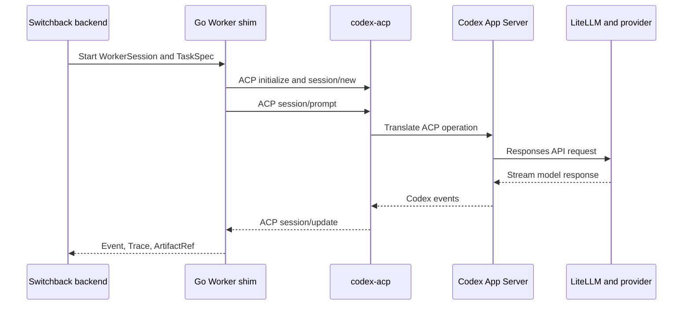

# Switchback Go ACP 与基础设施选型调研

_截至 2026-07-10，基于官方协议文档、官方项目文档和官方 GitHub 仓库的只读调研_

---

## 摘要

本文区分两类陈述：

- **事实**：可由协议规范、官方文档或项目官方仓库直接验证
- **设计建议**：结合 Switchback 当前目标、P0 范围和运维复杂度得出的推荐，不代表上游项目承诺

结论如下：

1. **Go ACP P0 选择 `github.com/coder/acp-go-sdk@v0.13.5`。** 它不是 ACP 官方 SDK，而是 ACP 官方站收录的社区库；正确仓库名是 `coder/acp-go-sdk`，`github.com/coder/acp-go` 截至调研日期不存在。Agent 侧固定 `@agentclientprotocol/codex-acp@1.1.2`，并在镜像 lockfile 中固定兼容的 `@openai/codex@0.144.1`，三者升级都必须经过契约测试。
2. **Go ACP SDK 只是协议层。** Switchback Worker 是 ACP Client，`agentclientprotocol/codex-acp` 是 ACP Agent/Adapter，后者再启动 Codex App Server。SDK 不负责容器、WorkerSession 生命周期、Trace JSONL、对象存储、EventCenter、LiteLLM 或 Switchback 领域状态。
3. **ACP 与 Switchback 后端通信是两条不同链路。** P0 中 ACP 最适合留在 WorkerSession 容器内，通过 `stdio` 连接 Go Worker shim 与 `codex-acp`；Worker shim 再通过 HTTPS/gRPC 向 Switchback 后端上传事件、Trace 和 Artifact。
4. **LiteLLM 是模型数据面网关，不是 Agent runtime。** P0 最简实现是在同一 WorkerSession 容器内以独立进程运行 LiteLLM，并仅监听 loopback；P1 再拆成同一 Pod/runtime group 内的独立 sidecar 容器。
5. **P0 本地基础设施应保持最小。** 推荐 GitHub、GitHub Actions、Docker Engine/Compose、PostgreSQL 加 transactional outbox、本地文件系统 ObjectStore adapter；不默认引入本地 GitLab、Jenkins、RocketMQ、MinIO 或 Kubernetes。
6. **MinIO 不应成为新系统的生产默认。** `minio/minio` 已在 2026-04-25 归档，官方 README 明确标记不再维护、社区版仅源码分发，且为 AGPL-3.0。

## 调研范围与方法

### 范围

本文回答以下问题：

- Go 生态可用 ACP SDK 的官方关系、成熟度、维护活跃度、API 覆盖和许可证
- Switchback Worker、ACP Client、`codex-acp`、Codex App Server、ACP Session/Event/Tool/Terminal 的职责边界
- LiteLLM 与 `ModelGateway` port 的职责和 P0 拓扑
- GitHub、GitLab、Jenkins、RocketMQ、MinIO、Docker、Kubernetes 的分阶段采用建议

### 方法

- 以 [ACP v1 规范](https://agentclientprotocol.com/protocol/v1/overview)、[ACP 官方组织](https://github.com/agentclientprotocol)和 [ACP 社区库清单](https://agentclientprotocol.com/libraries/community)为协议事实来源
- 以各项目官方仓库的 README、release、source、license 和官方部署文档为实现事实来源
- 活跃度数据是 2026-07-10 的时间截面，不应被当作长期保证
- 不以 star 数单独判断成熟度，优先考察协议覆盖、版本发布、测试、依赖重量、许可证和 Switchback P0 所需能力

## Go ACP SDK 生态

### 官方与社区关系

**事实：Go 当前没有 ACP 官方 SDK。** ACP 官方仓库列出的官方库是 Kotlin、Java、Python、Rust 和 TypeScript；Go 位于官网的 `Libraries / Community` 页面。该页面列出四个 Go 社区实现：`coder/acp-go-sdk`、`ironpark/acp-go`、`eino-contrib/acp` 和 `spachava753/acp-sdk`。[ACP 官方仓库的 Integrations](https://github.com/agentclientprotocol/agent-client-protocol#integrations)；[ACP Community Libraries](https://agentclientprotocol.com/libraries/community)

**事实：`github.com/coder/acp-go` 不存在，正确模块是 `github.com/coder/acp-go-sdk`。** 仓库属于 Coder 组织，虽然被 ACP 官网收录，但不属于 `agentclientprotocol` GitHub 组织，因此不能写成“ACP 官方 Go SDK”。[coder/acp-go-sdk](https://github.com/coder/acp-go-sdk)；[agentclientprotocol organization](https://github.com/agentclientprotocol)

**事实：ACP Registry 与 SDK 官方性无关。** Registry 是经过筛选的 ACP Agent 分发清单，要求 Agent 在握手中提供认证方法；它不是 SDK 认证或 SDK 成熟度榜单。[ACP Registry 文档](https://agentclientprotocol.com/get-started/registry)；[Registry 官方仓库](https://github.com/agentclientprotocol/registry)

### 候选库成熟度与许可证

| 库 | 维护快照 | 许可证 | 成熟度判断 | 主要风险 |
| --- | --- | --- | --- | --- |
| [`coder/acp-go-sdk`](https://github.com/coder/acp-go-sdk) | `v0.13.5`，2026-06-02 发布 | Apache-2.0 | 四者中最适合 P0 | 社区维护；仍为 `v0.x`；部分最新可选 API 可能滞后 |
| [`ironpark/acp-go`](https://github.com/ironpark/acp-go) | 无 release/tag；最近提交 2026-04-25 | MIT | 可研究，不建议 P0 | 仓库名与 module path 不同；无版本发布；要求 Go 1.26.1 |
| [`eino-contrib/acp`](https://github.com/eino-contrib/acp) | `v0.0.4`，2026-06-29 发布 | 仓库未提供 LICENSE | 功能广但仍早期 | 许可证缺失；依赖较重；P0 不需要其远程传输和代理能力 |
| [`spachava753/acp-sdk`](https://github.com/spachava753/acp-sdk) | `v0.2.0`，2026-07-07 发布 | 新增代码 Apache-2.0，上游保留原许可 | 活跃实验候选 | 项目很新；由 MCP Go SDK 改造；采用证据少 |

上表的版本依据各项目 release 页面：[coder v0.13.5](https://github.com/coder/acp-go-sdk/releases/tag/v0.13.5)、[eino-contrib v0.0.4](https://github.com/eino-contrib/acp/releases/tag/v0.0.4)、[spachava753 v0.2.0](https://github.com/spachava753/acp-sdk/releases/tag/v0.2.0)。`ironpark/acp-go` 的 `go.mod` module path 实际是 `github.com/ironpark/go-acp`，且仓库没有 release/tag。[ironpark go.mod](https://github.com/ironpark/acp-go/blob/main/go.mod)

关于许可证需要特别说明：

- `coder/acp-go-sdk` 仓库明确使用 [Apache-2.0](https://github.com/coder/acp-go-sdk/blob/main/LICENSE)
- `ironpark/acp-go` 仓库明确使用 [MIT](https://github.com/ironpark/acp-go/blob/main/LICENSE)
- `eino-contrib/acp` 根目录未提供 LICENSE，GitHub 也未识别许可证；**在维护者补充明确授权前，不应进入公司 P0 依赖清单**
- `spachava753/acp-sdk` 的 [LICENSE](https://github.com/spachava753/acp-sdk/blob/main/LICENSE) 声明新增改动使用 Apache-2.0，但由 MCP Go SDK 派生的原始贡献保留原许可证，合规扫描需要按文件确认

### API 覆盖比较

| 库 | Client/Agent | Session 与反向能力 | Transport | Switchback P0 适配度 |
| --- | --- | --- | --- | --- |
| `coder/acp-go-sdk` | 双向 typed interface 与 connection | `new/load/resume/list/close/prompt/cancel/config/mode`；FS、Terminal、Permission、Update、extension | 任意 `io.Reader/io.Writer`，示例以 stdio 为主 | 高 |
| `ironpark/acp-go` | 双向 connection | Session stream、store、middleware、Terminal handle | stdio、HTTP+SSE | 中低 |
| `eino-contrib/acp` | 双向 connection、server、proxy | generated types、反向调用、session event | stdio、Streamable HTTP、WebSocket | 中，能力超出 P0 |
| `spachava753/acp-sdk` | Agent interface、concrete Client | callback interface、cancel、并发、binary content、conformance tests | stdio 与可扩展 JSON-RPC transport | 中，成熟度不足 |

**事实：`coder/acp-go-sdk` 的 API 是从 ACP schema 生成的，并同时提供 Client 和 Agent 端。** 官方 README 展示了 `NewClientSideConnection`、`Initialize`、`NewSession`、`Prompt`、Agent/Client interface、Terminal callback 和 extension method；`v0.13.5` release 还包含稳定的 session config options 与 additional directories。[coder/acp-go-sdk README](https://github.com/coder/acp-go-sdk#explore-the-api)；[v0.13.5 release](https://github.com/coder/acp-go-sdk/releases/tag/v0.13.5)

**事实：ACP wire protocol 版本和 SDK/schema artifact 版本不是同一个概念。** 当前稳定 ACP wire protocol 是 `1`；SDK 包版本为 `v0.x` 不代表其只支持“ACP v0”。兼容性应以 `initialize.protocolVersion` 和 capability negotiation 判断。[ACP 官方 Versioning](https://github.com/agentclientprotocol/agent-client-protocol#versioning)；[Initialization capabilities](https://agentclientprotocol.com/protocol/v1/initialization)

**事实：`coder/acp-go-sdk@v0.13.5` 并非对最新所有可选能力完全同步。** 例如该版本仍将 `session/delete` 暴露为 unstable API，而当前 ACP v1 文档已将 Session Delete 列为稳定能力。这个差异不阻塞 Switchback P0 的 `new/load/resume/prompt/cancel`，但说明必须做 adapter contract tests。[coder client source at v0.13.5](https://github.com/coder/acp-go-sdk/blob/v0.13.5/client_gen.go)；[ACP Session Delete](https://agentclientprotocol.com/protocol/v1/session-delete)

### P0 推荐

**设计建议：P0 固定使用 `github.com/coder/acp-go-sdk@v0.13.5`，但在代码和文档中称为“ACP 社区 Go SDK”，不要称为“官方 Go SDK”。**

推荐原因：

- P0 只需要容器内 stdio ACP Client，不需要在 SDK 层引入 HTTP/WebSocket server、Hertz 或透明代理
- Coder SDK 的 `go.mod` 只声明 Go 1.21，没有第三方 runtime dependency，适合放在 Worker control shim 中。[go.mod](https://github.com/coder/acp-go-sdk/blob/v0.13.5/go.mod)
- 核心 session、stream update、permission、terminal 和 extension API 已覆盖
- Apache-2.0 清晰，release 节奏和使用样例优于其余候选

P0 采用条件：

1. 固定 `@agentclientprotocol/codex-acp@1.1.2` 与兼容的 `@openai/codex@0.144.1`，并提交 lockfile，禁止运行时无界使用 `latest`
2. 建立独立 ACP conformance/contract test，覆盖 `initialize` capability、`session/new`、`session/prompt`、`session/update`、permission、cancel、load/resume、terminal/file/tool event 映射
3. 对未知 enum、未知 `session/update`、extension method 和 adapter 新增字段采用兼容读取与原始帧落盘
4. 把 Go SDK 包在 Switchback 自有 `AgentControlPort` 后面，避免业务层直接依赖社区 SDK 类型

## Switchback Worker 与 ACP 边界

### P0 调用链



**事实：`codex-acp` 位于 `agentclientprotocol` 组织，是一个 TypeScript stdio ACP Agent server。** 它启动 Codex App Server，把 ACP request 翻译为 Codex operation，再把 Codex events 映射回 ACP Client。它支持模型/推理/审批/沙箱配置、文本与图像输入、shell/file/MCP/terminal/reasoning/plan/token usage 等事件，以及自定义 OpenAI-compatible gateway 认证。[agentclientprotocol/codex-acp](https://github.com/agentclientprotocol/codex-acp)

**事实：`codex-acp` 不是 Go SDK，也不是 Codex 本体。** 它是 Switchback Go ACP Client 与 Codex App Server 之间的 adapter；其 npm package 会携带兼容的 `@openai/codex` dependency。[codex-acp package.json](https://github.com/agentclientprotocol/codex-acp/blob/v1.1.2/package.json)

### Client、Agent 与 Session

| 概念 | Switchback P0 对应物 | 负责 | 不负责 |
| --- | --- | --- | --- |
| ACP Client | Go Worker control shim | 发起 initialize/session/prompt/cancel；接收 update；处理反向请求 | 实现 Codex 推理和工具循环 |
| ACP Agent | `codex-acp` process | 暴露 ACP server；翻译 ACP 与 Codex App Server | WorkerSession、容器和 Switchback 事件持久化 |
| Agent runtime | Codex App Server/Codex | 模型循环、工具执行、Codex session | Switchback TaskSpec 和 EventCenter 领域语义 |
| ACP Connection | Worker shim 与 `codex-acp` 的 stdio JSON-RPC 连接 | 双向 request/response/notification | 后端网络传输 |
| ACP Session | Agent 返回的 opaque session id | 一段可 new/load/resume 的 Agent 对话 | Switchback 用户级 WorkerSession 生命周期 |

**事实：一个 ACP connection 可以承载多个并发 session。** ACP 初始化阶段协商能力；Agent 至少支持 `session/new`、`session/prompt`、`session/cancel`、`session/update`，可选支持 load/resume/list/close 等能力。[ACP Architecture](https://agentclientprotocol.com/get-started/architecture)；[ACP Initialization](https://agentclientprotocol.com/protocol/v1/initialization)

**设计建议：保持现有身份关系，但修正“历史一对一”的表达。**

- 同一时刻，一个 `worker_session_id` 最多对应一个 active runtime/container
- 一个 `worker_session_id` 可以对应多个显式 ACP/Codex session id，例如用户或 adapter 创建 new session。固定 `codex-acp@1.1.2` 中的 subagent/nested flow 默认映射为带 child thread metadata 的 ACP tool call，Switchback 应记录为 AgentExecutionSpan/Trace，不自动创建独立 ACP AgentSession
- crash recovery 复用 `worker_session_id` 时，新容器会产生新的 container id，因此跨时间真实关系必然是 `worker_session_id : runtime_instance_id = 1:N`
- 增加 `runtime_instance_id` 或 `container_generation`，把“1:1”限定为当前 active mapping；否则 Kubernetes/Docker 的重建语义与需求自相矛盾

### Event 与 Switchback Trace

**事实：ACP 的实时输出主要通过 `session/update` notification 发送。** update 可包含 agent message、plan、tool call、tool call update、usage 等内容；message id 是 Agent 提供的 opaque id。[ACP Prompt Turn](https://agentclientprotocol.com/protocol/v1/prompt-turn)；[ACP Tool Calls](https://agentclientprotocol.com/protocol/v1/tool-calls)

**设计建议：ACP Event 不是 EventCenter Event。** Worker shim 应保留原始 ACP JSON-RPC frame，同时转换为 Switchback `TraceRecord` 和 `IntegrationEvent`，补充：

- `tenant_id`、`user_id`、`workspace_id`
- `worker_session_id`、`runtime_instance_id`、`agent_session_id`
- `task_id`、`trace_id`、`correlation_id`、`causation_id`
- `event_id`、`session_sequence`、`occurred_at`、`received_at`
- 原始 ACP method/update kind、adapter version、schema version

仅使用 `session_id + timestamp` 无法可靠排序和去重：时钟会漂移，时间戳可能碰撞，网络重试也会重复投递。推荐以 `event_id` 幂等去重，以 `worker_session_id + session_sequence` 做会话内排序，时间仅用于展示和跨源近似排序。

### Tool、Permission、FileSystem 与 Terminal

**事实：ACP ToolCall 主要是 Agent 向 Client 报告工具执行状态和结果的结构化事件。** 工具通常由 Agent 实际执行，Agent 可通过 `session/request_permission` 向 Client 请求用户决策；Client 也可以根据用户策略自动允许或拒绝。[ACP Tool Calls](https://agentclientprotocol.com/protocol/v1/tool-calls)

**事实：FileSystem 与 Terminal 是 Client 可选暴露给 Agent 的反向能力。** Terminal API 由 Agent 调用 Client 的 `terminal/create/output/wait_for_exit/kill/release`，命令运行在 Client 环境；Agent 必须先检查 Client 是否声明 terminal capability。[ACP Terminals](https://agentclientprotocol.com/protocol/v1/terminals)；[ACP File System](https://agentclientprotocol.com/protocol/v1/file-system)

**设计建议：Switchback 只在 WorkerSession 沙箱内部实现这些能力。**

- ACP Client 与 `codex-acp` 放在同一 WorkerSession 容器/runtime group，使 Terminal 和 FileSystem 的“Client 环境”仍然是沙箱，而不是宿主机
- 禁止把 Docker socket、宿主机根目录或宿主凭证目录暴露给 ACP Terminal/FileSystem
- 对普通沙箱内 patch、test、report 不额外询问；外部平台鉴权、跨权限边界或生产写操作才进入 Switchback approval
- P0 contract test 必须确认 `codex-acp` 的 shell/file events 究竟由 Codex App Server 本地执行后上报，还是需要 ACP Client Terminal callback；不能只凭协议抽象推断 adapter 行为

### Go ACP SDK 不承担的职责

Go ACP SDK 不负责：

- 构建镜像、创建/恢复/回收容器、48 小时 idle timeout、14 天最大存活和用户并发上限
- `worker_session_id`、container generation、TaskSpec、ArtifactRef 和领域状态机
- Codex 安装、Codex App Server 兼容性、`codex-acp` 版本匹配和 subagent 映射
- Trace JSONL 规范化、对象存储上传、Langfuse 投影和 EventCenter 回传
- LiteLLM 启停、模型路由、上游 key、预算、成本、重试和审计
- Skill/MCP 安装审批、SecretLease、网络策略和租户隔离

这些职责应分别由 Worker application/domain、runtime adapter、ObjectStore/EventCenter adapter、ModelGateway adapter 和 Skilling/Secret 管理模块承担。

## LiteLLM 与 ModelGateway

### LiteLLM 的职责

**事实：LiteLLM Proxy 提供 OpenAI-compatible gateway，可通过 Docker 运行并挂载 `config.yaml`，使用环境变量提供上游凭证。** 配置中的 `model_list`、router、alias、retry 和 timeout 可把稳定模型名路由到具体 provider/model。[LiteLLM Docker quick start](https://docs.litellm.ai/docs/proxy/docker_quick_start)；[LiteLLM config](https://docs.litellm.ai/docs/proxy/configs)；[LiteLLM routing](https://docs.litellm.ai/docs/proxy/load_balancing)

**事实：Codex 支持自定义 model provider。** provider 可配置 `base_url`、`env_key`、HTTP headers、command-backed auth 和 `wire_api = "responses"`，因此可以把 Codex 模型流量指向本地 LiteLLM。[Codex custom model providers](https://developers.openai.com/codex/config-advanced#custom-model-providers)；[Codex config reference](https://developers.openai.com/codex/config-reference)

LiteLLM 在 Switchback 中负责：

- 向 Codex 暴露稳定的 OpenAI-compatible Responses API endpoint
- 持有上游模型 provider credential，尽量不把上游 key 直接交给 Codex/task code
- model alias、provider routing、timeout、retry、fallback 和后续限流策略
- 模型调用 usage/cost/logging 的基础数据面观测
- P1 后按用户、workspace 或 session 分配 virtual key、budget 和 model access；LiteLLM virtual key 依赖 PostgreSQL，不应为了 P0 最简链路提前引入。[LiteLLM Virtual Keys](https://docs.litellm.ai/docs/proxy/virtual_keys)

LiteLLM 不负责：

- ACP initialize/session/prompt/update
- WorkerSession 或 Codex session 生命周期
- Tool/Skill/MCP 权限审批
- Switchback Trace JSONL 和 Langfuse 权威性
- EventCenter 排序、幂等、SSE 或前端渲染
- TaskSpec、Artifact、Truth、Inspiration

### 为什么保留 ModelGateway port

**设计建议：保留 `ModelGateway` port，但不要让它代理每个 token stream。** 它应是 Switchback control-plane abstraction，负责：

- 为 WorkerSession 解析模型策略、endpoint、model alias 和短期 credential
- 创建、续期、撤销 session-scoped model access
- 查询或汇总 usage/cost，关联 `task_id`、`worker_session_id` 和 `trace_id`
- 隔离 LiteLLM admin API、配置 schema 和部署拓扑

它不应重新实现 OpenAI Responses API data plane。Codex 直接请求 LiteLLM，避免多一跳和重复处理 streaming。

保留该 port 的原因不是“未来也许换产品”这一句空泛理由，而是当前已经存在三种会变化的边界：

1. P0 同容器 co-process，P1 独立 sidecar，生产可能是 per-Pod sidecar 或共享 gateway
2. LiteLLM admin/virtual-key API 属于基础设施协议，不应进入 Worker domain
3. 后续迁移 LLMGateway、测试 fake gateway 或使用内部统一网关时，Task/Worker 领域模型不应改变

### P0 最简 topology

**设计建议：P0 采用单 WorkerSession 容器内多进程，而不是每个 session 再增加一个 LiteLLM 容器。**

- `worker-shim`：Go 进程，ACP Client、Trace/Event/Artifact 上传和 session supervisor
- `codex-acp`：stdio ACP Agent server，启动兼容 Codex App Server
- `litellm`：独立进程，仅监听 `127.0.0.1:4000`
- `codex-acp/Codex`：通过 custom gateway auth 或生成的 Codex config 指向 `http://127.0.0.1:4000/v1`

启动顺序：

1. 容器 entrypoint 启动 LiteLLM 并等待 health check
2. Worker shim 启动固定版本 `codex-acp`
3. Worker shim 建立 stdio ACP connection 并执行 initialize
4. Worker shim 通过网络向 Switchback backend 注册 runtime instance，随后 new/load/resume Agent session

这不是严格意义上的 sidecar；它是 co-process。**P1 应拆为同一 Kubernetes Pod/runtime group 的独立 LiteLLM sidecar 容器**，以便独立 health check、资源限制和减少上游 key 暴露。Kubernetes 把同一 Pod 内多个容器视为共享网络和存储上下文的紧耦合单元，并正式支持 sidecar lifecycle。[Kubernetes Pods](https://kubernetes.io/docs/concepts/workloads/pods/)；[Kubernetes Sidecar Containers](https://kubernetes.io/docs/concepts/workloads/pods/sidecar-containers/)

P0 同容器方案的已知限制是进程级 secret isolation 较弱。即使只把上游 key 注入 LiteLLM 进程，同 UID 进程或过宽的 `/proc` 权限仍可能读取它；因此它只适合作为 P0 本地验证，生产应采用独立容器、不同用户、最小文件权限和网络策略。

## 基础设施分阶段选型

### 选型原则

Switchback P0 的目标是验证“真实 Coding Agent 在沙箱内可持续交互、产生 report/patch、轨迹可持久化、事件可回传”，不是搭建一套完整私有云。每增加一个有状态中间件都会增加启动、升级、备份、监控、故障恢复和本地资源成本，因此只有直接支撑 P0 验收的组件才进入默认栈。

### GitHub 与本地 GitLab

**事实：GitHub Actions 已提供 CI/CD workflow、hosted runner 和 self-hosted runner。** job 可运行在 VM 或 container 中，足以承担 Switchback 仓库自身的 build/test，以及后续验证 Worker image。[GitHub Actions overview](https://docs.github.com/en/actions/get-started/understand-github-actions)；[GitHub Actions runners](https://docs.github.com/en/actions/concepts/runners)

**事实：GitLab Self-Managed 当前单节点基线为 8 vCPU/16 GB RAM；内存受限环境至少 8 GB。** 这还没有计算 Switchback、WorkerSession、RocketMQ、Langfuse 等其他服务资源，因此不适合作为每个开发者默认本地依赖。[GitLab installation requirements](https://docs.gitlab.com/install/requirements/)

**设计建议：P0 只支持 GitHub；P1 将 GitLab 作为可选 integration profile。**

- P0 用 `SCMProvider` port 隔离 clone、branch、patch metadata、commit status、PR/MR 等平台差异
- P1 在专用集成机或 CI 环境运行 GitLab CE，验证 webhook、token、clone、MR 和 pipeline adapter
- 不要求 GitHub 与 GitLab 同时在线；生产按公司代码平台选择一个主平台
- 如果选 GitLab，其内置 CI/CD 与 Runner 已覆盖 pipeline/job/runners，不应再默认叠加 Jenkins。[GitLab CI/CD pipelines](https://docs.gitlab.com/ci/pipelines/)；[GitLab Runners](https://docs.gitlab.com/ci/runners/)

### Jenkins 是否必要

**事实：Jenkins 是 controller/agent 架构的通用自动化服务器，controller 负责调度和监控 agent。** 它可以使用 Docker agent，但引入独立 controller、插件、凭证、升级和 agent 运维面。[Jenkins agents](https://www.jenkins.io/doc/book/using/using-agents/)；[Jenkins Docker installation](https://www.jenkins.io/doc/book/installing/docker/)

**设计建议：Jenkins 不进入 P0/P1 默认栈。** GitHub Actions 或 GitLab CI 已提供仓库 CI；Switchback Worker 的交互式 48 小时 idle/14 天最大 session 也不是 Jenkins job/agent 生命周期。只有公司已有 Jenkins 且 Switchback 必须触发既有 pipeline 时，才把 Jenkins 作为 Delivery/CI integration adapter，而不是 Worker runtime。

### RocketMQ 是否适合 EventCenter

**事实：RocketMQ 5.x 的本地最小 Docker Compose 仍包含 NameServer、Broker、Proxy 三个服务。** 官方 Go 5.x client 已覆盖普通、FIFO、延时、事务消息和多种 consumer，但服务端和客户端运维面明显高于 PostgreSQL outbox。[RocketMQ Docker Compose quick start](https://rocketmq.apache.org/docs/quickStart/03quickstartWithDockercompose/)；[RocketMQ 5.x clients](https://github.com/apache/rocketmq-clients)

**事实：RocketMQ 只保证 message group 内的 FIFO，不保证全局顺序；消息是 at-least-once，失败会重投。** 因此消费者仍需幂等，不能把 broker message id 或 timestamp 当作业务唯一键。[RocketMQ ordered messages](https://rocketmq.apache.org/docs/featureBehavior/03fifomessage/)；[RocketMQ FAQ](https://rocketmq.apache.org/docs/bestPractice/06FAQ/)；[RocketMQ consumption retry](https://rocketmq.apache.org/docs/featureBehavior/10consumerretrypolicy/)

**设计建议：**

- P0 使用 PostgreSQL transactional outbox 加 polling dispatcher，先验证事件 schema、幂等、重试、SSE projection 和用户体验
- P1 增加可选 RocketMQ profile，message group 使用 `worker_session_id`，业务幂等键使用 `event_id`，排序键使用 `session_sequence`
- 生产是否采用 RocketMQ，取决于吞吐、跨服务订阅数、保留/回放、延时消息、组织运维经验和已有平台标准，而不是“EventCenter 必须有 MQ”
- 即使采用 RocketMQ，数据库 outbox 仍用于解决领域状态提交与事件发布之间的原子性窗口

RocketMQ 适合已有 RocketMQ 平台、需要大量异步订阅和 per-session FIFO 的环境；对于早期低吞吐 Switchback，它不是 P0 必需品。

### MinIO 当前状态与对象存储

**事实：`minio/minio` 仓库已于 2026-04-25 被 owner 归档，官方 README 明确写明“不再维护”。** 社区版使用 AGPL-3.0、只提供源码分发，不再发布维护中的预编译 community binary；历史 release 不再更新。[minio/minio 官方仓库](https://github.com/minio/minio)；[MinIO LICENSE](https://github.com/minio/minio/blob/master/LICENSE)

**设计建议：不要把 MinIO 作为 Switchback 新生产环境默认。**

- P0 用 `LocalFileObjectStore` 加 Docker named volume，验证 JSONL append/rollover、ArtifactRef、checksum 和恢复流程
- P1 用 `S3ObjectStore` contract tests 对接公司已有对象存储或维护中的 S3-compatible service
- 若为了兼容测试临时使用 MinIO，只能固定 source commit、自建镜像，并完成 AGPL、漏洞和维护风险评审
- 生产优先使用有明确 SLA、升级和安全支持的托管/内部对象存储

ObjectStore port 必须避免使用 MinIO 专有 admin API，使业务只依赖 bucket/key、multipart upload、range read、metadata、checksum、signed URL 或 backend proxy 等稳定能力。

### Docker 与 Kubernetes 的职责

**事实：Dockerfile 负责构建 image，Docker Engine 负责运行 container，Docker Compose 负责定义和运行本地多容器应用。** Compose 可以统一 service、network、volume、config 和 secret 的本地拓扑。[Docker Compose](https://docs.docker.com/compose/)；[Compose application model](https://docs.docker.com/compose/intro/compose-application-model/)

**事实：Kubernetes Pod 是最小调度单元，可包含共享网络/存储上下文的多个容器。** Kubernetes Job 面向运行到完成的一次性任务；Switchback WorkerSession 是可持续交互、按 idle/max lifetime 回收的会话，因此不适合直接建模为普通 Job。[Kubernetes Pods](https://kubernetes.io/docs/concepts/workloads/pods/)；[Kubernetes Jobs](https://kubernetes.io/docs/concepts/workloads/controllers/job/)

| 责任 | Docker P0 | Kubernetes 生产候选 | Switchback Worker 仍需负责 |
| --- | --- | --- | --- |
| Image | Dockerfile/build | 拉取 immutable image | AgentProfile 与 image version |
| Runtime | create/start/stop container | schedule/restart Pod/container | WorkerSession 状态机和回收策略 |
| Isolation | namespace/cgroup/user/network | Pod security、quota、network policy | capability、secret、workspace policy |
| Sidecar | 同容器 co-process 或 Compose service | 同 Pod LiteLLM sidecar | gateway config 与 credential lease |
| Recovery | Worker 重建 container | kubelet/controller 重建 Pod/container | session checkpoint、generation、rebind |

**设计建议（原始调研结论；M1 部署位置由 ADR 0059 收敛）：**

- M1 由 Compose 管理的 `switchback-backend` 内 RuntimeSupervisor 调用 Docker Engine，动态创建 sibling WorkerSession containers；这是 Docker-outside-of-Docker。Docker Socket 只挂载给受信任 Backend，WorkerSession container 内绝不挂载 Docker Socket，也不使用 privileged 模式。独立宿主 Supervisor 保留为风险上升后的 fallback，见 [ADR 0059](../adr/0059-embed-m1-runtime-supervisor-in-switchback-backend.md)
- P1 可用 kind/k3d 或测试集群验证“一 session 一 Pod + LiteLLM sidecar”，但不要求所有开发者本地运行 Kubernetes
- 生产候选用 Kubernetes 做资源调度、配额、网络策略、Secret 注入和故障重建；Switchback 自己仍维护 48 小时 idle timeout、14 天 absolute lifetime、用户并发 10 和 session/agent 映射
- 恢复所需 workspace/session state 必须放在 PVC、对象存储 checkpoint 或二者组合中，不能依赖 container writable layer

## 推荐矩阵

| 能力 | P0 本地开发 | P1 集成验证 | 生产候选 | 进入下一阶段的门槛 |
| --- | --- | --- | --- | --- |
| ACP Go SDK | `coder/acp-go-sdk@v0.13.5` | 多版本 contract matrix | 经验证版本或内部薄封装 | 覆盖核心 ACP event 与恢复 |
| Codex adapter | `codex-acp` 固定版本 | upgrade compatibility suite | 固定、可灰度升级 | 新版本事件不丢失 |
| Model gateway | 同容器 LiteLLM co-process | 独立 sidecar + optional DB | per-Pod sidecar 或共享 gateway | secret、预算、usage SLO 明确 |
| 代码平台 | GitHub | 可选专用 GitLab | GitHub Enterprise 或 GitLab | 身份、webhook、PR/MR 语义明确 |
| CI | GitHub Actions | GitHub Actions/GitLab CI adapter | 组织现有 CI | Jenkins 只做遗留集成 |
| 事件可靠性 | PostgreSQL outbox | 可选 RocketMQ 5.x profile | RocketMQ/托管 broker | 吞吐、保留、回放、SLO 明确 |
| 对象存储 | 本地文件系统 adapter | 维护中的 S3 endpoint | 托管/内部对象存储 | contract test 与数据治理通过 |
| Worker runtime | Docker Engine/Compose | Docker + optional K8s test | Kubernetes Pod | checkpoint、recovery、isolation 通过 |
| GitLab | 不启动 | 专用集成机 optional profile | 仅在自托管需求成立时 | 接受 8 vCPU/16 GB 基线运维成本 |
| Jenkins | 不采用 | 仅 external CI adapter test | 仅兼容现有平台 | 有真实遗留 pipeline 需求 |
| MinIO | 不采用或临时 fixture | 非默认 | 不推荐新生产采用 | 法务、安全、维护方案明确 |

P0 默认 Compose profile 建议只启动 Switchback backend、PostgreSQL 和必要的开发观测组件。WorkerSession 由 Worker runtime 动态创建，不应把 10 个常驻 session 预定义在 Compose 中。GitLab、RocketMQ、Langfuse 和 Kubernetes 应是独立 profile 或专用集成环境，避免默认开发栈失控。

## 未决风险与验证门槛

| 风险 | 当前证据 | 影响 | 推荐验证 | 阻塞阶段 |
| --- | --- | --- | --- | --- |
| Go SDK 与 `codex-acp` 漂移 | Go 仅有社区 SDK，adapter 更新更快 | 编译通过但事件丢失/方法不兼容 | ACP golden frames + live contract suite | P0 |
| `codex-acp` 事件覆盖 | README 列出广泛事件，但 Switchback schema 未逐项映射 | Trace/前端过程不完整 | shell/file/MCP/terminal/plan/usage 测试矩阵 | P0 |
| session/container 身份矛盾 | recovery 复用 session id，但新 container id 必然变化 | 审计与恢复映射错误 | 引入 runtime generation 并做 crash test | P0 |
| LiteLLM 同容器 secret 隔离弱 | co-process 共享 container security boundary | 上游 key 泄露 | 不同 UID、proc 限制、P1 sidecar | P0/P1 |
| 时间排序不可靠 | MQ/网络可乱序和重投 | SSE 抖动、状态回退、重复记录 | `event_id + session_sequence` chaos test | P0 |
| 48 小时/14 天 workspace 恢复 | container writable layer 非持久存储 | patch 和 session 丢失 | checkpoint/PVC/对象存储恢复演练 | P1 |
| RocketMQ 运维复杂度 | 本地最小仍为 NameServer/Broker/Proxy | 开发和生产成本增加 | 用量/SLO/回放需求评审 | P1 |
| MinIO 已归档 | 官方仓库停止维护且仅源码分发 | 安全与升级无默认路径 | 选择维护中的 S3 服务 | P1 |
| GitLab 本地资源高 | 官方单节点基线 8 vCPU/16 GB | 与 WorkerSession 争抢资源 | 专用集成环境容量测试 | P1 |
| “尽量不删除”无容量边界 | Trace、Artifact、Langfuse 均持续增长 | 成本和合规失控 | retention class、legal hold、archive tier | 生产前 |
| `eino-contrib/acp` 无 LICENSE | 仓库未明确授权 | 法务不可接受 | 上游补充许可证 | 采用前 |

## 最终推荐

Switchback 应把 P0 做成一个可替换但足够薄的 runtime vertical slice：

```text
GitHub TaskSpec
  -> Worker runtime on Docker
  -> Go ACP Client (coder/acp-go-sdk)
  -> codex-acp over stdio
  -> Codex App Server
  -> LiteLLM on loopback
  -> model provider
  -> ACP updates normalized by Worker
  -> PostgreSQL outbox + EventCenter projection
  -> JSONL/Artifact written through ObjectStore port
```

这条链路能直接验证 Switchback 的核心价值，同时把未来变化隔离在四个稳定 port 后：`AgentControlPort`、`ContainerRuntimePort`、`ModelGatewayPort`、`ObjectStorePort`。GitLab、Jenkins、RocketMQ、MinIO 和 Kubernetes 都不应该因为“常见”或“用户列过”而进入 P0；只有当它们解决了已经量化的集成、可靠性、隔离或规模问题时才升级为默认依赖。

## 一手资料索引

- [Agent Client Protocol official repository](https://github.com/agentclientprotocol/agent-client-protocol)
- [ACP Community Libraries](https://agentclientprotocol.com/libraries/community)
- [ACP Architecture](https://agentclientprotocol.com/get-started/architecture)
- [ACP Initialization](https://agentclientprotocol.com/protocol/v1/initialization)
- [ACP Session Setup](https://agentclientprotocol.com/protocol/v1/session-setup)
- [ACP Prompt Turn](https://agentclientprotocol.com/protocol/v1/prompt-turn)
- [ACP Tool Calls](https://agentclientprotocol.com/protocol/v1/tool-calls)
- [ACP Terminals](https://agentclientprotocol.com/protocol/v1/terminals)
- [coder/acp-go-sdk](https://github.com/coder/acp-go-sdk)
- [agentclientprotocol/codex-acp](https://github.com/agentclientprotocol/codex-acp)
- [Codex advanced configuration](https://developers.openai.com/codex/config-advanced)
- [LiteLLM Docker quick start](https://docs.litellm.ai/docs/proxy/docker_quick_start)
- [GitLab installation requirements](https://docs.gitlab.com/install/requirements/)
- [GitHub Actions](https://docs.github.com/en/actions/get-started/understand-github-actions)
- [Jenkins agents](https://www.jenkins.io/doc/book/using/using-agents/)
- [RocketMQ Docker Compose quick start](https://rocketmq.apache.org/docs/quickStart/03quickstartWithDockercompose/)
- [RocketMQ ordered messages](https://rocketmq.apache.org/docs/featureBehavior/03fifomessage/)
- [minio/minio](https://github.com/minio/minio)
- [Docker Compose](https://docs.docker.com/compose/)
- [Kubernetes Pods](https://kubernetes.io/docs/concepts/workloads/pods/)
- [Kubernetes Sidecar Containers](https://kubernetes.io/docs/concepts/workloads/pods/sidecar-containers/)
