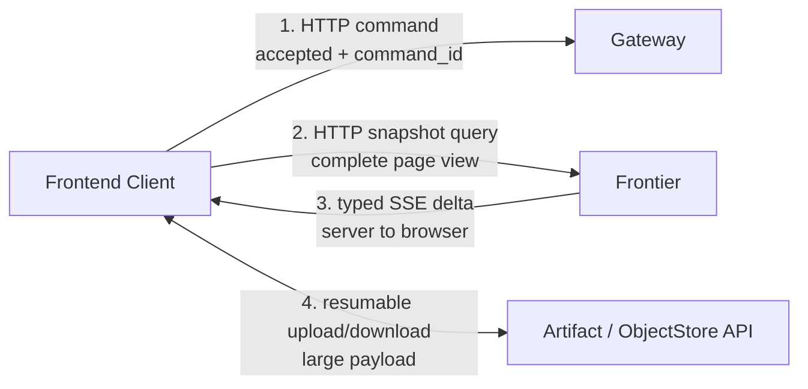

# GraphQL, SSE And Agent Client-Server Basics

> 调研日期：2026-07-13。本文用于解释技术职责和 Switchback P0 选型，不把某个前端框架写入领域契约。

## 结论

Switchback P0 继续采用普通 HTTP command/query + Frontier snapshot + typed SSE delta。GraphQL 暂不进入 P0，但保留为未来复杂跨资源查询的可选 read adapter。

原因不是 GraphQL 不好，而是它主要优化“客户端如何声明要哪些关联字段”；Switchback 当前最难的问题是异步命令收敛、Agent 流式事件、断线恢复、投影版本和 Artifact 传输。引入 GraphQL 不会替代这些协议，反而会提前增加 schema、resolver、字段级授权、查询成本和客户端 normalized cache 的复杂度。

## Agent Web 的四条通道



这四条通道的目标不同：

| Channel | 解决的问题 | 不应该承担 |
| --- | --- | --- |
| Command | 用户要求系统做什么；鉴权、幂等、快速 accepted | 等待长任务完成、持续推送 token |
| Snapshot query | 给页面一份自洽的完整当前状态 | 传输无限事件历史、执行副作用 |
| Typed stream | 推送状态、消息、Tool、审批和产物增量 | 成为业务事实源、传输大文件 |
| Artifact transfer | patch/report/raw payload 的断点传输和校验 | 低延迟状态通知 |

## GraphQL 到底做什么

[GraphQL 官方定义](https://graphql.org/)将其描述为 API 查询语言和服务端 runtime，并通过强类型 schema 表达数据及其关系。客户端可以声明要哪些字段，服务端返回与查询形状对应的结果。

例如 Task 页面只需要标题和 Worker 状态时，可以查询：

```graphql
query TaskHeader($id: ID!) {
  task(id: $id) {
    id
    title
    status
    workers {
      id
      status
    }
  }
}
```

它的直接价值是：

- 一个 endpoint 上组合关联资源，减少固定 REST response 的过取和欠取。
- schema、字段类型和关系对客户端可发现。
- 不同页面可以选择不同字段集合。
- 当 Web、移动端、飞书管理台等客户端的数据形状差异很大时，查询弹性更有价值。

[GraphQL 规范](https://spec.graphql.org/September2025/)定义 query、mutation 和 subscription 三类 operation。但 GraphQL 本身是 transport-agnostic；[GraphQL over HTTP 工作草案](https://graphql.github.io/graphql-over-http/draft/)主要映射 query/mutation 与 HTTP，并明确把 subscription 排除在当前 HTTP 规范范围外。因此“用了 GraphQL”不等于自动获得统一、可恢复的实时流协议。

### GraphQL 不会自动解决什么

- 不会定义 Switchback 的 TaskSaga、WorkerRun 或 projection 权威状态。
- 不会自动提供 `Last-Event-ID`、cursor retention、gap detection 或 `resync_required`。
- 不会替代 Agent message/tool/reasoning/artifact 的事件 taxonomy。
- 不会自动保证 mutation 幂等或外部副作用核查。
- 不会解决 Artifact 大文件断点传输。

工程上还需要额外处理字段级授权、resolver fan-out/N+1、query depth/complexity、schema 演进、partial error、subscription transport 和客户端 normalized cache。GraphQL over HTTP 草案自身也指出仍处于 Stage 2 draft，不适合把草案细节当作不可变生产协议。

## SSE 到底做什么

[WHATWG HTML 标准](https://html.spec.whatwg.org/dev/server-sent-events.html)定义了 `EventSource` 和 `text/event-stream`：服务器可以持续向浏览器发送命名事件，连接中断后浏览器可重连，并用 `Last-Event-ID` 告知服务器最后收到的事件 id。

SSE 的性质：

- 单向：server -> browser；用户命令仍走普通 HTTP POST。
- 基于 HTTP，适合经过常见反向代理和企业网络。
- 支持 `event`、`id`、`data` 和重连时间。
- 浏览器原生重连，但业务是否能续传取决于服务器是否保留 cursor 后的事件。
- `EventSource` 构造参数只有 URL 和 credentials mode，不提供任意自定义 header 面；Switchback 应优先使用 same-origin HttpOnly cookie/BFF，避免把 bearer token 放进 URL。

SSE 的自动重连不等于业务恢复。Switchback 仍然需要：

1. snapshot 返回当前 `view_epoch/view_cursor`；
2. SSE event id 使用相同 epoch/cursor 空间；
3. Frontier 保留一个有限 replay window；
4. cursor 过旧、epoch 改变或 delta version 断裂时返回 `resync_required`；
5. Frontend 重新获取 snapshot，而不是按时间戳猜缺失事件。

## 为什么 Switchback P0 不用 GraphQL

| 目标 | HTTP snapshot + typed SSE | GraphQL + subscription |
| --- | --- | --- |
| 固定 Task/Worker 页面 | 直接、schema 面小 | 查询弹性暂时用不上 |
| command accepted/idempotency | 与 Gateway HTTP 语义自然匹配 | mutation 仍需自定义 command contract |
| Agent typed events | SSE event taxonomy 直接表达 | subscription transport/taxonomy 仍需设计 |
| resume/resync | epoch/cursor/Last-Event-ID 明确 | GraphQL 规范不替 Switchback 定义 |
| 权限 | page projection 统一过滤 | 需要字段/resolver 级授权 |
| Go P0 实现复杂度 | 低 | 多一套 schema/resolver/client cache |

这不是永久排除 GraphQL。出现以下信号时可以重新评估只读 GraphQL adapter：

- 多种客户端需要完全不同的 Task/Worker/Workspace 关联字段。
- REST/page projection endpoint 数量和组合查询明显失控。
- 团队已经具备 GraphQL schema governance、query cost、DataLoader 和字段级授权基础设施。
- GraphQL 只作为查询 facade，不改变 Gateway command、Frontier SSE、EventCenter 和 owner context 的协议边界。

## 对 Switchback 的推荐 C/S 分工

### Frontend Client

- 渲染 page-optimized View。
- 保存短期 UI state、输入草稿和 pending command。
- 应用版本连续的 typed delta。
- 发生 gap/unknown schema/epoch mismatch 时丢弃局部投影并重新拉 snapshot。
- 不从 raw domain events 或 Trace 推断 Task/Worker 权威状态。

### Gateway

- 接收 message、AgentTurn、approval、ArtifactAction 等 command。
- 完成认证、输入校验、idempotency 和快速 accepted。
- 返回 `command_id`，但不承诺异步结果已经发生。

### Frontier

- 返回一致 page snapshot。
- 通过 SSE 推送版本化 typed delta 和 stream control event。
- 维护有限 replay window、heartbeat、cursor 和 `resync_required`。
- 对用户可见内容做授权过滤，不向浏览器暴露内部 domain event。

### EventCenter / Projection

- 消费 owner events，构建 ViewProjection。
- 处理 duplicate、gap、late event 和 projector replay。
- 不直接把 broker message 当浏览器协议。

## 下一项需要单独决定

Agent 输出存在两种不同数据：

- **durable state**：Run 状态、完整消息 checkpoint、Tool start/end、Approval、Artifact、Task 状态，必须可恢复。
- **transient stream**：token/message chunk、细粒度 reasoning/progress，主要改善实时体验。

如果把每个 token 都作为持久 projection delta，会产生明显写放大；如果全部视为瞬时数据，断线后又可能看到残缺消息。下一轮应决定 durable/transient 双通道与 checkpoint 语义。
