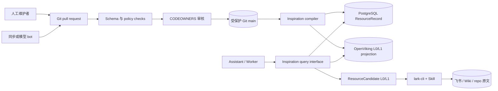
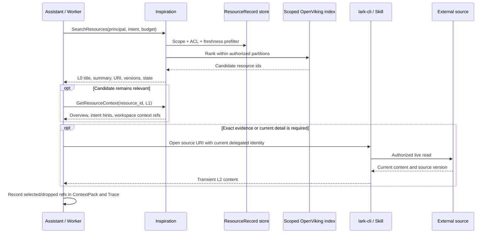

# Switchback Inspiration Versioned Context Repository Design

> 状态：P0 已接受设计基线。
>
> 日期：2026-07-10。
>
> 范围：Inspiration 独立版本化上下文仓库、运行时资源目录、同步与 Agent 渐进读取。

本文只使用官方文档、项目官方仓库或项目的一手规范支撑外部事实。除明确引用的一手事实外，其余内容均为 Switchback 的设计建议，不代表外部项目的实现承诺。

## 1. 结论

Switchback P0 应采用 **Markdown 上下文页 + 单资源 YAML manifest + 生成式 `INSPIRATION_INDEX.md` + 可重建运行时投影**，而不是把一个大型 Markdown 文件直接当数据库，也不应在 P0 引入数据库主写、Git 镜像审核的双写链路。

核心分工如下：

- `InspirationEntry`：Git 中低频、可人工审核的声明，描述资源是什么、为何可能有用、属于哪个 scope、由谁负责、如何继承源系统权限。
- `ResourceRecord`：由已合并的 `InspirationEntry` 编译出的运行时记录，保存源版本、内容指纹、权限观测、同步健康度、摘要新鲜度和索引版本。
- `INSPIRATION_INDEX.md`：由 manifests 确定性生成的人类浏览视图，不允许手工维护。
- `contexts/**/*.md`：人工可维护的用户、工作区、项目意图和额外上下文，不复制外部完整文档。
- PostgreSQL：保存 `ResourceRecord`、同步状态和错误等运行时投影。
- OpenViking：保存可重建的 L0/L1 检索投影；不成为 Inspiration 声明、外部原文或 ACL 的权威来源。
- 外部源系统：始终拥有完整文档、源版本和当前访问权限；Agent 需要原文时通过 `lark-cli` 和对应 Skill 按链接读取。

最重要的设计判断是：**不要把低频治理数据与高频观测数据写进同一个 Git 模型。** Git 适合审阅摘要、意图、owner 和 scope；`last_checked_at`、短暂 403、重试次数、embedding 版本等状态会产生无意义提交和冲突，应只存在于运行时投影。

### 1.1 权威来源不是一个，而是按问题划分

| 问题 | 权威来源 | 原因 |
| --- | --- | --- |
| 这个资源是否应被 Switchback 发现、面向什么意图、由谁维护 | Inspiration Git `main` | 需要人类可读 diff、审核、版本和回滚 |
| 文档当前内容和源版本是什么 | 飞书/Wiki/代码仓库等外部源系统 | Inspiration 不复制完整内容 |
| 当前用户是否仍可访问 | 源系统 ACL 与 Switchback Identity | Git 中的 scope 只是候选路由，不是授权凭据 |
| 最近一次同步是否成功、摘要是否过期 | `ResourceRecord` | 高频、可重建的运行态 |
| 如何快速召回候选 | OpenViking/search projection | 派生索引可以删除并从 Git 与 `ResourceRecord` 重建 |

### 1.2 P0 非目标

- 不在 Inspiration 仓库保存飞书文档、妙记或 Wiki 的完整正文。
- 不允许模型直接写受保护分支、直接写生产 `ResourceRecord` 或直接发布新摘要。
- 不把 `InspirationEntry.summary` 当作可直接约束 Agent 行为的 Truth。
- 不把 Skill 使用说明、凭证或工具权限嵌入资源 manifest。
- 不为搜索索引建立第二个可人工修改的事实源。
- 不承诺跨组织共享资源；P0 先按 `tenant_id + workspace_id` 分区，并支持可选的 `user_id`/`project_ids` 收窄。

## 2. 一手资料与可借鉴模式

### 2.1 直接相关的一手项目

| 一手来源 | 官方事实 | 对 Switchback 的直接启示 | 不应照搬的部分 |
| --- | --- | --- | --- |
| `llms.txt` 提案 | 该提案用一个有固定结构的 Markdown 文件提供简要背景、分组链接和可选资源；其目标是让人和 LLM 都能读取，并支持程序化解析。[^1] | 纯 Markdown 很适合 L0 目录和渐进发现；`INSPIRATION_INDEX.md` 应保持短、可扫描、指向细节。 | 它是网站推理时上下文提案，不解决企业 ACL、同步状态、冲突或审核策略，不能直接作为 Switchback 完整数据模型。 |
| Backstage Software Catalog | Backstage 将源代码管理中的 YAML 元数据文件视为 catalog 条目的事实来源，owner 通过正常 Git 工作流维护；合并后 catalog 自动摄取更新。[^2] | Git manifest 可以承担资源声明，运行时 catalog 只做摄取和查询投影。 | Backstage 的软件实体 taxonomy 不适合直接复制为知识资源 taxonomy。 |
| Backstage entity descriptor | Backstage 对输入使用便于人维护的 YAML，对 API 使用同语义 JSON；`apiVersion`/`kind` 决定解析方式。它还把处理状态定义为输出字段，而不是声明文件输入。[^3] | `InspirationEntry` 与 `ResourceRecord` 应分开；schema version 属于 Git 声明，处理健康度属于运行时输出。 | 不需要复制 Kubernetes 风格的完整 envelope；P0 应维持更小字段面。 |
| Backstage ingestion/provider | Backstage catalog 从权威来源摄取实体，在数据库中处理后提供 API；provider 支持 full/delta mutation，并用稳定 provider/location key 避免来源冲突和条目接管。[^4][^5] | Switchback 需要稳定 `entry_id`、来源定位、幂等 upsert 和明确冲突规则；运行时数据库应可从 Git 重建。 | Inspiration P0 不需要通用插件式 catalog processor 框架。 |
| GitHub CODEOWNERS 与 protected branches | CODEOWNERS 会请求对应 owner 评审；只有结合分支保护中的 required code-owner review、required reviews/status checks，才能形成可执行合并门禁。[^6][^7] | 路径 owner、schema/policy CI 和受保护 `main` 共同组成 Inspiration 的发布控制面。 | CODEOWNERS 不是运行时访问控制，也不能替代源系统 ACL。 |
| OpenViking | OpenViking 官方仓库描述了 filesystem paradigm，并把上下文分成 L0 摘要、L1 概览和按需读取的 L2 详情。[^8] | Switchback 可以复用 L0/L1/L2 的交互模型，先返回短摘要，再返回概览，最后由 Agent 读取原文。 | Switchback 的 L2 仍在飞书/Wiki 等源系统，不把完整原文复制进 Inspiration/OpenViking。 |

### 2.2 从一手资料得到的约束

1. 人类可读与机器可读并不冲突：YAML manifest 负责强 schema，Markdown 负责意图与浏览视图。
2. Git 是声明发布面，不是运行时状态数据库；运行时目录必须可由受保护分支重建。
3. 自动化应产生 proposal/PR，而不是绕过 owner 改写主分支。
4. 渐进式加载的目标不是多做三份摘要，而是让 Agent 在每一层都能决定是否值得继续花 token 和权限成本。
5. 目录中的 owner、scope、tags 只能辅助治理和召回；当前 ACL 必须由源系统或可信授权投影决定。

## 3. 三种架构比较

### 3.1 方案 A：纯 Markdown 索引

形态：以一个或多个 `INSPIRATION_INDEX.md` 为权威来源，每条记录包含标题、URL、摘要、标签和用途说明。

优点：

- 对人工编辑最友好，第一天即可使用。
- Git diff、review、history 和 rollback 天然可用。
- Agent 无需额外 parser 即可读取。
- 基础设施和开发成本最低。

缺点：

- Markdown 列表对强校验、唯一键、scope、权限策略和 schema migration 支持弱。
- 单一大文件会形成热点，自动同步与人工修改容易产生 merge conflict。
- 字段缺失、顺序变化和自由文本很容易使 parser 变脆。
- 很难区分声明状态、同步状态和索引状态。
- 权限过滤只能另写旁路逻辑，最终仍会出现第二份机器数据模型。

适用条件：几十条公开或低敏资源、主要人工维护、暂时不做自动同步。它适合作为 spike，不适合作为 Switchback P0 的稳定契约。

### 3.2 方案 B：Markdown + machine-readable manifest

形态：每个资源一个 YAML manifest；工作区/主题意图使用 Markdown；`INSPIRATION_INDEX.md` 从 manifests 生成。Git `main` 是声明权威，运行时 `ResourceRecord` 和 OpenViking 索引均为派生投影。

优点：

- 保留 Git 审核和人工编辑能力，同时获得 schema、唯一性、引用完整性和策略校验。
- 一资源一文件显著缩小冲突范围，bot 和人工可以并行修改不同条目。
- 声明与运行态分离，周期同步不会制造 Git 提交噪音。
- Git SHA、源文档版本和索引版本可以独立追踪。
- L0/L1 可以从结构化字段和 Markdown context 组合产生。
- 使用已有 PostgreSQL、GitHub 和 OpenViking，不增加新的 P0 基础设施类别。

缺点：

- 需要 manifest schema、编译器、生成器和 CI。
- 人工需要理解少量 YAML 约束。
- Git 合并到运行时可见之间存在短暂发布延迟，需要 webhook + reconciliation 处理。

适用条件：需要人工与模型共同维护、权限过滤、自动同步和长期版本治理。**推荐 Switchback P0 使用。**

### 3.3 方案 C：数据库索引 + Git 审核镜像

形态：数据库是主要写模型；UI、同步器和模型先写草稿表，再生成 Git PR 作为审核镜像；PR 合并后由 webhook 将决策应用回数据库。

优点：

- 最适合大规模批量同步、复杂查询、细粒度 workflow 和高频状态变化。
- 可以在 DB 中实现 draft、review、publish、rollback 等完整状态机。
- 对非 Git 用户可提供更完整的管理 UI。

缺点：

- DB 草稿、Git PR、已发布 DB 之间形成双写和双向同步问题。
- 需要处理 PR 被 force-push、关闭、rebase、部分合并以及 webhook 丢失。
- Git 不再是自然的权威源，审计者需要理解两套 revision。
- 运维、故障恢复和一致性成本最高。

适用条件：条目达到十万级、外部 provider 高频 delta、需要复杂运营台且 Git 成为吞吐瓶颈时再评估。P0 采用该方案是在为尚未出现的规模付费。

### 3.4 维度对比

| 维度 | 方案 A：纯 Markdown | 方案 B：Markdown + manifest | 方案 C：DB + Git 镜像 |
| --- | --- | --- | --- |
| 人工可编辑性 | 高 | 高，需遵循 schema | 中，通常依赖 UI |
| 自动同步 | 低，parser 脆弱 | 高，proposal 与运行态分离 | 很高 |
| 权限表达 | 低 | 中高，声明 policy ref，运行时执行 ACL | 高 |
| 冲突范围 | 高，集中于少数文件 | 低，一资源一文件 | DB 冲突低，双写冲突高 |
| 版本可解释性 | Git revision 单一，但源版本缺失 | Git/source/index 三类 revision 明确 | DB/Git/source revision 最复杂 |
| Agent 渐进加载 | 中 | 高，L0/L1 字段稳定 | 高 |
| 重建能力 | 中 | 高，DB/index 可从 Git 重建 | 中，需先确定哪边权威 |
| 运维成本 | 低 | 中 | 高 |
| P0 结论 | 仅适合 spike | 推荐 | 暂缓 |

## 4. P0 推荐架构



### 4.1 模块接口

Inspiration 对 Assistant/Worker 保持两个主要读取操作：

```text
SearchResources(query_context, intent, budget, limit) -> ResourceCandidate[]
GetResourceContext(query_context, resource_id, level=L0|L1) -> ResourceContext
```

接口约束：

- `query_context` 由 Switchback 注入 tenant/user/workspace/project/repo 和授权主体，Agent 不能自行覆盖。
- 返回值只能包含已发布、未 tombstone、权限观测仍有效的资源。
- `SearchResources` 返回短 L0，必要时才调用 `GetResourceContext` 取得 L1。
- Inspiration 不提供 `GetFullDocument`。L2 读取由 Agent 通过 `lark-cli`/Skill 直接访问源系统。
- 每个候选都返回 `entry_revision`、`source_version`、`summary_state`、`freshness_state` 和 source ref，供 `ContextPack` 与 Trace 记录。

### 4.2 存储映射

| 数据 | P0 存储 | 可否重建 | 写入者 |
| --- | --- | --- | --- |
| `InspirationEntry` | 独立 Git repo | 不适用，声明权威 | 人工或 bot PR，经审核合并 |
| 工作区/项目 context Markdown | 独立 Git repo | 不适用，声明权威 | 人工或 bot PR，经审核合并 |
| `ResourceRecord` | PostgreSQL | 可以 | Inspiration compiler/sync worker |
| L0/L1 语义索引 | OpenViking | 可以 | indexer |
| 完整文档 | 外部源系统 | 不由 Switchback 重建 | 源系统 owner |
| 临时读取内容 | Worker/Assistant 受控临时上下文 | 任务后清理或按现有 Trace 脱敏策略处理 | `lark-cli`/Skill |

OpenViking 当前原生 ACL/filter 能力必须通过 spike 验证，P0 不能假设其能独立完成 Switchback 授权。最低可行策略是按 tenant/workspace 的 `viking://resources/...` 路径或隔离分区检索，并由 Inspiration 在进入语义排序前完成 scope/ACL 预过滤。

## 5. 目录布局

```text
inspiration-context/
├── README.md
├── INSPIRATION_INDEX.md                # generated; do not edit
├── schemas/
│   └── inspiration-entry.v1.schema.json
├── resources/
│   └── <tenant_id>/
│       └── <workspace_id>/
│           ├── <entry_id>.yaml
│           └── ...
├── contexts/
│   └── <tenant_id>/
│       └── <workspace_id>/
│           ├── README.md                # 工作区目标、术语、维护规则
│           ├── <topic>.md               # 主题/项目意图上下文
│           └── ...
├── .github/
│   ├── CODEOWNERS
│   └── workflows/
│       └── validate-inspiration.yaml
└── tools/
    ├── validate
    └── generate-index
```

目录规则：

- 一条 `InspirationEntry` 对应一个 YAML 文件，文件名等于稳定 `entry_id`。
- `contexts/` 只保存 Switchback 自己的意图、导航和使用说明，不粘贴外部文档正文。
- `INSPIRATION_INDEX.md` 由 `tools/generate-index` 排序生成；CI 要求生成后 `git diff --exit-code` 为零。
- `lifecycle_status: tombstoned` 的条目留在原路径，避免删除文件后失去重定向、审计和索引清理依据。
- 同一个源 URL 可在不同 workspace 有不同 entry，因为意图和摘要可能不同；运行时可以按 canonical URI 复用元数据探测，但不能合并 scope。

## 6. 最小数据模型

### 6.1 `InspirationEntry`：Git 声明模型

建议的最小 manifest：

```yaml
schema_version: inspiration.entry.v1
entry_id: switchback-runtime-design

scope:
  tenant_id: tenant-a
  workspace_id: platform-engineering
  user_id: null
  project_ids:
    - switchback

source:
  type: feishu_doc
  uri: https://example.feishu.cn/docx/REDACTED

title: Switchback Worker runtime design
summary:
  l0: WorkerSession、ACP Codex 和运行时隔离的设计入口。
  l1: >-
    用于理解 Switchback Worker 的容器、会话恢复、Agent 控制和凭证注入约束；
    实现或评审 Worker 相关变更前应先读取原文确认当前版本。
  based_on_source_version: "doc-version-42"
  provenance:
    kind: human
    generator_ref: null

intent_hints:
  - 设计或评审 WorkerSession
  - 排查 ACP Codex runtime 边界
tags:
  - worker
  - acp
  - runtime
context_refs:
  - contexts/tenant-a/platform-engineering/switchback.md

owner_ref: team:platform-runtime
access_policy_ref: source_inherit
freshness_policy_ref: default:feishu_doc
lifecycle_status: active
```

| 字段 | 必需 | 含义与约束 |
| --- | --- | --- |
| `schema_version` | 是 | 固定为可迁移的 schema 标识，不使用 Git SHA 代替 |
| `entry_id` | 是 | 稳定、不可复用；文件名与其一致 |
| `scope` | 是 | `tenant_id`、`workspace_id` 必需；`user_id`、`project_ids` 可选收窄 |
| `source.type` | 是 | `feishu_doc`、`feishu_wiki`、`feishu_minutes`、`repo_doc`、`web` 等受控枚举 |
| `source.uri` | 是 | 原始可引用 URI；CI 做 canonicalization、host allowlist 和敏感信息检查 |
| `title` | 是 | 人类可识别名称，不作为稳定标识 |
| `summary.l0` | 是 | 一句话摘要，只用于相关性判断，不表达不可验证的新事实 |
| `summary.l1` | 否 | 规划阶段概览和使用场景；没有时由 L0、intent hints 与 context 组合 |
| `summary.based_on_source_version` | 条件必需 | 已知源版本时必须填写，用于判断摘要是否 stale |
| `summary.provenance` | 是 | `human` 或 `model`；模型生成时 `generator_ref` 指向模型/prompt policy 版本 |
| `intent_hints` | 是 | 说明什么任务应召回该资源，避免把 tags 当自然语言意图 |
| `tags` | 否 | 低基数、受控词汇，用于过滤和浏览 |
| `context_refs` | 否 | 指向仓库内工作区/项目 Markdown，不允许指向完整文档副本 |
| `owner_ref` | 是 | 负责内容语义与链接有效性的团队/用户；不授予运行时访问权 |
| `access_policy_ref` | 是 | P0 默认 `source_inherit`；指向授权策略，不内嵌易漂移的 ACL 用户列表 |
| `freshness_policy_ref` | 否 | 默认按 source type 选择探测周期、重试和 stale 阈值 |
| `lifecycle_status` | 是 | `active`、`disabled`、`tombstoned` |

有意不放入 Git 的字段：`last_checked_at`、`next_check_at`、`sync_error`、实时 ACL、embedding id、重试次数、读取次数和最近使用时间。这些字段变化频繁且不需要 PR 审核。

### 6.2 `ResourceRecord`：运行时投影

`ResourceRecord` 不是第二份可人工编辑的事实源。它是编译器将 Git 声明与源系统观测合并后的物化记录。

这会有意收敛当前领域草稿中的一个术语：`ResourceRecord` 不应作为拥有独立发布权威的 Aggregate Root。其运行时状态可以有自身不变量和更新事务，但声明语义仍由 `InspirationEntry` 的 Git 发布流程拥有；否则数据库与 Git 会同时成为 owner。

| 字段 | 含义 |
| --- | --- |
| `resource_id` | 等于 `entry_id` 的稳定运行时 id |
| `schema_version` | `resource.record.v1` |
| `entry_revision` | 发布该声明的 Git commit SHA |
| `scope` | 从 entry 复制并规范化的 tenant/workspace/user/project scope |
| `source_type`, `canonical_uri` | 规范化来源与 URI |
| `title`, `summary_l0`, `summary_l1` | 当前已审核、已发布的 L0/L1 |
| `intent_hints`, `tags`, `context_refs` | 当前已发布的召回元数据 |
| `owner_ref`, `access_policy_ref` | 治理与授权策略引用 |
| `source_version` | connector 最近观测到的文档版本/etag/revision；允许空值 |
| `content_fingerprint` | 经授权读取时计算的内容指纹；不保存原文 |
| `permission_snapshot_ref` | 指向受控 ACL/identity projection 的 opaque ref，不保存凭证 |
| `permission_checked_at` | 该权限观测的时间，用于决定查询前是否必须 refresh |
| `freshness_state` | `unknown`、`ready`、`stale`、`unreachable`、`forbidden`、`missing` |
| `summary_state` | `current`、`stale`、`proposal_pending` |
| `checked_at`, `next_check_at` | metadata probe 时间 |
| `index_state`, `index_revision` | `pending`、`ready`、`failed` 与当前 OpenViking/index build id |
| `last_error` | 结构化错误码、重试类别和脱敏消息；成功后可清理 |
| `updated_at` | 当前投影更新时间 |

### 6.3 四种版本不能混用

| 版本 | 回答的问题 | 产生位置 |
| --- | --- | --- |
| `schema_version` | parser 应如何解释字段 | manifest/schema |
| `entry_revision` | 哪一次审核发布了摘要、scope 和 owner | Git commit |
| `source_version` | 外部文档内容是否变化 | source connector |
| `index_revision` | 哪个摘要/模型版本被索引 | indexer/OpenViking |

只有当 `summary.based_on_source_version == ResourceRecord.source_version` 且对应 `entry_revision` 已完成索引时，`summary_state` 才能是 `current`。

## 7. 发布、同步与冲突处理

### 7.1 发布流水线

1. 人工、同步 bot 或模型 bot 基于最新 `main` 创建分支，只修改目标 entry/context 以及生成视图。
2. CI 解析全部 manifests，并执行 schema、唯一性、URI、安全和引用检查。
3. CI 重新生成 `INSPIRATION_INDEX.md`，检查生成结果无未提交 diff。
4. CODEOWNERS 按 tenant/workspace 路径请求 owner 审核。
5. 受保护分支要求 required review、required status checks，并禁止 bot 绕过。
6. 合并 commit SHA 成为新的 `entry_revision`。
7. Git webhook 触发 compiler；reconciler 也周期扫描 `main`，补偿丢失 webhook。
8. compiler 以 `(entry_id, entry_revision)` 为幂等键 upsert `ResourceRecord`。
9. indexer 仅将 ACL 允许、非 tombstone、L0/L1 可发布的数据写入 scope 隔离的 OpenViking 路径。
10. 新 revision 成功可查询后记录发布结果；旧 revision 保留审计但不再返回。

### 7.2 CI 必须检查

- 所有 YAML 通过 `inspiration-entry.v1.schema.json`。
- `entry_id` 与文件名一致，且历史上未被另一个资源复用。
- `(scope, canonical_uri)` 不重复；跨 workspace 的同 URI 允许，但必须是不同 entry。
- `source.type` 与 URI host/scheme 匹配 allowlist，URI 中不包含 token、临时签名或凭证。
- `owner_ref`、`access_policy_ref`、`context_refs` 可解析。
- `summary.l0`、`summary.l1` 和 intent hints 满足长度/token 上限。
- model provenance 在 `kind: model` 时包含 `generator_ref` 和 `based_on_source_version`。
- manifest 中不存在运行时字段和完整原文。
- tombstone 不允许删除 `entry_id`、source URI、owner 和最后发布 revision 所需审计信息。
- 生成索引与 manifests 一致。

### 7.3 自动同步不直接修改主分支

同步分成两条链路：

1. **观测链路**：周期 metadata probe 或 source webhook 更新 `ResourceRecord.source_version`、ACL snapshot、freshness 和错误，不产生 Git 提交。
2. **语义链路**：发现标题、摘要或 intent 需要变化时，生成一个带 source version 的 PR proposal；只有合并后才发布新的 L0/L1。

这样可以避免每次探测都产生 commit，也保证模型生成语义永远经过 owner review。

### 7.4 冲突规则

- 不使用无条件 last-write-wins。
- 稳定主键是 `entry_id`；来源身份是 `(scope, canonical_uri)`。
- bot 只修改一个 entry 文件，并在提交前比较 base `entry_revision` 与当前 `main`。
- 如果 source version 或 Git base 在摘要生成后变化，proposal 自动标记 obsolete，重新生成后再审。
- 两个 provider 不能声明同一 `(scope, canonical_uri)`；CI 报错并要求明确 owner，而不是任选一个覆盖。
- `INSPIRATION_INDEX.md` 冲突通过重新生成解决，禁止手工选择冲突片段。
- tombstone 合并后，compiler 先从查询面下线，再异步删除索引；不得只删除 Git 文件后期待下游猜测删除语义。

## 8. 模型生成摘要的审核规则

P0 原则：**模型可以提案，不能发布语义。**

### 8.1 允许模型做什么

- 为已存在 entry 提议新的 `summary.l0`、`summary.l1`、`intent_hints` 和 tags。
- 为明确授权的外部链接提议新 `InspirationEntry`。
- 根据最新 source version 标记旧摘要 stale。
- 生成 PR 描述，列出 source version、涉及的标题/章节标识、模型与 prompt policy 版本。

### 8.2 必须人工审核的变化

- 任意模型生成的 L0/L1 或 intent hints。
- 新增资源、变更 source URI、scope、owner、access policy 或 lifecycle。
- 从一个 workspace 扩大到多个 workspace/tenant 的可见范围。
- 涉及安全、生产、合规、客户数据或人员信息的摘要。

### 8.3 发布门禁

- bot 只能创建分支/PR，没有直接 push `main` 或 merge bypass 权限。
- 需要对应 workspace CODEOWNER 的真人 approval。
- 启用“最新可评审 push 必须由他人批准”或 dismiss stale approvals，防止 bot 在 approval 后追加内容。
- 合并前 `source-version-current` check 必须确认 proposal 的 `based_on_source_version` 仍为当前版本；无法确认时阻塞语义发布。
- PR、日志和 manifest 不复制大段原文，不写凭证；证据只保留 source URI、版本、标题/section ref 和受控审计引用。
- 任何模型摘要可通过 Git revert 回滚；回滚后触发 compiler 和 reindex。

### 8.4 摘要语义限制

- 摘要描述“该资源包含什么、何时值得读取”，不把文档中的结论重写成平台强规则。
- 不在摘要中生成源文档没有明确支持的推断。
- 对时效敏感内容使用“读取原文确认当前状态”等提示，不固化临时数值。
- `summary_state != current` 时，不把摘要作为事实注入 prompt；最多返回带 stale 标志的导航链接，并要求 live read。

## 9. 过期与失效检测

```mermaid
stateDiagram-v2
    accTitle: Inspiration Source Freshness
    accDescr: Runtime source observations move between unknown, ready, stale, unreachable, forbidden, and missing without rewriting the Git declaration; tombstoning remains a reviewed Git decision.

    [*] --> unknown
    unknown --> ready: metadata probe succeeds
    unknown --> unreachable: retry threshold reached
    unknown --> forbidden: sync credential denied

    ready --> stale: source version changed or max age exceeded
    stale --> ready: reviewed summary merged and indexed

    ready --> unreachable: transient failures exceed threshold
    stale --> unreachable: transient failures exceed threshold
    unreachable --> ready: probe recovers

    ready --> forbidden: ACL or credential revoked
    stale --> forbidden: ACL or credential revoked
    forbidden --> ready: authorized probe succeeds

    ready --> missing: authoritative not-found confirmed
    stale --> missing: authoritative not-found confirmed
    missing --> ready: source restored or URI corrected
    missing --> [*]: Git entry tombstoned
```



### 9.1 探测信号

按可靠性从高到低使用：

1. connector 提供的文档 id、revision、etag、updated_at 或删除标记。
2. 在合法授权下读取并计算的 `content_fingerprint`。
3. HTTP 状态/重定向，仅用于允许通用 HTTP 探测的 source type。
4. Agent live read 的成功或结构化错误，作为补充观测而非唯一删除依据。

### 9.2 状态行为

| 状态 | 查询行为 | 自动动作 |
| --- | --- | --- |
| `unknown` | 新 entry 默认不进入语义召回；可由 owner 显式测试 | 立即 probe |
| `ready` | 正常返回 L0/L1 | 按 freshness policy 安排下次检查 |
| `stale` | 可返回导航链接和 stale 标志；不把旧摘要当当前事实 | 生成摘要 proposal 或等待人工更新 |
| `unreachable` | 仅在调用方允许 last-known navigation 时返回，必须带错误状态 | 指数退避并告警 owner |
| `forbidden` | 不返回标题、摘要或 URI 给无权主体 | 刷新凭证/ACL；不能推断资源已删除 |
| `missing` | 从正常候选中排除 | 通知 owner，创建更新 URI 或 tombstone proposal |

单次 404、超时或 403 不能自动 tombstone。`missing` 需要 connector 的权威删除信号，或多次独立 not-found 后由 owner 通过 PR 确认。`forbidden` 必须绑定到具体同步身份或 ACL snapshot，不能据此推断所有用户都无权访问。

### 9.3 摘要与索引失效

- `source_version` 变化后立即把 `summary_state` 标为 `stale`。
- stale 摘要对应的 embedding/index entry 要删除或降级，避免旧语义继续高分召回。
- 新摘要合并后，以 `(entry_id, entry_revision, source_version)` 为 index idempotency key 重建。
- `index_state != ready` 时允许结构化/标签候选，但不得宣称语义索引已覆盖最新摘要。
- freshness 与 index failure 都写入 `ResourceRecord`，不反向制造 Git 状态提交。

## 10. 权限模型

### 10.1 Scope 不是 ACL

`scope` 回答“谁的任务可能需要看到这个候选”，`access_policy_ref` 和源系统 ACL 回答“当前主体是否真的可以看到”。两者必须同时通过。

P0 查询顺序：

1. Switchback Identity 注入 tenant/user/workspace/project principal。
2. Inspiration 按 entry scope 预过滤。
3. 检查 `permission_snapshot_ref` 是否覆盖当前 principal 且未过 freshness TTL。
4. 权限观测过期时先 refresh；不能在未知 ACL 下先做全局语义检索再事后过滤。
5. 只在允许的 tenant/workspace OpenViking 分区或候选集合内排序。
6. 返回 L0/L1 前再次检查 lifecycle、freshness 和 permission。
7. Agent 做 L2 live read 时，由源系统使用当前用户/委托凭证再次授权。

### 10.2 仓库自身的权限

- Inspiration repo 必须是 private，只向平台维护者和对应 workspace curator 开放。
- Worker 容器不挂载或 clone 整个 Inspiration repo，只通过受控查询接口取得已授权候选。
- Git repo 中不保存临时签名 URL、token、cookie、密钥或展开的 ACL member list。
- 高敏 tenant 如果连 URL/title 元数据都不能向平台级维护者共享，应拆分独立 repo 或独立加密分区；P0 不用单仓库假装解决这一风险。
- CODEOWNERS 只控制谁可以审核 manifest，不赋予资源读取权限。

## 11. Agent 渐进读取流程



具体规则：

1. L0 只回答“这是什么、为什么可能相关、是否新鲜”，目标是低 token 候选筛选。
2. L1 提供任务意图、使用场景和工作区 context，帮助 Agent 判断是否需要原文。
3. L2 是源系统当前完整内容，只在需要证据、精确字段或实现细节时读取。
4. `stale` 候选不得只凭旧摘要回答时效敏感问题，必须 live read 或明确丢弃。
5. `ContextPack.items` 记录实际使用的 entry/source/index revision；`dropped` 记录权限、过期、预算、读取失败或低相关性原因。
6. Trace 记录 Agent 是否打开了原文，避免把“看过摘要”误报为“验证过文档”。

## 12. 与其他领域的边界

| 能力 | Inspiration | Truth | Skill | 完整文档存储 | Search/OpenViking projection |
| --- | --- | --- | --- | --- | --- |
| 核心对象 | 外部资源指针、摘要、意图和 workspace context | 可治理的长期事实、偏好、规则、程序性知识 | 可执行的能力说明、依赖与权限 | 外部系统原文 | 可重建的召回索引 |
| 权威来源 | Inspiration Git `main` | Evolution RDBMS lifecycle；OpenViking 仅 active projection | Skilling/Skill source repository | 飞书/Wiki/repo 等源系统 | 不是权威来源 |
| 可否直接改变 Agent 行为 | 不能，只提供候选来源 | active Truth 可在受控 ContextPack 中影响行为 | 可以提供工具和流程能力 | 原文作为证据输入 | 不能，只排序/返回候选 |
| 是否保存完整内容 | 否 | 只保存已治理断言，不保存整篇文档 | 只保存执行所需说明 | 是 | P0 只保存 L0/L1 和索引元数据 |
| 模型自动变更 | 只能提 PR | 由 Evolution 模型建议 + 确定性 policy gate | 按 Skilling 安装/发布策略 | 不归 Switchback 修改 | 可自动重建，但不能反向覆盖 Git |
| 权限来源 | scope + source ACL | Truth scope/ACL/lifecycle | Capability grant/policy | 源系统 ACL | 继承并强制过滤上游权限 |

边界细化：

- Inspiration summary 不是 Truth。只有在 Agent 实际读取来源并形成可追踪 evidence 后，Evolution 才能生成 `TruthCandidate`。
- Skill 决定“如何读取飞书文档”，Inspiration 只返回“哪个链接值得读”；manifest 不复制 Skill prompt。
- Inspiration 不代理完整文档 API，不长期缓存原文，不承担文档协作编辑。
- OpenViking/search 只消费已发布 `ResourceRecord`，禁止模型或 Agent 直接写索引来绕过 Git 审核。
- `ResourceRecord` 的 `source_version`、ACL 和 freshness 是运行时观测，不应被 Evolution 当成业务 Truth。

## 13. P0 验收标准与后续升级触发点

### 13.1 P0 验收标准

- 至少支持 `feishu_doc`、`feishu_wiki`、`feishu_minutes` 和 `repo_doc` manifests。
- manifest schema、唯一性、URI allowlist、owner/access/context refs 和 generated index checks 可在 CI 阻塞合并。
- 受保护 `main` 禁止 bot bypass；模型语义变更必须真人 CODEOWNER 审核。
- Git merge 后可幂等生成 `ResourceRecord`，丢失 webhook 可由 reconciliation 修复。
- source version 变化可将摘要和索引标为 stale，不修改 Git。
- `forbidden`/`missing` 不泄漏标题、摘要和 URI；stale 状态在 `ResourceCandidate` 与 `ContextPack` 可见。
- Assistant/Worker 能按 L0 -> L1 -> `lark-cli`/Skill L2 渐进读取，并记录 selected/dropped reason。
- 删除/tombstone 能使查询先下线，再可靠清理 OpenViking 投影。
- PostgreSQL/OpenViking 数据可以从 Git `main` 和源系统 metadata 重新构建。

### 13.2 升级到 DB-primary 方案的触发点

只有出现以下至少两个信号时，再评估方案 C：

- 单 repo 条目量、PR 数或生成索引时间已经成为明确瓶颈。
- provider 需要秒级大规模 delta，Git proposal 无法承载。
- 需要非 Git 用户使用复杂运营台进行批量审核、委派和 SLA 管理。
- workspace/tenant 隔离要求必须拆分为大量独立仓库，控制面开始不可维护。
- 需要对 draft/review/publish 实现跨多个审核人的事务状态机。

即使升级，Git 仍可保留为审核与审计产物，但必须先明确 DB 是唯一发布权威，避免双向写入。

## 14. 风险与待验证项

| 风险/待验证项 | P0 处理 |
| --- | --- |
| OpenViking 是否支持 Switchback 所需的候选 id/scope 过滤 | 做独立 spike；未验证前使用 tenant/workspace 分区和 Switchback 预过滤，不依赖其原生 ACL |
| 飞书不同资源类型能否稳定取得 revision/updated_at | connector 分类型验证；拿不到时使用授权内容 fingerprint，并把 source version 标为 opaque |
| 中央 Git repo 的 URL/title 元数据是否满足内部合规 | 做 repo access review；高敏 workspace 使用独立 repo/分区 |
| 模型摘要 PR 如何让 reviewer 快速核验且不泄漏原文 | PR 只放 source version 与 section refs；reviewer 通过有权限的 live link 核验 |
| stale 摘要是否允许返回 | 默认只作为带 stale 标志的导航，不作为当前事实；调用方可更严格地直接 drop |
| GitHub 不可用时是否影响已有查询 | 已发布 `ResourceRecord` 可短时只读服务；禁止新发布，恢复后 reconcile |

## References

[^1]: Answer.AI / Jeremy Howard. "The /llms.txt file." llms-txt project proposal. https://llmstxt.org/

[^2]: Backstage. "Backstage Software Catalog." Official documentation. https://backstage.io/docs/features/software-catalog/

[^3]: Backstage. "Descriptor Format of Catalog Entities." Official documentation. https://backstage.io/docs/features/software-catalog/descriptor-format/

[^4]: Backstage. "The Life of an Entity." Official documentation. https://backstage.io/docs/features/software-catalog/life-of-an-entity/

[^5]: Backstage. "External integrations." Official documentation. https://backstage.io/docs/features/software-catalog/external-integrations/

[^6]: GitHub. "About code owners." Official documentation. https://docs.github.com/en/repositories/managing-your-repositorys-settings-and-features/customizing-your-repository/about-code-owners

[^7]: GitHub. "About protected branches." Official documentation. https://docs.github.com/en/repositories/configuring-branches-and-merges-in-your-repository/managing-protected-branches/about-protected-branches

[^8]: Volcengine. "OpenViking: The Context Database for AI Agents." Official repository README. https://github.com/volcengine/OpenViking/blob/main/README.md
