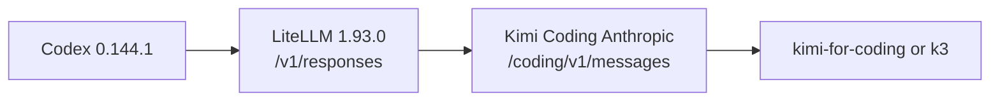
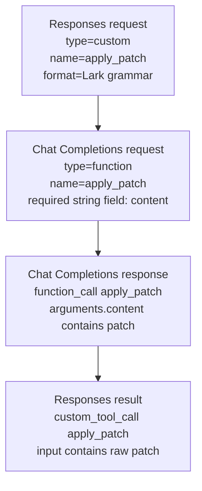

# Kimi Coding 与 Codex/LiteLLM 工具协议兼容性调研

> 状态：已完成官方资料核对、带凭证协议探针和 Switchback Worker Runtime 在线 E2E。
>
> 日期：2026-07-22。
>
> 范围：判断 Kimi Coding API 能否解决 Switchback 当前 `Codex Responses custom tool -> LiteLLM -> Anthropic Messages` 的 `unknown variant custom` 失败。

## 结论

**Kimi Coding 的 Anthropic-compatible 路由先在 LiteLLM `1.92.0` 下解除 `unknown variant custom` 阻塞，随后又在升级后的 `1.93.0` 镜像中完成 Switchback Worker Runtime 真实两 Turn 回归。** 两轮执行复用了同一个 ACP session、容器和 WorkingCopy，分别产生生产代码 patch 与边界测试 patch，测试、Trace、Langfuse、secret absence 和清理验收均通过。Kimi 本次仍通过 `exec_command` 完成文件修改，因此它证明了完整 Coding Agent 路径和版本回归，不单独证明 Kimi 路由上的 Responses free-form `apply_patch` wire round trip。

已经实测到 function-tool 调用的链路是：



判断分为四层：

| 判断 | 结论 | 证据等级 |
| --- | --- | --- |
| `https://api.kimi.com/coding/v1` 是否正确 | 正确，它是 Kimi Coding 的 OpenAI-compatible Base URL | 官方明确 |
| Kimi Coding 是否原生提供 `/responses` | 没有已发布的官方支持；官方反而明确说明 Codex Responses 与 Kimi Chat Completions 不兼容，需要转换层 | 官方明确到“需要转换”；不能把未列出的路径断言为永久不存在 |
| 当前 LiteLLM `1.92.0` + Kimi OpenAI 路由能否修复 | 不能；Kimi `/responses` 返回 404，Chat Completions 对 `type: custom` 返回 400 | 在线实测 |
| 当前 LiteLLM `1.92.0` + Kimi Anthropic 路由能否修复原 400 | **能**；请求成功，Codex 产生了正确的 `exec_command` function call | Switchback 在线 E2E |
| 当前路由能否完成 Worker Runtime Spike | **能**；两 Turn、增量 patch、测试、Trace、Langfuse 与清理均通过 | Switchback 在线 E2E |
| 当前路由能否保证 `apply_patch` custom-tool 闭环 | 尚未证明；Agent 通过普通 shell 修改文件，直接 custom-tool 探针的 free-form input 仍变成空对象 | 在线实测，风险明确 |
| LiteLLM `1.93.0` + Kimi Anthropic 路由是否回归通过 | **能**；完整两 Turn acceptance 为 `completed/passed` | Switchback 在线 E2E |
| LiteLLM `1.93.0` + Kimi 是否已触发 `apply_patch` | 没有；本次真实轨迹仍使用 `exec_command` | 在线轨迹 |

因此 Kimi 可作为 `kimi-codex-anthropic-v1` 显式模型 profile，与 DeepSeek 并列供 WorkerRun 启动前选择；它不是同一 AgentTurn 内的自动 fallback。若要对 Kimi 单独保证全部 Codex 内建工具语义，仍需增加可控的 wire contract test 或让任务稳定触发原生 `apply_patch`。

## 调研边界

- 只使用 Kimi/Moonshot 官方文档与仓库、LiteLLM 官方文档与源码、OpenAI Codex 官方源码与文档。
- 在线探针使用用户提供的 Kimi Coding Key，但不把完整 Key、Authorization header 或可逆凭证写入本文和受版本控制文件。
- 在线请求覆盖模型发现、文本生成、标准 function tool、custom tool、OpenAI `/responses`、Anthropic Messages 和完整 Switchback 两 Turn E2E。
- Key 已经出现在对话上下文中；当前仅暂存在 Git ignored、`0600` 的本地数据目录，进入共享环境或生产使用前应轮换。

## Kimi Coding API 契约

### 路径

Kimi Code 官方概览同时公布 OpenAI 与 Anthropic 两类兼容入口：[Kimi Code Overview](https://www.kimi.com/code/docs/en/)。

| 协议 | Base URL | 官方示例完整路径 | 状态 |
| --- | --- | --- | --- |
| OpenAI Chat Completions | `https://api.kimi.com/coding/v1` | `https://api.kimi.com/coding/v1/chat/completions` | 官方支持 |
| Anthropic Messages | `https://api.kimi.com/coding/` | `https://api.kimi.com/coding/v1/messages` | 官方支持 |
| OpenAI Responses | 未公布 | `https://api.kimi.com/coding/v1/responses` | **不在官方契约中** |

这里有一个容易配错的细节：Anthropic-compatible Base URL 是 `https://api.kimi.com/coding/`，客户端再拼接 `v1/messages`；OpenAI-compatible Base URL 已包含 `/v1`。

Kimi 官方 Codex 接入文档进一步明确：Codex CLI 使用 OpenAI Responses API，而 Kimi For Coding 提供 OpenAI-compatible Chat Completions API，两者不兼容，需要本地路由层双向转换请求和流式响应。[Using Kimi in Codex](https://www.kimi.com/code/docs/en/third-party-tools/codex)

这意味着：

- 不能把 Codex 的 Base URL 直接指向 `https://api.kimi.com/coding/v1` 并期待 `/responses` 工作。
- Kimi 官方文档中的 Codex 示例依赖 CC Switch；该页同时标明这是社区第三方集成，不由 Kimi 官方维护，也不保证兼容所有 Codex/CC Switch 版本。
- Switchback 可以让现有 LiteLLM 承担同类协议桥接职责，但必须验证它正确处理 Codex 的 custom tools 和流式回包。

### 模型

截至调研日期，Kimi Coding 两种协议均公布以下模型 ID：[Model Configuration](https://www.kimi.com/code/docs/en/kimi-code/models.html)

| 模型 ID | 官方定位 | 上下文/权限注意点 |
| --- | --- | --- |
| `k3` | Kimi K3，复杂工程和长程推理 | Moderato 及以上；最高 1M 取决于会员等级；支持 `low/high/max` reasoning effort |
| `kimi-for-coding` | Kimi K2.7 Code 标准版 | 所有 Kimi Code 会员；256K；Thinking 常开 |
| `kimi-for-coding-highspeed` | Kimi K2.7 Code 高速版 | Allegretto 及以上；256K；额度消耗更高 |

首次兼容性 spike 推荐 `kimi-for-coding`，因为权限门槛最低；若凭证有 K3 权限，再补测 `k3` 的 `medium -> high`、`xhigh -> max` reasoning 映射。模型质量不是首轮测试目标，首轮只验证协议和工具闭环。

### 2026-07-22 在线协议探针

使用同一个 Kimi Coding Key 和诚实的 Switchback compatibility-probe User-Agent 得到：

| 请求 | HTTP | 结果 |
| --- | ---: | --- |
| `GET /coding/v1/models` | 200 | 返回 `kimi-for-coding`、`kimi-for-coding-highspeed`、`k3` |
| OpenAI Chat Completions，纯文本 | 200 | `kimi-for-coding` 正常返回 |
| OpenAI Chat Completions，标准 `type:function` | 200 | 正确返回 `tool_calls[].function` 和参数 |
| OpenAI Chat Completions，`type:custom` | 400 | `unknown tool type: custom, currently only function and plugin are supported` |
| OpenAI `/responses`，`type:custom` | 404 | endpoint 不存在 |
| Anthropic Messages，纯文本 | 200 | 正常返回 text/thinking blocks |
| Anthropic Messages，标准 client tool | 200 | 正确返回 `tool_use` 和结构化 input |
| Anthropic Messages，携带 `type:custom` | 200 | 不拒绝请求，但无 schema 的 free-form custom tool 返回空 `input: {}` |

这组探针说明 Kimi 的两个兼容入口行为不同：OpenAI 路径严格拒绝 custom tools；Anthropic 路径宽松接受 mixed tool declaration，但并未原生保留 OpenAI Responses 的 free-form custom-tool 语义。

### Switchback 真实 E2E

使用以下 upstream 配置运行 `make spike-e2e`：

```text
SWITCHBACK_SPIKE_UPSTREAM_MODEL=anthropic/kimi-for-coding
SWITCHBACK_SPIKE_UPSTREAM_API_BASE=https://api.kimi.com/coding
```

结果：

1. 原 DeepSeek 路由的 `HTTP 400 unknown variant custom` 不再出现。
2. 初次运行发现 `codex-acp 1.1.2` 默认 `INITIAL_AGENT_MODE=agent`，从而在容器内启用 `workspace-write` bubblewrap；Worker 固定注入 `INITIAL_AGENT_MODE=agent-full-access` 后，Codex 在既有隔离容器边界内执行，意外 ACP permission 请求仍保持 fail closed。
3. 最终运行记录 12 个成功的 `model_observation`，model 均为 `kimi-for-coding`，两轮均以 `stopReason=end_turn` 结束。
4. Turn 1 修复 `counter.Add` 的生产代码并通过 `go test ./...`；Turn 2 在同一个 ACP session、容器和 WorkingCopy 中新增零增量边界测试，再次通过测试。
5. 两轮都生成独立 report、patch、raw ACP JSONL、normalized Trace 和校验清单；宿主 Fixture digest 前后一致。
6. Langfuse 精确查询验证同一 Trace 下的 2 个 `agent.turn` span、12 个 generation 及 Trace/Observation runtime metadata；已知凭证扫描通过。
7. 最终 acceptance 为 `execution_outcome=completed`、`spike_acceptance=passed`、`cleanup_confirmed=true`，Compose 与动态 Worker 无残留。
8. Codex 曾尝试把 `apply_patch` 当作 shell 命令，但镜像中没有该二进制，随后改用普通 shell 完成修改；因此本次 E2E 证明了真实编码闭环，但不证明 Responses `custom_tool_call` round-trip。

原始证据保存在 ignored runtime data 下：

```text
spikes/worker-runtime/.spike-data/variants/kimi-anthropic/
```

最终关键 ACP 顺序是 `session/prompt -> repeated model/function-tool calls -> production patch -> end_turn -> second session/prompt -> boundary-test patch -> end_turn`。machine-readable 结果位于 `acceptance/summary.json`，所有文件均在 Git ignored 的 runtime data 下。

### Coding Agent 定位

Kimi Coding 明确面向终端/IDE Agent 编程和多文件工程任务，并提供 Codex、Claude Code、OpenCode 等接入指南。不过“面向 Codex”不等于“原生实现 Responses API”：其 Codex 指南明确要求协议转换层。

Kimi 还提供官方 Coding Agent `Kimi Code CLI`，其 `kimi acp` 子命令通过 stdio JSON-RPC 暴露 ACP Agent，覆盖 `initialize`、认证、session new/load/resume、prompt、cancel、tool update、permission 和文件反向调用。[`kimi acp` reference](https://www.kimi.com/code/docs/en/kimi-code-cli/reference/kimi-acp.html)

这为 Switchback 提供了另一条路线：把 Kimi Code CLI 作为新的 `AgentAdapter`，由 Worker shim 直接通过 ACP 控制。该路线绕开 Codex Responses 转换问题，但它是“增加一个真实 Coding Agent”，不是“修好现有 CodexAdapter”，应单独立项和做 ACP 契约测试。

## 两条 Kimi 路由的差异

Switchback Worker 镜像当前固定：

- `@openai/codex@0.144.1`
- `@agentclientprotocol/codex-acp@1.1.2`
- `litellm[proxy]==1.93.0`

Codex `0.144.1` 的官方源码把 freeform tool 序列化为 Responses `type: "custom"`；`apply_patch` 正是带 Lark grammar 的 freeform tool：[ToolSpec](https://github.com/openai/codex/blob/rust-v0.144.1/codex-rs/tools/src/tool_spec.rs)、[apply_patch spec](https://github.com/openai/codex/blob/rust-v0.144.1/codex-rs/core/src/tools/handlers/apply_patch_spec.rs)。因此该 `custom` 不是 Switchback 或 DeepSeek 构造出来的异常字段，而是 Codex 所依赖的正式工具语义。

LiteLLM `1.92.0` 的 `transform_responses_api_tools_to_chat_completion_tools` 只显式转换 `function`、MCP 和 web search；其他工具进入 `else` 后原样追加到 Chat Completions tools 列表：[LiteLLM v1.92.0 transformation](https://github.com/BerriAI/litellm/blob/v1.92.0/litellm/responses/litellm_completion_transformation/transformation.py#L1279-L1333)。

如果使用 Kimi OpenAI Chat Completions，上游仍会形成：

```text
Codex tools[].type=custom
-> LiteLLM 1.92.0 原样透传
-> Kimi OpenAI-compatible Chat Completions
-> 收到非标准 Chat Completions tool 类型
```

Kimi/Moonshot 官方工具调用契约使用 JSON Schema function tools 和 `tool_calls`；没有官方证据表明 Kimi Chat Completions 接受 Responses 的 `type: "custom"`。[Moonshot tool_calls guide](https://platform.kimi.com/docs/guide/use-kimi-api-to-complete-tool-calls)

在线探针确认这条 OpenAI 路径返回 400，所以不能直接使用。

Kimi Anthropic Messages 路径则表现得更宽松：它接受包含 `type: custom` 的工具数组，因此现有 LiteLLM `1.92.0` 请求不再在反序列化阶段失败；同一请求中的标准 function tools 可以正常调用。这正是本次 Switchback E2E 能运行 `exec_command` 的原因。

但是，宽松接受不等于完整语义兼容。直接 custom-tool 探针得到空 `input: {}`，而 Codex 的 `apply_patch` 依赖 free-form patch 文本。因此当前 Anthropic 路由足以让 Worker 通过普通 function/shell tools 完成 Task 14，却不能替代完整 custom-tool bridge。

## LiteLLM 1.93.0 带来的关键变化

LiteLLM `1.93.0` 的官方源码新增了专门的 custom-tool bridge：[v1.93.0 transformation](https://github.com/BerriAI/litellm/blob/v1.93.0/litellm/responses/litellm_completion_transformation/transformation.py)、[custom_tools.py](https://github.com/BerriAI/litellm/blob/v1.93.0/litellm/responses/litellm_completion_transformation/custom_tools.py)。对应提交明确写明目标是 Codex CLI 的 custom tool round-trip：[commit `2f0cdb3`](https://github.com/BerriAI/litellm/commit/2f0cdb35bf35f77caa55faec321313af9c4615db)。

它执行以下双向转换：



LiteLLM 同版本还提供了针对 `apply_patch`、混合 function/custom tools、流式工具调用、参数解包和多轮输入恢复的官方测试：[test_custom_tool_call.py](https://github.com/BerriAI/litellm/blob/v1.93.0/tests/test_litellm/responses/test_custom_tool_call.py)。

这比“删除 custom tools”可靠：删除会让模型失去 patch 能力，而双向转换保留了工具名、grammar 描述、内容和 Codex 期望的回包类型。

## 推荐 Kimi 路由

Kimi Coding 不是 LiteLLM `moonshot/` provider 的默认 Moonshot Open Platform 地址。LiteLLM 官方 Moonshot provider 文档当前只列 `/chat/completions`，默认指向 `api.moonshot.ai`，与 `api.kimi.com/coding` 是两个产品入口：[LiteLLM Moonshot provider](https://docs.litellm.ai/docs/providers/moonshot)。

### A. 当前可用的短期路由

现有 LiteLLM `1.92.0` 无需改代码即可使用：

```text
SWITCHBACK_SPIKE_UPSTREAM_MODEL=anthropic/kimi-for-coding
SWITCHBACK_SPIKE_UPSTREAM_API_BASE=https://api.kimi.com/coding
```

该路由已经解除原 400，并通过真实两 Turn Worker Runtime acceptance。限制是尚未证明 `apply_patch` custom-tool round-trip，因此只能作为当前 Spike 的已验证临时路由，不能直接提升为最终生产 ModelRoute。

### B. 面向完整 custom tools 的目标路由

对 Kimi Coding 应使用 OpenAI-compatible custom endpoint，并显式启用 Responses-to-Chat-Completions bridge。LiteLLM 官方支持两种写法：[LiteLLM Responses bridge](https://docs.litellm.ai/docs/response_api#opt-in-bridge-for-openai-models-with-custom-api_base)

```yaml
model_list:
  - model_name: switchback-codex
    litellm_params:
      model: openai/kimi-for-coding
      api_base: https://api.kimi.com/coding/v1
      api_key: os.environ/SWITCHBACK_SPIKE_UPSTREAM_API_KEY
      use_chat_completions_api: true
```

或者把路由选择编码进模型名：

```yaml
model: openai/chat_completions/kimi-for-coding
```

Switchback 当前只通过环境变量提供 upstream model/base/key，第二种形式更适合窄范围 spike；正式实现可以再把 `use_chat_completions_api` 提升为受管 ModelRoute 配置，而不是依赖字符串约定。

不推荐的路由：

- `Codex -> Kimi /responses`：Kimi 未公布该接口。
- `Codex -> LiteLLM 1.92.0 -> Kimi Chat Completions`：仍会透传 `custom`。
- 丢弃 `custom` 或禁用 `apply_patch`：会得到“能聊天但不能完成真实编码任务”的假成功。

## 剩余验证

### A. 无凭证转换测试

升级 LiteLLM 后，先在本地对转换层做纯单元/假上游测试：

1. 向 LiteLLM `/v1/responses` 发送包含 `apply_patch` custom grammar 和普通 function tool 的请求。
2. 假上游断言收到的所有可调用工具都是标准 Chat Completions `type: function`。
3. 假上游返回 `apply_patch` function call。
4. 断言 LiteLLM 对 Codex 返回 `custom_tool_call`，并恢复原始 patch 文本。
5. 把该结果作为下一轮 input 回放，验证 call id、工具结果和历史不丢失。
6. 同时覆盖流式 delta、取消、错误终态和 Switchback callback correlation。

### B. 完整 Kimi 在线 E2E

基础文本、function tool、真实 Codex shell、两轮持续会话、文件修改、测试、Trace、Langfuse 和 LiteLLM `1.93.0` 回归已完成。剩余 Kimi 在线验证集中在 custom-tool bridge：

1. 用确定性 fixture 让 Codex 生成真正的 Responses `apply_patch` custom-tool call。
2. 验证 patch 文本经 Chat Completions function 包装后能无损恢复。
3. 覆盖较长 patch、多文件 patch、流式 delta 和 tool result 回放。
4. 继续检查 Trace、LiteLLM callback 和错误日志中没有凭证及完整敏感 header。

通过标准必须是 Worker 真实产出文件变更和阶段报告，不能只以 HTTP 200 或一段文本回复作为成功。

## 尚未确认的风险

| 风险 | 当前状态 | 验证方式 |
| --- | --- | --- |
| Kimi 对包装后的长 patch `content` 参数是否稳定 | 未知 | 真实 apply_patch E2E，覆盖多文件和较长 patch |
| 流式 function call 是否被 LiteLLM 完整还原 | 已通过 12 次模型观测和多次 `exec_command` 验证；custom tool 未验证 | Worker apply-patch ACP streaming E2E |
| reasoning/thinking 历史在多轮工具调用中是否完整 | 两 Turn 复用同一 ACP session 并正确依赖前轮工作树；更长会话仍未压测 | 长时多 Turn soak test |
| Kimi Coding 的会员权限、频控和目标模型可用性 | 当前 Key 可调用 `kimi-for-coding`，models 列出三个 ID；长期频控未知 | 长时压测前核对会员权益 |
| LiteLLM `1.93.0` 对 Switchback callback、镜像和 Python 依赖的回归 | 两 Turn 在线验收已通过；全量本地回归见升级计划 | 保持单测、集成和 E2E gate |
| Codex nested sandbox 在 Worker 容器内不可用 | 已处理：服务端固定 `INITIAL_AGENT_MODE=agent-full-access`，真实 E2E 通过 | 保持容器隔离、secret/permission 与无 Docker Socket 回归 |
| 通过 LiteLLM 后客户端身份标识是否满足 Kimi 要求 | 未知 | 核对 Kimi 对 gateway/代理场景的官方说明；不得伪造 User-Agent |
| Kimi Coding 会员 API 是否适合未来多用户产品流量 | 当前不应假设 | M1 仅限单用户 spike；生产前核对产品条款和团队/企业入口 |

Kimi 官方要求第三方工具保留真实客户端身份标识，并提示篡改 User-Agent 可能暂停会员权益。因此 Switchback 不应伪装成官方 Codex 或 Kimi 客户端；如果 LiteLLM 默认覆盖身份，需要使用诚实、可审计的 Switchback/Codex gateway 标识并向 Kimi 确认代理场景。

## 决策建议

1. **保留 `kimi-codex-anthropic-v1` 作为已验证 profile。** 它已在 LiteLLM `1.93.0` 下通过完整两 Turn acceptance。
2. **保持容器内 `agent-full-access` 与外围隔离边界。** Codex 不再启动嵌套 bubblewrap，Worker 仍必须维持无 Docker Socket、无任意 host mount、凭证隔离和意外审批 fail closed。
3. **继续单独验证 Kimi 的 `apply_patch` wire path。** 以官方 custom-tool tests 为基础补 Switchback mixed-tool、流式和多轮回归；这不是当前 Worker E2E 的阻塞项。
4. **模型选择保持配置级显式决策。** Kimi 与 DeepSeek 每个 WorkerRun 只能选一个，不做请求级或 Turn 中自动切换。
5. **保留 Kimi Code CLI ACP 作为未来 AgentProfile。** 它绕开 Codex 模型协议桥接，但不应混入本次 CodexAdapter 修复。
6. **当前 Key 仅保留在 Git ignored、`0600` 的本地 secret 文件。** 禁止复制到仓库、测试夹具、Trace 或普通日志，进入共享或生产环境前轮换。

最终判断：**Kimi Anthropic 路由已在 LiteLLM `1.92.0` 与 `1.93.0` 两个阶段完成 Switchback Worker Runtime 的真实两 Turn 编码验收，可作为显式备选模型 profile。Kimi 路由上的 Responses `apply_patch` wire path、长期稳定性和多用户使用条款仍需后续独立验证。**
