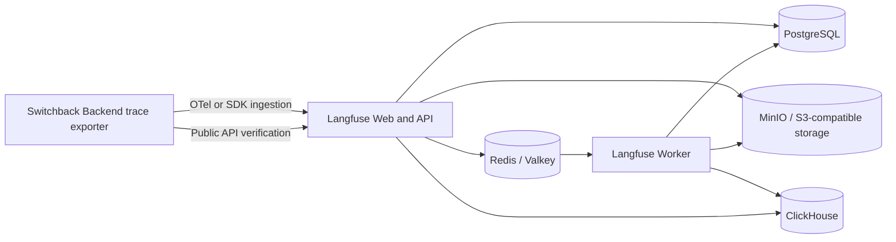

# Langfuse Self-Hosted Topology for the Switchback Worker Runtime Spike

> 状态：v0.1。
>
> 调研日期：2026-07-17。
>
> 目的：基于 Langfuse 官方文档和官方仓库，确定 Switchback Worker Runtime Spike 自托管 Langfuse 的最小真实拓扑、初始化、验收、版本固定和一键启动边界。

## Executive Conclusion

Switchback Worker Runtime Spike 应采用 Langfuse v3 官方六服务拓扑：`langfuse-web`、`langfuse-worker`、PostgreSQL、ClickHouse、Redis/Valkey 和 S3-compatible object storage。为了本地一键启动，object storage 使用 MinIO。这里的“最小”是关闭可选功能、减少端口暴露和副本数，而不是删除 v3 主链路服务。[Langfuse 官方 Docker Compose](https://langfuse.com/self-hosting/deployment/docker-compose)本身也是这六个服务；v3 的 ingestion 是异步链路，Web 接收事件后依赖 object storage、Redis、Worker 和 ClickHouse 才能最终查询到 Trace。[^1][^2]

截至调研日，GitHub 最新正式版本是 [`v3.217.0`](https://github.com/langfuse/langfuse/releases/tag/v3.217.0)，对应 commit `1f28a2989cad75eeb102adf2544e7f76eb7d9fed`。Spike 应让 Web 与 Worker 固定在同一个精确版本，不使用漂移的 `:3`；其余基础镜像也应固定 digest。官方 Compose 对部分基础镜像仍使用大版本或无 tag，因此不能原样视为可复现 lock。[^3][^4]

## Scope and Evidence Boundary

本报告只使用以下一手来源：

- Langfuse 官方 self-hosting 文档
- `langfuse/langfuse` 官方 GitHub 仓库及 `v3.217.0` Compose、初始化源码和发布 workflow
- Langfuse 官方 Public API 文档与 OpenAPI spec

未启动真实 Langfuse 实例，也未对非官方精简拓扑做实验。因此：

- “某组件不可省略”基于官方 v3 架构、必填配置和处理链路
- 本机实际最低资源、全部基础镜像 digest、冷启动耗时上界仍需在 Spike 实现阶段实测
- 官方未承诺的行为不作为 Switchback 契约

## Current Required Topology



Langfuse v3 官方 Compose 在 `v3.217.0` 中定义了以下服务，并让 Web、Worker 同时依赖四个 storage services 健康后启动。[^4]

| Service | Spike 中的职责 | 持久数据 | 是否可省略 |
| --- | --- | --- | --- |
| `langfuse-web` | 提供 UI、ingestion API、Public API、初始化和快速数据库迁移 | 否，状态写入后端存储 | 否 |
| `langfuse-worker` | 消费异步队列、处理事件、写入 ClickHouse、执行后台迁移和任务 | 否，处理结果写入后端存储 | 否 |
| PostgreSQL | 保存组织、项目、用户、API key、配置等事务数据 | 是 | 否 |
| ClickHouse | 保存 Trace、Observation、Score 等观测分析数据 | 是 | 否 |
| Redis/Valkey | 提供 ingestion queue 和 cache | 是，官方 Compose 挂载 volume | 否 |
| S3-compatible storage | 保存 raw events；还可保存 media 和 export | 是 | 存储能力不可省略；MinIO 实现可替换 |

Langfuse 将应用拆成 Web 和 Worker 两个容器：Web 服务 Console/API，Worker 处理事件和后台任务。[^5] ClickHouse 官方文档明确说明它是所有自托管部署的必需组件，目前没有受支持的替代 OLAP 数据库。[^6]

## Can Individual Services Be Removed?

### S3 or MinIO

**不能删除 object storage，能够替换 MinIO。** Langfuse 要求每个部署提供 event upload bucket，Web 和 Worker 都需要访问它；raw event storage 是 v3 ingestion 主链路的一部分。[^7]

Spike 选择 MinIO 的原因只是它能跟随 Compose 本地启动，不需要外部云账号。若以后已有共享 S3-compatible service，可以删除 `minio` 容器，并改为注入对应 endpoint、bucket 和 credentials。不能把“删除 MinIO 容器”误写成“不再需要 object storage”。

可在 Spike 中关闭的只有可选能力：

- batch export：`LANGFUSE_S3_BATCH_EXPORT_ENABLED=false`
- media upload：Switchback 本轮不发送 media；无需暴露 MinIO media endpoint
- 独立 bucket：event、media、export 无需在 Spike 中拆成多个 bucket

### Redis or Valkey

**不能删除。** 官方配置把 `REDIS_CONNECTION_STRING` 或等价的 host/port/auth 配置标记为 required；v3 使用 Redis/Valkey 承载事件队列和缓存。[^2][^8]

Redis 与 Valkey 可以作为实现替换，但本轮应沿用官方 Compose 的 Redis 7，避免同时验证替代实现兼容性。

### ClickHouse

**不能删除。** Trace、Observation、Score 的主要查询存储是 ClickHouse，官方明确表示所有 self-hosted 部署都必须包含 ClickHouse。[^6]

不能为了 Spike 回退到“PostgreSQL 同时保存 Trace”的 v2 思路，因为这将验证错误的运行时架构。

### Langfuse Worker

**不能删除。** v3 ingestion 在 Web 接收后异步处理。Worker 从 Redis queue 读取事件，完成解析并写入 ClickHouse；同时 background migrations 也由 Worker 在启动后执行。[^2][^9]

只验证 Web health 而不运行 Worker，最多证明 HTTP 进程和部分数据库连接正常，不能证明 Trace 真正落库并可查询。

### PostgreSQL

**不能删除。** `DATABASE_URL` 是所有 application containers 的 required 配置；项目、用户和 API key 的 headless initialization 也直接写入 PostgreSQL。[^8][^10]

## Headless Project and API Key Initialization

Spike 不需要手工进入 UI 创建项目。Langfuse Web 支持通过 `LANGFUSE_INIT_*` 环境变量在启动时创建不存在的 organization、project、API key 和 user。[^10]

最小 Trace 集成需要：

```dotenv
LANGFUSE_INIT_ORG_ID=switchback-spike
LANGFUSE_INIT_ORG_NAME=Switchback Spike
LANGFUSE_INIT_PROJECT_ID=switchback-worker-runtime
LANGFUSE_INIT_PROJECT_NAME=Switchback Worker Runtime
LANGFUSE_INIT_PROJECT_PUBLIC_KEY=lf_pk_<generated>
LANGFUSE_INIT_PROJECT_SECRET_KEY=lf_sk_<generated>
```

若需要登录 UI，再增加：

```dotenv
LANGFUSE_INIT_USER_EMAIL=switchback-spike@example.invalid
LANGFUSE_INIT_USER_NAME=Switchback Spike
LANGFUSE_INIT_USER_PASSWORD=<generated>
```

推荐自动化方式：

1. 一键启动脚本首次运行时生成 `.switchback/runtime-spike/langfuse.env`
2. 生成 `NEXTAUTH_SECRET`、`SALT`、`ENCRYPTION_KEY`、数据库密码、Redis 密码、MinIO 密码和 project API keys
3. 文件权限设为仅当前用户可读，并由仓库 `.gitignore` 排除
4. 后续启动复用同一文件，保证 API key 和 project identity 稳定
5. 只有显式 `reset` 动作才删除 volumes 和重新生成 identity

官方文档说明这些资源在不存在时自动创建；官方 `initialize.ts` 进一步显示 organization/project 使用 upsert，已存在时不更新，API key 以 public key 查询后按 project 关系决定是否创建。[^10][^11] 因此 Spike 应把 init identity 当作首次初始化配置，而不是通用的声明式更新或密钥轮换接口。

> **未知：** 官方文档没有把 `LANGFUSE_INIT_*` 定义为完整 reconciliation/rotation 协议。已有项目改名、已有用户改密码、已有 key 原地轮换的行为不应依赖；本轮通过保留 env + volumes 或显式 reset 规避。

官方还提示 Compose 中的 `LANGFUSE_INIT_*` 值不要额外使用双引号。Instance Management API 属于更强的程序化 provisioning 路径，但文档将其标为 EE；M1 Spike 不应对此形成依赖。[^10]

## Health, Readiness, and End-to-End Verification

### Process-level checks

官方提供以下端点：[^12]

| Check | Endpoint | 能证明什么 | 不能证明什么 |
| --- | --- | --- | --- |
| Web health | `GET /api/public/health` | Web API 进程可响应 | 默认不检查数据库 |
| Web + database health | `GET /api/public/health?failIfDatabaseUnavailable=true` | Web 和数据库连接正常 | 不证明 Redis、S3、Worker、ClickHouse ingestion 完成 |
| Web readiness | `GET /api/public/ready` | Web 未进入 graceful shutdown | 不检查完整依赖链 |
| Worker health | `GET :3030/api/health` | Worker 进程和数据库连接正常 | 不单独证明某条 Trace 已处理 |

官方 Compose 已为 PostgreSQL、Redis、ClickHouse 和 MinIO 配置 service healthchecks，但没有为 Langfuse Web/Worker 配置 Compose healthcheck。[^4] 因此不能只依赖 `docker compose up --wait`；Spike 启动脚本需要显式轮询 Web 和 Worker endpoints。

### Required end-to-end acceptance

健康端点不足以验收 Langfuse。Spike 必须执行一次真实 ingestion-query round trip：

1. 生成已知 `trace_id`，例如关联 `worker_session_id`、`worker_run_id` 和 `agent_turn_id`
2. 由 Switchback Backend Trace exporter 使用 Langfuse SDK 或官方推荐的 OpenTelemetry ingestion 发送至少一个 Trace 和一个 Observation
3. 显式 flush exporter/SDK，避免客户端进程退出前仍有 buffered spans
4. 记录 ingestion 请求成功
5. 使用 project public/secret key 进行 HTTP Basic Auth，轮询 Public API
6. 直到返回同一 `trace_id` 且至少包含预期 Observation，或达到 Spike 固定超时

查询命令形态：

```bash
curl -fsS \
  -u "${LANGFUSE_PUBLIC_KEY}:${LANGFUSE_SECRET_KEY}" \
  "${LANGFUSE_BASE_URL}/api/public/traces/${TRACE_ID}?fields=core,observations"
```

Public API 使用 public key 作为 Basic Auth username、secret key 作为 password，并提供 `GET /api/public/traces/{traceId}` 和 `GET /api/public/traces`。[^13][^14]

这一 round trip 才能同时覆盖：

- Web ingestion/API
- API key 和 project 初始化
- raw event object storage
- Redis queue
- Langfuse Worker 异步处理
- ClickHouse 写入与读取

由于 v3 ingestion 是异步的，不能把 ingestion HTTP success 当作 Trace 已可查询；验收必须轮询 exact trace id。[^2]

## Image and Version Pinning

### Confirmed current baseline

截至 2026-07-17：

- 最新 GitHub release：`v3.217.0`
- release commit：`1f28a2989cad75eeb102adf2544e7f76eb7d9fed`
- Web：`docker.io/langfuse/langfuse:3.217.0`
- Worker：`docker.io/langfuse/langfuse-worker:3.217.0`

Langfuse 官方 release workflow 为 release 生成 exact semantic version、major/minor、major 和 latest 等 tags，因此 exact `3.217.0` tag 是官方发布路径的一部分。[^3][^15]

### Recommended Spike policy

1. Web 和 Worker 必须固定相同的 exact Langfuse version
2. 进一步把所有镜像解析为 multi-arch manifest digest，并把 digest 写入 Spike 的 image lock
3. PostgreSQL、Redis、ClickHouse 和 MinIO 也固定 digest
4. 升级通过显式修改 lock 和重新运行验收完成，不在日常 `up` 时自动 pull 漂移 tag
5. 保留 upstream release、commit 和 Compose snapshot provenance

官方 Compose `v3.217.0` 当前使用：

| Component | Official Compose reference | Reproducibility risk |
| --- | --- | --- |
| Web | `langfuse/langfuse:3` | major tag 会漂移 |
| Worker | `langfuse/langfuse-worker:3` | major tag 会漂移 |
| PostgreSQL | `postgres:17` by default | major tag内会漂移 |
| Redis | `redis:7` | major tag内会漂移 |
| ClickHouse | `clickhouse/clickhouse-server` without tag | 高风险，会跟随 registry default |
| MinIO | `cgr.dev/chainguard/minio` without tag | 高风险，会跟随 registry default |

> **未知：** 本次已确认官方 Compose 的 image references，但没有从可信、可复现的官方 lock 获得这四个基础服务在 `v3.217.0` 发布时对应的确切 manifest digests。实现时必须解析、审查并提交 digest；本报告不虚构这些值。

Langfuse 官方允许使用 `:3` 自动跟随 major 内更新，并认为 minor/patch upgrade 自动迁移；这适合持续运营策略，不适合需要可重复结果的 Runtime Spike。[^16] Spike 应固定 exact release，后续再建立受控升级流程。

## Local Resource Risks

官方 sizing 页面列出的各服务最低资源为：Web 2 CPU/4 GiB、Worker 2 CPU/4 GiB、PostgreSQL 2 CPU/4 GiB、Redis/Valkey 1 CPU/1.5 GiB、ClickHouse 2 CPU/8 GiB、MinIO 2 CPU/4 GiB。简单相加是 11 CPU 和 25.5 GiB memory，但这是逐服务 sizing 表的算术汇总，不代表本地低流量 Compose 必须预留同等 dedicated resources。[^17]

官方 Docker Compose VM 指南另外建议至少 4 cores、16 GiB memory，并提示准备足够磁盘；Web 通常需要约 2 到 3 分钟才输出 `Ready`。[^1] 对 Switchback 的影响是：

- Langfuse 会与 Backend、Worker container、LiteLLM、Codex 和测试进程争用 Docker Desktop 资源
- ClickHouse 和 object storage 都会持续占用磁盘
- 冷启动和 migrations 不能使用过短 timeout
- 本机资源不足时，性能异常可能被误判为 ACP/Codex Runtime 故障

推荐的 Spike preflight：

- 检查 Docker daemon 可用
- 检查可用磁盘、CPU 和 memory allocation
- 若低于官方 Compose VM 的 4 cores/16 GiB，明确警告并拒绝默认验收
- 分别记录 Langfuse-only 和完整 Worker Spike 的峰值资源
- 不在本轮承诺生产容量或 retention SLA

> **未知：** Switchback 开发机上能够稳定同时运行 Langfuse 和真实 Worker Runtime 的最小 Docker Desktop 配额尚未实测。不能仅依据官方 sizing 表给出 Switchback 的最终资源 profile。

## Controlled One-Command Startup

目标是“一条命令启动”，而不是“把所有逻辑塞进一个 Compose 文件”。推荐对外提供一个稳定入口，例如：

```bash
make worker-runtime-spike-up
```

该入口内部按顺序执行：

1. 校验 Docker、端口和最低资源
2. 创建或复用 ignored runtime env 文件
3. 校验 image lock，拉取 pinned images
4. 使用固定 Compose project name 创建隔离 network/volumes
5. 启动 PostgreSQL、Redis、ClickHouse 和 MinIO
6. 等待四个官方 infrastructure healthchecks
7. 启动 Langfuse Web 和 Worker
8. 轮询 Web database health、Web readiness 和 Worker health
9. 启动 Switchback Backend 与动态 Worker Runtime
10. 运行一条 known trace ingestion-query smoke test
11. 只有所有检查通过才报告 Spike ready

### Scope controls

- Langfuse 作为 `observability` profile，只由 Worker Runtime Spike 命令启用
- 使用官方 `v3.217.0` Compose 作为来源，但在仓库中维护最小适配 snapshot 和 provenance，不运行时 clone `main`
- 只暴露 `127.0.0.1:3000`；Worker health 和所有 storage ports 默认仅在 Compose network 内访问
- 不暴露 MinIO console，不启用 media、batch export、email、SSO、evaluators 或高可用副本
- Langfuse 与 Switchback 使用不同命名 volume；正常 `down` 不删除数据
- `reset` 是单独的显式破坏性命令，负责删除 volumes 和重建 keys
- `up` 不执行无边界 `--pull always`
- Trace 验收失败时保留容器、logs、trace id 和 env file path，方便诊断

### Recommended decision for the Spike

采用“自托管真实 Langfuse、完整 v3 最小拓扑、一个入口命令、内部独立 lifecycle”的方案。它比外部 Langfuse 增加了六个服务的资源和启动成本，但满足当前选择的强制真实集成验收，并把复杂度限制在一个可关闭的 Spike profile 中。

## Implementation Checklist Derived from Research

- [ ] 从 `v3.217.0` 提取并标注 Compose provenance
- [ ] 将 Web/Worker 固定为 `3.217.0` 并锁定所有 image digests
- [ ] 生成 ignored secrets/env file，不提交真实 keys
- [ ] 保留六个 required services
- [ ] 关闭 batch export、media 和其他非 Spike 能力
- [ ] 为 Web/Worker 增加启动脚本级 health polling
- [ ] 让 Backend Trace exporter 使用 known trace id 和 Switchback correlation metadata
- [ ] flush 后轮询 `GET /api/public/traces/{traceId}`
- [ ] 将 round trip 作为 CI/local acceptance，而不是只检查容器 running
- [ ] 实测 Docker Desktop 冷启动、峰值 memory、CPU 和磁盘
- [ ] 提供非破坏性 `down` 与显式 `reset`

## Sources

[^1]: Langfuse. "Docker Compose Deployment (Self-Hosted)." https://langfuse.com/self-hosting/deployment/docker-compose

[^2]: Langfuse. "Migrate Langfuse v2 to v3." https://langfuse.com/self-hosting/upgrade/upgrade-guides/upgrade-v2-to-v3

[^3]: Langfuse. "Release v3.217.0." https://github.com/langfuse/langfuse/releases/tag/v3.217.0

[^4]: Langfuse. "docker-compose.yml at v3.217.0." https://github.com/langfuse/langfuse/blob/v3.217.0/docker-compose.yml

[^5]: Langfuse. "Application Containers (Self-Hosted)." https://langfuse.com/self-hosting/deployment/infrastructure/containers

[^6]: Langfuse. "ClickHouse (Self-Hosted)." https://langfuse.com/self-hosting/deployment/infrastructure/clickhouse

[^7]: Langfuse. "S3 / Blob Storage Configuration (Self-Hosted)." https://langfuse.com/self-hosting/deployment/infrastructure/blobstorage

[^8]: Langfuse. "Configuration via Environment Variables (Self-Hosted)." https://langfuse.com/self-hosting/configuration

[^9]: Langfuse. "Background Migrations (Self-Hosted)." https://langfuse.com/self-hosting/upgrade/background-migrations

[^10]: Langfuse. "Headless Initialization (Self-Hosted)." https://langfuse.com/self-hosting/administration/headless-initialization

[^11]: Langfuse. "Headless initialization source at v3.217.0." https://github.com/langfuse/langfuse/blob/v3.217.0/web/src/initialize.ts

[^12]: Langfuse. "Health and Readiness Check Endpoints." https://langfuse.com/self-hosting/configuration/health-readiness-endpoints

[^13]: Langfuse. "Public API." https://langfuse.com/docs/api-and-data-platform/features/public-api

[^14]: Langfuse. "Official OpenAPI specification." https://cloud.langfuse.com/generated/api/openapi.yml

[^15]: Langfuse. "Container release workflow at v3.217.0." https://github.com/langfuse/langfuse/blob/v3.217.0/.github/workflows/pipeline.yml

[^16]: Langfuse. "How to Upgrade a Self-Hosted Deployment." https://langfuse.com/self-hosting/upgrade

[^17]: Langfuse. "Sizing and Scaling." https://langfuse.com/self-hosting/configuration/scaling
