# LiteLLM 1.93.0、DeepSeek 与 Codex custom tools 兼容性调研

_Switchback Worker Runtime 主来源调研，核对日期：2026-07-22_

---

## 结论摘要

**已升级到 LiteLLM `1.93.0`，并完成 Switchback + Codex + DeepSeek OpenAI Chat Completions 的真实两 Turn E2E。** 该版本加入了面向 Codex CLI 的 Responses custom-tool 双向桥接；Switchback 另补了一个窄范围 history normalizer，使 Codex Responses 中夹在 tool-call batch 与 tool results 之间的 assistant item 满足 DeepSeek 的严格 Chat 消息邻接规则。最终执行、增量 patch、测试、Trace、Langfuse、凭证缺失扫描和容器清理全部通过。

DeepSeek 本次真实调用了 Codex 的原生 `apply_patch`，不再只是 shell 改写文件。不过持久化 rollout 将它记录为 `function_call`，且本次没有保存发往 DeepSeek 的完整 wire request，因此结论是“真实 Coding Agent E2E 和原生 patch 工具已通过”，不是“每一个 custom-tool 中间字段都已由 wire capture 证明”。

| 判断项 | 结论 | 置信度 |
| --- | --- | --- |
| `1.93.0` 是否为正式版本 | 是，PyPI 包版本为 `1.93.0`，Git tag/Release 为 `v1.93.0` | 已核验 |
| Responses custom tool 到 Chat function 的转换 | 支持，包含正向包装、非流式/流式反向还原和历史输入恢复 | 已核验源码与测试 |
| DeepSeek OpenAI Chat Completions 是否接受转换结果 | 协议形状匹配，只接受 function tools | 已核验官方契约 |
| DeepSeek OpenAI Chat 路由是否完成 E2E | 是，两 Turn acceptance 为 `completed/passed` | 已在线验证 |
| Codex Responses 是否可直接走 DeepSeek Anthropic endpoint | 没有一条已证明的直接路由；不建议作为首选 | 不推荐 |
| 是否可认定 DeepSeek 为 Switchback 第二备选 | 可以，与 Kimi 一样作为 WorkerRun 启动前显式选择的 profile | 已决策并验证 |

## 调研范围与方法

本次先完成主来源核对，随后使用本机 ignored、`0600` 的凭证文件执行在线模型发现和 Switchback E2E。凭证值、Authorization header 和可逆 secret 未写入本文或版本控制文件。

核对范围：

- LiteLLM `v1.92.0` 与 `v1.93.0` 的官方 tag 源码差异
- LiteLLM `v1.93.0` Release、PyPI 发布记录、PR `#32258` 和官方测试
- LiteLLM Responses bridge、DeepSeek Chat adapter、DeepSeek Anthropic Messages adapter
- DeepSeek 官方 Chat Completions、Anthropic API、tool calls 和当前模型说明
- Switchback 当前固定的 Codex/ACP/LiteLLM 版本与动态 upstream route 配置
- DeepSeek `deepseek-v4-pro` 在线模型发现与真实两 Turn Worker Runtime E2E

仍不在本次范围：价格、配额、SLA、生产使用条款、长时间 soak 和完整 outbound wire capture。

## 版本与发布日期

LiteLLM 的确切 Python 包版本是 `1.93.0`，Git tag 和 GitHub Release 名称是 `v1.93.0`。tag 指向 commit `052b5a2169d8d3082e1d66e69f200a72b0c1e274`。PyPI 首个 wheel 上传时间为 `2026-07-19T03:00:52Z`，source distribution 上传时间为 `2026-07-19T03:01:24Z`；GitHub Release 的 `published_at` 为 `2026-07-19T07:57:31Z`，即北京时间 `2026-07-19 15:57:31`。[^4][^5]

Release notes 明确包含 PR `#32258`：`fix(responses-bridge): custom tool round-trip and allowlist preservation for Codex CLI`。该 PR 于 2026-07-07 合并，merge commit 为 `2f0cdb35bf35f77caa55faec321313af9c4615db`。[^1][^6]

Switchback Worker 镜像现已精确固定 `litellm[proxy]==1.93.0`，Docker build 会读取已安装 distribution metadata 并断言版本完全相等。

## LiteLLM 1.93.0 的 custom-tool bridge

### 1.92.0 的失败原因

`v1.92.0` 的 `transform_responses_api_tools_to_chat_completion_tools` 只显式处理 MCP、web search 和 function tools。其他类型进入兜底分支并原样追加，因此 Codex 的 `type: "custom"` 会直接进入只接受 function tools 的 Chat Completions 上游。[^7]

对应链路是：

```text
Codex Responses custom tool
-> LiteLLM 1.92.0 原样透传 custom
-> DeepSeek Chat Completions
-> 上游拒绝非 function tool
```

### 1.93.0 的双向转换

`v1.93.0` 新增 `custom_tools.py`。正向转换会：

1. 识别 Responses `type: "custom"`
2. 保留工具名和说明
3. 把 grammar 定义追加到 function description
4. 生成只有一个必填字符串字段 `content` 的 JSON Schema
5. 以标准 `type: "function"` 发送给 Chat Completions provider

模型返回 function call 后，LiteLLM 根据原请求中的 custom tool 名称识别调用，把 `arguments.content` 解包为原始 free-form 文本，并生成 `type: "custom_tool_call"`、`name`、`call_id` 和 `input`。[^2][^3]

```mermaid
flowchart LR
    accTitle: Codex custom tool bridge
    accDescr: LiteLLM 1.93.0 converts a Codex Responses custom tool into a Chat Completions function and reconstructs the custom tool call from the model response

    codex_request["Codex /responses<br/>custom apply_patch"] --> wrap_function["LiteLLM bridge<br/>function with content schema"]
    wrap_function --> deepseek_chat["DeepSeek Chat Completions<br/>function tool call"]
    deepseek_chat --> unwrap_content["LiteLLM bridge<br/>unwrap arguments.content"]
    unwrap_content --> codex_result["Codex response<br/>custom_tool_call"]

    classDef primary fill:#dbeafe,stroke:#2563eb,stroke-width:2px,color:#1e3a5f
    classDef success fill:#dcfce7,stroke:#16a34a,stroke-width:2px,color:#14532d
    class codex_request,wrap_function,deepseek_chat primary
    class unwrap_content,codex_result success
```



### 官方测试覆盖

`v1.93.0` 的官方测试覆盖以下关键行为：

- `apply_patch` grammar 转换为带必填 `content` 的 function schema
- function call 还原为 `custom_tool_call`
- `arguments.content` 解包为原始 patch 文本
- function/custom 混合工具不混淆
- 多轮输入中的 `custom_tool_call.input` 恢复为下一次 Chat function arguments
- 空参数、非法 JSON 和超大参数的边界
- streaming iterator 输出 `custom_tool_call` 的 added/delta/done 事件

这些测试证明 LiteLLM 内部转换意图和基本实现存在，但它们不是 DeepSeek 在线 E2E。[^3][^8]

## DeepSeek OpenAI Chat Completions 路由

### 为什么协议上匹配

DeepSeek 官方 Chat Completions 文档说明：请求中的 `tools` 当前只支持 `type: "function"`，返回的 `tool_calls` 也只返回 function，参数放在 JSON 字符串 `function.arguments` 中。[^9]

这与 LiteLLM `1.93.0` custom bridge 生成的结构一致：

| Codex 语义 | LiteLLM 包装 | DeepSeek 契约 |
| --- | --- | --- |
| `custom apply_patch` | `function apply_patch` | 支持 function tool |
| free-form patch 文本 | `arguments.content: string` | 支持 JSON arguments |
| Lark grammar | 追加到 function description | description 可传递给模型 |
| 模型 function call | 解包并还原 `custom_tool_call` | 返回 function tool call |

LiteLLM `v1.93.0` 的 DeepSeek Chat adapter 还会在发请求前移除没有 Chat Completions 等价物的 Responses-only 工具类型，只保留 function tools；其官方测试覆盖了 function tools 保留和 dangling `tool_choice` 清理。由于 custom tool 已在更上游转换成 function，`apply_patch` 不应被这一过滤器删除。[^10][^11]

### 为什么不需要额外强制 bridge 标记

LiteLLM Responses 入口会先查询 provider 是否有原生 Responses config；没有时自动进入 `responses -> completion` bridge。`v1.93.0` 的 provider config 列表没有给 DeepSeek 注册原生 Responses config，因此 `deepseek/...` 会自动使用桥接逻辑。桥接 handler 最终调用 `litellm.completion` 或 `litellm.acompletion`，再把 Chat Completion 响应还原成 Responses 响应。[^12][^13]

`use_chat_completions_api: true` 主要用于 `openai/<model>` 加自定义 `api_base`、而上游实际没有 `/responses` 的场景。使用原生 `deepseek/` provider prefix 时无需依赖这一额外标记。[^14]

### 推荐 Spike 路由

建议第一轮 E2E 使用：

```text
SWITCHBACK_SPIKE_UPSTREAM_MODEL=deepseek/deepseek-v4-pro
SWITCHBACK_SPIKE_UPSTREAM_API_BASE=https://api.deepseek.com
```

不在文档中记录凭证；继续沿用 Switchback 已有的 ignored、`0600` 本地 secret 注入边界。

推荐 `deepseek-v4-pro` 而不是旧别名。DeepSeek 当前官方 API 列出 `deepseek-v4-pro` 和 `deepseek-v4-flash`；`deepseek-chat`、`deepseek-reasoner` 计划于 2026-07-24 15:59 UTC 停止使用。LiteLLM `v1.93.0` 的 model map 已包含 `deepseek/deepseek-v4-pro` 和 `deepseek/deepseek-v4-flash`。[^15][^16]

显式配置 `https://api.deepseek.com` 也能避免依赖 LiteLLM DeepSeek adapter 当前代码中的 `/beta` 默认值；只有确实需要 DeepSeek strict function calling 时才应单独评估 `/beta`。DeepSeek strict mode 要求 beta base，并要求所有 functions 设置 `strict: true`；LiteLLM custom bridge 生成的 wrapper 没有主动设置 `strict: true`，所以不能假定 strict mode 已启用。[^17][^2]

## DeepSeek Anthropic-compatible 路由

### DeepSeek endpoint 本身支持什么

DeepSeek 官方提供 `https://api.deepseek.com/anthropic`，支持 Anthropic Messages 的流式输出、thinking、标准 `tools` 的 `name`、`input_schema`、`description`，以及 `tool_use`/`tool_result` 消息。它不把 OpenAI Responses custom tool 当作原生协议概念。[^18]

LiteLLM `v1.93.0` 确实包含 `DeepSeekAnthropicMessagesConfig`：默认生成 `https://api.deepseek.com/anthropic/v1/messages`，并在发送前删除 tool definition 中 DeepSeek 不接受的显式 `type: "custom"`。官方测试验证了 endpoint、headers、thinking history、tool history 和 custom discriminator 清理。[^19][^20]

### 为什么它不是当前 Codex 首选路由

这套 DeepSeek adapter 属于 LiteLLM 的 Anthropic Messages API 配置。Codex 当前请求的是 OpenAI `/v1/responses`；LiteLLM 的 Responses bridge 调用通用 `completion`，`deepseek/` provider 随后选择 DeepSeek OpenAI Chat adapter，而不是 Anthropic Messages adapter。[^12][^13][^20]

直接把模型写成 `anthropic/deepseek-v4-pro` 并指向 DeepSeek Anthropic base 也不够稳妥：LiteLLM 官方测试明确区分 provider，只有 provider=`deepseek` 才选择 `DeepSeekAnthropicMessagesConfig`；provider=`anthropic` 会继续使用通用 `AnthropicMessagesConfig`。通用 Anthropic Chat mapper会给 user-defined tools 写入 `type: "custom"`，而 DeepSeek 专用 sanitizer 不会在该 provider 选择下运行。[^20][^21]

因此目前建议：

- Codex `/responses` 首选 `deepseek/...` -> DeepSeek OpenAI Chat Completions
- DeepSeek Anthropic endpoint 保留为独立实验路线
- 只有证明 Responses bridge 能明确选择 DeepSeek Messages adapter，或增加受测试的专用 route adapter 后，再把 Anthropic endpoint 列为同等级 fallback

## 在线 E2E 结果

2026-07-22 使用以下精确路由运行现有 `TestRealCodexTwoTurnE2E`：

```text
SWITCHBACK_SPIKE_UPSTREAM_MODEL=deepseek/deepseek-v4-pro
SWITCHBACK_SPIKE_UPSTREAM_API_BASE=https://api.deepseek.com
LiteLLM=1.93.0
Codex=0.144.1
codex-acp=1.1.2
```

最终机器验收结果：

| 证据 | 结果 |
| --- | --- |
| execution / acceptance | `completed` / `passed` |
| AgentTurns | 2 个不同 ID，同一 WorkerSession、WorkerRun、Runtime 与 ACP session |
| 修改工具 | Codex 原生 `apply_patch` 至少 1 次，并伴随多次 `exec_command` |
| Artifact / fixture | 生产与测试 patch 可验证，fixture digest 前后相同 |
| observability | Trace evidence 与 Langfuse 校验通过 |
| secret / cleanup | known-token absence 与 dynamic Worker cleanup 通过 |

首次升级后的在线请求还暴露了第二个兼容性差异：Codex Responses history 会形成 `function_call(s) -> assistant message -> function_call_output(s)`，而 DeepSeek Chat 要求 tool results 紧跟声明它们的 assistant `tool_calls`。空消息、并行两个 tool calls，以及带文字的 `update_plan` 消息都分别触发过 `400 insufficient tool messages following tool_calls message`。

Switchback 的 LiteLLM pre-call callback 现在只处理 call ID 完整且唯一匹配的批次：空 assistant item 被删除，有内容的 assistant item 被稳定移动到 call batch 之前，随后保持全部 call/output 相邻。无法完整匹配的批次不重排，继续 fail closed。对应单测覆盖单调用、并行调用、异步 Responses call type 和有内容消息。

### 尚未完成的 wire-level 证明

- 未保存完整 outbound DeepSeek request，因此没有独立证据逐字段证明 `apply_patch` 在 wire 上一定是带 `content` schema 的 function。
- Codex rollout 把执行项记录为 `function_call apply_patch`；这证明原生工具被执行，但不能单独证明 LiteLLM 内部先生成并再还原了 `custom_tool_call`。
- 长 patch、多文件 patch、取消中断、畸形 arguments 和更长 thinking history 仍需独立协议/soak 测试。

### 后续边界路径

| 边界 | 风险 | 验证要求 |
| --- | --- | --- |
| 长 patch / 多文件 patch | JSON arguments 截断、转义或 `content` 丢失 | 校验原始 patch digest 与应用结果 |
| streaming tool-call delta | function arguments 分片后无法还原 | 核对 added/delta/done 顺序和最终 input |
| mixed function/custom tools | 工具名或类型错误关联 | 同一 Turn 同时触发 function 与 custom |
| tool result 回放 | call id 或历史输入丢失 | 至少两次 custom-tool round trip |
| thinking mode | DeepSeek 要求后续请求携带 reasoning history | 覆盖带工具调用的多轮 thinking 请求 |
| unsupported Responses tools | `namespace`、Responses-native `shell` 等被丢弃 | 明确记录 capability snapshot 和 warning |
| malformed arguments | 模型返回非 JSON 或缺少 `content` | fail closed 或保留原始参数并产生可诊断错误 |
| cancellation / timeout | 半截流产生错误 tool call | 不执行不完整 patch，Trace 有终态 |
| LiteLLM callback | 版本升级破坏 Switchback correlation | 精确核对 AgentTurn、request id 和 Langfuse cardinality |
| secret boundary | header、Trace 或日志泄漏凭证 | 继续执行 known-token 全量扫描 |

DeepSeek thinking mode 的官方说明要求：涉及 tool calls 时，后续请求必须完整回传先前的 `reasoning_content`，否则返回 `400`。本次两 Turn E2E 已覆盖实际多轮工具历史，但没有单独捕获并断言每个 `reasoning_content` 字段，完整 wire-level 验证仍是后续项。[^22][^10]

### 不足以判定成功的现象

- `/v1/responses` 只返回 HTTP `200`
- 模型只输出解释文本或只完成单轮 function tool
- Codex 仅通过 `exec_command`、重定向或脚本修改文件
- LiteLLM 单元测试通过但没有真实 DeepSeek 请求
- 阶段报告成功但没有 Artifact、Trace、Langfuse 和清理证据

## 升级决策建议

### Switchback 已确认的模型选择语义

本次采用单上游的配置级选择，不在一个 AgentTurn 中自动 fallback：

- `deepseek-codex-openai-v1`：`deepseek/deepseek-v4-pro`，Base URL 为 `https://api.deepseek.com`
- `kimi-codex-anthropic-v1`：`anthropic/kimi-for-coding`，Base URL 为 `https://api.kimi.com/coding`
- 每个 WorkerRun 在启动前由服务端固化一个 profile，只把该 profile 的模型、Base URL 和一个 Key 注入 Worker Runtime
- route、credential 和实际模型写入 WorkerRun start snapshot、Trace 与观测元数据；用户 prompt 和 Agent 不能在运行中改写
- 某一路失败只终止或暂停当前 Run，不在同一 AgentTurn 内静默切换供应商

M1 Spike 继续复用现有 `SWITCHBACK_SPIKE_UPSTREAM_MODEL`、`SWITCHBACK_SPIKE_UPSTREAM_API_BASE` 和单 key-file 契约表达所选 profile，不在本次引入多 key LiteLLM 配置或新的客户端选模 API。

1. 保持 `litellm[proxy]==1.93.0` 精确 pin，不使用 `latest` 或版本范围。
2. 保持 `deepseek-codex-openai-v1` 与 `kimi-codex-anthropic-v1` 两个显式 profile；每个 WorkerRun 只获得一个 profile 和一个 key。
3. 不配置 LiteLLM request fallback，也不在同一 AgentTurn 内自动切换供应商。
4. 将 history normalizer 视为 DeepSeek Chat 兼容层，保留完整 ID 匹配的单测和 fail-closed 行为。
5. 后续增加无凭证 fake-upstream wire contract test，冻结 custom -> function -> custom 的完整流式 round trip。
6. DeepSeek Anthropic-compatible endpoint 仍只列实验路线，不作为已验证 profile。

最终判断：**LiteLLM `1.93.0` 升级成立；DeepSeek 与 Kimi 都已完成 Switchback Worker Runtime 的真实两 Turn 验收，可作为两个显式可选底层模型 profile。DeepSeek 已运行 Codex 原生 `apply_patch`，但完整 custom-tool wire schema、长时稳定性和生产条款仍需后续验证。**

## References

[^1]: BerriAI. (2026). "LiteLLM v1.93.0 Release." _GitHub_. https://github.com/BerriAI/litellm/releases/tag/v1.93.0

[^2]: BerriAI. (2026). "Responses custom-tool bridge helpers at v1.93.0." _GitHub_. https://github.com/BerriAI/litellm/blob/v1.93.0/litellm/responses/litellm_completion_transformation/custom_tools.py#L1-L163

[^3]: BerriAI. (2026). "Custom tool call tests at v1.93.0." _GitHub_. https://github.com/BerriAI/litellm/blob/v1.93.0/tests/test_litellm/responses/test_custom_tool_call.py

[^4]: Python Package Index. (2026). "litellm 1.93.0 release metadata." _PyPI JSON API_. https://pypi.org/pypi/litellm/1.93.0/json

[^5]: BerriAI. (2026). "LiteLLM v1.93.0 tag commit 052b5a2." _GitHub_. https://github.com/BerriAI/litellm/commit/052b5a2169d8d3082e1d66e69f200a72b0c1e274

[^6]: BerriAI. (2026). "PR #32258: custom tool round-trip and allowlist preservation for Codex CLI." _GitHub_. https://github.com/BerriAI/litellm/pull/32258

[^7]: BerriAI. (2026). "Responses-to-Chat tool transformation at v1.92.0." _GitHub_. https://github.com/BerriAI/litellm/blob/v1.92.0/litellm/responses/litellm_completion_transformation/transformation.py#L1279-L1333

[^8]: BerriAI. (2026). "Streaming Responses bridge at v1.93.0." _GitHub_. https://github.com/BerriAI/litellm/blob/v1.93.0/litellm/responses/litellm_completion_transformation/streaming_iterator.py#L90-L309

[^9]: DeepSeek. (2026). "Create Chat Completion." _DeepSeek API Docs_. https://api-docs.deepseek.com/api/create-chat-completion/

[^10]: BerriAI. (2026). "DeepSeek Chat transformation at v1.93.0." _GitHub_. https://github.com/BerriAI/litellm/blob/v1.93.0/litellm/llms/deepseek/chat/transformation.py#L18-L283

[^11]: BerriAI. (2026). "DeepSeek Chat transformation tests at v1.93.0." _GitHub_. https://github.com/BerriAI/litellm/blob/v1.93.0/tests/test_litellm/llms/deepseek/chat/test_deepseek_chat_transformation.py

[^12]: BerriAI. (2026). "Responses dispatch and bridge selection at v1.93.0." _GitHub_. https://github.com/BerriAI/litellm/blob/v1.93.0/litellm/responses/main.py#L994-L1066

[^13]: BerriAI. (2026). "Responses completion bridge handler at v1.93.0." _GitHub_. https://github.com/BerriAI/litellm/blob/v1.93.0/litellm/responses/litellm_completion_transformation/handler.py#L23-L119

[^14]: BerriAI. (2026). "Calling non-Responses API endpoints through the bridge." _LiteLLM Documentation_. https://docs.litellm.ai/docs/response_api#calling-non-responses-api-endpoints-responses-to-chatcompletions-bridge

[^15]: DeepSeek. (2026). "Your First API Call." _DeepSeek API Docs_. https://api-docs.deepseek.com/

[^16]: BerriAI. (2026). "LiteLLM model map at v1.93.0." _GitHub_. https://github.com/BerriAI/litellm/blob/v1.93.0/model_prices_and_context_window.json#L45069-L45118

[^17]: DeepSeek. (2026). "Tool Calls and strict mode." _DeepSeek API Docs_. https://api-docs.deepseek.com/guides/tool_calls/

[^18]: DeepSeek. (2026). "Anthropic API compatibility." _DeepSeek API Docs_. https://api-docs.deepseek.com/guides/anthropic_api/

[^19]: BerriAI. (2026). "DeepSeek Anthropic Messages transformation at v1.93.0." _GitHub_. https://github.com/BerriAI/litellm/blob/v1.93.0/litellm/llms/deepseek/messages/transformation.py

[^20]: BerriAI. (2026). "DeepSeek Anthropic Messages transformation tests at v1.93.0." _GitHub_. https://github.com/BerriAI/litellm/blob/v1.93.0/tests/test_litellm/llms/deepseek/messages/test_deepseek_anthropic_messages_transformation.py

[^21]: BerriAI. (2026). "Generic Anthropic Chat tool mapping at v1.93.0." _GitHub_. https://github.com/BerriAI/litellm/blob/v1.93.0/litellm/llms/anthropic/chat/transformation.py#L625-L674

[^22]: DeepSeek. (2026). "Thinking Mode tool calls." _DeepSeek API Docs_. https://api-docs.deepseek.com/guides/thinking_mode/
