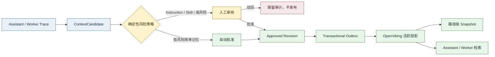

# OpenViking 记忆治理能力调研

> 调研日期：2026-07-10
>
> 官方基线：OpenViking `v0.4.9` 与 `main@7c5716c`[^release-049][^main-commit]
>
> 范围：仅使用 OpenViking 官方文档、`volcengine/OpenViking` 官方仓库源码/API 与官方 release。

## 结论

OpenViking 原生提供上下文的 **CRUD、分层检索、用户/账户级隔离，以及显式 Git 快照与恢复**；但截至本次调研，**未发现原生的候选内容状态、人工审批流、按内容自动/人工发布策略、面向终端用户的记忆治理看板、逐条内容的完整修订历史或治理审计**。

因此，Switchback 应把 OpenViking 定位为 **已发布上下文的检索投影与回滚底座**，而不是 Truth 治理系统。候选、风险分级、审批、不可变修订、发布状态、审计和用户看板必须由 Evolution + RDBMS 自建并作为权威事实源。

| 能力 | OpenViking 原生结论 | Switchback 决策 |
|---|---|---|
| 写入、读取、更新、删除 | **支持**。通用文件 API 支持 `read/write/rm/mv`，`write` 支持 `replace/append/create`；Skill 另有 `get/update/delete/validate` API[^filesystem-api][^skill-api] | 通过 Switchback adapter 调用，不把 OpenViking 写接口直接暴露给用户 |
| 检索 | **支持**。`find` 和 `search` 可按 URI、`memory/resource/skill`、元数据、时间和层级过滤[^retrieval-api] | 只检索已发布版本；候选内容不得进入可检索目录 |
| 版本与回滚 | **部分支持**。快照 API 提供 `commit/log/show/restore`；恢复会生成新提交，不改写历史[^snapshot-api] | 每次发布后显式创建路径级快照；逐条修订历史仍由 RDBMS 保存 |
| 审批工作流 | **未发现**候选、待审、批准、驳回等状态或 API | Switchback 自建 review task、审批策略和状态机 |
| 自动/人工发布 | **未发现**统一发布工作流。Memory 提取结果会直接应用；可选的 session Skill 提取也会直接写入真实 Skill 目录[^memory-updater][^skill-updater] | 关闭自动 Skill 提取；所有写入先经过 Switchback 决策，再投影到 OpenViking |
| 用户级记忆看板 | **未发现**治理型看板。Web Studio 有资源浏览、检索、Session 和请求日志，但当前路由中没有记忆候选、审批、修订或回滚页面[^studio-readme][^studio-routes] | Switchback 自建用户看板，展示来源、置信度、状态和修订，并支持修改、删除、恢复 |
| 权限 | **部分支持**。有 account/user 隔离与 ROOT/ADMIN/USER 角色；共享资源和 `agent/skills` 是账户级，未发现项目、仓库或单条内容 ACL[^authentication][^multi-tenant][^namespace-source] | Switchback 自建 tenant/user/project/repo/scope 权限，并用服务身份代理 OpenViking |
| 审计 | **部分支持**。Session 提取会写 `memory_diff.json`；请求审计记录请求元数据，但不是内容审批与逐修订治理审计[^session-api][^usage-audit] | Switchback 保存不可变的来源、决策、审批人、前后版本、发布和删除事件 |

## 事实、推断与建议边界

- **可确认事实**：官方文档、release 或当前源码直接声明或实现的能力。
- **源码推断**：官方没有给出产品承诺，但可由当前路由、schema 和调用链判断；后续版本可能变化。
- **Switchback 建议**：为满足本项目治理要求提出的边界和实现方案，不代表 OpenViking 原生能力。

## 数据抽象与 URI

### 可确认事实

OpenViking 把上下文分成三类：Resource 是用户加入的相对静态知识或规则，Memory 是 Agent 从交互中记录的动态认知，Skill 是可调用能力。`user/memories/skills` 表示“使用某项能力的经验”，不等于可执行的 Skill；真正的 Skill 位于 `user/.../skills` 或账户共享的 `agent/skills`[^context-types]。

URI 采用 `viking://{scope}/{path}`。当前主要目录如下[^uri-doc]：

| 内容 | 典型 URI | 可见范围 |
|---|---|---|
| 账户共享资源 | `viking://resources/...` | account 内共享 |
| 用户记忆 | `viking://user/{user_id}/memories/...` | 当前用户 |
| 用户资源 | `viking://user/{user_id}/resources/...` | 当前用户 |
| 用户 Skill | `viking://user/{user_id}/skills/...` | 当前用户 |
| 账户共享 Skill | `viking://agent/skills/...` | account 内共享 |
| Session | `viking://user/{user_id}/sessions/{session_id}` | 当前用户 |

每份上下文还可生成 L0 摘要、L1 概览和 L2 详情，用于渐进式检索；这属于上下文表达层级，不是治理版本[^context-layers]。

### Switchback 建议

- 将 OpenViking `account_id` 映射为 Switchback tenant，将 `user_id` 映射为 Switchback user。
- project、workspace、repo、环境和敏感级别没有原生强类型 ACL，应留在 Switchback 权限模型，并在投影 URI、metadata 与 adapter 校验中体现。
- OpenViking 中只保留 `active` 修订。`draft/pending_review/rejected/deprecated` 不写入 OpenViking。

## CRUD、版本与审计

### CRUD

**可确认事实**：通用文件 API 能对 URI 执行读、写、移动和删除，内容写入支持替换、追加和仅新建；Memory 写入后会刷新概览与向量索引[^filesystem-api][^content-write]。Skill API 能校验格式、读取、更新和删除 Skill[^skill-api]。

**源码推断**：Skill 更新过程中的临时备份只用于更新失败时恢复，成功后备份会被删除；它不是可供用户查看和选择的持久修订历史[^skill-router]。

### 三种容易混淆的“版本”

| 机制 | 能做什么 | 不能替代什么 |
|---|---|---|
| Memory 文件内 `version` | Memory 更新时递增当前版本号[^memory-file-utils] | 不单独保存全部历史内容，不能直接回滚任意修订 |
| Session `memory_diff.json` | 记录该次 Session 提取产生的新增、更新前后值和删除内容[^session-api] | 不覆盖手工 CRUD、Skill、Instruction 和审批决策 |
| Git-backed Snapshot | 显式 `commit` 后可查看日志、比较提交并恢复整棵树或子路径[^snapshot-api] | 不是自动逐写入版本、候选状态或审批流 |

隐私配置也有独立版本与激活旧版本能力，但它只管理敏感 Skill 配置值，不是 `SKILL.md` 正文的版本系统[^privacy-api]。

### 审计

**可确认事实**：OpenViking 请求审计 schema 包含 request/account/user、HTTP 方法、路由、状态码、耗时和时间等操作信息；默认保留策略是短期请求日志，而不是不可变内容账本[^usage-audit]。

**结论**：OpenViking 的 `memory_diff`、snapshot 和 request audit 可作为辅助证据，但未发现能完整回答以下治理问题的原生审计模型：谁基于哪条 Trace 生成了什么候选、采用了哪条策略、谁批准或驳回、哪一版何时发布、用户为何修改或删除。

## 审批、发布与看板

### 审批与发布

**可确认事实**：当前 Memory updater 会把模型输出的 `write/edit/delete` 操作直接应用到 Memory；没有经过候选与人工审批状态[^memory-updater]。`session_skill_extraction_enabled` 默认为 `false`，开启后 Session 会提取 Skill 并由 updater 直接创建或更新用户 Skill[^memory-config][^skill-updater]。

**未发现**：

- `draft -> pending_review -> approved/rejected -> active` 生命周期；
- reviewer、approval policy、decision reason、four-eyes 等审批字段；
- 将同一内容区分为自动发布和人工发布的策略 API；
- Skill 安全审核、权限差异审查或人工签名。

Skill 的 `validate` 只应视为格式校验，不能替代人工治理或安全审核。

### 用户级记忆看板

**可确认事实**：Web Studio 官方定位包含资源管理、检索、Session 和运行诊断；当前前端路由包含首页、playground、请求日志、检索、sessions、settings 等，通用文件预览器可以替换保存内容[^studio-readme][^studio-routes][^studio-editor]。

**源码推断**：当前未发现专门的用户记忆治理页面，也未发现候选、来源证据、置信度、风险、审批、修订比较、回滚和 tombstone UI。因此它只能算通用浏览/编辑工具，不满足 Switchback 的“用户可随时审查和修改记忆”产品要求。

**Switchback 建议**：自建 Memory Dashboard，至少提供：

| 视图/动作 | 必需信息 |
|---|---|
| 当前记忆 | 类型、摘要、scope、来源 Trace、置信度、风险、当前修订、发布时间、最后使用时间 |
| 待审内容 | diff、生成原因、冲突、权限影响、模型建议、确定性策略结果 |
| 用户动作 | 修改、批准、驳回、停用、删除、恢复旧版 |
| 审计视图 | 生成、编辑、审批、发布、投影、回滚、删除的 actor、时间、原因和前后 hash |

“删除”应从 OpenViking 活跃投影移除内容，但 Switchback RDBMS 保留 tombstone 和审计事件，避免物理删除抹掉治理证据。

## 权限边界

### 可确认事实

OpenViking 支持 account 级租户隔离、user 级数据隔离和 ROOT/ADMIN/USER 角色。账户共享 Resource 与共享 Skill 对同一 account 可见，用户 Memory、Resource、Skill 和 Session 按 user 隔离[^authentication][^multi-tenant]。

### 源码推断

- 当前权限模型主要是 account/user/共享目录级，未发现 project、workspace、repo 或逐条内容 ACL[^namespace-source]。
- snapshot 路由获取请求身份后直接操作该 account 的版本树，当前源码未见单独的管理员角色保护；它不适合直接暴露给普通终端用户[^snapshot-router]。

### Switchback 建议

所有 OpenViking 数据面操作都经由 Switchback service adapter：先校验 tenant、user、project/repo、内容类型和 lifecycle，再转换为 URI 操作。快照 commit/restore 只能由 Evolution 发布器或受控管理员用例触发。

## Memory、Instruction 与 Skill 是否共用 Truth 模型

结论：**不应共用一个生命周期和状态机**。可以共用最小治理信封，但必须分成不同聚合。

原因是 OpenViking 的 Memory 分类并不等于低风险事实。其 `experiences` 模板会生成可注入系统提示词的严格执行指令，`soul` 等类型也会影响 Agent 边界和行为[^experience-template][^memory-schema]。治理风险应按“内容是否改变行为、权限或执行能力”判断，而不能只看它是否存放在 `memories/`。

当前 OpenViking 一等上下文类型中没有 Instruction。旧版 `viking://agent/{agent_id}/instructions` 在迁移文档中明确不迁移，也没有对应的新目录替代[^instruction-migration]。因此 Switchback 不应把 Instruction 强塞成普通 Memory。

推荐共用的治理信封字段：`id`、`kind`、`scope`、`source_refs`、`risk_level`、`status`、`current_revision`、`created_by`、`created_at`。内容 schema、审批规则、发布目标和回滚策略按聚合分别定义。

### 推荐治理矩阵

| 内容类别 | 例子 | Switchback 聚合 | OpenViking 投影 | 自动记录 | 人工审核 | 版本与回滚 |
|---|---|---|---|---|---|---|
| 简单 Memory 片段 | 明确低风险偏好、已验证描述性事实、实体别名、短期项目状态 | `MemoryTruth` | `user/.../memories` | Switchback 已接受仅四类确定性白名单；需明确/权威/运行验证证据，临时状态强制 TTL | 模型推断、冲突、敏感、跨 scope、低置信或行为型内容必须 | RDBMS 不可变修订；发布后路径级 snapshot |
| 行为型 Memory | experience、trajectory 中的操作规则或系统提示片段 | `InstructionCandidate` 或 `ProcedureTruth` | 审批后才可投影为 Memory；默认不自动装入系统提示 | 不允许自动激活 | **必须** | RDBMS 修订、优先级与生效范围；snapshot 仅作投影兜底 |
| Instruction | 系统提示、边界、策略、工具调用规则 | `InstructionPolicy` | 无原生类型；由 ContextPack 编译，可选保存已发布副本 | 不允许 | **必须** | RDBMS 权威版本、diff、审批和回滚 |
| Skill | `SKILL.md`、manifest、脚本、依赖和权限声明 | `SkillPackage`，归 Skilling/Capability 域 | `user/.../skills` 或受控共享目录 | 不允许 | **生成和修改均必须** | Git/Artifact + RDBMS 修订；OpenViking snapshot 为发布兜底 |

Skill 不应成为 Truth 正文本体。Truth 可以记录“某用户偏好使用某 Skill”或引用 `skill_package_id`，但可执行内容、权限和依赖必须由 SkillPackage 管理。

## Switchback 自建状态与发布流程

RDBMS/Evolution 至少应持有以下权威状态：

| 聚合/记录 | 责任 |
|---|---|
| `ContextCandidate` | 原始生成内容、Trace/Artifact 来源、置信度、风险、去重与冲突结果 |
| `MemoryTruth` / `InstructionPolicy` / `SkillPackage` | 各自独立 schema、scope、状态机和当前修订 |
| `ContentRevision` | 不可变正文、metadata、hash、作者、父修订和 diff |
| `ReviewTask` / `PublicationDecision` | 自动决策或人工审批、reviewer、理由、策略版本和时间 |
| `OpenVikingProjection` | URI、目标 revision、同步状态、snapshot commit、错误和重试次数 |
| `GovernanceAuditEvent` | 生成、编辑、审批、发布、停用、删除、恢复的追加式审计 |

发布语义建议：RDBMS 事务内写入批准修订和 Outbox；异步发布器幂等写入 OpenViking，成功后显式 snapshot commit，再把 projection 标记为 active。OpenViking 不可用时状态保持 `publish_pending`，不得把未投影内容误报为已生效。

## 落地约束

1. 保持 OpenViking `session_skill_extraction_enabled=false`；Evolution 可以生成 Skill candidate，但不能让 OpenViking 直接发布。
2. P0 仅允许 `explicit_preference`、`verified_descriptive_fact`、`entity_alias`、`ephemeral_project_state` 通过确定性策略自动批准；模型推断无发布权，行为型 Memory 自动升级为人工审核。
3. Instruction 和 Skill 的新增、修改一律人工审核，不能因内容由 Evolution 自动生成而绕过。
4. OpenViking 只存 active projection；所有候选、历史修订、审批和 tombstone 留在 Switchback RDBMS。
5. 用户看板操作先修改 RDBMS 修订和状态，再由 Outbox 同步 OpenViking，禁止 UI 直接调用 OpenViking CRUD。
6. snapshot 是发布后的恢复保险，不是审批或逐条修订系统。

## 调研限制

- “未发现”表示在上述官方版本的文档、公开 API、schema 和当前源码路由中未发现明确支持，不等同于对未来版本作永久否定。
- 官方网站部分页面可能滞后于仓库 release；本报告对当前行为优先采用 `v0.4.9` release 与固定 commit 源码。
- Web Studio、快照权限和审批缺失等否定性结论包含源码清单推断，已与可确认事实分开标注。

[^release-049]: [OpenViking v0.4.9 release](https://github.com/volcengine/OpenViking/releases/tag/v0.4.9)
[^main-commit]: [本次调研固定源码 commit `7c5716c`](https://github.com/volcengine/OpenViking/commit/7c5716cb4bdb3ff487b31090aaec83d77f74d1f5)
[^context-types]: [官方上下文类型：Resource、Memory 与 Skill](https://github.com/volcengine/OpenViking/blob/7c5716cb4bdb3ff487b31090aaec83d77f74d1f5/docs/en/concepts/02-context-types.md)
[^uri-doc]: [官方 Viking URI 与目录规范](https://github.com/volcengine/OpenViking/blob/7c5716cb4bdb3ff487b31090aaec83d77f74d1f5/docs/en/concepts/04-viking-uri.md)
[^context-layers]: [官方 L0/L1/L2 上下文分层](https://github.com/volcengine/OpenViking/blob/7c5716cb4bdb3ff487b31090aaec83d77f74d1f5/docs/en/concepts/03-context-layers.md)
[^filesystem-api]: [官方 Filesystem API](https://github.com/volcengine/OpenViking/blob/7c5716cb4bdb3ff487b31090aaec83d77f74d1f5/docs/en/api/03-filesystem.md)
[^content-write]: [当前 `content_write` 实现](https://github.com/volcengine/OpenViking/blob/7c5716cb4bdb3ff487b31090aaec83d77f74d1f5/openviking/storage/content_write.py)
[^skill-api]: [官方 Skills API](https://github.com/volcengine/OpenViking/blob/7c5716cb4bdb3ff487b31090aaec83d77f74d1f5/docs/en/api/04-skills.md)
[^skill-router]: [当前 Skill 更新与临时备份实现](https://github.com/volcengine/OpenViking/blob/7c5716cb4bdb3ff487b31090aaec83d77f74d1f5/openviking/server/routers/skills.py)
[^retrieval-api]: [官方 Retrieval API](https://github.com/volcengine/OpenViking/blob/7c5716cb4bdb3ff487b31090aaec83d77f74d1f5/docs/en/api/06-retrieval.md)
[^snapshot-api]: [官方 Snapshot API](https://github.com/volcengine/OpenViking/blob/7c5716cb4bdb3ff487b31090aaec83d77f74d1f5/docs/en/api/11-snapshot.md)
[^snapshot-router]: [当前 Snapshot 路由实现](https://github.com/volcengine/OpenViking/blob/7c5716cb4bdb3ff487b31090aaec83d77f74d1f5/openviking/server/routers/snapshot.py)
[^memory-file-utils]: [Memory 文件版本号更新实现](https://github.com/volcengine/OpenViking/blob/7c5716cb4bdb3ff487b31090aaec83d77f74d1f5/openviking/session/memory/utils/memory_file_utils.py)
[^session-api]: [官方 Session API 与 `memory_diff.json`](https://github.com/volcengine/OpenViking/blob/7c5716cb4bdb3ff487b31090aaec83d77f74d1f5/docs/en/api/05-sessions.md)
[^privacy-api]: [官方隐私配置版本 API](https://github.com/volcengine/OpenViking/blob/7c5716cb4bdb3ff487b31090aaec83d77f74d1f5/docs/en/api/10-privacy.md)
[^memory-updater]: [当前 Memory updater 直接应用操作的实现](https://github.com/volcengine/OpenViking/blob/7c5716cb4bdb3ff487b31090aaec83d77f74d1f5/openviking/session/memory/memory_updater.py)
[^memory-config]: [当前 Memory 配置与 Skill 提取默认值](https://github.com/volcengine/OpenViking/blob/7c5716cb4bdb3ff487b31090aaec83d77f74d1f5/openviking_cli/utils/config/memory_config.py)
[^skill-updater]: [当前 Session Skill updater 实现](https://github.com/volcengine/OpenViking/blob/7c5716cb4bdb3ff487b31090aaec83d77f74d1f5/openviking/session/skill/skill_operation_updater.py)
[^authentication]: [官方认证与 ROOT/ADMIN/USER 角色](https://docs.openviking.ai/en/guides/04-authentication)
[^multi-tenant]: [官方多租户和用户隔离模型](https://docs.openviking.ai/en/concepts/11-multi-tenant)
[^namespace-source]: [当前 Namespace 与 URI 可访问范围实现](https://github.com/volcengine/OpenViking/blob/7c5716cb4bdb3ff487b31090aaec83d77f74d1f5/openviking/core/namespace.py)
[^usage-audit]: [当前请求审计 schema 与保留策略](https://github.com/volcengine/OpenViking/blob/7c5716cb4bdb3ff487b31090aaec83d77f74d1f5/openviking/observability/usage_audit/README.md)
[^studio-readme]: [官方 Web Studio README](https://github.com/volcengine/OpenViking/blob/7c5716cb4bdb3ff487b31090aaec83d77f74d1f5/web-studio/README.md)
[^studio-routes]: [当前 Web Studio 路由树](https://github.com/volcengine/OpenViking/blob/7c5716cb4bdb3ff487b31090aaec83d77f74d1f5/web-studio/src/routeTree.gen.ts)
[^studio-editor]: [当前 Web Studio 通用内容写入封装](https://github.com/volcengine/OpenViking/blob/7c5716cb4bdb3ff487b31090aaec83d77f74d1f5/web-studio/src/routes/resources/-lib/api.ts)
[^experience-template]: [当前 `experiences` Memory 模板](https://github.com/volcengine/OpenViking/blob/7c5716cb4bdb3ff487b31090aaec83d77f74d1f5/openviking/prompts/templates/memory/experiences.yaml)
[^memory-schema]: [当前 Memory schema 与来源字段](https://github.com/volcengine/OpenViking/blob/7c5716cb4bdb3ff487b31090aaec83d77f74d1f5/openviking/session/memory/dataclass.py)
[^instruction-migration]: [官方用户/Peer 模型迁移说明：旧 Instruction 目录不迁移](https://github.com/volcengine/OpenViking/blob/7c5716cb4bdb3ff487b31090aaec83d77f74d1f5/docs/en/migration/01-user-peer-model.md)
