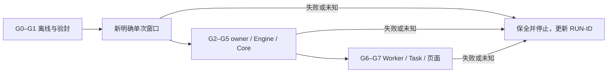

# Switchback 真实运行推进复盘

本次采用分层交付：主分支保存已完成的已提交功能与进度；新增容量切片保存在独立功能 PR，完整 PG 验证仍有未集成执行入口及旧夹具失败。这里的运行进度描述该切片，不表示它已全部进入主分支或通过验收。

最新实际 CI 发现另两项问题：RUN-052 为 Go/Python Engine 文件合同不一致（代码修复已通过定向测试，旧候选需更新）；RUN-053 为驻留后续 Turn、返工、续作、恢复等生产 owner 尚未接通。保留原有拒绝，不删除或改弱测试来制造全绿。

_覆盖 2026-10-16 至 2026-11-02；由既有报告转述，非本次重跑结果。_

---

完整真实交付尚未验收。历史中 Engine 曾真实启动并通过 ready；历史候选停在宿主控制器，sealed main 未启动。RUN-052 已证明旧 Go ELF 与 bundle 的两个 exact leaf 不匹配；下一步须先组装包含该修复的新 kit/bundle、生成新 exact seal/binding，再沿明确支持的 initial 路径取得真实收据。当前唯一跟踪入口是[运行进度页](README.md)，逐项状态见[53-ID 问题表](runtime-issues.tsv)。

## 📋 证据与当前身份

| 证据类别 | 可以证明 | 不能外推 |
| --- | --- | --- |
| 离线 | 源码回归、捕获回放、封存绑定、交叉编译与独立评审 | 真实 Linux/Engine/PG/Worker 或 provider 已通过 |
| 历史真实局部成功 | 对应窗口的原始收据所覆盖步骤 | 当前运行状态或新 binding 成功 |
| 模型 guest + 真实宿主文件树 | 模型端口与该宿主树的完整成本/行为 | VM 内核、实际 daemon、真实首启 |
| 当前真实验收 | 必须有当前 exact candidate/binding 的现场收据 | 旧 hash、旧 PID、局部 ready 或单个测试数字代替 |

| 身份 | SHA256 / 状态 |
| --- | --- |
| 历史未执行 sealed main 的候选 seal | `8a19eaf94a9efda98c0294bcab14bad774faee6e603928a16ba5a73d20f6c1e1` |
| 上述历史候选 binding | `4714f193a5a0274cba911a54e4308a8abcdb84614b2c5ea14f4c631ec129a8c3` |
| 绑定上述旧候选的宿主控制器 v2 | `8b8f290291dd88661ab026ae3e633dccdff43ec8e8d2fa5ca7aeb4a49850e225` |
| 历史候选既有离线记录 | Source279 / Pkg50 / Main35 / Modeled26 / tree45 / Auth24 / Seal32 通过 |
| 历史候选最终独立评审 | Spec PASS / Quality APPROVED；最终未解决 C0/I0/M0 |
| 含 RUN-052 两个 exact leaf 修复的新候选 | 尚待组装；新 exact seal/binding 和重绑控制器尚未生成 |
| 新候选 native/fullscale | 未测；旧候选耗时与评审不移签 |

这些 hash 用于识别私有历史中已封存的源码/交付闭包，不是公开 Git commit，也不表示公开源码 checkout 已生成同一候选。原始历史证据保留私有：**private evidence retained, not publicly reproducible**。本文各节及 TSV 的根因、修复与数字均由这些既有报告转述，没有在公开整理时执行验证器或重哈希原始证据树。

## 📚 已经推进到哪里

| 期间 / RUN-ID | 已取得的进展 | 剩余边界 |
| --- | --- | --- |
| 10/16–19 / 001–010 | 私有 Engine 与 Create→exact-CID quota→原 authorizer→单次 Start 顺序；有限 observer 认证 IPC；PG pending-cause 分类修复 | IPC 窗口总失败不能改写为总通过；Backend Linux 权限、完整 reader/容量链仍需现场 |
| 10/19 / 008 | macOS 原生 PG17.10 43 顶层/88 子项通过，覆盖事务、锁、回滚与应用生命周期 | 非固定 Docker PG 镜像/Linux 部署验证；不是全仓单测全绿 |
| 10/19–22 / 009–017 | raw v2、QSTATV 保真；显式共享卷容量保证；publisher 与 qualification 离线链 | 共享卷保证不承诺独立物理成本上界，不替代真实采样、签名容量和 PG 消费 |
| 10/21 / 013–016 | PID1 starttime0 解析真实通过；专用双能力诊断 8 组 namespace 前后稳定 | 专用诊断不扩 Backend/Worker 权限，也不授权 capacity/Start |
| 10/23–26 / 018–034 | 宿主入口、APFS 权限、Docker store 节点、systemd catalogue/模板/数组、固定父目录等现场差异逐项闭合 | 局部越过只关闭对应阻塞，不等于完成首启 |
| 10/26–29 / 035–043 | effective config、containerd start/ready、Engine start；owner 证明后真实 Stop；多个 no-replace 保存成功 | 部分窗口审计满或 checkpoint 超时，尾部 effects unknown 保留；不从 rename attempt 推导完整保存 |
| 10/29–30 / 044 | 维护 58.457 秒、四副本、containerd_ready/engine_ready 真实通过 | networks 读 procfs FD 遇 ENOENT；网络与最终 Engine receipt unknown；后续 native/Core/Task 未进入 |
| 10/30–31 / 045–046 | 旧 binding 的完整大规模离线演练通过：约 4.84GB、111631 nodes；work 3097.253 秒，cleanup 小于 20 秒 | 宿主树是真的，guest 是有限模型；耗时不移签到当前 binding |
| 11/01 / 047 | sealed CLI policy literal 不兼容 3600 的缺陷修正，并补 actual-main 回归 | 上一真实窗口 191.558 秒止于 T1 IPAM，未 Stop/move；非当前候选成功 |
| 11/01–02 / 048 | 默认桥 IPAM allocated/requested 完整匹配；creator 只接 integer1/2 且保留完整 docker0 owner proof；新 seal/binding 完成 | 该历史 binding native/fullscale、Linux/Core 与 Task-report-page 均未测；RUN-052 后需新候选 |

原生 PG 缺陷来自 `errors.Join(singlePending, nil)` 改变 cause 形态，误触发 discard；修复只在 Close 真有错误时 Join。后续大量阻塞来自正常系统数据未被组合测试覆盖：systemd 空数组/多值/模板/Watchdog 生命周期、Docker 默认桥/IPAM/creator2、Linux FD flags 和 procfs 瞬态。控制器错误同样承担工程责任，不能一概解释成“安全门禁更严格”。

## ⚠️ 最近两次停止与最后成功步骤

### RUN-049：执行目录创建过早

宿主先创建执行父目录保存 verify 收据，违反 sealed verifier 的 parent-absent 前提。7 份本地失败文件已 no-replace 原样保全；修正为先在外部保存完整验封收据，验封成功才创建执行目录。候选未改。

后续 fresh 完整验封 EXIT0，耗时 154.815767333 秒，stderr 为空。这是历史候选链路最后成功步骤，不是 sealed main 已运行，也不证明待组装的新候选已验封。

### RUN-051：receipt reader 把完整 stat 当稳定身份

新薄控制器读验封 receipt 后，用完整 `stat` 相等判断身份而停止；此前只有 syntax 检查，缺少实际 read 行为回归。现场 before-stat 未保存，不能确证现场差异就是 atime。普通 JSON 夹具仅变 atime 能重现同一断言，证明该机制存在。

v2 仅排除 atime，保留 identity、content、mtime_ns/ctime_ns；原脚本和失败原样保留。最终 9 项离线回归通过（0.270573417 秒），覆盖实际 reader、内容/mtime/inode/nlink 拒绝、65 成员复制及授权构造的 main fixture、子进程一次截获、非零不 retry、坏 verify/seal 在 mkdir 前拒绝；外部 watchdog 恢复 7200 秒。独立只读评审最终 C0/I0/M0。

该 v2 仍绑定旧候选；新候选组装后须把已评审 reader 逻辑及 main 绑定重新对准新的 exact seal/binding/成员集，并核对组合回归，不能直接复用旧控制器身份。末端 subprocess 被 fixture 截获，这不是 sealed actual CLI 的真实兼容证明。停止时没有创建 execution、grant 或 claim，没有 guest 命令、service Stop、凭据读取或 provider 调用。原失败窗口已经结束；G2–G7 没有因此前进。

## 🎯 下一次如何直接推进

先从功能 PR 中的 RUN-052 两个 exact leaf 修复组装新 kit/bundle，生成新的 exact seal/binding，并将 RUN-051 已评审 reader 逻辑重新绑定该候选；这些新产物目前尚不存在。核对重绑后的控制器、成员集和组合回归后，在新的明确单次授权范围内使用新外部控制目录和外部 fresh 验封回执，只调用一次 sealed actual 入口，优先验证支持的首次 initial 闭环。RUN-053 未集成路径保持独立 PR，不由此次闭环外推。不得复用旧候选控制器身份或已结束窗口的 grant、claim、human-intent。具体步骤、原范围与停止条件见[运行清单](runtime-checklist.md#下一次单次执行)。

图中 G0–G7 仅用于分类证据，不增加授权层级。运行前仍核对实际动作是否属于既有范围；VM 非 Running 不启动，不改分区，不调用模型/provider。后续 G6/G7 不能从 Engine 准备范围自动推导出执行权限。

为减少循环，每次只记录 exact binding、最后成功 effect、primary error、unknown effects 和下一次具体动作；已证明的副作用不无故重复，写入前仍 fresh 校验；同根因更新原 RUN-ID。未捕获的旧 stat、尾帧或 post-state 不事后重构成现场事实。公开 CI 通过与产品现场成功分别记录。
