# Switchback hard-cut product rename design

_Approved product-identity migration for the current pre-release repository, 2026-07-27._

---

## 📋 Decision

The repository adopts **Switchback** as its only current product identity. The migration is a hard cut: current code, configuration, protocols, deployment resources, tests, examples, and documentation do not retain runtime aliases for the previous identity.

The existing local environment is not an upgrade target. The acceptance deployment starts from newly created Compose resources and a newly initialized PostgreSQL database.

## 🎯 Scope and success criteria

### In scope

- Change the Go module to `github.com/abietic/switchback`
- Rename the Backend command to `cmd/switchback-backend`
- Replace product-prefixed environment variables with `SWITCHBACK_*`
- Replace product-prefixed HTTP headers with `X-Switchback-*`
- Replace protocol and schema identifiers with `switchback.*`
- Rename Compose services, images, containers, networks, databases, users, volumes, health checks, and local runtime paths
- Rename product-specific callback modules, package metadata, labels, logs, UI copy, fixtures, scripts, tests, current specifications, archived specifications, ADRs, and migration contents
- Rebuild the local environment from empty Compose volumes
- Preserve all domain terms such as `Assistant`, `WorkerSession`, `WorkerRun`, `RuntimeInstance`, `EventCenter`, `Evolution`, and `Frontier`

### Out of scope

- Renaming the local checkout directory on disk
- Rewriting Git commit history
- Changing the existing private remote `github.com/abietic/switchback`
- Supporting old environment variables, headers, protocol identifiers, database contents, container identities, or persisted runtime state
- Adding new product behavior unrelated to the rename

### Completion evidence

- The tracked working tree contains no previous product-name variants
- `go list ./...`, generated protocol checks, migration checks, unit/race/integration tests, frontend checks, and OpenSpec strict validation pass through `make verify`
- Compose creates only `switchback-*` application resources
- Backend health, frontend loading, PostgreSQL migration state, and effective Runtime profile are observable from the rebuilt environment
- Git history contains small, capability-scoped implementation commits followed by separately reviewable rename commits

## ⚙️ Canonical naming contract

| Surface | Canonical value | Compatibility policy |
| --- | --- | --- |
| Product | `Switchback` | No alternate current product name |
| Go module | `github.com/abietic/switchback` | No legacy module import |
| Environment | `SWITCHBACK_*` | No fallback lookup |
| HTTP headers | `X-Switchback-*` | No alternate header |
| Schema identity | `switchback.*` | No dual-emission |
| Backend command | `cmd/switchback-backend` | Old command path removed |
| Compose resources | `switchback-*` | Old resources removed before rebuild |
| Database/user | `switchback` | New empty database |
| Images | `switchback-backend`, `switchback-worker`, `switchback-web` | Rebuilt locally |
| Runtime paths | `/opt/switchback`, `/var/lib/switchback`, `/run/switchback-*` | No old mount path |
| Container labels | `switchback.*` namespace | Old containers rejected |
| Web packages and copy | `switchback-*`, `Switchback` | No old UI label |

Product naming is infrastructure identity, not a domain abstraction. Domain package names remain capability-oriented and do not gain a `switchback` prefix.

## 🔄 Delivery sequence

```mermaid
flowchart LR
    accTitle: Switchback Hard Cut Delivery
    accDescr: Ordered delivery from preserving existing capability work through product identity replacement, verification, destructive local reset, and phase acceptance

    baseline[📦 Commit capability slices] --> code[🔧 Rename code identities]
    code --> deploy[⚙️ Rename deployment resources]
    deploy --> docs[📚 Rewrite tracked documentation]
    docs --> verify{🧪 Full gates pass?}
    verify -->|No| repair[✏️ Repair exact failure]
    repair --> verify
    verify -->|Yes| reset[⚠️ Remove old volumes]
    reset --> restart[🚀 Rebuild and restart]
    restart --> accept([✅ Run phase acceptance])

    classDef process fill:#dbeafe,stroke:#2563eb,stroke-width:2px,color:#1e3a5f
    classDef decision fill:#fef9c3,stroke:#ca8a04,stroke-width:2px,color:#713f12
    classDef danger fill:#fee2e2,stroke:#dc2626,stroke-width:2px,color:#7f1d1d
    classDef success fill:#dcfce7,stroke:#16a34a,stroke-width:2px,color:#14532d

    class baseline,code,deploy,docs,repair,restart process
    class verify decision
    class reset danger
    class accept success
```



The capability baseline is committed before the rename so reviewers can distinguish functional evolution from identity-only changes. The destructive environment reset happens only after the renamed source passes the repository gates.

## 📦 Atomic commit topology

### Existing capability baseline

The pre-rename worktree was committed in buildable ownership boundaries:

1. Agent navigation
2. Production Web workbenches
3. Workbench persistence primitives
4. Assistant conversation and dispatch core
5. Trusted-network contract
6. Durable Runtime recovery and terminal settlement
7. Interactive product prototype
8. Workbench OpenSpec archive
9. Platform vertical wiring
10. Assistant and Runtime acceptance documentation
11. Platform architecture baseline

Shared transactional and startup code stayed together where splitting it would
have produced an uncompilable or behaviorally misleading intermediate commit.

### Product identity hard cut

1. `refactor!: rename runtime identifiers to Switchback`
   - Go module/imports, command paths, protocol identifiers, headers, environment lookup, callback modules, UI code, fixtures, and tests
2. `build!: rename local deployment resources to Switchback`
   - Compose, Dockerfiles, images, scripts, Make targets, acceptance harnesses, database bootstrap, runtime paths, labels, and deployment tests
3. `docs: adopt Switchback as the sole product identity`
   - Requirements, technical design, agent guidance, ADRs, OpenSpec current/archive content, operations, acceptance guides, and examples

A commit may be combined with its immediate neighbor only when splitting would leave either commit uncompilable or would separate a schema change from its only consumer. Such a combination must keep one capability and one reason for change.

## 💾 Destructive local migration

The hard cut intentionally does not migrate old local state.

1. Record the exact old Compose containers, networks, images, and volumes
2. Stop the old project and remove its containers, networks, anonymous volumes, named application volumes, and orphans
3. Regenerate local environment configuration with `SWITCHBACK_*` keys without printing credential values
4. Build new Backend, Worker, Web, and supporting images
5. Initialize the `switchback` PostgreSQL role/database and apply every migration from an empty schema
6. Start the complete Compose topology

> ⚠️ **Warning:** Removing the old PostgreSQL and Langfuse volumes destroys their local contents. Recovery is possible only from an independently created backup, which is not part of this design.

Credential source files may be reused, but their mount targets and configuration keys must use the new product identity.

## 🔍 Verification and acceptance

### Repository gates

```bash
make verify
```

The full gate is run after the final rename commit and must cover Go formatting, migration ordering, generated protocols, Worker image checks, unit/race/vet/integration tests, frontend checks, secret scanning, and strict OpenSpec validation.

The final name scan excludes only Git internals, CodeGraph derived data, dependency caches, local runtime output, and the filesystem checkout path:

```bash
rg -n --hidden \
  -g '!.git/**' \
  -g '!.codegraph/**' \
  -g '!**/node_modules/**' \
  -g '!runtime-data/**' \
  '(?i)h[e]lix|h[a]ilix|flux[ _-]?web'
```

Expected result: no tracked-file matches.

### Compose acceptance

- All expected services are running or successfully completed one-shot jobs
- Backend `GET /healthz` returns `200`
- Frontend returns the Switchback application shell
- PostgreSQL contains the full expected migration set
- Backend effective configuration uses only `SWITCHBACK_*`
- Worker provisioning references the new image, network, labels, paths, headers, and protocol identities
- No old application container, network, or volume remains
- Runtime recovery remains enabled and its durable first-heartbeat watchdog configuration is effective

### Failure handling

- A repository gate failure blocks the destructive reset
- A Compose build failure preserves source and commits but is reported as an environment/build failure
- A startup failure is diagnosed from service health, logs, migration state, and effective configuration before any retry
- No failed startup is reported as accepted

## 📌 Review checklist

- [x] The hard cut has no compatibility aliases
- [x] Destructive data loss is explicit
- [x] Domain terminology remains stable
- [x] Existing functional work is separated from the rename
- [x] Commit messages identify one capability and one reason for change
- [x] Repository and Compose acceptance evidence are concrete
- [x] Local checkout and Git history are outside the rename boundary
- [x] The design contains no placeholders or unresolved decisions
