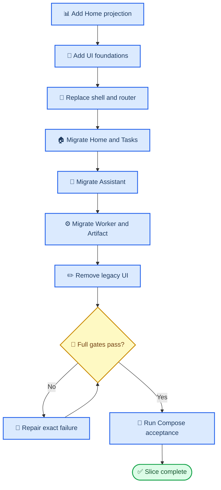

# Production Web Core Experience Design

_Approved design for a complete, production-backed migration of the Switchback core Web experience, 2026-07-28._

---

## 📋 Decision summary

Switchback will migrate the information architecture and visual language proven in
`web-demo/` into the production `web/` application without replacing the production
runtime owners.

The migration uses an **adaptive product shell**:

- Overview routes render an expanded navigation sidebar
- Assistant, Worker, and Artifact routes collapse navigation to an icon rail
- Mobile routes render navigation in a drawer
- Dark theme is the first-visit default
- Light theme is fully supported rather than treated as a partial fallback

The first delivery slice includes a real `home_dashboard` Frontier View and complete
production migration of Home, Tasks, Assistant, Worker, and Artifact. `web/` remains the
only production frontend owner. `web-demo/` remains a reference prototype and its mock
engine does not enter the production bundle.

## 🎯 Scope and success criteria

### In scope

- Add the `home_dashboard` projection, TypeScript contract, snapshot/SSE consumption,
  tests, and production Home route
- Replace the production application shell with the approved adaptive navigation
- Introduce semantic design tokens, dark and light themes, and user-controlled theme
  persistence
- Migrate the Tasks, Assistant, Worker, and Artifact presentation to the approved
  product language
- Preserve direct Task creation as an expert path alongside the Assistant flow
- Preserve all current Frontier replica, cursor, resync, transient display, pending
  command, revision, authorization, Runtime recovery, Artifact integrity, and Task
  acceptance behavior
- Establish component, browser, responsive, theme, accessibility, repository, and local
  Compose acceptance gates
- Remove the superseded production visual system after the replacement passes its gates

### Out of scope

- Copying `web-demo/src/mock/**` or simulated heartbeat, approval, cost, or execution data
- Implementing Workspaces, Memory/Evolution, Skills/MCP, Observability, or Admin read
  models in this delivery slice
- Implementing `web_ide`, SessionProcess, PreviewProxy, or any incomplete capability from
  `worker-web-ide-session-process`
- Replacing Frontier with page-owned fetching or client-owned business state
- Adding Token, model cost, or model routing data without an authoritative production
  projection
- Modifying existing uncommitted changes under `web-demo/`

### Complete migration definition

Migration is complete only when every in-scope surface has one production implementation,
one authoritative data path, automated coverage, and manual acceptance evidence.

The final `web/` tree must not retain:

- A second visual system
- A second router or theme owner
- Imports from `web-demo/`
- Mock domain records
- Legacy product/prototype copy
- Permanent migration flags
- Disabled code paths that preserve the old UI

Future platform modules may appear in a collapsed `平台规划` navigation group with a
non-interactive `规划中` label. They must not expose fake pages or imply production
availability.

## 🔍 Current-state evidence

The current production frontend already owns behavior that the prototype does not:

| Production owner | Current responsibility |
| --- | --- |
| `web/src/state/clientViewReplica.ts` | Snapshot identity, cursor continuity, resync, transient streams, pending commands |
| `web/src/state/frontierViewController.ts` | Snapshot loading, SSE connection, retry, control events |
| `web/src/api/*Commands.ts` | Command identities, revisions, error mapping, accepted command handling |
| `web/src/views/AssistantConversation.tsx` | Readiness, checkpoint, exact draft confirmation, Workspace evidence |
| `web/src/views/WorkerDetail.tsx` | Timeline, approvals, Task actions, Runtime recovery, Workbench |
| `web/src/views/ArtifactDetail.tsx` | Integrity-aware Artifact rendering and navigation |
| `internal/eventingprojection/` | Page-shaped authoritative projections and owner-sequenced deltas |

The prototype contributes visual and information-design evidence:

- Platform-wide navigation and product grouping
- A dense operational Home layout
- A dark, engineering-oriented visual language
- Compact status badges and information cards
- Assistant readiness visibility
- Worker execution and Runtime context in one workspace

These responsibilities are combined through adapters. They are not combined by moving
prototype state into production.

## ⚙️ Runtime and frontend architecture

```mermaid
flowchart LR
    accTitle: Production Web Ownership Flow
    accDescr: Authoritative domain events become Frontier views and client replicas before presentation adapters render the migrated interface without taking ownership of business state

    domain_events([⚡ Owner events]) --> materializer[⚙️ Projection materializer]
    materializer --> frontier[🌐 Frontier snapshot and SSE]
    frontier --> replica[🔄 Client View replica]
    replica --> feature_adapter[🔧 Feature adapter]
    feature_adapter --> ui_components[🎨 Demo-derived UI]
    user_action([👤 User action]) --> command_client[🌐 Command client]
    command_client --> gateway[🌐 Gateway]
    gateway --> domain_events
    command_client --> pending[⏰ Pending command]
    pending --> replica

    classDef authority fill:#dbeafe,stroke:#2563eb,stroke-width:2px,color:#1e3a5f
    classDef presentation fill:#ede9fe,stroke:#7c3aed,stroke-width:2px,color:#3b0764
    classDef pending_state fill:#fef9c3,stroke:#ca8a04,stroke-width:2px,color:#713f12

    class domain_events,materializer,frontier,gateway authority
    class feature_adapter,ui_components presentation
    class pending pending_state
```



The projection and replica layers remain authoritative. Feature adapters can rename,
group, sort, and format already-authorized data for presentation, but cannot manufacture
domain state, infer permissions, or mutate optimistic business state.

### Frontend module boundaries

```text
web/src/
├── app/                 # Router, route definitions, providers
├── components/
│   ├── layout/          # Product shell, navigation, page chrome
│   └── ui/              # Stateless visual primitives
├── features/
│   ├── home/            # Home adapter and page
│   ├── tasks/           # Task adapter and page
│   ├── assistant/       # Assistant adapter and page
│   ├── worker/          # Worker adapter and page
│   └── artifact/        # Artifact adapter and page
├── api/                 # Frontier and Gateway contracts/clients
├── state/               # ClientViewReplica and Frontier controller
└── styles/              # Semantic tokens and theme entry points
```

The migration may move existing files into these boundaries only when the move and its
consumer are delivered together. It must not perform an unrelated repository-wide
refactor.

### Dependency policy

- Add `react-router` as the single route owner for current and future platform routes
- Add Tailwind for layout composition and semantic token consumption
- Keep CSS custom properties as the theme contract used by Tailwind and non-Tailwind
  code
- Add only the accessible primitives required by the first slice
- Do not copy the prototype's complete component catalogue or dependency set
- Preserve existing Artifact tree, Diff, Markdown, icon, testing, and Frontier
  dependencies

## 🏠 Product shell and routes

### Shell modes

| Route class | Navigation mode | Main content behavior |
| --- | --- | --- |
| Home and Tasks | Expanded sidebar | Scrollable overview canvas |
| Assistant conversation | Icon rail | Conversation plus context panel |
| Worker detail | Icon rail | Execution area plus Workbench |
| Artifact detail | Icon rail | Integrity metadata plus content |
| Mobile | Drawer | One visible content column |

The application uses one shell instance. Individual pages declare a shell mode; they do
not implement navigation independently.

### Route contract

| Route | Behavior |
| --- | --- |
| `/` | Load `home_dashboard/index` |
| `/tasks` | Load `task_summary/index` |
| `/assistant` | Render an explicit start-conversation action |
| `/assistant/:conversationId` | Load one `assistant_conversation` View |
| `/workers/:workerSessionId` | Load one `worker_detail` View |
| `/artifacts/:artifactId` | Load one `artifact_detail` View |

Navigating to `/assistant` cannot create a Conversation. Conversation creation remains an
explicit user command, and a successful accepted response navigates to the returned
Conversation route.

### Theme behavior

- First visit defaults to dark
- The user can select dark, light, or system preference
- An explicit choice is stored in browser-local presentation state
- Theme state never enters Task, Conversation, Workspace, or user Memory persistence
- Both themes share semantic status and surface tokens
- Status meaning is always repeated in text or iconography
- Reduced-motion preference suppresses non-essential transitions

## 📊 Home dashboard contract

### View identity

| Field | Value |
| --- | --- |
| `view_type` | `home_dashboard` |
| `view_id` | `index` |
| Snapshot schema | `frontier.projection_snapshot.v1` |
| Delta schema | `frontier.projection_delta.v1` |
| Authority | Eventing projection materializer |

The View is page-shaped and viewer-scoped. It is bootstrapped deterministically even when
no Tasks or WorkerSessions exist.

### Data shape

```typescript
interface HomeDashboardData {
  attention_tasks: HomeTaskItem[];
  recent_workers: HomeWorkerItem[];
  recent_deliveries: HomeDeliveryItem[];
  capacity: {
    used: number;
    limit: number;
  };
  updated_at: string;
}

interface HomeTaskItem {
  task_id: string;
  title: string;
  workspace: string;
  status: "waiting_user" | "delivered";
  status_tone: "waiting";
  worker_session_id?: string;
  updated_at: string;
}

interface HomeWorkerItem {
  worker_session_id: string;
  workspace: string;
  status: string;
  status_tone: "neutral" | "active" | "waiting" | "success" | "danger";
  runtime_generation: number;
  bound_task_id?: string;
  task_title?: string;
  updated_at: string;
}

interface HomeDeliveryItem {
  task_id: string;
  title: string;
  workspace: string;
  status: "delivered" | "completed";
  acceptance_mode: "auto" | "manual";
  worker_session_id?: string;
  artifact_refs: Array<{
    artifact_id: string;
    artifact_type: "report" | "patch";
    href: string;
  }>;
  updated_at: string;
}
```

### Query and refresh rules

- `attention_tasks` contains at most six `waiting_user` or `delivered` Tasks
- `recent_workers` contains at most six viewer-readable WorkerSessions
- `recent_deliveries` contains at most six delivered or completed Tasks
- Lists sort by server `updated_at` descending and stable identity ascending for ties
- Capacity reuses the authoritative continuity quota `used` and `limit`
- Task, WorkerSession, and Artifact owner events refresh the View
- Conversation-only events do not refresh the View until they create or change a Task
- Related references use existing Task, Worker, and Artifact View URLs
- Viewer, Tenant, and Workspace checks remain server-side

Token usage, cost, model routing, simulated heartbeat age, and other prototype-only fields
are absent.

## 📚 Page migration contract

| Surface | Required production behavior |
| --- | --- |
| Home | Attention Tasks, recent Workers, deliveries, capacity, explicit Assistant entry |
| Tasks | Active/completed/all filters, direct creation, capacity, exact Worker navigation |
| Assistant | Turns, run state, Workspace evidence, clarification, readiness, checkpoint, draft, handoff |
| Worker | Durable/transient display, grouped timeline, commands, approvals, recovery, Task actions |
| Workbench | Report, Diff, Files, Artifact integrity, Task review |
| Artifact | Availability, digest/integrity, Markdown or patch content, Worker return path |

### Assistant invariants

- The page asks only through server-projected Assistant turns
- `available_actions` controls send, checkpoint, retry, Workspace, and confirmation actions
- A pending command does not optimistically advance readiness or Task state
- Exact draft confirmation keeps all current revision and creation-intent evidence
- Workspace selection remains explicit

### Worker invariants

- Durable checkpoints and transient display remain separate
- Runtime recovery preserves Session, Run, Turn, and generation evidence
- Prompt, steer, interrupt, approval, Task acceptance, rework, and continuation remain
  permission- and revision-gated
- Report, Diff, and Files render only authoritative Artifact data
- The layout reserves a stable future Workbench tab seam but does not implement Web IDE

## ⚠️ Loading, continuity, and failure behavior

| Condition | Required UI behavior |
| --- | --- |
| Initial snapshot | Render structural skeletons |
| Temporary SSE disconnect | Keep the last trusted snapshot and show reconnecting state |
| `resync_required` | Suspend mutation commands and reload the snapshot |
| `client_upgrade_required` | Block interaction and require a compatible client |
| Accepted command pending | Disable the exact conflicting action without optimistic domain state |
| Stale revision | Explain staleness and refresh the authoritative View |
| Command rejection | Preserve the projection and render local actionable feedback |
| Runtime recovery | Render failed/replacement generation and continuity evidence |
| Permission removal | Remove or disable the affected action immediately |
| Empty View | Render an actionable empty state without sample records |

Mobile pages cannot introduce document-level horizontal scrolling. Diff and code content may
scroll inside their own bounded regions.

## 🔄 Migration sequence



Each slice must be buildable and testable. Temporary adapters may exist between commits,
but the final delivery removes them unless they are stable feature boundaries.

## ✅ Verification and acceptance

### Backend tests

- Bootstrap an empty `home_dashboard`
- Project attention Tasks, recent Workers, deliveries, and capacity
- Refresh the View from Task, WorkerSession, and Artifact owner events
- Enforce Tenant and viewer isolation
- Preserve stable ordering and item limits
- Validate the new View type and related references
- Serve snapshot and SSE deltas through existing Frontier handlers

### Frontend tests

- Route matching, navigation activity, shell mode, drawer state, and focus restoration
- First-visit theme default, explicit persistence, system mode, and both theme renderings
- Home adapters and all empty/loading/error states
- Existing Task, Assistant, Worker, and Artifact command contracts
- Pending, stale, resync, client-upgrade, permission removal, and Runtime recovery states
- No imports from `web-demo/` or `web-demo/src/mock/**`
- No current product copy containing `Switchback`

### Browser and visual tests

Playwright covers:

1. Open Home and navigate to a Task and Worker
2. Start an Assistant Conversation explicitly
3. Send a message and observe pending projection state
4. Confirm an exact ready Task draft
5. Open Worker, issue allowed commands, and render recovery state
6. Review Report, Diff, Files, and Artifact detail
7. Complete Task acceptance or rework where allowed
8. Exercise reconnect, resync, and client-upgrade presentations

Visual snapshots cover Home, Assistant, Worker, and Diff at desktop and mobile widths in
dark and light themes.

### Repository and local acceptance

```bash
cd web
npm test
npm run build
npm run test:browser
cd ..
make openspec-check
make verify
```

The local Compose acceptance creates a real Task through Assistant, observes Worker
execution through Frontier, opens the produced Artifact, performs the allowed acceptance
action, and verifies the resulting dashboard update.

An environment, credential, Docker, or external-service failure is reported separately.
It cannot be represented as a passing product gate.

## 📍 Full-platform roadmap

The user-selected full-platform direction remains intact, but each capability receives its
own OpenSpec change, implementation plan, and acceptance evidence.

| Order | Slice | Product outcome |
| ---: | --- | --- |
| 1 | Production Web core | Home, Tasks, Assistant, Worker, Artifact |
| 2 | Workspace and capability management | Workspaces, Skills, MCP inventory and policy |
| 3 | Observability and Admin | OTel, Langfuse, metrics, logs, database, ObjectStore |
| 4 | Memory and Evolution | Candidates, revisions, review, Truth provenance |

Completion of the first slice does not imply that the later slices are implemented.

## 🚫 Rejected alternatives

### Promote `web-demo` to production

Rejected because it would replace verified projection, command, authorization, continuity,
and recovery behavior with a mock-owned application and then require those contracts to be
rebuilt.

### Build a parallel `web-v2`

Rejected because duplicate routers, dependency graphs, visual systems, and test suites
would increase migration duration and create two candidate production owners.

### Copy the complete prototype dependency set

Rejected because the first slice uses only a subset of the prototype's component catalogue.
Dependencies are admitted when an in-scope accessible component requires them.

### Reuse `task_summary/index` as the Home contract

Rejected because it cannot truthfully provide recent Worker and delivery data without
turning the page into a client-side cross-View join.

## 📌 Review checklist

- [x] Production runtime owners remain unchanged
- [x] The Home page has a real server-owned View
- [x] Dark and light themes are both in scope
- [x] Navigation behavior is defined for overview, deep, and mobile routes
- [x] Assistant, Task, Worker, Artifact, and Runtime invariants are preserved
- [x] Prototype-only data is excluded
- [x] Web IDE remains outside this slice
- [x] Error and continuity states are explicit
- [x] Automated and manual gates are concrete
- [x] Legacy UI removal is part of completion
- [x] Future platform slices are separated from current completion
- [x] The design contains no unresolved decisions
