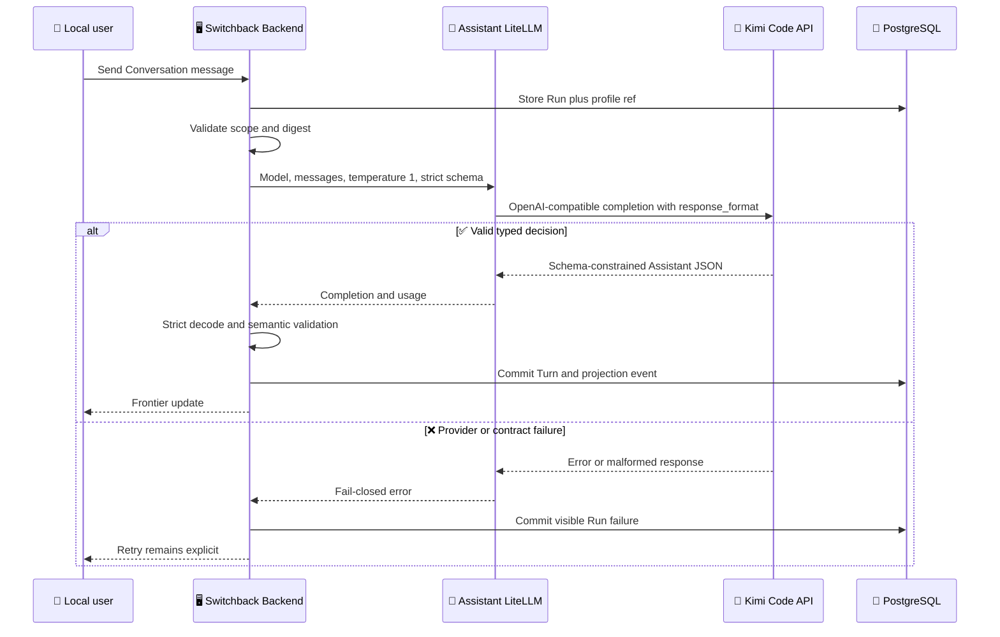

# Kimi Code Assistant Profile Design

_Approved design for using an existing Kimi Code key in the loopback-only Switchback Assistant, amended with strict structured output on 2026-07-29._

---

## 📋 Decision summary

Switchback will support the existing Kimi Code key for Assistant model calls only under
`single_user_local_v1`. It will not add Kimi Platform credentials, endpoints, billing
semantics, or multi-user claims.

The implementation introduces a new immutable profile identity,
`kimi-code-assistant-openai-v1`. Its digest owns the exact request policy, including
`temperature=1` and strict `assistant.decision.v1` JSON Schema output. The Assistant
LiteLLM client will serialize only parameters declared by the selected profile instead
of hard-coding one sampling value for every provider.

This preserves the current authority model:

- Server-owned profiles define model request policy
- Each `AssistantRun` records the exact profile ID, revision, and digest
- LiteLLM remains a transport and provider adapter rather than a hidden policy owner
- Provider failure remains fail-closed and never triggers an implicit fallback
- Historical Run references remain immutable
- Strict decoding and semantic validation remain authoritative after provider-side
  schema enforcement

## 🎯 Goals, scope, and non-goals

### Goals

- Make the existing Kimi Code key usable by the local Assistant
- Capture `temperature=1` in the profile digest and Run evidence
- Capture strict `json_schema` response policy in the profile revision and digest
- Keep the current `kimi-for-coding` model and OpenAI-compatible Kimi Code endpoint
- Enforce `single_user_local_v1` before the Backend starts serving traffic
- Preserve strict `assistant.decision.v1` decoding and validation
- Complete the real production Web acceptance flow blocked by the provider HTTP 400

### In scope

- Extend `AssistantModelProfile` with an optional, typed request policy
- Add `kimi-code-assistant-openai-v1`
- Change the local Compose default to the new profile
- Rename the Assistant LiteLLM alias and internal key variables to say `Kimi Code`
- Serialize `temperature` only when the selected profile declares it
- Serialize strict `json_schema` only when the selected profile declares the closed,
  versioned `assistant.decision.v1` response policy
- Reject invalid request policy, deployment scope, revision, or digest
- Add unit, architecture, configuration, integration, and real-provider acceptance
  evidence
- Close the remaining `production-web-core-experience` tasks only after the real flow
  passes

### Out of scope

- Kimi Platform or `https://api.moonshot.cn/v1`
- New provider credentials or a credential migration
- Multi-user, remote, team, or externally hosted deployment profiles
- Arbitrary request JSON, provider-specific header injection, or User-Agent spoofing
- Automatic model fallback, retry-driven provider switching, or hidden parameter
  coercion
- Provider-specific schema repair, permissive parsing, or automatic replay after a
  malformed decision
- Changing the Worker AgentProfile or its Anthropic-compatible Kimi Code path
- Changing the Kimi model ID from `kimi-for-coding`

> ⚠️ **Boundary:** Kimi Code permits API-key integration with third-party development
> tools, but distinguishes that programming-tool service from Kimi Platform product
> integration.[^1] The two services also use different keys and base URLs that are not
> interchangeable.[^2] This design therefore makes no claim beyond the loopback
> single-user developer product.

## 🔍 Current-state evidence

The committed production path now owns temperature correctly, but the active closeout
still has one response-contract gap:

| Owner | Current behavior | Required change |
| --- | --- | --- |
| `internal/platform/config/runtime_profiles.go` | Kimi revision 1 owns scope and `temperature=1` | Add the closed structured-output policy and revision 2 |
| `internal/contracts/v1` | Strict decision decoder exists; public JSON Schema leaves nested proposals open | Own one closed provider-schema projection and digest |
| `internal/interaction/adapter/litellm/client.go` | Serializes typed temperature and strictly decodes the returned content | Serialize exact profile-owned `response_format` before the existing decoder |
| `images/assistant-litellm/config.yaml` | Kimi alias targets the Kimi Code OpenAI endpoint | Keep endpoint, model, key, and alias unchanged |
| `deploy/local/compose.yaml` | Defaults to `kimi-code-assistant-openai-v1` | Keep the ID and load revision 2 from the fixed registry |
| `internal/interaction/application/send_message.go` | Stores exact profile identity for each new Run | Preserve unchanged |
| `internal/interaction/application/processor.go` | Fails closed when the Run and client profile differ | Preserve unchanged |

The real Compose acceptance report records a provider HTTP 400:
`invalid temperature: only 1 is allowed for this model`. The Workspace binding and
Conversation creation completed before that request, so this is a provider request
contract failure rather than a credential, Docker, network, or frontend failure. See
[`status-2026-07-28-production-web-core-experience.md`](../../status/status-2026-07-28-production-web-core-experience.md).

After the temperature fix, real Kimi Code calls reached HTTP 200 but exposed an
additional compatibility boundary: some responses failed strict
`assistant.decision.v1` decoding before Validator execution, while other responses
decoded and later failed semantic policy checks. Exact profile ID, revision, digest,
runtime image, and Retry references matched, so changing profile selection cannot
address this response-contract instability.

A sanitized compatibility probe then sent fixed, non-project prompts through the
existing Kimi Code endpoint. Both `response_format={"type":"json_object"}` and strict
`json_schema` returned an API envelope, valid JSON content, and the exact probe schema
in three of three calls each. This is bounded compatibility evidence, not a claim that
Kimi Code publicly guarantees the feature. The production design therefore keeps the
capability Kimi-profile-owned, versioned, digest-bound, and fail-closed.

## ⚙️ Profile and client architecture

### New profile identity

The fixed production registry will expose:

| Field | Value |
| --- | --- |
| Profile ID | `kimi-code-assistant-openai-v1` |
| Revision | `2` |
| LiteLLM model alias | `switchback-assistant-kimi-code` |
| Response schema | `assistant.decision.v1` |
| Deployment scope | `single_user_local_v1` |
| Temperature | `1` |
| Structured output | `strict_json_schema` |
| Structured-output schema | `assistant.decision.v1` |
| Provider schema ID | `assistant-decision-strict-json-schema-v1` |
| Provider schema digest | SHA-256 of canonical schema bytes |
| Automatic fallback | Empty |

Revision `1` of `kimi-code-assistant-openai-v1` remains historical evidence and is not
rewritten. New local Runs use revision `2`. The old `kimi-assistant-openai-v1` identity
also remains unselectable for new local configuration. Historical database rows keep
their original profile ID, revision, and digest; no migration rewrites them.

### Typed request policy

`AssistantModelProfile` gains optional fields with `omitempty` so profiles that declare no
new policy retain their existing JSON digest:

```go
type AssistantModelRequestPolicy struct {
	Temperature      *float64                          `json:"temperature,omitempty"`
	StructuredOutput *AssistantStructuredOutputPolicy `json:"structured_output,omitempty"`
}

type AssistantStructuredOutputPolicy struct {
	Mode                 string `json:"mode"`
	DecisionSchema       string `json:"decision_schema"`
	ProviderSchemaID     string `json:"provider_schema_id"`
	ProviderSchemaDigest string `json:"provider_schema_digest"`
}

type AssistantModelProfile struct {
	ID                         string                        `json:"id"`
	Revision                   uint64                        `json:"revision"`
	LiteLLMModel               string                        `json:"litellm_model"`
	ResponseSchema             string                        `json:"response_schema"`
	DeploymentScope            string                        `json:"deployment_scope,omitempty"`
	RequestPolicy              *AssistantModelRequestPolicy `json:"request_policy,omitempty"`
	AutomaticFallbackProfileID string                        `json:"automatic_fallback_profile_id,omitempty"`
	Digest                     string                        `json:"digest"`
}
```

The request policy is deliberately closed:

- `temperature` is optional
- A present temperature must be finite and between `0` and `2`
- `structured_output` is optional
- Its only supported mode is `strict_json_schema`
- Its decision schema must equal the profile's exact `assistant.decision.v1`
  response schema
- Its provider schema ID and digest select one repository-owned, closed projection
- The client maps that typed policy to the fixed OpenAI-compatible
  `response_format.type=json_schema`, `json_schema.strict=true`, stable schema name, and
  repository-owned JSON Schema; configuration cannot supply raw schema JSON
- Unknown or arbitrary provider parameters are not representable
- `RequestPolicy` and `DeploymentScope` participate in the profile digest
- `AutomaticFallbackProfileID` remains empty

`deepseek-assistant-openai-v1` declares neither temperature nor structured output. Its
request omits both fields, and its existing digest remains stable because the new
optional fields serialize to nothing.

The provider schema is a dedicated closed projection of the model-proposed fields in
`AssistantDecision`; it is not the existing public
`api/schema/v1/assistant-decision.schema.json`. The public schema intentionally permits
nested objects that the Go decoder and semantic validators inspect later, while a strict
provider schema must declare and close every generated object. Reusing the public schema
verbatim was rejected by a sanitized real-endpoint probe with HTTP 4xx.

Removing only `$schema`, `$id`, and `title` still returned HTTP 4xx. A fully closed
informational projection then returned HTTP 2xx with exact schema-compliant content, as
did a third projection that added the closed `AssistantTaskDraft` null-or-object union.
These bounded probes establish the implementation shape without treating provider
behavior as a permanent public guarantee.

The repository owns the provider schema under `internal/contracts/v1`, canonicalizes it
as minified UTF-8 JSON, calculates that byte sequence's SHA-256 digest, and exposes only
its fixed ID, digest, and defensive-copy bytes. The schema closes the seven top-level
fields, the full readiness proposal, and the optional TaskDraft proposal. `checkpoint`
is constrained to `null` because the model instructions never authorize the provider to
mint a checkpoint; Interaction constructs that governed record at the existing
server-owned boundary.

Changing provider schema bytes requires a new provider schema ID and profile revision.
Silently changing the request under an existing profile ref is forbidden. Repository
tests must prove that representative clarification, ready-draft, and informational
fixtures satisfy both the provider projection and `DecodeAssistantDecision`; semantic
rules that JSON Schema cannot express remain in the existing validators.

### Deployment-scope enforcement

`localproduct.Config.Validate` compares the selected Assistant profile scope with
`configuration.Profile.Name`. A scoped profile is invalid when these differ. The check
runs before the Assistant runner, network listener, or provider request is created.

The registry and client also validate the profile digest and request policy. This creates
three independent fail-closed boundaries:

1. Registry construction owns the fixed profile
2. Product configuration enforces deployment eligibility
3. Client construction enforces request serialization safety

## 🔄 Request and response flow



The key remains mounted into the Assistant LiteLLM container. It is not added to the
profile, digest, request record, command, Trace, Frontier projection, or status document.
The upstream endpoint remains `https://api.kimi.com/coding/v1`, and the model remains
`kimi-for-coding`, matching the official OpenAI-compatible Kimi Code contract.[^1]

Provider-side structured output is defense in depth, not an authority transfer.
`DecodeAssistantDecision` and the existing readiness, planning, and TaskDraft validators
remain mandatory. A provider response that satisfies JSON Schema but violates semantic
policy produces the existing sanitized failure and cannot mutate Conversation, Task, or
Worker state.

## ⚠️ Compatibility and failure semantics

### Historical and in-flight Runs

An existing Run remains bound to the profile identity stored when its source message was
accepted.

- Terminal Runs remain readable and unchanged
- A queued revision-1 Run is never rebound to revision 2
- If the revision-2 fixed client claims a revision-1 Run, exact identity validation returns
  `ErrModelPolicyConflict`
- The processor commits the existing visible failure path
- A user Retry creates a new Run under the currently selected profile
- A request with an unknown external effect follows the existing restart reconciliation
  path and is never replayed automatically

This trades transparent migration for explicit authority. A retry is a new user-visible
attempt, not a rewrite of historical evidence.

### Provider and response failures

| Failure | Result |
| --- | --- |
| Scope mismatch | Backend startup fails |
| Invalid or stale profile digest | Backend or client construction fails |
| Invalid temperature | Profile or client construction fails |
| Unsupported structured-output mode or schema | Profile or client construction fails |
| Run/client profile mismatch | `ErrModelPolicyConflict` |
| Provider timeout | Existing timeout failure |
| Provider non-2xx | Existing upstream failure |
| Missing, ignored, malformed, or semantically invalid decision | Existing sanitized failure |
| Kimi quota or permission failure | Visible failure; no fallback |

The implementation must not log raw credentials, authorization headers, environment
values, or unrestricted provider bodies. Kimi Code documentation also requires clients
to preserve their real identity rather than tamper with identity headers.[^1]

## 🧪 Verification strategy

### Automated contract tests

| Layer | Required evidence |
| --- | --- |
| Profile registry | New ID, revision, scope, alias, temperature, digest stability |
| Profile validation | Reject NaN, infinity, out-of-range temperature, unknown structured-output mode/schema, fallback, and stale digest |
| LiteLLM client | Exact Kimi payload contains `temperature:1` and one strict `assistant.decision.v1` `json_schema` response format |
| LiteLLM client | Exact DeepSeek payload omits `temperature` and `response_format` |
| Protocol consistency | Fixed provider schema ID/digest, closed object graph, defensive-copy access, and representative decisions accepted by both schema and strict decoder |
| Product config | Scoped profile accepts only `single_user_local_v1` |
| Architecture | Compose and image contain Kimi Code names and no Kimi Platform surface |
| Interaction | Revision-1 Run fails closed; Retry creates a revision-2 Run |
| Security | Repository secret and forbidden-endpoint shields pass |

The confirmed TDD seams are:

1. `config.ProductionProfileRegistry().Assistant` plus public profile ref/digest
   validation
2. `litellm.Client.Complete` through an `httptest` provider boundary, asserting the
   exact outbound JSON and strict inbound decision behavior
3. `localproduct.Config.Validate` before listener/provider startup
4. OpenSpec, generated-protocol, architecture, shell, and forbidden-surface gates
5. Public local-product HTTP/Frontier/Web acceptance from Conversation through Home

Tests assert exact JSON keys and independent known literals. Finding only the strings
`temperature` or `response_format`, testing a private helper, or recomputing the expected
schema with production code is insufficient.

### Real-provider acceptance

The existing non-empty Kimi Code key is the only credential used. Acceptance proceeds in
two stages:

1. A focused real-provider probe must return one strictly decoded and semantically valid
   `assistant.decision.v1` response through revision 2 with the exact structured-output
   policy.
2. The complete local Compose flow must pass:
   clarification, user answer, ready draft, exact confirmation, Task creation, Worker
   delivery, Artifact/Task navigation, and final Home projection update.

Provider logs may prove status, model alias, request ID, and sanitized failure reason.
They must not expose the key, headers, environment, or unrestricted response body.

### Completion gates

The change is complete only when:

- Focused Go tests pass
- `make verify` passes with a fresh PostgreSQL test database
- Production Web unit, build, and Playwright gates remain green
- Real Kimi Code focused and complete-flow acceptance pass
- `web-demo/` has zero task diff
- OpenSpec strict validation passes before and after synchronization

## 📦 OpenSpec and rollout

The active `kimi-code-assistant-profile` change will be amended before implementation.
Its proposal, design, delta specs, and tasks must preserve the decisions in this
document, including revision 2, strict structured output, strict decoding, and the
absence of hidden retry.

Rollout order:

1. Amend and strictly revalidate `kimi-code-assistant-profile`
2. Amend and strictly validate the OpenSpec contract for profile-owned structured output
3. Implement the revision, typed policy, client serialization, documentation, and tests
4. Rebuild Assistant LiteLLM and Backend
5. Run the focused real-provider probe
6. Run the complete production Web acceptance flow
7. Present the delta-spec synchronization impact
8. Synchronize and archive `kimi-code-assistant-profile` after confirmation
9. Mark `production-web-core-experience` tasks `6.3` and `6.5` only if their exact
   evidence exists
10. Synchronize and archive the frontend change under the same confirmation rule

Rollback is one Git revert plus image rebuild. It does not rewrite existing Runs,
credentials, or provider observations.

## 🔐 Security and compliance boundaries

- The Kimi Code key remains a mounted file, not an environment value in Backend
  configuration
- The sidecar reads the mounted file once and exports it only inside its process
  environment
- Key material never enters profile JSON or a digest
- No Kimi Platform hostname, credential variable, or billing claim is introduced
- No automatic fallback can send the ContextPack to a different provider
- The existing loopback-only Web boundary remains mandatory
- Provider identity headers are not forged or rewritten
- Complete model input/output observability retains the existing local-only privacy
  boundary and secret filtering

## 🔗 References

[^1]: Moonshot AI. (2026). "Kimi Code Overview." _Kimi Code Documentation_. https://www.kimi.com/code/docs/en/

[^2]: Moonshot AI. (2026). "Kimi Code Error Reference." _Kimi Code Documentation_. https://www.kimi.com/code/docs/en/kimi-code/error-reference.html
