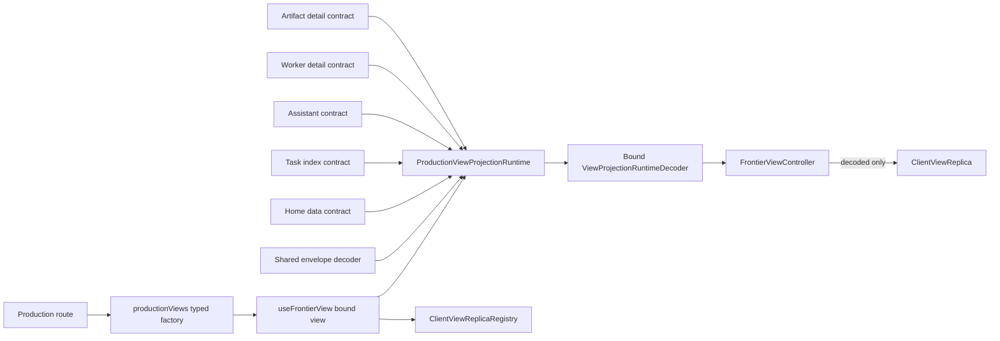

# Production ViewProjection Runtime Decoder Design

**Date:** 2026-08-24
**Status:** Proposed
**Scope:** Switchback production Web runtime only

## Decision Summary

Switchback will replace the optional per-page Snapshot/Delta parser seam with one
closed, production-owned `ViewProjectionRuntimeDecoder` registry.

The registry binds a supported `view_type` and exact `view_id` to all three durable
ingress decoders:

- `ProjectionSnapshot`
- `ProjectionDelta`, including the SSE event id
- `ProjectionControlEvent`, including the SSE event name

`useFrontierView` will obtain this decoder from the closed registry. Pages will no
longer choose a generic data type or pass parser functions. The controller will not
have a cast fallback. Raw HTTP/SSE values must pass identity, schema, envelope and
view-specific validation before they can reach `ClientViewReplica`.

This is a browser trust-boundary change. It does not change Go wire structs,
PostgreSQL rows, migrations, JSON field names or Gateway authorization.

## First-Principles Goal

The browser receives untrusted JSON. TypeScript types disappear at runtime, so a
type assertion cannot make those bytes authoritative.

The required invariant is:

> No durable View data, action, related reference, receipt, cursor or version may
> mutate a production replica until one production-owned decoder has proved that
> the value belongs to the bound View and satisfies the currently supported wire
> and view-data contract.

For WorkerDetail this is also a command-safety invariant. `available_actions`,
Session/Run/Turn revisions, Task binding and approval identities feed command
composition. Client validation is defense in depth; Gateway remains the final
authorization owner.

## Current Evidence

| Surface | Current runtime behavior | Consequence |
| --- | --- | --- |
| `FrontierViewControllerOptions` | `parseSnapshot?` and `parseDelta?` are optional | A production caller may omit validation. |
| Controller constructor | Defaults to `value as ProjectionSnapshot<T>` / `ProjectionDelta<T>` | Raw JSON becomes trusted by assertion. |
| `useFrontierView<T>` | Caller supplies free `T` plus optional independent parsers | Snapshot and Delta parsers can be absent, mismatched or dishonest. |
| Production routes | Home, Assistant and Artifact pass parsers; Tasks and Worker do not | Two real routes bypass runtime data validation. |
| Replica registry | Caches by `view_type + view_id` and casts the stored generic | Decoder identity is not part of the cached replica contract. |
| Control events | `JSON.parse` plus object cast | A foreign or malformed control can trigger refresh/upgrade effects. |
| Replica continuity | Schema is checked before identity and Delta accepts any result version greater than base | `foreign + future schema` is misclassified; version jumps are accepted. |

The Go continuity reader proves durable identity, supported envelope schema and
cursor continuity, but intentionally passes view-specific JSON through. It cannot
replace browser runtime validation.

## Domain Vocabulary

- **Production View**: one of the View types rendered by the production SPA.
- **View contract**: the view-specific rules for `data`, actions and related refs.
- **Bound decoder**: an immutable decoder paired with one exact `view_type` and
  `view_id`.
- **Foreign identity**: a well-formed value for a different View.
- **Unsupported schema**: a value for the bound View and correct envelope family,
  but a version this client does not support.
- **Invalid contract**: malformed JSON, missing/invalid identity, wrong envelope
  family or a current-schema value that violates known fields/invariants.
- **Integrity reconciliation**: at most one automatic Snapshot refresh for one
  replayable malformed Delta before the controller stops the affected stream.

These are frontend protocol concepts, not new domain aggregates; `CONTEXT.md` does
not need a domain-language change.

## Options Considered

### Option A — Make both parser arguments required

Rejected. A page can still pass `(value) => value as ProjectionSnapshot<T>`, choose
an unrelated `T`, or pair parsers for different Views. Common validation and error
classification remain duplicated.

### Option B — Require one bound decoder argument from every page

Better, but rejected for production composition. It prevents Snapshot/Delta
mis-pairing, yet each page can still select or construct the wrong decoder. It also
keeps production completeness distributed across route code.

### Option C — Closed production registry behind `useFrontierView`

Selected. `view_type` determines the data type and the only admitted decoder.
`view_id` binds the instance. The hook owns production selection; the controller
accepts only a bound decoder; the replica registry verifies the stable contract key.

### Option D — Add JSON Schema or change numeric wire fields

Deferred. There is no existing Projection Snapshot/Delta JSON Schema authority,
and converting Go `uint64` fields to strings is a wire-v2 decision. Runtime
validation can fail closed on unsafe JavaScript integers without changing v1.

## Module Boundary



The deep module lives under `web/src/projections/`; it is neither a React feature
nor a page-owned API helper. Dependency direction is one-way:

```text
projection primitive validators
    -> shared projection runtime decoder
    -> projections/decoders view-specific data/authority contracts
    -> projections/productionViewRegistry composition root
    -> state controller/hook/replica
    -> app routes and feature components
```

View contract modules must not import React, state/controller code or feature
components. Artifact parsing and the pure checksum/download/related-ref authority
helpers move together out of `features/artifact` into the projections module;
Artifact components import that contract in the forward direction. The old
feature-owned authority/parser modules are deleted rather than kept as forwarding
wrappers. The Artifact workbench uses the same bound production decoder for its
non-replica one-shot preview load rather than retaining an alternate full-envelope
parser. That projections-owned helper accepts only a bound Artifact view and
returns only a decoded Artifact result; it does not mutate `ClientViewReplica`,
connect SSE, reconcile commands or participate in controller guards. The
controller's cause-tagged coordinator may share its low-level HTTP/decode primitive,
but remains the only owner of replica effects and retries.

Existing Home and Assistant modules are reduced to pure view-data/authority
decoders consumed by the projections registry. Their public full-envelope
`parse*Snapshot`/`parse*Delta` exports are deleted or made module-private, and their
tests move to the bound production runtime. No second envelope-validation seam is
kept for convenience.

## Public Type Shape

The exact names may change during implementation, but the boundary must preserve
this shape:

```ts
type ProductionViewDefinitionByKind = {
  home: { viewType: "home_dashboard"; data: HomeDashboardData };
  taskIndex: { viewType: "task_summary"; data: TaskIndexData };
  assistant: { viewType: "assistant_conversation"; data: AssistantConversationData };
  worker: { viewType: "worker_detail"; data: WorkerDetailData };
  artifact: { viewType: "artifact_detail"; data: ArtifactDetailData };
};

type ProductionViewKind = keyof ProductionViewDefinitionByKind;
type ProductionViewType = ProductionViewDefinitionByKind[ProductionViewKind]["viewType"];
type DataOfKind<K extends ProductionViewKind> = ProductionViewDefinitionByKind[K]["data"];

declare const boundProductionViewBrand: unique symbol;
declare const decodedProjectionBrand: unique symbol;

interface TrustedViewProjectionState<T> {
  readonly data: T;
  readonly availableActions: readonly ActionRef[];
  readonly relatedRefs: readonly RelatedRef[];
  readonly viewEpoch: number;
  readonly viewCursor: number;
  readonly projectionVersion: number;
}

interface TrustedProjectionPosition {
  readonly viewEpoch: number;
  readonly viewCursor: number;
  readonly projectionVersion: number;
}

interface DecodedDeltaIdentity {
  readonly deltaId: string;
  readonly viewEpoch: number;
  readonly viewCursor: number;
}

interface BoundViewProjectionRuntimeDecoder<T> {
  readonly contractKey: string;
  readonly viewType: ProductionViewType;
  readonly viewId: string;
  decodeSnapshot(
    value: unknown,
    context: { requestedClientCommandIds: readonly string[] },
  ): DecodedProjectionSnapshot<T>;
  decodeDeltaFrame(
    frame: ProjectionSSEFrame,
    current: TrustedViewProjectionState<T>,
  ): DecodedDeltaDecision<T>;
  decodeControlFrame(
    frame: ProjectionSSEFrame,
    current: TrustedViewProjectionState<T>,
  ): DecodedProjectionControl;
}

interface BoundProductionView<K extends ProductionViewKind> {
  readonly [boundProductionViewBrand]: K;
  readonly kind: K;
  readonly runtimeVersion: string;
  readonly decoder: BoundViewProjectionRuntimeDecoder<DataOfKind<K>>;
}

interface DecodedProjectionSnapshot<T> {
  readonly [decodedProjectionBrand]: true;
  readonly envelope: ProjectionSnapshot<T>;
  readonly effective: TrustedViewProjectionState<T>;
  readonly requestContext: {
    readonly requestedClientCommandIds: readonly string[];
  };
}

interface DecodedProjectionDelta<T> {
  readonly [decodedProjectionBrand]: true;
  readonly envelope: ProjectionDelta<T>;
  readonly effective: TrustedViewProjectionState<T>;
}

type DeltaResyncReason =
  | "epoch_mismatch"
  | "cursor_gap"
  | "base_version_mismatch";

type DecodedContinuityDiscontinuity =
  | {
      readonly [decodedProjectionBrand]: true;
      readonly source: "delta";
      readonly reason: DeltaResyncReason;
      readonly key: string;
      readonly trusted: TrustedProjectionPosition;
      readonly incoming: {
        readonly deltaId: string;
        readonly viewEpoch: number;
        readonly viewCursor: number;
        readonly baseProjectionVersion: number;
        readonly resultProjectionVersion: number;
      };
    }
  | {
      readonly [decodedProjectionBrand]: true;
      readonly source: "control";
      readonly reason: "server_resync";
      readonly key: string;
      readonly trusted: TrustedProjectionPosition;
      readonly incoming: {
        readonly viewEpoch: number;
        readonly snapshotCursor: number;
      };
    };

interface DecodedDeltaDecision<T> {
  readonly [decodedProjectionBrand]: true;
  readonly result:
    | { readonly kind: "duplicate"; readonly identity: DecodedDeltaIdentity }
    | {
        readonly kind: "resync_required";
        readonly discontinuity: DecodedContinuityDiscontinuity & { readonly source: "delta" };
      }
    | { readonly kind: "apply"; readonly delta: DecodedProjectionDelta<T> };
}

interface DecodedProjectionControl {
  readonly [decodedProjectionBrand]: true;
  readonly envelope: ProjectionControlEvent;
  readonly result:
    | {
        readonly kind: "resync_required";
        readonly discontinuity: DecodedContinuityDiscontinuity & { readonly source: "control" };
      }
    | { readonly kind: "client_upgrade_required" };
}

interface DecodedIntegrityFailure {
  readonly [decodedProjectionBrand]: true;
  readonly ingress: "delta";
  readonly eventFamily: "projection_delta";
  readonly replayable: true;
  readonly key: string;
  readonly safeReason:
    | "malformed_contract"
    | "authority_violation"
    | "sse_binding_mismatch";
}

interface ViewProjectionDecodeError extends Error {
  readonly classification:
    | "foreign_identity"
    | "unsupported_schema"
    | "invalid_contract";
  readonly safeReason: string;
  readonly integrityFailure?: DecodedIntegrityFailure;
}

declare const replicaCommitBrand: unique symbol;

interface DecodedCommandReconciliationCause {
  readonly [replicaCommitBrand]: true;
  readonly reason:
    | "delta_command_identity_conflict"
    | "snapshot_receipt_identity_conflict"
    | "submission_response_identity_conflict";
  readonly key: string;
  readonly trustedPosition: TrustedProjectionPosition | undefined;
  readonly conflictingPosition?: {
    readonly viewEpoch: number;
    readonly viewCursor: number;
    readonly projectionVersion: number;
  };
  readonly pendingBindingFingerprint: string;
  readonly requestedClientCommandIds: readonly string[];
}

type ReplicaCommitDecision =
  | { readonly kind: "committed" }
  | {
      readonly kind: "command_reconciliation_required";
      readonly cause: DecodedCommandReconciliationCause;
    }
  | { readonly kind: "command_reconciliation_blocked" }
  | { readonly kind: "stale_decode_context" };

const productionViews: {
  home(): BoundProductionView<"home">;
  taskIndex(): BoundProductionView<"taskIndex">;
  assistant(id: string): BoundProductionView<"assistant">;
  worker(id: string): BoundProductionView<"worker">;
  artifact(id: string): BoundProductionView<"artifact">;
};

function useFrontierView<V extends AnyBoundProductionView>(
  view: V,
): FrontierViewResult<DataOf<V>>;
```

There is no public free `<T>`, arbitrary `view_type` string, default registry branch
or optional parser. Routes use calls such as
`useFrontierView(productionViews.worker(workerSessionId))`. The registry definition
uses an exhaustive mapped type or `satisfies` expression so that omitting any
production kind fails compilation.

The unique-symbol brands are private to the projections module. Feature/page code
cannot structurally construct a bound production view or decoded projection; only
the five factories and runtime decoder can create them. Negative type tests use
`@ts-expect-error` to prove the old four-argument hook, a fake bound object and a
wrong kind/data pairing do not compile.

`replicaCommitBrand` is separately private to the state/replica module. Only the
replica may construct a command-reconciliation cause after comparing decoded wire
identities with its local active-command ownership. Projections do not inspect or
import that local state, and pages cannot forge the token. A decoded envelope is
therefore necessary but not sufficient for commit: the replica returns the closed
`ReplicaCommitDecision`, and the controller handles it without collapsing a local
command conflict into a wire discontinuity.

The same state-private recovery signal is emitted when an asynchronous command
submission response conflicts with an existing client/server identity binding.
The controller subscribes directly to that signal; a feature callback does not
translate replica sync state into a free-form refresh. The replica retains the
full implicated local bindings internally and exposes only the branded safe cause.

The registry closes over product kinds rather than wire `view_type` alone. This is
required because `task_summary` currently has both index and individual-Task wire
shapes, while the production SPA consumes only the index. `home` and `taskIndex`
bind exact `view_id = "index"`; Assistant, Worker and Artifact factories validate
and bind their route identity.

Bound decoders and replicas share one exact-identity registry entry rather than two
unbounded Maps. A stable semantic
`contractKey = kind + runtimeVersion + view_type + view_id` is used for compatibility;
function/object identity is not. A View decoder's explicit `runtimeVersion` is
bumped whenever its accepted input set, canonical normalization or authority/effect
semantics changes incompatibly, including when newly loaded code can no longer
prove data accepted by the prior decoder. The same key reuses an entry. A key change clears and replaces only that
exact replica, then performs one fresh Snapshot load; it never reuses old authority
or manufactures `client_upgrade_required`. If two different contract keys are
requested concurrently in one production runtime, the composition fails closed.
Development HMR first disposes the old controller, then uses this replacement path.

The registry makes that distinction with an acquire/release lease (or an equivalent
active-owner token) held by each mounted controller. Same-key acquire reuses the
entry. A different-key acquire while any old-key lease remains is a concurrent
composition error. After all old leases release, a different-key acquire clears and
replaces the entry once. Hook cleanup stops its controller before releasing the
lease, so HMR/remount cannot leave an old decoder applying events to the replacement.

## Decode Order and Error Classification

Every Snapshot, Delta and Control decoder follows the same order:

1. Parse JSON where applicable and require a non-array record.
2. Read the minimal, version-independent `view_type` and `view_id`.
3. If either identity field is missing or non-canonical, return
   `invalid_contract`.
4. If the well-formed identity differs from the bound View, return
   `foreign_identity` without inspecting schema or payload.
5. Read `schema_version`.
6. A future version in the correct envelope family is `unsupported_schema`; a
   missing schema or wrong family is `invalid_contract`.
7. Validate the common envelope.
8. Validate view-specific data, actions and refs.
9. Return a new decoded object only after every check succeeds.

Schema tokens use an executable grammar per ingress family:

```text
frontier.projection_snapshot.v<version>
frontier.projection_delta.v<version>
frontier.projection_control.v<version>
```

`<version>` is a canonical positive decimal integer with no leading zero. The
decoder compares the decimal text without converting it to a JavaScript Number:
exact `v1` is supported, a canonical value greater than one is
`unsupported_schema`, and `v0`, `v01`, non-decimal, missing or cross-family tokens
are `invalid_contract`.

This gives deterministic cases:

| Raw case | Classification |
| --- | --- |
| foreign View + snapshot v2 | `foreign_identity` |
| matching View + snapshot v2 | `unsupported_schema` |
| missing identity + snapshot v2 | `invalid_contract` |
| Snapshot endpoint carrying Delta v1 | `invalid_contract` |
| matching v1 with malformed Worker authority | `invalid_contract` |

`ViewProjectionDecodeError.classification` carries only `foreign_identity`,
`unsupported_schema` or `invalid_contract`, matching the controller's three
decisions. An invalid error has a safe `reason` such as `malformed_contract`,
`authority_violation` or `sse_binding_mismatch` for tests/diagnostics. It also
carries expected identity and safe stage metadata, but never raw protected payloads.
When and only when an invalid Delta has a canonical replay id and is eligible for
one integrity reconciliation, the decoder attaches a private branded
`DecodedIntegrityFailure` with literal `replayable: true`, the closed event family,
safe reason and non-sensitive correlation key. A non-canonical/absent SSE id never
produces this token.
The controller/coordinator consumes that object verbatim; it never derives an
integrity key from the raw frame, payload or transport event.

## Common Envelope Invariants

### Numbers

All epoch, cursor, version, revision, sequence, ordinal, size and generation values
must be integers within `Number.isSafeInteger`.

- positive fields reject zero;
- explicitly non-negative fields accept zero;
- Delta requires `result_projection_version === base_projection_version + 1`;
- v1 fails closed if a valid Go `uint64` cannot be represented safely in
  JavaScript. A decimal-string representation requires a future wire version.

### Identities and timestamps

Known IDs are non-empty, untrimmed strings without CR, LF or NUL. Timestamps use
the existing strict timestamp validator. The browser has no trusted expected
Tenant identity, so `tenant_id` is validated as canonical but is not described as a
client authorization proof.

`client_command_id`, when present, requires a present canonical `command_id`;
`command_id` may still appear alone. This preserves the producer's causal pairing
rule without making the historically additive client field required.

### Receipts

`command_receipts` preserves absent versus present-empty semantics. Before issuing
a Snapshot request, the controller captures one immutable, deduplicated and bounded
`requestedClientCommandIds` list. The same list constructs the reconcile query and
is passed to `decodeSnapshot` after the asynchronous response returns. If the list
is empty, receipts must be absent. If it is non-empty, receipts may be absent or
present, but every receipt client id must be a member of that captured set. The
decoder also enforces the server reconciliation limit, canonical client/server IDs
and a one-to-one mapping. Identical duplicates may normalize; conflicting or
unrequested receipts fail.

The decoded Snapshot retains a frozen normalized copy of that exact request set as
private commit context. The replica uses it only to compare receipt settlement with
its local pending-command bindings; neither controller nor feature code may replace
it with a later `getState()` result.

### Actions and references

The shared decoder validates the structural contract:

- canonical `action` and `target_id`;
- positive safe `expected_revision`;
- optional object metadata;
- canonical source/related-ref identities;
- a related-ref href exactly matching the encoded type/id API path when that View
  contract uses canonical View refs.

View-specific contracts then validate admitted action names, exact targets,
revisions and related identities. Because Delta payload members are optional, the
Delta decoder receives the current trusted replica state, constructs the effective
post-Delta data/actions/refs without mutating it, and validates cross-field
authority against that effective state. It returns a private branded
`DecodedProjectionDelta` containing the canonical envelope and that already
validated effective state. `ClientViewReplica` commits this effective state
directly; it must not repeat a second `??` merge over optional payload members.
`TrustedViewProjectionState` is owned by `projections`, and `state` adapts to it;
the projections module never imports the replica implementation.

### Delta ordering before view authority

The Delta decoder first validates record/identity/schema, safe position fields,
SSE name/id binding and common non-payload envelope fields. It then compares the
position to the supplied trusted state:

- only a Delta in the **same `view_epoch`** whose cursor is less than or equal to
  the current trusted cursor returns branded `duplicate`, without parsing or
  merging view payload authority;
- any different epoch, cursor gap or base-version mismatch returns branded
  `resync_required` without interpreting payload. The result includes one private
  branded discontinuity containing the decoder-proved trusted and incoming
  positions plus a canonical non-sensitive key; the controller never reconstructs
  that key from the raw frame;
- only the exact next Delta decodes the payload, constructs effective state and
  returns branded `apply`.

This preserves idempotent duplicate handling. An old partial Delta cannot be merged
with newer trusted data and misreported as an authority violation. Replica apply
still rechecks that its current cursor/version equals the decode context before it
commits, then uses the already validated effective state.

### SSE frames

- `projection_delta` payloads must arrive under that event name.
- Replayable Delta `lastEventId` must equal
  `${view_epoch}:${view_cursor}`.
- Control listener name must equal decoded `event_type`.
- Control events are not required to have an empty `lastEventId`, because the
  browser may expose the preceding replay id for an un-id'd control frame. The
  value must therefore be either empty or equal the current durable replica
  cursor; a Control event cannot introduce or advance a cursor.
- A valid `resync_required` Control returns a branded control discontinuity keyed
  by its decoder-proved trusted position and the Control's `view_epoch` /
  `snapshot_cursor`. It is subject to the same bounded continuity coordination as
  a Delta gap. A repeated same-position Control after a stale Snapshot is not an
  unlimited refresh signal.
- Unknown additive object fields remain accepted. Known required or authority
  fields remain strict.
- Delta `event_type` is closed to types the current production materializer
  actually emits with the generic effective-state payload: all five Views admit
  `view.entity_upserted.v1`, Worker additionally admits
  `view.stream_checkpointed.v1`, and Artifact additionally admits
  `view.artifact_ready.v1`. The other names accepted by the broad Go write
  validator remain unsupported in the browser until a real producer and typed
  payload/reducer are implemented. `event_type` is provenance only in this change;
  it does not select an arbitrary reducer or JSON path.

TransientDisplayDelta is explicitly outside this change and continues to have its
own overlay path. The design must not claim that transient decoding is complete.

## Production View Contract Matrix

| View | Identity/data rules | Authority rules |
| --- | --- | --- |
| Home | exact `home_dashboard/index`; strict Home lists, capacity and timestamps | actions are empty; each Task/Worker/Artifact ref must correspond to an identity present in decoded Home data, with no foreign extra |
| Tasks | exact `task_summary/index`; strict task array, Task status union, status tone, capacity and optional Worker identity | current producer contract requires empty index actions/refs; individual Task summary contracts are not silently accepted as the index |
| Assistant | exact conversation id; preserve legacy/current profile compatibility already covered by Assistant contract tests | only the four Assistant actions below are admitted; each Task/Worker ref must correspond to a decoded handoff identity |
| Worker | `worker_session_id` equals bound id; strict Session/Task/Run/Turn status unions; null from current materializer is normalized only where the wire already emits nullable optional fields; all revisions are safe integers | Worker actions bind Session/Turn revisions; Task actions bind exact Task/revision; approval action binds an included request/revision; Artifact refs bind included artifacts; `task.continue` metadata is a closed interaction-kind set |
| Artifact | `artifact_id` equals bound id; preserve integrity, manifest, checksum, media and download rules | download action remains exact; current materializer emits no Artifact related refs, so the decoder requires an empty list rather than accepting an unprovable Worker navigation hint |

### Exact action authority

| View/action | Target source | Revision source | Metadata/condition |
| --- | --- | --- | --- |
| Home | none | none | `available_actions` must be empty |
| Task index | none | none | `available_actions` and `related_refs` must be empty for the current index producer |
| `assistant.send_message` | `conversation_id` | conversation `revision` | admitted only for an active conversation; no metadata |
| `assistant.confirm_task` | current `task_draft.task_draft_id` | draft `revision` | draft is current and readiness is `ready_confirmed` or `ready_with_assumptions`; no metadata |
| `assistant.checkpoint` | active `checkpoint.checkpoint_id` | checkpoint `revision` | no metadata |
| `assistant.retry_run` | failed retryable `assistant_run.assistant_run_id` | Run `revision` | no metadata |
| `worker.follow_up` | bound WorkerSession id | `session_revision` | Session is not closed/expired/recovering; latest Run and Turn are both terminal; no metadata |
| `worker.queue` | bound WorkerSession id | `session_revision` | Session is not closed/expired/recovering; latest Run and Turn are both active; no metadata |
| `worker.interrupt` | `active_agent_turn_id` | `active_turn_revision` | same active Session/Run/Turn condition; exact active Run/Turn tuple is present; no metadata |
| `task.continue` | `bound_task_id` | `task_revision` | Session is not closed/expired/recovering; latest Run/Turn are terminal; decoded Task status is delivered; metadata contains only the closed `interaction_kinds` set admitted by the current producer |
| `task.accept` / `task.rework` | `bound_task_id` | `task_revision` | decoded Task status is delivered; no metadata; producer intentionally allows this delivered-result authority independently of Session terminal status |
| `worker.approval` | included `approval_request_id` | approval `revision` | approval request must be present; no free target |
| `artifact.download` | bound Artifact id | current download authority revision | manifest/integrity permits download; no free target |

An admitted action may be omitted by a permission-filtering producer; omission only
removes UI capability. Any action that is present must match this table exactly.
Unknown action names or mismatched target/revision/metadata are
`authority_violation`.

The producer also distinguishes its direct `worker_sessions.bound_task_id` from a
fallback Task lookup, but that distinction is not present in the View data. The
decoder does not invent proof for this hidden fact: it validates every observable
state/identity condition above, while Gateway remains responsible for the hidden
binding and current authorization. Optimization #1 may later move command-attempt
composition behind an owner that can express a stronger authority snapshot without
changing this wire in place.

`agent_profile` may be empty before a WorkerRun exists. The decoder must follow
the real materializer contract rather than turning current nullable/empty states
into invented failures.

### Preserved sparse Worker legacy rows

The current startup upgrade test deliberately preserves a preexisting sparse
WorkerDetail payload after removing only the flat `timeline`; it also preserves
legacy `worker.send_prompt` authority and a legacy Task ref. That row has the
current outer Snapshot schema but lacks the revisions/status/authority evidence
required by current `WorkerDetailData`.

The browser must not fabricate missing fields or treat that legacy authority as
current. The explicit compatibility decision is fail-closed readability:

- the persisted bytes, upgrade event/digest and audit lineage remain unchanged;
- the decoder classifies the sparse payload as `invalid_contract` with safe reason
  `legacy_worker_contract` when recognizable (otherwise ordinary malformed data);
- none of its data, actions or refs enters a replica, and it is never mislabeled as
  `client_upgrade_required`;
- a prior-runtime replica is already cleared by the decoder contract-version
  replacement path; a fresh load shows a non-disclosing integrity/unavailable
  state with mutations disabled;
- one later canonical Worker projection from the current materializer restores
  normal readability; explicit Retry may fetch it, but the legacy Snapshot itself
  does not enter an automatic decode loop.

This knowingly chooses safety over rendering an under-specified historical row. A
future server-side rematerialization migration may recover such rows, but this
browser change neither rewrites history nor claims they satisfy the current
contract. An integration-derived fixture proves the exact preserved row is rejected
with zero authority mutation.

The data contracts protect composition in the browser. They do not replace
Gateway authorization, expected-revision validation or idempotency fencing.

## Controller Effects

Decoding is pure. The controller owns effects after inspecting the typed outcome.
For Delta, a decoded `duplicate` is a no-op, `resync_required` enters the existing
targeted Snapshot path, and only `apply` reaches replica commit.

| Decoded Delta decision | Controller/replica effect |
| --- | --- |
| `duplicate` | no payload decode, no mutation, no refresh |
| `resync_required` | no payload decode; refresh only the bound View through the existing continuity path |
| `apply` | ask the replica to atomically commit the branded effective state; only `committed` advances cursor/version |

Snapshot and Delta commit also compare decoded command/receipt identities with the
replica's private active-command state:

| Replica commit decision | Effect |
| --- | --- |
| `committed` | publish the decoded effective state atomically |
| `command_reconciliation_required` | no partial mutation; pass the replica-branded cause to the Snapshot coordinator |
| `command_reconciliation_blocked` | no partial mutation or refresh; enter retryable lifecycle error because the replica-owned single-slot budget is already charged |
| `stale_decode_context` | no mutation; enter retryable lifecycle error and require Manual Retry rather than inventing a decoder discontinuity |

`resync_required` is the ordinary continuity-recovery path already owned by the
replica/controller. Both a Delta epoch/cursor/version discontinuity and a valid
server `resync_required` Control arrive as a private branded discontinuity. The
controller uses its decoder-produced key directly; it never reads positions from a
raw SSE frame.

Ordinary continuity recovery has one bounded single-slot latch, not a per-key Map.
The first Delta or Control discontinuity after trusted progress records its branded
key and may trigger one targeted Snapshot refresh. Until the trusted position
changes or Manual Retry explicitly resets the latch, **any** second discontinuity
stops automatic continuity refresh and enters a retryable lifecycle error, whether
its key is the same or different. The key is evidence/correlation, never a separate
retry allowance. This bounds stale-Snapshot replay, alternating Delta/Control and
ever-changing-key loops with constant memory while not treating the first valid
discontinuity as malformed input.

All controller-owned, replica-mutating Snapshot loads pass through one cause-tagged
coordinator. It accepts only the closed causes `initial`, `manual_retry`,
`sse_transport`, `command_stale`, a branded `continuity_discontinuity`, a safe
decoder-generated `integrity_failure`, or a replica-generated
`command_reconciliation`. It owns one attempt generation, one in-flight request,
one retry timer, one queued automatic follow-up and one queued Manual Retry.
Delta/Control listeners cannot pass a free-form reason, key or position, and no
caller may bypass it with a direct replica Snapshot fetch or `connect()`. The
Artifact preview one-shot helper is the explicit non-replica exception described
above and has no controller effects.

Immediately after acquiring the request slot—and before freezing context or
starting fetch—each attempt calls the controller's sole
`fenceAndCloseStream()` primitive. That primitive always invalidates the active
stream token first, removes the stream reference second and calls `close()` last.
It is the only stream-closing path and is also used synchronously by `onerror`
before arming backoff, `stop()`, client-upgrade, foreign/invalid/polluted-stream
terminal effects and contract replacement. No caller invokes raw `close()`.
Every Delta,
Control, transient, `onopen` and `onerror` callback checks that token before decode,
guard changes or replica effects, so an already queued callback from the detached
stream is inert. Only then does the attempt freeze its cause, generation and
requested client-command id set and construct the URL. Decode and commit use that
same attempt context; a late response
whose attempt generation is no longer authoritative is likewise inert. If Snapshot
commit produces the first `command_reconciliation_required` while that request is
still in flight, the coordinator queues exactly one serial follow-up carrying the
replica token's immutable request set. An asynchronous submission signal or typed
`command_stale` arriving during a request uses the same one-slot automatic queue.
The queued attempt starts only from the current attempt's `finally` path after the
in-flight slot is released; it is never recursively started or coalesced into the
request that discovered the conflict. A blocked cause queues nothing. A second
different automatic cause while the slot is occupied fails closed into retryable
lifecycle error instead of overwriting or growing the queue; queued Manual Retry
still has priority and may recover explicitly.

Transport failure does not arm a timer inside `catch`. It records one
`retryCurrentCause` successor carrying the exact current cause and frozen ids. The
attempt also records one closed completion state: `continue`,
`stopped_manual_revivable`, `client_upgrade_required` or `disposed`. Access clear,
`terminal_http`, foreign/invalid Snapshot, `stale_decode_context`, blocked guard and
other effects declared to stop automatic recovery all produce
`stopped_manual_revivable`; they do not rely on an error string. The single
successor arbiter runs only after `finally` releases the in-flight slot and chooses
exactly one outcome in this order:

1. disposed or `client_upgrade_required`: drop every queue/retry intent;
2. queued Manual Retry, when the completion state is revivable: drop automatic
   follow-up and retry-current intent, then run the one explicit attempt;
3. `stopped_manual_revivable`: drop automatic follow-up and retry-current intent;
   keep the stopped lifecycle state and wait for a later Manual Retry;
4. automatic-queue conflict: drop the queued automatic follow-up and retry-current
   intent, publish retryable lifecycle error, and wait for Manual Retry;
5. queued automatic follow-up: drop retry-current intent and start that follow-up;
6. retry-current intent: arm the sole capped-backoff timer for the unchanged cause
   and request context;
7. `connectWhenIdle`, recorded only by a decoded-and-committed Snapshot: open one
   SSE stream after rechecking generation/lifecycle/replica readiness;
8. otherwise: no successor.

Snapshot success never calls `connect()` in the attempt body. It records
`connectWhenIdle`; choosing Manual Retry, automatic follow-up, stopped outcome or
retry discards that flag. Therefore a successful A attempt with queued B opens no
intermediate stream, and only the final committed attempt with no successor opens
SSE once.

Thus an in-flight continuity/SSE request that receives a submission signal and
then fails with 503 cannot leave both a follow-up and an old-cause timer. Timer
callbacks also re-enter through the coordinator/generation check; they never call
`connect()` or start a second request directly.

Every effect that stops automatic recovery calls one private
`stopAutomaticRecovery(disposition)` transition. During an in-flight attempt it
records the stopped completion state consumed by the arbiter. With no request in
flight it immediately cancels the retry timer and queued automatic successor and
publishes the stopped lifecycle state. This includes an asynchronous replica
`command_reconciliation_blocked` signal. It preserves a legal queued Manual Retry;
upgrade/disposal alone discard that intent as described above.

An armed retry timer is the same `retryCurrentCause` successor in delayed form, not
a separate execution channel. With no request in flight, an incoming identical
automatic cause coalesces with that timer. A different admissible automatic cause
has the same priority as queued automatic follow-up: it cancels the old timer and
becomes the sole immediate successor while retaining the old guard state. Manual
Retry still outranks and cancels either. Lifecycle-blocked, upgrade-required or
disposed controllers never reactivate from an automatic signal.

The controller exposes `start()`, `manualRetry()`, `reconcileCommandStale()` and
`stop()`; its internal `requestSnapshot(cause)` is private. The hook's ViewBoundary
Retry callback calls only `manualRetry()`. Worker command code receives the
separate narrow `reconcileCommandStale()` callback, which may be invoked only after
a typed Gateway `stale_target`; it schedules `command_stale` without resetting any
guard. Internal SSE, continuity, integrity and replica recovery likewise call only
`requestSnapshot` with their exact cause and cannot acquire Manual Retry semantics.

If `manualRetry()` is called with no request in flight, it clears the controller's
continuity/integrity guards, tells the replica to begin Manual Retry and clear its
command guard, cancels transport retry and starts one explicit `manual_retry`
attempt. If a request
is in flight, it records at most one queued Manual Retry and does **not** clear any
guard yet; repeated clicks share that intent. After the old attempt releases the
slot, queued Manual Retry has priority over any automatic follow-up, cancels it,
then clears the guards and starts exactly one fresh attempt with freshly captured
ids. This serial rule keeps at most one request in flight and prevents an old cause
or request set from masquerading as the user's attempt. It may reactivate
continuity/integrity/command-blocked, access-clear, `terminal_http` or
`retryable_transport` lifecycle errors, but cannot revive
`client_upgrade_required` or a disposed controller. `stop()` marks the controller
disposed, drops both queues, closes transport and makes late responses inert; it is
not a pause operation.

| Outcome | Snapshot | Delta | Control |
| --- | --- | --- | --- |
| success | ask replica to commit; on `committed`, record `connectWhenIdle` for the successor arbiter | ask replica to commit | apply matching control |
| foreign identity | no mutation; integrity error | close polluted stream; no mutation or upgrade | close polluted stream; no mutation, refresh or upgrade |
| unsupported schema | matching View enters terminal client-upgrade state | matching View stops and enters client-upgrade state | matching View enters client-upgrade state |
| invalid contract (including authority/SSE reasons) | no mutation; lifecycle error | one bounded integrity reconciliation when the frame has a canonical replay id, then hard error on any further integrity failure before reset; zero authority/cursor mutation | close polluted stream; lifecycle error; no payload-directed effect |

The decoder, not the controller, owns integrity-cause construction. For an eligible
malformed replay it returns a private branded `DecodedIntegrityFailure` containing
only its safe reason and non-sensitive key; it never includes or hashes protected
payload. The controller has one single-slot integrity fuse, not a per-key Map. The
first branded failure after trusted progress records the key and may trigger one
targeted Snapshot refresh. Until a valid durable Delta commits or Manual Retry
explicitly resets the fuse, **any** second integrity failure stops automatic
reconciliation, whether its key is the same or different. The key is evidence, not
a new allowance, so alternating malformed ids cannot create a refresh loop or
unbounded state.

Local command reconciliation has a third independent single-slot guard owned by
the replica, not the controller. The first Delta, Snapshot-receipt or command-
submission response conflict charges it and returns a branded cause with the safe
basis position/fingerprint and exact immutable requested-id set. Any later local
command conflict before reconciliation progress returns
`command_reconciliation_blocked`, regardless of key, so the controller cannot
exchange a different conflict for another refresh.

The replica clears this guard only after one of these proved events:

- Manual Retry explicitly begins;
- any committed Snapshot or Delta actually settles/removes every pending binding
  implicated by the stored cause; or
- for a Delta-origin conflict only, a committed Snapshot or Delta replaces the
  epoch or reaches/passes that conflicting Delta cursor, proving the replay
  position is covered.

A position-unchanged Snapshot with absent receipts retains unresolved pending
bindings and therefore retains the guard. Position movement alone never clears a
Snapshot-receipt or submission-response conflict; those require actual implicated
binding settlement/removal. Likewise, a valid unrelated Delta with no resolving
command identity clears continuity/integrity guards after commit but leaves a
Snapshot-receipt/submission-origin command guard charged. The replica evaluates
progress against its stored private basis, decoded Snapshot request context and
committed Delta command evidence. Decoder continuity and integrity guards never
inspect local command mappings.

A successful automatic Snapshot may recover the display but does not by itself
replenish the integrity budget: a stale replacement followed by the same malformed
replay must still stop. Reset behavior has one authority, this effect matrix:

| Trigger/effect | Continuity latch | Integrity fuse | Command-reconciliation guard |
| --- | --- | --- | --- |
| decoded Delta/Control discontinuity | if empty, store its branded key and allow one refresh; if already charged, any key stops | unchanged | unchanged |
| replayable `invalid_contract` Delta | unchanged | if empty, store its branded failure and allow one refresh; if already charged, any key stops | unchanged |
| replica command-reconciliation decision | unchanged | unchanged | if empty, store its branded cause and allow one refresh; if already charged, any key stops |
| automatic Snapshot decodes but replica rejects command commit | position is not published; retained | retained | retained/second cause stops |
| automatic Snapshot is decoded and committed with unchanged keyed position | retained | retained | clear only if every implicated pending binding is actually settled/removed; receipt-absent unchanged state retains |
| automatic Snapshot is decoded and committed with changed/replaced trusted position | clear | retained | Delta-origin clears when the conflicting cursor is covered/epoch replaced; Snapshot-receipt/submission origin still requires implicated binding settlement/removal |
| valid durable Delta is decoded and committed | clear after commit | clear after commit | clear only when it settles/removes the implicated binding, or when a Delta-origin conflict position is covered; unrelated Delta retains |
| duplicate Delta | unchanged | unchanged | unchanged |
| Manual Retry begins after acquiring the request slot | clear before the explicit attempt | clear before the explicit attempt | replica clears before the explicit attempt |
| `command_stale` automatic refresh | unchanged | unchanged | unchanged |
| SSE transport probe/retry | unchanged | unchanged | unchanged |
| terminal stop, access clear or contract replacement | discard controller-local guard; no automatic restart | discard controller-local guard; no automatic restart | replica discards its guard with local command authority; no automatic restart |

No prose outside this matrix defines a different reset. In particular, Control
resync never touches the integrity fuse, an automatic Snapshot never resets it,
and a valid committed Delta always resets continuity/integrity but resets command
reconciliation only with the source-specific proof above. Manual Retry
intentionally resets all three guards.

### Access before decode

HTTP status is classified before reading JSON into one closed outcome:

| Transport outcome | Classification/effect |
| --- | --- |
| 2xx | decode the body; no effect precedes successful decode |
| 401, 403, 404 | `access_clear`: clear the affected replica's data, actions, refs, transient overlay and pending command identities; render a non-disclosing blocked state |
| network error, 408, 425, 429, 5xx | `retryable_transport`: retain previously decoded data read-only and follow the cause-specific policy below |
| every other final non-2xx status, including remaining 4xx | `terminal_http`: retain no mutation authority, stop automatic recovery and require Manual Retry |

Retryable transport policy preserves the attempt's cause rather than converting it
to `sse_transport`:

| Snapshot cause | `retryable_transport` effect |
| --- | --- |
| `initial` | stop in a retryable lifecycle error; wait for explicit Manual Retry |
| `manual_retry` | the one explicit attempt ends in a retryable lifecycle error; another click is another explicit attempt |
| `sse_transport`, `command_stale`, branded continuity, integrity or command reconciliation | retain the exact cause, guards and frozen requested-id context; schedule one capped-backoff timer and retry serially while active |

For every cause, `access_clear` clears and stops automatic recovery;
`terminal_http` retains only read-only display state and stops; a successful body
continues to decode/commit under the original cause. Neither stopped result is
silently recast as transport recovery. A queued Manual Retry, if one already exists,
runs afterward under the serial rule unless upgrade/disposal made revival illegal.

Fetch follows its configured redirect policy before this final-status
classification. P0 does not interpret `Retry-After`; retryable outcomes use the
controller's capped local backoff and single timer/request invariant. Mutation is
disabled whenever lifecycle is not live, including retained read-only data.

Native EventSource does not expose the HTTP status that caused `onerror`. Therefore
an SSE error first calls `fenceAndCloseStream()` synchronously and, after the
existing bounded backoff, re-enters
the Snapshot fetch path rather than calling `connect()` directly. A resulting
401/403/404 clears the exact replica; a successful decoded Snapshot replaces it and
records `connectWhenIdle`, so the arbiter opens a new stream only when no successor
exists. A network/5xx Snapshot failure retains the last decoded data in
read-only state and schedules the next Snapshot probe with capped backoff while the
controller remains active. The controller owns at most one retry timer and one
Snapshot request at a time; repeated `onerror` callbacks coalesce into that loop,
and `stop`/unmount cancels the timer and makes any late response inert. Thus a
transient outage keeps probing without parallel reconnect loops, while an observed
access failure terminates the loop by clearing the exact replica. `terminal_http`
and decoded terminal/integrity outcomes stop automatic SSE recovery and require
Manual Retry; they do not fall through to direct `connect()`.
This behavior has explicit SSE-error to Snapshot-404 and SSE-error to
repeated-network/5xx tests.

This closes the browser behavior for an observed access failure. Adding server
mid-stream reauthorization or the currently unimplemented `access_revoked` control
event remains outside scope. A later reconnect that receives 401/403/404 still
converges by clearing the affected View.

## Replica and Registry Invariants

- `ClientViewReplicaRegistry.get` accepts a bound production view, not
  caller-provided `<T>`, `view_type` and `view_id` independently.
- A cached entry stores its stable `contractKey`; a changed key replaces that exact
  cleared entry, while concurrent conflicting keys fail closed instead of casting.
- Replica identity checks run before schema fallback as defense in depth.
- Delta defense in depth requires exact `base + 1` result version.
- Only private branded decoded objects reach production `replaceSnapshot`,
  `applyDelta` and `applyControl` calls. Delta application commits the decoder's
  effective state and does not reinterpret optional payload members.
- Snapshot/Delta command and receipt settlement remains replica-owned. A local
  identity conflict publishes no partial state and returns only its private branded
  reconciliation cause; the replica never returns a free-form resync string.
- The replica, not the controller, owns the single command-reconciliation guard and
  its full implicated-binding basis. Command submission responses emit the same
  private recovery signal. Snapshot commit can reset the guard only with the
  source-specific progress proof in the effect matrix.
- A defense-in-depth decode-context race returns `stale_decode_context` and cannot
  manufacture a decoder discontinuity or silently commit against newer state.
- `fenceAndCloseStream()` is the sole stream-close primitive for Snapshot slot,
  onerror, terminal, stop and replacement paths; every callback is token-bound,
  and only `connectWhenIdle` installs a new token after the final committed attempt.
- Access loss has a dedicated clear operation and cannot leave command/action
  authority behind.

## Compatibility Boundary

This change must preserve:

- `frontier.projection_snapshot.v1`, `frontier.projection_delta.v1` and
  `frontier.projection_control.v1` field names;
- SSE event names and durable id framing;
- `command_receipts` omitted versus empty behavior;
- nullable/additive `client_command_id` history;
- current Home and Worker persisted upgrade bytes/digests;
- current Assistant legacy profile read compatibility;
- additive unknown JSON fields during the v1 compatibility window;
- all Gateway-side authorization and idempotency checks.

The change must not modify `api/schema/v1`, `migrations`, Go Projection wire
structs, the PostgreSQL continuity reader or materializer payloads.

## Explicit Non-Goals

- Implement `access_revoked` or `stream_draining` server controls.
- Convert numeric wire fields from JSON numbers to strings.
- Add Projection JSON Schema files or generated TypeScript.
- Redesign typed event reducers or introduce arbitrary domain-event dispatch.
- Fully decode `TransientDisplayDelta`.
- Rework TanStack Query, Router or replica ownership.
- Move command-attempt ownership from WorkerDetail; that is optimization #1.
- Change Assistant/LiteLLM profile authority; that is optimization #4.
- Rewrite Home/Worker persisted contract upgrade history.

## Test Strategy

### Decoder unit tests

- table-test primitive/array/null/missing fields;
- `foreign + v2`, matching `v2`, missing identity, wrong envelope family and
  canonical/non-canonical version-token grammar without numeric overflow;
- fractional, infinite and unsafe integer rejection;
- exact `base + 1` and Delta `lastEventId` checks;
- receipt absent/empty, captured-request subset, unrequested id, bound, duplicate
  and conflict cases; decoded Snapshot preserves the same frozen normalized request
  context rather than rereading pending state;
- same-epoch duplicate partial Delta is discarded before payload/authority merge;
  a cross-epoch old cursor is `resync_required`, and exact-next Delta alone
  constructs effective state;
- Delta `resync_required` exposes only the closed epoch/cursor/base-version reason
  set and a branded key/trusted/incoming position tuple; the controller needs no
  raw-frame read to coordinate it;
- event-type matrix accepts only the three currently produced generic-payload
  types on their admitted Views;
- Control event-name matching and foreign/malformed no-effect classification;
- replayable invalid Delta errors alone carry a private branded integrity failure;
  non-canonical SSE ids carry none, the controller never constructs a key from a
  raw frame, and a structurally forged integrity token fails a negative type test;
- additive unknown fields accepted.

### View contract tests

- one real Go-shaped Snapshot and Delta fixture for each of the five production
  Views;
- Task status/capacity/ref failures;
- Worker action target/revision, bound Task, approval and Artifact ref mutation
  matrix, including terminal/active Run/Turn and delivered-Task state conditions;
- current null/empty pre-Run Worker fields;
- existing Home and Assistant compatibility cases, plus current Artifact producer
  cases with empty related refs; historical unproved Artifact-to-Worker hints are
  rejection fixtures, not compatibility cases.
- Artifact preview one-shot loading returns only decoder-proved data and cannot
  mutate a replica, connect SSE or enter controller retry/guard state.

### State/controller tests

- controller cannot be constructed without a bound decoder;
- production hook exposes no free generic/parser seam;
- public Retry calls `manualRetry()`; internal recovery cannot call it or gain its
  reset behavior, and neither upgrade-required nor disposed state is revivable;
- Manual Retry during an in-flight automatic attempt queues once without early
  guard reset; after the old slot releases it supersedes automatic follow-up and
  starts exactly one fresh-id attempt, with no concurrent request or stale response
  effect;
- Gateway `stale_target` uses only `reconcileCommandStale()`/`command_stale`, never
  Manual Retry, and does not reset any guard;
- no replica mutation precedes successful decode;
- foreign/malformed Control causes zero refresh/upgrade/mutation;
- malformed replay reconciles once, then stops without a loop;
- ordinary epoch/gap/version `resync_required` does not consume or reset the
  malformed-replay reconciliation fuse;
- the same ordinary discontinuity after a stale Snapshot refresh stops after one
  attempt; for the continuity column an automatic Snapshot position change clears
  the obsolete latch without touching integrity, while independent command progress
  follows its own column and Manual Retry clears all three guards;
- a same-position server `resync_required` Control after a stale Snapshot also
  stops after one refresh; its branded position/key is the only coordination input;
- alternating different-key Delta/Control discontinuities before trusted progress
  share the same single-slot continuity budget and the second stops; alternating
  malformed replay keys likewise share one integrity budget;
- the cause-tagged Snapshot coordinator and reset matrix are table-tested: valid
  committed Delta resets continuity/integrity but command only with basis progress;
  Manual Retry resets all three, automatic Snapshot resets no integrity fuse, and
  duplicate/transport retry reset none;
- Delta command-identity and Snapshot receipt conflicts return an unforgeable
  replica reconciliation cause with zero partial mutation; the first may refresh,
  any second cause before a reconciliation-progress commit stops, and a commit
  clears only that guard when the exact matrix progress proof holds;
- command-submission response identity conflicts emit the third replica-owned
  recovery reason directly to the controller, not through feature refresh state;
- a structurally forged replica reconciliation cause fails a negative type test;
- a commit-stage Snapshot receipt conflict queues exactly one serial follow-up
  after the current request releases its slot; it cannot be swallowed by coalescing
  or started recursively;
- conflict -> same-position receipt-absent committed Snapshot -> replayed conflict
  stops after the one refresh; Delta-position coverage and actual implicated
  receipt settlement are separate positive reset cases;
- submission/receipt conflict -> receipt-absent Snapshot -> unrelated valid Delta
  retains the command guard, while a Delta settling the implicated binding clears it;
- in-flight SSE/continuity cause + queued submission signal + 503 selects only the
  queued automatic successor and leaves no old-cause fake timer; Manual Retry wins
  over both, and a second different automatic cause drops auto/timer and fails closed;
- A=200 decoded/committed with queued automatic or Manual successor opens zero
  intermediate SSE streams; after the final successor commits with an empty queue,
  `connectWhenIdle` opens exactly one;
- live SSE -> command-stale/continuity/integrity/replica Snapshot attempt
  synchronously invalidates and closes the old stream before fetch; queued old
  Delta/Control/transient/error callbacks cause zero decode, mutation, guard charge
  or successor, and the final idle commit opens only one new stream;
- `onerror` fences the stream before the backoff timer is armed, and
  foreign/invalid/upgrade/stop use the same sole primitive; queued callbacks in the
  error-to-timer or terminal gap have zero decode/guard/replica effect;
- queued automatic cause followed by current-attempt 401/403/404,
  `terminal_http`, invalid/foreign Snapshot, blocked command reconciliation or
  `stale_decode_context` drops auto/retry and stays stopped; only an already queued
  legal Manual Retry runs afterward;
- while a retry timer is armed, the same automatic cause coalesces and a different
  admissible cause cancels/replaces that timer as the sole request; blocked/upgrade/
  disposed state ignores automatic reactivation;
- an asynchronous `command_reconciliation_blocked` or other stop-automatic effect
  with only a retry timer pending cancels that timer/auto queue immediately and
  leaves no callback able to reactivate the controller;
- matching future schema alone enters client-upgrade;
- HTTP outcome tables cover 401/403/404 clear; network/408/425/429/5xx retryable;
  remaining final non-2xx terminal; `Retry-After` is not interpreted;
- cause-by-HTTP tests prove automatic recovery preserves its exact cause/guard/id
  context across retryable transport, while initial and Manual Retry each stop
  after one failed attempt and `terminal_http` can be reactivated only manually;
- EventSource failure re-enters Snapshot fetch and a resulting 404 clears the View;
  network/5xx probes retain read-only data, use one capped-backoff timer/request
  loop, and stop/unmount cancels it; a 503 -> timer -> 200 sequence reconnects SSE
  exactly once;
- HMR/decoder function identity changes never manufacture client-upgrade;
- registry tests cover same-key reuse, different-key replacement only after the
  final old lease releases, and concurrent different-key acquire failing closed;
- exact result version and identity-before-schema defense in depth.

### Production composition and browser tests

- all five production routes are covered through the closed registry;
- malformed Task/Worker Snapshot and Delta cannot render or enable a command;
- existing reconnect, pending-command, Worker command and Artifact integrity flows
  continue to pass;
- continuity Playwright scenarios remain green.

### Static gates

The implementation must make these obsolete seams disappear from production
state code:

```bash
rg -n 'parseSnapshot\?|parseDelta\?|value as ProjectionSnapshot|value as ProjectionDelta' \
  web/src/state
```

Expected: no output.

The hook exposes explicit `manualRetry` and `reconcileCommandStale` callbacks; the
ambiguous `refresh` return and its current automatic-stale wiring are removed:

```bash
rg -n '\brefresh\b' web/src/state/useFrontierView.ts
rg -n 'onStale=\{(refresh|manualRetry)\}' web/src/app
```

Expected: no output.

There must be exactly one exhaustive production registry entry for every key in
`ProductionViewDefinitionByKind`, with no `default` or unknown fallback.

## Verification Gates

```bash
npm --prefix web test -- \
  src/projections/viewRuntime.test.ts \
  src/projections/productionViewRegistry.test.ts \
  src/state/clientViewReplica.test.ts \
  src/state/frontierViewController.test.ts \
  src/state/useFrontierView.test.tsx \
  src/app/routes.test.tsx

npm --prefix web test
npm --prefix web run test:browser -- tests/continuity-flow.spec.ts
npm --prefix web run build

make generated-protocol-check
make migration-check
test -z "$(git status --short -- migrations api/schema/v1)"
git diff --check
```

The final repository closure also runs `make verify` with a real PostgreSQL test
URL so the browser-only change cannot silently regress existing production
composition or continuity behavior.

## Success Criteria

The optimization is complete only when:

1. no production View can omit or select its own decoder;
2. all five production Views have runtime-validated data and authority;
3. identity is classified before schema and only a matching future schema triggers
   client upgrade;
4. Snapshot, Delta and Control values are decoded before replica mutation;
5. replay ids, safe integers and exact version increments are enforced;
6. malformed replay cannot create an automatic refresh loop;
7. observed 401/403/404 clears only the affected sensitive replica;
8. no wire, schema, migration or persisted-upgrade bytes change;
9. focused, full Web, browser continuity and repository verification gates pass;
10. independent design, task and final diff reviews report no unresolved Critical
    or Important findings.
