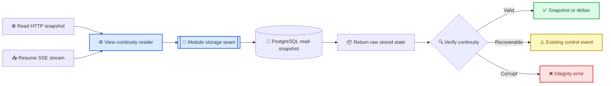

# View Continuity Reader Design

_Proposed design for deepening Frontier durable snapshot and replay reads; implementation starts only after this specification is reviewed._

---

## 📋 Decision summary

Switchback will replace the shallow `SnapshotService` and `ReplayService` read paths
with one concrete `ViewContinuityReader` module. Its small interface owns the complete
durable read contract:

- validate snapshot and resume queries
- read one internally consistent PostgreSQL state
- construct snapshots and command reconciliation receipts
- classify replay as contiguous deltas, caught up, `resync_required`, or
  `client_upgrade_required`
- reject malformed stored identity or continuity as an integrity failure
- apply one server-owned replay limit and clock policy

HTTP snapshot and SSE adapters will call this module and only translate its result into
the existing wire contract. The browser continues to use
`Last-Event-ID = view_epoch:view_cursor`; no schema migration or wire-format change is
required.

The key correctness rule is that a replay decision must be derived from one anchored
database snapshot. PostgreSQL will read the View head, retention floor, and bounded
delta rows inside one short `REPEATABLE READ READ ONLY` transaction. A concurrent
projection commit or replay prune therefore produces either a continuous old window or
an explicit resync decision, never a mixed window assembled from different database
states.

## 🔍 Current-state evidence

The existing code splits one protocol decision across shallow modules and the
PostgreSQL adapter:

| Evidence | Current behavior | Consequence |
| --- | --- | --- |
| [`replay.go`](../../../internal/eventingprojection/application/replay.go) | `ReplayService` validates a query and forwards it | The module has little depth; continuity semantics live behind the seam |
| [`store.go`](../../../internal/eventingprojection/adapter/postgres/store.go) | `ReadReplay` reads head, retention floor, and rows in three pool statements | Under `READ COMMITTED`, each statement can observe a different committed state |
| [`handler.go`](../../../internal/frontier/sse/handler.go) | SSE advances its resume cursor to the last returned row | A partial or gapped batch can be acknowledged before the next poll |
| [`snapshot.go`](../../../internal/eventingprojection/application/snapshot.go) | Snapshot and optional command receipts use separate reads | Snapshot assembly has a second consistency policy outside replay |
| [`000005_frontier_projection.sql`](../../../migrations/000005_frontier_projection.sql) | Constraints protect each delta row | They do not prove continuity across a returned batch |

The concrete unsafe interleaving is:

1. A reader observes head cursor `N`.
2. The reader observes earliest retained cursor `E = after_cursor + 1`.
3. A writer commits cursor `N+1` and prunes row `E`.
4. The reader's final query starts at `E+1`, can also read past anchored head `N`, and
   returns a window that the adapter never validates.

The browser's `ClientViewReplica` rejects cursor and projection-version gaps, which is
valuable defense in depth. It does not satisfy the server responsibility in
[`ADR 0035`](../../adr/0035-frontier-snapshot-and-typed-sse.md): Frontier must return
`resync_required` when replay is evicted, gapped, or cannot safely reach the next
projection version.

## 🎯 Goals and non-goals

### Goals

- Concentrate durable View read behavior behind one small interface.
- Guarantee that every replay result is internally continuous or explicitly fails
  closed.
- Keep HTTP and SSE transport adapters ignorant of database state and continuity
  rules.
- Preserve the current snapshot, delta, control-event, ETag, and SSE cursor contracts.
- Make the protocol testable through the same interface used by production callers.
- Add deterministic evidence for the concurrent commit-and-prune race.

### Non-goals

- Change `ProjectionSnapshot`, `ProjectionDelta`, or `ProjectionControlEvent` JSON.
- Add cursor fields, encode projection version into `Last-Event-ID`, or replace SSE.
- Change replay retention limits or pruning policy.
- Move transient display events into the durable lane defined by
  [`ADR 0036`](../../adr/0036-durable-checkpoints-and-transient-agent-stream.md).
- Add a second production storage adapter or a speculative public storage interface.
- Introduce multi-user authorization or dynamic revocation behavior beyond the current
  viewer-scoped fail-closed reads.
- Repair corrupt durable state automatically.

## ⚙️ Deep module design

### External interface

`ViewContinuityReader` is a concrete application module, not a new public Go interface.
Its module interface consists of two operations:

```go
type ViewContinuityReader struct {
	// private storage seam, clock, and replay policy
}

func NewViewContinuityReader(
	store ContinuityStore,
	options ViewContinuityReaderOptions,
) (*ViewContinuityReader, error)

func (reader *ViewContinuityReader) ReadSnapshot(
	context.Context,
	SnapshotQuery,
) (ProjectionSnapshot, error)

func (reader *ViewContinuityReader) Resume(
	context.Context,
	ResumeQuery,
) (ResumeResult, error)
```

`SnapshotQuery` contains `Viewer`, `ViewType`, `ViewID`, and an optional command-ID
reconciliation set. A nil set means reconciliation was not requested; a present empty
set remains distinguishable so current ETag behavior is preserved.

`ResumeQuery` contains only `Viewer`, `ViewType`, `ViewID`, `AfterEpoch`, and
`AfterCursor`. Callers cannot choose an arbitrary page size. The reader owns a validated
default and maximum, preserving one replay policy across every transport adapter.

`ResumeResult` has exactly one of these shapes:

| Shape | Meaning |
| --- | --- |
| Non-empty deltas | A verified contiguous prefix after the requested cursor |
| Empty deltas | The requested cursor equals the anchored head |
| Control event | Existing `resync_required` or `client_upgrade_required` contract |

The implementation rejects a result containing both deltas and a control event. This
keeps the module interface smaller than exposing head state, retention state, and
continuity decisions separately.

### Internal storage seam

The implementation has one module-internal storage seam with two raw reads. Its Go
identifiers are exported only because the PostgreSQL adapter lives in a different
`internal` package:

```go
type ContinuityStore interface {
	LoadSnapshotState(context.Context, SnapshotStoreQuery) (StoredSnapshotState, error)
	LoadReplayWindow(context.Context, ReplayStoreQuery) (StoredReplayWindow, error)
}
```

This seam is internal to the module. It exists to separate protocol interpretation from
database snapshot acquisition, not to promise interchangeable production databases.
The PostgreSQL adapter is the only production adapter. A deterministic in-memory
adapter is confined to module contract tests.

The storage results are deliberately raw:

- `storedSnapshotState` contains the View row and any bounded command receipts.
- `storedReplayWindow` contains the anchored View head, optional earliest retained
  cursor, and rows after the requested cursor bounded by the anchored head.

The adapter does not emit control events or decide that a gap is safe. The reader owns
those rules, which creates locality: protocol changes and their tests stay in one
implementation rather than spreading across PostgreSQL, HTTP, and SSE callers.

### PostgreSQL adapter

Each raw read uses a short `REPEATABLE READ READ ONLY` transaction:

1. Read and anchor the exact View identity, schema, epoch, cursor, and projection
   version.
2. For a snapshot, read requested command receipts bounded by that anchored epoch,
   cursor, projection version, and retention time.
3. For resume, read the earliest retained cursor and at most the reader-owned page
   limit, with `view_cursor > after_cursor` and
   `view_cursor <= anchored_head_cursor`.
4. Commit the read-only transaction before returning raw state to the reader.

No row lock is required. Writers continue to commit and prune while PostgreSQL retains
the reader's old row versions for the short transaction. The explicit upper cursor
bound also keeps the raw-window contract correct if the adapter implementation changes
later.

### Replace, do not layer

Implementation removes the old `ViewReader`, `CommandReceiptReader`, `ReplayReader`,
`SnapshotService`, and `ReplayService` seams after callers migrate. It does not place
`ViewContinuityReader` in front of those shallow interfaces. By the deletion test,
removing the new module would force query validation, snapshot assembly, continuity
classification, and failure mapping back into multiple callers; that concentrated
behavior is the intended depth.

## 🔄 Read flow



Snapshot and subscribe remain separate requests. Their race is safe because the
snapshot exposes its committed cursor and `Resume` reads every later decision from one
consistent state. Transient events remain best effort, carry no durable SSE ID, and
cannot advance this cursor.

## ⚠️ Continuity and failure rules

### Query validation

The reader rejects non-canonical viewer or View identities, unsupported View types,
zero resume epoch, invalid reconciliation IDs, and invalid configured replay limits
before calling storage. Arithmetic comparisons must avoid `uint64` overflow when
checking the next cursor.

### Snapshot integrity

A snapshot succeeds only when the stored row matches the exact viewer, View type, and
View ID; uses the supported snapshot schema; has a non-zero epoch and projection
version; and yields normalized, one-to-one command receipts inside the requested set.
An unsupported durable schema produces `client_upgrade_required` only on the resume
lane, preserving the current HTTP snapshot error contract. A mismatched identity or
malformed stored row is an integrity error, not a recoverable resync.

### Resume continuity

The reader returns `resync_required` when any of these conditions holds:

- requested epoch differs from the anchored head
- requested cursor is ahead of the anchored head
- the next cursor has fallen below the retained window
- the requested cursor is behind the head but storage returns no deltas
- the first returned cursor is not exactly `after_cursor + 1`
- adjacent cursors are not monotonic by exactly one
- any row changes View identity or epoch
- any delta does not satisfy `result_projection_version = base_projection_version + 1`
- the first delta base does not equal the projection version anchored at the requested
  cursor
- adjacent deltas do not chain the prior result version into the next base version
- a batch that reaches the anchored head does not reach its projection version

An incompatible durable schema returns `client_upgrade_required`. These are expected
recovery controls and keep their current wire payload.

The reader derives the requested cursor's projection-version anchor from the same View
head:

```text
cursor_distance = anchored_head_cursor - after_cursor
anchored_after_projection_version = anchored_head_projection_version - cursor_distance
```

This is valid because every durable delta advances both cursor and projection version
by exactly one, while their absolute values remain separate protocol concepts. Any
subtraction underflow makes the durable head internally contradictory. The first
returned delta must use the derived version as its base even when the page limit means
the batch does not reach the head. The browser still verifies its local base as a
second defense.

A storage failure, impossible result shape, malformed identity, or internally
contradictory head is an integrity or availability error. It maps to the existing HTTP
503 behavior or closes an established SSE stream. It must not masquerade as
`resync_required`, which would create an infinite refetch loop, or as
`client_upgrade_required`, which would incorrectly blame the browser.

The reader records an internal reason code for logs and metrics. Recovery controls use
`ResumeResult.Reason`; integrity failures use `ProjectionIntegrityError.Reason` while
still unwrapping to `ErrProjectionIntegrity`. Neither reason is added to the public
control-event schema in this change.

### Transport error mapping

Stored identity and basic head integrity are validated before schema compatibility, so
crossed or malformed durable state cannot be mislabeled as a browser upgrade.

| Reader result | HTTP snapshot | SSE before headers | SSE after stream starts |
| --- | --- | --- | --- |
| `ErrInvalidCommandReconciliation` | Existing 400 JSON | Not applicable | Not applicable |
| `ErrInvalidViewQuery` or `ErrViewUnavailable` | Existing 404 JSON | Existing 404 response | Close without further data |
| `resync_required` control | Not applicable | Emit existing control and end | Emit existing control and end |
| `client_upgrade_required` control | Unsupported snapshot schema remains existing 503 JSON | Emit existing control and end | Emit existing control and end |
| Storage or `ErrProjectionIntegrity` | Existing 503 JSON | Existing 503 response | Close without untrusted data |

An invalid `Last-Event-ID` remains transport-level input and is rejected by the SSE
adapter with the existing 400 response before calling the reader.

## 🧪 Verification strategy

### Module contract tests

Use a deterministic in-memory adapter through the private seam to cover:

- invalid snapshot, resume, reconciliation, and configuration inputs
- snapshot construction with absent, empty, duplicate, and conflicting receipts
- caught-up empty result and bounded contiguous replay
- old or future epoch and cursor
- evicted first cursor, first-row gap, internal cursor gap, and behind-head empty result
- invalid result/base version and adjacent version-chain gaps
- first-base mismatch against the version derived from the anchored head
- identity, epoch, and durable-schema mismatch
- mutually exclusive `ResumeResult` shapes
- storage and integrity error classification

These tests exercise the same two-operation module interface used by HTTP and SSE
callers. They do not retest private helper functions.

### PostgreSQL integration tests

Extend the existing
[`continuity_integration_test.go`](../../../internal/eventingprojection/adapter/postgres/continuity_integration_test.go)
evidence with:

- snapshot cursor followed by a committed projection and resume
- retention eviction returning `resync_required`
- command receipts anchored to the same snapshot state
- an anchored-head barrier: start at head `2`, resume after `1`, then commit cursor `3`;
  the current adapter can return `[2,3]`, while the new adapter must return only the old
  window `[2]`
- a retention-floor barrier before the delta query: retain only cursor `2`, resume
  after `1`, then commit cursor `3` and prune `2`; the current adapter can return the
  gapped `[3]`, while the new adapter must still see `[2]`
- proof that each race returns the continuous anchored window or an explicit control,
  never rows beyond the anchored head or a gapped batch

The race test must fail against the current three-statement `READ COMMITTED`
implementation and pass with the read-only repeatable snapshot. A timing-only stress
test is insufficient evidence.

### Transport and browser tests

HTTP tests verify status, ETag, reconciliation digest, and unchanged error JSON. SSE
tests verify `epoch:cursor` IDs, delta ordering, control-event termination, and cursor
advancement only after a verified batch. The browser replica's existing gap rejection
tests remain as defense in depth.

Verification gates are:

1. focused application and Frontier Go tests
2. focused PostgreSQL integration tests
3. full Go unit and integration suites required by the repository
4. `go test -race` for the affected Go packages
5. frontend state tests that prove the unchanged wire contract
6. migration verification proving no schema change was introduced

## 📚 Alternatives considered

| Approach | Depth and locality | Decision |
| --- | --- | --- |
| Deepen only `ReplayService` | Improves validation but leaves snapshot assembly and consistent database acquisition elsewhere | Rejected as incomplete |
| Add `ViewContinuityReader` with a private raw-storage seam | One small caller interface owns both durable read paths and all protocol interpretation | Selected |
| Encode all decisions in one PostgreSQL CTE | Gives statement-level consistency but makes protocol rules SQL-specific and harder to contract-test | Rejected |
| Rely only on `ClientViewReplica` gap detection | Detects corruption after transport and allows the server to acknowledge an invalid window | Rejected |

## 🗂️ Delivery and rollback

Implementation is one focused slice:

1. Add reader contract tests and the concrete module.
2. Add raw PostgreSQL snapshot/window reads using repeatable-read read-only
   transactions.
3. Migrate HTTP and SSE adapters to the new module.
4. Add the deterministic concurrent prune integration test.
5. Migrate Materializer bootstrap reads, local-product construction wiring, and all
   integration or acceptance fixtures that construct the old services.
6. Delete the five superseded shallow seams.
7. Run focused, race, integration, frontend contract, and migration gates, including
   Materializer bootstrap idempotency.

There is no dual-read feature flag because two continuity authorities would make
failures ambiguous. Rollback is the normal source rollback: the public database and
wire contracts are unchanged. No persisted state requires migration or repair.
