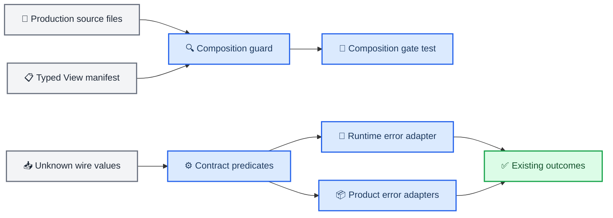

# Production View test and contract primitives deepening design

_Switchback Web architecture design for an observationally equivalent refactor of the production View decoder tests and repeated wire-contract predicates._

---

## 🎯 Goal and success criteria

This change completes two non-blocking architecture candidates left by the Production View runtime-decoder review:

1. Separate the Oxc-based composition gate from `viewRuntime.test.ts` and give it one small test-only interface.
2. Centralize the exact canonical-identity and safe-integer rules without centralizing ingress-specific error handling.

The change is successful only when all observable behavior remains unchanged:

- the five production View factories and their closed composition rules remain identical;
- accepted and rejected wire values remain identical;
- existing error messages remain identical where tests or callers can observe them;
- `ViewProjectionDecodeError` classification, safe reason, ingress and trusted provenance remain identical;
- no schema, migration, Go projection wire, materializer payload or browser recovery behavior changes;
- the existing unrelated dirty worktree paths remain untouched.

## 📋 Current problem

### Composition-gate locality

`web/src/projections/viewRuntime.test.ts` currently mixes two responsibilities:

- runtime decoder behavior, continuity, integrity and authority tests;
- roughly 900 lines of Oxc AST traversal that statically enforces which modules may compose production View decoders.

The composition scanner also keeps decoder paths in more than one collection. Adding a production View therefore requires synchronized edits across the registry and multiple test tables.

### Primitive-rule locality

The same three wire rules are implemented independently in `viewRuntime.ts`, Worker, Artifact, Task-index, Home, Assistant and command-receipt parsing:

- canonical identity is a non-empty string, unchanged by `trim()`, with no carriage return, newline or NUL;
- positive safe integer is a JavaScript safe integer greater than zero;
- non-negative safe integer is a JavaScript safe integer greater than or equal to zero.

The callers intentionally differ in how they report failure. Runtime ingress creates trusted `ViewProjectionDecodeError` values, while product-data parsers throw their existing label-specific `Error`. The shared module must own only the rule, not those error policies.

## 🔍 Options considered

| Option | Composition gate | Primitive rules | Decision |
| --- | --- | --- | --- |
| Focused deep modules | Test-only guard with one function | Three pure predicates | Selected |
| File split only | Move scanner beside tests | Leave duplication | Reject: incomplete |
| Generic schema framework | Generated registry/validator DSL | Central parser errors | Reject: excessive interface and migration risk |

The selected design maximizes locality while keeping each public interface smaller than the implementation it hides.

## ⚙️ Architecture



The two modules are independent and can be implemented and reviewed as separate commits.

## 📚 Module design

### Test-only production composition guard

Create `web/src/test/productionViewCompositionGuard.ts` with one exported interface:

```typescript
export interface ProductionViewCompositionViolation {
  readonly path: string;
  readonly reason: string;
}

export function findProductionViewCompositionViolations(
  sources: Readonly<Record<string, string>>,
): readonly ProductionViewCompositionViolation[];
```

All Oxc parsing, static-string evaluation, alias propagation, dynamic-import detection, export inspection and exact decoder-factory shape checks remain private implementation details.

The guard owns one typed manifest keyed by `ProductionViewKind`. Each entry records the decoder module path, factory name, data type name, exact `viewType`, contract-key prefix and whether the View id is dynamic. The manifest uses a mapped type over `ProductionViewDefinitionByKind`, so adding a kind without an entry fails TypeScript compilation.

Decoder paths used to derive the allowed internal-composition importer set come from this manifest. The same path must not be written into a second decoder-path list.

Create `web/src/projections/productionViewComposition.test.ts` for composition fixtures and assertions. `viewRuntime.test.ts` retains only decoder behavior tests and may continue importing internal composition symbols to exercise the runtime seam.

The guard stays under `src/test`; production code does not import it and Vite cannot pull it into the application graph.

### Pure wire-contract predicates

Create `web/src/api/contractPrimitives.ts` with exactly three value-level exports:

```typescript
export function isCanonicalIdentity(value: unknown): value is string;

export function isPositiveSafeInteger(value: unknown): value is number;

export function isNonNegativeSafeInteger(value: unknown): value is number;
```

Their rules are exact:

| Predicate | Returns `true` only when |
| --- | --- |
| `isCanonicalIdentity` | `typeof value === "string"`, length is positive, `value.trim() === value`, and `/[\r\n\0]/` does not match |
| `isPositiveSafeInteger` | `typeof value === "number"`, `Number.isSafeInteger(value)`, and `value > 0` |
| `isNonNegativeSafeInteger` | `typeof value === "number"`, `Number.isSafeInteger(value)`, and `value >= 0` |

The module must not throw, normalize data, accept labels, construct decode errors or expose optional/nullable helpers.

The following callers retain their current local wrappers and error policy, changing only the duplicated condition to a predicate call:

- `web/src/projections/viewRuntime.ts`
- `web/src/projections/decoders/worker.ts`
- `web/src/projections/artifactAuthority.ts`
- `web/src/projections/decoders/taskIndex.ts`
- `web/src/api/contracts.ts`
- `web/src/api/homeContracts.ts`
- `web/src/api/assistantContracts.ts`

Local helpers for optional/null handling, strings that may be empty, ordinary finite numbers, timestamps, digests and closed enums remain local because their semantics are not identical across callers.

## 🔐 Error and compatibility invariants

The refactor follows a predicate-plus-adapter pattern:

1. The shared predicate answers only whether a value satisfies the wire rule.
2. The existing local wrapper maps `false` to its current error type and exact text.
3. Existing outer decoder code continues to normalize product-contract errors into the same trusted failure result.

The implementation must not:

- replace local wrappers with a shared throwing validator;
- change the order in which identity, schema, continuity or product authority is checked;
- add trimming, coercion, defaulting, numeric conversion or maximum identity length;
- widen allowed View kinds, decoder importers, event types or reference types;
- export internal View contract constructors through the new test module.

## 🧪 Testing strategy

### Composition gate

Move the existing static-boundary cases without weakening them. The new suite must continue covering:

- direct, aliased and namespace imports of internal composition symbols;
- static and aliased dynamic imports, `import.meta.glob` and runtime re-exports;
- exact production decoder factory signatures and contract-key/view identity construction;
- forbidden runtime value exports and forged contract aliases;
- the legal five-factory production composition.

Add a compile-time exhaustiveness assertion through the mapped manifest. A missing production kind must fail `npm --prefix web run build`.

### Contract primitives

Add table tests for each shared predicate with independent literal expectations:

- identities: ordinary canonical ids, empty string, surrounding whitespace, CR, LF, NUL and non-string values;
- integers: zero, positive, negative, fractional, `NaN`, infinities and values beyond `Number.MAX_SAFE_INTEGER`;
- relationship: every positive safe integer is non-negative, while zero is only non-negative.

A new command-receipt characterization suite plus the existing Home, Assistant, Task-index, Worker, Artifact and runtime-decoder suites are the equivalence oracle for error text and ingress behavior. No snapshot rewriting or fixture normalization is allowed to make them pass.

### Verification gates

Run, in order:

```bash
npm --prefix web test -- \
  src/projections/productionViewComposition.test.ts \
  src/projections/viewRuntime.test.ts

npm --prefix web test -- \
  src/api/contractPrimitives.test.ts \
  src/api/contracts.test.ts \
  src/api/homeContracts.test.ts \
  src/api/assistantContracts.test.ts \
  src/projections/decoders/taskIndex.test.ts \
  src/projections/decoders/worker.test.ts \
  src/projections/decoders/artifact.test.ts \
  src/projections/viewRuntime.test.ts

npm --prefix web test
npm --prefix web run test:browser
npm --prefix web run build
SWITCHBACK_TEST_DATABASE_URL='postgresql:///postgres?host=/tmp' make verify
git diff --check
```

Final verification must report test counts, Playwright results, build warnings separately from failures, and confirm that the pre-existing dirty paths were not staged or modified.

## 🚫 Non-goals

- No new generic schema or parser framework
- No production View behavior, route, controller or replica change
- No error-message cleanup or validation-order change
- No consolidation of unrelated string, timestamp, digest, enum or record helpers
- No Go, schema, migration, materializer or persisted-fixture change
- No edits to `web-demo`
- No opportunistic formatting of untouched modules

## ✅ Acceptance checklist

- [ ] `viewRuntime.test.ts` contains decoder behavior but no Oxc scanner implementation
- [ ] one test-only guard owns all composition scanning and one typed decoder manifest
- [ ] decoder module paths are not duplicated inside the guard
- [ ] exactly three shared non-throwing predicates exist
- [ ] all seven ingress modules delegate the identical rules while preserving local errors
- [ ] focused, full Web, browser, build and repository gates pass
- [ ] independent review reports no Critical or Important finding
- [ ] unrelated dirty worktree paths remain untouched and unstaged
