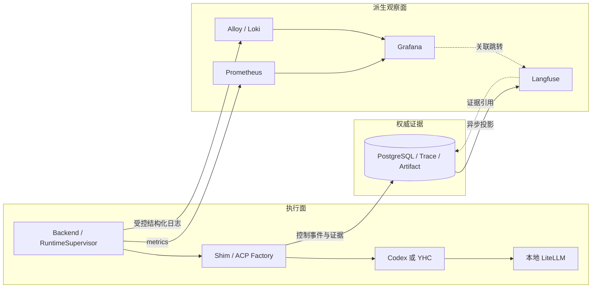
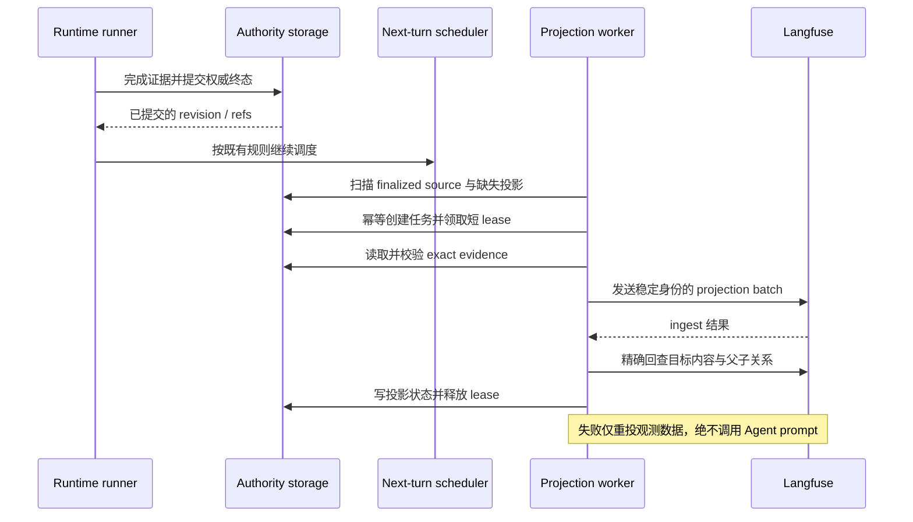

# Switchback M1 可观测性与 YHC Harness 集成设计

_2026-09-05 · 本地 SingleUserLocalProfile · 设计稿；不代表实现、真实验收或发布完成_

---

## 🎯 目标、范围与决策状态

目标是在一次真实 Worker 执行出现异常时，能从 Grafana 的指标定位到 Loki 日志、Langfuse 调用链及权威 Trace；同时允许在创建 WorkerSession 时选择 Codex 或 YHC，复用同一套平台生命周期和控制边界。

用户已确认：本地 M1 真实闭环、Prometheus + Loki + Grafana、Langfuse 运行诊断优先、平台统一 ACP Harness Factory，以及本设计中的架构边界、观测契约和双 Harness 契约。故障验收与分阶段启用方案在本稿一并具体化，供最终审阅。

| 本期范围 | 后续范围 |
| --- | --- |
| 本地真实采集、查询、关联、预置仪表盘及本地告警状态 | HA、多租户访问治理、生产 paging/SLO |
| Langfuse 异步投影、补投、Tool/MCP 与模型诊断 | Dataset、Evaluator、Prompt 管理平台 |
| Codex/YHC 固定 Profile、ACP 互操作、真实模型验收 | 任意可执行文件、动态插件市场、会话内切换引擎 |
| Prometheus/Loki 本地 7 天保留 | 长期日志归档、无损日志、全量历史回填 |

采用平台统一语义 + ACP Factory：执行协议、轨迹和观测关联由 Switchback 定义，Agent 负责自己的工具循环与上下文管理。相比先引入 OTel 中心总线，这条路径能直接复用已有 Trace 与 Langfuse 投影；相比每个 Harness 自建观测流水线，它能保证双引擎使用相同身份与结果语义。OTel 接入保留为基础设施适配方向。

本期选择 Loki 是基于本地诊断需求和 Grafana 统一入口；若将来出现复杂全文检索、SIEM 或既有 Elastic 平台约束，再单独评估 Elasticsearch/Kibana。

## 🔍 当前事实与实施切入点

Switchback 源码基线为 `91284baa386b61240b4a2c9ba6a50e4577ffaeb8`；当前 checkout 中已有其他未提交改动，本稿不把它们视为本次实现。YHC 本轮复核基线为 `1e25f69d7e32105ee1f2b4f29b498b31171c71d4`；它是独立仓库，实施前必须重新确认 checkout 并锁定构建源，不从活动工作树隐式取包。

| 能力 | 当前证据 | 尚需完成 |
| --- | --- | --- |
| Langfuse 部署 | [local Compose](../../../deploy/local/compose.yaml) 已有 web/worker、PostgreSQL、ClickHouse、Redis、对象存储依赖 | Backend 冷启动解耦、独立观测启停 |
| Langfuse 内容 | [projector](../../../internal/artifacttrace/adapter/langfuse/projector.go) 已投影 Run、Turn、generation 及完整模型 I/O | Tool/MCP、缺失诊断字段、持久化异步补投 |
| 结果语义隔离 | [observability service](../../../internal/artifacttrace/application/observability.go) 将导出失败记为 degraded | 同步 export/verify 仍在 [runtime runner](../../../internal/localproduct/runtime_runner.go) 返回路径上，需要时延隔离 |
| Prometheus/Loki/Grafana | 现 Compose 无对应服务；web-demo 观测页为 mock | 真实后端采集、配置、查询与仪表盘 |
| AgentAdapter | [端口](../../../internal/workerruntime/application/ports.go) 已有 ACP 生命周期接口 | [Shim](../../../internal/workerruntime/adapter/shimruntime/runtime.go) 仍直接构造 Codex adapter |
| Profile | [注册表](../../../internal/platform/config/runtime_profiles.go) 已有固定 Codex 模型配置 | YHC 注册、精确选择和身份贯通 |
| YHC ACP | 独立仓库 `server/acp/agent.go` 已有会话生命周期 | 托管 gateway 鉴权、模型路径约束和互操作验收 |

继承 [Langfuse 完整 I/O 计划](../plans/2026-07-24-langfuse-full-input-output.md) 的内容契约。现有 [single-runtime-recovery change](../../../openspec/changes/single-runtime-recovery/design.md) 仍拥有恢复语义；本项目不因新增 Harness 而自动开启它的 rollout gate。

## 🏗️ 架构与数据权威

PostgreSQL 中的 Task/Run/Turn 状态，以及 ObjectStore Trace JSONL、Artifact 和 PostgreSQL TraceManifest，是可审计事实。Prometheus、Loki、Langfuse 和 Grafana 是派生观察面，均不拥有执行终态、重试、取消或恢复权限。

RuntimeSupervisor 继续是 Docker API/Socket 的唯一 owner，采集它管理的 Worker 容器输出。Alloy、Worker、Grafana 等不获得 Docker Socket。Worker 的网络、资源、驻留、managed process 和 PreviewProxy 规则沿用现行 ADR，不能因本项目扩大权限。

本期核心 Backend 的 startup/readiness 不等待 Langfuse、Prometheus、Loki、Alloy 或 Grafana。保留本地共享 PostgreSQL 部署时，停止这个数据库属于核心基础设施故障，不能用作“纯观测服务故障”验收。派生任务使用受限连接池和并发，避免占满执行事务资源；本期不宣称共享宿主的物理故障隔离。

## 📊 统一观测契约

### Correlation envelope

字段必须来自已验证的执行上下文；缺失字段省略或显式标记 unknown，不伪造 ID。Assistant 路径使用真实 Conversation/Turn 身份，不假造 WorkerRun。

| 字段组 | 内容 | 用途 |
| --- | --- | --- |
| Scope | tenant、workspace、actor、conversation | 权限过滤与上下文关联 |
| Execution | task、worker_session、worker_run、agent_session、agent_turn | 精确定位执行 |
| Runtime | runtime_instance、generation、channel_epoch | 区分恢复代际与过期事件 |
| Source | trace、event/request ID、sequence、manifest revision、evidence ref | 去重、排序与证据追溯 |
| Configuration | harness_kind、profile id/revision/digest、image digest | 复现实际执行配置 |

`harness_kind` 从服务端验证的 `AgentProfile.AgentAdapter` 派生，不允许由模型或另一份可独立修改的配置覆盖。实体 ID、profile revision/digest、generation、sequence、URI 与自由文本都禁止进入 Prometheus labels 或 Loki index labels。Prometheus 的每组 label 都产生独立时间序列，应使用有界值集。[^1]

### Prometheus

Backend 提供内部 `/metrics`；采集 Run/Turn 结果与时长、Session/Runtime/队列/容量、心跳与恢复、控制通道连接，以及模型 latency/first-token/token/cost/fallback 和投影健康。上游未提供的 first-token、usage 或 cost 标为不可用，不填成零。

允许标签按 metric family 明确列出，限于 `service`、`environment`、`component`、`harness_kind`、状态、结果、配置中的有限 route 和错误枚举。未知错误映射为 `unknown`，完整错误不进入 label。不能直接使用 Provider 返回的任意模型名。

采样默认 15 秒，本地保留 7 天。Scrape 不等待模型或观测后端网络；当前状态来自内存快照或受限后台采样。已提交执行事件的计数需要去重，重连、历史 Load、Langfuse 补投不能再次增加业务计数。进程重启可产生标准 counter reset；精确账单与审计仍读取权威记录。

### Loki 与 Alloy

Backend 产生规范化 JSON 日志，通过有界异步发送器送至 Alloy `loki.source.api`，再写入 Loki；该组件支持接收 Loki HTTP push，不要求 Docker Socket。[^2] Worker 日志由 RuntimeSupervisor 采集并规范化后进入同一路径。

固定 JSON envelope 为 `ts/level/service/component/event/schema_version`；关联 ID、duration、error_code 放 JSON 字段，可由 Alloy 映射为非索引 structured metadata。两者并非同一概念：JSON 是日志内容，structured metadata 是附加的非索引字段。Loki 使用支持该能力的 TSDB/schema v13 或更高兼容配置。[^3]

索引 labels 固定为 `service/environment/component/level`，必要时增加枚举 `harness_kind`。外部进程 stdout/stderr 不直接整行转发到 Loki：仅已知事件和允许字段进入普通日志，其他输出记录来源、长度、受控诊断码及权限过滤后的证据引用。prompt、源码正文、完整 Tool payload、HTTP headers、环境和凭证不得作为日志内容。

发送队列有固定上限；远端阻塞、超限或格式不合法时可以丢弃，但须记录原因、drop count 和可定位的时间窗口，不能反压执行。队列只使用有界内存，M1 不承诺持久 spool 或停机期间日志补齐；恢复后不得声称历史缺口已消失。Loki 本地单体保留 7 天，通过 retention/compactor 与持久卷配置验收实际过期清理。

### Langfuse 内容与 Grafana 入口

维持 `WorkerRun trace → AgentTurn span → model generation / Tool span`。保留既有完整 Turn/model I/O，排除传输凭证、headers 和 callback internals；known-token scan 命中后在任何 HTTP 导出前拒绝该 batch，诊断不回显命中内容。

新增 Tool/MCP 名称与已声明身份、调用关联、开始/结束/状态、受控摘要或 evidence ref，以及可证明的重试、fallback、latency、first-token、token、cost 和 terminal reason。Tool observation 以稳定 tool-call/event identity 关联生命周期更新，不能把 start/update/end 当成三个调用。并发工具保留 parent 和 sequence，不推断不存在的因果顺序。

LiteLLM model sink 已接收到但在 Shim 转换中丢失的 latency/cost/error 需贯通权威 Trace 后再投影。未暴露的内部 child span 标记 coverage gap；只有已记录的调用才投影，不从生成文本猜测 Tool、错误或费用。未来 Score/Eval 只预留关联来源与版本接口。

Grafana provision 四组真实 datasource 仪表盘：Platform Health、Worker Runtime、Harness & Model、Projection Health。数据链路支持按 scope、run、turn 和时间窗口跳转 Loki/Langfuse/WorkerDetail；链接不携带 secret，目标页面重新鉴权。正式应用只增加必要的诊断链接和投影状态，web-demo mock 不充当真实数据源。

告警先提供本地 Grafana firing/resolved 状态与明确的 no-data/error 状态，覆盖 target down、日志丢弃、投影积压和 runtime 异常；持续窗口是服务端配置。外部消息通道以后单独配置，本期告警不执行自动修复。

## 🔄 Langfuse 持久化异步投影

### 权威终态与派生任务

把 `ExportAndVerify` 移出 runtime runner 的终态及 next-turn 返回链路。权威记录提交后即可进入平台现有后续调度，无需等待 ingest、query 或派生状态写入。原有 Trace/Artifact 完整性要求继续生效。

Projection worker 从已提交的 finalized Turn/TraceManifest 发现 eligible source，按唯一键幂等创建投影任务；终态提交后的即时唤醒只作加速。即使进程在提交后、创建 job 前退出，reconciliation 仍能枚举缺少相应投影版本的 finalized source，不能只扫描已有 pending jobs。派生 job 写失败不得回滚已经提交的执行状态。

首次启用时持久化 projection schema version 与 enablement watermark，自动发现范围限定为该边界之后完成权威 finalization 的 source；之前已开始、之后才 finalization 的 Turn 仍包含在内。扫描需覆盖提交与游标推进的竞态，不能仅按未提交事务预分配的序号跳过晚提交 source。schema 升级创建新启用边界，不自动扫描全部历史；历史重投只接受显式指定的 exact source refs，并重新校验内容完整性。

完整投影输入必须由不可变 Trace segment、Turn input/report refs、Model/Tool observation 等权威证据重新构建，不能依赖 runtime runner 内存。若现有格式无法保存某项内容，先扩展版本化 Trace 契约；历史缺少该内容时记录 `source_incomplete`，不能伪造回填。该来源完整性是启用补投的前置门禁。

### 幂等、重试与状态

Job identity 至少包含 tenant、WorkerRun、AgentTurn、source manifest revision/digest 和 projection schema version；每次 retry 复用稳定 batch/observation IDs。投影定义变化需推进 schema version，并使用独立版本命名空间，避免覆盖旧格式 trace。

新版本 trace root 只写不可变的 Run 启动信息、初始输入和关联身份；完整输入/输出与终态放在各 Turn span。root 不承载滚动更新的“最新输出/当前 outcome”。每个 finalized source 的 observation 使用稳定 ID 和确定性内容；旧 batch 晚到只能重复同一内容，不能覆盖较新 Turn 的结果。相比旧 projector 每次更新 root 输出，新格式的结果入口改为对应 Turn span，既有完整 Turn/model I/O 不删减，旧 trace 保持可读。

Run 级 lease 用于限制并发和本地任务写入，不被当作远端 fencing。Langfuse 不认识 PostgreSQL fencing token；因此必须以以上不可变内容约束保证跨 lease 的延迟请求安全，而不能仅依赖本地锁。验收包含新 Turn batch verified 后旧 batch 才到达的场景。

使用 PostgreSQL 短 lease、fencing token、有限并发和退避；事务内不做 HTTP 或 ObjectStore I/O。每次网络操作有 deadline，查询重试只发生在 projection worker。进程退出或 lease 过期后可重新领取；“导出成功但状态未写”和“ACK 丢失”复用原身份，不增加重复 observation。

内部任务区分 pending、running、retry_wait、verified、blocked；这些不是 Task/Run 状态。用户面显示 pending/passed/degraded，并展示 source revision、最近成功时间、attempt 和 lag。只有 exact verification 成功才为 passed；永久内容 mismatch、source 不完整或 token scan 命中为 blocked/degraded，不能无限盲重试。网络错误可在服务端重试策略下自动补投。

回查比较不可变 trace root 及目标 source 对应的 exact metadata、input/output、observation IDs/集合、parent、原始 started_at/ended_at、usage/cost 和必要诊断字段。其他合法 Turn 的 observations 不算目标 source 的“额外项”，同一目标 source 的缺失或额外项必须失败。源事件时间来自 sealed evidence，不得在补投时使用当前时钟重新生成；未知原始时间标记 coverage gap。404 可在有界窗口内等待；内容错误不接受“近似匹配”。重新投影只覆盖指定来源版本；不会通过修改执行 outcome 来“修复”观测状态。

## 🔌 Codex / YHC Harness 契约

### Profile、镜像与平台所有权

保持现有 `AgentAdapter` 端口和复合 `AgentProfile`，固定 `agent_adapter=codex-acp|yhc-acp` 及模型路由。Factory 从已验证的服务端 Profile 选择启动器；Task 不能提供任意 binary、args、env 或宿主路径。

新 WorkerSession 固化 Profile id/revision/digest、Harness 版本及 image digest；Runtime generation 恢复沿用这些身份。显式复用 Session 时必须与已固定配置一致，改变 Harness 通过创建新 Session 完成，不能把旧 Agent state 解释为另一引擎的上下文。禁用 Profile 只阻止新选择，不把在途 Run 改投 Codex。

M1 采用一个固定 Worker 镜像包含两个已校验的可执行文件，每次只启动所选一个。YHC 从独立已审阅 exact commit 构建并记录二进制校验值；构建来源、依赖锁与 image digest 进入验收报告。Worker 启动时不下载二进制，不从活动宿主源码目录挂载引擎。

公共 ACP 层负责 Initialize、Authenticate、New/Resume/Load、Prompt、Cancel、Close、capability snapshot、typed SDK 前的有界原始帧记录和归一化事件。薄兼容层仅处理固定启动方式、Agent state 目录与 Harness 特有更新/错误。Codex 特有错误识别不能泛化成所有 ACP Agent 的协议规则。

WorkerSession/Run/Turn、WorkingCopy、deadline、dispatch permit、权限与恢复仍由 Switchback 控制；YHC 保留内部执行循环。工具审批必须收敛到平台权限边界，模型 reviewer 不产生平台权限。原始帧在持久化前脱敏本地 token；未知可选进度可保留并告警，权限或协议语义无法确定则 fail closed。

### YHC gateway 与模型调用

使用 ACP Initialize/Authenticate 机制，复用当前 Codex 的 `methodId=gateway` 与 `_meta.gateway` 扩展。这是适配器协商扩展，并非所有 ACP Agent 的必需基础能力。[^4] 不以修改 SDK fork 作为默认接入办法。

YHC 的托管模式需要准确宣告 auth method，验证 gateway schema、服务端批准的 loopback base URL、请求头和模型别名；未鉴权时拒绝 New/Load/Resume/Prompt。普通独立 CLI 模式保持原语义。上游 Provider key 仅由 LiteLLM 持有，YHC 只得到 generation 绑定的本地代理凭证；认证材料不写 transcript/checkpoint/日志/Langfuse，新 generation 重新鉴权。

主模型、子 Agent、fallback、reviewer 及所有其他模型调用均使用注入的 LiteLLM，托管模式不得从 ambient env、项目配置或 session model switch 绕过固定 Profile。允许的模型 fallback 必须由服务端明确配置并记录原路由与实际路由，不能改变 Harness。现有模型 fallback 字段不构成 YHC→Codex 的授权。

YHC OpenAI Provider 路径使用 Responses API，因此真实验收覆盖 LiteLLM `/responses` 的流式工具调用、取消和错误传播；仅 `/chat/completions` 成功不能证明兼容。模型组合逐个验收后登记，不承诺 Codex 的所有 Profile 都能直接用于 YHC。YHC SDK 本地 replace/fork 需要以线协议测试验证，不能仅比较声明的 SDK 版本。

### 连续性与启动错误

优先使用协商的 `session/resume`；`session/load` 会重播历史，resume 不重播完整会话历史。[^5] Load 重播带独立 replay 标记/归属，不创建新 Turn、工具执行、费用样本或重复显示事件。恢复前由 Switchback 校验 exact WorkerSession、AgentSession、WorkingCopy、generation 和 state 路径，不依赖 YHC active Resume 重新验证 CWD。

持久 Agent state 必须覆盖 YHC transcript 与其所需关联状态；只有 ACP Session ID 不足以恢复。NewSession 响应丢失不得盲目再次 New 并冒充原会话。连续性不能证明时进入 waiting_user，不静默创建空白上下文。Cancel 通知成功不能直接释放执行槽，需等待 terminal 或可靠退出/fencing 证据。

当前 Shim 在 ACP 初始化后才建 WorkerControl 连接，因此实施必须先补齐可认证、可持久化的 startup outcome 报告。携带 phase、稳定 error_code、retry classification、exact identity 与是否发过 prompt，Backend 据此判断恢复；不得把 auth/protocol/profile 错误仅表现为 container exit 后归类成 runtime loss。若错误原因未能可靠报告，保持 unknown 并阻止盲重建。

## 🧪 故障模型与验收标准

### 故障处置

| 故障 | 执行处理 | 观察/恢复处理 |
| --- | --- | --- |
| Prometheus 不可用 | outcome 与调度不变 | stale/unknown，恢复后 scrape |
| Alloy/Loki 阻塞或存储满 | 日志不得反压执行 | bounded drop、计数和缺口 |
| Grafana 不可用/错配 | 执行与采集继续 | 展示验收失败，不重跑 Task |
| Langfuse ingest/query timeout | 终态与 next-turn 不等待 | durable retry，仅补投 |
| Langfuse 内容 mismatch/token 命中 | 保留既有 outcome | blocked/degraded，拒绝绕过 |
| 权威 Trace/Artifact 不完整 | 沿用既有交付完整性规则 | 不凭 Langfuse 有数据宣称交付成功 |
| Harness profile/auth/protocol 错误 | 启动 fail closed | 不进入自动 runtime recovery |
| ACP New/Resume 结果未知 | 不发送新 prompt | 保留证据，连续性不足则 waiting_user |
| active prompt 后 ACP EOF | 结果未知，禁止 prompt replay | 仅按既有 gate 与 bounded recovery 策略处置 |
| 用户取消/deadline/resource limit | 沿用现有平台规则 | 不因 YHC 接入改变归因 |

观察面故障不能触发 Run 重试、RuntimeRecoveryIncident、自动 rollback 或重新执行外部副作用。恢复 gate 未开启时不能通过验收脚本偷偷开启。managed process 跨 Turn terminal 的生存规则仍遵循现行 ADR。

### 分层门禁

| Gate | 必须提供的证据 |
| --- | --- |
| G1 契约/静态 | 标签 allowlist、secret 排除、稳定 identity、Factory 无 fallback、Compose 结构解析、loopback 暴露与 Socket 所有权 |
| G2 持久性 | 启用边界与晚提交扫描、finalized source 重建、commit→enqueue crash、ingest→status crash、lease 过期、新 batch 验证后旧 batch 晚到、重启补投与重复任务 |
| G3 本地闭环 | 实际 `/metrics` scrape 与 PromQL；Loki exact run/turn 查询；Langfuse exact query；Grafana datasource/panel 与告警 firing/resolved |
| G4 故障隔离 | 观测全停的 core 冷启动、顺序两 Turn；逐服务 timeout/停机；恢复后补投与日志缺口可见 |
| G5 双 Harness | 固定镜像/真实 Provider，各跑同 Session 两 Turn、模型调用、工具调用、cancel；profile/Trace/generation 一致 |
| G6 连续性/恢复 | gateway/protocol 失败不重建；错误 CWD 恢复拒绝且无写入；Load 无重复执行；开启现有 gate 后单独验证 EOF/fencing/无 prompt replay |

确定性 fixture 用于验证时延隔离，真实 Provider 用于证明协议与调用链；两者不能互相替代。G4 在相同本机环境各运行至少 20 对顺序 Turn：观测正常与全停各一组，使用受控立即响应模型/工具，记录 terminal settlement 与 next-turn dispatch 的延迟分布。默认每次都在 5 秒内完成，故障组 p95 相对基线增加不超过 1 秒；这些是 M1 测试判定值，不是生产 SLO。通过可阻塞且不返回的 export/query test double，另行证明调度路径没有等待投影 future，防止仅靠宽松 timeout 掩盖耦合。

G5 每个可启用 Profile 至少提供一次真实模型证据，包括 `/responses` 所需的完整往返；模型耗时不使用 G4 的 fixture 阈值判失败。Auth/protocol 注入后要检查 generation 未递增、没有其他 Harness 进程、没有外部模型调用；EOF 后检查没有重复 prompt 或未知工具副作用重试。

每轮验收输出机器可读报告：Switchback/YHC commit、image digest、Profile ref、scenario id、executed/passed/failed/skipped、exact run/turn/generation、source checksums、query assertions、latency、observability gaps 与 managed residue。缺少 required scenario、`skipped` 或残留未清理不能产生 `enablement_ready=true`；脚本 exit 0 必须要求对应 readiness 为 true，不能只验证字段类型。

常规 `make verify`、Compose config、HTTP health、mock 页面或历史测试结果都不等同 G3–G6。未配置凭据、Docker 不可用或模型能力不匹配时如实记录未执行，不把 YHC 宣告为可启用。

## 📦 实施顺序、兼容性与启用

按四个可独立审阅的实施切片推进，每个切片单独写任务及必要的 OpenSpec delta；本稿提供跨切片不变量，避免一次实现同时改动所有子系统。

| 顺序 | 切片 | 退出条件 |
| --- | --- | --- |
| 1 | 观测可用性解耦与 Langfuse durable async projection | G1/G2 及 Langfuse outage/next-turn 验收 |
| 2 | Prometheus、Alloy/Loki、Grafana 及必要诊断入口 | G3/G4，7 天配置与过期清理、真实告警状态 |
| 3 | Tool/MCP 与模型诊断字段贯通 | Trace 重建和 exact projection 比较覆盖新增字段 |
| 4 | 通用 ACP Factory、YHC 托管模式、固定镜像 | 先 Codex 回归，再 YHC G5/G6，按 Profile opt-in |

切片 4 先只在 Factory 注册 Codex，证明公共层提取不改变行为；再加入默认不启用的 YHC Profile，完成协议和真实运行验收后开放本地选择。只有通过对应 Profile 所需 gates 才标记 M1 enabled；恢复能力单独报告 readiness，不能由双 Harness 基础通过推导。

Prometheus/Loki/Grafana/Alloy 镜像在实施时核验官方已发布版本与平台架构支持，并锁定 digest；这是构建门禁，不能用 `latest` 或 upstream main 直接发布。本期延用已有 Langfuse 服务；新 Loki 不复用或新增 MinIO 依赖，Langfuse 既有对象存储迁移另立工作项。

数据库与 Trace/schema 改动采用追加字段/表和版本化解码，保留旧记录读取；缺少新增诊断信息的旧来源显示 coverage gap。Codex 既有 Profile ref 不原地改写，新增配置产生新 revision/digest。正式协议变化在对应实施切片同步 OpenSpec/schema/ADR，不在设计稿中勾选实现任务。

禁用观测 profile 时保留数据卷与权威证据，派生任务可留待兼容版本补投。禁用 YHC 时只关闭新建入口，既有 Session 根据当前权限和生命周期完成或显式终止；不自动换引擎或转换状态目录。回退实现版本前必须确认其能读取新 schema/job 版本，否则只禁用 feature，不运行不兼容旧程序。

本地开发使用隔离工作树并固定双仓源码；设计记录与实现提交不纳入已有无关未提交修改。YHC 仓库写入、构建依赖和 Docker/真实 Provider 验收遵循运行环境权限机制，远端发布/PR 合入另按用户授权执行。

## 🔗 来源与文档验证

内部源码入口已在相关段落给出。YHC 相邻 checkout 的关键入口为 `cmd/yhc/cmd/serve_acp.go`、`server/acp/agent.go`、`engine/provider/provider.go` 与 session/replay 测试；源码事实按实施时 exact commit 复核。

正式稿检查范围：决策一致性、来源路径、占位符、Markdown 结构、Mermaid 语法与 `git diff --check`。本稿的完成不代表 G1–G6 已执行。

[^1]: Prometheus. Metric and label naming. https://prometheus.io/docs/practices/naming/ （核验于 2026-09-05）。
[^2]: Grafana. Alloy loki.source.api. https://grafana.com/docs/alloy/latest/reference/components/loki/loki.source.api/ （核验于 2026-09-05）。
[^3]: Grafana. Loki structured metadata. https://grafana.com/docs/loki/latest/get-started/labels/structured-metadata/ （核验于 2026-09-05）。
[^4]: Agent Client Protocol. CodexAuthMethod.ts. https://github.com/agentclientprotocol/codex-acp/blob/main/src/CodexAuthMethod.ts （扩展定义参考；实施使用锁定版本）。
[^5]: Agent Client Protocol. Session Resume is stabilized. https://agentclientprotocol.com/announcements/session-resume-stabilized （核验于 2026-09-05）。
