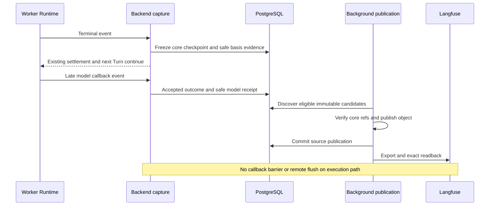

# 不可变模型补充来源设计

日期：2026-09-11。状态：用户于 2026-09-13 确认本书面设计；进入实现计划阶段，尚未进入生产代码实现。

适用基线：`3a5c51cce15231514c3a0af95a81005f01ec913b`。延续[观测与 YHC 总设计](2026-09-05-observability-and-yhc-harness-design.md)及 active [durable-observability-projection](../../../openspec/changes/durable-observability-projection/design.md)。本文经确认后修订该 change，不同步或归档主 spec，不把旧测试通过等同于完整验收通过。

## 🎯 决策与保证

采用独立、append-only 的模型补充来源。旧 `turn.observation.source.v1`、TraceManifest、settlement checkpoint 和 v2 job 的冻结事实不变；不放宽 terminal cut、不改写 marker、不等待未来 callback。新增 v3 投影将 Run/Turn 基础内容与每条模型观测分开：**所有模型，无论早到或晚到，只有同一个补充来源发布入口**。

保证的对象是：在新版本适用范围内，经合法接收、身份核验、原凭据范围扫描并持久化的模型事实。只要权威父级证据可读、基础设施最终恢复，这些事实可以在 Backend 重启、Runtime 清理及 Langfuse 故障后继续发现和投影，不因晚于 terminal 而永久遗漏。

以下不是本次保证：尚未可靠送入 Backend 的 callback；Runtime 被强制终止前尚未形成的结果；扫描证明缺失或已发现凭据的内容；“所有模型请求均已回调”的全局完整性证明。Task 成功与观测完整性必须分开报告。

不新增 Task/Run 状态、deadline、等待 callback 的 barrier、公开 backfill API、模型请求持久 inventory、YHC 适配或 Loki/Grafana/Prometheus 看板。本片仍是原观测计划的可靠性前置工作。

## 🔍 已验证的问题与取舍

[物理失败记录](../../operations/durable-observability-projection.md#physical-gate-failure-late-model-observations)记录：第一 Turn 的 terminal 为 seq 7，合法模型事件为 seq 8，晚到约 4.196 ms；两个 Turn 均完成，但第一来源始终 `source_incomplete`。Langfuse 恢复后只有第二个原来源自然重试通过。这是来源成员规则的问题，不是增加重试能够修复的远端故障。

当前源码还有三处与方案直接相关：

- [captureRuntimeObservationSource](../../../internal/localproduct/runtime_observation_source.go)限定 `sequence <= cut`，零模型的 source 会清空 input 并保存 marker。
- [ProjectionSourceLoader.Load](../../../internal/artifacttrace/application/projection_source_loader.go)要求首 Turn 的旧 source 完整；因此旧 marker 还会阻断同 Run 后续 Turn 的根输入验证。
- [DurableProjector](../../../internal/artifacttrace/adapter/langfuse/durable_projector.go)的模型 ID 与逻辑身份绑定，但 metadata 包含 manifest checksum。新来源若沿用同 ID 却改变 metadata，会破坏不可变写入；换 ID 则可能双计数。

接收路径也必须配套收敛：[waitTurnTerminal](../../../internal/localproduct/runtime_runner.go)和 [settlement replay](../../../internal/localproduct/runtime_settlement_recovery.go)会先排除不同 Turn；[Hub pending pump](../../../internal/workerruntime/adapter/controlgrpc/hub.go)逐条等待队头 applied，而当前 runOnce 没有 idle 模型 drain。因此仅改 publisher 或两个 waiter 都不能覆盖“terminal 后没有下一 Turn”的合法 callback。

| 方案 | 执行依赖 | 主要代价 | 决策 |
| --- | --- | --- | --- |
| 等待 callback 排空 | 等待未来观测 | 丢回调时无法兼顾完整性和进展 | 不采用 |
| 独立模型补充来源 | 仅有界本地封存 | 多一种来源及扫描证明 | 采用 |
| 独立完整 bundle 封存 | 无需 Task 等待 | 新请求 inventory/watermark 协议 | 延后 |

## 📦 来源与模块职责

### 不可变内容

新增内部来源 schema `observation.fragment.v1`，以 `run_basis`、`turn_basis`、`model` 区分内容，不扩展既有 TraceManifest segment 集合。它是由核心事实派生的观测输入，不是执行 authority。

| 内容 | 固定字段 | 明确不包含 |
| --- | --- | --- |
| Run basis | scope、Run ID、唯一 initial Turn、Run started_at、原始 input | 当前 Runtime、最后输出、Turn 集合、累计 usage |
| Turn basis | exact Turn identity、原始 start/end、input、完整 report output | 模型集合、投影状态、累计 usage |
| Model supplement | exact 逻辑模型身份、model/route/status、原始时间、完整 I/O、usage | 到达时间、当前队列、来源批次或 terminal cut |

Run/Turn basis 在零模型时仍可成立。Run input 必须来自与 Run 创建绑定的唯一 initial prompt/queue Turn，不取当前活动 Turn、最早可见日志或 marker 中的 null。initial Turn 不唯一、真实 input 缺失或 report 校验失败时明确阻断。

每个内容 frame 使用确定性的编码与 SHA-256；原始 JSON I/O 保持完整文本，不经浮点反序列化或截断。独立 publication ledger 保存 frame 引用、checksum、核心 manifest/report、journal message/sequence/envelope digest、接受结果和扫描证明之间的关系。可变重试状态不进入 frame。

### 三个模块与 seam

1. `ObservationCapture`：消费已验证的本地模型事件或冻结的 Turn 证据；完成纯编码、原 scope 扫描和安全 candidate/receipt 准备。调用方不决定去重、摘要或 wire 格式，不接触 token 列表。
2. `ObservationPublication`：从持久 candidate/receipt 及核心证据恢复，校验 scope、digest、接受结果与冲突，事务外写 ObjectStore，再短事务登记 publication。它不推进 Task 或 Turn。
3. `FragmentProjection`：从 immutable publication 加载 frame、验证扫描证明与确定性 wire 摘要，导出并精确读回。复用现有 Postgres lease/fencing 与 Langfuse HTTP adapter；不在模块中另建执行状态机。

ArtifactTrace 拥有来源、publication 和投影规则；WorkerControl 拥有模型事件接受与幂等 ACK；Runtime secret adapter 拥有原 scope scanner；LocalProduct 仅装配这些 seam。Domain 不依赖 Worker application 或 Langfuse client。

## 🔄 时序与持久化

### Turn basis 的本地封存

复用当前 terminal capture 已读取的 durable Turn input、冻结 ACP 范围和同一个纯 report builder，准备 basis frame，不从后来变化的 live map 重建。扫描通过的安全 candidate bytes 与 receipt 放入 Backend-only PostgreSQL 旁表。

旁表写入必须与**首次冻结该 EvidenceInput 的 checkpoint 事务**原子绑定，使用 settlement ID、exact checkpoint digest、input/report digest 和 lease fence；不修改旧 checkpoint JSON，也不等到 `EvidencePrepared` 才落 receipt。当前[协调器](../../../internal/localproduct/runtime_settlement.go)在 accepted 阶段先 freeze checkpoint，再执行包含 ObjectStore I/O 的 finalize，之后才进入 `EvidencePrepared`；把 receipt 放到最后会留下不可恢复的崩溃窗口。

后续 publication 必须等待核心 manifest/report 真正提交，并验证 report bytes 与 candidate 内的报告摘要一致；candidate 本身不能证明 Task 已完成。旧 checkpoint 已存在且没有新 receipt 时，不重写 checkpoint，只按历史范围规则显式补录或显示不可用。

### 模型事件的接收

共享的模型接收入口按事件携带的 exact Turn/Run/AgentSession/Runtime generation 校验，而不是按“此刻正在等待哪个 Turn”校验。已结束 Turn 的模型事实，在同一合法 Runtime/channel authority 下仍可被接收；它不得改变旧 Turn/Task 的状态、重新激活旧 Run 或刷新 Session idle clock。

在单 owner pending-event pump 的业务分流 seam 注入 application `ModelObservationAcceptor`：模型在投递给 active/startup/recovery waiter 之前消费，idle 时也有同一 owner；不得另开 goroutine 争抢 `live.events`。gRPC 和 fallback 必须走同一应用接收规则，传输 adapter 不实现模型归属或扫描业务规则。原 waiter 的重复模型分支移除或明确转交，不保留第二个接受 owner。

接收时必须验证该 Runtime 的 durable start command/effect 与 Turn/Run/AgentSession 的历史关联，不能只确认 Turn ID 存在。仍然拒绝跨 scope、未知 Turn、身份错配、已 fenced 的新旧 channel/generation 消息；重连 replay 沿用既有合法 journal identity，而非给旧消息授新执行权限。本次接收的是与既有执行关联的回调事实，不增加在 terminal 后发起新模型调用的授权。

在事务外对原始 envelope、规范 model frame 及确定性发送片段扫描；在现有 Apply 事务中重验 journal identity、当前接收 authority、连续 applied cursor 与 envelope digest，原子提交接受 outcome 及安全 candidate/receipt。合法事件的扫描失败只保存不含 payload 的原因；非法事件写明确 rejected/ignored outcome，均正常推进可推进的 cursor，不因永久的可选扫描问题反复阻塞队头或后续心跳。数据库提交失败仍回滚 applied/cursor，是核心持久化故障，不伪装成观测成功。

发现资格必须同时满足 `direction=event`、`message_type=model.observation`、`effect_status=applied` 和 `outcome.status=model_observation_recorded`，并核验接受路径与所有关联身份。`applied` 也可能表示 ignored，不能单独作为资格。旧 ignored 事件保持原事实，不由后台擅自重新解释为 accepted。

### 后台 publication

candidate 是 durable staging，不是内存 enqueue。publisher 分页 anti-join 尚未处理的适用 candidate，登记有界 lease；事务外完成对象校验/写入，再以 exact fence 短事务登记 publication。投影 worker 独立发现 publication，commit 后丢失唤醒也必须可恢复。

对象按内容寻址，并校验现存对象与 size/digest 相同；响应丢失或对象写成但数据库未提交时，重试复用同一对象。publication identity 一旦绑定 digest 不得换内容；对象存储实现不能允许同 key 的不同 bytes 被静默覆盖。孤立对象不是 publication，不触发导出。本片不新增自动全盘 GC。

journal 可以作为有界 reconciliation 索引，用于找出 accepted 但缺少安全 candidate 的事件；不能从 journal 在没有原扫描证明时直接导出内容。缺证明时仅在原 registry 仍可用且来源适用时重新准备；否则记录安全的 coverage gap。

## 🔐 扫描证明与 Runtime 清理

### Receipt 的信任范围

新增 Backend-only `ObservationScanReceipt`，绑定 frame digest、wire fragment digest、来源 envelope/checkpoint/report digest、scanner 的 Session/Runtime/generation、扫描 policy/compiler revision 及结果。凭据值不进入 receipt、job、错误、日志或 source 对象；客户端/Worker 传入的 `scan_passed` 字段不构成证明。

成功 receipt 只由可信 capture 模块在原 generation registry 扫描完成后产生。扫描对象包含原始 JSON、完整 Turn report、所有身份 metadata、规范 frame，以及纯 v3 compiler 生成的最终发送片段。不得先去重或转成 marker 再跳过原 payload 扫描。

先计算不含 receipt 的 frame digest，再由纯 compiler 生成发送片段并计算 wire digest，最后提交 receipt，避免摘要自引用。wire metadata 只含稳定内容身份、frame digest 和固定版本，不引用 publication checksum、receipt ID 或当前批次。

HTTP 前重新校验 frame/receipt/core refs，并用相同 compiler 生成 byte-identical wire fragment、比对 wire digest，再扫描最终批次中的当前 Backend/Langfuse 凭据。原 scope 的保障来自完整持久 receipt，不以当前 scanner 冒充旧 scanner。编译规则变化必须换 projection/compiler 版本并重新建立合法证明，不能以“新代码兼容”为由修改旧 ID 下的内容。

### 清理与失败边界

- receipt 在模型 accepted Apply / 首次 basis freeze 的本地事务中持久化；因此清理不需要等待 ObjectStore、publication、Langfuse 或未来 callback。
- 将普通 terminal cleanup 与已有 failed/fenced cleanup 统一到 exact Runtime secret 清理入口：先停止/fence 接收与旧执行 authority，再删除对应 registry；不影响非终态 resident Runtime。必须有可核验的 durable fencing 成功结果，不能把当前无返回值的 `Hub.Revoke` 调用当作成功证明。正常 close 不应因缺少 registry 删除而无限保留旧 token；fencing 无法证明时沿用安全清理失败诊断，不因观测队列或 HTTP 重试延长保留。
- 扫描与清理并发时，只允许已经取得并完成校验的短期原 scanner handle 完成本地有界扫描；不跨请求、重试或重启持有 token。未取得原 scanner 的来源安全阻断。Apply 的 authority 重验与 fencing 收敛后，不能再用 receipt 把已 ignored 消息变为 accepted。
- deadline/forced-stop/recovery 若在 basis capture 前已删除原 registry，且尚无对应证明，明确 `basis_scan_unavailable`，不承诺该 Turn 完整投影。已存在的安全模型来源保留；新 generation 不补签旧 generation 的 basis。扩展强制终止下的 basis 完整性是单独后续工作。
- scanner 暂不可用时，在原 registry 存活期内可后台重试；registry 已清理且没有证明时为不可恢复 coverage gap。凭据命中、身份冲突、证明/对象摘要不符是 blocked，不发含敏感内容的 HTTP。

这里没有“零成本”的承诺：新增的是有界本地编码/扫描及既有事务内的持久化，不是等待未来模型结果或远端服务。容量/大小沿用现有输入和 journal 上限，超限安全阻断而非截断；单次准备有独立截止时间，不能无限占用 Runtime 事件循环。

## 🏷️ 身份、冲突与 v3 投影

新 namespace 为 `langfuse.projection.v3`，不改变 v2 encoder 或远端 ID 的语义。

| 身份 | 确定性种子 |
| --- | --- |
| Run trace | version、Tenant/User/Workspace/Session/Run |
| Turn span | version、exact Turn/AgentSession/Runtime generation identity |
| Model generation | version、exact Turn identity、ObservationID |
| Ingestion event | version、角色、对应逻辑对象 ID |
| Publication/job | source kind、稳定 source ID、固定 checksum、projection version |

ID 不含到达时间、ChannelEpoch、terminal cut、manifest/publication checksum 或每次重试时间。每个逻辑模型只有一个 supplement；相同身份和 byte-identical canonical payload 返回原来源，不另计 token。相同身份、不同内容记 `source_identity_conflict`，保留原不可变内容与安全冲突摘要，拒绝第二次写入；若原内容已经投影，不伪称可以撤回既有远端事实。

basis job 仅写 Run/Turn；model job 写自己的 generation，并可以重放完全相同的父 basis 片段以满足父级可见性。所有入口共用同一纯 compiler。父片段的 payload、event ID 和时间始终一致，不因当前模型数或导出顺序变化。

模型 job 在父 basis 尚未发表时等待重试，不判定永久缺失；父 basis 已确定安全阻断或核心证据损坏时，明确 `parent_basis_unavailable`。Run 首个旧 source 为零模型 marker，不是新 basis 的阻断条件；真实父输入缺失或凭据命中仍然是。

保留当前锁定 adapter 的 `json-text.v1` 完整 I/O、metadata 逐值编码、UTC 毫秒 wire 时间及纳秒来源时间、safe-integer usage 校验。readback 只比较本 job 的精确对象字段，不要求整个 Run 的 observation 总数等于本 job 数量。旧批次晚到只能重复相同内容；PG completion 仍须校验尚有效的 lease generation。

## 🚦 启用、历史补投与回滚

本分支 v2 尚未发布为受支持部署，本次 v3 采用明确切换而非双写：停止 v2 自动发现/claim/导出进程，保留 v2 表、source、job、checkpoint 和已有远端记录，只读可查。不得仅改常量让旧 v2 job 被新 compiler 消费，也不手工重置旧 blocked/passed 状态。切换前取消在途旧 worker 并确认旧进程退出；namespace 隔离保护无法撤回的旧 HTTP 写入。

首次激活 v3 在单事务中记录 activation 与当时可见的 Run 排除目录。新 Run 适用，已有 Run 默认不适用，包括激活时仍在运行的 Run；升级不是全历史导出授权。排除以事务可见身份集合为准，不使用业务 created_at 或 sequence 高水位模拟提交顺序；激活前开始、激活后才提交的新 Run 不得漏掉。重启不重建边界。

对适用 Run，所有早到、晚到模型均走统一 supplement publication，完全不以旧 source 是 marker 还是 passed 作为筛选条件。新启用后旧来源即使仍被 core finalizer 生成，也不会重新触发 v2 自动投影。

历史补投只提供内部 exact request，绑定真实操作者、Run、initial/target Turn 的 manifest checksum、精确 model event refs/digests、期望 projection version 与幂等键；不存在通配所有 Run、按最新状态猜测或直接 SQL 修改 job 的路径。缺原扫描证明且原 registry 已不存在时明确拒绝。本次只设计该端口，不替用户执行历史数据导出。

显式历史 v3 重建可能与保留的 v2 远端数据同时存在；不同 namespace 只防覆盖，不防跨版本双计数。统计/验收必须选择一个明确 projection version，不能合并 v2/v3 求和。历史整体迁移与删除旧 Langfuse 数据不在本片。

回滚时先停用观测 worker，再回滚业务应用，保留新增表和来源。旧应用不得在同库上自动恢复未受约束的 v2 discovery；回滚后默认观测 disabled，另行审核才允许重新导出。Schema 迁移不通过 down migration 删除证据。

## 📊 Coverage 与错误语义

旧 source/job 的 `passed` 只证明其冻结内容已投影；旧 marker 不会因为 supplement 通过而改成正常 source。新 coverage 按明确来源集合展示 accepted、安全封存、publication、verified 及 gap 的状态，可以随新增成员变化，但它本身不是不可变执行事实。

没有请求 inventory/watermark 时，使用“截至此次快照，已接受的 N 个模型中 M 个已验证”及精确来源 refs，不使用“整个 Turn 所有模型均完整”或 `all_models_complete=true`。验收用受控 fixture 的已知模型集合比对真实来源，不从当前远端条目数反推闭包。

| 情况 | 处理 |
| --- | --- |
| 对象服务/HTTP 暂时故障、尚未可见 | 有界 retryable |
| 父来源尚未发布 | 等待父 publication |
| 原 registry 缺失且无 proof | 安全 coverage gap |
| credential、identity/payload 冲突、checksum 错误 | blocked，无敏感输出 |
| ignored/stale/unrelated 旧 journal event | 不具备发布资格 |
| Callback 尚未送达 Backend | 未知，不伪造成功 |

## 🧪 验收门禁

书面设计确认后，先修订 active OpenSpec 和实现计划，再 test-first 实现。本次文档不勾选原 5.1/5.2 完成门禁。

1. 使用可控 channel barrier：terminal 已持久化、下一 Turn 已可开始后才释放模型 callback。Task 不等待 callback；旧 source/manifest/checkpoint/job 摘要不变；新增 generation 最终精确出现一次。
2. 同 Turn 模型 A 早到、B 晚到，包括 B 在下一 Turn 活动、Runtime idle、后续 Turn settlement replay 时到达。v3 A/B 各一个，身份仍属原 Turn；后续 heartbeat 不被无消费的模型队头堵住；显式历史 fixture 中旧 source 已 passed 也不跳过 B。
3. 同 Run 首 Turn 旧 marker、后续 Turn 完整；只要两者新 basis 的原输入/报告及扫描证明真实有效，首 marker 不再阻断 root。父凭据/损坏证据不能被该测试绕过。
4. 同 ObservationID 跨消息重复、冲突 payload、channel replay、跨 scope、旧 generation、`applied+ignored`。扫描发生在去重之前；相同模型无双计数，冲突不覆盖。
5. 分别在扫描后、Apply/checkpoint 提交前、提交后、对象写后、publication/job 创建后崩溃。安全 receipt 与接受/冻结原子性成立；无内存唤醒依赖，无重复副作用。
6. Runtime registry 清理后依靠既有 receipt 继续补投；清理竞态、伪造 receipt、frame/wire digest 改动、原 scope 缺失、deadline basis 缺证明均 fail closed。不得为等待 Langfuse 留住旧 token。
7. 真实 PostgreSQL 验证 activation 可见集合、late commit、重启、分页、并发 claim、过期 lease、duplicate publication、parent 等待及历史 exact request，不使用 SQLite/fake 替代这一层。
8. 真实锁定 Langfuse 验证完整 I/O/usage/time/metadata、重复和乱序 batch、来源级 readback，不依赖 ingestion ACK 宣称成功。
9. 重新执行真实 Docker 故障前 smoke；通过后再完成既定 healthy/outage 20-pair、Backend 重启和故障矩阵。新 Backend 在 Langfuse 全部服务不可用时仍能启动并完成同 Session/Runtime 的两 Turn；outage p95 增量不超过 1 秒，每次测量不超过 5 秒。记录连续故障区间与清理证据，不用场景标签冒充测量。

## 📋 工作状态

- [x] 从保留提交恢复隔离工作目录；未覆盖旧临时目录或主工作区未提交改动。
- [x] 核验物理失败记录、source/root loader、身份冲突及 scanner 生命周期。
- [x] 推荐方向经用户批准；无新的可视化选择问题，本轮不启动浏览器伴随工具。
- [x] 写出本设计及领域词汇；完成占位、矛盾、范围与歧义自检。
- [x] 用户于 2026-09-13 复核并确认本书面设计。
- [x] 通过 writing-plans 修订[实现计划](../plans/2026-09-13-immutable-model-observation-supplements.md)与 active OpenSpec。
- [ ] 按实现计划逐项执行测试、实现与 review 门禁。

本轮只产出设计，不声称补投缺陷已修复、测试已通过或观测整片已完成。实现时若无法做到原子安全封存、合法 late correlation 或严格版本切换，必须显式报告阻塞，不能静默削弱本设计。
