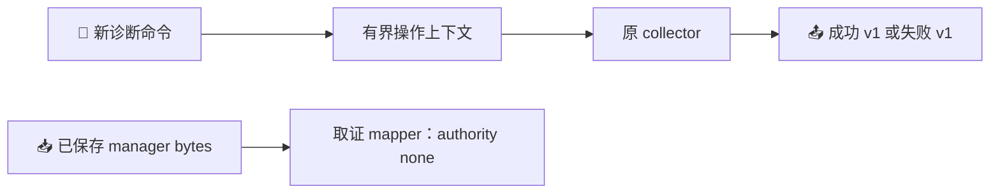

# M1 B3-D 部署失败观测设计

*2026-10-20 · 待用户审阅 · 范围为源码与离线验证，不包含新的真实执行窗口。*

---

## 🎯 目标与已知事实

B3-C 的单次真实窗口已经消费：stage、挂载 flags 和两种 X_OK 检查通过，exact ELF 执行退出 1，只留下固定的 `deployment diagnostic failed`。现有证据不能定位 ELF 内部失败原因。原 manager parser 另外拒绝了展开的 SystemCallFilter 和 failed unit 的空 ControlGroup；这两个读取问题与 ELF 失败应分别记录。

本片提供可注入、可重复的离线反馈：新增独立诊断 API 和命令，区分入口、采集、编码、大小与输出失败；新增不授予权限的 manager 取证 mapper。保留原成功 DTO v1、原 probe、原 collector 和所有封存输入。验收不要求也不证明 native 成功。

事实来源是当前源码与已封存回执：B3-C 结果 (private evidence retained)、后续范围说明 (private evidence retained)、[原 B3-A 契约](</path/to/switchback/docs/superpowers/specs/2026-10-20-m1-deployment-diagnostic-b3a-design.md>)。本设计增加新入口，不改写旧契约。

| 方案 | 收益与代价 | 决定 |
| --- | --- | --- |
| 新 API、独立命令、纯取证 mapper | 复用原 collector；保住旧消费者与封存输入；多一个明确命名的诊断入口 | 采用 |
| 原地修改旧 collector/probe | 入口较少，但改变已封存候选和既有失败协议 | 不采用 |
| 只修 manager 解析 | 范围最小，但下一次 ELF 失败仍不透明 | 不足以完成目标 |

## 🧩 组件与数据流



Go API 位于原 `capacityprobe` 包内：

```go
func ObserveDeploymentDiagnostic(ctx context.Context) (DeploymentObservation, *DeploymentFailureObservation)
```

成功时返回原成功值和 nil failure；失败时返回零成功值和非 nil failure。新私有适配器装饰现有 `deploymentBackend`，调用原 `observeDeployment`，不复制 parser 或验证规则。Linux amd64/arm64 入口沿用线程锁定和固定 native backend；其他平台只返回 unsupported。没有可替换的导出 backend、路径/PID 参数、环境开关或全局可变 hook。

适配器逐次转发原 backend 调用，记录最后一次非 close 操作的有限上下文。它不额外读取文件、不增加时钟调用、不重试、不改变参数或返回值。现有 fd 获取、延迟错误及 cleanup 路径保持原样；内部 fd→逻辑目标表在 close 时删除，close 不覆盖最后操作。原 close 接口不返回错误，所以本片不声称证明了内核 close 成功。

## 📋 失败包契约

新类型 `DeploymentFailureObservation` 使用以下封闭格式；提供 `Validate() error`，无效时仅返回既有 `ErrDeploymentInvalid`。验证不接触 native backend。

| JSON 字段 | 类型与约束 |
| --- | --- |
| `schema` | 固定 `switchback.capacity.deployment_failure.v1` |
| `kind` | 固定 `diagnostic_only` |
| `stage` | `entry`、`observe`、`encode`、`size`、`write` |
| `error_class` | 必须与下表 stage 对应 |
| `last_primitive` | 可省略；仅 stage=observe 可携带，格式见下文 |

| stage | error_class |
| --- | --- |
| entry | `invalid` |
| observe | `invalid`、`unavailable`、`cancelled`、`unsupported`、`internal_invalid_result` |
| encode | `encoding_failed` |
| size | `size_exceeded` |
| write | `write_failed` |

API 自身只产生 entry/observe。nil context/backend 属于 entry invalid；已取消的 context、unsupported 平台及原 collector 错误属于 observe。原 collector 的错误类别映射保持现状，不输出 error 文本。无操作发生时省略 last_primitive。

`last_primitive` 字段：

- `operation` 是 `now`、`ids`、`kernel`、`open_global`、`open_proc`、`open_leaf`、`open_namespace`、`namespace_stat`、`stat`、`statfs`、`read` 之一。
- `target` 是固定逻辑标签：`clock`、`identity`、`kernel`、`boot`、`cap_last_cap`、`caller`、`pid1`、`unknown`；以及 `caller`/`pid1` 与 `.status`/`.stat`/`.cgroup`/`.ns.user`/`.ns.pid`/`.ns.mnt`/`.ns.cgroup` 的组合。它不包含 fd、真实路径或 proc 内容。
- `outcome` 为 `returned` 或 `failed`，只表示该 backend 方法是否返回 error。`errno` 可省略；仅 outcome=failed 且该次 error 可通过 `errors.As` 得到 1..4095 的 syscall errno 时保留数值，不使用 0 表示未知。

**最后操作是上下文，不是根因。** 原 collector 可能在 backend 返回后因解析、身份一致性或取消检查而拒绝；包不声称定位失败字段、before/after 轮次或根因。namespace EACCES/EPERM 本身可以是有效成功观测；不得缓存“首次 errno”并在稍后失败时把它当成原因。适配器不输出调用历史、部分成功 DTO、时间戳、任意字符串或 raw error。

## 🔧 独立命令与输出规则

新增命令 `cmd/switchback-deployment-diagnostic`，原 `cmd/switchback-deployment-probe` 保持原样。新命令固定调用新 API，拒绝参数，不接受环境或路径选择；保留 5 秒协作式 context deadline，不声称能抢占阻塞 syscall。

| 情形 | stdout | stderr | exit |
| --- | --- | --- | --- |
| 原 collector 完整成功 | 原 DeploymentObservation v1 JSON 加 LF | 空 | 0 |
| 原 collector 成功且任一 namespace 为有效 EACCES/EPERM | 同一成功 DTO v1 | 空 | 2 |
| 输出前失败 | 单个失败包 JSON 加 LF | 空，除非 stdout 写失败 | 1 |
| 任一 stdout 写入发生 short write 或 error | 保留已写 bytes，不追加第二份 JSON | 尝试一次 write_failed 失败包 | 1 |

成功输出上限 32768 bytes，失败包上限 4096 bytes，均包含结尾 LF。先完整编码和检查大小再写；一个 stream 最多调用一次 Write。`n != len(packet)` 或 error 非 nil 均视为失败，包括写满但同时返回 error。stderr 失败时直接结束，不递归输出、不补写、不重试。

API 返回组合矛盾、失败包验证失败或成功值 schema/kind 错误时，输出固定 observe/internal_invalid_result 包，不回显输入。entry/encode/size/write 包无 last_primitive。编码失败不输出 encoder error。stderr 的 write_failed 包仅描述输出故障，原先部分 stdout 不能被解释为有效观测。

## 🔍 manager 取证 mapper

新 Python 模块只提供纯函数 `map_manager_forensics(raw: bytes)`；不读文件、不执行命令、不访问网络，也不接受 expected unit/nonce/prior receipt。调用方从封存 actual/post envelope 提取 systemctl show 的 stdout bytes 并验证其 byte count/SHA256；mapper 不负责传输完整性或授权链校验。

输入最多 65536 bytes、256 行；要求 LF 结尾，每行恰含一个属性名及首个 `=` 分隔，值中可有 `=`。属性名匹配 `[A-Za-z][A-Za-z0-9]{0,63}`，任何重复键拒绝。只接受 ASCII 可打印字符及行分隔 LF，不接受 NUL、CR 或空行。未知属性可保留在输入摘要覆盖范围内，但不回显。

以下 12 个属性必须存在：`Id`、`LoadState`、`ActiveState`、`SubState`、`Result`、`MainPID`、`ExecMainPID`、`ExecMainCode`、`ExecMainStatus`、`InvocationID`、`ControlGroup`、`SystemCallFilter`。结构不合法、缺键、长度超限或数字不合法时抛出专用 `ManagerForensicsError`，消息固定为 `invalid_manager_capture`，不输出 raw error 或部分结果。

输出顶层键固定为 `schema`、`kind`、`authority`、`source`、`unit`、`process`、`invocation`、`cgroup`、`syscall_filter`。source 含 `bytes`、`sha256`；unit 含 `id`、`load_state`、`active_state`、`sub_state`、`result`；process 含 `main_pid`、`exec_main_pid`、`exec_main_code`、`exec_main_status`；后三个对象各含 `raw` 和 `class`。不携带未选属性的内容。

| 输出内容 | 精确规则 |
| --- | --- |
| schema/kind/authority | 固定 `switchback.deployment.manager_forensics.v1` / `diagnostic_only` / `none` |
| source | 原始输入 bytes 长度、SHA256；摘要不证明来源真实性 |
| unit/state/result | 原 Id 为 1..256 bytes；4 个状态值各为 0..64 bytes，保留未知值，不作状态机判断 |
| PID/code/status | 4 个原数字均匹配 `0\|[1-9][0-9]*` 且不超过 4294967295；不据此证明进程存活或终止 |
| invocation | 保留原字符串，至多 128 bytes；分类为 empty、hex32、unclassified。hex32 只接受 32 位小写十六进制，不证明归属或本次执行 |
| cgroup | 保留原值，至多 4096 bytes；分类为 empty 或 present，不补造路径、不推断 ownership |
| syscall filter | 保留原值，至多 8192 bytes；分类为 empty、group_tokens、syscall_tokens、mixed_tokens、unclassified；不建立策略等价关系 |

filter 分类仅检查词法：去掉至多一个起始 `~` 后，以单个 ASCII 空格分隔非空 token；`@[A-Za-z0-9_]+` 为 group token，`[A-Za-z_][A-Za-z0-9_]*` 为 syscall token，其余为 unclassified。原始字符串不排序、不去重、不展开、不替换。分类不证明这些名称在当前 systemd/kernel 上存在或生效。未知属性值单项上限 8192 bytes；完整输出 JSON 加 LF 上限 65536 bytes。

B3-C actual/post 的原始 manager stdout 均为 1290 bytes、SHA256 `5140e67e07a2856fc2cc917a8149a463e2364c3a1840bbce036e6a3190915246`，是离线回放的固定输入，不作为新 native 成功证据。

结果没有 `owned`、`policy_matches`、`can_stop`、`can_start` 或 termination verdict。failed+empty cgroup 是可保留事实，不能修复原 Stop predicate。原 carrier 的 manager、receipt、nonce、source binding 和消费检查均保持原样；新结果类型不能传入其授权分支。未来如需安全策略规范化，必须另行绑定 systemd 版本、明确比较规则及新 carrier，不在本片实现。

## 🗂️ 文件范围与兼容边界

以下均是批准后新增文件，当前不是已存在源码；不修改已有 Go/Python 输入、依赖文件或旧封存目录。

| 位置 | 职责 |
| --- | --- |
| `internal/platform/capacityprobe/deployment_diagnostic_types.go` | 固定失败 DTO、枚举、Validate |
| `internal/platform/capacityprobe/deployment_diagnostic.go` | backend 装饰器、错误类别映射、私有组合入口 |
| `internal/platform/capacityprobe/deployment_diagnostic_linux.go` | Linux amd64/arm64 固定 native 入口与线程锁定 |
| `internal/platform/capacityprobe/deployment_diagnostic_other.go` | 其他平台 unsupported |
| `internal/platform/capacityprobe/deployment_diagnostic_test.go` | 复用原同包 fixture 的离线故障测试 |
| `cmd/switchback-deployment-diagnostic/main.go`、`main_test.go` | 新命令、输出/退出契约与固定绑定测试 |
| `.scratch/runtime-m1-deployment-failure-observation-b3d-1020/manager_forensics.py`、`test_manager_forensics.py` | 无副作用 mapper 与真实 capture 回放 |
| 同一新 scratch phase 下的验证/报告文件 | 保护清单、回执、源码哈希与最终封存；不携带执行器或新 native candidate |

原 `ObserveDeployment`、`DeploymentObservation`、deploymentBackend 和旧 CLI 不变；不会把成功 JSON 加一层 envelope。新旧 collector 一致性通过测试证明，不把其代码复制成第二套规则。

实现前基线包含 977 项 current inputs、1773 个 Git-visible 文件，HEAD 为 `fbebfe754045bdbf1af40871a5018eed33743011`、暂存 diff 为 0 bytes。新增本设计后 Git-visible 集合允许且仅允许增加本文件；批准实施后再明确登记上述新文件，既有文件必须按 byte/hash 保持。当前脏工作树不提交、不暂存、不推送。

## 🧪 离线验证与交付标准

1. 新 API 对完整成功、有效 namespace EPERM/EACCES 返回与旧 core 完全相同的成功值；失败只返回零成功值与有效有限失败包。nil/cancelled/unsupported 在尚无操作时不得产生 backend IO。
2. 用原同包 fixture 注入 11 类操作错误、fd+late error、取消、返回后解析错误及身份漂移。核查最后操作和 error_class，不把上下文写成根因；覆盖 namespace 预期拒绝之后的其他失败、fd 复用和 cleanup 次数，证明适配器没有新增调用或改变转发结果。
3. 校验所有 stage/class 组合、无效 target/operation、errno 边界、无 last_primitive 场景、矛盾 API 组合。用 canary raw error/proc 内容验证有限包不泄露数据。
4. 新 CLI 覆盖退出 0/2/1、固定绑定、参数拒绝、5 秒 context、编码失败、成功包 32768/32769 边界、所有短写/错误组合及 stderr 失败。有效失败 DTO 的枚举字段天然小于 4096 bytes；测试全部合法字段最长组合及失败包大小防线，不为了凑边界扩充协议或增加生产注入钩子。验证每 stream 至多一次写入，无部分输出可被当作成功。
5. 回放 B3-C actual/post 中有哈希绑定的 manager 原始 stdout；应保留 InvocationID、ExecMainPID、failed、空 cgroup 与完整展开 filter。缺键、重复键、非规范数字、溢出、无效 InvocationID、任意 filter token 与超长输入均有确定结果。语法合法的伪造 InvocationID 仍不能获得权限。
6. 对 source/nonce 漂移、incomplete transport、已消费 actual 的既有拒绝 fixture 做定向回归；证明新 mapper 不改变原读取失败或 Stop/Start 拒绝。只执行离线 fixture，不调用 carrier 的真实传输模式。
7. 执行新增 Go/Python 测试与既有相关回归；对新增 Go 包执行适用的 race 检查，并 compile-only 检查 Linux amd64/arm64。仅生成离线测试产物，不构建/替换部署 ELF，不运行新 CLI 的 native 采集入口。
8. 源码与契约完成独立评审，修复实际问题后做一次最终全量相关验证。报告明确区分已证明的离线行为、仍未知的原 ELF 根因和未执行的 native 证据。

两份必须保持不变的 B3-C seal：离线 443 项 `2f61de3e881bd94ab5bdc9b4d6f8143f101b61ccbfbf1c1d44981f4ffde827f9`；真实窗口 69 项 `18b04e5484641a240bf6958ea815ad80982054873a961a5e9845ae679adcd686`。更早封存输入亦按既有 verifier 继续保护。

## 🔒 授权范围与后续

接受本设计仅授权上面的源码及离线验证。不会进入 guest、启动 VM/unit/Engine/PG/Worker/Backend/publisher/provider、实际授予 capability、初始化 key/journal、创建 guest 文件、修改 quota/Trust/资源值或接入生产链路。`capacity_ready=false`、`execution_enabled=false`、`paid_consumed=false` 保持现状。

B3-C actual 已消费，原 stage/unit/evidence 保留，未证明 ownership 的 Stop 不补发。离线交付完成后，下一项可评估工作是绑定新诊断产物的新 carrier/新窗口设计；它需要独立的具体方案、封存与真实执行授权，不能复用旧 nonce 或 once 标记。
