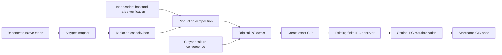

# M1 native capacity publisher：S4 拆分与首片详细设计

_2026-10-20 · 待用户审阅 · 仅设计，未授权实施或部署_

## 结论与本次决定

沿用已批准的 `m1_accounted_capacity_v1`，把 S4 分成三个可独立验收的交付：

| 交付 | 责任 | 本文件的约束力 |
| --- | --- | --- |
| **S4-A：typed pool observation mapper** | 完整、类型化的有限读回转换为未签名 `capacitysnapshot.Facts`，保留独立诊断 | 本次详细设计；建议审阅后先实施这一片 |
| S4-B：native 采样与签名发布 | 实际 Engine/FD/cgroup 采样、受管 publisher、序号与原子文件发布 | 后续独立设计；本文件只确定其输入和禁止事项 |
| S4-C：资源故障收敛 | 可信资源失败、PG 不可写、未知副作用、有界诊断与原 owner reconciliation | 后续独立设计；不能通过 A 的成功推定完成 |

原 host/native 部署验证器及 S5 实机验收仍是独立门禁。A 不增加命令、daemon、密钥、文件发布、PG 调用或生产装配；当前 `verifyCapacityDeployment` 继续 unavailable。本文件没有选择新的宿主 backing 机制，也没有为任何新进程授予 capability。

已固定的产品目标不变：原 PG reserve-before-permit → 原消费/StartSnapshot → Create → exact-CID 有限 quota 观察 → 原 PG 重验 → 同 CID 单次 Start → 正式报告 → initiator 接受 → 刷新同一身份 → 同 Task 观测。A 只补真实 publisher 的一个必要转换环节。

## 当前源码与需要补的事实

| 当前事实 | 对设计的影响 |
| --- | --- |
| `capacityprobe.Collect` 固定输出 `preparation_blocked`、`Trust=none`，并保留旧物理证明 blockers | 保留其诊断用途；不能删除 blocker 或改 status 后签名 |
| `ReadLinux` 读取固定目录、FSID 和 aggregate cgroup 文本；没有完整 running layer、真实 ownership census 和全部签名字段 | 不能将旧 `Collection` 直接转换成可用完整样本 |
| created-layer native adapter 已有同 FD 的 geometry、FSXAttr、QSTATV、target/default0 原始读回与前后检查 | B 可以复用底层有限读取；created 状态专用入口不能冒充 running pool 入口 |
| `MapQuotaInodeEvidence`、`MapQuotaStateEvidence` 已有独立、无权威的解析 | A 复用其字节/计数规则；QSTATV mapper 只验证成功前缀，不能替代完整采样窗口验证 |
| raw v1 有完整 running `Container`，没有容器 state 或 inode 字段；raw v2 仍为独立离线 evidence | A 不改这两种格式，不将 v2 Verified 降级为 v1 Verified |
| 原 budget 对未观察到的 durable resident 保留全额承诺，对额外观察到但不属于原 owner 的 container 拒绝 | mapper 不创建 owner，不凭 label 建账，也不生成 removal；原 PG 仍重验身份与预算 |
| 普通 recovery trigger 已排除 `resource_exhausted`，普通 failure observer 也只接受 eligible trigger | C 不能将资源失败包装成 container loss 来借用自动重建 |
| manifest reader 目前只验证文件与 digest 的结构绑定，production host/native verifier 固定 unavailable | 哈希、mapper 成功和签名成功都不能激活保证 |

源码锚点与本轮哈希保存在来源记录 (private evidence retained)。先前 S3 的 104 项封存产物、912 个输入已在新增本文前重验。

## 路径比较

| 路径 | 收益 | 代价 | 选择 |
| --- | --- | --- | --- |
| **独立 typed mapper，随后接具体 native publisher** | 不改变旧诊断/签名契约，缺失值不能混入生产，转换可离线检验 | 要定义真正完整的读回 DTO | 推荐 |
| 在旧 `Collection` 上删 blocker、补字段、直接签名 | 表面改动少 | status 与可选指针混入权威路径，容易把默认值当真实读取，还会改变已封存诊断含义 | 不采用 |
| 扩展 exact-CID observer，让它同时发布全池容量 | 可复用一个进程 | 扩大同步 IPC、密钥与职责；有限观察与全池签名耦合 | 不采用 |

这里采用一个具体 Go module，不新增可插拔 provider/factory、动态 profile 或通用采集框架。普通函数/具体 struct 足够表达本片的 Interface。

## S4-A 的接口与文件职责

新增 `internal/platform/capacityprobe/pool_types.go`，只定义内部 Go DTO，不提供 JSON/RPC 解码入口。新增 `internal/workerruntime/adapter/capacitypublisher/`，承载 mapper 与其私有校验。它依赖现有 capacityprobe、config、capacitysnapshot、capacityobserver 的纯解析，不反向改变领域端口。

对外 Interface 固定为：

```go
type CoreContainerBinding struct {
    ContainerID string // exact 64-hex CID
    ImageDigest string // exact sha256 image ID
    CoreID      string // one pinned Trust.Core domain
}

type Mapper struct { /* private copied configuration */ }

func NewMapper(
    trust capacitysnapshot.Trust,
    core []CoreContainerBinding,
    workerImageDigest string, // pinned deployment inventory image ID
) (*Mapper, error)

type Result struct {
    Facts         capacitysnapshot.Facts
    StorageInodes map[string]capacitysnapshot.CreatedLayerInodeObservation // domain ID
    LayerInodes   map[string]capacitysnapshot.CreatedLayerInodeObservation // CID
}

func (m *Mapper) Map(
    ctx context.Context,
    observation capacityprobe.PoolObservation,
    sequence int64,
) (Result, error)
```

`Result` 是未签名、无 native provenance 的转换结果，不命名为 Verified/Ready/Admission。它不能传给 PG 当授权，也不携带 receipt、permit、reservation、PG target 或 Start 参数。inode diagnostics 不进入 raw v1、StartSnapshot 或 budget。

constructor 只接受 exact 新保证，拒绝 nil/legacy/未知引用；既有 legacy 入口保持原样。worker image digest 必须是固定候选 inventory 的 exact sha256 image ID；复制 Trust 的 key、slices、policy pointer 和 core bindings，返回结果也不与配置或输入的 maps/slices 别名共享。core bindings 是 server deployment configuration；将来 B 必须从经过部署验证的候选配置固定它们并绑定部署输入 digest，不能由 Engine 观察自行增加例外。A 不实现该配置的文件 parser。core 的实际 process membership 必须来自独立读回，不能拿 HostConfig.CgroupParent 字符串代替；guest service 的实际归属与完整 writer coverage 仍由 B/部署验证器负责。

计划中的文件分工：

| 新增文件 | 职责 |
| --- | --- |
| `internal/platform/capacityprobe/pool_types.go` | 下述完整内部读回 DTO；无 IO、wire 或 policy |
| `internal/workerruntime/adapter/capacitypublisher/mapper.go` | immutable constructor、Map 编排、零错误结果与最终 CheckFacts |
| 同目录 `pool_identity.go` | Engine census、窗口、目录/geometry/mount identity、core/worker 分区 |
| 同目录 `pool_quota.go` | raw quota、字节单位和独立 inode diagnostics |
| 同目录 `pool_cgroup.go` | cgroup2 身份、固定文件解析与 hard upper 对齐 |
| 同目录 `mapper_test.go`、`pool_quota_test.go`、`pool_cgroup_test.go` | 公共 Interface 的行为与边界回归 |

目录内可以使用私有小函数；不新增另一个 validator Framework。没有必要为了测试修改现有 collector、IPC、raw v1/v2、PG、localproduct、Compose 或 systemd 文件。

### 内部读回 DTO

`PoolObservation` 必须表达以下值；这些字段是采样数据，不能成为调用者自证真实读取的凭证：

| Go DTO | 必须包含的值 | 来源/限制 |
| --- | --- | --- |
| `PoolObservation` | `Started, Ended time.Time`；`BootBefore, BootAfter [16]byte`；`NamespaceBefore, NamespaceAfter uint64`；`MountInfoBefore, MountInfoAfter []byte`；`EngineBefore, EngineAfter PoolEngineReadback`；`Anchor PoolAnchorReadback`；`Core []PoolCoreReadback`；`Storage []PoolStorageReadback`；`Workers []PoolWorkerReadback` | slice 数量有界；没有 ready、trust、execution_enabled 字段；B 的完整采集函数须在任一必要 IO 失败时返回 error，不能交付 partial DTO |
| `PoolEngineReadback` | `ID, APIVersion, Version, DockerRoot, Driver string`；`CPUCount, MemoryBytes uint64`；`Containers []PoolContainerInspect` | 白名单字段，不保留 Engine Env、secret、完整请求/响应 body |
| `PoolContainerInspect` | exact `ID, ImageDigest`；state/status/PID/running/paused/restarting/dead/started-at；detached labels；CgroupParent；NanoCPUs/memory/memory-swap/PIDs；privileged/network-mode | 对同 CID 进行前后读取，字段不从标签补成内核值 |
| `PoolAnchorReadback` | 复用 `CreatedLayerDirectory`；statfs before/after 的 type、bsize、frsize、blocks、bfree、bavail；对应 mount options | geometry UUID 与 FSID 分开；不引入 inode 容量预算 |
| `PoolQuotaReadback` | `QStatV [160]byte`；`StateSamples []CreatedLayerSample`；`StateSamplesTruncated bool`；`Target Quota`；`Default0 [112]byte` | target 复用完整 RawHex 与已解码计数；default0 不填入 target；sample 不能单独自证 native |
| `PoolStorageReadback` | `DomainID string`；复用 `CreatedLayerDirectory`；`Quota PoolQuotaReadback` | 与 Trust.Storage 一一对应；不接受自选 domain/path/project |
| `PoolCgroupReadback` | `Path string`；cgroup2 fs type；directory device/inode before/after；固定 `cpu.max`、`memory.max`、`memory.swap.max`、`pids.max`、`cgroup.type` 原始文本 before/after | scalar 文本各最多128 bytes；拒绝 max/空白缺失/非法 token |
| `PoolCoreReadback` | `CoreID string`；`Cgroup PoolCgroupReadback`；`Members []PoolProcessReadback` | 恰好覆盖 Trust.Core；每个固定 core container 的 PID/实际 cgroup membership 也须读回 |
| `PoolProcessReadback` | `ContainerID string`；PID、start-time-ticks、实际 cgroup path before/after | exact Inspect PID 与 process identity 关联；路径必须落在对应实际 cgroup 下 |
| `PoolWorkerReadback` | `ContainerID string`；`Process PoolProcessReadback`；`Cgroup PoolCgroupReadback`；layer `CreatedLayerDirectory` 和 `PoolQuotaReadback` | exact Inspect PID 与 proc identity 绑定，路径从实际读回取得 |

数值字段全部使用无符号固定宽度类型；仅 API 已固定的 `sequence` 使用 int64。目录身份、geometry、FSXAttr、raw quota 使用既有固定数组布局。新的 statfs DTO 使用 uint64 存储块数/大小，native signed 字段必须由 B 在转入前检查正数与溢出。

每份 mountinfo 最多现有 `capacityprobe.MaxResponse`；inventory 最多现有 `MaxContainers=32`，core/storage 数量不超过32且恰好匹配固定 Trust 集合；每个 quota sample 最多64项。CID、label、path、mount 字符串应用现有边界，新增非路径 label value 最多512 bytes、每容器最多32项；core Members 最多32且与固定 core bindings 恰好匹配，超限直接拒绝。Map 不接收任意文件名、endpoint、command 或未限长的错误字符串。

## 转换不变量

Map 捕获一次 server `now`；public 方法不接受调用者 clock。测试可使用私有 `mapAt`，不能形成 production 可配置时钟。

1. **窗口与来源形状。** nil/cancelled context、未构造 mapper、sequence<=0 拒绝；Ended 必须晚于 Started，窗口不超过30秒，起点距 now 不超过30秒，起止最多未来2秒。boot/namespace/mountinfo 前后均有效且一致。前后 Engine identity、CPU/memory 和 census 的参与字段按 CID 排序后完全相等；重复/新增/遗漏/状态改变直接拒绝。sequence 只验证正数，不制造单调性证明。`Facts.ObservedAt=Started`，避免将整个窗口都描述成结束时刻的原子事实。
2. **完整 census。** inventory 的每个 CID 必须恰好属于固定 core binding 或一个 worker readback，两类不能交叉。core 的 CID/image/CoreID 必须匹配固定绑定，state 必须 running、PID>0、未 paused/restarting/dead，对应 member 的 PID/start-time-ticks/实际 cgroup path 前后一致、落在对应 core 域内，且不能带 Worker runtime/session/generation 身份。其余 container 的 image 必须等于固定 workerImageDigest，满足 Worker 固定标签与当前 resource/network profile，并有同 CID 的完整 readback；label 仅提供待比对的身份，不创造 durable ownership。unknown、duplicate、privileged 或 host-network 均拒绝。持久 mount/secret-volume 的真实归属与 writer coverage 由 B 的部署和采样验证负责，A 的 DTO 不含完整 mount inventory，不能据此宣称已证明全部 writer 隔离。
3. **只映射 running Worker。** Worker 必须 running、PID>0、未 paused/restarting/dead；实际 PID/start time/cgroup node 在有限窗口内一致，layer 安全目录身份与原始 quota 完整。created/exited/removing/dead 等输入返回 `inventory_incomplete`，不能伪造 cgroup、填 host config 作为实际读回、静默丢弃该 CID，或因非 running 就生成 Removal。
4. **目录与 pool identity。** 对 anchor、storage、layer 校验 canonical path、前后 inode/device/mount/geometry UUID/FSXAttr，以及 nofollow/reopen 对应的有限读回。真实 UUID 从256-byte geometry 解析，并与目录身份、Trust.Identity 一致；不把 statfs.Fsid 当 FSUUID。mount ID/device/FSUUID 不漂移，type 必须 XFS；storage 与 layer project 正确、不同物理域不重叠。布尔检查记录不能替代这些字段比对，更不能证明外部 writer/ABA 已被全时排除。
5. **anchor 可用字节。** anchor path 必须等于 Trust.AnchorPath，project0、不继承。mount options 有 prjquota/pquota；bsize/frsize 均正且在本片支持的候选中相等，bavail<=bfree<=blocks。用 `bavail*bsize`，先检查乘法及 MaxInt64 边界；available=0 是合法读回，随后由原 budget 判定不足，不改成 unlimited。使用 before/after 可用字节较小值；其他 identity/geometry 条件必须稳定。这只是有限窗口内较保守的读值，不承诺窗口外单调性。
6. **core 执限。** cgroup2 身份稳定，type=domain；CPU quota/period、memory.max、pids.max 前后相等且与对应 Trust.Core 全等；memory.swap.max=0。不存在用实时 usage 借用 idle 额度的分支。publisher/observer 等实际受管服务必须在 B 的真实部署中落在同一已计入的 aggregate core 域内；A 不扩大该域数值。
7. **storage 与 layer 字节。** 复用 quota inode mapper 验证 Target.RawHex 与 target 解码值一致；用 QSTATV mapper 解析原始状态，同时额外要求所有 StateSamples 连续序号、source=linux_syscall、observed/无 errno、起止严格递增且均在总窗口内、不得重叠，不允许截断或后续失败，并要求 project ACCT/ENFD 0x30。target project、FSXAttr、domain 都必须一致；hard/used blocks 乘512均检查溢出与 MaxInt64。storage 的实际 hard 等于 Trust，used<=hard；worker layer hard=soft=10GiB、used<=hard，资源与固定2vCPU/4GiB/512PIDs匹配。statics 不凭缺失 soft 字段补出 worker 的 soft=hard 事实。
8. **inode 独立诊断。** 全部 target hard/used 保留 uint64；hard0 返回 `InodeBoundUnproven`，正 hard 的 used>hard 拒绝，其他返回 `InodesObserved`。default0 raw 原样保留在输入，只检查记录版本/类型/project0，并且不参与 target 分类或预算。零 inode bound 不代表已证明的有效无限制，也不增加 inode cap。结果分类复用现有 `AssessInodeEvidence`，不用新 vocabulary。
9. **输出与最终校验。** 逐字段构造 raw v1 Facts：固定 Trust.Identity/ManifestDigest、实际 Engine CPU/memory、anchor、core、storage、running containers，`Removals=[]`。不得把整个 Trust.Storage 复制后仅补 used 冒充实际执限；每个输出值须由相应读回匹配。转换后调用现有 `capacitysnapshot.CheckFacts`；任一拒绝返回完全零 Result，不暴露半成功 Facts。ctx 在返回前再次校验。

Error 使用片内固定 reason code：`observation_invalid`、`observation_stale`、`identity_drift`、`inventory_incomplete`、`quota_unproven`、`resource_mismatch`；保留 context cancellation 的 `errors.Is`。不返回路径、SQL、Engine error body 或任意 cause 文本。Map 不把 errno/text 推断成 Task `waiting_user`。

### 为什么不把非 running 容器补成成功

raw v1 无法同时表达“这个 CID 已存在、仍占 durable resident、但没有可读 running cgroup”。在本片，拒绝整个新转换结果比扩展 raw schema 或复制 host config 更小，也更诚实。原 PG 已能对未观察到的 resident 保留全额承诺，但这不能授权 mapper 从它观察到的完整 inventory 中静默漏掉一个 CID。

B 必须单独验证 Create→quota→Start 期间的 sampler 衔接：短暂 created 状态可能阻止新样本刷新，旧样本只能按原30秒时效使用；不能重新加盖 ObservedAt、放宽 freshness 或重试新 Create。超过时效就拒绝并保留原 owner/CID，交原 reconciliation。A 的通过不保证这个时间窗口能在实机闭合。若这一保守策略实测不能满足体验，再独立设计有显式状态的采样协议，而不是修改 raw v1 的既有含义。

## S4-B / C 必须带走的约束

以下是依赖条件，未在本次实施范围：

- B 的 production command 只能调用固定 concrete native 数据源，不能接收 stdin JSON/Collection/fixture 来签名，也不能将 A 的 Result 自身当作 native provenance。签名继续使用现有 raw v1 domain；v2 与 finite IPC/HMAC 的用途、密钥分离。签名前仍需实际部署验证与完整来源检查。
- 新 publisher 若需要 CAP_SYS_ADMIN，只能在专用 Linux guest 的独立受管进程中另行明确评审；不得加到 Backend，也不得自动扩大现有 exact-CID observer。现有 Backend 三项文件 capability 不变。GET quota 有内部 kernel effects，“只查询”不等于 capability 细粒度只读或零副作用。Linux quota 权限依据为[固定 Linux v6.8 源码](https://raw.githubusercontent.com/torvalds/linux/v6.8/fs/quota/quota.c)，实际候选仍需对照已冻结 exact142 源码与 loaded kernel。
- B 的 fixed private directory、root-owned key、单 writer、持久单调 sequence、原子 `capacity.json` 发布、fsync/rename 失败和 restart 必须有独立执行计划。不得操作已消费的 blocked-status 目录或重新签名旧证据；sequence 丢失不得自动归零，也不能访问 PG 取新 authority。
- publisher 停止不会在同一瞬间撤销已验证的旧样本。缺文件被 Backend 读取后，现有 `ReconcileCapacity` 可以 block；原 PG 样本还受30秒 freshness 约束。B 必须明确发布失败/失联到原 owner 拒绝之间的界限，不能声称文件删除即同步撤销所有 consumed permit。
- C 的真实资源来源限于 exact Runtime/generation/CID 的可信 syscall errno、内核 cgroup 证据或结构化 PG SQLSTATE；Agent stderr 或 Engine generic500 只构成未知失败。PG `53100=disk_full` 与 `58030=io_error` 含义不同，不能用字符串把它们都映射为已归属 Worker 的 ENOSPC；[PG17 官方错误码](https://www.postgresql.org/docs/17/errcodes-appendix.html)是分类依据。
- C 不调用普通 recovery 来重建 resource-exhausted Runtime，不因 Turn terminal 或 stop 释放 resident。PG 写/commit 未确认时，不向前端伪造 waiting_user 已提交；任何本地 bounded diagnostic 只作排障材料，不能成为新 owner、退款或自动 replay 授权。未知副作用仍沿原 identity/idempotency reconciliation。
- independent host/native verifier 仍必须基于真实 candidate receipt 与当前读回产出私有验证结果；source digest、文件存在、mapper 通过或签名正确都不代替它。当前宿主 backing 门禁保持开放，不能因为 guest metadata 物理上界已退出本保证就略过宿主边界。



## A 的验收矩阵

| 分类 | 必须验证的结果 |
| --- | --- |
| 配置固定 | exact guarantee 通过；nil/legacy/未知拒绝；原 Trust/core bindings/返回 maps 修改互不影响；worker image 漂移拒绝 |
| 正例 | zero-worker + exact core census；一个和多个完整 running worker；多个 coverage role 指向同一个 storage domain 仍只输出一个物理域 |
| 完整性 | 任何未知/重复/缺失 core/storage/worker/CID、两次 census 改变、created/exited/paused/无 PID/无 cgroup 均零 Result |
| 原始 identity | boot/ns/mount/FD inode/geometry UUID/FSXAttr/project、路径替换、wrong ABI、QSTATV关闭/未知flags、错误 default0 全部拒绝 |
| quota 边界 | hard0+used0/非零/MaxUint64 为 inode_bound_unproven；正 hard 等号通过、超1拒绝；byte等号、超1、乘法溢出、MaxInt64 边界；default0独立；源 raw bytes 不变 |
| cgroup | 无限制max、缺值、非法token、overflow、before/after漂移、swap非零、type/threaded、memory/PID/CPU不匹配拒绝 |
| 时效与 cancellation | Started/Ended与30秒/未来2秒等号及超界、反转、迟返、nil/cancelled context；ObservedAt只能取Started |
| 兼容 | A 不改变现有 raw v1/v2/created/IPC/PG/Start 路径；既有 capacityprobe、capacitysnapshot、capacityobserver 和 production-unavailable 回归保持 |
| 权威隔离 | 测试数据明确 SYNTHETIC；Map 无 IO/签名/PG/Start，不能构造 Verified；unknown inventory 不被 core allowlist 或 label 隐藏 |

实施时先写可执行行为 RED，再给最小实现及公共 Interface 回归；测试来源、精确源码、退出码与最终 raw JSONL 对齐，之后做适当 Linux compile-only。A 不执行 native/integration-tag/PG 测试，不生成真实 key/Trust/manifest，不启动或部署任何环境。审批后按 writing-plans 形成这一片的精确文件/代码/命令计划；本文没有假装已经运行这些新增测试。

## 自检、审阅与进度

本文件是新设计候选，不是对 S4-B/C 的执行授权，也没有关闭 OpenSpec 的6.5/8.4/9.3。当前 `capacity_ready=false`、`execution_enabled=false`、`paid_consumed=false`，OpenSpec38/41。

建议本次只确认 **S4-A 的完整 typed DTO、纯 mapper 与离线验收范围**。之后可直接推进对应计划及实施；B/C 分别以自己的具体设计进入后续窗口。新进程权限、宿主 backing 机制和真实运行对象都不能从“接受 A”推导出来。

设计自检与当前来源绑定见阶段记录 (private evidence retained)。没有修改既有设计、源码、配置、测试、全局进度或任何旧 seal，没有提交。
